

<header style="display:flex;flex-direction:column;gap:8px">

# Bear / Polar (Paula)

สรุปอาชีพ Bear จากวิกิแฟนเกม PlayTrickster (oto.fandom) เพราะวิกิ ggFTW ไม่มีอาชีพนี้

<ul class="notes"><li>ข้อมูลมาจากวิกิแฟนเกมของเซิร์ฟอื่น ตัวเลขหรือของฝึกอาจไม่ตรงกับในเกมของเรา</li><li>ของฝึก Mastery ของ Bear ยังไม่ได้อยู่ในหน้า Skill Mastery เพราะหน้านั้นทำจากวิกิ ggFTW</li></ul>

</header>

<input id="q" placeholder="ค้นสกิล การ์ด หรือ NPC" type="search"/>

<label><input id="hidedone" type="checkbox"/> ซ่อนที่ทำแล้ว</label><button id="reset" type="button">ล้างติ๊ก</button>

<nav class="toc"><a href="#about">ภาพรวม</a><a href="#quest">เควสเปลี่ยนอาชีพ</a><a href="#animal">สกิล Animal Lover</a><a href="#trainer">สกิล Trainer</a><a href="#zoologist">สกิล Zoologist</a></nav>

<section id="about">

## Bear คืออะไร

ตัวละครสาย <b>Power</b> ผู้หญิงตัวที่ 9 ชื่อ <b>Paula</b> ใช้ <b>ค้อนสองมือ</b> ตีระยะประชิด แรงตีมาจาก AP และ DA (วิกิแนะนำอัปสเตตัส Power กับ Sense) สายอาชีพ <b>Animal Lover → Trainer → Zoologist</b> มีอาชีพ 3 สายเดียว (สายเพียว) Job Master คือ <b>Trainer Mimi</b> วิกิเขียนไว้ว่ามีเฉพาะเซิร์ฟ Polar  จุดเด่นของสายนี้คือ <b>โหมด Crazy Hammer</b>: ตีไปเรื่อยๆ จะสะสมเกจ พอเต็มจะเข้าโหมดชั่วคราว Crazy Hammer I–V แต่ละขั้นเพิ่มความสามารถของโหมด (AP, ความเร็ว, ดาเมจตีธรรมดา, คริ, คลื่นกระแทกรอบตัว)

</section>

<section data-c="" id="quest">

<h2>เควสเปลี่ยนอาชีพ </h2>

เรียงตามลำดับที่ทำจริง ขั้นของอาชีพ 3 คล้ายสายอื่น ต่างกันที่คุยกับ Trainer Mimi ที่ Rose Field 3 และใช้ Red Ruby เป็น Guardian Stone

<table><thead><tr><th></th><th>เควส</th><th>ที่</th><th>ต้องทำ</th><th>ได้</th></tr></thead><tbody>
<tr><td class="ck"><input aria-label="ทำแล้ว" id="q0" type="checkbox"/></td><td class="nm" data-l="เควส">Trainer Mimi - Bear 2nd Job Quest</td><td data-l="ที่">Relics Town - Azteca หรือ Room of Job Administrator 1 (Garden of Skill Master)</td><td data-l="ต้องทำ">Lv 60+, TM 50+ · ส่ง Growth Badge × 1 (ดรอปจาก Kaboom ที่ Caballa Relics Dungeon 4) + 100K Galder Check × 3 (ซื้อจาก Andrew ใบละ 105,000)</td><td data-l="ได้">เปลี่ยนเป็น Trainer · Sign of Wilderness, Second Job Advancement Cloak (Power), 1,000,000 EXP / 12,000,000 TM</td></tr>
<tr><td class="ck"><input aria-label="ทำแล้ว" id="q1" type="checkbox"/></td><td class="nm" data-l="เควส">Door of Tribulation - The Riddle</td><td data-l="ที่">Garden of Skill Master</td><td data-l="ต้องทำ">อาชีพ 2, Lv 130+ · ส่ง Ticket of the Valiant (ดรอปจาก Clurican Lv 240 ที่ 2nd Closed Lot of Jade Steel) + 1 Mil Galder Check × 3</td><td data-l="ได้">Marble of Triumph, เข้า Room of Guardian ได้, TM 10,000,000</td></tr>
<tr><td class="ck"><input aria-label="ทำแล้ว" id="q2" type="checkbox"/></td><td class="nm" data-l="เควส">Vulcanus Phoenix's Messenger - Zoologist Job Quest (รับไว้ก่อน)</td><td data-l="ที่">Room of Guardian</td><td data-l="ต้องทำ">รับเควสค้างไว้ ของที่ต้องส่งได้จากขั้นถัดไป</td><td class="nw" data-l="ได้"></td></tr>
<tr><td class="ck"><input aria-label="ทำแล้ว" id="q3" type="checkbox"/></td><td class="nm" data-l="เควส">Trainer Mimi - Bring the Zoologist Guardian Stone</td><td data-l="ที่">Rose Field 3 - Maze of Blue Rose</td><td data-l="ต้องทำ">ถือ Marble of Triumph · ส่ง Red Ruby (ดรอปจาก Chele หรือ Monkya) + Sacred Water (ขุดใน Black Swamp Fields)</td><td data-l="ได้">Sealed Guardian, Scroll, 7,497,300 EXP / 7,615,625 TM</td></tr>
<tr><td class="ck"><input aria-label="ทำแล้ว" id="q4" type="checkbox"/></td><td class="nm" data-l="เควส">Happisto Stallone - Make Happisto's Compass Frame (3 รอบ)</td><td data-l="ที่">Gate of Snow Hill</td><td data-l="ต้องทำ">ต้องมี Scroll · รอบละ Brass, Glass Piece, Magnetite, Magic Powder (ดูหน้าเปลี่ยนอาชีพว่าดรอปจากอะไร)</td><td data-l="ได้">รอบ 3 ได้ Compass Frame</td></tr>
<tr><td class="ck"><input aria-label="ทำแล้ว" id="q5" type="checkbox"/></td><td class="nm" data-l="เควส">Trainer Mimi - The Compass Frame</td><td data-l="ที่">Rose Field 3 - Maze of Blue Rose</td><td data-l="ต้องทำ">ส่ง Compass Frame</td><td data-l="ได้">The Key of Trials</td></tr>
<tr><td class="ck"><input aria-label="ทำแล้ว" id="q6" type="checkbox"/></td><td class="nm" data-l="เควส">Path of Tribulation 16 ห้อง</td><td data-l="ที่">Room of Tribulation 1–16</td><td data-l="ต้องทำ">ล่าห้องละ 3 ตัว ทำต่อกันตามลำดับ เหมือนสายอื่น (ดูตาราง Tribunal ในหน้าเปลี่ยนอาชีพ)</td><td data-l="ได้">ห้องสุดท้ายได้ Stone of Patience</td></tr>
<tr><td class="ck"><input aria-label="ทำแล้ว" id="q7" type="checkbox"/></td><td class="nm" data-l="เควส">Trainer Mimi - Making the Compass</td><td data-l="ที่">Rose Field 3 - Maze of Blue Rose</td><td data-l="ต้องทำ">ส่ง Stone of Patience + The Key of Trials + Marble of Triumph</td><td data-l="ได้">Needleless Compass</td></tr>
<tr><td class="ck"><input aria-label="ทำแล้ว" id="q8" type="checkbox"/></td><td class="nm" data-l="เควส">ส่ง Zoologist Job Quest ให้ Vulcanus Phoenix's Messenger</td><td data-l="ที่">Room of Guardian</td><td data-l="ต้องทำ">Lv 130+, TM 120+ · ส่ง Harkon + Needleless Compass + Sealed Guardian</td><td data-l="ได้">เปลี่ยนเป็น Zoologist · Ruby Guardian, Light Compass, TM 16,000,000</td></tr>
</tbody></table>

</section>

<section data-c="" id="animal">

<h2>สกิล Animal Lover (อาชีพ 1) </h2>

ติ๊กเมื่อสกิลถึง Mastery แล้ว

<table><thead><tr><th></th><th>สกิล</th><th>TM</th><th>ทำอะไร</th><th>ต้องมีก่อน</th><th>ของฝึก Mastery</th><th>ได้จาก</th></tr></thead><tbody>
<tr><td class="ck"><input aria-label="ทำแล้ว" id="sk-EquipHammer" type="checkbox"/></td><td class="nm" data-l="สกิล"><a href="https://oto.fandom.com/wiki/Equip_Hammer" rel="noopener" target="_blank">Equip Hammer</a></td><td class="nw" data-l="TM">TM 1</td><td data-l="ทำอะไร">ติดตัว ใช้ค้อนสองมือได้ · ติดตัว</td><td class="nw" data-l="ต้องมีก่อน">–</td><td class="nw" data-l="ของฝึก Mastery">ฝึกไม่ได้</td><td data-l="ได้จาก">ซื้อจาก Trainer Mimi (Skill Card Shop)</td></tr>
<tr><td class="ck"><input aria-label="ทำแล้ว" id="sk-PowerfulHammer" type="checkbox"/></td><td class="nm" data-l="สกิล"><a href="https://oto.fandom.com/wiki/Powerful_Hammer" rel="noopener" target="_blank">Powerful Hammer</a></td><td class="nw" data-l="TM">TM 1</td><td data-l="ทำอะไร">ตีแรงสำหรับมือใหม่ เลเวลสูงสุด 1 ฝึกไม่ได้ · ใช้โจมตี</td><td class="nw" data-l="ต้องมีก่อน">–</td><td class="nw" data-l="ของฝึก Mastery">ฝึกไม่ได้</td><td data-l="ได้จาก">ซื้อจาก Trainer Mimi (Skill Card Shop)</td></tr>
<tr><td class="ck"><input aria-label="ทำแล้ว" id="sk-DoubleHammer" type="checkbox"/></td><td class="nm" data-l="สกิล"><a href="https://oto.fandom.com/wiki/Double_Hammer" rel="noopener" target="_blank">Double Hammer</a></td><td class="nw" data-l="TM">TM 10</td><td data-l="ทำอะไร">ตีสองครั้งในทีเดียว · ใช้โจมตี</td><td data-l="ต้องมีก่อน">Equip Hammer Lv 1</td><td data-l="ของฝึก Mastery">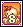Hula Octopus Card × 2</td><td data-l="ได้จาก">ซื้อจาก Trainer Mimi (Skill Card Shop)</td></tr>
<tr><td class="ck"><input aria-label="ทำแล้ว" id="sk-StrengthTraining" type="checkbox"/></td><td class="nm" data-l="สกิล"><a href="https://oto.fandom.com/wiki/Strength_Training" rel="noopener" target="_blank">Strength Training</a></td><td class="nw" data-l="TM">TM 20</td><td data-l="ทำอะไร">เพิ่ม AP ชั่วคราว · บัฟ/ดีบัฟ</td><td data-l="ต้องมีก่อน">Double Hammer Lv 10</td><td data-l="ของฝึก Mastery">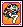Silver G Card × 2</td><td data-l="ได้จาก">ซื้อจาก Trainer Mimi (Skill Card Shop)</td></tr>
<tr><td class="ck"><input aria-label="ทำแล้ว" id="sk-Concentration" type="checkbox"/></td><td class="nm" data-l="สกิล"><a href="https://oto.fandom.com/wiki/Concentration" rel="noopener" target="_blank">Concentration</a></td><td class="nw" data-l="TM">TM 25</td><td data-l="ทำอะไร">เพิ่ม DA ชั่วคราว · บัฟ/ดีบัฟ</td><td data-l="ต้องมีก่อน">Double Hammer Lv 10</td><td data-l="ของฝึก Mastery">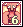Turvy Card × 2</td><td data-l="ได้จาก">ซื้อจาก Trainer Mimi (Skill Card Shop)</td></tr>
<tr><td class="ck"><input aria-label="ทำแล้ว" id="sk-MentalBreakdown" type="checkbox"/></td><td class="nm" data-l="สกิล"><a href="https://oto.fandom.com/wiki/Mental_Breakdown" rel="noopener" target="_blank">Mental Breakdown</a></td><td class="nw" data-l="TM">TM 30</td><td data-l="ทำอะไร">ทำให้ศัตรูขยับไม่ได้ชั่วคราว · บัฟ/ดีบัฟ</td><td data-l="ต้องมีก่อน">Concentration Lv 1</td><td data-l="ของฝึก Mastery">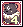Koom Card × 2</td><td data-l="ได้จาก">ซื้อจาก Trainer Mimi (Skill Card Shop)</td></tr>
<tr><td class="ck"><input aria-label="ทำแล้ว" id="sk-ShieldofWill" type="checkbox"/></td><td class="nm" data-l="สกิล"><a href="https://oto.fandom.com/wiki/Shield_of_Will" rel="noopener" target="_blank">Shield of Will</a></td><td class="nw" data-l="TM">TM 35</td><td data-l="ทำอะไร">เพิ่ม DP ชั่วคราว · บัฟ/ดีบัฟ</td><td data-l="ต้องมีก่อน">Mental Concentration Lv 1</td><td data-l="ของฝึก Mastery">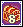Mimic Card × 2</td><td data-l="ได้จาก">ซื้อจาก Trainer Mimi (Skill Card Shop)</td></tr>
<tr><td class="ck"><input aria-label="ทำแล้ว" id="sk-PartyGuard" type="checkbox"/></td><td class="nm" data-l="สกิล"><a href="https://oto.fandom.com/wiki/Party_Guard" rel="noopener" target="_blank">Party Guard</a></td><td class="nw" data-l="TM">TM 40</td><td data-l="ทำอะไร">โล่กันกายภาพให้ทั้งปาร์ตี้ตามจำนวนครั้ง (กันเวทไม่ได้) · บัฟ/ดีบัฟ</td><td data-l="ต้องมีก่อน">Shield of Will Lv 10</td><td data-l="ของฝึก Mastery">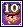Guiana Card × 2</td><td data-l="ได้จาก">ซื้อจาก Trainer Mimi (Skill Card Shop)</td></tr>
<tr><td class="ck"><input aria-label="ทำแล้ว" id="sk-EarthquakeHammer" type="checkbox"/></td><td class="nm" data-l="สกิล"><a href="https://oto.fandom.com/wiki/Earthquake_Hammer" rel="noopener" target="_blank">Earthquake Hammer</a></td><td class="nw" data-l="TM">TM 50</td><td data-l="ทำอะไร">เรียกค้อนยักษ์ตีรอบตัว (โจมตีวงกว้าง) · ใช้โจมตี</td><td data-l="ต้องมีก่อน">Concentration Lv 10</td><td data-l="ของฝึก Mastery">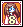Quiem Card × 2</td><td data-l="ได้จาก">ซื้อจาก Trainer Mimi (Skill Card Shop)</td></tr>
</tbody></table>

</section>

<section data-c="" id="trainer">

<h2>สกิล Trainer (อาชีพ 2) </h2>

<table><thead><tr><th></th><th>สกิล</th><th>TM</th><th>ทำอะไร</th><th>ต้องมีก่อน</th><th>ของฝึก Mastery</th><th>ได้จาก</th></tr></thead><tbody>
<tr><td class="ck"><input aria-label="ทำแล้ว" id="sk-CrazyHammerI" type="checkbox"/></td><td class="nm" data-l="สกิล"><a href="https://oto.fandom.com/wiki/Crazy_Hammer_I" rel="noopener" target="_blank">Crazy Hammer I</a></td><td class="nw" data-l="TM">TM 60</td><td data-l="ทำอะไร">สะสมเกจแล้วเข้าโหมด Crazy Hammer เพิ่ม AP · โหมด</td><td data-l="ต้องมีก่อน">Strength Training Lv 10</td><td data-l="ของฝึก Mastery">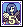Crow Card × 3</td><td data-l="ได้จาก">ซื้อจาก Trainer Mimi (Skill Card Shop)</td></tr>
<tr><td class="ck"><input aria-label="ทำแล้ว" id="sk-InvisibleDefence" type="checkbox"/></td><td class="nm" data-l="สกิล"><a href="https://oto.fandom.com/wiki/Invisible_Defence" rel="noopener" target="_blank">Invisible Defence</a></td><td class="nw" data-l="TM">TM 70</td><td data-l="ทำอะไร">เพิ่ม MD และ DP ชั่วคราว · บัฟ/ดีบัฟ</td><td data-l="ต้องมีก่อน">Shield of Will Lv Master</td><td data-l="ของฝึก Mastery">Officer Sulaphat Card × 3</td><td data-l="ได้จาก">ซื้อจาก Trainer Mimi (Skill Card Shop)</td></tr>
<tr><td class="ck"><input aria-label="ทำแล้ว" id="sk-OverSwing" type="checkbox"/></td><td class="nm" data-l="สกิล"><a href="https://oto.fandom.com/wiki/Over_Swing" rel="noopener" target="_blank">Over Swing</a></td><td class="nw" data-l="TM">TM 90</td><td data-l="ทำอะไร">ตีเป้าเดียว 3 ครั้งติด · ใช้โจมตี</td><td data-l="ต้องมีก่อน">Earthquake Hammer Lv 10</td><td data-l="ของฝึก Mastery">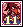Chele Card × 3</td><td data-l="ได้จาก">ซื้อจาก Trainer Mimi (Skill Card Shop)</td></tr>
<tr><td class="ck"><input aria-label="ทำแล้ว" id="sk-CrazyHammerII" type="checkbox"/></td><td class="nm" data-l="สกิล"><a href="https://oto.fandom.com/wiki/Crazy_Hammer_II" rel="noopener" target="_blank">Crazy Hammer II</a></td><td class="nw" data-l="TM">TM 90</td><td data-l="ทำอะไร">โหมด Crazy Hammer วิ่งเร็วขึ้น · บัฟ/ดีบัฟ</td><td data-l="ต้องมีก่อน">Crazy Hammer I Lv Master</td><td data-l="ของฝึก Mastery">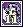Dancer Michel Card × 3</td><td data-l="ได้จาก">ซื้อจาก Trainer Mimi (Skill Card Shop)</td></tr>
<tr><td class="ck"><input aria-label="ทำแล้ว" id="sk-MoleHammer" type="checkbox"/></td><td class="nm" data-l="สกิล"><a href="https://oto.fandom.com/wiki/Mole_Hammer" rel="noopener" target="_blank">Mole Hammer</a></td><td class="nw" data-l="TM">TM 110</td><td data-l="ทำอะไร">ลด DP ศัตรูและทำดาเมจต่อเนื่อง · ดีบัฟ + ดาเมจต่อเนื่อง</td><td data-l="ต้องมีก่อน">Mental Breakdown Lv 10</td><td data-l="ของฝึก Mastery">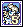Dancer Isabelle Card × 3</td><td data-l="ได้จาก">ซื้อจาก Trainer Mimi (Skill Card Shop)</td></tr>
<tr><td class="ck"><input aria-label="ทำแล้ว" id="sk-CrazyHammerIII" type="checkbox"/></td><td class="nm" data-l="สกิล"><a href="https://oto.fandom.com/wiki/Crazy_Hammer_III" rel="noopener" target="_blank">Crazy Hammer III</a></td><td class="nw" data-l="TM">TM 120</td><td data-l="ทำอะไร">โหมด Crazy Hammer ตีธรรมดาแรงขึ้นอีก · บัฟ/ดีบัฟ</td><td data-l="ต้องมีก่อน">Crazy Hammer II Lv Master</td><td data-l="ของฝึก Mastery">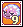Slithis Card × 3</td><td data-l="ได้จาก">ซื้อจาก Trainer Mimi (Skill Card Shop)</td></tr>
<tr><td class="ck"><input aria-label="ทำแล้ว" id="sk-FlyingHammer" type="checkbox"/></td><td class="nm" data-l="สกิล"><a href="https://oto.fandom.com/wiki/Flying_Hammer" rel="noopener" target="_blank">Flying Hammer</a></td><td class="nw" data-l="TM">TM 120</td><td data-l="ทำอะไร">ขว้างค้อนใส่ศัตรูไกล ยิ่ง DA ของอาวุธสูงยิ่งแรง · ใช้โจมตี</td><td data-l="ต้องมีก่อน">Over Swing Lv Master</td><td data-l="ของฝึก Mastery">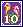Cobra Flower Card × 3</td><td data-l="ได้จาก">ซื้อจาก Trainer Mimi (Skill Card Shop)</td></tr>
</tbody></table>

</section>

<section data-c="" id="zoologist">

<h2>สกิล Zoologist (อาชีพ 3) </h2>

<table><thead><tr><th></th><th>สกิล</th><th>TM</th><th>ทำอะไร</th><th>ต้องมีก่อน</th><th>ของฝึก Mastery</th><th>ได้จาก</th></tr></thead><tbody>
<tr><td class="ck"><input aria-label="ทำแล้ว" id="sk-AuraofAnger" type="checkbox"/></td><td class="nm" data-l="สกิล"><a href="https://oto.fandom.com/wiki/Aura_of_Anger" rel="noopener" target="_blank">Aura of Anger</a></td><td class="nw" data-l="TM">TM 140</td><td data-l="ทำอะไร">เพิ่ม DA ชั่วคราว (แรงกว่า Concentration) · บัฟ/ดีบัฟ</td><td data-l="ต้องมีก่อน">Concentration Lv Master</td><td data-l="ของฝึก Mastery">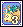Slug G Card × 5</td><td data-l="ได้จาก">เปิด Card Pack Feoh</td></tr>
<tr><td class="ck"><input aria-label="ทำแล้ว" id="sk-StrongArms" type="checkbox"/></td><td class="nm" data-l="สกิล"><a href="https://oto.fandom.com/wiki/Strong_Arms" rel="noopener" target="_blank">Strong Arms</a></td><td class="nw" data-l="TM">TM 140</td><td data-l="ทำอะไร">เพิ่ม AP ชั่วคราว (แรงกว่า Strength Training) · บัฟ/ดีบัฟ</td><td data-l="ต้องมีก่อน">Strength Training Lv Master</td><td data-l="ของฝึก Mastery">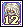Malefic Matron Card × 5</td><td data-l="ได้จาก">เปิด Card Pack Ur</td></tr>
<tr><td class="ck"><input aria-label="ทำแล้ว" id="sk-LastDefence" type="checkbox"/></td><td class="nm" data-l="สกิล"><a href="https://oto.fandom.com/wiki/Last_Defence" rel="noopener" target="_blank">Last Defence</a></td><td class="nw" data-l="TM">TM 150</td><td data-l="ทำอะไร">เพิ่ม DP ตอนเลือดต่ำกว่า 30% · บัฟ/ดีบัฟ</td><td data-l="ต้องมีก่อน">Invisible Defence Lv Master</td><td data-l="ของฝึก Mastery">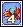Fire Moth Card × 5</td><td data-l="ได้จาก">เปิด Card Pack Thorn</td></tr>
<tr><td class="ck"><input aria-label="ทำแล้ว" id="sk-BearAttack" type="checkbox"/></td><td class="nm" data-l="สกิล"><a href="https://oto.fandom.com/wiki/Bear_Attack" rel="noopener" target="_blank">Bear Attack</a></td><td class="nw" data-l="TM">TM 170</td><td data-l="ทำอะไร">เรียกหมีขาวขู่ศัตรู ลด DP ชั่วคราว · บัฟ/ดีบัฟ</td><td data-l="ต้องมีก่อน">Mole Hammer Lv 10</td><td data-l="ของฝึก Mastery">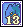Blue Salamander Card × 5</td><td data-l="ได้จาก">เปิด Card Pack Ansur</td></tr>
<tr><td class="ck"><input aria-label="ทำแล้ว" id="sk-BestShield" type="checkbox"/></td><td class="nm" data-l="สกิล"><a href="https://oto.fandom.com/wiki/Best_Shield" rel="noopener" target="_blank">Best Shield</a></td><td class="nw" data-l="TM">TM 180</td><td data-l="ทำอะไร">เพิ่ม DP ให้ปาร์ตี้ตามค่า DP ของคนที่สูงสุด · บัฟ/ดีบัฟ</td><td data-l="ต้องมีก่อน">Party Guard Lv Master</td><td data-l="ของฝึก Mastery">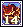Fire Golem Card × 5</td><td data-l="ได้จาก">เปิด Card Pack Rad</td></tr>
<tr><td class="ck"><input aria-label="ทำแล้ว" id="sk-RainofHammers" type="checkbox"/></td><td class="nm" data-l="สกิล"><a href="https://oto.fandom.com/wiki/Rain_of_Hammers" rel="noopener" target="_blank">Rain of Hammers</a></td><td class="nw" data-l="TM">TM 190</td><td data-l="ทำอะไร">โปรยค้อนเล็กรอบตัว (โจมตีวงกว้าง) · ใช้โจมตี</td><td data-l="ต้องมีก่อน">Strong Arms Lv Master</td><td data-l="ของฝึก Mastery">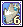Skelefish Card × 5</td><td data-l="ได้จาก">เปิด Card Pack Ken</td></tr>
<tr><td class="ck"><input aria-label="ทำแล้ว" id="sk-HammerSpin" type="checkbox"/></td><td class="nm" data-l="สกิล"><a href="https://oto.fandom.com/wiki/Hammer_Spin" rel="noopener" target="_blank">Hammer Spin</a></td><td class="nw" data-l="TM">TM 220</td><td data-l="ทำอะไร">หมุนค้อนตีรอบตัวต่อเนื่อง (โจมตีวงกว้าง) · ใช้โจมตี</td><td data-l="ต้องมีก่อน">Flying Hammer Lv Master</td><td data-l="ของฝึก Mastery">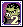Reggae Orc Card × 5</td><td data-l="ได้จาก">ดรอปจากมอน Tower of Chaos ชั้น 38 ขึ้นไป</td></tr>
<tr><td class="ck"><input aria-label="ทำแล้ว" id="sk-CrazyHammerIV" type="checkbox"/></td><td class="nm" data-l="สกิล"><a href="https://oto.fandom.com/wiki/Crazy_Hammer_IV" rel="noopener" target="_blank">Crazy Hammer IV</a></td><td class="nw" data-l="TM">TM 220</td><td data-l="ทำอะไร">โหมด Crazy Hammer เพิ่มโอกาสคริ · บัฟ/ดีบัฟ</td><td data-l="ต้องมีก่อน">Crazy Hammer III Lv Master</td><td data-l="ของฝึก Mastery">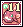Krybeth Card × 5</td><td data-l="ได้จาก">เปิด Card Pack Wunjo</td></tr>
<tr><td class="ck"><input aria-label="ทำแล้ว" id="sk-HammerSpinBooster" type="checkbox"/></td><td class="nm" data-l="สกิล"><a href="https://oto.fandom.com/wiki/Hammer_Spin_Booster" rel="noopener" target="_blank">Hammer Spin Booster</a></td><td class="nw" data-l="TM">TM 240</td><td data-l="ทำอะไร">เพิ่มดาเมจ Hammer Spin · ใช้โจมตี</td><td data-l="ต้องมีก่อน">Hammer Spin Lv Master</td><td data-l="ของฝึก Mastery">Skelefish Card × 5</td><td data-l="ได้จาก">ดรอปจากมอน Tower of Chaos ชั้น 38 ขึ้นไป</td></tr>
<tr><td class="ck"><input aria-label="ทำแล้ว" id="sk-CrazyHammerV" type="checkbox"/></td><td class="nm" data-l="สกิล"><a href="https://oto.fandom.com/wiki/Crazy_Hammer_V" rel="noopener" target="_blank">Crazy Hammer V</a></td><td class="nw" data-l="TM">TM 240</td><td data-l="ทำอะไร">โหมด Crazy Hammer ปล่อยคลื่นกระแทกรอบตัว · บัฟ/ดีบัฟ</td><td data-l="ต้องมีก่อน">Crazy Hammer IV Lv Master</td><td data-l="ของฝึก Mastery">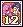Phantom Dame Card × 5</td><td data-l="ได้จาก">ดรอปจากมอน Tower of Chaos ชั้น 38 ขึ้นไป</td></tr>
</tbody></table>

</section>

<footer>สรุปจาก <a href="https://oto.fandom.com/wiki/Bear" rel="noopener" target="_blank">oto.fandom: Bear</a> (หน้า Animal Lover, Trainer, Zoologist, 2nd/3rd job Advancement และหน้าสกิลแต่ละตัว) ติ๊กเก็บไว้ในเบราว์เซอร์ที่เปิดหน้านี้เท่านั้น</footer>

<PageBehavior />
