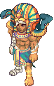
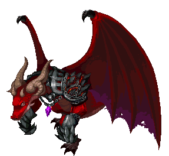

<header style="display:flex;flex-direction:column;gap:8px">

# บอส

บอสประจำโซนทั้ง 10 ตัว ทางเข้า ของที่ต้องใช้ ด่านทดสอบก่อนถึงห้องบอส และยูนีคที่ดรอป เรียงตามเลเวลบอส

</header>

<input id="q" placeholder="ค้นชื่อบอส แมพ หรือไอเทม" type="search"/>

<label><input id="hidedone" type="checkbox"/> ซ่อนที่ล่าแล้ว</label><button id="reset" type="button">ล้างติ๊ก</button>

<nav class="toc"><a href="#all">บอสทั้งหมด</a><a href="#rule">ระบบห้องบอส</a><a href="#trials">ด่านทดสอบ</a><a href="#old">บอสที่ไม่มีแล้ว</a><a href="#compare">เทียบกับบล็อก</a></nav>

<section data-c="" id="all">

<h2>บอสทั้งหมด </h2>

ติ๊กเมื่อล่าแล้ว "จำกัดเลเวล" คือเลเวลตัวละครที่เข้าด่านได้ ส่วน "เกิดใหม่" นับจากที่บอสตัวก่อนตาย

<table><thead><tr><th></th><th>บอส</th><th>ทางเข้า</th><th>จำกัดเลเวล · เกิดใหม่</th><th>จุดอ่อน / ต้านทาน</th><th>ยูนีคที่ดรอป</th></tr></thead><tbody>
<tr><td class="ck"><input aria-label="ล่าแล้ว" id="b0" type="checkbox"/></td><td class="nm" data-l="บอส">Tutankhamen Lv 71 · Magic · Desert Beach</td><td data-l="ทางเข้า">ให้ <b>Apron</b> กับ Rosemary ที่ Pyramid Dungeon 5 แล้วโชว์ <b>Subject's Earrings + Subject's Mask</b> (ไม่หาย) กับ Bastet ที่ Pyramid Dungeon 6 - Hall of the Queen</td><td data-l="จำกัดเลเวล · เกิดใหม่">Lv 1–90 · 20 นาที</td><td data-l="จุดอ่อน / ต้านทาน">แพ้ กายภาพ, ปืน · ต้าน เวท, ลม, แสง</td><td data-l="ยูนีค">Pharaoh Hat, Golden Sword, Golden Lion Shield (Lv 35)</td></tr>
<tr><td class="ck"><input aria-label="ล่าแล้ว" id="b1" type="checkbox"/></td><td class="nm" data-l="บอส">Tombeth Lv 121 · Charm · Caballa Relics</td><td data-l="ทางเข้า">ให้ <b>500 Galder Coupon</b> กับ Rosemary ที่ Caballa Relics Dungeon 3</td><td data-l="จำกัดเลเวล · เกิดใหม่">Lv 1–150 · 20 นาที</td><td data-l="จุดอ่อน / ต้านทาน">แพ้ ปืน · ต้าน เวท, ดิน, ลม</td><td data-l="ยูนีค">Guardian's Soul Helm, Staff, Shield (Lv 90)</td></tr>
<tr><td class="ck"><input aria-label="ล่าแล้ว" id="b2" type="checkbox"/></td><td class="nm" data-l="บอส">Captain Skull Lv 152 · Power · Oops Wharf</td><td data-l="ทางเข้า">ให้ <b>Sea Ivory</b> กับ Card Girl ที่ Wharf Field 4 - Chrono Wharf</td><td data-l="จำกัดเลเวล · เกิดใหม่">Lv 1–210 · 20 นาที</td><td data-l="จุดอ่อน / ต้านทาน">แพ้ เวท, ทุกธาตุ · ต้าน กายภาพ, ปืน</td><td data-l="ยูนีค">Dread Pirate Hat, Dread Cutlass (Lv 120, ไม่ดรอปโล่)</td></tr>
<tr><td class="ck"><input aria-label="ล่าแล้ว" id="b3" type="checkbox"/></td><td class="nm" data-l="บอส">Pirate King Karan Lv 250 · Sense · Ghost Blue</td><td data-l="ทางเข้า">ให้ <b>Nora Doll × 5</b> กับ La Vida ที่ Nora Sewer</td><td data-l="จำกัดเลเวล · เกิดใหม่">Lv 1–280 · 30 นาที</td><td data-l="จุดอ่อน / ต้านทาน">แพ้ กายภาพ, ดิน, แสง · ต้าน ปืน, เวท, น้ำ, สายฟ้า, มืด</td><td data-l="ยูนีค">Ebon Admiral's Hat, Pearl Pistol (Lv 150)</td></tr>
<tr><td class="ck"><input aria-label="ล่าแล้ว" id="b4" type="checkbox"/></td><td class="nm" data-l="บอส">Mad Ray Lv 302 · Sense · Phantom School</td><td data-l="ทางเข้า">ให้ <b>Skull Necklace</b> กับ Coward Craven ที่ Phantom School - Science Lab (ไม่มีด่านทดสอบ)</td><td data-l="จำกัดเลเวล · เกิดใหม่">Lv 200+ · 33 นาที</td><td data-l="จุดอ่อน / ต้านทาน">แพ้ กายภาพ, เวท, มืด · ต้าน ปืน, ไฟ, ลม, ดิน, สายฟ้า, แสง</td><td data-l="ยูนีค">ไม่มียูนีค ดรอปอาวุธ/หมวก/โล่ตระกูล Master (Lv 120–170)</td></tr>
<tr><td class="ck"><input aria-label="ล่าแล้ว" id="b5" type="checkbox"/></td><td class="nm" data-l="บอส">Count Blood Lv 330 · Charm · Rose Garden</td><td data-l="ทางเข้า">ให้ <b>Lapis Lazuli</b> กับ Werewolf Lycan ที่ Vamp Dungeon 4 - Center of the Dark <b>ตอนกลางคืนในเกม</b> (19:00–06:00)</td><td data-l="จำกัดเลเวล · เกิดใหม่">Lv 1–360 · 30 นาที</td><td data-l="จุดอ่อน / ต้านทาน">แพ้ ปืน · ต้าน กายภาพ, เวท (ดูดตอนหลอดเขียว), มืด (ดูด)</td><td data-l="ยูนีค">Mark of the Vampire, Blood Sword, Blood Shield (Lv 180)</td></tr>
<tr><td class="ck"><input aria-label="ล่าแล้ว" id="b6" type="checkbox"/></td><td class="nm" data-l="บอส">Tenter Lion Lv 420 · Charm · Black Swamp</td><td data-l="ทางเข้า">ให้ <b>Herb Potion</b> กับ Little Chagan ที่ Swamp Field 6 - Lake of Illusion</td><td data-l="จำกัดเลเวล · เกิดใหม่">Lv 150+ · 30 นาที</td><td data-l="จุดอ่อน / ต้านทาน">แพ้ ปืน · ต้าน เกือบทุกอย่าง ดูดน้ำ และดูดดินตอนหลอดแดง</td><td data-l="ยูนีค">Tenter Lion Mane, Tail Spear, Earring (Lv 210)</td></tr>
<tr><td class="ck"><input aria-label="ล่าแล้ว" id="b7" type="checkbox"/></td><td class="nm" data-l="บอส">Queen Odinea Lv 520 · Magic · Snow Hill</td><td data-l="ทางเข้า">ให้ <b>Bear Fur</b> กับ General Granada ที่ Ice Dungeon 3 - Heart of Crystal</td><td data-l="จำกัดเลเวล · เกิดใหม่">ไม่จำกัด · 45 นาที</td><td data-l="จุดอ่อน / ต้านทาน">แพ้ ปืน, กายภาพ, สายฟ้า · ต้าน ธาตุอื่นทั้งหมด ดูดเวทไม่มีธาตุ</td><td data-l="ยูนีค">Ice Diadem, Ice Heart Sword, Ice Shield (Lv 240)</td></tr>
<tr><td class="ck"><input aria-label="ล่าแล้ว" id="b8" type="checkbox"/></td><td class="nm" data-l="บอส">Soki Lv 630 · Power · Techichi Volcano</td><td data-l="ทางเข้า">ให้ <b>Stone Ball × 2</b> กับ Tango ที่ Black Ash Dungeon 4</td><td data-l="จำกัดเลเวล · เกิดใหม่">Lv 150+ · 45 นาที</td><td data-l="จุดอ่อน / ต้านทาน">แพ้ เวททุกธาตุ · ดูดกายภาพและปืน (ใช้อาวุธธาตุหรือ Shield Breaker)</td><td data-l="ยูนีค">Gray Ash Helm, Staff, Shield (Lv 270)</td></tr>
<tr><td class="ck"><input aria-label="ล่าแล้ว" id="b9" type="checkbox"/></td><td class="nm" data-l="บอส">Spicy Dragon Lv 730 · Magic · Tapasco Volcano</td><td data-l="ทางเข้า">ให้ <b>Spicy Egg × 2</b> กับ Cletta ที่ Spicy Island</td><td data-l="จำกัดเลเวล · เกิดใหม่">ไม่จำกัด · วิกิไม่ระบุ</td><td data-l="จุดอ่อน / ต้านทาน">ทำดาเมจไม่ได้จนกว่าจะได้เวท Leviathan's Help</td><td data-l="ยูนีค">Draconic Circlet, Sword, Staff, Dagger, Bowgun, Shield (Lv 300)</td></tr>
</tbody></table>

</section>

<section id="rule">

## ระบบห้องบอส

หลังแพตช์ระบบบอสใหม่ ทุกคนได้ห้องบอสของตัวเอง ไม่ต้องรีบหรือกลัวคนอื่นตัดหน้า เข้าห้องแล้วรอสักพักบอสจะเกิด ล่าเสร็จมีเวลาเก็บของบนพื้นประมาณ 30 วินาที แล้วห้องจะพังและส่งออกไปหน้าประตูโซน (ห้องบอสไม่มีวาร์ปออก) ต้องรอก่อนเข้าด่านใหม่ เช่น Tutankhamen และ Tombeth รอ 15 นาที ส่วน Queen Odinea รอ 45 นาที ระวังบอสที่มี <b>Banish</b> (Tutankhamen, Count Blood, Tenter Lion, Queen Odinea, Soki, Spicy Dragon) วงสีฟ้าที่ขึ้นรอบตัวจะส่งเรากลับเมืองถ้ายังยืนในวงตอนมันหาย

</section>

<section id="trials">

## ด่านทดสอบก่อนถึงบอส

สรุปขั้นตอนจากวิกิ ชื่อ NPC มอน และไอเทมใช้ตามในเกม

<h3>Tutankhamen · Pyramid Dungeon</h3>
<ul class="notes">
<li><b>ด่าน 1 Test of Calmness</b>: คุย Lieutenant รับเควส แล้วคุยอีกครั้งเลือกตัวเลือกที่ 2 ให้วาร์ปไปหา Scarab ล่าตัวที่ถูก (ตัวที่ตีก่อน อยู่แถวขวา) ภายใน 5 นาที ไม่ต้องเก็บ King's Seal</li>
<li><b>ด่าน 2 Test of Quickness</b>: คุย Sergeant ล่า Pharaoh's Mimic ภายใน 2 นาที</li>
<li><b>ด่าน 3 Test of Knowledge</b>: Captain ถามปริศนาตรรกะจากคำพูดของ Lieutenant กับ Sergeant แล้วถามประวัติอียิปต์อีกข้อ</li>
<li><b>ด่าน 4 Test of Power</b>: ล่า Guardian กับ Captain ให้ได้ Gray, Dark และ Red Round Seal แล้วโชว์ Bastet เพื่อเข้า Pyramid Dungeon 7 - Doom of Pharaoh</li>
<li>วิกิไม่แนะนำให้ไปคนเดียวถ้าต่ำกว่า Lv 70</li>
</ul>

<h3>Tombeth · Caballa Relics Dungeon</h3>
<ul class="notes">
<li>เริ่มจาก Explorer Reina คนแรกแล้ววนตามเข็มนาฬิกา ส่งเควสกับ Reina คนถัดไปเสมอ</li>
<li><b>ด่าน 1</b>: ล่า Guard Stone Soldier × 6 ใน 1 นาที · <b>ด่าน 2</b>: ขุด Torn Clue 1</li>
<li><b>ด่าน 3</b>: ล่า Awakened Guiana × 30 ใน 10 นาที · <b>ด่าน 4</b>: ขุด Torn Clue 2</li>
<li><b>ด่าน 5</b>: เดินทะลุกำแพงทางตะวันตกเฉียงใต้ของ Reina เก็บ Philosopher's Stone × 5 จาก Awoken Mimic (ชิ้นละ 500 WT ควรมีน้ำหนักว่างเกิน 2,500)</li>
<li><b>ด่าน 6 Guide Stones</b>: มี 11 ห้อง เริ่มห้อง 7 ห้องสุดท้ายคือห้อง 5 ที่มีแค่ Guide Sabrina ใช้ Chaotic + Fractal Guide Stone กับ Keeper Julio จะข้ามไป 4 ห้อง เตรียมอย่างละ 3 อันพอ (Awakened Chimu มี Banish)</li>
<li><b>ด่าน 7</b>: คุย Indiana John ตัวซ้าย ล่า Tombeth's Soul × 2 ใน 5 นาที แล้วไป The Trident Maze ให้ Guide Sabrina ส่งไปหา Tombeth</li>
</ul>

<h3>Captain Skull · Oops Wharf</h3>
<ul class="notes">
<li><b>ด่าน 1 Not This Ship</b>: Shaman Girl Jia ให้ล่า Dread Black Foe × 10, Card Girl ให้ล่า Dread Master Foe × 10 แล้วขุด Love Crystal × 5 ส่ง Jia</li>
<li><b>ด่าน 2 Not This Map</b>: เก็บ Crystallized Sound 1–4 จาก Dread Requi, Dread Quiem, Dread Crow และการขุด</li>
<li><b>ด่าน 3 Real Wharf of Darkness</b>: วาร์ปไปมากับ Copyfish DomDom ขุด Requiem Mass Candle × 6, Candelabrum, Brush, Sword และล่า Black Hearted Requi กับ Black Hearted Quiem</li>
<li><b>ด่าน 4 Real Dock of Darkness</b>: ขุดโน้ต G, A, F ให้ Black Pirate Swab ซ้าย กลาง ขวาตามลำดับ รับ Pirate's Combined Song จาก Vice Captain แล้ว Jia ส่งเข้าห้องบอส</li>
</ul>

<h3>Pirate King Karan · Nora Sewer</h3>
<ul class="notes">
<li><b>ด่าน 1 Trench of the Dead</b>: เก็บ Evil Spirit Bone 1, 2, 3 อย่างละ 5 จาก Popeyed Anemone Ghost, Jelly Fish Ghost (ระเบิดได้) และ Sea Tiger Ghost</li>
<li><b>ด่าน 2 Trench of Patience</b>: เก็บ Soul Marble × 30 จาก Sea Dragon Ghost แล้วหาทางออกเขาวงกตด้านบน (มี MD สูงช่วยมาก)</li>
<li><b>ด่าน 3 Whirlpool of Agony</b>: หาทางออกเขาวงกตที่มี Merman Ale/Aqu Ghost ซึ่งใช้ Faint + Banish</li>
<li><b>ด่าน 4</b>: ล่า Right Hand Saki และ Left Hand Sass แล้วเข้าห้อง Karan เดินหาตัวบอสในแมพ</li>
<li>ชุด Pirate Set ต้องมี Blood-Red Eyepatch จากเควสแฟชั่นยูนีคด้วย</li>
</ul>

<h3>Count Blood · Vamp Castle</h3>
<ul class="notes">
<li><b>ด่าน 1</b>: Guardian Kerberos ส่งไปแมพที่มี Kerberos เต็มไปหมด เดินฝ่าไปวาร์ปอีกฝั่ง</li>
<li><b>ด่าน 2</b>: Vamp Lydia ให้หา Vampire Bat ที่ปนอยู่กับค้างคาวธรรมดา สกิลโจมตีหมู่ช่วยได้มาก</li>
<li><b>ด่าน 3</b>: Majordomo Felix ให้แก้ซูโดกุ 2 ข้อ</li>
<li><b>ด่าน 4</b>: Werewolf Lycan ให้เลือกทางระหว่าง Vamp Lydia กับ Majordomo Felix วิกิบอกว่าโอกาสถูกประมาณ 70/30</li>
</ul>

<h3>Tenter Lion · Black Swamp</h3>
<ul class="notes">
<li><b>ด่าน 1 Protect the Sky Lotus</b>: Frog Shaman ให้ล่า Tentacles × 8 แล้วล่า Dark Shaman เก็บ Dark Necklace × 6</li>
<li><b>ด่าน 2 Lotus Examination Room</b>: Witch La Befana ให้ล่ามอนตัว Super ทีละจุด (Cobra Flower 1, Myconid 2, Lotus Wormhole 3, Stoor Worm 1, Slug G 2) แล้วหา Shadow Mon ล่องหน 4 ตัว (กด Alt ให้ชื่อขึ้น)</li>
<li><b>ด่าน 3 Calm Down Suu</b>: เดินหา NPC ตามลำดับ Pastor Tau, Kristoffer J., Madam Sarah, Warrior Kei แล้วส่งให้ Swampy Suu</li>
<li><b>ด่าน 4</b>: ล่า Ancient Hero Statue × 8 ได้ Teleport Scroll แล้ว Pastor Tau ส่งเข้าถ้ำ</li>
<li>เลือดยิ่งน้อยยิ่งต้านสูง ตอนหลอดแดงดูดธาตุดิน และ Banish ติดกันได้</li>
</ul>

<h3>Queen Odinea · Blue Ice Dungeon</h3>
<ul class="notes">
<li><b>ด่าน 1</b>: Princess Rosetta ให้ล่า Gate Keeper Coolem × 3 (มี Arrow Rush, Berserker, Faint)</li>
<li><b>ด่าน 2</b>: ขุดไม้กระดานแดง น้ำเงิน เขียว ใช้เดินไปหา General Granada ลำดับที่เร็วสุดคือ เขียว แดง เขียว เขียว แล้วล่า General's Peon Niwerth × 3 ใน 1 นาที</li>
<li><b>ด่าน 3</b>: Santa Claus ให้ล่า Queen's Icicler × 5 ใน 2 นาที แล้วขุด Special Broom ให้ Witch La Befana</li>
<li><b>ด่าน 4</b>: ล่า Queen's Maid 1 และ 2 เอา Maid's Room Key แล้วเล่นมินิเกมกับ Star Gazer Stella เอา Queen's Room Key จาก Sly Snow Kid</li>
<li>ถ้าพลาดในด่าน 2–4 จะโดนส่งเข้า Ice Palace Jail ต้องทำเควสผู้คุมเพื่อกลับไปเริ่มด่านนั้นใหม่ · Ice Nail ชิ้นสุดท้ายของชุด Cold Hearted ได้จากเควส</li>
</ul>

<h3>Soki · Black Ash Dungeon</h3>
<ul class="notes">
<li><b>ด่าน 1 Maze of Death</b>: ขุด Blue Bone 1 หรือ Red Bone 1 แล้วส่งต่อให้ Ponchichi ทีละตัวจนถึงตัวที่ 7 ตอบคำถาม 2 ข้อ</li>
<li><b>ด่าน 2 Origin of Death</b>: Compounder Nadia ให้ล่า Ashen Doom Swine × 3 แล้วผสม Worn Magical Rune + Incense Remnants เป็น Rune Stone</li>
<li><b>ด่าน 3 Death's Time</b>: เควสล่ามอนกับ Orpeo 3 รอบ</li>
<li><b>ด่าน 4 Test of Death</b>: ขุด Cat Doll Part 1–3 ให้ Brother Tango แล้วเอา Techichi Village's Holy Sword จาก Doom Lion (มี Banish)</li>
</ul>

<h3>Spicy Dragon · Tapasco Volcano</h3>
<ul class="notes">
<li>ทำเควสต่อกันเป็นสาย: Cletta → Draco Knight → ทุบรูปปั้น 5 และ 8 ตัวตามลำดับที่มันเกิด → Leviathan's Trial 1–4 กับ Clerk Z. Smith → Hunter Master's Trial 1–4 (ห้องละ 15 ตัว อย่าตีก่อนรับเควส) → Slide Puzzle 3 ข้อ (3×3, 4×4, 5×5)</li>
<li>ช่วงท้ายทำ Cletta's Bamboozled Adventurer, The Story Behind Tapasco Volcano และ <b>Leviathan's Help</b> ต้องได้เวทน้ำนี้ก่อน ไม่งั้นทำดาเมจบอสไม่ได้ · Cletta's Crystal จาก Path 1 กับ Path 4 เป็นคนละชิ้นกัน</li>
<li>ห้องบอสยังขุดได้</li>
</ul>

</section>

<section id="old">

## บอสที่ไม่มีแล้วหรือหาข้อมูลไม่ได้

<ul class="notes">
<li><b>Predator</b> (Lv 666, Seabed Dungeon 5 - The Abyss): วิกิบอกว่ายังไม่กลับมาหลังแพตช์ปรับ Ghost Blue บล็อกเก่าบอกว่าต้องใช้ โซ่ตรวน กับ ยาพิษเหลวสีน้ำเงิน และเกิดใหม่ทุก 60 นาที</li>
<li><b>Master Monk</b> (Coral Beach): มีแต่ในบล็อก บอกว่าเข้าผ่าน Kong Kong ลิงขี้ขโมยในถ้ำระหว่าง Coral Beach กับทางเข้า Desert Beach ใช้เขา Addax × 3 และเข้าได้ถึง Lv 30 วิกิไม่มีหน้านี้ จึงยังยืนยันไม่ได้</li>
</ul>

</section>

<section id="compare">

## เทียบกับบล็อก guwnteen

บล็อกก๊อปข้อมูลมาจากกระทู้ปี 2009 ซึ่งเป็นช่วงก่อนแพตช์ระบบบอสใหม่ ของที่ใช้เข้าห้องและด่านทดสอบจึงต่างจากวิกิแทบทุกตัว หน้านี้ใช้ข้อมูลวิกิเป็นหลัก

<table><thead><tr><th>บอส</th><th>บล็อก (2009–2011)</th><th>วิกิ (ใช้ในหน้านี้)</th></tr></thead><tbody>
<tr><td class="nm" data-l="บอส">Tutankhamen</td><td data-l="บล็อก">Lv 1–80 · Apron + Subject's Earrings + Mask · เกิด 20 นาที · มีคอมเมนต์ว่ามีด่าน 4–5 ด่าน</td><td data-l="วิกิ">Lv 1–90 · ของชุดเดิม แต่ Earrings กับ Mask ไม่หาย · มี 4 ด่าน · 20 นาที ใกล้เคียง</td></tr>
<tr><td class="nm" data-l="บอส">Tombeth</td><td data-l="บล็อก">Lv 80–150 · การ์ด Rosemary (เควส Blue Fairy) + สร้อยคอลูกแก้ว (ขุด) · 12 นาที</td><td data-l="วิกิ">Lv 1–150 · 500 Galder Coupon · 7 ด่าน · 20 นาที ต่างกัน</td></tr>
<tr><td class="nm" data-l="บอส">Captain Skull</td><td data-l="บล็อก">Lv 60–120 · การ์ด Captain Fo · 25 นาที</td><td data-l="วิกิ">Lv 1–210 · Sea Ivory ให้ Card Girl · 4 ด่าน · 20 นาที ต่างกัน</td></tr>
<tr><td class="nm" data-l="บอส">Pirate King Karan</td><td data-l="บล็อก">ไม่มี</td><td data-l="วิกิ">Nora Doll × 5 ให้ La Vida · 4 ด่าน มีแต่วิกิ</td></tr>
<tr><td class="nm" data-l="บอส">Mad Ray</td><td data-l="บล็อก">Lv 200+ · สร้อยหัวกะโหลก (ดรอปจากปีศาจเรด) · 32 นาที</td><td data-l="วิกิ">Lv 200+ · Skull Necklace ให้ Coward Craven · 33 นาที ตรงกัน</td></tr>
<tr><td class="nm" data-l="บอส">Count Blood</td><td data-l="บล็อก">หินพระอาทิตย์ (ขุดในปราสาทแวมไพร์) · เลเวลและเวลาไม่ทราบ</td><td data-l="วิกิ">Lapis Lazuli ตอนกลางคืน · 4 ด่าน · Lv 1–360 · 30 นาที ต่างกัน</td></tr>
<tr><td class="nm" data-l="บอส">Tenter Lion</td><td data-l="บล็อก">Lv 100+ · ดอกบัว (ดรอปจากหนอนดอกบัว) · 40 นาที</td><td data-l="วิกิ">Lv 150+ · Herb Potion ให้ Little Chagan · 4 ด่าน · 30 นาที ต่างกัน</td></tr>
<tr><td class="nm" data-l="บอส">Queen Odinea</td><td data-l="บล็อก">เครื่องมือหมายเลข 3 (ดรอปจาก Super Coolem) · HP 32,768 × 5</td><td data-l="วิกิ">Bear Fur ให้ General Granada · 4 ด่าน + คุก · HP 27,465 × 5 · 45 นาที ต่างกัน</td></tr>
<tr><td class="nm" data-l="บอส">Soki</td><td data-l="บล็อก">Lv 150+ · ลูกบอลหิน × 2 (ดรอปจาก Orconio) · 30 นาที</td><td data-l="วิกิ">Lv 150+ · Stone Ball × 2 ให้ Tango · 4 ด่าน · 45 นาที ของตรง เวลาต่าง</td></tr>
<tr><td class="nm" data-l="บอส">Spicy Dragon</td><td data-l="บล็อก">Spicy Egg (ขุดที่ Tapasco เขต 1) · ยังไม่ทราบทางเข้า</td><td data-l="วิกิ">Spicy Egg × 2 ให้ Cletta · ด่านยาวหลายสาย วิกิละเอียดกว่า</td></tr>
</tbody></table>

</section>

<footer>สรุปจากวิกิ ggFTW ฉบับ mirror ของ LifeTO <a href="https://wikimirror.lifeto.co/wiki.ggftw.com/trickster/Category_Boss_Monsters.html" rel="noopener" target="_blank">Category: Boss Monsters</a> และ <a href="https://wikimirror.lifeto.co/wiki.ggftw.com/trickster/Mad_Ray.html" rel="noopener" target="_blank">Mad Ray</a> เทียบกับบล็อก <a href="http://guwnteen.blogspot.com/2011/05/trickster_02.html" rel="noopener" target="_blank">guwnteen: บอสทุกตัวในเกม</a> ติ๊กเก็บไว้ในเบราว์เซอร์ที่เปิดหน้านี้เท่านั้น</footer>

<PageBehavior />
