

<header style="display:flex;flex-direction:column;gap:8px">

# เควสการ์ด (Card Girl)

Card Girl ในแต่ละโซนขอการ์ดมอนที่เป็นปริศนา (ในเกมขึ้นว่า Unknown Item) ทำได้ครั้งเดียวต่อเควส รางวัลเป็น Arcana Card ไว้แลกของ เรียงตามโซน

<ul class="notes"><li>ในเกมจะเห็นแค่คำใบ้ ตารางนี้เฉลยว่าเป็นการ์ดของมอนตัวไหน และมอนอยู่แมพไหน</li><li>เลเวลที่ขึ้น ? คือวิกิไม่ได้บอกไว้</li><li>การ์ดหลายใบใช้ฝึกสกิลด้วย ดูหน้า Skill Mastery ก่อนส่ง จะได้ไม่ต้องตีซ้ำ</li></ul>

</header>

<input id="q" placeholder="ค้นชื่อการ์ด มอน หรือโซน" type="search"/>

<label><input id="hidedone" type="checkbox"/> ซ่อนที่ทำแล้ว</label><button id="reset" type="button">ล้างติ๊ก</button>

<nav class="toc"><a href="#z0">Desert Beach</a><a href="#z1">Megalopolis</a><a href="#z2">Caballa</a><a href="#z3">Phantom School</a><a href="#z4">Mermaid Palace</a><a href="#z5">Ghost Blue</a><a href="#z6">Rose Garden</a><a href="#z7">Black Swamp</a><a href="#z8">Snow Hill</a><a href="#z9">Techichi Volcano</a><a href="#z10">Tapasco Volcano</a></nav>

<section data-c="" id="z0">

<h2>Desert Beach </h2>

Card Girl อยู่ที่ <b>Gate of Desert Beach</b>

<table><thead><tr><th></th><th>เควส</th><th>เลเวล</th><th>การ์ดที่ต้องหา (ดรอปจาก)</th><th>รางวัล</th><th>คำใบ้ในเกม</th></tr></thead><tbody>
<tr><td class="ck"><input aria-label="ทำแล้ว" id="c0" type="checkbox"/></td><td class="nm" data-l="เควส">Card Girl Quest (1)</td><td class="nw" data-l="เลเวล">Lv 10+</td><td data-l="การ์ดที่ต้องหา (ดรอปจาก)">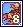<b>Sea Scorpion Card</b> ← Sea Scorpion Lv 22 · Desert Beach Field 3 - Statue of Anubis</td><td data-l="รางวัล">1 × Arcana Smart Card TM 8,577</td><td data-l="คำใบ้ในเกม">“Claw dances with sand under scorching sun”</td></tr>
<tr><td class="ck"><input aria-label="ทำแล้ว" id="c1" type="checkbox"/></td><td class="nm" data-l="เควส">Card Girl Quest (2)</td><td class="nw" data-l="เลเวล">Lv 15+</td><td data-l="การ์ดที่ต้องหา (ดรอปจาก)">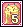<b>Sand Demon Card</b> ← Sand Demon Lv 28 · Desert Beach Field 3 - Statue of Anubis</td><td data-l="รางวัล">2 × Arcana Smart Card TM 19,920</td><td data-l="คำใบ้ในเกม">“The sand falls, piling on time”</td></tr>
<tr><td class="ck"><input aria-label="ทำแล้ว" id="c2" type="checkbox"/></td><td class="nm" data-l="เควส">Card Girl Quest (3)</td><td class="nw" data-l="เลเวล">Lv 25+</td><td data-l="การ์ดที่ต้องหา (ดรอปจาก)"><b>Nephthys Card</b> ← Nephthys Lv 38 · Pyramid Dungeon 2 - Hall of Harpy 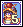<b>Isis Card</b> ← Isis Lv 42 · Pyramid Dungeon 2 - Hall of Harpy</td><td data-l="รางวัล">3 × Arcana Smart Card TM 79,191</td><td data-l="คำใบ้ในเกม">“The wind blows south. We're the wings that protect our dormant king”</td></tr>
<tr><td class="ck"><input aria-label="ทำแล้ว" id="c3" type="checkbox"/></td><td class="nm" data-l="เควส">Card Girl Quest (4)</td><td class="nw" data-l="เลเวล">Lv ?</td><td data-l="การ์ดที่ต้องหา (ดรอปจาก)">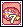<b>Shell Trap Card</b> ← Shell Trap Lv 19 · Desert Beach Field 1 - Delta Island</td><td data-l="รางวัล">4 × Arcana Smart Card TM 79,191</td><td data-l="คำใบ้ในเกม">“Its cute face is hidden behind its sharp teeth”</td></tr>
<tr><td class="ck"><input aria-label="ทำแล้ว" id="c4" type="checkbox"/></td><td class="nm" data-l="เควส">Card Girl Quest (5)</td><td class="nw" data-l="เลเวล">Lv ?</td><td data-l="การ์ดที่ต้องหา (ดรอปจาก)">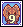<b>Fan Lizard Card</b> ← Fan Lizard Lv 26 · Desert Beach Field 4 - Parasol River</td><td data-l="รางวัล">5 × Arcana Smart Card TM 79,191</td><td data-l="คำใบ้ในเกม">“It's this hot, and it still has a muffler on”</td></tr>
</tbody></table>

</section>

<section data-c="" id="z1">

<h2>Megalopolis </h2>

Card Girl อยู่ที่ <b>Southeast Forest</b>

<table><thead><tr><th></th><th>เควส</th><th>เลเวล</th><th>การ์ดที่ต้องหา (ดรอปจาก)</th><th>รางวัล</th><th>คำใบ้ในเกม</th></tr></thead><tbody>
<tr><td class="ck"><input aria-label="ทำแล้ว" id="c5" type="checkbox"/></td><td class="nm" data-l="เควส">Card Girl Quest (1)</td><td class="nw" data-l="เลเวล">Lv 35+</td><td data-l="การ์ดที่ต้องหา (ดรอปจาก)"><b>Sppo Card</b> ← Sppo Lv 46 · Poppuri Dungeon - Rainbow Cave, Poppuri Dungeon - Root Cave</td><td data-l="รางวัล">2 × Arcana Smart Card TM 245,428</td><td data-l="คำใบ้ในเกม">“It looks like a snowball, but attacks in a flurry!”</td></tr>
<tr><td class="ck"><input aria-label="ทำแล้ว" id="c6" type="checkbox"/></td><td class="nm" data-l="เควส">Card Girl Quest (2)</td><td class="nw" data-l="เลเวล">Lv 40+</td><td data-l="การ์ดที่ต้องหา (ดรอปจาก)">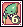<b>Forest Mantis Card</b> ← Forest Mantis Lv 50 · Southwest Forest</td><td data-l="รางวัล">3 × Arcana Smart Card TM 366,066</td><td data-l="คำใบ้ในเกม">“A creature standing tall, with limbs that can be used as martial weapons”</td></tr>
<tr><td class="ck"><input aria-label="ทำแล้ว" id="c7" type="checkbox"/></td><td class="nm" data-l="เควส">Card Girl Quest (3)</td><td class="nw" data-l="เลเวล">Lv 42+</td><td data-l="การ์ดที่ต้องหา (ดรอปจาก)">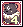<b>Koom Card</b> ← Koom Lv 55 · Poppuri Dungeon - Moss Cave</td><td data-l="รางวัล">4 × Arcana Smart Card TM 419,480</td><td data-l="คำใบ้ในเกม">“A creature with a dark furred coat who has split personalities and lives near Poppuri”</td></tr>
<tr><td class="ck"><input aria-label="ทำแล้ว" id="c8" type="checkbox"/></td><td class="nm" data-l="เควส">Card Girl Quest (4)</td><td class="nw" data-l="เลเวล">Lv 42+</td><td data-l="การ์ดที่ต้องหา (ดรอปจาก)">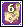<b>Queen Yamu Card</b> ← Green Chipmunk Lv 39 · Southeast Forest</td><td data-l="รางวัล">5 × Arcana Smart Card TM 419,480</td><td data-l="คำใบ้ในเกม">“She's a queen, even if she looks just like everyone else”</td></tr>
<tr><td class="ck"><input aria-label="ทำแล้ว" id="c9" type="checkbox"/></td><td class="nm" data-l="เควส">Card Girl Quest (5)</td><td class="nw" data-l="เลเวล">Lv 42+</td><td data-l="การ์ดที่ต้องหา (ดรอปจาก)">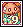<b>Kokebi Card</b> ← Kokebi Lv 39 · Poppuri Dungeon - Slide Cave, Poppuri Dungeon - Root Cave</td><td data-l="รางวัล">6 × Arcana Smart Card TM 419,480</td><td data-l="คำใบ้ในเกม">“I'm so, so, so sleepy”</td></tr>
</tbody></table>

</section>

<section data-c="" id="z2">

<h2>Caballa Relics </h2>

Card Girl อยู่ที่ <b>Gate of Caballa Relics</b>

<table><thead><tr><th></th><th>เควส</th><th>เลเวล</th><th>การ์ดที่ต้องหา (ดรอปจาก)</th><th>รางวัล</th><th>คำใบ้ในเกม</th></tr></thead><tbody>
<tr><td class="ck"><input aria-label="ทำแล้ว" id="c10" type="checkbox"/></td><td class="nm" data-l="เควส">Card Girl Quest (1)</td><td class="nw" data-l="เลเวล">Lv 45+</td><td data-l="การ์ดที่ต้องหา (ดรอปจาก)"><b>Mimic Card</b> ← Mimic Lv 61 · Relics Field 2 - Hand of Giant, Relics Field 3 - Monkey Statues, Relics Field 4 - An Altar for Sacrifice</td><td data-l="รางวัล">3 × Arcana Brave Card TM 505,218</td><td data-l="คำใบ้ในเกม">“Such form will bring confusion. Avarice will bring about disaster itself”</td></tr>
<tr><td class="ck"><input aria-label="ทำแล้ว" id="c11" type="checkbox"/></td><td class="nm" data-l="เควส">Card Girl Quest (2)</td><td class="nw" data-l="เลเวล">Lv 55+</td><td data-l="การ์ดที่ต้องหา (ดรอปจาก)"><b>Chibcha Card</b> ← Chibcha Lv 73 · Caballa Relics Dungeon 1, Caballa Relics Dungeon 3</td><td data-l="รางวัล">4 × Arcana Brave Card TM 2,097,694</td><td data-l="คำใบ้ในเกม">“You, who has deceived Eve is wearing a jar over your head”</td></tr>
<tr><td class="ck"><input aria-label="ทำแล้ว" id="c12" type="checkbox"/></td><td class="nm" data-l="เควส">Card Girl Quest (3)</td><td class="nw" data-l="เลเวล">Lv 60+</td><td data-l="การ์ดที่ต้องหา (ดรอปจาก)">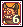<b>Chimu Card</b> ← Chimu Lv 78 · Caballa Relics Dungeon 2, Caballa Relics Dungeon 4</td><td data-l="รางวัล">5 × Arcana Brave Card TM 2,562,815</td><td data-l="คำใบ้ในเกม">“What is hidden behind the smiling mask is a crying face”</td></tr>
<tr><td class="ck"><input aria-label="ทำแล้ว" id="c13" type="checkbox"/></td><td class="nm" data-l="เควส">Card Girl Quest (4)</td><td class="nw" data-l="เลเวล">Lv 60+</td><td data-l="การ์ดที่ต้องหา (ดรอปจาก)">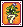<b>Mandragondra Card</b> ← Mandragora Lv 53 · Path to Caballa Relics, Relics Field 1 - Atlas</td><td data-l="รางวัล">6 × Arcana Brave Card TM 2,562,815</td><td data-l="คำใบ้ในเกม">“Those who hear her scream will be followed by death's shadow”</td></tr>
<tr><td class="ck"><input aria-label="ทำแล้ว" id="c14" type="checkbox"/></td><td class="nm" data-l="เควส">Card Girl Quest (5)</td><td class="nw" data-l="เลเวล">Lv 60+</td><td data-l="การ์ดที่ต้องหา (ดรอปจาก)">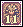<b>Aposis Card</b> ← Aposis Lv 66 · Relics Field 3 - Monkey Statues, Relics Field 4 - An Altar for Sacrifice</td><td data-l="รางวัล">7 × Arcana Brave Card TM 2,562,815</td><td data-l="คำใบ้ในเกม">“A deadly venom is hidden underneath its beauty”</td></tr>
</tbody></table>

</section>

<section data-c="" id="z3">

<h2>Phantom School </h2>

Card Girl อยู่ที่ <b>Gate of Phantom School</b>

<table><thead><tr><th></th><th>เควส</th><th>เลเวล</th><th>การ์ดที่ต้องหา (ดรอปจาก)</th><th>รางวัล</th><th>คำใบ้ในเกม</th></tr></thead><tbody>
<tr><td class="ck"><input aria-label="ทำแล้ว" id="c15" type="checkbox"/></td><td class="nm" data-l="เควส">Card Girl Quest (1)</td><td class="nw" data-l="เลเวล">Lv 50+</td><td data-l="การ์ดที่ต้องหา (ดรอปจาก)"><b>Inky Muck Card</b> ← Inky Muck Lv 89 · Phantom School - 2F Toilet, Phantom School - 3F Toilet</td><td data-l="รางวัล">2 × Arcana Love Card TM 1,570,794</td><td data-l="คำใบ้ในเกม">“To clean, you need dirty first”</td></tr>
<tr><td class="ck"><input aria-label="ทำแล้ว" id="c16" type="checkbox"/></td><td class="nm" data-l="เควส">Card Girl Quest (2)</td><td class="nw" data-l="เลเวล">Lv 80+</td><td data-l="การ์ดที่ต้องหา (ดรอปจาก)">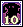<b>Shadow Card</b> ← Shadow Lv 136 · Phantom School 3-1, Phantom School 3-2</td><td data-l="รางวัล">3 × Arcana Love Card TM 2,945,934</td><td data-l="คำใบ้ในเกม">“Goes hand in hand with a flashlight”</td></tr>
<tr><td class="ck"><input aria-label="ทำแล้ว" id="c17" type="checkbox"/></td><td class="nm" data-l="เควส">Card Girl Quest (3)</td><td class="nw" data-l="เลเวล">Lv 110+</td><td data-l="การ์ดที่ต้องหา (ดรอปจาก)">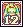<b>Daze Card</b> ← Daze Lv 175 · Phantom School - Music Room</td><td data-l="รางวัล">4 × Arcana Love Card TM 3,867,810</td><td data-l="คำใบ้ในเกม">“The sound of the flute seduces people”</td></tr>
</tbody></table>

</section>

<section data-c="" id="z4">

<h2>Mermaid Palace </h2>

Card Girl อยู่ที่ <b>Mermaid Palace Field 4 - Rock Square</b>

<table><thead><tr><th></th><th>เควส</th><th>เลเวล</th><th>การ์ดที่ต้องหา (ดรอปจาก)</th><th>รางวัล</th><th>คำใบ้ในเกม</th></tr></thead><tbody>
<tr><td class="ck"><input aria-label="ทำแล้ว" id="c18" type="checkbox"/></td><td class="nm" data-l="เควส">Card Girl Quest (1)</td><td class="nw" data-l="เลเวล">Lv 75+</td><td data-l="การ์ดที่ต้องหา (ดรอปจาก)">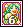<b>Mermaid Little Card</b> ← Mermaid Little Lv 73 · Mermaid Palace Field 1 - Water Park, Mermaid Palace Field 2 - Seaweeds Square</td><td data-l="รางวัล">4 × Arcana Smart Card TM 2,932,113</td><td data-l="คำใบ้ในเกม">“Overweight Fish”</td></tr>
<tr><td class="ck"><input aria-label="ทำแล้ว" id="c19" type="checkbox"/></td><td class="nm" data-l="เควส">Card Girl Quest (2)</td><td class="nw" data-l="เลเวล">Lv 80+</td><td data-l="การ์ดที่ต้องหา (ดรอปจาก)">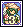<b>Water Weed Witch Card</b> ← Water Weed Witch Lv 95</td><td data-l="รางวัล">5 × Arcana Smart Card TM 2,975,934</td><td data-l="คำใบ้ในเกม">“The remedy made from your hands will take away one's voice”</td></tr>
<tr><td class="ck"><input aria-label="ทำแล้ว" id="c20" type="checkbox"/></td><td class="nm" data-l="เควส">Card Girl Quest (3)</td><td class="nw" data-l="เลเวล">Lv 80+</td><td data-l="การ์ดที่ต้องหา (ดรอปจาก)">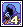<b>Officer Okto Card</b> ← Okto Lv 129 · Mermaid Dungeon 2 - Legend of the Sea</td><td data-l="รางวัล">6 × Arcana Smart Card TM 2,975,934</td><td data-l="คำใบ้ในเกม">“Their eight legs have been inherited from their ancestors”</td></tr>
<tr><td class="ck"><input aria-label="ทำแล้ว" id="c21" type="checkbox"/></td><td class="nm" data-l="เควส">Card Girl Quest (4)</td><td class="nw" data-l="เลเวล">Lv 85+</td><td data-l="การ์ดที่ต้องหา (ดรอปจาก)">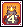<b>S. Golden Mole Card</b> ← Super Golden Mole Lv 80 · Path to Mermaid Palace 1</td><td data-l="รางวัล">7 × Arcana Smart Card TM 3,046,958</td><td data-l="คำใบ้ในเกม">“A crown and a cape aren't enough to shut this creature”</td></tr>
<tr><td class="ck"><input aria-label="ทำแล้ว" id="c22" type="checkbox"/></td><td class="nm" data-l="เควส">Card Girl Quest (5)</td><td class="nw" data-l="เลเวล">Lv 85+</td><td data-l="การ์ดที่ต้องหา (ดรอปจาก)">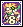<b>Tink Card</b> ← Fish Guardian Tink Lv 78 · Mermaid Palace Field 2 - Seaweeds Square, Mermaid Palace Field 3 - Coral Square 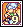<b>Bell Card</b> ← Fish Guardian Bell Lv 80 · Mermaid Palace Field 3 - Coral Square</td><td data-l="รางวัล">8 × Arcana Smart Card TM 3,046,958</td><td data-l="คำใบ้ในเกม">“Warriors who protect the sea”</td></tr>
</tbody></table>

</section>

<section data-c="" id="z5">

<h2>Ghost Blue </h2>

Card Girl อยู่ที่ <b>Gate of Ghost Blue</b>

<table><thead><tr><th></th><th>เควส</th><th>เลเวล</th><th>การ์ดที่ต้องหา (ดรอปจาก)</th><th>รางวัล</th><th>คำใบ้ในเกม</th></tr></thead><tbody>
<tr><td class="ck"><input aria-label="ทำแล้ว" id="c23" type="checkbox"/></td><td class="nm" data-l="เควส">Card Girl Quest (1)</td><td class="nw" data-l="เลเวล">Lv 90+</td><td data-l="การ์ดที่ต้องหา (ดรอปจาก)">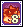<b>Armor Squirt Card</b> ← Armor Squirt Lv 108 · Seabed Field 1 - North, Seabed Field 2 - East</td><td data-l="รางวัล">2 × Arcana Brave Card TM 3,272,140</td><td data-l="คำใบ้ในเกม">“It looks like a hedgehog and a turtle combined”</td></tr>
<tr><td class="ck"><input aria-label="ทำแล้ว" id="c24" type="checkbox"/></td><td class="nm" data-l="เควส">Card Girl Quest (2)</td><td class="nw" data-l="เลเวล">Lv 100+</td><td data-l="การ์ดที่ต้องหา (ดรอปจาก)">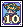<b>Pirate Ghost Card</b> ← Pirate Ghost Lv 121 · Seabed Field 4 - Undersea Grave</td><td data-l="รางวัล">3 × Arcana Brave Card TM 3,737,537</td><td data-l="คำใบ้ในเกม">“Remember, you outlaw of the sea. Your spirit has not fallen in eternal sleep yet”</td></tr>
<tr><td class="ck"><input aria-label="ทำแล้ว" id="c25" type="checkbox"/></td><td class="nm" data-l="เควส">Card Girl Quest (3)</td><td class="nw" data-l="เลเวล">Lv 100+</td><td data-l="การ์ดที่ต้องหา (ดรอปจาก)">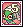<b>Nora Mummy Card</b> ← Nora Mummy Lv 132 · Nora Sewer</td><td data-l="รางวัล">4 × Arcana Brave Card TM 3,737,537</td><td data-l="คำใบ้ในเกม">“Place where outsiders have gathered. Only people with bandages will talk about the truth.”</td></tr>
<tr><td class="ck"><input aria-label="ทำแล้ว" id="c26" type="checkbox"/></td><td class="nm" data-l="เควส">Card Girl Quest (4)</td><td class="nw" data-l="เลเวล">Lv 110+</td><td data-l="การ์ดที่ต้องหา (ดรอปจาก)">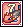<b>Torpedo Fish Card</b> ← Torpedo Fish Lv 112 · Seabed Field 2 - East, Seabed Field 3 - Undersea Park</td><td data-l="รางวัล">5 × Arcana Brave Card TM 3,867,810</td><td class="nw" data-l="คำใบ้ในเกม">“Fish?.”</td></tr>
<tr><td class="ck"><input aria-label="ทำแล้ว" id="c27" type="checkbox"/></td><td class="nm" data-l="เควส">Card Girl Quest (5)</td><td class="nw" data-l="เลเวล">Lv 110+</td><td data-l="การ์ดที่ต้องหา (ดรอปจาก)">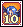<b>Siremaid Card</b> ← Siremaid Lv 120 · Seabed Field 4 - Undersea Grave</td><td data-l="รางวัล">6 × Arcana Brave Card TM 3,867,810</td><td data-l="คำใบ้ในเกม">“The heavenly harp melody is a dirge that leads one to death.”</td></tr>
</tbody></table>

</section>

<section data-c="" id="z6">

<h2>Rose Garden </h2>

Card Girl อยู่ที่ <b>Rose Field 4 - Bloom Grave</b>

<table><thead><tr><th></th><th>เควส</th><th>เลเวล</th><th>การ์ดที่ต้องหา (ดรอปจาก)</th><th>รางวัล</th><th>คำใบ้ในเกม</th></tr></thead><tbody>
<tr><td class="ck"><input aria-label="ทำแล้ว" id="c28" type="checkbox"/></td><td class="nm" data-l="เควส">Card Girl Quest (1)</td><td class="nw" data-l="เลเวล">Lv 120+</td><td data-l="การ์ดที่ต้องหา (ดรอปจาก)">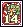<b>Beast Vincento Card</b> ← Beast Vincento Lv 156 · Rose Field 4 - Bloom Grave</td><td data-l="รางวัล">3~4 × Arcana Dream Card TM 4,229,112</td><td data-l="คำใบ้ในเกม">“Only the red rose knows your true self”</td></tr>
<tr><td class="ck"><input aria-label="ทำแล้ว" id="c29" type="checkbox"/></td><td class="nm" data-l="เควส">Card Girl Quest (2)</td><td class="nw" data-l="เลเวล">Lv 125+</td><td data-l="การ์ดที่ต้องหา (ดรอปจาก)">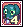<b>Kerberos Card</b> ← Kerberos Lv 179 · Vamp Dungeon 1 - Banquet of the Vamp</td><td data-l="รางวัล">4 × Arcana Dream Card TM 4,428,359</td><td data-l="คำใบ้ในเกม">“Green snow shines on a dark body”</td></tr>
<tr><td class="ck"><input aria-label="ทำแล้ว" id="c30" type="checkbox"/></td><td class="nm" data-l="เควส">Card Girl Quest (3)</td><td class="nw" data-l="เลเวล">Lv 125+</td><td data-l="การ์ดที่ต้องหา (ดรอปจาก)">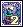<b>Bone Magician Card</b> ← Bone Magician Lv 231 · Vamp Dungeon 4 - Center of the Dark, Vamp Dungeon 5 - Resurrection of the Dark</td><td data-l="รางวัล">5 × Arcana Dream Card TM 4,428,359</td><td data-l="คำใบ้ในเกม">“Bones and magic met in the darkness and created you”</td></tr>
<tr><td class="ck"><input aria-label="ทำแล้ว" id="c31" type="checkbox"/></td><td class="nm" data-l="เควส">Card Girl Quest (4)</td><td class="nw" data-l="เลเวล">Lv 130+</td><td data-l="การ์ดที่ต้องหา (ดรอปจาก)"><b>Dancer Isabelle Card</b> ← Dancer Isabelle Lv 141 · Rose Field 1 - Stairway to Sorrow</td><td data-l="รางวัล">6 × Arcana Dream Card TM 4,615,530</td><td data-l="คำใบ้ในเกม">“A never ending dance. That's a ballerina destiny”</td></tr>
<tr><td class="ck"><input aria-label="ทำแล้ว" id="c32" type="checkbox"/></td><td class="nm" data-l="เควส">Card Girl Quest (5)</td><td class="nw" data-l="เลเวล">Lv 125+</td><td data-l="การ์ดที่ต้องหา (ดรอปจาก)">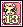<b>Captain Norman Card</b> ← Captain Norman Lv 148 · Rose Field 2 - Maze of Black Rose, Rose Field 4 - Bloom Grave <b>Captain Arman Card</b> ← Captain Arman Lv 145 · Rose Field 2 - Maze of Black Rose 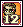<b>Captain Charman Card</b> ← Captain Charman Lv 142 · Rose Field 2 - Maze of Black Rose</td><td data-l="รางวัล">7 × Arcana Dream Card TM 4,615,530</td><td data-l="คำใบ้ในเกม">“Sun, Moon, Star”</td></tr>
</tbody></table>

</section>

<section data-c="" id="z7">

<h2>Black Swamp </h2>

Card Girl อยู่ที่ <b>Gate of Black Swamp</b>

<table><thead><tr><th></th><th>เควส</th><th>เลเวล</th><th>การ์ดที่ต้องหา (ดรอปจาก)</th><th>รางวัล</th><th>คำใบ้ในเกม</th></tr></thead><tbody>
<tr><td class="ck"><input aria-label="ทำแล้ว" id="c33" type="checkbox"/></td><td class="nm" data-l="เควส">Card Girl Quest (1)</td><td class="nw" data-l="เลเวล">Lv 140+</td><td data-l="การ์ดที่ต้องหา (ดรอปจาก)">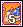<b>Electric Snail Card</b> ← Electric Snail Lv 164 · Path to Black Swamp, Swamp Field 1 - Black Hole, Swamp Field 2 - Beaver's Swamp</td><td data-l="รางวัล">2 × Arcana Dream Card TM 4,750,042</td><td data-l="คำใบ้ในเกม">“Cooking ingredient whith a house on it's back”</td></tr>
<tr><td class="ck"><input aria-label="ทำแล้ว" id="c34" type="checkbox"/></td><td class="nm" data-l="เควส">Card Girl Quest (2)</td><td class="nw" data-l="เลเวล">Lv 140+</td><td data-l="การ์ดที่ต้องหา (ดรอปจาก)">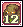<b>Mud Bigfoot Card</b> ← Mud Bigfoot Lv 180 · Swamp Field 6 - Lake of Illusion</td><td data-l="รางวัล">3 × Arcana Dream Card TM 4,750,042</td><td data-l="คำใบ้ในเกม">“That grass on his body, did they sprout from him?”</td></tr>
<tr><td class="ck"><input aria-label="ทำแล้ว" id="c35" type="checkbox"/></td><td class="nm" data-l="เควส">Card Girl Quest (3)</td><td class="nw" data-l="เลเวล">Lv 160+</td><td data-l="การ์ดที่ต้องหา (ดรอปจาก)">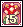<b>Myconid Card</b> ← Myconid Lv 208 · Swamp Dungeon 1 - Marshy Trail, Swamp Dungeon 2 - Marshy Pool</td><td data-l="รางวัล">4 × Arcana Dream Card TM 4,678,418</td><td data-l="คำใบ้ในเกม">“What you have on both your hands belongs to the rabbit!”</td></tr>
<tr><td class="ck"><input aria-label="ทำแล้ว" id="c36" type="checkbox"/></td><td class="nm" data-l="เควส">Card Girl Quest (4)</td><td class="nw" data-l="เลเวล">Lv 180+</td><td data-l="การ์ดที่ต้องหา (ดรอปจาก)"><b>Stoor Worm Card</b> ← Stoor Worm Lv 221 · Swamp Dungeon 5 - Marshy Lawn, Swamp Dungeon 6 - Suu's Muddy Pool</td><td data-l="รางวัล">5 × Arcana Dream Card TM 4,678,418</td><td data-l="คำใบ้ในเกม">“I'm sorry, but will the red scarf catch on fire?”</td></tr>
<tr><td class="ck"><input aria-label="ทำแล้ว" id="c37" type="checkbox"/></td><td class="nm" data-l="เควส">Card Girl Quest (5)</td><td class="nw" data-l="เลเวล">Lv 160+</td><td data-l="การ์ดที่ต้องหา (ดรอปจาก)"><b>Mingo Card</b> ← Mingo Lv 171 · Swamp Field 3 - Maze of Forest</td><td data-l="รางวัล">6 × Arcana Dream Card TM 4,903,525</td><td class="nw" data-l="คำใบ้ในเกม">“Slimy”</td></tr>
</tbody></table>

</section>

<section data-c="" id="z8">

<h2>Snow Hill </h2>

Card Girl อยู่ที่ <b>Gate of Snow Hill</b>

<table><thead><tr><th></th><th>เควส</th><th>เลเวล</th><th>การ์ดที่ต้องหา (ดรอปจาก)</th><th>รางวัล</th><th>คำใบ้ในเกม</th></tr></thead><tbody>
<tr><td class="ck"><input aria-label="ทำแล้ว" id="c38" type="checkbox"/></td><td class="nm" data-l="เควส">Card Girl Quest (1)</td><td class="nw" data-l="เลเวล">Lv 165+</td><td data-l="การ์ดที่ต้องหา (ดรอปจาก)">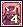<b>Bug Bear Card</b> ← Bug Bear Lv 192 · Frost Wind Forest 2, Path to Snow Hill</td><td data-l="รางวัล">3 × Arcana Love Card TM 5,139,187</td><td data-l="คำใบ้ในเกม">“Those wings don't really look right on your body”</td></tr>
<tr><td class="ck"><input aria-label="ทำแล้ว" id="c39" type="checkbox"/></td><td class="nm" data-l="เควส">Card Girl Quest (2)</td><td class="nw" data-l="เลเวล">Lv 165+</td><td data-l="การ์ดที่ต้องหา (ดรอปจาก)"><b>Ice Cream Card</b> ← Ice Cream Lv 220 · Snow Field 3 - Stairway of Snowflake</td><td data-l="รางวัล">4 × Arcana Love Card TM 5,139,187</td><td data-l="คำใบ้ในเกม">“Want to eat”</td></tr>
<tr><td class="ck"><input aria-label="ทำแล้ว" id="c40" type="checkbox"/></td><td class="nm" data-l="เควส">Card Girl Quest (3)</td><td class="nw" data-l="เลเวล">Lv 170+</td><td data-l="การ์ดที่ต้องหา (ดรอปจาก)"><b>Freyja Card</b> ← Freyja Lv 264 · Ice Dungeon 1 - Cave of Darkblue, Ice Dungeon 2 - Cave of Crystal, Ice Dungeon 3 - Heart of Crystal</td><td data-l="รางวัล">5 × Arcana Love Card TM 5,363,353</td><td data-l="คำใบ้ในเกม">“No one reaches out to the pale girl”</td></tr>
<tr><td class="ck"><input aria-label="ทำแล้ว" id="c41" type="checkbox"/></td><td class="nm" data-l="เควส">Card Girl Quest (4)</td><td class="nw" data-l="เลเวล">Lv 180+</td><td data-l="การ์ดที่ต้องหา (ดรอปจาก)">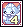<b>Great Coolem Card</b> ← Great Coolem Lv 280 · Ice Dungeon 3 - Heart of Crystal</td><td data-l="รางวัล">6 × Arcana Love Card TM 5,560,151</td><td data-l="คำใบ้ในเกม">“The power of the Ice Giant comes from his brain”</td></tr>
<tr><td class="ck"><input aria-label="ทำแล้ว" id="c42" type="checkbox"/></td><td class="nm" data-l="เควส">Card Girl Quest (5)</td><td class="nw" data-l="เลเวล">Lv 190+</td><td data-l="การ์ดที่ต้องหา (ดรอปจาก)">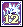<b>Icicler Card</b> ← Icicler Lv 228 · Snow Field 4 - Happy New Year</td><td data-l="รางวัล">7 × Arcana Love Card TM 5,618,956</td><td data-l="คำใบ้ในเกม">“The ice drill is one that drills the skies”</td></tr>
</tbody></table>

</section>

<section data-c="" id="z9">

<h2>Techichi Volcano </h2>

Card Girl อยู่ที่ <b>Gate of Techichi</b>

<table><thead><tr><th></th><th>เควส</th><th>เลเวล</th><th>การ์ดที่ต้องหา (ดรอปจาก)</th><th>รางวัล</th><th>คำใบ้ในเกม</th></tr></thead><tbody>
<tr><td class="ck"><input aria-label="ทำแล้ว" id="c43" type="checkbox"/></td><td class="nm" data-l="เควส">Card Girl Quest (1)</td><td class="nw" data-l="เลเวล">Lv 200+</td><td data-l="การ์ดที่ต้องหา (ดรอปจาก)">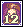<b>Roaster Card</b> ← Roaster Lv 266 · Frost Wind Forest 1, Path to Techichi 1 - Sleet Forest, Path to Techichi 2 - Dry Forest</td><td data-l="รางวัล">4 × Arcana Dream Card TM 5,850,797</td><td data-l="คำใบ้ในเกม">“Well roasted food walks around”</td></tr>
<tr><td class="ck"><input aria-label="ทำแล้ว" id="c44" type="checkbox"/></td><td class="nm" data-l="เควส">Card Girl Quest (2)</td><td class="nw" data-l="เลเวล">Lv 210+</td><td data-l="การ์ดที่ต้องหา (ดรอปจาก)">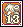<b>Orpeo Card</b> ← Orpeo Lv 299 · Techichi Field 3</td><td data-l="รางวัล">5 × Arcana Dream Card TM 6,419,336</td><td data-l="คำใบ้ในเกม">“Her anguish covers her like the ash upon her heart”</td></tr>
<tr><td class="ck"><input aria-label="ทำแล้ว" id="c45" type="checkbox"/></td><td class="nm" data-l="เควส">Card Girl Quest (3)</td><td class="nw" data-l="เลเวล">Lv 220+</td><td data-l="การ์ดที่ต้องหา (ดรอปจาก)">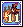<b>Dekumanus Card</b> ← Dekumanus Lv 312 · Techichi Field 4</td><td data-l="รางวัล">6 × Arcana Dream Card TM 6,736,009</td><td data-l="คำใบ้ในเกม">“You look like an onion, but your bite is fierce”</td></tr>
<tr><td class="ck"><input aria-label="ทำแล้ว" id="c46" type="checkbox"/></td><td class="nm" data-l="เควส">Card Girl Quest (4)</td><td class="nw" data-l="เลเวล">Lv 230+</td><td data-l="การ์ดที่ต้องหา (ดรอปจาก)">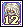<b>Malefic Matron Card</b> ← Malefic Matron Lv 320 · Black Ash Dungeon 1, Black Ash Dungeon 2</td><td data-l="รางวัล">7 × Arcana Dream Card TM 6,844,084</td><td data-l="คำใบ้ในเกม">“This creature is the saddest creature ever”</td></tr>
<tr><td class="ck"><input aria-label="ทำแล้ว" id="c47" type="checkbox"/></td><td class="nm" data-l="เควส">Card Girl Quest (5)</td><td class="nw" data-l="เลเวล">Lv 230+</td><td data-l="การ์ดที่ต้องหา (ดรอปจาก)">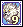<b>Doom Claw Card</b> ← Doom Claw Lv 367 · Black Ash Dungeon 2, Black Ash Dungeon 3, Black Ash Dungeon 4</td><td data-l="รางวัล">8 × Arcana Dream Card TM 6,844,084</td><td data-l="คำใบ้ในเกม">“The kings of heaven and earth have become one”</td></tr>
</tbody></table>

</section>

<section data-c="" id="z10">

<h2>Tapasco Volcano </h2>

Card Girl อยู่ที่ <b>Gate of Tapasco Volcano</b>

<table><thead><tr><th></th><th>เควส</th><th>เลเวล</th><th>การ์ดที่ต้องหา (ดรอปจาก)</th><th>รางวัล</th><th>คำใบ้ในเกม</th></tr></thead><tbody>
<tr><td class="ck"><input aria-label="ทำแล้ว" id="c48" type="checkbox"/></td><td class="nm" data-l="เควส">Card Girl Quest (1)</td><td class="nw" data-l="เลเวล">Lv 235+</td><td data-l="การ์ดที่ต้องหา (ดรอปจาก)">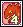<b>Red Salamander Card</b> ← Red Salamander Lv 334 · Tapasco Field 1 - Net of Lava 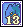<b>Blue Salamander Card</b> ← Blue Salamander Lv 339 · Tapasco Field 1 - Net of Lava</td><td data-l="รางวัล">7 × Arcana Love Card TM 6,990,592</td><td data-l="คำใบ้ในเกม">“If you add the two together would it turn purple?”</td></tr>
<tr><td class="ck"><input aria-label="ทำแล้ว" id="c49" type="checkbox"/></td><td class="nm" data-l="เควส">Card Girl Quest (2)</td><td class="nw" data-l="เลเวล">Lv 240+</td><td data-l="การ์ดที่ต้องหา (ดรอปจาก)">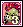<b>Funky Orc Card</b> ← Funky Orc Lv 343 · Tapasco Field 2 - Rhythm of Hammer, Tapasco Field 3 - Valley of Flame</td><td data-l="รางวัล">8 × Arcana Love Card TM 7,305,500</td><td data-l="คำใบ้ในเกม">“It may have a crest, but it is a pig not a chicken”</td></tr>
<tr><td class="ck"><input aria-label="ทำแล้ว" id="c50" type="checkbox"/></td><td class="nm" data-l="เควส">Card Girl Quest (3)</td><td class="nw" data-l="เลเวล">Lv 250+</td><td data-l="การ์ดที่ต้องหา (ดรอปจาก)">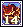<b>Fire Golem Card</b> ← Fire Golem Lv 357 · Tapasco Field 2 - Rhythm of Hammer, Tapasco Field 4 - Stairway to Fire</td><td data-l="รางวัล">9 × Arcana Love Card TM 8,047,587</td><td data-l="คำใบ้ในเกม">“Between the cracked earth, a flame sticks out it's tongue”</td></tr>
<tr><td class="ck"><input aria-label="ทำแล้ว" id="c51" type="checkbox"/></td><td class="nm" data-l="เควส">Card Girl Quest (4)</td><td class="nw" data-l="เลเวล">Lv 260+</td><td data-l="การ์ดที่ต้องหา (ดรอปจาก)">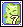<b>Magic Green Card</b> ← Magic Green Lv 416 <b>Magic Yellow Card</b> ← Magic Yellow Lv 416 <b>Magic Pink Card</b> ← Magic Pink Lv 416</td><td data-l="รางวัล">10 × Arcana Love Card TM 8,532,228</td><td data-l="คำใบ้ในเกม">“The 3 noisy friends from the spa”</td></tr>
<tr><td class="ck"><input aria-label="ทำแล้ว" id="c52" type="checkbox"/></td><td class="nm" data-l="เควส">Card Girl Quest (5)</td><td class="nw" data-l="เลเวล">Lv 260+</td><td data-l="การ์ดที่ต้องหา (ดรอปจาก)">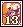<b>Lava Horse Card</b> ← Lava Horse Lv 480</td><td data-l="รางวัล">11 × Arcana Love Card TM 8,532,228</td><td data-l="คำใบ้ในเกม">“Having been born in the burning magma, it will go back into it”</td></tr>
</tbody></table>

</section>

<footer>สรุปจากวิกิ ggFTW ฉบับ mirror ของ LifeTO <a href="https://wikimirror.lifeto.co/wiki.ggftw.com/trickster/Category_Card_Quest.html" rel="noopener" target="_blank">Category: Card Quest</a></footer>

<PageBehavior />
