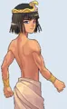

<header style="display:flex;flex-direction:column;gap:8px">

# เควสรายวัน (Daily)

รวมเควสที่ทำได้วันละครั้ง แยกเป็นกลุ่ม ติ๊กในหน้านี้จะล้างเองเมื่อขึ้นวันใหม่ ใช้เป็นเช็กลิสต์ประจำวันได้

<ul class="notes"><li>เลือกทำเฉพาะกลุ่มที่เลเวลถึง ใช้ช่องค้นหาพิมพ์ชื่อโซนเพื่อดูเฉพาะเควสในโซนนั้น</li><li>วิกิบันทึกของที่ขอไว้ซีซันเดียว ในเกมอาจขอของอีกอย่าง</li></ul>

</header>

<input id="q" placeholder="ค้นโซน NPC หรือไอเทม" type="search"/>

<label><input id="hidedone" type="checkbox"/> ซ่อนที่ทำแล้ว</label><button id="reset" type="button">ล้างติ๊ก</button>
ติ๊กจะรีเซ็ตเองทุกวัน (ตามเวลาเครื่อง)

<nav class="toc"><a href="#town">ประจำเมือง</a><a href="#julio">Julio / Yuri</a><a href="#shadow">Shadow World</a><a href="#maps">แผนที่สมบัติ</a><a href="#chaos">Requiem</a></nav>

<section data-c="" id="town">

<h2>เดลี่ประจำเมือง </h2>

ทำได้วันละครั้ง ทุกเควสได้ Daily Coupon วิกิบอกว่าของที่ขอจะเปลี่ยนตามซีซัน ถ้าในเกมขอของไม่ตรงก็เป็นเพราะเหตุนี้

<table><thead><tr><th></th><th>NPC</th><th>โซน · ที่อยู่</th><th>เงื่อนไข</th><th>ของที่ต้องส่ง</th><th>รางวัล</th></tr></thead><tbody>
<tr><td class="ck"><input aria-label="ทำแล้ว" id="t0" type="checkbox"/></td><td class="nm" data-l="NPC">Indiana John</td><td data-l="โซน · ที่อยู่">Coral Beach · Coral Town - Blooming Cora</td><td class="nw" data-l="เงื่อนไข">Lv 5+</td><td data-l="ของที่ต้องส่ง"><b>2 × Crystal</b> Crystal ← ขุดใน Coral Beach Fields.</td><td data-l="รางวัล">Daily Coupon and 5x Pink Potion A, 5x Blue Potion A, 2x 100 Galder Coupon, or Moon Staff TM 3,369</td></tr>
<tr><td class="ck"><input aria-label="ทำแล้ว" id="t1" type="checkbox"/></td><td class="nm" data-l="NPC">Monkey T</td><td data-l="โซน · ที่อยู่">Desert Beach · Beach Town - Paradise</td><td class="nw" data-l="เงื่อนไข">Lv 20+</td><td data-l="ของที่ต้องส่ง"><b>Sleeping Socks</b> Sleeping Socks ← ดรอปจาก Punisher Cannon Shell (Lv 38).</td><td data-l="รางวัล">Daily Coupon and 5x Half Pink Potion, 5x Half Blue Potion, 10x 500 Galder Coupon, or Sharp Dirk TM 16,421</td></tr>
<tr><td class="ck"><input aria-label="ทำแล้ว" id="t2" type="checkbox"/></td><td class="nm" data-l="NPC">Star Gazer Stella</td><td data-l="โซน · ที่อยู่">Megalopolis · Megalopolis Square</td><td class="nw" data-l="เงื่อนไข">Lv 35+</td><td data-l="ของที่ต้องส่ง"><b>2 × Shtella's Profile</b> Shtella's Profile ← ดรอปจาก Desert Beach, Caballa Relics and Oops Wharf (มอนทั่วไป).</td><td data-l="รางวัล">Daily Coupon and 2x 500 Galder Coupon, 5x Pink Potion B, or 5x Blue Potion B TM 96,418</td></tr>
<tr><td class="ck"><input aria-label="ทำแล้ว" id="t3" type="checkbox"/></td><td class="nm" data-l="NPC">Pharaoh Boy</td><td data-l="โซน · ที่อยู่">Caballa Relics · Relics Town - Azteca</td><td class="nw" data-l="เงื่อนไข">Lv 50+</td><td data-l="ของที่ต้องส่ง"><b>Staff of Purification</b> Staff of Purification ← ดรอปจาก Punisher Aposis (Lv 71).</td><td data-l="รางวัล">Daily Coupon, 10x 500 Galder Coupon or 10x Pink Potion B or 10x Blue Potion B or Strong Antique Gun or Sharp Dagger TM 617,097</td></tr>
<tr><td class="ck"><input aria-label="ทำแล้ว" id="t4" type="checkbox"/></td><td class="nm" data-l="NPC">Marinel</td><td data-l="โซน · ที่อยู่">Oops Wharf · Oops Wharf</td><td class="nw" data-l="เงื่อนไข">Lv 65+</td><td data-l="ของที่ต้องส่ง"><b>2 × Thick Rope</b> Thick Rope ← ขุดใน Oops Wharf Fields.</td><td data-l="รางวัล">Daily Coupon, 5x Half Pink Potion or 5x Half Blue Potion or 10x 500 Galder Coupon or Sharp Dirk TM 1,120,782</td></tr>
<tr><td class="ck"><input aria-label="ทำแล้ว" id="t5" type="checkbox"/></td><td class="nm" data-l="NPC">Entertainer Elicia</td><td data-l="โซน · ที่อยู่">Mermaid Palace · Mermaid Palace Field 4 - Rock Square</td><td class="nw" data-l="เงื่อนไข">Lv 80+</td><td data-l="ของที่ต้องส่ง"><b>2 × Executioner's Gills</b> Executioner's Gills ← ดรอปจาก Punisher Merman Ale (Lv 100).</td><td data-l="รางวัล">Daily Coupon and 15x 500 Galder Coupon, 10x Half Pink Potion, 10x Half Blue Potion, Strong Sten Gun, Strong Square Shield, Sharp Flat Sword, Moon Stone Rod or Sharp Katana TM 1,157,331</td></tr>
<tr><td class="ck"><input aria-label="ทำแล้ว" id="t6" type="checkbox"/></td><td class="nm" data-l="NPC">Star Gazer Stella</td><td data-l="โซน · ที่อยู่">Ghost Blue · Ghost Blue Seabed Town - Aquarius</td><td class="nw" data-l="เงื่อนไข">Lv 100+</td><td data-l="ของที่ต้องส่ง"><b>2 × Stela's Profile</b> Stela's Profile ← ดรอปจาก Mermaid Palace, Rose Garden, and Black Swamp (มอนทั่วไป).</td><td data-l="รางวัล">Daily Coupon, 20x 500 Galder Coupon or 5x First-Aid Pink Potion or 5x First-Aid Blue Potion or Moon Battle Rod or Strong Knight Shield or Sharp Sabre TM 1,468,318</td></tr>
<tr><td class="ck"><input aria-label="ทำแล้ว" id="t7" type="checkbox"/></td><td class="nm" data-l="NPC">Homeless Ian</td><td data-l="โซน · ที่อยู่">Rose Garden · Rose Field 1 - Stairway to Sorrow</td><td class="nw" data-l="เงื่อนไข">Lv 120+</td><td data-l="ของที่ต้องส่ง"><b>2 × Punisher B.V. Claws</b> Punisher B.V. Claws ← ดรอปจาก Punisher Beast Vincento (Lv 161).</td><td data-l="รางวัล">Daily Coupon, 25x 500 Galder Coupon or 10x First-Aid Pink Potion or 10x First-Aid Blue Potion or Strong Crest Shield TM 1,661,437</td></tr>
<tr><td class="ck"><input aria-label="ทำแล้ว" id="t8" type="checkbox"/></td><td class="nm" data-l="NPC">Hair of Rosetta</td><td data-l="โซน · ที่อยู่">Black Swamp · Swamp Town - Carbigal</td><td class="nw" data-l="เงื่อนไข">Lv 140+</td><td data-l="ของที่ต้องส่ง"><b>2 × Swamp Leaf</b> Swamp Leaf ← ขุดใน Black Swamp Fields.</td><td data-l="รางวัล">Daily Coupon and 30x 500 Galder Coupon, 5x Pink Potion C, or 5x Blue Potion C TM 1,866,088</td></tr>
<tr><td class="ck"><input aria-label="ทำแล้ว" id="t9" type="checkbox"/></td><td class="nm" data-l="NPC">Winnie</td><td data-l="โซน · ที่อยู่">Snow Hill · Snow Hill Town - Laplanoel</td><td class="nw" data-l="เงื่อนไข">Lv 170+</td><td data-l="ของที่ต้องส่ง"><b>2 × Icicler's Crystal</b> Icicler's Crystal ← ดรอปจาก Punisher Icicler (Lv 233).</td><td data-l="รางวัล">Daily Coupon and 35x 500 Galder Coupon, 10x Pink Potion C, 10x Blue Potion C, Sharp Kalis, or Strong Shotgun TM 2,107,031</td></tr>
<tr><td class="ck"><input aria-label="ทำแล้ว" id="t10" type="checkbox"/></td><td class="nm" data-l="NPC">Star Gazer Stella</td><td data-l="โซน · ที่อยู่">Techichi Volcano · Techichi Town - Neil's Camp</td><td class="nw" data-l="เงื่อนไข">Lv 220+</td><td data-l="ของที่ต้องส่ง"><b>2 × Stellar's Profile</b> Stellar's Profile ← ดรอปจาก Techichi and Tapasco Volcano (มอนทั่วไป).</td><td data-l="รางวัล">Daily Coupon, 40x 500 Galder Coupon or 5x Herb Potion or 5x Gold Pearl Potion TM 2,646,289</td></tr>
<tr><td class="ck"><input aria-label="ทำแล้ว" id="t11" type="checkbox"/></td><td class="nm" data-l="NPC">Guardian Kerberos</td><td data-l="โซน · ที่อยู่">Tapasco Volcano · Gate of Tapasco Volcano</td><td class="nw" data-l="เงื่อนไข">Lv 270+</td><td data-l="ของที่ต้องส่ง"><b>2 × HP Recovery Potion</b> HP Recovery Potion ← ดรอปจาก Punisher Fire Golem (Lv 357).</td><td data-l="รางวัล">Daily Coupon, 50x 500 Galder Coupon or 10x Herb Potion or 10x Gold Pearl Potion or Strong Shield of Honor TM 3,458,118</td></tr>
<tr><td class="ck"><input aria-label="ทำแล้ว" id="t12" type="checkbox"/></td><td class="nm" data-l="NPC">Madam Sarah</td><td data-l="โซน · ที่อยู่">Abyss · Abyss Town - Platonia</td><td class="nw" data-l="เงื่อนไข">Lv 290+</td><td data-l="ของที่ต้องส่ง"><b>5 × Random Part, 5 × Random Bearing</b> Random Part and Random Bearing ← ขุดใน Abyss Fields.</td><td data-l="รางวัล">Daily Coupon, 15x Herb Potion, 15x Gold Pearl Potion, 50x 500 Galder Coupon TM 5,721,682</td></tr>
</tbody></table>

</section>

<section data-c="" id="julio">

<h2>Keeper Julio และ Hunter Yuri </h2>

Julio รับของขุดได้ 10–100 ชิ้นต่อวัน ยิ่งส่งเยอะยิ่งได้ EXP และคูปองมาก ส่วน Hunter Yuri เป็นเควสล่าจับเวลา

<table><thead><tr><th></th><th>เควส</th><th>ที่อยู่</th><th>เงื่อนไข</th><th>ต้องทำ</th><th>รางวัล</th></tr></thead><tbody>
<tr><td class="ck"><input aria-label="ทำแล้ว" id="j1" type="checkbox"/></td><td class="nm" data-l="เควส">Julio's Storage Mission 1</td><td data-l="ที่อยู่">Gate of Desert Beach</td><td class="nw" data-l="เงื่อนไข">Lv 20+</td><td data-l="ต้องทำ"><b>Crystal</b> 10–100 ชิ้น Crystal ← ขุดใน Coral Beach and Desert Beach Fields.</td><td data-l="รางวัล">500 Galder Coupon (ยิ่งส่งมากยิ่งได้มาก) · ส่งครบ 100 ได้ Chaos's Feather 20</td></tr>
<tr><td class="ck"><input aria-label="ทำแล้ว" id="j2" type="checkbox"/></td><td class="nm" data-l="เควส">Julio's Storage Mission 2</td><td data-l="ที่อยู่">Gate of Caballa Relics</td><td class="nw" data-l="เงื่อนไข">Lv 50+</td><td data-l="ต้องทำ"><b>Patterned Pottery</b> 10–100 ชิ้น Patterned Pottery ← ขุดใน Caballa Relics Fields.</td><td data-l="รางวัล">500 Galder Coupon (ยิ่งส่งมากยิ่งได้มาก) · ส่งครบ 100 ได้ Chaos's Feather 50</td></tr>
<tr><td class="ck"><input aria-label="ทำแล้ว" id="j3" type="checkbox"/></td><td class="nm" data-l="เควส">Julio's Storage Mission 3</td><td data-l="ที่อยู่">Gate of Oops Wharf</td><td class="nw" data-l="เงื่อนไข">Lv 65+</td><td data-l="ต้องทำ"><b>Sea Ivory</b> 10–100 ชิ้น Sea Ivory ← ขุดใน Oops Wharf Fields.</td><td data-l="รางวัล">500 Galder Coupon (ยิ่งส่งมากยิ่งได้มาก) · ส่งครบ 100 ได้ Chaos's Feather 65</td></tr>
<tr><td class="ck"><input aria-label="ทำแล้ว" id="j4" type="checkbox"/></td><td class="nm" data-l="เควส">Julio's Storage Mission 4</td><td data-l="ที่อยู่">Gate of Ghost Blue</td><td class="nw" data-l="เงื่อนไข">Lv 100+</td><td data-l="ต้องทำ"><b>Premium Wine</b> 10–100 ชิ้น Premium Wine ← ขุดใน Seabed Fields.</td><td data-l="รางวัล">500 Galder Coupon (ยิ่งส่งมากยิ่งได้มาก) · ส่งครบ 100 ได้ Chaos's Feather 110</td></tr>
<tr><td class="ck"><input aria-label="ทำแล้ว" id="j5" type="checkbox"/></td><td class="nm" data-l="เควส">Julio's Storage Mission 5</td><td data-l="ที่อยู่">Event Garden - Ceremonia</td><td class="nw" data-l="เงื่อนไข">Lv 120+</td><td data-l="ต้องทำ"><b>Rose Petal</b> 10–100 ชิ้น Rose Petal ← ขุดใน Rose Garden Fields.</td><td data-l="รางวัล">500 Galder Coupon (ยิ่งส่งมากยิ่งได้มาก) · ส่งครบ 100 ได้ Chaos's Feather 125</td></tr>
<tr><td class="ck"><input aria-label="ทำแล้ว" id="j6" type="checkbox"/></td><td class="nm" data-l="เควส">Julio's Storage Mission 6</td><td data-l="ที่อยู่">Gate of Black Swamp</td><td class="nw" data-l="เงื่อนไข">Lv 140+</td><td data-l="ต้องทำ"><b>Golden Ball</b> 10–100 ชิ้น Golden Ball ← ขุดใน Black Swamp Fields.</td><td data-l="รางวัล">500 Galder Coupon (ยิ่งส่งมากยิ่งได้มาก) · ส่งครบ 100 ได้ Chaos's Feather 140</td></tr>
<tr><td class="ck"><input aria-label="ทำแล้ว" id="j7" type="checkbox"/></td><td class="nm" data-l="เควส">Julio's Storage Mission 7</td><td data-l="ที่อยู่">Gate of Snow Hill</td><td class="nw" data-l="เงื่อนไข">Lv 170+</td><td data-l="ต้องทำ"><b>Ammonite Fossil</b> 10–100 ชิ้น Ammonite Fossil ← ขุดใน Snow Hill Fields.</td><td data-l="รางวัล">10,000 Galder Coupon (ยิ่งส่งมากยิ่งได้มาก) · ส่งครบ 100 ได้ Chaos's Feather 170</td></tr>
<tr><td class="ck"><input aria-label="ทำแล้ว" id="j8" type="checkbox"/></td><td class="nm" data-l="เควส">Julio's Storage Mission 8</td><td data-l="ที่อยู่">Gate of Techichi</td><td class="nw" data-l="เงื่อนไข">Lv 220+</td><td data-l="ต้องทำ"><b>Selinomarina</b> 10–100 ชิ้น Selinomarina ← ขุดใน Techichi Fields.</td><td data-l="รางวัล">1,000 Galder Coupon (ยิ่งส่งมากยิ่งได้มาก) · ส่งครบ 100 ได้ Chaos's Feather 215</td></tr>
<tr><td class="ck"><input aria-label="ทำแล้ว" id="j9" type="checkbox"/></td><td class="nm" data-l="เควส">Julio's Storage Mission 9</td><td data-l="ที่อยู่">Gate of Tapasco Volcano</td><td class="nw" data-l="เงื่อนไข">Lv 270+</td><td data-l="ต้องทำ"><b>Whetstone</b> 10–100 ชิ้น Whetstone ← ขุดใน Tapasco Volcano Fields.</td><td data-l="รางวัล">1,000 Galder Coupon (ยิ่งส่งมากยิ่งได้มาก) · ส่งครบ 100 ได้ Chaos's Feather 275</td></tr>
<tr><td class="ck"><input aria-label="ทำแล้ว" id="j10" type="checkbox"/></td><td class="nm" data-l="เควส">Julio's Storage Mission 10</td><td data-l="ที่อยู่">Gate of Abyss</td><td class="nw" data-l="เงื่อนไข">Lv 290+</td><td data-l="ต้องทำ"><b>Hydelite</b> 10–100 ชิ้น Hydelite ← ขุดใน Abyss Fields.</td><td data-l="รางวัล">1,000 Galder Coupon (ยิ่งส่งมากยิ่งได้มาก) · ส่งครบ 100 ได้ Chaos's Feather 305</td></tr>
<tr><td class="ck"><input aria-label="ทำแล้ว" id="y0" type="checkbox"/></td><td class="nm" data-l="เควส">Hunter Yuri - Desert Beach Hunter Girl</td><td data-l="ที่อยู่">Gate of Desert Beach</td><td class="nw" data-l="เงื่อนไข">Lv 10+</td><td data-l="ต้องทำ">ล่า 15 × Fanta Slime (Lv.18) ใน 15 นาที</td><td data-l="รางวัล">Hunter Girl's Thank You Gift</td></tr>
<tr><td class="ck"><input aria-label="ทำแล้ว" id="y1" type="checkbox"/></td><td class="nm" data-l="เควส">Hunter Yuri - Paradise Hunter Girl</td><td data-l="ที่อยู่">Desert Beach Field 3 - Statue of Anubis</td><td class="nw" data-l="เงื่อนไข">Lv 20+</td><td data-l="ต้องทำ">ล่า 15 × Sand Demon (Lv.28) ใน 15 นาที</td><td data-l="รางวัล">Hunter Girl's Happy Gift</td></tr>
<tr><td class="ck"><input aria-label="ทำแล้ว" id="y2" type="checkbox"/></td><td class="nm" data-l="เควส">Hunter Yuri - Hunt the Feisty Koom</td><td data-l="ที่อยู่">Southeast Forest</td><td class="nw" data-l="เงื่อนไข">Lv 28</td><td data-l="ต้องทำ">ล่า 1 × Feisty Koom (Lv.60) ใน 5 นาที</td><td data-l="รางวัล">500 Galder Coupon, 2,000 Galders</td></tr>
<tr><td class="ck"><input aria-label="ทำแล้ว" id="y3" type="checkbox"/></td><td class="nm" data-l="เควส">Hunter Yuri - South East Forest Hunter Girl</td><td data-l="ที่อยู่">Path to Desert Beach</td><td class="nw" data-l="เงื่อนไข">Lv 30+</td><td data-l="ต้องทำ">ล่า 15 × Pink Chipmunk (Lv.33) ใน 15 นาที</td><td data-l="รางวัล">Hunter Girl's Special Gift</td></tr>
</tbody></table>

</section>

<section data-c="" id="shadow">

<h2>Shadow World </h2>

ต้องมีสกิล <b>Mind's Eye</b> ก่อน (เควส Eclipse - Another View for the World ที่ Garden of Skill Master: Lv 180+, ฟักการ์เดียนแล้ว, มี Eclipse's Message, ส่ง P. Anemone Card + Dimensional Key) แล้วเปิดสกิลถึงจะเห็น NPC และมอนเงา Jia ให้ล่าตามช่วงเลเวลของเรา Stella ขอของดรอปจากมอนเงา

<table><thead><tr><th></th><th>เควส</th><th>ที่อยู่</th><th>เลเวล</th><th>ต้องทำ</th></tr></thead><tbody>
<tr><td class="ck"><input aria-label="ทำแล้ว" id="sj1" type="checkbox"/></td><td class="nm" data-l="เควส">Dark Spirit Punishment 1</td><td data-l="ที่อยู่">Coral Town - Blooming Cora</td><td class="nw" data-l="เลเวล">Lv 180+</td><td data-l="ต้องทำ">Lv 180~183 3 × Shadow Torobbie (Lv.324) ใน 15 นาที Lv 184~187 3 × Shadow Bad Fury (Lv.327) ใน 10 นาที Lv 188~191 3 × Shadow Little Cora (Lv.333) ใน 11 นาที Lv 192~195 3 × Shadow Bustshell (Lv.339) ใน 11 นาที Lv 196+ 3 × Shadow Addax (Lv.349) ใน 10 นาที</td></tr>
<tr><td class="ck"><input aria-label="ทำแล้ว" id="ss1" type="checkbox"/></td><td class="nm" data-l="เควส">Shadow Star 1</td><td data-l="ที่อยู่">Coral Town - Blooming Cora</td><td class="nw" data-l="เลเวล">Lv 180+</td><td data-l="ต้องทำ"><b>5 × Giant Nail</b> ดรอปจาก Shadow Tottochi (Lv.330), Shadow Clione (Lv.342), and Shadow Thiefmon (Lv.346)</td></tr>
<tr><td class="ck"><input aria-label="ทำแล้ว" id="sj2" type="checkbox"/></td><td class="nm" data-l="เควส">Dark Spirit Punishment 2</td><td data-l="ที่อยู่">Beach Town - Paradise</td><td class="nw" data-l="เลเวล">Lv 195+</td><td data-l="ต้องทำ">Lv 195~198 3 × Shadow Fanta Slime (Lv.351) ใน 12 นาที Lv 199~202 3 × Shadow Hula Octopus (Lv.355) ใน 12 นาที Lv 203~205 3 × Shadow Sea Scorpion (Lv.357) ใน 11 นาที Lv 206~209 3 × Shadow Oran G (Lv.362) ใน 11 นาที Lv 210+ 3 × Shadow Basic Mummy (Lv.370) ใน 10 นาที</td></tr>
<tr><td class="ck"><input aria-label="ทำแล้ว" id="ss2" type="checkbox"/></td><td class="nm" data-l="เควส">Shadow Star 2</td><td data-l="ที่อยู่">Beach Town - Paradise</td><td class="nw" data-l="เลเวล">Lv 195+</td><td data-l="ต้องทำ"><b>5 × Talisman of Darkness</b> ดรอปจาก Shadow Shell Trap (Lv.352), Shadow Golden Mole (Lv.353), Shadow Fanta Fish (Lv.354), Shadow Sand Demon (Lv.356), Shadow Pineapple (Lv.358), Shadow Fan Lizard (Lv.359) and Shadow Cannon Shell (Lv.360)</td></tr>
<tr><td class="ck"><input aria-label="ทำแล้ว" id="sj3" type="checkbox"/></td><td class="nm" data-l="เควส">Dark Spirit Punishment 3</td><td data-l="ที่อยู่">Megalopolis Square</td><td class="nw" data-l="เลเวล">Lv 210+</td><td data-l="ต้องทำ">Lv 210~213 3 × Shadow Yamu (Lv.378) ใน 12 นาที Lv 213~217 3 × Shadow Pochi (Lv.380) ใน 12 นาที Lv 218~221 3 × Shadow Sppo (Lv.388) ใน 11 นาที Lv 222~225 3 × Shadow Forest Tickler (Lv.398) ใน 11 นาที Lv 226+ 3 × Shadow Turvy (Lv.396) ใน 10 นาที</td></tr>
<tr><td class="ck"><input aria-label="ทำแล้ว" id="ss3" type="checkbox"/></td><td class="nm" data-l="เควส">Shadow Star 3</td><td data-l="ที่อยู่">Megalopolis Square</td><td class="nw" data-l="เลเวล">Lv 210+</td><td data-l="ต้องทำ"><b>5 × Petite Hammer</b> ดรอปจาก Shadow Queen Yamu (Lv.382), Shadow Forest Wasp (Lv.400), and Shadow Forest Mantis (Lv.403)</td></tr>
<tr><td class="ck"><input aria-label="ทำแล้ว" id="sj4" type="checkbox"/></td><td class="nm" data-l="เควส">Dark Spirit Punishment 4</td><td data-l="ที่อยู่">Relics Town - Azteca</td><td class="nw" data-l="เลเวล">Lv 225+</td><td data-l="ต้องทำ">Lv 225~228 3 × Shadow Leaf Bird (Lv.405) ใน 12 นาที Lv 229~232 3 × Shadow Stone Soldier (Lv.409) ใน 12 นาที Lv 233~236 3 × Shadow Mimic (Lv.411) ใน 11 นาที Lv 237~240 3 × Shadow Guiana (Lv.416) ใน 11 นาที Lv 241+ 3 × Shadow Lima (Lv.419) ใน 10 นาที</td></tr>
<tr><td class="ck"><input aria-label="ทำแล้ว" id="ss4" type="checkbox"/></td><td class="nm" data-l="เควส">Shadow Star 4</td><td data-l="ที่อยู่">Relics Town - Azteca</td><td class="nw" data-l="เลเวล">Lv 225+</td><td data-l="ต้องทำ"><b>5 × Lock of Hair</b> ดรอปจาก Shadow Mandragora (Lv.407) and Shadow Aposis (Lv.413)</td></tr>
<tr><td class="ck"><input aria-label="ทำแล้ว" id="sj5" type="checkbox"/></td><td class="nm" data-l="เควส">Dark Spirit Punishment 5</td><td class="nw" data-l="ที่อยู่">Oops Wharf</td><td class="nw" data-l="เลเวล">Lv 240+</td><td data-l="ต้องทำ">Lv 240~243 3 × Shadow Ironclad Turtle (Lv.432) ใน 12 นาที Lv 244~247 3 × Shadow Requi (Lv.434) ใน 12 นาที Lv 248~251 3 × Shadow Black Foe (Lv.437) ใน 11 นาที Lv 252~255 3 × Shadow Cone Stone (Lv.440) ใน 11 นาที Lv 256+ 3 × Shadow Pirate Boxer B (Lv.441) ใน 10 นาที</td></tr>
<tr><td class="ck"><input aria-label="ทำแล้ว" id="ss5" type="checkbox"/></td><td class="nm" data-l="เควส">Shadow Star 5</td><td class="nw" data-l="ที่อยู่">Oops Wharf</td><td class="nw" data-l="เลเวล">Lv 240+</td><td data-l="ต้องทำ"><b>5 × Hair Tie</b> ดรอปจาก Shadow Sea Tiger (Lv.433), Shadow Quiem (Lv.435), Shadow Crow (Lv.436), Shadow Black Foe (Lv.438), Shadow Master Foe (Lv.438), Shadow Mermaid Little (Lv.442), Shadow Fish Guardian Tink (Lv.443), Shadow Fish Guardian Bell (Lv.444), Shadow Merman Aku (Lv.447), and Shadow Merman Ale (Lv.449)</td></tr>
<tr><td class="ck"><input aria-label="ทำแล้ว" id="sj6" type="checkbox"/></td><td class="nm" data-l="เควส">Dark Spirit Punishment 6</td><td data-l="ที่อยู่">Ghost Blue Seabed Town - Aquarius</td><td class="nw" data-l="เลเวล">Lv 255+</td><td data-l="ต้องทำ">Lv 255~258 3 × Shadow Mushumushu (Lv.459) ใน 12 นาที Lv 259~262 3 × Shadow Popeyed Anemone (Lv.465) ใน 12 นาที Lv 263~266 3 × Shadow Monguse (Lv.467) ใน 11 นาที Lv 267~270 3 × Shadow Merrow (Lv.437) ใน 11 นาที Lv 271+ 3 × Shadow Nora Joe (Lv.481) ใน 10 นาที</td></tr>
<tr><td class="ck"><input aria-label="ทำแล้ว" id="ss6" type="checkbox"/></td><td class="nm" data-l="เควส">Shadow Star 6</td><td data-l="ที่อยู่">Ghost Blue Seabed Town - Aquarius</td><td class="nw" data-l="เลเวล">Lv 255+</td><td data-l="ต้องทำ"><b>5 × Candle of Shadow</b> ดรอปจาก Shadow Plug Bat (Lv.461), Shadow Pirate Boxer (Lv.463), Shadow Torpedo Fish (Lv.469), Shadow Cora Pyupyu (Lv.471), Shadow Siremaid (Lv.475), and Shadow Pirate Ghost (Lv.477)</td></tr>
<tr><td class="ck"><input aria-label="ทำแล้ว" id="sj7" type="checkbox"/></td><td class="nm" data-l="เควส">Dark Spirit Punishment 7</td><td data-l="ที่อยู่">Event Garden - Ceremonia</td><td class="nw" data-l="เลเวล">Lv 270+</td><td data-l="ต้องทำ">Lv 270~273 3 × Shadow Dancer Michel (Lv.483) ใน 12 นาที Lv 274~277 3 × Shadow Captain Norman (Lv.490) ใน 12 นาที Lv 278~281 3 × Shadow Madam Chiffon (Lv.491) ใน 11 นาที Lv 282~285 3 × Shadow Maid Lydia (Lv.498) ใน 11 นาที Lv 286+ 3 × Shadow Bone Warrior (Lv.508) ใน 10 นาที</td></tr>
<tr><td class="ck"><input aria-label="ทำแล้ว" id="ss7" type="checkbox"/></td><td class="nm" data-l="เควส">Shadow Star 7</td><td data-l="ที่อยู่">Event Garden - Ceremonia</td><td class="nw" data-l="เลเวล">Lv 270+</td><td data-l="ต้องทำ"><b>5 × Sharp Needle</b> ดรอปจาก Shadow Dancer Isabelle (Lv.487), Shadow Captain Charman (Lv.488), Shadow Captain Arman (Lv.489), Shadow Madam Fondue (Lv.493), and Shadow Beast Vincento (Lv.494)</td></tr>
<tr><td class="ck"><input aria-label="ทำแล้ว" id="sj8" type="checkbox"/></td><td class="nm" data-l="เควส">Dark Spirit Punishment 8</td><td data-l="ที่อยู่">Swamp Town - Carbigal</td><td class="nw" data-l="เลเวล">Lv 285+</td><td data-l="ต้องทำ">Lv 285+ 3 × Shadow Lotus Wormhole (Lv.532) ใน 10 นาที</td></tr>
<tr><td class="ck"><input aria-label="ทำแล้ว" id="ss8" type="checkbox"/></td><td class="nm" data-l="เควส">Shadow Star 8</td><td data-l="ที่อยู่">Swamp Town - Carbigal</td><td class="nw" data-l="เลเวล">Lv 285+</td><td data-l="ต้องทำ"><b>5 × Shadow Flames</b> ดรอปจาก Shadow Monkya (Lv.519), Shadow Arachne (Lv.516), Shadow Mud Bigfoot (Lv.517)</td></tr>
<tr><td class="ck"><input aria-label="ทำแล้ว" id="sj9" type="checkbox"/></td><td class="nm" data-l="เควส">Dark Spirit Punishment 9</td><td data-l="ที่อยู่">Snow Hill Town - Laplanoel</td><td class="nw" data-l="เลเวล">Lv 300+</td><td data-l="ต้องทำ">Lv 300~303 3 × Shadow King Yamu (Lv.540) ใน 12 นาที Lv 304~307 3 × Shadow Bug Bear (Lv.543) ใน 10 นาที Lv 308~311 3 × Shadow Polar Bear (Lv.546) ใน 10 นาที Lv 312~315 3 × Shadow Niwerth (Lv.552) ใน 11 นาที Lv 316+ 3 × Shadow Coolem (Lv.558) ใน 10 นาที</td></tr>
<tr><td class="ck"><input aria-label="ทำแล้ว" id="ss9" type="checkbox"/></td><td class="nm" data-l="เควส">Shadow Star 9</td><td data-l="ที่อยู่">Snow Hill Town - Laplanoel</td><td class="nw" data-l="เลเวล">Lv 300+</td><td data-l="ต้องทำ"><b>5 × Voodoo Doll</b> ดรอปจาก Shadow Joker (Lv.541), Shadow Goma (Lv.542), Shadow Santa Bear (Lv.547), Shadow Ice Cream (Lv.549), Shadow Icicler (Lv.550), Shadow Yeti (Lv.548)</td></tr>
<tr><td class="ck"><input aria-label="ทำแล้ว" id="sj10" type="checkbox"/></td><td class="nm" data-l="เควส">Dark Spirit Punishment 10</td><td data-l="ที่อยู่">Techichi Town - Neil's Camp</td><td class="nw" data-l="เลเวล">Lv 315+</td><td data-l="ต้องทำ">Lv 315~318 3 × Shadow Fossil Soldier (Lv.567) ใน 12 นาที Lv 319~322 3 × Shadow Laki (Lv.573) ใน 10 นาที Lv 323~325 3 × Shadow Aabon (Lv.581) ใน 11 นาที Lv 326~329 3 × Shadow Malefic Matron (Lv.585) ใน 11 นาที Lv 330+ 3 × Shadow Burning Kili (Lv.587) ใน 10 นาที</td></tr>
<tr><td class="ck"><input aria-label="ทำแล้ว" id="ss10" type="checkbox"/></td><td class="nm" data-l="เควส">Shadow Star 10</td><td data-l="ที่อยู่">Techichi Town - Neil's Camp</td><td class="nw" data-l="เลเวล">Lv 315+</td><td data-l="ต้องทำ"><b>5 × Mysterious Spell Scroll</b> ดรอปจาก Shadow Roaster (Lv.569), Shadow Kilimanjaro (Lv.571), Shadow Ponchichi (Lv.575), Shadow Orpeo (Lv.579), Shadow Orconio (Lv.577) and Shadow Dekumanus (Lv.583)</td></tr>
<tr><td class="ck"><input aria-label="ทำแล้ว" id="sj11" type="checkbox"/></td><td class="nm" data-l="เควส">Dark Spirit Punishment 11</td><td data-l="ที่อยู่">Gate of Tapasco Volcano</td><td class="nw" data-l="เลเวล">Lv 330+</td><td data-l="ต้องทำ">Lv 330~333 3 × Shadow Fire Moth (Lv.594) ใน 11 นาที Lv 334~337 3 × Shadow Funky Orc (Lv.601) ใน 11 นาที Lv 338+ 3 × Shadow Regent Orc (Lv.603) ใน 11 นาที</td></tr>
<tr><td class="ck"><input aria-label="ทำแล้ว" id="ss11" type="checkbox"/></td><td class="nm" data-l="เควส">Shadow Star 11</td><td data-l="ที่อยู่">Gate of Tapasco Volcano</td><td class="nw" data-l="เลเวล">Lv 330+</td><td data-l="ต้องทำ"><b>5 × Lost Marble</b> ดรอปจาก Shadow Red Salamander (Lv.596), Shadow Blue Salamander (Lv.598), Shadow Funky Orc (Lv.601), Shadow Reggae Orc (Lv.605), Shadow Fire Golem (Lv.607)</td></tr>
<tr><td class="ck"><input aria-label="ทำแล้ว" id="sj12" type="checkbox"/></td><td class="nm" data-l="เควส">Dark Spirit Punishment 12</td><td data-l="ที่อยู่">Abyss Town - Platonia</td><td class="nw" data-l="เลเวล">Lv 345+</td><td data-l="ต้องทำ">Lv 345~348 3 × Shadow Krybeth (Lv.624) ใน 12 นาที Lv 349+ 3 × Shadow Skelefish (Lv.630) ใน 12 นาที</td></tr>
<tr><td class="ck"><input aria-label="ทำแล้ว" id="ss12" type="checkbox"/></td><td class="nm" data-l="เควส">Shadow Star 12</td><td data-l="ที่อยู่">Abyss Town - Platonia</td><td class="nw" data-l="เลเวล">Lv 345+</td><td data-l="ต้องทำ"><b>5 × Sealing Gem</b> ดรอปจาก Shadow Channa (Lv.621) and Shadow Ghost Diver (Lv.627)</td></tr>
</tbody></table>

</section>

<section data-c="" id="maps">

<h2>แผนที่สมบัติ (Marky / Reina) </h2>

ทุกเควสต้องจบ <b>Indiana John - Old Man's Dream</b> ก่อน ขุดแผนที่ A กับ B ในฟิลด์ของโซนนั้นแล้วเอาไปแลกเป็นแผนที่สมบัติ ของ Reina ต้องทำ Treasure Hunting 1 ของโซนนั้นครบ 50 ครั้งก่อน

<table><thead><tr><th></th><th>NPC</th><th>โซน · ที่อยู่</th><th>เงื่อนไข</th><th>ของที่ต้องส่ง</th><th>รางวัล</th></tr></thead><tbody>
<tr><td class="ck"><input aria-label="ทำแล้ว" id="m-Desert_Beach" type="checkbox"/></td><td class="nm" data-l="NPC">Driller King Marky</td><td data-l="โซน · ที่อยู่">Desert Beach · Desert Beach Field 4 - Parasol River</td><td class="nw" data-l="เงื่อนไข">Lv 15~115</td><td data-l="ของที่ต้องส่ง">Weird Beach Map A + Weird Beach Map B ← ขุดในฟิลด์ของโซนนี้</td><td data-l="รางวัล">Weird Beach Treasure Map</td></tr>
<tr><td class="ck"><input aria-label="ทำแล้ว" id="r-Desert_Beach" type="checkbox"/></td><td class="nm" data-l="NPC">Explorer Reina</td><td data-l="โซน · ที่อยู่">Desert Beach · Desert Beach Field 3 - Statue of Anubis</td><td data-l="เงื่อนไข">Lv 15~115 , ทำ Treasure Hunting 1 ครบ 50 ครั้ง</td><td data-l="ของที่ต้องส่ง">Old Beach Map A + Old Beach Map B ← ขุดในฟิลด์ของโซนนี้</td><td data-l="รางวัล">Old Beach Treasure Map</td></tr>
<tr><td class="ck"><input aria-label="ทำแล้ว" id="m-Megalopolis" type="checkbox"/></td><td class="nm" data-l="NPC">Driller King Marky</td><td data-l="โซน · ที่อยู่">Megalopolis · Southeast Forest</td><td class="nw" data-l="เงื่อนไข">Lv 25~125</td><td data-l="ของที่ต้องส่ง">Weird Forest Map A + Weird Forest Map B ← ขุดในฟิลด์ของโซนนี้</td><td data-l="รางวัล">Weird Forest Treasure Map</td></tr>
<tr><td class="ck"><input aria-label="ทำแล้ว" id="r-Megalopolis" type="checkbox"/></td><td class="nm" data-l="NPC">Explorer Reina</td><td data-l="โซน · ที่อยู่">Megalopolis · Southwest Forest</td><td data-l="เงื่อนไข">Lv 25~125 , ทำ Treasure Hunting 1 ครบ 50 ครั้ง</td><td data-l="ของที่ต้องส่ง">Old Forest Map A + Old Forest Map B ← ขุดในฟิลด์ของโซนนี้</td><td data-l="รางวัล">Old Forest Treasure Map</td></tr>
<tr><td class="ck"><input aria-label="ทำแล้ว" id="m-Caballa_Relics" type="checkbox"/></td><td class="nm" data-l="NPC">Driller King Marky</td><td data-l="โซน · ที่อยู่">Caballa Relics · Relics Field 3 - Monkey Statues</td><td class="nw" data-l="เงื่อนไข">Lv 40~140</td><td data-l="ของที่ต้องส่ง">Weird Relics Map A + Weird Relics Map B ← ขุดในฟิลด์ของโซนนี้</td><td data-l="รางวัล">Weird Relics Treasure Map</td></tr>
<tr><td class="ck"><input aria-label="ทำแล้ว" id="r-Caballa_Relics" type="checkbox"/></td><td class="nm" data-l="NPC">Explorer Reina</td><td data-l="โซน · ที่อยู่">Caballa Relics · Gate of Caballa Relics</td><td data-l="เงื่อนไข">Lv 40~140 , ทำ Treasure Hunting 1 ครบ 50 ครั้ง</td><td data-l="ของที่ต้องส่ง">Old Relics Map A + Old Relics Map B ← ขุดในฟิลด์ของโซนนี้</td><td data-l="รางวัล">Old Relics Treasure Map</td></tr>
<tr><td class="ck"><input aria-label="ทำแล้ว" id="m-Oops_Wharf" type="checkbox"/></td><td class="nm" data-l="NPC">Driller King Marky</td><td data-l="โซน · ที่อยู่">Oops Wharf · Oops Wharf</td><td class="nw" data-l="เงื่อนไข">Lv 60~160</td><td data-l="ของที่ต้องส่ง">Weird Wharf Map A + Weird Wharf Map B ← ขุดในฟิลด์ของโซนนี้</td><td data-l="รางวัล">Weird Wharf Treasure Map</td></tr>
<tr><td class="ck"><input aria-label="ทำแล้ว" id="r-Oops_Wharf" type="checkbox"/></td><td class="nm" data-l="NPC">Explorer Reina</td><td data-l="โซน · ที่อยู่">Oops Wharf · Wharf Field 1 - Haunted Town</td><td data-l="เงื่อนไข">Lv 60~160 ทำ Treasure Hunting 1 ครบ 50 ครั้ง</td><td data-l="ของที่ต้องส่ง">Old Wharf Map A + Old Wharf Map B ← ขุดในฟิลด์ของโซนนี้</td><td data-l="รางวัล">Old Wharf Treasure Map</td></tr>
<tr><td class="ck"><input aria-label="ทำแล้ว" id="m-Mermaid_Palace" type="checkbox"/></td><td class="nm" data-l="NPC">Driller King Marky</td><td data-l="โซน · ที่อยู่">Mermaid Palace · Mermaid Palace Field 4 - Rock Square</td><td class="nw" data-l="เงื่อนไข">Lv 70~260</td><td data-l="ของที่ต้องส่ง">Weird Sea Map A + Weird Sea Map B ← ขุดในฟิลด์ของโซนนี้</td><td data-l="รางวัล">Weird Sea Treasure Map</td></tr>
<tr><td class="ck"><input aria-label="ทำแล้ว" id="r-Mermaid_Palace" type="checkbox"/></td><td class="nm" data-l="NPC">Explorer Reina</td><td data-l="โซน · ที่อยู่">Mermaid Palace · Mermaid Palace Field 1 - Water Park</td><td data-l="เงื่อนไข">Lv 70~260 ทำ Treasure Hunting 1 ครบ 50 ครั้ง</td><td data-l="ของที่ต้องส่ง">Old Sea Map A + Old Sea Map B ← ขุดในฟิลด์ของโซนนี้</td><td data-l="รางวัล">Old Sea Treasure Map</td></tr>
<tr><td class="ck"><input aria-label="ทำแล้ว" id="m-Mirage_Island" type="checkbox"/></td><td class="nm" data-l="NPC">Driller King Marky</td><td data-l="โซน · ที่อยู่">Mirage Island · Gate of Mirage Island</td><td class="nw" data-l="เงื่อนไข">Lv 80~280</td><td data-l="ของที่ต้องส่ง">Weird Island Map A + Weird Island Map B ← ขุดในฟิลด์ของโซนนี้</td><td data-l="รางวัล">Weird Island Treasure Map</td></tr>
<tr><td class="ck"><input aria-label="ทำแล้ว" id="r-Mirage_Island" type="checkbox"/></td><td class="nm" data-l="NPC">Explorer Reina</td><td data-l="โซน · ที่อยู่">Mirage Island · Mirage Island Field 1 - Alteo</td><td data-l="เงื่อนไข">Lv 80~280 ทำ Treasure Hunting 1 ครบ 50 ครั้ง</td><td data-l="ของที่ต้องส่ง">Old Island Map A + Old Island Map B ← ขุดในฟิลด์ของโซนนี้</td><td data-l="รางวัล">Old Island Treasure Map</td></tr>
<tr><td class="ck"><input aria-label="ทำแล้ว" id="m-Ghost_Blue" type="checkbox"/></td><td class="nm" data-l="NPC">Driller King Marky</td><td data-l="โซน · ที่อยู่">Ghost Blue · Seabed Field 3 - Undersea Park</td><td class="nw" data-l="เงื่อนไข">Lv 90~290</td><td data-l="ของที่ต้องส่ง">Weird Ocean Map A + Weird Ocean Map B ← ขุดในฟิลด์ของโซนนี้</td><td data-l="รางวัล">Weird Ocean Treasure Map</td></tr>
<tr><td class="ck"><input aria-label="ทำแล้ว" id="r-Ghost_Blue" type="checkbox"/></td><td class="nm" data-l="NPC">Explorer Reina</td><td data-l="โซน · ที่อยู่">Ghost Blue · Seabed Field 1 - North</td><td data-l="เงื่อนไข">Lv 90~290 ทำ Treasure Hunting 1 ครบ 50 ครั้ง</td><td data-l="ของที่ต้องส่ง">Old Ocean Map A + Old Ocean Map B ← ขุดในฟิลด์ของโซนนี้</td><td data-l="รางวัล">Old Ocean Treasure Map</td></tr>
<tr><td class="ck"><input aria-label="ทำแล้ว" id="m-Rose_Garden" type="checkbox"/></td><td class="nm" data-l="NPC">Driller King Marky</td><td data-l="โซน · ที่อยู่">Rose Garden · Rose Field 4 - Bloom Grave</td><td class="nw" data-l="เงื่อนไข">Lv 100+</td><td data-l="ของที่ต้องส่ง">Weird Garden Map A + Weird Garden Map B ← ขุดในฟิลด์ของโซนนี้</td><td data-l="รางวัล">Weird Garden Treasure Map</td></tr>
<tr><td class="ck"><input aria-label="ทำแล้ว" id="r-Rose_Garden" type="checkbox"/></td><td class="nm" data-l="NPC">Explorer Reina</td><td data-l="โซน · ที่อยู่">Rose Garden · Rose Field 2 - Maze of Black Rose</td><td data-l="เงื่อนไข">Lv 100+ ทำ Treasure Hunting 1 ครบ 50 ครั้ง</td><td data-l="ของที่ต้องส่ง">Old Garden Map A + Old Garden Map B ← ขุดในฟิลด์ของโซนนี้</td><td data-l="รางวัล">Old Garden Treasure Map</td></tr>
<tr><td class="ck"><input aria-label="ทำแล้ว" id="m-Underground_Dev_Room" type="checkbox"/></td><td class="nm" data-l="NPC">Driller King Marky</td><td data-l="โซน · ที่อยู่">Underground Dev Room · Underground Dev Room - Underground Passage 3</td><td class="nw" data-l="เงื่อนไข">Lv 120+</td><td data-l="ของที่ต้องส่ง">Weird Underground Map A + Weird Underground Map B ← ขุดในฟิลด์ของโซนนี้</td><td data-l="รางวัล">Weird Underground Treasure Map</td></tr>
<tr><td class="ck"><input aria-label="ทำแล้ว" id="r-Underground_Dev_Room" type="checkbox"/></td><td class="nm" data-l="NPC">Explorer Reina</td><td data-l="โซน · ที่อยู่">Underground Dev Room · Underground Dev Room - Underground Passage 2</td><td data-l="เงื่อนไข">Lv 120+ ทำ Treasure Hunting 1 ครบ 50 ครั้ง</td><td data-l="ของที่ต้องส่ง">Old Underground Map A + Old Underground Map B ← ขุดในฟิลด์ของโซนนี้</td><td data-l="รางวัล">Old Underground Treasure Map</td></tr>
<tr><td class="ck"><input aria-label="ทำแล้ว" id="m-Snow_Hill" type="checkbox"/></td><td class="nm" data-l="NPC">Driller King Marky</td><td data-l="โซน · ที่อยู่">Snow Hill · Snow Field 4 - Happy New Year</td><td class="nw" data-l="เงื่อนไข">Lv 130+</td><td data-l="ของที่ต้องส่ง">Weird Snow Map A + Weird Snow Map B ← ขุดในฟิลด์ของโซนนี้</td><td data-l="รางวัล">Weird Snow Treasure Map</td></tr>
<tr><td class="ck"><input aria-label="ทำแล้ว" id="r-Snow_Hill" type="checkbox"/></td><td class="nm" data-l="NPC">Explorer Reina</td><td data-l="โซน · ที่อยู่">Snow Hill · Snow Field 1 - Merry Christmas</td><td data-l="เงื่อนไข">Lv 130+ ทำ Treasure Hunting 1 ครบ 50 ครั้ง</td><td data-l="ของที่ต้องส่ง">Old Snow Map A + Old Snow Map B ← ขุดในฟิลด์ของโซนนี้</td><td data-l="รางวัล">Old Snow Treasure Map</td></tr>
<tr><td class="ck"><input aria-label="ทำแล้ว" id="m-Black_Swamp" type="checkbox"/></td><td class="nm" data-l="NPC">Driller King Marky</td><td data-l="โซน · ที่อยู่">Black Swamp · Swamp Field 5 - Further Maze of Forest</td><td class="nw" data-l="เงื่อนไข">Lv 110+</td><td data-l="ของที่ต้องส่ง">Weird Swamp Map A + Weird Swamp Map B ← ขุดในฟิลด์ของโซนนี้</td><td data-l="รางวัล">Weird Swamp Treasure Map</td></tr>
<tr><td class="ck"><input aria-label="ทำแล้ว" id="r-Black_Swamp" type="checkbox"/></td><td class="nm" data-l="NPC">Explorer Reina</td><td data-l="โซน · ที่อยู่">Black Swamp · Swamp Field 1 - Black Hole</td><td data-l="เงื่อนไข">Lv 110+ ทำ Treasure Hunting 1 ครบ 50 ครั้ง</td><td data-l="ของที่ต้องส่ง">Old Swamp Map A + Old Swamp Map B ← ขุดในฟิลด์ของโซนนี้</td><td data-l="รางวัล">Old Swamp Treasure Map</td></tr>
<tr><td class="ck"><input aria-label="ทำแล้ว" id="m-Techichi_Volcano" type="checkbox"/></td><td class="nm" data-l="NPC">Driller King Marky</td><td data-l="โซน · ที่อยู่">Techichi Volcano · Gate of Techichi</td><td class="nw" data-l="เงื่อนไข">Lv 140~400</td><td data-l="ของที่ต้องส่ง">Weird Ruins Map A + Weird Ruins Map B ← ขุดในฟิลด์ของโซนนี้</td><td data-l="รางวัล">Weird Ruins Treasure Map</td></tr>
<tr><td class="ck"><input aria-label="ทำแล้ว" id="r-Techichi_Volcano" type="checkbox"/></td><td class="nm" data-l="NPC">Explorer Reina</td><td data-l="โซน · ที่อยู่">Techichi Volcano · Techichi Field 2</td><td data-l="เงื่อนไข">Lv 140~400, ทำ Treasure Hunting 1 ครบ 50 ครั้ง</td><td data-l="ของที่ต้องส่ง">Old Ruins Map A + Old Ruins Map B ← ขุดในฟิลด์ของโซนนี้</td><td data-l="รางวัล">Old Ruins Treasure Map</td></tr>
<tr><td class="ck"><input aria-label="ทำแล้ว" id="m-Tapasco_Volcano" type="checkbox"/></td><td class="nm" data-l="NPC">Driller King Marky</td><td data-l="โซน · ที่อยู่">Tapasco Volcano · Gate of Tapasco Volcano</td><td class="nw" data-l="เงื่อนไข">Lv 150+</td><td data-l="ของที่ต้องส่ง">Weird Volcano Map A + Weird Volcano Map B ← ขุดในฟิลด์ของโซนนี้</td><td data-l="รางวัล">Weird Volcano Treasure Map</td></tr>
<tr><td class="ck"><input aria-label="ทำแล้ว" id="r-Tapasco_Volcano" type="checkbox"/></td><td class="nm" data-l="NPC">Explorer Reina</td><td data-l="โซน · ที่อยู่">Tapasco Volcano · Spicy Island</td><td data-l="เงื่อนไข">Lv 150~400 ทำ Treasure Hunting 1 ครบ 50 ครั้ง</td><td data-l="ของที่ต้องส่ง">Old Volcano Map A + Old Volcano Map B ← ขุดในฟิลด์ของโซนนี้</td><td data-l="รางวัล">Old Volcano Treasure Map</td></tr>
<tr><td class="ck"><input aria-label="ทำแล้ว" id="m-Abyss" type="checkbox"/></td><td class="nm" data-l="NPC">Driller King Marky</td><td data-l="โซน · ที่อยู่">Abyss · Gate of Abyss</td><td class="nw" data-l="เงื่อนไข">Lv 160+</td><td data-l="ของที่ต้องส่ง">Weird Abyss Map A + Weird Abyss Map B ← ขุดในฟิลด์ของโซนนี้</td><td data-l="รางวัล">Weird Abyss Treasure Map</td></tr>
<tr><td class="ck"><input aria-label="ทำแล้ว" id="r-Abyss" type="checkbox"/></td><td class="nm" data-l="NPC">Explorer Reina</td><td data-l="โซน · ที่อยู่">Abyss · Abyss Town - Platonia</td><td data-l="เงื่อนไข">Lv 160+ ทำ Treasure Hunting 1 ครบ 50 ครั้ง</td><td data-l="ของที่ต้องส่ง">Old Abyss Map A + Old Abyss Map B ← ขุดในฟิลด์ของโซนนี้</td><td data-l="รางวัล">Old Abyss Treasure Map</td></tr>
</tbody></table>

</section>

<section data-c="" id="chaos">

<h2>Tower of Chaos </h2>

Poirot - Reinvestigate Outraged Requiem ที่ชั้น 72: ล้ม Outraged Requiem (Lv 769) แล้วคุยกับ Poirot ในห้อง Requiem ได้ Stage 6 Requiem Box ต้องจบ Poirot - Defeat Outraged Requiem ก่อน ดูหน้า Tower of Chaos

<table><thead><tr><th></th><th>เควส</th><th>ที่อยู่</th><th>เงื่อนไข</th><th>ต้องทำ</th></tr></thead><tbody>
<tr><td class="ck"><input aria-label="ทำแล้ว" id="poirot" type="checkbox"/></td><td class="nm" data-l="เควส">Poirot - Reinvestigate Outraged Requiem</td><td data-l="ที่อยู่">Tower of Chaos 72nd Floor</td><td data-l="เงื่อนไข">จบ Defeat Outraged Requiem</td><td data-l="ต้องทำ">ล้ม Outraged Requiem Lv 769</td></tr>
</tbody></table>

</section>

<footer>สรุปจากวิกิ ggFTW ฉบับ mirror ของ LifeTO <a href="https://wikimirror.lifeto.co/wiki.ggftw.com/trickster/Category_Daily_Quest.html" rel="noopener" target="_blank">Category: Daily Quest</a> และ <a href="https://wikimirror.lifeto.co/wiki.ggftw.com/trickster/Shadow_World_Quests_Guide.html" rel="noopener" target="_blank">Shadow World Quests Guide</a> ติ๊กเก็บไว้ในเบราว์เซอร์ที่เปิดหน้านี้เท่านั้น</footer>

<PageBehavior />
