

<header style="display:flex;flex-direction:column;gap:8px">

# Episode 0 · The Start of an Adventure

จุดเริ่มต้นการผจญภัย · 3 บท 36 เควส

สรุปจากวิกิ ggFTW (ฉบับ mirror ของ LifeTO) หน้า [Episode 0 Quests](https://wikimirror.lifeto.co/wiki.ggftw.com/trickster/Episode_0_Quests.html) อ่านเนื้อเรื่องย่อทุกตอนได้ที่หน้า [Story Quest](./story-quest.md)

วิกินี้เป็นข้อมูลเก่า และตัววิกิเตือนเองว่าบางส่วนอาจไม่ตรงกับเซิร์ฟ LifeTO ปัจจุบัน

</header>

<section>

## ภาพรวม

บทสอนเล่นของเกม ลงทะเบียนเป็นผู้เล่น ฝึกขุด ผสมยา และตีบวกอาวุธ แล้วได้พบโฮโลแกรมของ Don Cavalier ที่บอกเป้าหมายจริงของเกม

<ul>
<li>เริ่มที่ <b>Heidi</b> (Coral Town - Blooming Cora)</li>
<li>เควสต่อกันเป็นสาย ทำเรียงตามลำดับในหน้านี้ ส่งเควสหนึ่งแล้วเควสถัดไปจะเปิดให้รับ</li>
<li>บท 3 ต้องหา <b>Heart Gem 8 เม็ด</b> ให้ Andrew คนในเมือง 8 คนมีเควสให้คนละ 2 แบบ ทำได้แค่แบบเดียวตามตัวละคร เลือกตัวละครด้านล่างแล้วหน้าจะซ่อนแบบที่ทำไม่ได้ให้</li>
<li>ติ๊ก "ทำแล้ว" เมื่อส่งเควสแล้ว ระบบจำการติ๊กไว้ในเบราว์เซอร์นี้ กดชื่อบทเพื่อพับหรือกาง</li>
</ul>

<nav class="toc"><a href="#ch-1">บท 1 · The Start of an Adventure</a><a href="#ch-2">บท 2 · Don Giuvanni's Push</a><a href="#ch-3">บท 3 · Our Prologue</a></nav>

<a href="./episode-1.html">Episode 1 →</a>

</section>

<section aria-live="polite" class="counter">

## ความคืบหน้า

0 / 36 เควส

<button id="hidedone" type="button" aria-pressed="false">ซ่อนเควสที่ทำแล้ว</button><label class="pick">ตัวละคร <select id="cls"><option value="">ทุกตัว</option><option value="bunny">Bunny</option><option value="buffalo">Buffalo</option><option value="sheep">Sheep</option><option value="dragon">Dragon</option><option value="fox">Fox</option><option value="lion">Lion</option><option value="cat">Cat</option><option value="raccoon">Raccoon</option></select></label><button id="reset" type="button">ล้างทั้งหมด</button>

</section>

<section id="ch-1">

<h2 id="ch-1-h">บท 1 · The Start of an Adventure </h2>

มาถึง Blooming Cora บน Caballa Island Heidi ให้ใบลงทะเบียนแล้วส่งไปหา Bunny Maid ซึ่งทดสอบด้วยการให้หาแครอทมาให้ จากนั้นช่วยเหลือคนในเมือง ทั้ง Winnie ที่ห่วง Lifeguard Deen, Tinnie ที่ดูแลสนามวอลเลย์บอล และ Lifeguard Bean ที่ขอน้ำแข็ง สุดท้าย Bean บอกว่าทั้งหมดคือบททดสอบ และให้ไปพบ Don Giuvanni รองประธาน Megalo Company ที่อีกฝั่งของถ้ำ

<label class="done"><input class="ep" id="e0-1" type="checkbox"/> ทำแล้ว</label>1.1<h3>Heidi - Trickster Registration</h3>เริ่มบท

Coral Town - Blooming CoraLv 1+

<b>ภารกิจ:</b> ไปคุยกับ Bunny Maid

เงื่อนไข: มี Registration Form
<ul class="src"><li>Registration Form ได้จากการคุยกับ Heidi</li></ul>
รางวัล: Rookie Sword, Rookie Hat, Rookie Shield · EXP 256 / TM 256

<figure class="map" style="aspect-ratio:142/125">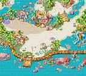</figure>

<label class="done"><input class="ep" id="e0-2" type="checkbox"/> ทำแล้ว</label>1.2<h3>Bunny Maid - Prove Your Spirit!</h3>

Coral Town - Blooming CoraLv 1+

<b>ภารกิจ:</b> Baby Carrot × 2
<ul class="src"><li>Baby Carrot ดรอปจาก Torobbie (Lv 1)</li></ul>
รางวัล: Level Up Guide, 2,000 Galder · EXP 1,374 / TM 1,374

<figure class="map" style="aspect-ratio:142/125"></figure>

<label class="done"><input class="ep" id="e0-3" type="checkbox"/> ทำแล้ว</label>1.3<h3>Bunny Maid - Helping Others</h3>

Coral Town - Blooming CoraLv 1+

<b>ภารกิจ:</b> ไปคุยกับ Winnie

รางวัล: Young Egg, 2,000 Galder · EXP 2,739 / TM 2,739

<figure class="map" style="aspect-ratio:142/125"></figure>

<label class="done"><input class="ep" id="e0-4" type="checkbox"/> ทำแล้ว</label>1.4<h3>Winnie - Winnie's Request</h3>

Coral Town - Blooming CoraLv 1+

<b>ภารกิจ:</b> ไปคุยกับ Lifeguard Dean
<ul class="src"><li>Lifeguard Deen อยู่ที่ Coral Beach Field 1 หน้าอาคาร Lifeguard</li></ul>
รางวัล: Lucky Pink Potion × 10, Lucky Blue Potion × 10, Recovery Guide · EXP 3,735 / TM 3,735

<figure class="map" style="aspect-ratio:142/125"></figure>

<label class="done"><input class="ep" id="e0-5" type="checkbox"/> ทำแล้ว</label>1.5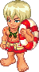<h3>Lifeguard Deen - Deen's Request - 1</h3>

Coral Beach Field 1 - Blue WaveLv 1+

<b>ภารกิจ:</b> ล่า Tottochi (Lv 2) ให้ได้ 5 ตัวภายใน 10 นาที

รางวัล: 500 Galder Coupon × 5 · EXP 3,735 / TM 3,735

<figure class="map" style="aspect-ratio:142/116">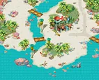</figure>

<label class="done"><input class="ep" id="e0-6" type="checkbox"/> ทำแล้ว</label>1.6<h3>Lifeguard Deen - Deen's Request - 2</h3>

Coral Beach Field 1 - Blue WaveLv 1+

<b>ภารกิจ:</b> ไปคุยกับ Tinnie

เงื่อนไข: ผ่านเควส Lifeguard Dean - Deen's Request - 1 แล้ว
<ul class="src"><li>Tinnie อยู่ที่ Coral Beach Field 2 ข้างสนามวอลเลย์บอลชายหาด</li></ul>
รางวัล: Lucky Pink Potion × 10, Lucky Blue Potion × 10, 2,000 Galder · EXP 4,970 / TM 4,970

<figure class="map" style="aspect-ratio:142/116"></figure>

<label class="done"><input class="ep" id="e0-7" type="checkbox"/> ทำแล้ว</label>1.7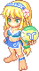<h3>Tinnie - Tinnie's Request - 1</h3>

Coral Beach Field 2 - Passionate SunLv 1+

<b>ภารกิจ:</b> ล่า Bad Fury (Lv 4) ให้ได้ 5 ตัวภายใน 10 นาที

เงื่อนไข: ผ่านเควส Lifeguard Dean - Deen's Request - 2 แล้ว

รางวัล: 500 Galder Coupon × 5 · EXP 4,970 / TM 4,970

<figure class="map" style="aspect-ratio:142/117">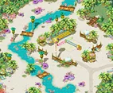</figure>

<label class="done"><input class="ep" id="e0-8" type="checkbox"/> ทำแล้ว</label>1.8<h3>Tinnie - Tinnie's Request - 2</h3>

Coral Beach Field 2 - Passionate SunLv 1+

<b>ภารกิจ:</b> ไปคุยกับ Lifeguard Bean
<ul class="src"><li>Lifeguard Bean อยู่ที่ Coral Beach Field 3 หน้าบ่อน้ำ</li></ul>
รางวัล: Lucky Pink Potion × 10, Lucky Blue Potion × 10, 2,000 Galder · EXP 4,970 / TM 4,970

<figure class="map" style="aspect-ratio:142/117"></figure>

<label class="done"><input class="ep" id="e0-9" type="checkbox"/> ทำแล้ว</label>1.9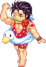<h3>Lifeguard Bean - Bean's Request</h3>จบบท

Coral Beach Field 3 - Sunny BeachLv 1+

<b>ภารกิจ:</b> Cool Ice × 5
<ul class="src"><li>Cool Ice ดรอปจาก Blue Penguin (Lv 6)</li></ul>
รางวัล: Pocket Pouch, Shortcut Guide, 10,000 Galder · EXP 32,928 / TM 32,928

<figure class="map" style="aspect-ratio:130/142">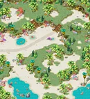</figure>

<label class="done"><input class="ep" id="e0-10" type="checkbox"/> ทำแล้ว</label>1.10<h3>Lifeguard Bean - Meet Don Giuvanni</h3>

Coral Beach Field 3 - Sunny BeachLv 1+

<b>ภารกิจ:</b> ไปคุยกับ Don Giuvanni
<ul class="src"><li>Don Giuvanni อยู่ที่ Gate of Desert Beach</li></ul>
รางวัล: 4,000 Galder · EXP 12,664 / TM 12,664

<figure class="map" style="aspect-ratio:130/142"></figure>

</section>

<section id="ch-2">

<h2 id="ch-2-h">บท 2 · Don Giuvanni's Push </h2>

Don Giuvanni ประกาศว่าตอนนี้เขาคุมเกม Trickster และจะเลือกผู้ชนะเอง เขาจัดโปรแกรมฝึกให้ เริ่มจากเรียนขุดกับ Driller Marky แล้วไปหา Officer Robert ที่ Paradise เพื่อเรียนผสมยา (Compounder Paul) ผสมแบบ Mature (Alchemist Nate) และตีบวกอาวุธ (Blacksmith Marx) จบแล้วได้ Hologram Port ซึ่งพาไปพบโฮโลแกรมของ Don Cavalier เขาบอกว่าจะเป็น Trickster ตัวจริงได้ต้องมีสายเลือดของ Trickster แท้ และต้องตามหารูปปั้นในตำนาน Poseidon's Blessing

<label class="done"><input class="ep" id="e0-11" type="checkbox"/> ทำแล้ว</label>2.1<h3>Don Giuvanni - Don Giuvanni's Training Pt. 1</h3>

Gate of Desert BeachLv 13+

<b>ภารกิจ:</b> 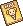Drilling for Dummies

เงื่อนไข: ผ่านเควส Lifeguard Bean - Meet Don Giuvanni แล้ว
<ul class="src"><li>Drilling for Dummies ได้จากเควส Driller Marky - Master Drilling!</li></ul>
รางวัล: Oasis Water × 5, Distilled Water × 5, Empty Potion Bottle × 5, Drilling for Dummies · EXP 21,763 / TM 21,763

<figure class="map" style="aspect-ratio:142/77">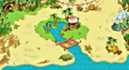</figure>

<label class="done"><input class="ep" id="e0-12" type="checkbox"/> ทำแล้ว</label>2.2<h3>Driller Marky - Master Drilling!</h3>

Gate of Desert BeachLv 13+

<b>ภารกิจ:</b> Tanning Oil × 2
<ul class="src"><li>Tanning Oil ขุดได้ที่ Gate of Desert Beach</li></ul>
รางวัล: Peng, Drilling for Dummies · EXP 21,763 / TM 21,763

<figure class="map" style="aspect-ratio:142/77"></figure>

<label class="done"><input class="ep" id="e0-13" type="checkbox"/> ทำแล้ว</label>2.3<h3>Don Giuvanni - Meet Officer Robert</h3>

Gate of Desert Beach

<b>ภารกิจ:</b> ไปคุยกับ Officer Robert

เงื่อนไข: ผ่านเควส Don Giuvanni - Don Giuvanni's Training Pt. 1 แล้ว
<ul class="src"><li>Officer Robert อยู่ที่ Beach Town - Paradise</li></ul>
รางวัล: Oasis Water × 5, Distilled Water × 5, Empty Potion Bottle × 5 · EXP 21,763 / TM 21,763

<figure class="map" style="aspect-ratio:142/77"></figure>

<label class="done"><input class="ep" id="e0-14" type="checkbox"/> ทำแล้ว</label>2.4<h3>Officer Robert - Don Giuvanni's Training Pt. 2</h3>

Beach Town - Paradise

<b>ภารกิจ:</b> Desert Potion
<ul class="src"><li>Desert Potion ผสม (Compound) จาก Oasis Water + Distilled Water + Empty Potion Bottle กับ Compounder Paul ที่ Paradise Shop</li><li>Oasis Water, Distilled Water, และ Empty Potion Bottle ได้จากเควส Don Giuvanni's Training Pt. 1 และ Meet Officer Robert</li></ul>
รางวัล: Hard Scales × 5, Life Vest · EXP 21,763 / TM 21,763

<figure class="map" style="aspect-ratio:142/107">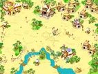</figure>

<label class="done"><input class="ep" id="e0-15" type="checkbox"/> ทำแล้ว</label>2.5<h3>Officer Robert - Don's Push - 3rd Stage</h3>

Beach Town - Paradise

<b>ภารกิจ:</b> Nate's Certification
<ul class="src"><li>Nate's Certification ได้จากเควส Let's Try Maturing Compounding!</li></ul>
รางวัล: Pink Potion B × 20, Blue Potion B × 20, Wooden Sword · EXP 21,763 / TM 21,763

<figure class="map" style="aspect-ratio:142/107"></figure>

<label class="done"><input class="ep" id="e0-16" type="checkbox"/> ทำแล้ว</label>2.6<h3>Alchemist Nate - Let's Try Maturing Compounding!</h3>

Paradise Shop

<b>ภารกิจ:</b> ผสม Life Vest กับ Hard Scales (Mature Compound)

เงื่อนไข: รับเควส Officer Robert - Don's Push - 3rd Stage ค้างไว้
<ul class="src"><li>Life Vest และ Hard Scales ได้จากเควส Don Giuvanni's Training Pt. 2</li></ul>
รางวัล: Mature Compounding Guide, Nate's Certification · EXP 21,763 / TM 21,763

<figure class="map" style="aspect-ratio:100/76">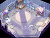</figure>

<label class="done"><input class="ep" id="e0-17" type="checkbox"/> ทำแล้ว</label>2.7<h3>Officer Robert - Don's Push - 4th Stage</h3>จบบท

Beach Town - Paradise

<b>ภารกิจ:</b> 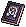Refining Guide, Wooden Sword ที่ตีบวก +1 แล้ว

เงื่อนไข: ผ่านเควส Officer Robert - Don's Push - 3rd Stage แล้ว
<ul class="src"><li>Refining Guide ได้จากเควส Blacksmith Marx - Learn to Refine!</li></ul>
รางวัล: Refining Guide, Hologram Port, Beginner's Scroll of Revival × 5 · EXP 87,054 / TM 43,527

<figure class="map" style="aspect-ratio:142/107"></figure>

<label class="done"><input class="ep" id="e0-18" type="checkbox"/> ทำแล้ว</label>2.8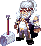<h3>Blacksmith Marx - Learn to Refine!</h3>

Paradise Shop

<b>ภารกิจ:</b> 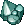Bronze Fragment × 7

เงื่อนไข: รับเควส Officer Robert - Don's Push - 4th Stage ค้างไว้
<ul class="src"><li>Bronze Fragment ขุดได้ที่ 1st Mining Lot of Crystal Copper</li></ul>
รางวัล: Refining Guide, Bronze Fragment × 7, Wooden Sword · EXP 21,763 / TM 21,763

<figure class="map" style="aspect-ratio:100/76"></figure>

</section>

<section id="ch-3">

<h2 id="ch-3-h">บท 3 · Our Prologue </h2>

Andrew ให้ไปทำความรู้จักชาวเมือง Paradise โดยเก็บ Heart Gem ให้ครบ 8 เม็ดจากการช่วยเหลือคนต่างๆ แต่ละคนมีเควสให้ 2 แบบ แบบหนึ่งสำหรับตัวละครที่ตรงกับเขา อีกแบบสำหรับตัวละครอื่น

<label class="done"><input class="ep" id="e0-19" type="checkbox"/> ทำแล้ว</label>3.1<h3>Andrew - Meet the Natives!</h3>เริ่มบทจบบท

Beach Town - ParadiseLv 20+

<b>ภารกิจ:</b> Heart Gem × 8

เงื่อนไข: ผ่านเควส Officer Robert - Don's Push - 4th Stage แล้ว
<ul class="src"><li>Heart Gem ได้จากเควสของคนในเมือง 8 คน คนละ 1 เม็ด แต่ละคนมี 2 เควส ทำได้แบบเดียวตามตัวละคร: Steve Ryu, Don Giuvanni, Clever Owl, Kristoffer J., Dorothy, Officer Tera, Old Artist และ Rosemary (อยู่ในบทนี้ด้านล่าง)</li></ul>
รางวัล: Health Charm, Wing Port (Paradise) × 10 · EXP 176,960 / TM 50,160

<figure class="map" style="aspect-ratio:142/107"></figure>

<label class="done"><input class="ep" id="e0-20" type="checkbox"/> ทำแล้ว</label>3.2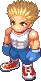<h3>Steve Ryu - Helping Confess</h3>

Beach Town - ParadiseLv 20+ทุกตัวละครยกเว้น Bunny

<b>ภารกิจ:</b> Bouquet × 3
<ul class="src"><li>Bouquet ดรอปจาก Hula Octopus (Lv 25)</li></ul>
รางวัล: Bunny Card, Heart Gem · EXP 35,392 / TM 10,032

<figure class="map" style="aspect-ratio:142/107"></figure>

<label class="done"><input class="ep" id="e0-21" type="checkbox"/> ทำแล้ว</label>3.2<h3>Steve Ryu - Wacky Confession</h3>

Beach Town - ParadiseLv 20+เฉพาะ Bunny

<b>ภารกิจ:</b> Handkerchief of Challenge
<ul class="src"><li>Handkerchief of Challenge ได้จากเควส Mermaid Babe - The Mark of Love!</li><li>ตอนรับเควสนี้ Steve Ryu จะให้ Written Challenge มา</li></ul>
รางวัล: Bouquet, Heart Gem, Baby Bunny, Strong Ring · EXP 35,392 / TM 10,032

<figure class="map" style="aspect-ratio:142/107"></figure>

<label class="done"><input class="ep" id="e0-22" type="checkbox"/> ทำแล้ว</label>3.2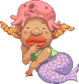<h3>Mermaid Babe - The Mark of Love!</h3>

Desert Beach Field 2 - Sand PalaceLv 20+เฉพาะ Bunny

<b>ภารกิจ:</b> 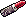Red Lipstick × 3, 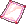Written Challenge

เงื่อนไข: รับเควส Steve Ryu - Wacky Confession ค้างไว้
<ul class="src"><li>Red Lipstick ขุดได้ที่ Desert Beach Field 2 - Sand Palace</li><li>Written Challenge ได้ตอนรับเควส Steve Ryu - Wacky Confession</li></ul>
รางวัล: Handkerchief of Challenge · EXP 35,392 / TM 10,032

<figure class="map" style="aspect-ratio:142/142">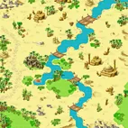</figure>

<label class="done"><input class="ep" id="e0-23" type="checkbox"/> ทำแล้ว</label>3.3<h3>Don Giuvanni - A Famous Model's Picture</h3>

Beach Town - ParadiseLv 20+ทุกตัวละครยกเว้น Cat

<b>ภารกิจ:</b> Jenny's Photo B
<ul class="src"><li>Jenny's Photo B ขุดได้ที่ Desert Beach Field 1 - Delta Island</li></ul>
รางวัล: Cat Card, Blue Potion B × 10, Heart Gem · EXP 35,392 / TM 10,032

<figure class="map" style="aspect-ratio:142/107"></figure>

<label class="done"><input class="ep" id="e0-24" type="checkbox"/> ทำแล้ว</label>3.3<h3>Don Giuvanni - Enemies in a Place like this?</h3>

Beach Town - ParadiseLv 20+เฉพาะ Cat

<b>ภารกิจ:</b> Clam Meat × 3
<ul class="src"><li>Clam Meat ดรอปจาก Shell Trap (Lv 19)</li></ul>
รางวัล: Director's Letter, Kitten, Heart Gem, Solid Ring · EXP 35,392 / TM 10,032

<figure class="map" style="aspect-ratio:142/107"></figure>

<label class="done"><input class="ep" id="e0-25" type="checkbox"/> ทำแล้ว</label>3.4<h3>Clever Owl - The Owl's Worry</h3>

Beach Town - ParadiseLv 20+ทุกตัวละครยกเว้น Sheep

<b>ภารกิจ:</b> 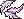Golden Mole Feather × 3
<ul class="src"><li>Golden Mole Feather ดรอปจาก Golden Mole (Lv 20)</li></ul>
รางวัล: Sheep Card, Heart Gem · EXP 35,392 / TM 10,032

<figure class="map" style="aspect-ratio:142/107"></figure>

<label class="done"><input class="ep" id="e0-26" type="checkbox"/> ทำแล้ว</label>3.4<h3>Clever Owl - The Owl from that Time</h3>

Beach Town - ParadiseLv 20+เฉพาะ Sheep

<b>ภารกิจ:</b> Magic Sealed Letter
<ul class="src"><li>Magic Sealed Letter ขุดได้ที่ Desert Beach Field 1 - Delta Island</li></ul>
รางวัล: Unsealed Letter, Lamb, Heart Gem, Smart Ring · EXP 35,392 / TM 10,032

<figure class="map" style="aspect-ratio:142/107"></figure>

<label class="done"><input class="ep" id="e0-27" type="checkbox"/> ทำแล้ว</label>3.5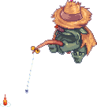<h3>Kristoffer J. - Weird Fisherman</h3>

Beach Town - ParadiseLv 20+ทุกตัวละครยกเว้น Fox

<b>ภารกิจ:</b> 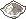Salt × 3
<ul class="src"><li>Salt ขุดได้ที่ Desert Beach Field 1 - Delta Island</li></ul>
รางวัล: Salted Dry Fish × 20, Fox Card, Heart Gem · EXP 35,392 / TM 10,032

<figure class="map" style="aspect-ratio:142/107"></figure>

<label class="done"><input class="ep" id="e0-28" type="checkbox"/> ทำแล้ว</label>3.5<h3>Kristoffer J. - Fished Up Scroll</h3>

Beach Town - ParadiseLv 20+เฉพาะ Fox

<b>ภารกิจ:</b> 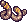Earthworm × 3
<ul class="src"><li>Earthworm ดรอปจาก Golden Mole (Lv 20)</li></ul>
รางวัล: Envelope with Photo, Fox Pup, Heart Gem, Accurate Ring · EXP 35,392 / TM 10,032

<figure class="map" style="aspect-ratio:142/107"></figure>

<label class="done"><input class="ep" id="e0-29" type="checkbox"/> ทำแล้ว</label>3.6<h3>Dorothy - A Present for a Sick Friend (1)</h3>

Beach Town - ParadiseLv 20+ทุกตัวละครยกเว้น Lion

<b>ภารกิจ:</b> Scorpion Jerky × 3
<ul class="src"><li>Scorpion Jerky ดรอปจาก Sea Scorpion (Lv 22)</li></ul>
รางวัล: Lion Card, Heart Gem · EXP 35,392 / TM 10,032

<figure class="map" style="aspect-ratio:142/107"></figure>

<label class="done"><input class="ep" id="e0-30" type="checkbox"/> ทำแล้ว</label>3.6<h3>Dorothy - Guardian of Dreams</h3>

Beach Town - ParadiseLv 20+เฉพาะ Lion

<b>ภารกิจ:</b> Twinkle Star × 3
<ul class="src"><li>Twinkle Star ดรอปจาก Fanta Slime (Lv 18)</li></ul>
รางวัล: Lion Cub, Child's Letter, Heart Gem, Accurate Ring · EXP 35,392 / TM 10,032

<figure class="map" style="aspect-ratio:142/107"></figure>

<label class="done"><input class="ep" id="e0-31" type="checkbox"/> ทำแล้ว</label>3.7<h3>Officer Tera - Help Keep the Peace</h3>

Beach Town - ParadiseLv 20+ทุกตัวละครยกเว้น Buffalo

<b>ภารกิจ:</b> Illegal CD × 3
<ul class="src"><li>Illegal CD ดรอปจาก Grumpy Octopus (Lv 29)</li></ul>
รางวัล: 500 Galder Coupon, Buffalo Card, Heart Gem · EXP 35,392 / TM 10,032

<figure class="map" style="aspect-ratio:142/107"></figure>

<label class="done"><input class="ep" id="e0-32" type="checkbox"/> ทำแล้ว</label>3.7<h3>Officer Tera - An Unexpected Encounter</h3>

Beach Town - ParadiseLv 20+เฉพาะ Buffalo

<b>ภารกิจ:</b> Illegal CD × 3
<ul class="src"><li>Illegal CD ดรอปจาก Grumpy Octopus (Lv 29)</li></ul>
รางวัล: 500 Galder Coupon, Buffalo Calf, Heart Gem, Strong Ring · EXP 35,392 / TM 10,032

<figure class="map" style="aspect-ratio:142/107"></figure>

<label class="done"><input class="ep" id="e0-33" type="checkbox"/> ทำแล้ว</label>3.8<h3>Old Artist - Cherishing Destinies</h3>

Desert Beach Field 2 - Sand PalaceLv 20+ทุกตัวละครยกเว้น Dragon

<b>ภารกิจ:</b> Paper, Color Pencils × 2
<ul class="src"><li>Paper ขุดได้ที่ Desert Beach Field 2 - Sand Palace หรือซื้อที่ Gate of Desert Beach Shop หรือ Paradise Shop</li><li>Color Pencils ดรอปจาก Fanta Fish (Lv 21)</li></ul>
รางวัล: Postcard, Dragon Card, Pink Potion B × 10, Heart Gem · EXP 35,392 / TM 10,032

<figure class="map" style="aspect-ratio:142/142"></figure>

<label class="done"><input class="ep" id="e0-34" type="checkbox"/> ทำแล้ว</label>3.8<h3>Old Artist - The Painter from Notre Dame</h3>

Desert Beach Field 2 - Sand PalaceLv 20+เฉพาะ Dragon

<b>ภารกิจ:</b> Paper, Color Pencils × 2
<ul class="src"><li>Paper ขุดได้ที่ Desert Beach Field 2 - Sand Palace หรือซื้อที่ Gate of Desert Beach Shop หรือ Paradise Shop</li><li>Color Pencils ดรอปจาก Fanta Fish (Lv 21)</li></ul>
รางวัล: Postcard, Dragon Whelp, Heart Gem, Smart Ring · EXP 35,392 / TM 10,032

<figure class="map" style="aspect-ratio:142/142"></figure>

<label class="done"><input class="ep" id="e0-35" type="checkbox"/> ทำแล้ว</label>3.9<h3>Rosemary - Lookin' Good!</h3>

Beach Town - ParadiseLv 20+ทุกตัวละครยกเว้น Raccoon

<b>ภารกิจ:</b> Swimsuit × 2
<ul class="src"><li>Swimsuit ขุดได้ที่ Desert Beach Field 2 - Sand Palace</li></ul>
รางวัล: Raccoon Card, Heart Gem · EXP 35,392 / TM 10,032

<figure class="map" style="aspect-ratio:142/107"></figure>

<label class="done"><input class="ep" id="e0-36" type="checkbox"/> ทำแล้ว</label>3.9<h3>Rosemary - Runaway Student</h3>

Beach Town - ParadiseLv 20+เฉพาะ Raccoon

<b>ภารกิจ:</b> Pen × 2, Paper × 2
<ul class="src"><li>Pen ดรอปจาก Fanta Fish (Lv 21)</li><li>Paper ขุดได้ที่ Desert Beach Field 2 หรือซื้อที่ Gate of Desert Beach Shop หรือ Paradise Shop</li></ul>
รางวัล: Signed Agreement, Raccoon Cub, Heart Gem, Solid Ring · EXP 35,392 / TM 10,032

<figure class="map" style="aspect-ratio:142/107"></figure>

</section>

<PageBehavior />
