

<header style="display:flex;flex-direction:column;gap:8px">

# Episode 1 · Secret of the Alteo Empire

ความลับของอาณาจักร Alteo · 3 บท 22 เควส

สรุปจากวิกิ ggFTW (ฉบับ mirror ของ LifeTO) หน้า [Episode 1 Quests](https://wikimirror.lifeto.co/wiki.ggftw.com/trickster/Episode_1_Quests.html) อ่านเนื้อเรื่องย่อทุกตอนได้ที่หน้า [Story Quest](./story-quest.md)

วิกินี้เป็นข้อมูลเก่า และตัววิกิเตือนเองว่าบางส่วนอาจไม่ตรงกับเซิร์ฟ LifeTO ปัจจุบัน

</header>

<section>

## ภาพรวม

เริ่มรู้จักตำนานของราชินี Nefertiti, รูปปั้น Poseidon's Blessing และแร่ศักดิ์สิทธิ์ Harkon

<ul>
<li>เริ่มที่ <b>Monkey T</b> (Gate of Caballa Relics) ต้องเลเวล 45+ และจบ Episode 0 แล้ว</li>
<li>เควสต่อกันเป็นสาย ทำเรียงตามลำดับในหน้านี้ ส่งเควสหนึ่งแล้วเควสถัดไปจะเปิดให้รับ</li>
<li>กดชื่อบทเพื่อพับหรือกาง</li>
</ul>

<nav class="toc"><a href="#ch-1">บท 1 · Nefertiti's Necklace</a><a href="#ch-2">บท 2 · Unknown Ancient Box</a><a href="#ch-3">บท 3 · Harkon Searchers</a></nav>

<a href="./episode-0.html">← Episode 0</a> · <a href="./episode-2.html">Episode 2 →</a>

</section>

<section aria-live="polite" class="counter">

## ความคืบหน้า

0 / 22 เควส

<button id="hidedone" type="button" aria-pressed="false">ซ่อนเควสที่ทำแล้ว</button><button id="reset" type="button">ล้างทั้งหมด</button>

</section>

<section id="ch-1">

<h2 id="ch-1-h">บท 1 · Nefertiti's Necklace </h2>

ได้สร้อยคอเก่าแต่สวยมาแล้วพยายามซ่อม ระหว่างนั้นเจอภาพวาดหญิงงามชื่อ Nefertiti และได้ฟังตำนาน ราชินีสาวแห่ง Fremeia ที่สัตว์ร้าย Enkicladus หลงรักจนลักพาตัวไปก้นทะเล ก่อนเทพ Poseidon จะสังหาร Enkicladus แล้วพาเธอไปเป็นมเหสีที่อาณาจักร Alteo สร้อยกลับไปหาเจ้าของคือ Love Hunter Robin ซึ่งให้เอาภาพไปให้ Rosaline Gracia คู่หมั้นของ Don Giuvanni เธอมอบคัมภีร์ลึกลับที่เล่าว่า Poseidon's Blessing คือของขวัญจาก Poseidon ถึง Nefertiti ลูกหลานของเธอควบคุมพลัง Harkon ได้และถูกเรียกว่า Trickster ส่วนเหล่า Nereides พี่น้องของมเหสีเดิมของ Poseidon ได้ทำลาย Alteo เพื่อแก้แค้น

<label class="done"><input class="ep" id="e1-1" type="checkbox"/> ทำแล้ว</label>1.1<h3>Monkey T - Honest Monkey T</h3>เริ่มบท

Gate of Caballa RelicsLv 45+

<b>ภารกิจ:</b> 50 Galder Coupon × 5
<ul class="src"><li>50 Galder Coupon ขุดได้หลายแมพ โดยเฉพาะ Mirage Island Fields และดันเจี้ยนแถวนั้น</li></ul>
รางวัล: Faded Necklace · EXP 257,613 / TM 121,252

<figure class="map" style="aspect-ratio:114/108">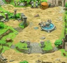</figure>

<label class="done"><input class="ep" id="e1-2" type="checkbox"/> ทำแล้ว</label>1.2<h3>Old Artist - Old Artist's Request</h3>

Relics Field 1 - AtlasLv 45+ตอนกลางวัน

<b>ภารกิจ:</b> Ginseng Tea, 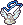Faded Necklace

เงื่อนไข: มี Faded Necklace ในกระเป๋า
<ul class="src"><li>Ginseng Tea ผสม (Compound) จาก 2x Ginseng + 1x Honey + 1x Distilled Water กับ Compounder Paul ที่ Megalopolis Square หรือ Relics Town - Azteca</li><li>Faded Necklace ได้จากเควส Monkey Business</li><li>Ginseng ขุดได้ที่ Southeast Forest / Southwest Forest · Honey ดรอปจาก Forest Wasp (Lv 47) · Distilled Water ซื้อได้ตามร้านค้าทั่วไป</li></ul>
รางวัล: Empty Container · EXP 257,613 / TM 121,252

<figure class="map" style="aspect-ratio:142/142">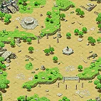</figure>

<label class="done"><input class="ep" id="e1-3" type="checkbox"/> ทำแล้ว</label>1.3<h3>Old Artist - Old Artist's Needs</h3>

Relics Field 1 - AtlasLv 45+

<b>ภารกิจ:</b> Fully-Filled Container
<ul class="src"><li>Fully-Filled Container ได้จากเควส Sabrina's Sacred Water</li></ul>
รางวัล: Nefertiti's Portrait, Mermaid Babe's Portrait · EXP 257,613 / TM 121,252

<figure class="map" style="aspect-ratio:142/142"></figure>

<label class="done"><input class="ep" id="e1-4" type="checkbox"/> ทำแล้ว</label>1.4<h3>Guide Sabrina - Sabrina's Sacred Water</h3>

Relics Town - AztecaLv 45+

<b>ภารกิจ:</b> Empty Container, Gold × 5, Golden Egg

เงื่อนไข: รับเควส Old Artist's Needs ค้างไว้
<ul class="src"><li>Empty Container ได้จากเควส Old Artist's Request</li><li>Gold ดรอปจาก Mimic (Lv 61)</li><li>Golden Egg ขุดได้ที่ Caballa Relics Fields</li></ul>
รางวัล: Fully-Filled Container · EXP 257,613 / TM 121,252

<figure class="map" style="aspect-ratio:135/142">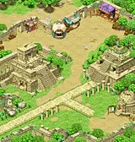</figure>

<label class="done"><input class="ep" id="e1-5" type="checkbox"/> ทำแล้ว</label>1.5<h3>Old Artist - Help Old Artist</h3>

Relics Field 1 - AtlasLv 45+

<b>ภารกิจ:</b> Chuu~ Check

เงื่อนไข: ผ่านเควส Old Artist's Needs แล้ว
<ul class="src"><li>Chuu~ Check ได้จากเควส Model Mermaid Babe - A Mirror for the Beauty</li></ul>
รางวัล: Restored Necklace · EXP 257,613 / TM 121,252

<figure class="map" style="aspect-ratio:142/142"></figure>

<label class="done"><input class="ep" id="e1-6" type="checkbox"/> ทำแล้ว</label>1.6<h3>Model Mermaid Babe - Mermaid Babe's Complaint</h3>

Relics Field 1 - AtlasLv 45+

<b>ภารกิจ:</b> Mermaid Babe's Portrait, Antique Mirror

เงื่อนไข: รับเควส Help Old Artist ค้างไว้
<ul class="src"><li>Mermaid Babe's Portrait ได้จากเควส Old Artist's Needs</li><li>Antique Mirror ได้จากเควส Antique Mirror!</li></ul>
รางวัล: Antique Mirror · EXP 257,613 / TM 121,252

<figure class="map" style="aspect-ratio:142/142"></figure>

<label class="done"><input class="ep" id="e1-7" type="checkbox"/> ทำแล้ว</label>1.7<h3>Monkey T - Antique Mirror!</h3>

Gate of Caballa RelicsLv 45+

<b>ภารกิจ:</b> 500 Galder Coupon × 2

เงื่อนไข: รับเควส Mermaid Babe's Complaint ค้างไว้
<ul class="src"><li>500 Galder Coupon ได้จากหลายเควส ขุดได้หลายที่ และมอนหลายตัวดรอป แมพที่แนะนำคือ Gate of Ghost Blue</li></ul>
รางวัล: Antique Mirror · EXP 257,613 / TM 121,252

<figure class="map" style="aspect-ratio:114/108"></figure>

<label class="done"><input class="ep" id="e1-8" type="checkbox"/> ทำแล้ว</label>1.8<h3>Model Mermaid Babe - A Mirror for the Beauty</h3>

Relics Field 1 - AtlasLv 45+

<b>ภารกิจ:</b> Fantastic Hand Mirror

เงื่อนไข: ผ่านเควส Mermaid Babe's Complaint แล้ว
<ul class="src"><li>Fantastic Hand Mirror ได้จากเควส Louis the Great</li></ul>
รางวัล: Chuu~ Check · EXP 257,613 / TM 121,252

<figure class="map" style="aspect-ratio:142/142"></figure>

<label class="done"><input class="ep" id="e1-9" type="checkbox"/> ทำแล้ว</label>1.9<h3>Louis Bitton - Louis the Great</h3>

Relics Town - AztecaLv 45+

<b>ภารกิจ:</b> Antique Mirror, Fantastic Powder

เงื่อนไข: รับเควส A Mirror for the Beauty ค้างไว้
<ul class="src"><li>Antique Mirror ได้จากเควส Mermaid Babe's Complaint</li><li>Fantastic Powder ขุดได้ที่ Relics Field 4 - An Altar for Sacrifice</li></ul>
รางวัล: Fantastic Hand Mirror · EXP 257,613 / TM 121,252

<figure class="map" style="aspect-ratio:135/142"></figure>

<label class="done"><input class="ep" id="e1-10" type="checkbox"/> ทำแล้ว</label>1.10<h3>Love Hunter Robin - Necklace's Owner</h3>

Path to Caballa RelicsLv 45+

<b>ภารกิจ:</b> Restored Necklace

เงื่อนไข: ผ่านเควส Help Old Artist แล้ว · มี Restored Necklace ในกระเป๋า
<ul class="src"><li>Restored Necklace ได้จากเควส Help Old Artist</li></ul>
รางวัล: Aquamarine Pendant · EXP 257,613 / TM 121,252

<figure class="map" style="aspect-ratio:71/142">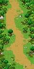</figure>

<label class="done"><input class="ep" id="e1-11" type="checkbox"/> ทำแล้ว</label>1.11<h3>Rosaline Gracia - Rosaline's Document</h3>จบบท

Megalopolis SquareLv 45+

<b>ภารกิจ:</b> Honey Tea, Nefertiti's Portrait
<ul class="src"><li>Honey Tea ผสม (Compound) จาก 1x Honey + 2x Royal Jelly + 2x Distilled Water กับ Compounder Paul ที่ Megalopolis Square และ Relics Town - Azteca</li><li>Nefertiti's Portrait ได้จากเควส Old Artist - Old Artist's Needs</li><li>Honey และ Royal Jelly ดรอปจาก Forest Wasp (Lv 47) · Distilled Water ซื้อได้ตามร้านค้าทั่วไป</li></ul>
รางวัล: Unknown Old Document · EXP 1,288,065 / TM 606,262

<figure class="map" style="aspect-ratio:142/132"></figure>

</section>

<section id="ch-2">

<h2 id="ch-2-h">บท 2 · Unknown Ancient Box </h2>

ตามเบาะแสจากคัมภีร์จนเจอกล่องเก่าจาก Alteo ต้องรวบรวมชิ้นส่วนจากคนที่ Oops Wharf มาเปิด ในกล่องมีเอกสารเล่าเรื่อง Harkon, Hephaistos ผู้สร้าง Poseidon's Blessing, ผู้พิทักษ์ 16 คนที่ซ่อนรูปปั้นไว้หลัง Alteo ล่มสลาย และ Janus ผู้พิทักษ์คนแรกที่ทิ้ง Nefertiti ไปเพราะใจที่เต็มไปด้วยความโกรธ

<label class="done"><input class="ep" id="e1-12" type="checkbox"/> ทำแล้ว</label>2.1<h3>Indiana John - Weird Box</h3>เริ่มบท

Caballa Relics Dungeon 1Lv 50+

<b>ภารกิจ:</b> Weird Piece 1, Weird Piece 2, Weird Piece 3

เงื่อนไข: ผ่านเควส Rosaline's Document แล้ว
<ul class="src"><li>Weird Piece 1 ได้จากเควส Min's Tale</li><li>Weird Piece 2 ได้จากเควส Jia's New Vibe</li><li>Weird Piece 3 ได้จากเควส Eloy's Tale</li></ul>
รางวัล: Completed Box Key, Soil Attribute Stone, Light Attribute Stone · EXP 331,296 / TM 376,990

<figure class="map" style="aspect-ratio:142/142">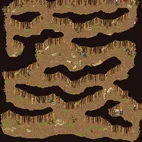</figure>

<label class="done"><input class="ep" id="e1-13" type="checkbox"/> ทำแล้ว</label>2.2<h3>Skipper Min - Skipper Min's Sightings</h3>

Gate of Oops WharfLv 50+

<b>ภารกิจ:</b> Thick Rope × 3, Piece of Lumber × 5
<ul class="src"><li>Thick Rope ขุดได้ที่ Oops Wharf Fields</li><li>Piece of Lumber ดรอปจาก Black Foe (Lv 79) และขุดได้ที่ Oops Wharf Fields</li></ul>
รางวัล: Weird Piece 1 · EXP 331,296 / TM 376,990

<figure class="map" style="aspect-ratio:142/74">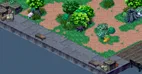</figure>

<label class="done"><input class="ep" id="e1-14" type="checkbox"/> ทำแล้ว</label>2.3<h3>Shaman Girl Jia - Jia's Deja Vu</h3>

Wharf Field 4 - Chrono WharfLv 50+

<b>ภารกิจ:</b> Bell Cluster × 2
<ul class="src"><li>Bell Cluster ดรอปจาก Crow (Lv 88)</li></ul>
รางวัล: Weird Piece 2 · EXP 331,296 / TM 376,990

<figure class="map" style="aspect-ratio:142/142">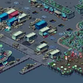</figure>

<label class="done"><input class="ep" id="e1-15" type="checkbox"/> ทำแล้ว</label>2.4<h3>Vagabond Eloy - Eloy's Tale</h3>

Oops WharfLv 50+

<b>ภารกิจ:</b> Baby Powder × 3
<ul class="src"><li>Baby Powder ดรอปจาก Quiem (Lv 75)</li></ul>
รางวัล: Weird Piece 3 · EXP 331,296 / TM 376,990

<figure class="map" style="aspect-ratio:116/110">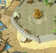</figure>

<label class="done"><input class="ep" id="e1-16" type="checkbox"/> ทำแล้ว</label>2.5<h3>Indiana John - Box's Identity</h3>จบบท

Caballa Relics Dungeon 1Lv 50+

<b>ภารกิจ:</b> Doc from Weird Box, Lamplight × 2

เงื่อนไข: ผ่านเควส Weird Box แล้ว
<ul class="src"><li>Doc from Weird Box ได้จาก Weird Box</li><li>Lamplight ดรอปจาก Naranjo (Lv 84)</li></ul>
รางวัล: Memo from Weird Box · EXP 1,656,480 / TM 1,884,952

<figure class="map" style="aspect-ratio:142/142"></figure>

<label class="done"><input class="ep" id="e1-17" type="checkbox"/> ทำแล้ว</label>2.6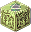<h3>Weird Box - VENDETTA</h3>

Caballa Relics Dungeon 1Lv 50+

<b>ภารกิจ:</b> ตอบคำถามให้ถูก

เงื่อนไข: รับเควส Box's Identity ค้างไว้
<ul class="src"><li>คำตอบที่ถูกคือ "Vendetta" ถ้าเลือกข้ออื่นจะโดนวาร์ปออกไป</li></ul>
รางวัล: Doc from Weird Box

<figure class="map" style="aspect-ratio:142/142"></figure>

</section>

<section id="ch-3">

<h2 id="ch-3-h">บท 3 · Harkon Searchers </h2>

ผจญภัยต่อจนได้ Harkon มา และเจอนางฟ้า Nono ที่ถูกผนึกในก้อน Harkon ขนาดใหญ่ ซึ่งดูเหมือนมีแต่เราที่มองเห็นและได้ยินเธอ

<label class="done"><input class="ep" id="e1-18" type="checkbox"/> ทำแล้ว</label>3.1<h3>Tango - Tango's Love</h3>เริ่มบท

Gate of Oops WharfLv 52+

<b>ภารกิจ:</b> Harkon Necklace

เงื่อนไข: ผ่านเควส Box's Identity แล้ว
<ul class="src"><li>Harkon Necklace ได้จากการเปิด Harkon Heirloom</li></ul>
รางวัล: Silk Handkerchief, Volcano Water × 3 · EXP 363,639 / TM 429,317

<figure class="map" style="aspect-ratio:142/74"></figure>

<label class="done"><input class="ep" id="e1-19" type="checkbox"/> ทำแล้ว</label>3.2<h3>Explorer Reina - Reina's Preparation</h3>

Path to Mermaid Palace 1Lv 52+

<b>ภารกิจ:</b> Power Plan Battery × 5
<ul class="src"><li>Power Plan Battery ดรอปจาก Pirate Boxer B (Lv 86)</li></ul>
รางวัล: 500 Galder Coupon × 5 · EXP 363,639 / TM 429,317

<figure class="map" style="aspect-ratio:48/142"></figure>

<label class="done"><input class="ep" id="e1-20" type="checkbox"/> ทำแล้ว</label>3.3<h3>Explorer Reina - Reina's Exploration</h3>

Path to Mermaid Palace 1Lv 52+

<b>ภารกิจ:</b> Harkon Ornament × 3
<ul class="src"><li>Harkon Ornament ได้จากการเปิด Harkon Heirloom หรือขุดที่ Techichi Volcano Fields</li></ul>
รางวัล: Special Polisher · EXP 363,639 / TM 429,317

<figure class="map" style="aspect-ratio:48/142"></figure>

<label class="done"><input class="ep" id="e1-21" type="checkbox"/> ทำแล้ว</label>3.4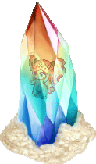<h3>Fairy Nono - Fairy in a Harkon</h3>

Path to Mermaid Palace 2Lv 52+

<b>ภารกิจ:</b> Silk Handkerchief, Special Polisher, Volcano Water
<ul class="src"><li>Silk Handkerchief และ Volcano Water ได้จากเควส Tango's Love</li><li>Special Polisher ได้จากเควส Reina's Exploration</li></ul>
รางวัล: Nono's Note · EXP 363,639 / TM 429,317

<figure class="map" style="aspect-ratio:53/142"></figure>

<label class="done"><input class="ep" id="e1-22" type="checkbox"/> ทำแล้ว</label>3.5<h3>Fairy Nono - Fairy's Favor</h3>จบบท

Path to Mermaid Palace 2Lv 52+

<b>ภารกิจ:</b> Transparent Medicine, Nono's Note

เงื่อนไข: ผ่านเควส Fairy in a Harkon and have Volcano Water แล้ว · Silk Handkerchief · Special Polisher in inventory
<ul class="src"><li>Transparent Medicine ผสม (Compound) จาก 1x Harkon Shard + 2x Super Bean Shell + 1x Fairy's Drink กับ Compounder Paul ที่ Oops Wharf</li><li>Nono's Note ได้จากเควส Fairy in a Harkon</li><li>Harkon Shard ได้จากการเปิด Harkon Heirloom · Super Bean Shell ดรอปจาก Super Golden Mole (Lv 80) · Fairy's Drink ขุดได้ที่ Path to Mermaid Palace 1 / 2</li></ul>
รางวัล: Nono Ring · EXP 1,818,198 / TM 2,146,586

<figure class="map" style="aspect-ratio:53/142"></figure>

</section>

<PageBehavior />
