

<header style="display:flex;flex-direction:column;gap:8px">

# Episode 2 · Mirage Island

เกาะมิราจ · 3 บท 29 เควส

สรุปจากวิกิ ggFTW (ฉบับ mirror ของ LifeTO) หน้า [Episode 2 Quests](https://wikimirror.lifeto.co/wiki.ggftw.com/trickster/Episode_2_Quests.html) อ่านเนื้อเรื่องย่อทุกตอนได้ที่หน้า [Story Quest](./story-quest.md)

</header>

<section>

## ภาพรวม

ถึง Rosaline จะเตือน แต่เราก็ไปหาดาบ Sword of Vengeance ให้ Don Giuvanni และได้รู้ถึงพลังอันน่ากลัวของมัน พร้อมกับการปรากฏของ Mirage Island ที่นั่นเราได้ฟังเรื่องรักโศกของคนสองคนที่เกิดขึ้นก่อนจะมี Caballa Island

<ul>
<li>เริ่มที่ <b>Kahlihara</b> (Gate of Mermaid Dungeon) ต้องเลเวล 80+ และจบ Episode 1 แล้ว</li>
<li>เควสต่อกันเป็นสาย ทำเรียงตามลำดับในหน้านี้ ส่งเควสหนึ่งแล้วเควสถัดไปจะเปิดให้รับ</li>
<li>กดชื่อบทเพื่อพับหรือกาง</li>
</ul>

<nav class="toc"><a href="#ch-1">บท 1 · Sword of Vengeance</a><a href="#ch-2">บท 2 · Song of Memories</a><a href="#ch-3">บท 3 · Prelude of The Cursed Soul</a></nav>

<a href="./episode-1.html">← Episode 1</a> · <a href="./episode-3.html">Episode 3 →</a>

</section>

<section aria-live="polite" class="counter">

## ความคืบหน้า

0 / 29 เควส

<button id="hidedone" type="button" aria-pressed="false">ซ่อนเควสที่ทำแล้ว</button><button id="reset" type="button">ล้างทั้งหมด</button>

</section>

<section id="ch-1">

<h2 id="ch-1-h">บท 1 · Sword of Vengeance </h2>

ตามหาดาบ Sword of Vengeance ให้ Kahlihara แล้วพบว่า Rosaline เป็นห่วงเรื่องดาบเล่มนี้ ทำฝักดาบกับ Blacksmith Marx แล้วส่งดาบให้ Don Giuvanni จนได้ตั๋วล่องเรือไป Mirage Island

<label class="done"><input class="ep" id="e2-1" type="checkbox"/> ทำแล้ว</label>1.1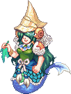<h3>Kahlihara - Kahlihara's Request</h3>เริ่มบท

Gate of Mermaid DungeonLv 80+

<b>ภารกิจ:</b> Tanya's Sword
<ul class="src"><li>Tanya's Sword ดรอปจาก Tanya (Lv 150)</li></ul>
รางวัล: Sword of Vengeance · EXP 506,800 / TM 967,950

<figure class="map" style="aspect-ratio:142/115">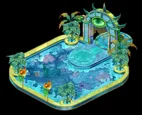</figure>

<label class="done"><input class="ep" id="e2-2" type="checkbox"/> ทำแล้ว</label>1.2<h3>Kahlihara - The Sword Deal</h3>

Gate of Mermaid DungeonLv 80+

<b>ภารกิจ:</b> Tear Soaked Check
<ul class="src"><li>Tear Soaked Check ได้จากเควส Don Giuvanni - Man's Tears</li></ul>
รางวัล: Voucher of Promise, Kahlihara Card · EXP 506,800 / TM 967,950

<figure class="map" style="aspect-ratio:142/115"></figure>

<label class="done"><input class="ep" id="e2-3" type="checkbox"/> ทำแล้ว</label>1.3<h3>Rosaline Gracia - Rosaline's Worry</h3>

Oops WharfLv 80+

<b>ภารกิจ:</b> Sword of Vengeance

เงื่อนไข: รับเควส Kahlihara - The Sword Deal ค้างไว้
<ul class="src"><li>Sword of Vengeance ได้จากเควส Kahlihara's Request</li></ul>
รางวัล: Sword of Vengeance, Nefertiti's Portrait · EXP 506,800 / TM 967,950

<figure class="map" style="aspect-ratio:116/110">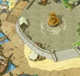</figure>

<label class="done"><input class="ep" id="e2-4" type="checkbox"/> ทำแล้ว</label>1.4<h3>Rosaline Gracia - Fate of the Portrait</h3>

Oops WharfLv 80+

<b>ภารกิจ:</b> Robin's Letter
<ul class="src"><li>Robin's Letter ได้จากเควส Love Hunter Robin - Robin's Acceptance</li></ul>
รางวัล: Art Stone Rod · EXP 506,800 / TM 967,950

<figure class="map" style="aspect-ratio:116/110"></figure>

<label class="done"><input class="ep" id="e2-5" type="checkbox"/> ทำแล้ว</label>1.5<h3>Love Hunter Robin - Robin's Acceptance</h3>

Path to Caballa RelicsLv 80+

<b>ภารกิจ:</b> Nefertiti's Portrait, Dark Cloth × 3

เงื่อนไข: รับเควส Fate of the Portrait ค้างไว้
<ul class="src"><li>Nefertiti's Portrait ได้จากเควส Rosaline's Worry</li><li>Dark Cloth ดรอปจาก Crow (Lv 88)</li></ul>
รางวัล: Robin's Letter · EXP 506,800 / TM 967,950

<figure class="map" style="aspect-ratio:71/142">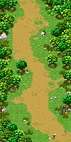</figure>

<label class="done"><input class="ep" id="e2-6" type="checkbox"/> ทำแล้ว</label>1.6<h3>Blacksmith Marx - Marx's Sheath</h3>

Gate of Mermaid DungeonLv 80+

<b>ภารกิจ:</b> Black Pearl × 3, Pearl × 3, Sturdy Scale × 3

เงื่อนไข: รับเควส Don Giuvanni - Knife's New Owner ค้างไว้
<ul class="src"><li>Black Pearl, Pearl ขุดได้ที่ Mermaid Palace Fields และ Mermaid Dungeon</li><li>Sturdy Scale ดรอปจาก Merman Aqu (Lv 86)</li></ul>
รางวัล: Scabbard, Blacksmith Marx Card · EXP 506,800 / TM 967,950

<figure class="map" style="aspect-ratio:142/115"></figure>

<label class="done"><input class="ep" id="e2-7" type="checkbox"/> ทำแล้ว</label>1.7<h3>Don Giuvanni - Knife's New Owner</h3>

Oops WharfLv 80+

<b>ภารกิจ:</b> Sword of Vengeance, Scabbard

เงื่อนไข: ผ่านเควส Rosaline Gracia - Fate of the Portrait and have Kahlihara - The Sword Deal in quest log แล้ว
<ul class="src"><li>Sword of Vengeance ได้จากเควส Rosaline's Worry</li><li>Scabbard ได้จากเควส Marx's Sheath</li></ul>
รางวัล: Blank Check · EXP 506,800 / TM 967,950

<figure class="map" style="aspect-ratio:116/110"></figure>

<label class="done"><input class="ep" id="e2-8" type="checkbox"/> ทำแล้ว</label>1.8<h3>Don Giuvanni - Man's Tears</h3>

Oops WharfLv 80+

<b>ภารกิจ:</b> Giuvanni's Tear, Blank Check

เงื่อนไข: ผ่านเควส Marx Sheath's แล้ว
<ul class="src"><li>รับเควสแล้ว Don Giuvanni จะวาร์ปไป Don Giuvanni's Secret Room ซึ่งมี Don Giuvanni (มอน) รออยู่</li><li>Giuvanni's Tear ดรอปจาก Don Giuvanni (Lv 150)</li><li>Blank Check ได้จากเควส Don Giuvanni - Knife's New Owner</li></ul>
รางวัล: Tear Soaked Check · EXP 506,800 / TM 967,950

<figure class="map" style="aspect-ratio:116/110"></figure>

<label class="done"><input class="ep" id="e2-9" type="checkbox"/> ทำแล้ว</label>1.9<h3>Don Giuvanni - Writing on the Knife</h3>จบบท

Oops WharfLv 80+

<b>ภารกิจ:</b> Decoded Document

เงื่อนไข: ผ่านเควส Kahlihara - The Sword Deal แล้ว · can only be done during nighttime
<ul class="src"><li>Decoded Document ได้จากเควส Indiana John - Clay Tablet Discovered</li></ul>
รางวัล: Cruise Ticket, Don Giuvanni's Mask · EXP 7,095,200 / TM 13,551,300

<figure class="map" style="aspect-ratio:116/110"></figure>

<label class="done"><input class="ep" id="e2-10" type="checkbox"/> ทำแล้ว</label>1.10<h3>Indiana John - Clay Tablet Discovered</h3>

Relics Field 2 - Hand of GiantLv 80+

<b>ภารกิจ:</b> Clay Tablet × 5

เงื่อนไข: รับเควส Don Giuvanni - Writing on the Knife ค้างไว้
<ul class="src"><li>Clay Tablet ขุดได้ที่ Caballa Relics Fields</li></ul>
รางวัล: Decoded Document, Indiana John Card · EXP 506,800 / TM 967,950

<figure class="map" style="aspect-ratio:142/142">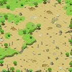</figure>

</section>

<section id="ch-2">

<h2 id="ch-2-h">บท 2 · Song of Memories </h2>

บน Mirage Island ช่วย Bard La Fimmel จุดกำยานแห่งความทรงจำ ฟื้นความจำของ Portina และราชินี Nefertiti

<label class="done"><input class="ep" id="e2-11" type="checkbox"/> ทำแล้ว</label>2.1<h3>Bard La Fimmel - Incense of Flame 1</h3>เริ่มบท

Gate of Mirage IslandLv 80+

<b>ภารกิจ:</b> Yellow Flame Incense
<ul class="src"><li>Yellow Flame Incense ได้จากเควส Portina, Remembered</li></ul>
รางวัล: Yellow Musical Score · EXP 506,800 / TM 967,950

<figure class="map" style="aspect-ratio:142/98">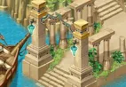</figure>

<label class="done"><input class="ep" id="e2-12" type="checkbox"/> ทำแล้ว</label>2.2<h3>Portina - Portina, Remembered</h3>

Mirage Island Field 2 - Cliff of FateLv 80+

<b>ภารกิจ:</b> Abiox × 5
<ul class="src"><li>Abiox ดรอปจาก Sea Spirit (Lv 121)</li></ul>
รางวัล: Yellow Flame Incense, Portina Card · EXP 506,800 / TM 967,950

<figure class="map" style="aspect-ratio:142/142">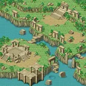</figure>

<label class="done"><input class="ep" id="e2-13" type="checkbox"/> ทำแล้ว</label>2.3<h3>Bard La Fimmel - Incense of Flame 2</h3>

Gate of Mirage IslandLv 80+

<b>ภารกิจ:</b> Purple Flame Incense
<ul class="src"><li>Purple Flame Incense ได้จากเควส Queen Nefertiti, Remembered</li></ul>
รางวัล: Purple Musical Score · EXP 506,800 / TM 967,950

<figure class="map" style="aspect-ratio:142/98"></figure>

<label class="done"><input class="ep" id="e2-14" type="checkbox"/> ทำแล้ว</label>2.4<h3>Nefertiti 2 - Queen Nefertiti, Remembered</h3>

Mirage Island Field 3 - FremeiaLv 80+

<b>ภารกิจ:</b> Magical Silver Platter
<ul class="src"><li>Magical Silver Platter ได้จากเควส Fortune Teller - Magical Silver Platter</li></ul>
รางวัล: Purple Flame Incense · EXP 506,800 / TM 967,950

<figure class="map" style="aspect-ratio:142/142">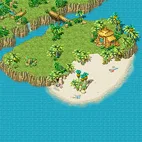</figure>

<label class="done"><input class="ep" id="e2-15" type="checkbox"/> ทำแล้ว</label>2.5<h3>Fortune Teller - Magical Silver Platter</h3>

Mirage Island Field 1 - AlteoLv 80+

<b>ภารกิจ:</b> Silver Platter, Mirror Spring Water
<ul class="src"><li>Silver Platter ดรอปจาก Werepot (Lv 98) · Mirror Spring Water ขุดได้ที่ Mirage Island Field 1 - Alteo</li></ul>
รางวัล: Magical Silver Platter, Fortune Teller Card · EXP 506,800 / TM 967,950

<figure class="map" style="aspect-ratio:142/142">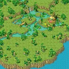</figure>

<label class="done"><input class="ep" id="e2-16" type="checkbox"/> ทำแล้ว</label>2.6<h3>Bard La Fimmel - Gift From La Fimmel</h3>จบบท

Gate of Mirage IslandLv 80+

<b>ภารกิจ:</b> Moonlight Coral × 5, Whale Baleen × 5
<ul class="src"><li>Moonlight Coral ขุดได้ที่ Mirage Island Field 3 - Fremeia</li><li>Whale Baleen ดรอปจาก Sea Hyena (Lv 126)</li></ul>
รางวัล: Crescent, La Fimmel Card · EXP 7,095,200 / TM 13,551,300

<figure class="map" style="aspect-ratio:142/98"></figure>

</section>

<section id="ch-3">

<h2 id="ch-3-h">บท 3 · Prelude of The Cursed Soul </h2>

ดูละครแห่งความทรงจำทีละฉาก เรื่องของ Enkicladus กับ Nefertiti ตั้งแต่หน้าผาแห่งโชคชะตา คำสาปของสามเทพีแห่งโชคชะตา (Moirae) ไปจนถึงการตายของ Enkicladus และคำขอสุดท้ายของเขา

<label class="done"><input class="ep" id="e2-17" type="checkbox"/> ทำแล้ว</label>3.1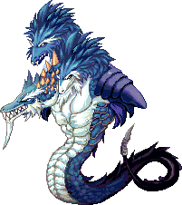<h3>Enkicladus 1 - Act 1 Scene 1, End of the Cliff</h3>เริ่มบท

Mirage Island Field 2 - Cliff of FateLv 80+

<b>ภารกิจ:</b> 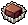Dark Choco Piece × 3
<ul class="src"><li>Dark Choco Piece ผสม (Compound) จาก 2x Cacao และ 1x Mysterious Milk กับ Compounder Paul ที่ Blooming Cora Shop</li><li>Cacao ขุดได้ที่ Coral Beach Fields · Mysterious Milk ดรอปจาก Clione (Lv 10)</li></ul>
รางวัล: Dark Attribute Stone × 3 · EXP 506,800 / TM 967,950

<figure class="map" style="aspect-ratio:142/142"></figure>

<label class="done"><input class="ep" id="e2-18" type="checkbox"/> ทำแล้ว</label>3.2<h3>Knight Scar - Act 1 Scene 2: Badly Aimed Spear</h3>

Mirage Island Field 2 - Cliff of FateLv 80+

<b>ภารกิจ:</b> Witch's Deadly Poison, Sharp Spear
<ul class="src"><li>Witch's Deadly Poison ได้จากเควส Witch's Deadly Poison · Sharp Spear ดรอปจาก Fabilsag (Lv 106)</li></ul>
รางวัล: Light Attribute Stone, Knight Scar Card · EXP 506,800 / TM 967,950

<figure class="map" style="aspect-ratio:142/142"></figure>

<label class="done"><input class="ep" id="e2-19" type="checkbox"/> ทำแล้ว</label>3.3<h3>Kahlihara - Witch's Deadly Poison</h3>

Gate of Mermaid DungeonLv 80+

<b>ภารกิจ:</b> Voucher of Promise, Fabilsag's Stinger × 5, Venomous Canine × 5
<ul class="src"><li>Voucher of Promise ได้จากเควส The Sword Deal · Fabilsag's Stinger ดรอปจาก Fabilsag G (Lv 110) · Venomous Canine ดรอปจาก Uraeus (Lv 34)</li></ul>
รางวัล: Witch's Deadly Poison, Kahlihara Card · EXP 506,800 / TM 967,950

<figure class="map" style="aspect-ratio:142/115"></figure>

<label class="done"><input class="ep" id="e2-20" type="checkbox"/> ทำแล้ว</label>3.4<h3>Enkicladus 1 - Act 1 Scene 3, Love's Sacrifice</h3>

Mirage Island Field 2 - Cliff of FateLv 80+

<b>ภารกิจ:</b> 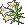White Lily Bouquet
<ul class="src"><li>White Lily Bouquet ดรอปจาก Sea Spirit (Lv 121)</li></ul>
รางวัล: Mirage Drill, Ember of Memory 1, Enkicladus 1 Card · EXP 506,800 / TM 967,950

<figure class="map" style="aspect-ratio:142/142"></figure>

<label class="done"><input class="ep" id="e2-21" type="checkbox"/> ทำแล้ว</label>3.5<h3>Clotho - Act 1 Scene 4, Curse of Moirae</h3>

Mirage Island Dungeon 2 - Deepest CaveLv 80+

<b>ภารกิจ:</b> Fluorescent Marble × 5
<ul class="src"><li>Fluorescent Marble ดรอปจาก Dark Hollow (Lv 122)</li><li>คุยกับ Sea Spirit Rumo เพื่อเข้า Mirage Island Dungeon 2 - Deepest Cave</li><li>ใช้ Abiox เป็นค่าเข้า</li></ul>
รางวัล: Cursed Scroll, Clotho Card · EXP 506,800 / TM 967,950

<figure class="map" style="aspect-ratio:136/142">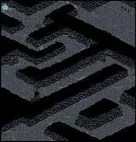</figure>

<label class="done"><input class="ep" id="e2-22" type="checkbox"/> ทำแล้ว</label>3.6<h3>Nefertiti 2 - Act 2, Scene 1: Reunion of Nefertiti</h3>

Mirage Island Field 3 - FremeiaLv 80+

<b>ภารกิจ:</b> Earthen Fate Necklace
<ul class="src"><li>Earthen Fate Necklace ได้จากเควส Confession of the Spirit of the Ocean</li></ul>
รางวัล: Water Attribute Stone × 2 · EXP 506,800 / TM 967,950

<figure class="map" style="aspect-ratio:142/142"></figure>

<label class="done"><input class="ep" id="e2-23" type="checkbox"/> ทำแล้ว</label>3.7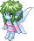<h3>Sea Spirit Rumo - Confession of the Spirit of the Ocean</h3>

Mirage Island Field 3 - FremeiaLv 80+

<b>ภารกิจ:</b> Anklet of Ocean Spirit × 5
<ul class="src"><li>Anklet of Ocean Spirit ดรอปจาก Sea Spirit (Lv 121)</li></ul>
รางวัล: Earthen Fate Necklace, Sea Spirit Rumo Card · EXP 506,800 / TM 967,950

<figure class="map" style="aspect-ratio:142/142"></figure>

<label class="done"><input class="ep" id="e2-24" type="checkbox"/> ทำแล้ว</label>3.8<h3>Enkicladus 1 - Act 2 Scene 2, Reunion of Enkicladus</h3>

Mirage Island Field 3 - FremeiaLv 80+

<b>ภารกิจ:</b> 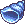Ocean Conch × 5
<ul class="src"><li>Ocean Conch ดรอปจาก Sea Hyena (Lv 126)</li></ul>
รางวัล: Mirage Shield · EXP 506,800 / TM 967,950

<figure class="map" style="aspect-ratio:142/142"></figure>

<label class="done"><input class="ep" id="e2-25" type="checkbox"/> ทำแล้ว</label>3.9<h3>Love Hunter Robin - Robin's Secret</h3>

Mirage Island Field 1 - AlteoLv 80+

<b>ภารกิจ:</b> Papyrus, Ancient Feather Pen
<ul class="src"><li>Papyrus ขุดได้ที่ Pyramid Dungeon, Mirage Island Field 1 / 6</li><li>Ancient Feather Pen ขุดได้ที่ Mirage Island Field 1 / 5 / 6</li></ul>
รางวัล: Contract of Secrecy, L. Hunter Robin Card · EXP 506,800 / TM 967,950

<figure class="map" style="aspect-ratio:142/142"></figure>

<label class="done"><input class="ep" id="e2-26" type="checkbox"/> ทำแล้ว</label>3.10<h3>Nefertiti 2 - Act 3 Scene 1, Death of Enkicladus</h3>

Mirage Island Dungeon 1 - Ocean's EndLv 80+

<b>ภารกิจ:</b> Sky's Fate Necklace
<ul class="src"><li>Sky's Fate Necklace ได้จากเควส Enkicladus 2 - The Final Request</li></ul>
รางวัล: Dark Earth Fate Necklace · EXP 506,800 / TM 967,950

<figure class="map" style="aspect-ratio:142/142">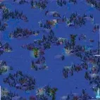</figure>

<label class="done"><input class="ep" id="e2-27" type="checkbox"/> ทำแล้ว</label>3.11<h3>Enkicladus 2 - The Final Request</h3>

Mirage Island Dungeon 1 - Ocean's EndLv 80+

<b>ภารกิจ:</b> Bloody Rune of Fate
<ul class="src"><li>Bloody Rune of Fate ขุดได้ที่ Mirage Island Dungeon 1 - Ocean's End</li></ul>
รางวัล: Sky's Fate Necklace, Mirage Helm, Enkicladus 2 Card · EXP 506,800 / TM 967,950

<figure class="map" style="aspect-ratio:142/142"></figure>

<label class="done"><input class="ep" id="e2-28" type="checkbox"/> ทำแล้ว</label>3.12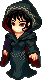<h3>Lachesis - Act 3 Scene 2, Recall of Spirit</h3>

Mirage Island Dungeon 2 - Deepest CaveLv 80+

<b>ภารกิจ:</b> Shard of Spirit
<ul class="src"><li>Shard of Spirit ดรอปจาก Sea Hyena (Lv 126)</li></ul>
รางวัล: Blessed Scroll, Lachesis Card · EXP 506,800 / TM 967,950

<figure class="map" style="aspect-ratio:136/142"></figure>

<label class="done"><input class="ep" id="e2-29" type="checkbox"/> ทำแล้ว</label>3.13<h3>Nefertiti 2 - Final Act, Waiting</h3>จบบท

Mirage Island Dungeon 1 - Ocean's EndLv 80+

<b>ภารกิจ:</b> 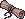Cursed Scroll, 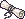Blessed Scroll, Dark Earth Fate Necklace
<ul class="src"><li>Cursed Scroll ได้จากเควส Clotho - Act 1 Scene 4, Curse of Moirae · Blessed Scroll ได้จากเควส Lachesis - Act 3 Scene 2, Recall of Spirit · Dark Earth Fate Necklace ได้จากเควส Nefertiti - Act 3 Scene 1, Death of Enkicladus</li></ul>
รางวัล: Ember of Memory 2, Ancient Treasure Box, Queen Nefertiti Card · EXP 7,095,200 / TM 13,551,300

<figure class="map" style="aspect-ratio:142/142"></figure>

</section>

<PageBehavior />
