

<header style="display:flex;flex-direction:column;gap:8px">

# Episode 3 · Dreams of an Empire

ความฝันของอาณาจักร · 4 บท 37 เควส

สรุปจากวิกิ ggFTW (ฉบับ mirror ของ LifeTO) หน้า [Episode 3 Quests](https://wikimirror.lifeto.co/wiki.ggftw.com/trickster/Episode_3_Quests.html) อ่านเนื้อเรื่องย่อทุกตอนได้ที่หน้า [Story Quest](./story-quest.md)

</header>

<section>

## ภาพรวม

ลึกเข้าไปใน Mirage Island คือ Alteo ดินแดนในตำนานที่ตอนนี้รกร้าง ที่นี่เราจะได้รู้ว่า Trickster เกิดขึ้นมาอย่างไร ความลับเบื้องหลังการล่มสลายของ Alteo และได้พบ Nefertiti กับเรื่องของคนรักผู้ถูกลิขิต Enkicladus และพลังแห่งการแก้แค้นที่กำลังฟื้นคืน

<ul>
<li>เริ่มที่ <b>Chief Architect Amos</b> (Mirage Island Field 4 - Alteo Construction Site) ต้องเลเวล 130+ และจบ Episode 2 แล้ว</li>
<li>เควสต่อกันเป็นสาย ทำเรียงตามลำดับในหน้านี้ ส่งเควสหนึ่งแล้วเควสถัดไปจะเปิดให้รับ</li>
<li>กดชื่อบทเพื่อพับหรือกาง</li>
</ul>

<nav class="toc"><a href="#ch-1">บท 1 · Building an Empire</a><a href="#ch-2">บท 2 · A Hero Appears</a><a href="#ch-3">บท 3 · Robin's Advice</a><a href="#ch-bonus">โบนัส</a></nav>

<a href="./episode-2.html">← Episode 2</a> · <a href="./episode-4.html">Episode 4 →</a>

</section>

<section aria-live="polite" class="counter">

## ความคืบหน้า

0 / 37 เควส

<button id="hidedone" type="button" aria-pressed="false">ซ่อนเควสที่ทำแล้ว</button><button id="reset" type="button">ล้างทั้งหมด</button>

</section>

<section id="ch-1">

<h2 id="ch-1-h">บท 1 · Building an Empire </h2>

ช่วย Chief Architect Amos สร้างเมือง Alteo ขึ้นใหม่ งานหนักทั้งเก็บหิน ทำอิฐ หาไม้ เตรียมของกิน และขนอัญมณี

<label class="done"><input class="ep" id="e3-1" type="checkbox"/> ทำแล้ว</label>1.1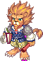<h3>Chief Architect Amos - Amos' Orders</h3>เริ่มบทจบบท

Mirage Island Field 4 - Alteo Construction SiteLv 130+

<b>ภารกิจ:</b> Signed Document 4
<ul class="src"><li>Signed Document 4 ได้จากเควส Sue - Hard Job Pt. 4 Transport Gems</li></ul>
รางวัล: Alteo Passport · EXP 2,593,183 / TM 969,261

<figure class="map" style="aspect-ratio:142/108">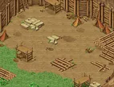</figure>

<label class="done"><input class="ep" id="e3-2" type="checkbox"/> ทำแล้ว</label>1.2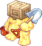<h3>Larry - Hard Job Pt. 1 Pick Rocks</h3>

Mirage Island Field 4 - Alteo Construction SiteLv 130+

<b>ภารกิจ:</b> 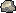Shard of Caliche × 20
<ul class="src"><li>Shard of Caliche ขุดได้ที่ Mirage Island Field 4 - Alteo Construction Site</li></ul>
รางวัล: Signed Statement 1 · EXP 2,074,547 / TM 775,409

<figure class="map" style="aspect-ratio:142/108"></figure>

<label class="done"><input class="ep" id="e3-3" type="checkbox"/> ทำแล้ว</label>1.3<h3>Bob - Hard Job Pt. 2 Collect Bricks</h3>

Mirage Island Field 4 - Alteo Construction SiteLv 130+

<b>ภารกิจ:</b> 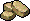Lump of Gray Clay × 10, 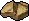Lump of Pale Clay × 10, 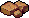Lump of Red Clay × 10
<ul class="src"><li>Lump of Gray Clay ดรอปจาก Gray Clay Rock (Lv 60) · Lump of Pale Clay ดรอปจาก Pale Clay Rock (Lv 60) · Lump of Red Clay ดรอปจาก Red Clay Rock (Lv 60)</li></ul>
รางวัล: Blue Potion B × 10 · EXP 2,074,547 / TM 775,409

<figure class="map" style="aspect-ratio:142/108"></figure>

<label class="done"><input class="ep" id="e3-4" type="checkbox"/> ทำแล้ว</label>1.4<h3>Bob - Hard Job Pt. 2 Collect Timber</h3>

Mirage Island Field 4 - Alteo Construction SiteLv 130+

<b>ภารกิจ:</b> Poplar Wood × 10, Cherry Wood × 10, Walnut Wood × 10
<ul class="src"><li>Poplar Wood ดรอปจาก Poplar Tree (Lv 60) · Cherry Wood ดรอปจาก Cherry Tree (Lv 60) · Walnut Wood ดรอปจาก Walnut Tree (Lv 60)</li></ul>
รางวัล: Signed Document 2 · EXP 2,074,547 / TM 775,409

<figure class="map" style="aspect-ratio:142/108"></figure>

<label class="done"><input class="ep" id="e3-5" type="checkbox"/> ทำแล้ว</label>1.5<h3>Jim - Hard Job Pt. 3 Prepare Snacks</h3>

Mirage Island Field 4 - Alteo Construction SiteLv 130+

<b>ภารกิจ:</b> Chickensaurus's Leg × 5
<ul class="src"><li>Chickensaurus's Leg ดรอปจาก Chickensaurus (Lv 116)</li></ul>
รางวัล: Signed Document 3 · EXP 2,074,547 / TM 775,409

<figure class="map" style="aspect-ratio:142/108"></figure>

<label class="done"><input class="ep" id="e3-6" type="checkbox"/> ทำแล้ว</label>1.6<h3>Sue - Hard Job Pt. 4 Transport Gems</h3>

Mirage Island Field 4 - Alteo Construction SiteLv 130+

<b>ภารกิจ:</b> Gem Supply Box
<ul class="src"><li>Gem Supply Box ได้จากเควส Merchant Vinny - Gem Supply Box</li></ul>
รางวัล: Signed Document 4 · EXP 2,074,547 / TM 775,409

<figure class="map" style="aspect-ratio:142/108"></figure>

<label class="done"><input class="ep" id="e3-7" type="checkbox"/> ทำแล้ว</label>1.7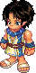<h3>Merchant Vinny - Gem Supply Box</h3>

Gate of Mirage IslandLv 130+

<b>ภารกิจ:</b> คุยกับ NPC ตัวนี้

เงื่อนไข: รับเควส Hard Job Pt. 4 Transport Gems ค้างไว้

รางวัล: Gem Supply Box

<figure class="map" style="aspect-ratio:142/98">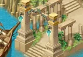</figure>

</section>

<section id="ch-2">

<h2 id="ch-2-h">บท 2 · A Hero Appears </h2>

ไข่แห่งแสงเล่าถึงกำเนิดของ Trickster ยุคแรก ศึกษาภาพจิตรกรรมฝาผนังกับ Curator Morgos ที่เล่าเรื่องการเกิด การเติบโต และวีรบุรุษ แล้วไกล่เกลี่ยความขัดแย้งของสามตระกูล Byzantine, Ra และ Folkan

<label class="done"><input class="ep" id="e3-8" type="checkbox"/> ทำแล้ว</label>2.1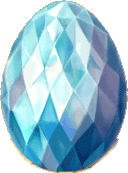<h3>Light Filled Egg - Birth of the Early Tricksters</h3>เริ่มบท

Trickster ShrineLv 130+

<b>ภารกิจ:</b> Fabilsag's Stinger × 2, Ancient Face × 5
<ul class="src"><li>Fabilsag's Stinger ดรอปจาก Fabilsag G (Lv 110) · Ancient Face ดรอปจาก Ancient Chimu (Lv 160)</li></ul>
รางวัล: Crystal of Light × 2 · EXP 1,852,274 / TM 692,329

<figure class="map" style="aspect-ratio:142/83">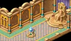</figure>

<label class="done"><input class="ep" id="e3-9" type="checkbox"/> ทำแล้ว</label>2.2<h3>Curator Morgos - The Story of the Mural - Birth</h3>

Trickster ShrineLv 130+

<b>ภารกิจ:</b> Status Report
<ul class="src"><li>Status Report ได้จากเควส Indiana John - Mural's Analysis</li></ul>
รางวัล: Status Report · EXP 1,852,274 / TM 692,329

<figure class="map" style="aspect-ratio:142/83"></figure>

<label class="done"><input class="ep" id="e3-10" type="checkbox"/> ทำแล้ว</label>2.3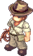<h3>Indiana John - Mural's Analysis</h3>

Mirage Island Field 7 - Guardian's SquareLv 130+

<b>ภารกิจ:</b> Fatigue Medicine
<ul class="src"><li>Fatigue Medicine ผสม (Compound) จาก 5x Panacea และ 1x Herb Potion กับ Compounder Paul ที่ Mirage Island Field 7</li><li>Panacea ดรอปจาก Werepot (Lv 98), Fabilsag (Lv 106), Fabilsag G (Lv 110), Chickensaurus (Lv 116), Dark Hollow (Lv 122), Ancient Chimu (Lv 160) · Herb Potion ซื้อได้ตามร้านค้าทั่วไปและขุดได้หลายแมพ</li></ul>
รางวัล: Status Report · EXP 1,852,274 / TM 692,329

<figure class="map" style="aspect-ratio:142/142">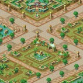</figure>

<label class="done"><input class="ep" id="e3-11" type="checkbox"/> ทำแล้ว</label>2.4<h3>Curator Morgos - The Story of the Mural - Growth</h3>

Trickster ShrineLv 130+

<b>ภารกิจ:</b> Restoration Details
<ul class="src"><li>Restoration Details ได้จากเควส Old Artist - Mural's Restoration</li></ul>
รางวัล: 10,000 Galder Coupon · EXP 1,852,274 / TM 692,329

<figure class="map" style="aspect-ratio:142/83"></figure>

<label class="done"><input class="ep" id="e3-12" type="checkbox"/> ทำแล้ว</label>2.5<h3>Old Artist - Mural's Restoration</h3>

Mirage Island Field 7 - Guardian's SquareLv 130+

<b>ภารกิจ:</b> 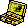Restoration Box, Status Report
<ul class="src"><li>Restoration Box ดรอปจาก Ancient Werepot (Lv 170)</li><li>Status Report ได้จากเควส Indiana John - Mural's Analysis</li></ul>
รางวัล: Restoration Details · EXP 1,852,274 / TM 692,329

<figure class="map" style="aspect-ratio:142/142"></figure>

<label class="done"><input class="ep" id="e3-13" type="checkbox"/> ทำแล้ว</label>2.6<h3>Curator Morgos - The Story of the Mural - Hero</h3>

Trickster ShrineLv 130+

<b>ภารกิจ:</b> Bindi, Crystal of Light
<ul class="src"><li>Bindi ดรอปจาก Ancient Chimu (Lv 160) · Crystal of Light ได้จากเควส Light Filled Egg - Birth of the Early Tricksters</li></ul>
รางวัล: Resurrection Marble × 2 · EXP 1,852,274 / TM 692,329

<figure class="map" style="aspect-ratio:142/83"></figure>

<label class="done"><input class="ep" id="e3-14" type="checkbox"/> ทำแล้ว</label>2.7<h3>Nefertiti 2 - Reunion with the Princess</h3>จบบท

Mirage Island Field 6 - Water GardenLv 130+

<b>ภารกิจ:</b> 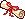Morgos's Message

เงื่อนไข: มี Proof of a Hero ในกระเป๋า
<ul class="src"><li>Proof of a Hero ดรอปจาก Golem (Lv 300)</li><li>Morgos's Message ได้จากเควส Curator Morgos - Hyper Mind Control</li></ul>
รางวัล: Nothing · EXP 5,186,367 / TM 1,938,522

<figure class="map" style="aspect-ratio:142/142">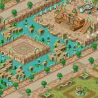</figure>

<label class="done"><input class="ep" id="e3-15" type="checkbox"/> ทำแล้ว</label>2.8<h3>Curator Morgos - Hyper Mind Control</h3>

Mirage Island Field 6 - Water GardenLv 130+

<b>ภารกิจ:</b> 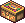Ra Weapon Box, Folkan Weapon Box, Byzantine Weapon Box
<ul class="src"><li>Ra Weapon Box ได้จากเควส The Ra's Complaints · Folkan Weapon Box ได้จากเควส The Folkan's Complaints · Byzantine Weapon Box ได้จากเควส The Byzantine's Complaints</li></ul>
รางวัล: Morgos's Message, Legendary Gaia Box · EXP 1,852,274 / TM 692,329

<figure class="map" style="aspect-ratio:142/142"></figure>

<label class="done"><input class="ep" id="e3-16" type="checkbox"/> ทำแล้ว</label>2.9<h3>Chief Architect Amos - The Byzantine's Complaints</h3>

Mirage Island Field 5 - Alteo CityLv 130+

<b>ภารกิจ:</b> Byzantine Family's Feeling of Unity
<ul class="src"><li>Byzantine Family's Feeling of Unity ได้จากการแลก Byzantine Family's Grievances กับ Poseidon's Blessing ที่ Nefertiti's Shrine</li><li>ถ้ายังมี Grievances ติดตัว Amos จะไม่รับของ</li></ul>
รางวัล: Byzantine Weapon Box · EXP 1,852,274 / TM 692,329

<figure class="map" style="aspect-ratio:142/142">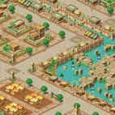</figure>

<label class="done"><input class="ep" id="e3-17" type="checkbox"/> ทำแล้ว</label>2.10<h3>Dancer Olinda - The Ra's Complaints</h3>

Mirage Island Field 5 - Alteo CityLv 130+

<b>ภารกิจ:</b> Ra Family's Feeling of Unity
<ul class="src"><li>Ra Family's Feeling of Unity ได้จากการแลก Ra Family's Grievances กับ Poseidon's Blessing ที่ Nefertiti's Shrine</li><li>ถ้ายังมี Grievances ติดตัว Olinda จะไม่รับของ</li></ul>
รางวัล: Ra Weapon Box · EXP 1,852,274 / TM 692,329

<figure class="map" style="aspect-ratio:142/142"></figure>

<label class="done"><input class="ep" id="e3-18" type="checkbox"/> ทำแล้ว</label>2.11<h3>Merchant Vinny - The Folkan's Complaints</h3>

Mirage Island Field 5 - Alteo CityLv 130+

<b>ภารกิจ:</b> Folkan Family's Feeling of Unity
<ul class="src"><li>Folkan Family's Feeling of Unity ได้จากการแลก Folkan Family's Grievances กับ Poseidon's Blessing ที่ Nefertiti's Shrine</li><li>ถ้ายังมี Grievances ติดตัว Vinny จะไม่รับของ</li></ul>
รางวัล: Folkan Weapon Box · EXP 1,852,274 / TM 692,329

<figure class="map" style="aspect-ratio:142/142"></figure>

</section>

<section id="ch-3">

<h2 id="ch-3-h">บท 3 · Robin's Advice </h2>

Love Hunter Robin ให้คำแนะนำ ผ่านบททดสอบของนางฟ้ากุหลาบ เอาชนะ Rosaspina ผู้พิทักษ์ Rhodonite แล้วได้ยินเสียงจากรูปปั้น Poseidon's Blessing พบกับ Nono อีกครั้ง ได้ข้อความจากวิญญาณของ Nefertiti และสุดท้าย Don Cavalier ก็ยื่นข้อเสนอมา

<label class="done"><input class="ep" id="e3-19" type="checkbox"/> ทำแล้ว</label>3.1<h3>Love Hunter Robin - Robin's Advice</h3>เริ่มบท

Nefertiti's ShrineLv 130+

<b>ภารกิจ:</b> 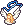Robin's Necklace
<ul class="src"><li>Robin's Necklace ดรอปจาก Rosaspina (Lv 210)</li></ul>
รางวัล: Sincere Heart · EXP 2,593,183 / TM 969,261

<figure class="map" style="aspect-ratio:142/84">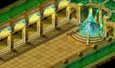</figure>

<label class="done"><input class="ep" id="e3-20" type="checkbox"/> ทำแล้ว</label>3.2<h3>Rose Fairy Harmony - Rose Fairy's Message 1</h3>

Nefertiti's ShrineLv 130+

<b>ภารกิจ:</b> Rose Certificate A

เงื่อนไข: รับเควส Robin's Advice ค้างไว้
<ul class="src"><li>Rose Certificate A ได้จากเควส Rose Fairy's First Test</li></ul>
รางวัล: Nothing · EXP 2,593,183 / TM 969,261

<figure class="map" style="aspect-ratio:142/84"></figure>

<label class="done"><input class="ep" id="e3-21" type="checkbox"/> ทำแล้ว</label>3.3<h3>Rose Fairy Marion - Rose Fairy's First Test</h3>

Nefertiti's ShrineLv 130+

<b>ภารกิจ:</b> คุยกับ NPC แล้วดูเนื้อเรื่อง

เงื่อนไข: รับเควส Rose Fairy's Message 1 ค้างไว้

<figure class="map" style="aspect-ratio:142/84"></figure>

<label class="done"><input class="ep" id="e3-22" type="checkbox"/> ทำแล้ว</label>3.4<h3>Rose Fairy Harmony - Rose Fairy's Message 2</h3>

Nefertiti's ShrineLv 130+

<b>ภารกิจ:</b> Rose Certificate B
<ul class="src"><li>Rose Certificate B ได้จากเควส Rose Fairy's Second Test</li></ul>
รางวัล: Nothing · EXP 2,593,183 / TM 969,261

<figure class="map" style="aspect-ratio:142/84"></figure>

<label class="done"><input class="ep" id="e3-23" type="checkbox"/> ทำแล้ว</label>3.5<h3>Rose Fairy Marion - Rose Fairy's Second Test</h3>

Nefertiti's ShrineLv 130+

<b>ภารกิจ:</b> คุยกับ NPC แล้วดูเนื้อเรื่อง

เงื่อนไข: รับเควส Rose Fairy's Message 2 ค้างไว้

<figure class="map" style="aspect-ratio:142/84"></figure>

<label class="done"><input class="ep" id="e3-24" type="checkbox"/> ทำแล้ว</label>3.6<h3>Rosaspina - The Rhodonite Guardian</h3>

Guardian's RoomLv 130+

<b>ภารกิจ:</b> ล้ม Rosaspina (Lv 210)
<ul class="src"><li>Rosaspina ดรอป Robin's Necklace</li></ul>
รางวัล: Soul Summoning Scroll 1, Robin's Necklace, Voice of Spirits · EXP 2,593,183 / TM 969,261

<figure class="map" style="aspect-ratio:160/160"></figure>

<label class="done"><input class="ep" id="e3-25" type="checkbox"/> ทำแล้ว</label>3.7<h3>Love Hunter Robin - Harkon Statue</h3>

Nefertiti's ShrineLv 130+

<b>ภารกิจ:</b> Earthen Fate Necklace
<ul class="src"><li>Earthen Fate Necklace ได้จากเควส Spirit Nefertiti's Message</li></ul>
รางวัล: Earthen Fate Necklace · EXP 2,593,183 / TM 969,261

<figure class="map" style="aspect-ratio:142/84"></figure>

<label class="done"><input class="ep" id="e3-26" type="checkbox"/> ทำแล้ว</label>3.8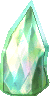<h3>Poseidon's Blessing - The Voice from the Statue</h3>

Nefertiti's ShrineLv 130+

<b>ภารกิจ:</b> Soul Summoning Scroll 3, 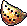Voice of Spirits, Sincere Heart, Crystal of Light, Spirit of Light
<ul class="src"><li>Soul Summoning Scroll 3 ได้จากเควส Decipher the Scroll · Voice of Spirits ได้จากเควส The Rhodonite Guardian · Sincere Heart ได้จากเควส Robin's Advice · Crystal of Light ได้จากเควส Birth of the Early Tricksters · Spirit of Light ได้จากเควส Reunion with Nono</li></ul>
รางวัล: Soul Summoning (Skill) × 5 · EXP 2,593,183 / TM 969,261

<figure class="map" style="aspect-ratio:142/84"></figure>

<label class="done"><input class="ep" id="e3-27" type="checkbox"/> ทำแล้ว</label>3.9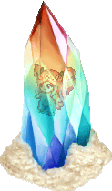<h3>Fairy Nono - Reunion with Nono</h3>

Nefertiti's ShrineLv 130+

<b>ภารกิจ:</b> Soul Summoning Scroll 1, Fairy Eyedrops
<ul class="src"><li>Soul Summoning Scroll 1 ได้จากเควส The Rhodonite Guardian</li><li>Fairy Eyedrops ดรอปจาก Rose Worm (Lv 190)</li></ul>
รางวัล: Soul Summoning Scroll 2, Spirit of Light · EXP 2,593,183 / TM 969,261

<figure class="map" style="aspect-ratio:142/84"></figure>

<label class="done"><input class="ep" id="e3-28" type="checkbox"/> ทำแล้ว</label>3.10<h3>Indiana John - Decipher the Scroll</h3>

Mirage Island Field 7 - Guardian's SquareLv 130+

<b>ภารกิจ:</b> Bindi, Soul Summoning Scroll 2
<ul class="src"><li>Bindi ดรอปจาก Ancient Chimu (Lv 160)</li><li>Soul Summoning Scroll 2 ได้จากเควส Reunion with Nono</li></ul>
รางวัล: Soul Summoning Scroll 3 · EXP 2,593,183 / TM 969,261

<figure class="map" style="aspect-ratio:142/142"></figure>

<label class="done"><input class="ep" id="e3-29" type="checkbox"/> ทำแล้ว</label>3.11<h3>Spirit of Nefertiti - Spirit Nefertiti's Message</h3>

Room of LightLv 130+

<b>ภารกิจ:</b> Earthen Fate Necklace
<ul class="src"><li>Earthen Fate Necklace ขุดได้ที่ Room of Light ไปได้ด้วยสกิล Soul Summoning ซึ่งได้จากเควส Poseidon's Blessing - The Voice from the Statue</li><li>Earthen Fate Necklace ทิ้ง เทรด หรือขาย NPC ไม่ได้ แต่ฝากโกดังได้</li></ul>
รางวัล: Earthen Fate Necklace · EXP 2,593,183 / TM 969,261

<figure class="map" style="aspect-ratio:142/104">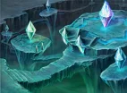</figure>

<label class="done"><input class="ep" id="e3-30" type="checkbox"/> ทำแล้ว</label>3.12<h3>Officer Robert - Robert the Spy</h3>

Mirage Island Field 6 - Water GardenLv 130+

<b>ภารกิจ:</b> Ancient Feather Pen, Papyrus, 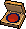Red Ink Pad
<ul class="src"><li>Ancient Feather Pen ขุดได้ที่ Mirage Island Field 1 / 5 / 6</li><li>Papyrus ขุดได้ที่ Pyramid Dungeon, Mirage Island Field 1 / 6</li><li>Red Ink Pad ดรอปจาก Ancient Naranjo (Lv 180)</li></ul>
รางวัล: Holographic Photo · EXP 2,593,183 / TM 969,261

<figure class="map" style="aspect-ratio:142/142"></figure>

<label class="done"><input class="ep" id="e3-31" type="checkbox"/> ทำแล้ว</label>3.13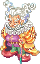<h3>Don Cavalier - Don Cavalier's Proposal</h3>จบบท

Hologram ChamberLv 130+

<b>ภารกิจ:</b> Earthen Fate Necklace

เงื่อนไข: ใช้ Holographic Photo เพื่อไปหา NPC
<ul class="src"><li>Earthen Fate Necklace ได้จากเควส Spirit Nefertiti's Message</li><li>Holographic Photo ได้จากเควส Officer Robert - Robert the Spy</li></ul>
รางวัล: Dev. Room Card Key, Legendary Gaia Box × 4 · EXP 11,113,644 / TM 4,153,977

<figure class="map" style="aspect-ratio:140/95">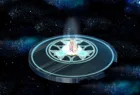</figure>

</section>

<section id="ch-bonus">

<h2 id="ch-bonus-h">โบนัส </h2>

พิมพ์เขียวเมืองหายไป สืบหาคนร้ายจากคนงานทั้งสี่ จนได้คำสารภาพจาก Monkey T

<label class="done"><input class="ep" id="e3-32" type="checkbox"/> ทำแล้ว</label>โบนัส 1<h3>Chief Architect Amos - Find the Missing Blueprints</h3>เริ่มบทจบบท

Mirage Island Field 4 - Alteo Construction SiteLv 130+

<b>ภารกิจ:</b> City Blueprint
<ul class="src"><li>City Blueprint ได้จากเควส Monkey T - The Criminal's Confession</li></ul>
รางวัล: 10,000 Galder Coupon × 5 · EXP 2,646,105

<figure class="map" style="aspect-ratio:142/108"></figure>

<label class="done"><input class="ep" id="e3-33" type="checkbox"/> ทำแล้ว</label>โบนัส 2<h3>Larry - Who is the Criminal?</h3>

Mirage Island Field 4 - Alteo Construction SiteLv 130+

<b>ภารกิจ:</b> 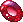Secretly Hidden Gem
<ul class="src"><li>Secretly Hidden Gem ขุดได้ที่ Mirage Island Field 4 - Alteo Construction Site</li></ul>
รางวัล: Secretly Hidden Gem, Ripped Contract · EXP 2,646,105

<figure class="map" style="aspect-ratio:142/108"></figure>

<label class="done"><input class="ep" id="e3-34" type="checkbox"/> ทำแล้ว</label>โบนัส 3<h3>Bob - Who is the Criminal?</h3>

Mirage Island Field 4 - Alteo Construction SiteLv 130+

<b>ภารกิจ:</b> Secretly Hidden Gem
<ul class="src"><li>Secretly Hidden Gem ขุดได้ที่ Mirage Island Field 4 - Alteo Construction Site</li></ul>
รางวัล: Secretly Hidden Gem × 2, Ripped Contract · EXP 2,646,105

<figure class="map" style="aspect-ratio:142/108"></figure>

<label class="done"><input class="ep" id="e3-35" type="checkbox"/> ทำแล้ว</label>โบนัส 4<h3>Jim - Who is the Criminal?</h3>

Mirage Island Field 4 - Alteo Construction SiteLv 130+

<b>ภารกิจ:</b> Secretly Hidden Gem
<ul class="src"><li>Secretly Hidden Gem ขุดได้ที่ Mirage Island Field 4 - Alteo Construction Site</li></ul>
รางวัล: Secretly Hidden Gem × 2, Ripped Contract · EXP 2,646,105

<figure class="map" style="aspect-ratio:142/108"></figure>

<label class="done"><input class="ep" id="e3-36" type="checkbox"/> ทำแล้ว</label>โบนัส 5<h3>Sue - Who is the Criminal?</h3>

Mirage Island Field 4 - Alteo Construction SiteLv 130+

<b>ภารกิจ:</b> Secretly Hidden Gem
<ul class="src"><li>Secretly Hidden Gem ขุดได้ที่ Mirage Island Field 4 - Alteo Construction Site</li></ul>
รางวัล: Secretly Hidden Gem × 2, Ripped Contract · EXP 2,646,105

<figure class="map" style="aspect-ratio:142/108"></figure>

<label class="done"><input class="ep" id="e3-37" type="checkbox"/> ทำแล้ว</label>โบนัส 6<h3>Monkey T - The Criminal's Confession</h3>

Mirage Island Field 1 - AlteoLv 130+

<b>ภารกิจ:</b> Restored Contract, Secretly Hidden Gem,
<ul class="src"><li>Restored Contract ได้จากการเอา Ripped Contracts ครบ 4 ชิ้นไปแลกกับ Compounder Paul ที่ Mirage Island Field 7</li><li>Secretly Hidden Gem ขุดได้ที่ Mirage Island Field 4</li></ul>
รางวัล: City Blueprint · EXP 2,646,105

<figure class="map" style="aspect-ratio:142/142">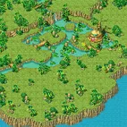</figure>

</section>

<PageBehavior />
