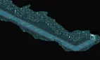
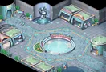
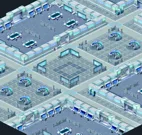
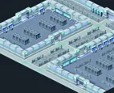
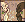
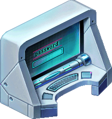
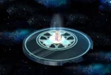

<header style="display:flex;flex-direction:column;gap:8px">

# Episode 4 · Beyond the Veil

เบื้องหลังม่าน · 4 บท 25 เควส

สรุปจากวิกิ ggFTW (ฉบับ mirror ของ LifeTO) หน้า [Episode 4 Quests](https://wikimirror.lifeto.co/wiki.ggftw.com/trickster/Episode_4_Quests.html) อ่านเนื้อเรื่องย่อทุกตอนได้ที่หน้า [Story Quest](./story-quest.md)

วิกินี้เป็นข้อมูลเก่า และตัววิกิเตือนเองว่าบางส่วนอาจไม่ตรงกับเซิร์ฟ LifeTO ปัจจุบัน

</header>

<section>

## ภาพรวม

เราได้รับเชิญไปห้อง Dev Room ของ Megalo Company ได้พบทีมพัฒนาที่เล่าที่มาของบริษัท และเรื่องความขัดแย้งระหว่าง Don Cavalier กับ Don Giuvanni ตกดึกได้พบเด็กชายชื่อ Don Danihen ที่บอกเรื่องฟังก์ชันลับของคอมพิวเตอร์แม่ข่ายในห้องนี้

<ul>
<li>เริ่มที่ <b>Coward Craven</b> (Underground Dev Room - Underground Passage 4) ต้องเลเวล 150+ และจบ Episode 3 แล้ว</li>
<li>เควสต่อกันเป็นสาย ทำเรียงตามลำดับในหน้านี้ ส่งเควสหนึ่งแล้วเควสถัดไปจะเปิดให้รับ</li>
<li>ติ๊ก "ทำแล้ว" เมื่อส่งเควสแล้ว ระบบจำการติ๊กไว้ในเบราว์เซอร์นี้ กดชื่อบทเพื่อพับหรือกาง</li>
</ul>

<nav class="toc"><a href="#ch-1">บท 1 · Company Invitation</a><a href="#ch-2">บท 2 · Development Diary</a><a href="#ch-3">บท 3 · The Ghost of Dev Room</a><a href="#ch-bonus">โบนัส</a></nav>

<a href="./episode-3.html">← Episode 3</a> · <a href="./episode-5.html">Episode 5 →</a>

</section>

<section aria-live="polite" class="counter">

## ความคืบหน้า

0 / 25 เควส

<button id="hidedone" type="button" aria-pressed="false">ซ่อนเควสที่ทำแล้ว</button><button id="reset" type="button">ล้างทั้งหมด</button>

</section>

<section id="ch-1">

<h2 id="ch-1-h">บท 1 · Company Invitation </h2>

ลิฟต์เสียทำให้ต้องเดินลงไป Underground Dev Room Don Giuvanni ต้อนรับ แล้วช่วยงานทีมพัฒนาแต่ละคน

<label class="done"><input class="ep" id="e4-1" type="checkbox"/> ทำแล้ว</label>1.1<h3>Coward Craven - Broken Elevator</h3>เริ่มบท

Underground Dev Room - Underground Passage 4Lv 150+

<b>ภารกิจ:</b> Merchant Mon's Bag × 5
<ul class="src"><li>Merchant Mon's Bag ดรอปจาก Merchant Mon (Lv 186)</li></ul>
รางวัล: Emergency Key · EXP 5,075,677 / TM 1,403,525

<figure class="map" style="aspect-ratio:142/86"></figure>

<label class="done"><input class="ep" id="e4-2" type="checkbox"/> ทำแล้ว</label>1.2<h3>Don Giuvanni - Welcome!</h3>

Underground Dev Room - LobbyLv 150+

<b>ภารกิจ:</b> Nondisclosure Agreement, Pen
<ul class="src"><li>Nondisclosure Agreement และ Pen ดรอปจาก Robber Mole (Lv 230)</li><li>Pen ตัวนี้ไม่ใช่ Pen ที่ดรอปจาก Cannon Shell (Lv 33)</li></ul>
รางวัล: 500 Galder Coupon × 15 · EXP 3,045,406 / TM 842,115

<figure class="map" style="aspect-ratio:132/90"></figure>

<label class="done"><input class="ep" id="e4-3" type="checkbox"/> ทำแล้ว</label>1.3<h3>Lead Developer - The Star of Developer Photo2</h3>

Underground Dev Room - LobbyLv 150+

<b>ภารกิจ:</b> Americano
<ul class="src"><li>Americano ผสม (Compound) จาก Company Mug และ Coffee Beans กับ Water Dispenser ที่ Underground Dev Room - Lobby</li><li>Company Mug ขุดได้ที่ System Control Room · Coffee Beans ดรอปจาก Guiana (Lv 66) และ Merchant Mon (Lv 186)</li></ul>
รางวัล: 500 Galder Coupon × 15, Leader Dev Card · EXP 3,045,406 / TM 842,115

<figure class="map" style="aspect-ratio:132/90"></figure>

<label class="done"><input class="ep" id="e4-4" type="checkbox"/> ทำแล้ว</label>1.4<h3>Developer J - Dev J Quest</h3>

Underground Dev Room - Dev RoomLv 150+ตอนกลางวัน

<b>ภารกิจ:</b> Merchant Mon's Leaflet Bundle × 10
<ul class="src"><li>Merchant Mon's Leaflet Bundle ดรอปจาก Merchant Mon (Lv 186)</li></ul>
รางวัล: Blue Potion C × 10, Dev J Card, Poppuri Card · EXP 3,045,406 / TM 842,115

<figure class="map" style="aspect-ratio:142/135"></figure>

<label class="done"><input class="ep" id="e4-5" type="checkbox"/> ทำแล้ว</label>1.5<h3>Developer H - Dev H's Request</h3>

Underground Dev Room - System Control RoomLv 150+ตอนกลางวัน

<b>ภารกิจ:</b> Hot Cup Noodles
<ul class="src"><li>Hot Cup Noodles ผสม (Compound) จาก Cup Noodles และ Wooden Chopsticks กับ Water Dispenser ที่ Underground Dev Room - Lobby</li><li>Cup Noodles และ Wooden Chopsticks ขุดได้ที่ System Control Room</li></ul>
รางวัล: Pink Potion C × 10, Dev H Card · EXP 3,045,406 / TM 842,115

<figure class="map" style="aspect-ratio:142/115"></figure>

<label class="done"><input class="ep" id="e4-6" type="checkbox"/> ทำแล้ว</label>1.6<h3>Developer K - Dev K Quest</h3>จบบท

Underground Dev Room - Dev RoomLv 150+ตอนกลางวัน

<b>ภารกิจ:</b> Fan Art A, Fan Art B, Fan Art C, Fan Art D, Fan Art E, Fan Art F
<ul class="src"><li>Fan Art A, Fan Art B ขุดได้ที่ Underground Dev Room - Dev Room</li><li>Fan Art C, Fan Art D, Fan Art E, Fan Art F ดรอปจาก Robber Mole (Lv 230)</li></ul>
รางวัล: Blue Potion C × 10, Dev K Card · EXP 5,075,677 / TM 1,403,525

<figure class="map" style="aspect-ratio:142/135"></figure>

</section>

<section id="ch-2">

<h2 id="ch-2-h">บท 2 · Development Diary </h2>

คอมพิวเตอร์ของ Developer ติดไวรัส ต้องกำจัดไวรัส หาแผ่น Backup CD และวัคซีน เตรียมงาน User Conference และฟังตำนานเมืองของ Dev Room

<label class="done"><input class="ep" id="e4-7" type="checkbox"/> ทำแล้ว</label>2.1<h3>Developer's PC - Defeat the Virus!</h3>เริ่มบท

Underground Dev Room - Dev RoomLv 150+

<b>ภารกิจ:</b> H Key, O Key, T Key, S Key, G Key

เงื่อนไข: ใส่รหัสผ่านให้ถูก (ดูหมายเหตุ)
<ul class="src"><li>H Key, O Key, T Key, S Key, G Key ดรอปจาก Win32 Worm (Lv 235)</li><li>รหัสคือ "GHOST"</li></ul>
รางวัล: Blue Potion C × 10 · EXP 5,075,677 / TM 1,403,525

<figure class="map" style="aspect-ratio:142/135"></figure>

<label class="done"><input class="ep" id="e4-8" type="checkbox"/> ทำแล้ว</label>2.2<h3>Developer's PC - Find the Backup CD</h3>

Underground Dev Room - Dev RoomLv 150+

<b>ภารกิจ:</b> Backup CD
<ul class="src"><li>Backup CD ดรอปจาก Merchant Mon (Lv 186)</li></ul>
รางวัล: Blue Potion C × 10 · EXP 3,045,406 / TM 842,115

<figure class="map" style="aspect-ratio:142/135"></figure>

<label class="done"><input class="ep" id="e4-9" type="checkbox"/> ทำแล้ว</label>2.3<h3>Developer's PC - Find the Vaccine</h3>

Underground Dev Room - Dev RoomLv 150+

<b>ภารกิจ:</b> Antivirus Program
<ul class="src"><li>Antivirus Program ได้จากเควส Developer Y - Preparing for User Conference</li></ul>
รางวัล: Developer's Journal, Developer's PC Card · EXP 3,045,406 / TM 842,115

<figure class="map" style="aspect-ratio:142/135"></figure>

<label class="done"><input class="ep" id="e4-10" type="checkbox"/> ทำแล้ว</label>2.4<h3>Developer Y - Preparing for User Conference</h3>

Underground Dev Room - System Control RoomLv 150+ตอนกลางวัน

<b>ภารกิจ:</b> Capuccino × 5, Green Tea × 5
<ul class="src"><li>Capuccino ผสม (Compound) จาก Instant Coffee + Company Mug · Green Tea ผสมจาก Green Tea Bag + Company Mug ทั้งคู่ใช้ Water Dispenser ที่ Underground Dev Room - Lobby</li><li>Instant Coffee, Green Tea Bag, Company Mug ขุดได้ที่ System Control Room</li></ul>
รางวัล: Antivirus Program, GM Y Card · EXP 3,045,406 / TM 842,115

<figure class="map" style="aspect-ratio:142/115"></figure>

<label class="done"><input class="ep" id="e4-11" type="checkbox"/> ทำแล้ว</label>2.5<h3>Waste Basket - Dev Room Urban Legends</h3>จบบท

Underground Dev Room - Dev RoomLv 150+

<b>ภารกิจ:</b> Trash × 100
<ul class="src"><li>Trash ขุดได้ที่ Underground Dev Room Passages, Dev Room (สองที่นี้ขุดได้ง่าย) และ System Control Room</li></ul>
รางวัล: Urban Legend Note, Trash Can Card · EXP 5,075,677 / TM 1,403,525

<figure class="map" style="aspect-ratio:142/135"></figure>

</section>

<section id="ch-3">

<h2 id="ch-3-h">บท 3 · The Ghost of Dev Room </h2>

ตอนกลางคืนเจอ Don Danihen ผีเด็กแห่ง Dev Room ช่วยเขาขัดขวางการสืบสวนของ Coward Craven ส่งจดหมายลับให้คนที่จำ 'ชาติก่อน' ได้ จนได้อุปกรณ์เก็บความทรงจำจาก Don Cavalier

<label class="done"><input class="ep" id="e4-12" type="checkbox"/> ทำแล้ว</label>3.1<h3>Don Danihen - The Star of the Ghost Story</h3>เริ่มบท

Underground Dev Room - Dev RoomLv 150+ตอนกลางคืน

<b>ภารกิจ:</b> Deliver Delicate Key to Rosaline Gracia

รางวัล: 500 Galder Coupon × 15 · EXP 5,075,677 / TM 1,403,525

<figure class="map" style="aspect-ratio:142/135"></figure>

<label class="done"><input class="ep" id="e4-13" type="checkbox"/> ทำแล้ว</label>3.2<h3>Rosaline Gracia - Key Necklace</h3>

Underground Dev Room - LobbyLv 150+

<b>ภารกิจ:</b> Delicate Key, Necklace Chain
<ul class="src"><li>Delicate Key ขุดได้ที่ Rose Garden Fields</li><li>Necklace Chain ขุดได้ที่ Dev Room</li></ul>
รางวัล: 500 Galder Coupon × 15 · EXP 3,045,406 / TM 842,115

<figure class="map" style="aspect-ratio:132/90"></figure>

<label class="done"><input class="ep" id="e4-14" type="checkbox"/> ทำแล้ว</label>3.3<h3>Don Danihen - Interrupt Craven's Investigation</h3>

Underground Dev Room - Dev RoomLv 150+ตอนกลางคืน

<b>ภารกิจ:</b> คุยกับ Coward Craven แล้วทำเควส What Craven Needs 1 / 2

รางวัล: Blank Check, 500 Galder Coupon × 15 · EXP 3,045,406 / TM 842,115

<figure class="map" style="aspect-ratio:142/135"></figure>

<label class="done"><input class="ep" id="e4-15" type="checkbox"/> ทำแล้ว</label>3.4<h3>Coward Craven - What Craven Needs 1</h3>

Underground Dev Room - System Control RoomLv 150+

<b>ภารกิจ:</b> Emergency Lantern
<ul class="src"><li>Emergency Lantern ขุดได้ที่ System Control Room</li></ul>
รางวัล: Nothing

<figure class="map" style="aspect-ratio:142/115"></figure>

<label class="done"><input class="ep" id="e4-16" type="checkbox"/> ทำแล้ว</label>3.5<h3>Coward Craven - What Craven Needs 2</h3>

Underground Dev Room - System Control RoomLv 150+

<b>ภารกิจ:</b> Pork Bellies, Green Bull Tonic
<ul class="src"><li>Pork Bellies และ Green Bull Tonic ขุดได้ที่ System Control Room</li></ul>
รางวัล: Pink Potion C × 10 · EXP 3,045,406 / TM 842,115

<figure class="map" style="aspect-ratio:142/115"></figure>

<label class="done"><input class="ep" id="e4-17" type="checkbox"/> ทำแล้ว</label>3.6<h3>Don Danihen - Commission Painting 1</h3>

Underground Dev Room - Dev RoomLv 150+ตอนกลางคืน

<b>ภารกิจ:</b> Receipt Envelope
<ul class="src"><li>Receipt Envelope ได้จากเควส Old Artist - Commission Painting 2</li></ul>
รางวัล: Secret Letter 1 · EXP 3,045,406 / TM 842,115

<figure class="map" style="aspect-ratio:142/135"></figure>

<label class="done"><input class="ep" id="e4-18" type="checkbox"/> ทำแล้ว</label>3.7<h3>Old Artist - Commission Painting 2</h3>

Underground Dev Room - LobbyLv 150+

<b>ภารกิจ:</b> Blank Check, Dark Cloth
<ul class="src"><li>Blank Check ได้จากเควส Don Danihen - Interrupt Craven's Investigation</li><li>Dark Cloth ดรอปจาก Crow (Lv 88)</li></ul>
รางวัล: Receipt Envelope · EXP 3,045,406 / TM 842,115

<figure class="map" style="aspect-ratio:132/90"></figure>

<label class="done"><input class="ep" id="e4-19" type="checkbox"/> ทำแล้ว</label>3.8<h3>Lead Developer - A Request from a Long Time Ago</h3>

Underground Dev Room - LobbyLv 150+

<b>ภารกิจ:</b> Secret Letter 1
<ul class="src"><li>คุยกับ Lead Developer แล้วตอบว่า "Fate has found us"</li><li>Secret Letter 1 ได้จากเควส Don Danihen - Commission Painting 1</li></ul>
รางวัล: Don Cavalier Wep Exchange, Secret Letter 2 · EXP 3,045,406 / TM 842,115

<figure class="map" style="aspect-ratio:132/90"></figure>

<label class="done"><input class="ep" id="e4-20" type="checkbox"/> ทำแล้ว</label>3.9<h3>Officer Robert - A Request from a Long Time Ago</h3>

Underground Dev Room - LobbyLv 150+

<b>ภารกิจ:</b> Secret Letter 2
<ul class="src"><li>คุยกับ Officer Robert แล้วตอบว่า "Don't forget about our 'previous life'"</li><li>Secret Letter 2 ได้จากเควส Lead Developer - A Request from a Long Time Ago</li></ul>
รางวัล: Don Cavalier's Hat, Secret Letter 3 · EXP 3,045,406 / TM 842,115

<figure class="map" style="aspect-ratio:132/90"></figure>

<label class="done"><input class="ep" id="e4-21" type="checkbox"/> ทำแล้ว</label>3.10<h3>Rosaline Gracia - A Request from a Long Time Ago</h3>

Underground Dev Room - LobbyLv 150+

<b>ภารกิจ:</b> Secret Letter 3
<ul class="src"><li>คุยกับ Rosaline Gracia แล้วตอบว่า "Do you remember our love?"</li><li>Secret Letter 3 ได้จากเควส Officer Robert - A Request from a Long Time Ago</li></ul>
รางวัล: Don Cavalier's Shield, Hologram Port · EXP 3,045,406 / TM 842,115

<figure class="map" style="aspect-ratio:132/90"></figure>

<label class="done"><input class="ep" id="e4-22" type="checkbox"/> ทำแล้ว</label>3.11<h3>Don Cavalier - Memory Storage Device</h3>จบบท

Hologram ChamberLv 150+

<b>ภารกิจ:</b> คุยกับ NPC ตัวนี้

เงื่อนไข: ใช้ Hologram Port เพื่อไปหา NPC
<ul class="src"><li>Hologram Port ได้จากเควส Rosaline Gracia - A Request from a Long Time Ago</li></ul>
รางวัล: Half Blue Potion × 10, Half Pink Potion × 10, Star Card Pack No.5 · EXP 17,764,872 / TM 4,912,339

<figure class="map" style="aspect-ratio:140/95"></figure>

</section>

<section id="ch-bonus">

<h2 id="ch-bonus-h">โบนัส </h2>

ตามหาของหายในถังขยะ คืนเงินที่หายให้ Guild Clerk Esther และขอลายเซ็นให้ Lead Developer

<label class="done"><input class="ep" id="e4-23" type="checkbox"/> ทำแล้ว</label>โบนัส 1<h3>Waste Basket - Find Missing Item</h3>เริ่มบท

Underground Dev Room - Dev RoomLv 150+

<b>ภารกิจ:</b> Urban Legend Note, Trash Bag
<ul class="src"><li>Urban Legend Note ได้จากเควส Waste Basket - Dev Room Urban Legends · Trash Bag ขุดได้ที่ Dev Room</li><li>เก็บ Lost 10,000 Galder ไว้ใช้เควสถัดไป ระวังอย่าเผลอกดใช้</li></ul>
รางวัล: Lost 10,000 Galder · EXP 3,262,935

<figure class="map" style="aspect-ratio:142/135"></figure>

<label class="done"><input class="ep" id="e4-24" type="checkbox"/> ทำแล้ว</label>โบนัส 2<h3>Guild Clerk Esther - Lost Galder</h3>

Underground Dev Room - Dev RoomLv 150+ตอนกลางวัน

<b>ภารกิจ:</b> Lost 10,000 Galder
<ul class="src"><li>Lost 10,000 Galder ได้จากเควส Waste Basket - Find Missing Item</li></ul>
รางวัล: 10,000 Galder Coupon × 2 · EXP 3,262,935

<figure class="map" style="aspect-ratio:142/135"></figure>

<label class="done"><input class="ep" id="e4-25" type="checkbox"/> ทำแล้ว</label>โบนัส 3<h3>Lead Developer - Autograph Request</h3>จบบท

Underground Dev Room - LobbyLv 150+

<b>ภารกิจ:</b> Pen, Developer Photo 2, Americano
<ul class="src"><li>Pen ดรอปจาก Robber Mole (Lv 230)</li><li>Pen ตัวนี้ไม่ใช่ Pen ที่ดรอปจาก Cannon Shell (Lv 33)</li><li>Developer Photo 2 ได้จากการเปิด Strange Box, Angel Ring Pack, หรือ Weird Box</li><li>Americano ผสม (Compound) จาก Company Mug และ Coffee Beans กับ Water Dispenser ที่ Underground Dev Room - Lobby</li><li>Company Mug ขุดได้ที่ System Control Room · Coffee Beans ดรอปจาก Guiana (Lv 66) และ Merchant Mon (Lv 186)</li></ul>
รางวัล: Signed Developer Photo 2, Water Cooler Card · EXP 3,262,935

<figure class="map" style="aspect-ratio:132/90"></figure>

</section>

<PageBehavior />
