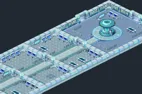
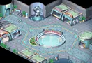
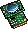
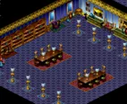
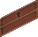
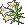
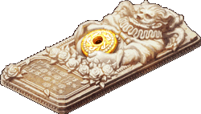
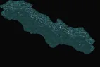
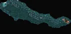
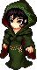

<header style="display:flex;flex-direction:column;gap:8px">

# Episode 5 · Rebirth of Memories

ความทรงจำที่ฟื้นคืน · 4 บท 32 เควส

สรุปจากวิกิ ggFTW (ฉบับ mirror ของ LifeTO) หน้า [Episode 5 Quests](https://wikimirror.lifeto.co/wiki.ggftw.com/trickster/Episode_5_Quests.html) อ่านเนื้อเรื่องย่อทุกตอนได้ที่หน้า [Story Quest](./story-quest.md)

วิกินี้เป็นข้อมูลเก่า และตัววิกิเตือนเองว่าบางส่วนอาจไม่ตรงกับเซิร์ฟ LifeTO ปัจจุบัน

</header>

<section>

## ภาพรวม

ใช้เครื่องฟื้นฟูเซลล์ความทรงจำในคอมพิวเตอร์แม่ข่ายของ Dev Room ย้อนดูอดีตของ Don Giuvanni, Rosaline และ Don Cavalier ผู้ถือกุญแจของความลับ แล้วบุกเข้าห้องลับในห้องทำงานของ Don Cavalier เพื่อไขปริศนาสุดท้ายของเขา ประธาน Megalo Company และ Trickster ผู้ก่อตั้ง

<ul>
<li>เริ่มที่ <b>JOKER</b> (Underground Dev Room - Control Room) ต้องเลเวล 160+ และจบ Episode 4 แล้ว</li>
<li>เควสต่อกันเป็นสาย ทำเรียงตามลำดับในหน้านี้ ส่งเควสหนึ่งแล้วเควสถัดไปจะเปิดให้รับ</li>
<li>ติ๊ก "ทำแล้ว" เมื่อส่งเควสแล้ว ระบบจำการติ๊กไว้ในเบราว์เซอร์นี้ กดชื่อบทเพื่อพับหรือกาง</li>
</ul>

<nav class="toc"><a href="#ch-1">บท 1 · Memory Recovery</a><a href="#ch-2">บท 2 · Cavalier's Room</a><a href="#ch-3">บท 3 · Mysterious Sarcophagus</a><a href="#ch-bonus">โบนัส</a></nav>

<a href="./episode-4.html">← Episode 4</a> · <a href="./episode-6.html">Episode 6 →</a>

</section>

<section aria-live="polite" class="counter">

## ความคืบหน้า

0 / 32 เควส

<button id="hidedone" type="button" aria-pressed="false">ซ่อนเควสที่ทำแล้ว</button><button id="reset" type="button">ล้างทั้งหมด</button>

</section>

<section id="ch-1">

<h2 id="ch-1-h">บท 1 · Memory Recovery </h2>

ผ่านระบบรักษาความปลอดภัย JOKER แล้วใช้เส้นผมของแต่ละคนทำ Memory Kit เพื่อเข้าไปในความทรงจำของ Don Giuvanni และ Rosaline

<label class="done"><input class="ep" id="e5-1" type="checkbox"/> ทำแล้ว</label>1.1<h3>JOKER - Security System JOKER</h3>เริ่มบท

Underground Dev Room - Control RoomLv 160+

<b>ภารกิจ:</b> คุยกับ NPC ตัวนี้
<ul class="src"><li>รหัสคือ "F", "A", "T", "E"</li></ul>
รางวัล: 10,000 Galder Coupon · EXP 5,844,468 / TM 1,471,407

<figure class="map" style="aspect-ratio:142/94"></figure>

<label class="done"><input class="ep" id="e5-2" type="checkbox"/> ทำแล้ว</label>1.2<h3>Don Giuvanni - Don Giuvanni's Hair</h3>

Underground Dev Room - LobbyLv 160+

<b>ภารกิจ:</b> ล้ม Don Giuvanni (Lv 238), Don Giuvanni's Hair
<ul class="src"><li>Don Giuvanni จะวาร์ปไป Giuvanni's Hidden Room</li><li>Don Giuvanni's Hair ดรอปจาก Don Giuvanni (Lv 238)</li></ul>
รางวัล: 10,000 Galder Coupon × 2, Don Giuvanni's Hair · EXP 5,260,021 / TM 1,323,951

<figure class="map" style="aspect-ratio:132/90"></figure>

<label class="done"><input class="ep" id="e5-3" type="checkbox"/> ทำแล้ว</label>1.3<h3>JOKER - Memory of Don Giuvanni</h3>

Underground Dev Room - Control RoomLv 160+

<b>ภารกิจ:</b> Memory Kit 1
<ul class="src"><li>รหัสคือ 12487257</li><li>Memory Kit 1 ผสม (Compound) จาก Memory Projector + Hologram Source + DNA Sensor + Don Giuvanni's Hair กับ Inventor Gale ที่ Underground Dev Room - Lobby</li><li>Memory Projector และ Hologram Source ดรอปจาก Win16 Worm (Lv 232)</li><li>DNA Sensor ดรอปจาก Thief Mole (Lv 227)</li><li>Don Giuvanni's Hair ได้จากเควส Don Giuvanni - Don Giuvanni's Hair</li></ul>
รางวัล: Approved Memory Kit 1 · EXP 3,506,680 / TM 882,634

<figure class="map" style="aspect-ratio:142/94"></figure>

<label class="done"><input class="ep" id="e5-4" type="checkbox"/> ทำแล้ว</label>1.4<h3>Don Giuvanni - Don Giuvanni's Memory</h3>

Giuvanni's MemoryLv 160+

<b>ภารกิจ:</b> Voice Chip
<ul class="src"><li>Voice Chip ขุดได้ที่ Giuvanni's Memory</li></ul>
รางวัล: Half Pink Potion × 20, Half Blue Potion × 20 · EXP 2,805,344 / TM 706,107

<figure class="map" style="aspect-ratio:142/116"></figure>

<label class="done"><input class="ep" id="e5-5" type="checkbox"/> ทำแล้ว</label>1.5<h3>Don Cavalier - Don Cavalier's Memory</h3>

Giuvanni's MemoryLv 160+

<b>ภารกิจ:</b> Voice Chip
<ul class="src"><li>Voice Chip ขุดได้ที่ Giuvanni's Memory</li></ul>
รางวัล: Executive Room Card Key · EXP 2,805,344 / TM 706,107

<figure class="map" style="aspect-ratio:142/116"></figure>

<label class="done"><input class="ep" id="e5-6" type="checkbox"/> ทำแล้ว</label>1.6<h3>Rosaline Gracia - Rosaline's Hair</h3>

Underground Dev Room - Control RoomLv 160+

<b>ภารกิจ:</b> Comb
<ul class="src"><li>Comb ขุดได้ที่ System Control Room</li></ul>
รางวัล: Rosaline's Hair · EXP 3,506,680 / TM 882,634

<figure class="map" style="aspect-ratio:142/94"></figure>

<label class="done"><input class="ep" id="e5-7" type="checkbox"/> ทำแล้ว</label>1.7<h3>JOKER - Memory of Rosaline</h3>

Underground Dev Room - Control RoomLv 160+

<b>ภารกิจ:</b> Memory Kit 2
<ul class="src"><li>รหัสคือ 54244724</li><li>Memory Kit ผสม (Compound) จาก Memory Projector + Hologram Source + DNA Sensor + Rosaline's Hair กับ Inventor Gale ที่ Underground Dev Room - Lobby</li><li>Memory Projector และ Hologram Source ดรอปจาก Win16 Worm (Lv 232)</li><li>DNA Sensor ดรอปจาก Thief Mole (Lv 227)</li><li>Rosaline's Hair ได้จากเควส Rosaline Gracia - Rosaline's Hair</li></ul>
รางวัล: Approved Memory Kit 2 · EXP 3,506,680 / TM 882,634

<figure class="map" style="aspect-ratio:142/94"></figure>

<label class="done"><input class="ep" id="e5-8" type="checkbox"/> ทำแล้ว</label>1.8<h3>Little Rosaline - Rosaline's Memory</h3>

Rosaline's MemoryLv 160+

<b>ภารกิจ:</b> Voice Chip
<ul class="src"><li>Voice Chip ขุดได้ที่ Rosaline's Memory</li></ul>
รางวัล: Half Pink Potion × 20, Half Blue Potion × 20 · EXP 2,805,344 / TM 706,107

<figure class="map" style="aspect-ratio:142/118"></figure>

<label class="done"><input class="ep" id="e5-9" type="checkbox"/> ทำแล้ว</label>1.9<h3>Don Danihen - Don Danihen's Memory</h3>จบบท

Rosaline's MemoryLv 160+

<b>ภารกิจ:</b> Voice Chip
<ul class="src"><li>Voice Chip ขุดได้ที่ Rosaline's Memory</li></ul>
รางวัล: Half Pink Potion × 20, Half Blue Potion × 20, Don Danihen's Music Sheet · EXP 2,805,344 / TM 706,107

<figure class="map" style="aspect-ratio:142/118"></figure>

</section>

<section id="ch-2">

<h2 id="ch-2-h">บท 2 · Cavalier's Room </h2>

เปิดลิ้นชักที่ล็อกในห้องทำงานของ Don Cavalier อ่านไดอารี่ของ Danihen ไขความลับของกรอบรูปปริศนา จนเจอทางเข้าห้องลับหลังตู้หนังสือ

<label class="done"><input class="ep" id="e5-10" type="checkbox"/> ทำแล้ว</label>2.1<h3>Drawer - Locked Desk Drawer</h3>เริ่มบท

Cavalier's OfficeLv 160+

<b>ภารกิจ:</b> Desk Key
<ul class="src"><li>Desk Key ขุดได้ที่ Cavalier's Office</li><li>ไป Cavalier's Office โดยคุยกับ Officer Robert ที่ Underground Dev Room - Lobby แล้วเลือก "Ask about the secret"</li></ul>
รางวัล: Danihen's Diary (locked) · EXP 3,506,680 / TM 882,634

<figure class="map" style="aspect-ratio:142/111"></figure>

<label class="done"><input class="ep" id="e5-11" type="checkbox"/> ทำแล้ว</label>2.2<h3>Rosaline Gracia - Danihen's Diary</h3>

Underground Dev Room - Control RoomLv 160+

<b>ภารกิจ:</b> Danihen's Diary (locked)
<ul class="src"><li>Danihen's Diary (locked) ได้จากเควส Drawer - Locked Desk Drawer</li></ul>
รางวัล: Danihen's Diary (unlocked) · EXP 2,805,344 / TM 706,107

<figure class="map" style="aspect-ratio:142/94"></figure>

<label class="done"><input class="ep" id="e5-12" type="checkbox"/> ทำแล้ว</label>2.3<h3>Mysterious Frame - The Frame's Secret 1</h3>

Cavalier's OfficeLv 160+

<b>ภารกิจ:</b> Ladder
<ul class="src"><li>Ladder ดรอปจาก Part-Timer (Lv 180)</li></ul>
รางวัล: Hologram Port × 10 · EXP 3,506,680 / TM 882,634

<figure class="map" style="aspect-ratio:142/111"></figure>

<label class="done"><input class="ep" id="e5-13" type="checkbox"/> ทำแล้ว</label>2.4<h3>Enkicladus 2 - The Frame's 1st Tale</h3>

Ocean of the PastLv 160+

<b>ภารกิจ:</b> Pure Lily, Chrysanthemum

เงื่อนไข: ใช้ Hologram Port เพื่อไปหา NPC
<ul class="src"><li>Pure Lily และ Chrysanthemum ขุดได้ที่ Ocean of the Past</li><li>Hologram Port ได้จากเควส The Frame's Secret 1</li></ul>
รางวัล: Pure Lily, Chrysanthemum, Enkicladus's Scale · EXP 4,208,016 / TM 1,059,161

<figure class="map" style="aspect-ratio:142/140"></figure>

<label class="done"><input class="ep" id="e5-14" type="checkbox"/> ทำแล้ว</label>2.5<h3>Mysterious Frame - The Frame's Secret 2</h3>

Cavalier's OfficeLv 160+

<b>ภารกิจ:</b> Emergency Lantern
<ul class="src"><li>Emergency Lantern ขุดได้ที่ System Control Room</li></ul>
รางวัล: Memo · EXP 3,506,680 / TM 882,634

<figure class="map" style="aspect-ratio:142/111"></figure>

<label class="done"><input class="ep" id="e5-15" type="checkbox"/> ทำแล้ว</label>2.6<h3>Bookcase - Entrance to the Secret Room</h3>จบบท

Cavalier's OfficeLv 160+

<b>ภารกิจ:</b> Danihen's Diary (unlocked)
<ul class="src"><li>Danihen's Diary (unlocked) ได้จากเควส Danihen's Diary</li></ul>
รางวัล: Danihen's Diary (unlocked) · EXP 2,805,344 / TM 706,107

<figure class="map" style="aspect-ratio:142/111"></figure>

</section>

<section id="ch-3">

<h2 id="ch-3-h">บท 3 · Mysterious Sarcophagus </h2>

เจอโลงศพปริศนา (Sarcophagus) ตามรอยความทรงจำของชายพันผ้าพันแผล ไขรหัสเปิดโลง แล้วได้พบกับ Don Cavalier

<label class="done"><input class="ep" id="e5-16" type="checkbox"/> ทำแล้ว</label>3.1<h3>Mysterious Sarcophagus - Mysterious Sarcophagus</h3>เริ่มบท

Secret RoomLv 160+

<b>ภารกิจ:</b> Emergency Lantern, Magnifying Glasses
<ul class="src"><li>Emergency Lantern ขุดได้ที่ System Control Room · Magnifying Glasses ขุดได้ที่ Secret Room</li></ul>
รางวัล: Mysterious Hair · EXP 3,506,680 / TM 882,634

<figure class="map" style="aspect-ratio:142/103"></figure>

<label class="done"><input class="ep" id="e5-17" type="checkbox"/> ทำแล้ว</label>3.2<h3>JOKER - Mysterious Hair</h3>

Underground Dev Room - Control RoomLv 160+

<b>ภารกิจ:</b> Memory Kit 3
<ul class="src"><li>รหัสคือ 78252985</li><li>Memory Kit ผสม (Compound) จาก Memory Projector + Hologram Source + DNA Sensor + Mysterious Hair กับ Inventor Gale ที่ Underground Dev Room - Lobby</li><li>Memory Projector และ Hologram Source ดรอปจาก Win16 Worm (Lv 232)</li><li>DNA Sensor ดรอปจาก Thief Mole (Lv 227)</li><li>Mysterious Hair ได้จากเควส Mysterious Sarcophagus</li></ul>
รางวัล: Approved Memory Kit 3 · EXP 3,506,680 / TM 882,634

<figure class="map" style="aspect-ratio:142/94"></figure>

<label class="done"><input class="ep" id="e5-18" type="checkbox"/> ทำแล้ว</label>3.3<h3>Bandaged Man - Someone's Memory</h3>

Memory of a NightmareLv 160+

<b>ภารกิจ:</b> Voice Chip
<ul class="src"><li>Voice Chip ขุดได้ที่ Memory of a Nightmare</li></ul>
รางวัล: Half Pink Potion × 20, Half Blue Potion × 20 · EXP 2,805,344 / TM 706,107

<figure class="map" style="aspect-ratio:142/131"></figure>

<label class="done"><input class="ep" id="e5-19" type="checkbox"/> ทำแล้ว</label>3.4<h3>Bandaged Man - Dark Nightmare</h3>

Memory of a NightmareLv 160+

<b>ภารกิจ:</b> Bandage × 5
<ul class="src"><li>Bandage ขุดได้ที่ Memory of a Nightmare</li></ul>
รางวัล: Message for Rosie · EXP 3,506,680 / TM 882,634

<figure class="map" style="aspect-ratio:142/131"></figure>

<label class="done"><input class="ep" id="e5-20" type="checkbox"/> ทำแล้ว</label>3.5<h3>Mysterious Sarcophagus - The Code</h3>

Secret RoomLv 160+

<b>ภารกิจ:</b> Pen, Paper
<ul class="src"><li>Pen ดรอปจาก Robber Mole (Lv 230)</li><li>Pen ตัวนี้ไม่ใช่ Pen ที่ดรอปจาก Cannon Shell (Lv 33)</li><li>Paper ซื้อจาก Item Girl ได้หลายร้าน รวมถึงร้านที่ Underground Dev Room - Lobby</li></ul>
รางวัล: Paper with Passcodes · EXP 3,506,680 / TM 882,634

<figure class="map" style="aspect-ratio:142/103"></figure>

<label class="done"><input class="ep" id="e5-21" type="checkbox"/> ทำแล้ว</label>3.6<h3>Rosaline Gracia - The Code of Two</h3>

Underground Dev Room - Control RoomLv 160+

<b>ภารกิจ:</b> Message for Rosie, Paper with Passcodes
<ul class="src"><li>Message for Rosie ได้จากเควส Bandaged Man - Dark Nightmare</li><li>Paper with Passcodes ได้จากเควส Mysterious Sarcophagus - The Code</li><li>คำตอบที่ถูกคือ "skyline"</li></ul>
รางวัล: Sky's Fate Necklace · EXP 2,805,344 / TM 706,107

<figure class="map" style="aspect-ratio:142/94"></figure>

<label class="done"><input class="ep" id="e5-22" type="checkbox"/> ทำแล้ว</label>3.7<h3>Mysterious Sarcophagus - It's Open!</h3>

Secret RoomLv 160+

<b>ภารกิจ:</b> Sky's Fate Necklace, Earthen Fate Necklace
<ul class="src"><li>Sky's Fate Necklace ได้จากเควส Rosaline Gracia - The Code of Two</li><li>Earthen Fate Necklace ได้จากเควส Queen Nefertiti - The Frame's 2nd Tale</li></ul>
รางวัล: Half Pink Potion × 20, Half Blue Potion × 20 · EXP 2,805,344 / TM 706,107

<figure class="map" style="aspect-ratio:142/103"></figure>

<label class="done"><input class="ep" id="e5-23" type="checkbox"/> ทำแล้ว</label>3.8<h3>Mysterious Sarcophagus - Into the Dark</h3>

Secret RoomLv 160+

<b>ภารกิจ:</b> Rope, Emergency Lantern
<ul class="src"><li>Rope ขุดได้ที่ Control Room · Emergency Lantern ขุดได้ที่ System Control Room</li></ul>
รางวัล: Half Pink Potion × 20, Half Blue Potion × 20 · EXP 3,506,680 / TM 882,634

<figure class="map" style="aspect-ratio:142/103"></figure>

<label class="done"><input class="ep" id="e5-24" type="checkbox"/> ทำแล้ว</label>3.9<h3>Don Cavalier - Encounter</h3>จบบท

SarcophagusLv 160+

<b>ภารกิจ:</b> คุยกับ NPC ตัวนี้

รางวัล: Cavalier Weapon Modifier, Cavalier Hat Modifier, Cavalier Shield Modifier · EXP 20,455,638 / TM 5,148,701

<figure class="map" style="aspect-ratio:142/95"></figure>

</section>

<section id="ch-bonus">

<h2 id="ch-bonus-h">โบนัส </h2>

ตามหาเพลงที่หายไปของ Danihen กับ Bard La Fimmel และฟังคำทำนายของสามเทพีแห่งโชคชะตา

<label class="done"><input class="ep" id="e5-25" type="checkbox"/> ทำแล้ว</label>โบนัส 1<h3>Bard La Fimmel - Danihen's Lost Song</h3>เริ่มบท

Underground Dev Room - Underground Passage 5Lv 160+

<b>ภารกิจ:</b> Don Danihen's Music Sheet

เงื่อนไข: ผ่านเควส Don Cavalier - Encounter แล้ว
<ul class="src"><li>Don Danihen's Music Sheet ได้จากเควส Don Danihen's Memory</li></ul>
รางวัล: Song About a Legend · EXP 3,005,726

<figure class="map" style="aspect-ratio:142/68"></figure>

<label class="done"><input class="ep" id="e5-26" type="checkbox"/> ทำแล้ว</label>โบนัส 2<h3>Explorer Reina - Hair in the Pumpkin</h3>

Underground Dev Room - Underground Passage 5Lv 160+

<b>ภารกิจ:</b> Baseball Video DVD × 50, Baseball Game CD × 50
<ul class="src"><li>Baseball Video DVD และ Baseball Game CD ดรอปจาก Merchant Mon (Lv 186)</li></ul>
รางวัล: Pumpkin with Hair · EXP 3,757,158

<figure class="map" style="aspect-ratio:142/68"></figure>

<label class="done"><input class="ep" id="e5-27" type="checkbox"/> ทำแล้ว</label>โบนัส 3<h3>JOKER - Memory of Pumpkin</h3>

Underground Dev Room - Control RoomLv 160+

<b>ภารกิจ:</b> Memory Kit 4
<ul class="src"><li>รหัสคือ 0404134</li><li>Memory Kit 4 ผสม (Compound) จาก Memory Projector + Hologram Source + DNA Sensor + Pumpkin with Hair กับ Inventor Gale ที่ Underground Dev Room - Lobby</li><li>Memory Projector และ Hologram Source ดรอปจาก Win16 Worm (Lv 232)</li><li>DNA Sensor ดรอปจาก Thief Mole (Lv 227)</li><li>Pumpkin with Hair ได้จากเควส Explorer Reina - Hair in the Pumpkin</li></ul>
รางวัล: Approved Memory Kit 4 · EXP 3,757,158

<figure class="map" style="aspect-ratio:142/94"></figure>

<label class="done"><input class="ep" id="e5-28" type="checkbox"/> ทำแล้ว</label>โบนัส 4<h3>Knight Scar - Prophecy</h3>

The ProphecyLv 160+

<b>ภารกิจ:</b> Voice Chip
<ul class="src"><li>Voice Chip ขุดได้ที่ The Prophecy</li></ul>
รางวัล: Half Pink Potion × 20, Half Blue Potion × 20 · EXP 3,005,726

<figure class="map" style="aspect-ratio:150/138"></figure>

<label class="done"><input class="ep" id="e5-29" type="checkbox"/> ทำแล้ว</label>โบนัส 5<h3>Clotho - The First Prophecy</h3>

The ProphecyLv 160+

<b>ภารกิจ:</b> Voice Chip
<ul class="src"><li>Voice Chip ขุดได้ที่ The Prophecy</li></ul>
รางวัล: Half Pink Potion × 20, Half Blue Potion × 20 · EXP 3,005,726

<figure class="map" style="aspect-ratio:150/138"></figure>

<label class="done"><input class="ep" id="e5-30" type="checkbox"/> ทำแล้ว</label>โบนัส 6<h3>Lachesis - Second Prophecy</h3>

The ProphecyLv 160+

<b>ภารกิจ:</b> Voice Chip
<ul class="src"><li>Voice Chip ขุดได้ที่ The Prophecy</li></ul>
รางวัล: Half Pink Potion × 20, Half Blue Potion × 20 · EXP 3,005,726

<figure class="map" style="aspect-ratio:150/138"></figure>

<label class="done"><input class="ep" id="e5-31" type="checkbox"/> ทำแล้ว</label>โบนัส 7<h3>Atropos - Third Prophecy</h3>

The ProphecyLv 160+

<b>ภารกิจ:</b> Voice Chip
<ul class="src"><li>Voice Chip ขุดได้ที่ The Prophecy</li></ul>
รางวัล: Half Pink Potion × 20, Half Blue Potion × 20, Don Danihen's Picture · EXP 3,005,726

<figure class="map" style="aspect-ratio:150/138"></figure>

<label class="done"><input class="ep" id="e5-32" type="checkbox"/> ทำแล้ว</label>โบนัส 8<h3>Farmer Tsetsech - Memory of a Student</h3>จบบท

Swamp Town - CarbigalLv 160+

<b>ภารกิจ:</b> Don Danihen's Picture
<ul class="src"><li>Don Danihen's Picture ได้จากเควส Atropos - Third Prophecy</li></ul>
รางวัล: Half Pink Potion × 20, Half Blue Potion × 20 · EXP 3,005,726

<figure class="map" style="aspect-ratio:142/90"></figure>

แลกของ<h3>Inventor Gale</h3>

Underground Dev Room - Lobbyไม่เสียเงิน

แลก Memory Kit ที่ใช้ในเควส Episode 5 + Memory Projector, Hologram Source, DNA Sensor อย่างละ 1
<ul><li><b>Memory Kit 1</b> ← Don Giuvanni's Hair</li><li><b>Memory Kit 2</b> ← Rosaline's Hair</li><li><b>Memory Kit 3</b> ← Mysterious Hair</li><li><b>Memory Kit 4</b> ← Pumpkin with Hair</li></ul>

แลกของ<h3>JOKER</h3>

Underground Dev Room - Control Roomไม่เสียเงิน

แลก Memory Kit ที่ใช้ในเควส Episode 5
<ul><li><b>Approved Memory Kit 1</b> ← Memory Kit 1</li><li><b>Approved Memory Kit 2</b> ← Memory Kit 2</li><li><b>Approved Memory Kit 3</b> ← Memory Kit 3</li><li><b>Approved Memory Kit 4</b> ← Memory Kit 4</li></ul>

</section>

<PageBehavior />
