

<header style="display:flex;flex-direction:column;gap:8px">

# Episode 6 · Songs of Love and Fate

บทเพลงแห่งรักและโชคชะตา · 5 บท 42 เควส

สรุปจากวิกิ ggFTW (ฉบับ mirror ของ LifeTO) หน้า [Episode 6 Quests](https://wikimirror.lifeto.co/wiki.ggftw.com/trickster/Episode_6_Quests.html) อ่านเนื้อเรื่องย่อทุกตอนได้ที่หน้า [Story Quest](./story-quest.md)

</header>

<section>

## ภาพรวม

บทสุดท้ายของเรื่อง Trickster ผู้ถูกเลือกโดย Nefertiti ได้รับคำสั่งจาก Don Cavalier ให้ไปหาเมือง Alteo ที่ซึ่งความลับทั้งหมดรออยู่

<ul>
<li>เริ่มที่ <b>Don Cavalier</b> (The Sarcophagus) ต้องเลเวล 200+ และจบ Episode 5 แล้ว</li>
<li>เควสต่อกันเป็นสาย ทำเรียงตามลำดับในหน้านี้ ส่งเควสหนึ่งแล้วเควสถัดไปจะเปิดให้รับ</li>
<li>กดชื่อบทเพื่อพับหรือกาง</li>
</ul>

<nav class="toc"><a href="#ch-1">บท 1 · Alteo Doomsday</a><a href="#ch-2">บท 2 · Nefertiti and Enkicladus</a><a href="#ch-3">บท 3 · Rosaline and Don Danihen</a><a href="#ch-4">บท 4 · Pastor Tau and Chagan</a><a href="#ch-bonus">โบนัส</a></nav>

<a href="./episode-5.html">← Episode 5</a>

</section>

<section aria-live="polite" class="counter">

## ความคืบหน้า

0 / 42 เควส

<button id="hidedone" type="button" aria-pressed="false">ซ่อนเควสที่ทำแล้ว</button><button id="reset" type="button">ล้างทั้งหมด</button>

</section>

<section id="ch-1">

<h2 id="ch-1-h">บท 1 · Alteo Doomsday </h2>

Don Cavalier ที่จริงยังไม่ตาย (เขาแกล้งตายมาหลายครั้ง) มอบภารกิจสุดท้ายให้ตามหาพรของ Harkon ใช้ Mind's Eye มองหากล่อง Vendetta ที่พาไป Gate of Alteo Empire สำรวจซากเมืองกับ Reina และ John จนเจอประตูลับ ได้พบ Robin ผู้พิทักษ์ของ Nefertiti ที่เตือนว่าอย่าไว้ใจ Don Cavalier ย้อนดูความทรงจำของ Nefertiti กับ Enkicladus แล้วไปปกป้องศาลเจ้าจาก Chronos และกองทัพมืด

<label class="done"><input class="ep" id="e6-1" type="checkbox"/> ทำแล้ว</label>1.1<h3>Don Cavalier - Final Mission for Inheritance</h3>เริ่มบท

The SarcophagusLv 200+

<b>ภารกิจ:</b> Unknown Item, Unknown Item

เงื่อนไข: ผ่านเควส Don Cavalier - Encounter แล้ว
<ul class="src"><li>ต้องใช้ Mind's Eye ถึงจะเห็น Vendetta</li><li>Vendetta จะวาร์ปไป Gate of Alteo Empire</li><li>Unknown Item ชิ้นแรกคือ Temporary Harkon Sculpture ชิ้นที่สองคือ Special Teleporting Device ได้ทั้งคู่จากเควส Transformed Rosaline - Metamorphosed Rosaline's Request</li><li>ส่งเควสแล้ว Don Cavalier จะวาร์ปไป Matrix เพื่อสู้กับเรา</li></ul>
รางวัล: None · EXP 7,580,776 / TM 1,404,191

<figure class="map" style="aspect-ratio:142/95">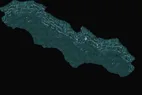</figure>

<label class="done"><input class="ep" id="e6-2" type="checkbox"/> ทำแล้ว</label>1.2<h3>Officer Albert - Officer Albert's Test</h3>

Gate of Alteo EmpireLv 200+

<b>ภารกิจ:</b> ตอบคำถาม 10 ข้อให้ถูกทั้งหมด

เงื่อนไข: ผ่านเควส Don Cavalier - Encounter แล้ว
<ul class="src"><li>คำตอบตามลำดับ: Nefertiti, Enkicladus, Poseidon, Nereids, Sword of Vengeance, Trickster, Ra Family, Fate Necklace, 17, Officer Albert</li></ul>
รางวัล: Secret Contract · EXP 3,790,388 / TM 702,095

<figure class="map" style="aspect-ratio:142/90">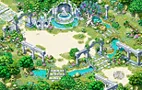</figure>

<label class="done"><input class="ep" id="e6-3" type="checkbox"/> ทำแล้ว</label>1.3<h3>Officer Albert - Relics Specialist Researcher</h3>

Gate of Alteo Empire

<b>ภารกิจ:</b> Give Secret Contract to Indiana John
<ul class="src"><li>Secret Contract ได้จากเควส Officer Albert - Officer Albert's Test</li><li>Indiana John อยู่ที่ Alteo Empire Field 1 - Secret Garden</li></ul>
รางวัล: None · EXP 3,790,388 / TM 702,095

<figure class="map" style="aspect-ratio:142/90"></figure>

<label class="done"><input class="ep" id="e6-4" type="checkbox"/> ทำแล้ว</label>1.4<h3>Indiana John - Alteo Empire Survey 1</h3>

Alteo Empire Field 1 - Secret Garden

<b>ภารกิจ:</b> Old Slate Piece × 10
<ul class="src"><li>Old Slate Piece ขุดได้ที่ Alteo Empire Fields</li></ul>
รางวัล: 10,000 Galder Coupon · EXP 7,580,776 / TM 1,404,191

<figure class="map" style="aspect-ratio:142/142">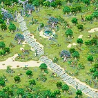</figure>

<label class="done"><input class="ep" id="e6-5" type="checkbox"/> ทำแล้ว</label>1.5<h3>Indiana John - The Slate's Secret</h3>

Alteo Empire Field 1 - Secret Garden

<b>ภารกิจ:</b> Unknown Item
<ul class="src"><li>Unknown Item คือ Collection of Shiny Pieces ได้จากเควส Explorer Reina - Alteo Empire Survey 3</li></ul>
รางวัล: Ancient Alteo Slate, Collection of Shiny Pieces · EXP 3,790,388 / TM 702,095

<figure class="map" style="aspect-ratio:142/142"></figure>

<label class="done"><input class="ep" id="e6-6" type="checkbox"/> ทำแล้ว</label>1.6<h3>Explorer Reina - Alteo Empire Survey 2</h3>

Alteo Empire Field 2 - Time Cascade

<b>ภารกิจ:</b> Shiny Piece × 10

เงื่อนไข: รับเควส Indiana John - The Slate's Secret ค้างไว้
<ul class="src"><li>Shiny Piece ขุดได้ที่ Alteo Empire Fields</li></ul>
รางวัล: 10,000 Galder Coupon · EXP 7,580,776 / TM 1,404,191

<figure class="map" style="aspect-ratio:142/142">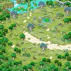</figure>

<label class="done"><input class="ep" id="e6-7" type="checkbox"/> ทำแล้ว</label>1.7<h3>Explorer Reina - Alteo Empire Survey 3</h3>

Alteo Empire Field 2 - Time Cascade

<b>ภารกิจ:</b> Water Spirit Stone, 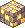Electricity Spirit Stone, 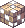Wind Spirit Stone, 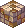Earth Spirit Stone
<ul class="src"><li>Water Spirit Stone ดรอปจาก Water Spirit (Lv 250)</li><li>Electricity Spirit Stone ดรอปจาก Electricity Spirit (Lv 250)</li><li>Wind Spirit Stone ดรอปจาก Wind Spirit (Lv 250) และ Intermediate Spirit of Wind (Lv 285)</li><li>Earth Spirit Stone ดรอปจาก Earth Spirit (Lv 250) และ Intermediate Spirit of Earth (Lv 285)</li></ul>
รางวัล: Collection of Shiny Pieces · EXP 7,580,776 / TM 1,404,191

<figure class="map" style="aspect-ratio:142/142"></figure>

<label class="done"><input class="ep" id="e6-8" type="checkbox"/> ทำแล้ว</label>1.8<h3>Indiana John - The Door of the Hidden Shrine</h3>

Alteo Empire Field 1 - Secret Garden

<b>ภารกิจ:</b> Ancient Alteo Slate, Collection of Shiny Pieces

เงื่อนไข: ผ่านเควส Indiana John - The Slate's Secret แล้ว
<ul class="src"><li>ต้องหา Gate of Hidden Shrine ใน Alteo Empire Field 1 - Secret Garden</li><li>อยู่แถวมุมซ้ายบนของแมพ ต้องใช้ Mind's Eye ถึงจะเห็น</li><li>ประตูนี้จะวาร์ปไป The Shrine's Secret Passage</li></ul>
รางวัล: None · EXP 3,790,388 / TM 702,095

<figure class="map" style="aspect-ratio:142/142"></figure>

<label class="done"><input class="ep" id="e6-9" type="checkbox"/> ทำแล้ว</label>1.9<h3>Love Hunter Robin - Robin's Memory</h3>

The Shrine's Secret Passage

<b>ภารกิจ:</b> The Truth in Memories (A), The Truth in Memories (B)
<ul class="src"><li>Love Hunter Robin พาเข้า Robin's Memory ได้</li><li>The Truth in Memories (A) ได้จากเควส Enkicladus 2 - Enkicladus in Robin's Memory</li><li>The Truth in Memories (B) ได้จากเควส Queen Nefertiti - Nefertiti in Robin's Memory</li><li>ได้ The Truth in Memories (A) และ (B) ครบแล้ว ไปคุยกับ Robin Van Peruoza ใน Robin's Memory</li><li>เลือก "Help Nefertiti..." เพื่อส่งเควส</li><li>Robin Van Peruoza จะวาร์ปไป Gate of Nefertiti Shrine</li></ul>
รางวัล: 10,000 Galder Coupon · EXP 7,580,776 / TM 1,404,191

<figure class="map" style="aspect-ratio:142/83">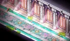</figure>

<label class="done"><input class="ep" id="e6-10" type="checkbox"/> ทำแล้ว</label>1.10<h3>Enkicladus 2 - Enkicladus in Robin's Memory</h3>

Robin's Memory

<b>ภารกิจ:</b> Nefertiti's Heart × 10

เงื่อนไข: รับเควส Love Hunter Robin - Robin's Memory ค้างไว้
<ul class="src"><li>Nefertiti's Heart ขุดได้ที่ Robin's Memory</li></ul>
รางวัล: The Truth in Memories (A) · EXP 7,580,776 / TM 1,404,191

<figure class="map" style="aspect-ratio:142/68">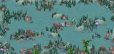</figure>

<label class="done"><input class="ep" id="e6-11" type="checkbox"/> ทำแล้ว</label>1.11<h3>Nefertiti 2 - Nefertiti in Robin's Memory</h3>

Robin's Memory

<b>ภารกิจ:</b> Enkicladus' Heart × 10

เงื่อนไข: รับเควส Love Hunter Robin - Robin's Memory ค้างไว้
<ul class="src"><li>Enkicladus' Heart ขุดได้ที่ Robin's Memory</li></ul>
รางวัล: The Truth in Memories (B) · EXP 7,580,776 / TM 1,404,191

<figure class="map" style="aspect-ratio:142/68"></figure>

<label class="done"><input class="ep" id="e6-12" type="checkbox"/> ทำแล้ว</label>1.12<h3>King Poppuri - Harkon Guardian Battle</h3>

Gate of Nefertiti Shrine

<b>ภารกิจ:</b> Dark Heart

เงื่อนไข: ผ่านเควส Love Hunter Robin - Robin's Memory แล้ว
<ul class="src"><li>Dark Heart ดรอปจาก Chronos (Lv 720)</li><li>รับเควสแล้ว King Poppuri จะวาร์ปไป Nefertiti's Audience Chamber และเริ่มศึก Harkon Guardian Battle</li></ul>
รางวัล: 10,000 Galder Coupon, King Poppuri Card · EXP 7,580,776 / TM 1,404,191

<figure class="map" style="aspect-ratio:142/97"></figure>

<label class="done"><input class="ep" id="e6-13" type="checkbox"/> ทำแล้ว</label>1.13<h3>King Poppuri - Nefertiti's Descendant Trickster</h3>จบบท

Gate of Nefertiti Shrine

<b>ภารกิจ:</b> ไปคุยกับ Spirit of Nefertiti ที่ Space of Light
<ul class="src"><li>คุยกับรูปปั้น Poseidon's Blessing ใน Nefertiti's Audience Chamber</li><li>รูปปั้นจะวาร์ปไป Space of Light</li></ul>
รางวัล: None · EXP 7,580,776 / TM 1,404,191

<figure class="map" style="aspect-ratio:142/97"></figure>

</section>

<section id="ch-2">

<h2 id="ch-2-h">บท 2 · Nefertiti and Enkicladus </h2>

King Poppuri กับพวกพ้องสร้างเกราะกั้นศาลเจ้า Nefertiti ขอให้หาคนที่มีชะตาเหมือนเธอ ซึ่งก็คือ Rosaline ที่ถูกพาตัวมาอยู่ที่ Tree Sanctuary หลังสูญเสีย Don Danihen คนรัก Nefertiti ผนึกตัวเองในเศษ Harkon ให้เราพาไปหา Rosaline แล้วทั้งสองรวมร่างกันด้วยผงวิเศษจาก Ethel และ Grandpa T เพื่อทำลายคำสาปแห่งโชคชะตา

<label class="done"><input class="ep" id="e6-14" type="checkbox"/> ทำแล้ว</label>2.1<h3>Spirit of Nefertiti - Temporary Harkon Sculpture</h3>เริ่มบท

Space of Light

<b>ภารกิจ:</b> Harkon Crystal × 16

เงื่อนไข: ผ่านเควส King Poppuri - Nefertiti's Descendant Trickster แล้ว
<ul class="src"><li>Harkon Crystal ดรอปจาก Harkon Spirit (Lv 250)</li><li>ส่งเควสแล้ว Spirit of Nefertiti จะวาร์ปไป Gate of Nefertiti Shrine</li></ul>
รางวัล: Spirit Infused Harkon · EXP 7,580,776 / TM 1,404,191

<figure class="map" style="aspect-ratio:142/104">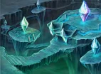</figure>

<label class="done"><input class="ep" id="e6-15" type="checkbox"/> ทำแล้ว</label>2.2<h3>Spirit of Nefertiti - Spirit Infused Harkon</h3>

Space of Light

<b>ภารกิจ:</b> Give Spirit Infused Harkon to Rosaline Gracia in Tree Sanctuary
<ul class="src"><li>Spirit Infused Harkon ได้จากเควส Spirit of Nefertiti - Temporary Harkon Sculpture</li><li>เข้า Tree Sanctuary ได้โดยคุยกับ Opening in the Sanctuary ใน Alteo Empire Field 3 - Sanctuary Forest</li></ul>
รางวัล: None · EXP 7,580,776 / TM 1,404,191

<figure class="map" style="aspect-ratio:142/104"></figure>

<label class="done"><input class="ep" id="e6-16" type="checkbox"/> ทำแล้ว</label>2.3<h3>King Poppuri - Seal the Shrine</h3>

Gate of Nefertiti Shrine

<b>ภารกิจ:</b> Shrine Block (A), Shrine Block (B), Shrine Block (C)

เงื่อนไข: ผ่านเควส Spirit of Nefertiti - Temporary Harkon Sculpture แล้ว
<ul class="src"><li>Shrine Block (A) ได้จากเควส Artisan Poppuri - Seal the Shrine Mission (1)</li><li>Shrine Block (B) ได้จากเควส Poppuri - Seal the Shrine Mission (2)</li><li>Shrine Block (C) ได้จากเควส Blue Muffler Poppuri - Seal the Shrine Mission (3)</li></ul>
รางวัล: 10,000 Galder Coupon · EXP 7,580,776 / TM 1,404,191

<figure class="map" style="aspect-ratio:142/97"></figure>

<label class="done"><input class="ep" id="e6-17" type="checkbox"/> ทำแล้ว</label>2.4<h3>Artisan Poppuri - Seal the Shrine Mission (1)</h3>

Gate of Nefertiti Shrine

<b>ภารกิจ:</b> Light Spirit Stone × 10

เงื่อนไข: รับเควส King Poppuri - Seal the Shrine ค้างไว้
<ul class="src"><li>Light Spirit Stone ดรอปจาก Light Spirit (Lv 250)</li></ul>
รางวัล: Shrine Block (A) · EXP 7,580,776 / TM 1,404,191

<figure class="map" style="aspect-ratio:142/97"></figure>

<label class="done"><input class="ep" id="e6-18" type="checkbox"/> ทำแล้ว</label>2.5<h3>Poppuri - Seal the Shrine Mission (2)</h3>

Gate of Nefertiti Shrine

<b>ภารกิจ:</b> Marble Piece × 10

เงื่อนไข: รับเควส King Poppuri - Seal the Shrine ค้างไว้
<ul class="src"><li>Marble Piece ขุดได้ที่ Gate of Nefertiti Shrine</li></ul>
รางวัล: Shrine Block (B) · EXP 7,580,776 / TM 1,404,191

<figure class="map" style="aspect-ratio:142/97"></figure>

<label class="done"><input class="ep" id="e6-19" type="checkbox"/> ทำแล้ว</label>2.6<h3>Blue Muffler Poppuri - Seal the Shrine Mission (3)</h3>

Gate of Nefertiti Shrine

<b>ภารกิจ:</b> Holy Leaf × 10

เงื่อนไข: รับเควส King Poppuri - Seal the Shrine ค้างไว้
<ul class="src"><li>Holy Leaf ขุดได้ที่ Gate of Nefertiti Shrine</li></ul>
รางวัล: Shrine Block (C) · EXP 7,580,776 / TM 1,404,191

<figure class="map" style="aspect-ratio:142/97"></figure>

<label class="done"><input class="ep" id="e6-20" type="checkbox"/> ทำแล้ว</label>2.7<h3>King Poppuri - Guardian Robin</h3>

Gate of Nefertiti Shrine

<b>ภารกิจ:</b> ไปคุยกับ Robin Van Peruoza ที่ The Shrine's Secret Passage

เงื่อนไข: ผ่านเควส King Poppuri - Seal the Shrine แล้ว
<ul class="src"><li>รับเควสแล้ว King Poppuri จะวาร์ปไป The Shrine's Secret Passage</li></ul>
รางวัล: None · EXP 7,580,776 / TM 1,404,191

<figure class="map" style="aspect-ratio:142/97"></figure>

<label class="done"><input class="ep" id="e6-21" type="checkbox"/> ทำแล้ว</label>2.8<h3>Robin Van Peruoza - To Be a Guardian</h3>

The Shrine's Secret Passage

<b>ภารกิจ:</b> คุยกับ NPC แล้วดูเนื้อเรื่อง
<ul class="src"><li>รับเควสแล้ว Robin Van Peruoza จะวาร์ปไป Matrix</li><li>จบเควสแล้ว Robin Van Peruoza จะวาร์ปไป Alteo Empire Field 1 - Secret Garden</li></ul>
<figure class="map" style="aspect-ratio:142/83"></figure>

<label class="done"><input class="ep" id="e6-22" type="checkbox"/> ทำแล้ว</label>2.9<h3>Rosaline Gracia - Preparations to Be One</h3>

Tree Sanctuary

<b>ภารกิจ:</b> Unknown Item

เงื่อนไข: ผ่านเควส Spirit of Nefertiti - Spirit Infused Harkon แล้ว
<ul class="src"><li>Unknown Item คือ Pain in the Butt Daily Pill ได้จากเควส Stargazer Ethel - Inconvenient Request</li></ul>
รางวัล: Spirit Infused Harkon · EXP 7,580,776 / TM 1,404,191

<figure class="map" style="aspect-ratio:142/83"></figure>

<label class="done"><input class="ep" id="e6-23" type="checkbox"/> ทำแล้ว</label>2.10<h3>Stargazer Ethel - Inconvenient Request</h3>

Alteo Empire Field 3 - Sanctuary Forest

<b>ภารกิจ:</b> Wind Spirit Stone × 10, Water Spirit Stone × 10, Earth Spirit Stone × 10, Star Dust

เงื่อนไข: รับเควส Rosaline Gracia - Preparations to Be One ค้างไว้
<ul class="src"><li>Wind Spirit Stone ดรอปจาก Wind Spirit (Lv 250) และ Intermediate Spirit of Wind (Lv 285)</li><li>Water Spirit Stone ดรอปจาก Water Spirit (Lv 250)</li><li>Earth Spirit Stone ดรอปจาก Earth Spirit (Lv 250) และ Intermediate Spirit of Earth (Lv 285)</li><li>Star Dust ได้จากเควส Grandpa T - Honest Grandpa T</li></ul>
รางวัล: Pain in the Butt Daily Pill · EXP 7,580,776 / TM 1,404,191

<figure class="map" style="aspect-ratio:142/142">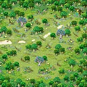</figure>

<label class="done"><input class="ep" id="e6-24" type="checkbox"/> ทำแล้ว</label>2.11<h3>Grandpa T - Honest Grandpa T</h3>

Alteo Empire Field 2 - Time Cascade

<b>ภารกิจ:</b> Ancient Nutritious Mushroom × 20

เงื่อนไข: รับเควส Stargazer Ethel - Inconvenient Request ค้างไว้
<ul class="src"><li>Ancient Nutritious Mushroom ขุดได้ที่ Alteo Empire Fields</li></ul>
รางวัล: Star Dust, Grandpa T Card · EXP 7,580,776 / TM 1,404,191

<figure class="map" style="aspect-ratio:142/142"></figure>

<label class="done"><input class="ep" id="e6-25" type="checkbox"/> ทำแล้ว</label>2.12<h3>Rosaline Gracia - Unite as One</h3>จบบท

Tree Sanctuary

<b>ภารกิจ:</b> Spirit Infused Harkon

เงื่อนไข: ผ่านเควส Rosaline Gracia - Preparations to Be One แล้ว
<ul class="src"><li>Spirit Infused Harkon ได้จากเควส Rosaline Gracia - Preparations to Be One</li><li>Rosaline Gracia จะรวมร่างกับ Spirit of Nefertiti กลายเป็น Transformed Rosaline</li><li>คุยกับ Transformed Rosaline เพื่อส่งเควส</li></ul>
รางวัล: 10,000 Galder Coupon · EXP 7,580,776 / TM 1,404,191

<figure class="map" style="aspect-ratio:142/83"></figure>

</section>

<section id="ch-3">

<h2 id="ch-3-h">บท 3 · Rosaline and Don Danihen </h2>

Rosaline เชื่อว่า Don Cavalier คือ Don Danihen ที่โดนสามเทพีแห่งโชคชะตาสาป เราใช้อุปกรณ์วาร์ปของ Willie ส่งเธอไปหา Cavalier แต่ Don Giuvanni ที่ถูกดาบ Sword of Vengeance ครอบงำโผล่มาแทง Cavalier ดาบทำลายคำสาปจน Cavalier กลับเป็น Danihen แล้วหักเป็นสองท่อน เราช่วย Giuvanni ให้หลุดจากความมืด เขาขอโทษและพี่น้องคืนดีกัน ตามด้วยศึกกับเทวดามืด Janus ที่ Nereides ส่งมา Rosaline แต่งตั้งเราเป็น True Champion และเธอกับ Danihen ก็หายไปอยู่ด้วยกันในที่ที่ไม่มีเทพองค์ใดรบกวน

<label class="done"><input class="ep" id="e6-26" type="checkbox"/> ทำแล้ว</label>3.1<h3>Transformed Rosaline - Metamorphosed Rosaline's Request</h3>เริ่มบท

Tree Sanctuary

<b>ภารกิจ:</b> Special Teleporting Device

เงื่อนไข: ผ่านเควส Rosaline Gracia - Unite as One แล้ว
<ul class="src"><li>Special Teleporting Device ได้จากเควส Willie - Make a Special Transporting Device</li></ul>
รางวัล: Special Teleporting Device, Temporary Harkon Sculpture, Resurrection Marble × 2 · EXP 7,580,776 / TM 1,404,191

<figure class="map" style="aspect-ratio:142/83"></figure>

<label class="done"><input class="ep" id="e6-27" type="checkbox"/> ทำแล้ว</label>3.2<h3>Willie - Make a Special Transporting Device</h3>

Gate of Alteo Empire

<b>ภารกิจ:</b> Teleporting Device (Alteo) × 10, Electricity Spirit Stone × 15, Homunculus' Debris × 15

เงื่อนไข: รับเควส Rosaline - Metamorphosed Rosaline's Request ค้างไว้
<ul class="src"><li>Teleporting Device (Alteo) ซื้อจาก Item Boy Thomas ชิ้นละ 15,000 Galder</li><li>Electricity Spirit Stone ดรอปจาก Electricity Spirit (Lv 250)</li><li>Homunculus' Debris ขุดได้ที่ Alteo Empire Fields</li></ul>
รางวัล: Special Teleporting Device · EXP 7,580,776 / TM 1,404,191

<figure class="map" style="aspect-ratio:142/90"></figure>

<label class="done"><input class="ep" id="e6-28" type="checkbox"/> ทำแล้ว</label>3.3<h3>Don Cavalier - How To Break Free From Destiny</h3>

SarcophagusLv 200+

<b>ภารกิจ:</b> คุยกับ NPC แล้วดูเนื้อเรื่อง

เงื่อนไข: ผ่านเควส Don Cavalier - Final Mission for Inheritance แล้ว

<figure class="map" style="aspect-ratio:142/95"></figure>

<label class="done"><input class="ep" id="e6-29" type="checkbox"/> ทำแล้ว</label>3.4<h3>Don Cavalier - Evil Don Giuvanni</h3>

SarcophagusLv 200+

<b>ภารกิจ:</b> คุยกับ NPC แล้วดูเนื้อเรื่อง
<ul class="src"><li>หลังบทสนทนาของ Transformed Rosaline กับ Don Cavalier ที่ Evil Don Giuvanni เข้ามาขัด จะโดนวาร์ปไป Matrix เพื่อสู้กับ Evil Don Giuvanni</li></ul>
<figure class="map" style="aspect-ratio:142/95"></figure>

<label class="done"><input class="ep" id="e6-30" type="checkbox"/> ทำแล้ว</label>3.5<h3>Don Giuvanni - An Apology</h3>

Matrix

<b>ภารกิจ:</b> ไปคุยกับ Don Danihen

รางวัล: Broken Sword of Vengeance (A) · EXP 7,580,776 / TM 1,404,191

<figure class="map" style="aspect-ratio:142/106">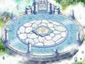</figure>

<label class="done"><input class="ep" id="e6-31" type="checkbox"/> ทำแล้ว</label>3.6<h3>Transformed Don Danihen - Song of Destiny</h3>

Matrix

<b>ภารกิจ:</b> 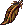Janus' Feather

เงื่อนไข: รับเควส Don Giuvanni - An Apology ค้างไว้
<ul class="src"><li>Janus' Feather ดรอปจาก Janus (Lv 410)</li><li>ต้องใช้ Mind's Eye ถึงจะเห็น Janus</li><li>Janus จะเรียก Nereides ออกมาช่วย</li></ul>
รางวัล: Broken Sword of Vengeance (B), Janus' Feather, Transformed Don Danihen Card · EXP 15,161,552 / TM 2,808,382

<figure class="map" style="aspect-ratio:142/106"></figure>

<label class="done"><input class="ep" id="e6-32" type="checkbox"/> ทำแล้ว</label>3.7<h3>Transformed Rosaline - Birth of a True Trickster</h3>จบบท

Matrix

<b>ภารกิจ:</b> ไปคุยกับ Transformed Rosaline

เงื่อนไข: ผ่านเควส Don Giuvanni - An Apology แล้ว
<ul class="src"><li>ส่งเควสนี้แล้วจะขึ้นเครดิตปิดเกม Trickster Online</li><li>จากนั้นจะวาร์ปไป Gate of Alteo Empire</li></ul>
รางวัล: Harkon Crystal Dust, Token of a True Trickster, Rosaline's Music Sheet, Transformed Rosaline Card · EXP 37,903,880 / TM 7,020,957

<figure class="map" style="aspect-ratio:142/106"></figure>

</section>

<section id="ch-4">

<h2 id="ch-4-h">บท 4 · Pastor Tau and Chagan </h2>

ระหว่างงานฉลอง Madam Sarah เป็นห่วง Pastor Tau ที่ไปตามหา Little Chagan ใน Alteo King Poppuri ช่วยเปิดทางเข้าไปในหัวใจของ Chagan เราคุ้มกัน Tau ไปถึงตัว Chagan ที่ถูก Flashire ผู้พิทักษ์ที่อาศัยอยู่ในตัวเธอครอบงำ เอาชนะ Flashire ให้กลับไปหลับในตัว Chagan แล้ว Tau ฝากแหวนประจำตระกูลไปให้ Sarah

<label class="done"><input class="ep" id="e6-33" type="checkbox"/> ทำแล้ว</label>4.1<h3>Madam Sarah - Sarah's Concerns</h3>เริ่มบทจบบท

Gate of Alteo Empire

<b>ภารกิจ:</b> Unknown Item

เงื่อนไข: ผ่านเควส Transformed Rosaline - Birth of a True Trickster แล้ว
<ul class="src"><li>Unknown Item คือ Jade Ring ได้จากเควส Pastor Tau - Tau and Chagan</li></ul>
รางวัล: Madam Sarah Card, 10,000 Galder Coupon × 10 · EXP 6,064,620 / TM 1,123,353

<figure class="map" style="aspect-ratio:142/90"></figure>

<label class="done"><input class="ep" id="e6-34" type="checkbox"/> ทำแล้ว</label>4.2<h3>King Poppuri - Holy Preparations?</h3>

Gate of Nefertiti Shrine

<b>ภารกิจ:</b> Poppuri Incense Burner, Poppuri Incense, Poppuri Snack Set

เงื่อนไข: รับเควส Madam Sarah - Sarah's Concerns ค้างไว้
<ul class="src"><li>Poppuri Incense Burner ได้จากเควส Poppuri - Make a Holy Incense Burner</li><li>Poppuri Incense ได้จากเควส Artisan Poppuri - Make Holy Incense</li><li>Poppuri Snack Set ได้จากเควส Blue Muffler Poppuri - Make Holy Snacks</li></ul>
รางวัล: Transfer to Chagan's Heart (Purification) · EXP 6,064,620 / TM 1,123,353

<figure class="map" style="aspect-ratio:142/97"></figure>

<label class="done"><input class="ep" id="e6-35" type="checkbox"/> ทำแล้ว</label>4.3<h3>Poppuri - Make a Holy Incense Burner</h3>

Gate of Nefertiti Shrine

<b>ภารกิจ:</b> Strong Tooth × 10

เงื่อนไข: รับเควส King Poppuri - Holy Preparations ค้างไว้
<ul class="src"><li>Strong Tooth ดรอปจาก Intermediate Spirit of Earth (Lv 285)</li></ul>
รางวัล: Poppuri Incense Burner · EXP 6,064,620 / TM 1,123,353

<figure class="map" style="aspect-ratio:142/97"></figure>

<label class="done"><input class="ep" id="e6-36" type="checkbox"/> ทำแล้ว</label>4.4<h3>Artisan Poppuri - Make Holy Incense</h3>

Gate of Nefertiti Shrine

<b>ภารกิจ:</b> Wind Feather × 10

เงื่อนไข: รับเควส King Poppuri - Holy Preparations ค้างไว้
<ul class="src"><li>Wind Feather ดรอปจาก Intermediate Spirit of Wind (Lv 285)</li></ul>
รางวัล: Poppuri Incense · EXP 6,064,620 / TM 1,123,353

<figure class="map" style="aspect-ratio:142/97"></figure>

<label class="done"><input class="ep" id="e6-37" type="checkbox"/> ทำแล้ว</label>4.5<h3>Blue Muffler Poppuri - Make Holy Snacks</h3>

Gate of Nefertiti Shrine

<b>ภารกิจ:</b> Red Flower Cotton Candy × 15, Blue Flower Cotton Candy × 15

เงื่อนไข: รับเควส King Poppuri - Holy Preparations ค้างไว้
<ul class="src"><li>Red Flower Cotton Candy และ Blue Flower Cotton Candy ขุดได้ที่ Alteo Empire Fields</li></ul>
รางวัล: Poppuri Snack Set · EXP 6,064,620 / TM 1,123,353

<figure class="map" style="aspect-ratio:142/97"></figure>

<label class="done"><input class="ep" id="e6-38" type="checkbox"/> ทำแล้ว</label>4.6<h3>Pastor Tau - Chagan's Heart</h3>

Chagan's Heart (Purification)

<b>ภารกิจ:</b> คุ้มกัน Young Pastor Tau ระหว่างที่เขาเดิน

เงื่อนไข: ผ่านเควส King Poppuri - Holy Preparations แล้ว
<ul class="src"><li>Pastor Tau จะวาร์ปไป Chagan's Heart (Confusion)</li><li>คุ้มกัน Young Pastor Tau จาก Corroded Cognition (Lv 270) ระหว่างที่เขาเดินผ่านแมพ</li><li>เดินจบทางแล้วจะกลับมาที่ Chagan's Heart (Purification)</li><li>คุยกับ Pastor Tau อีกครั้งเพื่อส่งเควส</li></ul>
รางวัล: None · EXP 6,064,620 / TM 1,123,353

<figure class="map" style="aspect-ratio:150/119"></figure>

<label class="done"><input class="ep" id="e6-39" type="checkbox"/> ทำแล้ว</label>4.7<h3>Pastor Tau - Tau and Chagan</h3>

Chagan's Heart (Purification)

<b>ภารกิจ:</b> คุยกับ NPC แล้วดูเนื้อเรื่อง
<ul class="src"><li>Pastor Tau จะวาร์ปไป Deep Within Chagan's Heart</li><li>จบเควสแล้ว Pastor Tau จะวาร์ปกลับ Gate of Alteo Empire</li></ul>
<figure class="map" style="aspect-ratio:150/119"></figure>

</section>

<section id="ch-bonus">

<h2 id="ch-bonus-h">โบนัส </h2>

กลับมาที่ Gate of Alteo Empire ทุกคนเตรียมฉลองชัยชนะ Bard La Fimmel ร้องเพลงรักของ Rosaline กับ Danihen, Louis Bitton ตัดเสื้อคลุม Trickster's Cloak ให้ และ Happisto Stallone ผู้สร้างดาบ Sword of Vengeance หลอมเศษดาบเป็นมงกุฎ Trickster's Crown

<label class="done"><input class="ep" id="e6-40" type="checkbox"/> ทำแล้ว</label>โบนัส 1<h3>Happisto Stallone - Nefertiti's Crown</h3>

Gate of Alteo Empire

<b>ภารกิจ:</b> Broken Sword of Vengeance (A), Broken Sword of Vengeance (B), Homunculus' Debris × 10

เงื่อนไข: ผ่านเควส Transformed Rosaline - Birth of a True Trickster แล้ว
<ul class="src"><li>Broken Sword of Vengeance (A) ได้จากเควส Don Giuvanni - An Apology</li><li>Broken Sword of Vengeance (B) ได้จากเควส Don Danihen 2 - Song of Destiny</li><li>Homunculus' Debris ขุดได้ที่ Alteo Empire Fields</li></ul>
รางวัล: Trickster's Crown, H. Stallone Card · EXP 3,790,388 / TM 702,095

<figure class="map" style="aspect-ratio:142/90"></figure>

<label class="done"><input class="ep" id="e6-41" type="checkbox"/> ทำแล้ว</label>โบนัส 2<h3>Louis Bitton - Trickster Cloak</h3>

Gate of Alteo Empire

<b>ภารกิจ:</b> Harkon Crystal Dust, Tattered Silk Piece × 10

เงื่อนไข: ผ่านเควส Transformed Rosaline - Birth of a True Trickster แล้ว
<ul class="src"><li>Harkon Crystal Dust ได้จากเควส Rosaline - Birth of a True Trickster</li><li>Tattered Silk Piece ขุดได้ที่ Alteo Empire Fields</li></ul>
รางวัล: Trickster's Cloak, Louis Bitton Card · EXP 3,790,388 / TM 702,095

<figure class="map" style="aspect-ratio:142/90"></figure>

<label class="done"><input class="ep" id="e6-42" type="checkbox"/> ทำแล้ว</label>โบนัส 3<h3>Bard La Fimmel - Song About Love and Destiny</h3>

Gate of Alteo Empire

<b>ภารกิจ:</b> Rosaline's Music Sheet, Clear Spring Water × 10

เงื่อนไข: ผ่านเควส Transformed Rosaline - Birth of a True Trickster แล้ว
<ul class="src"><li>Rosaline's Music Sheet ได้จากเควส Rosaline - Birth of a True Trickster</li><li>Clear Spring Water ดรอปจาก Water Spirit (Lv 250)</li></ul>
รางวัล: Love Song, La Fimmel Card · EXP 3,790,388 / TM 702,095

<figure class="map" style="aspect-ratio:142/90"></figure>

</section>

<PageBehavior />
