

<header class="hero">

# คู่มือ Trickster ✦

เควส เช็กลิสต์ และของที่ต้องหา สรุปจากวิกิ ggFTW

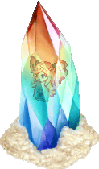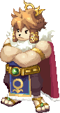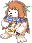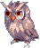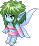

</header>

<nav class="toc"><a href="#guides">คู่มือ</a><a href="#key">เควสกุญแจ</a><a href="#story">เควสเนื้อเรื่อง</a></nav>

<section id="guides">

<h2 id="guides-h">คู่มือ</h2>

<a class="g" href="daily-quests.html" style="--c:var(--g-daily)">เควสรายวัน80 เควส · รีเซ็ตทุกวันเดลี่ประจำเมือง, Julio, Shadow World, แผนที่สมบัติ</a>
<a class="g" href="card-girl-quests.html" style="--c:var(--g-cards)">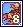เควสการ์ด53 เควส · 11 โซนCard Girl พร้อมเฉลยการ์ดและมอนที่ดรอป</a>
<a class="g" href="jobs.html" style="--c:var(--g-jobs)">อาชีพ9 ตัวละคร · 35 อาชีพเควสเปลี่ยนอาชีพ 2 และ 3, สกิลทุกอาชีพ, ของฝึก Mastery รวม Bear (Paula)</a>
<a class="g" href="tower-of-chaos.html" style="--c:var(--g-chaos)">Tower of Chaos72 ชั้นทางเข้า, เควสขอบัตร, วาร์ป, เลเวลมอนแต่ละช่วง</a>
<a class="g" href="leveling-maps.html" style="--c:var(--g-level)">แมพเก็บเลเวล253 แมพทุกโซนเรียงตามเลเวลมอน</a>
<a class="g" href="bosses.html" style="--c:var(--g-boss)">บอส10 บอส · Lv 71–730ทางเข้า ด่านทดสอบ จุดอ่อน และยูนีคที่ดรอป</a>
<a class="g" href="guardian.html" style="--c:var(--g-guardian)">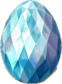Guardian28 ขั้นตอน · Lv 65–180Card Identification, เลี้ยงไข่ Soul Seed, ปลุก Guardian, Mind's Eye</a>
<a class="g" href="stats.html" style="--c:var(--g-stats)">สเตตัส12 สเตตัสแต่ละตัวมีผลกับอะไร และกราฟตัวละครทำงานยังไง</a>

</section>

<section id="key">

<h2 id="key-h">เควสกุญแจ</h2>

ทำตามลำดับเลข แต่ละโซนต้องผ่านเควสกุญแจของโซนก่อนหน้าก่อน

<a class="t" href="key-desert-beach.html" style="--c:var(--z-desert)">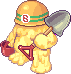1Desert BeachLV 25+ · Desert Sticker × 5</a>
<a class="t" href="key-megalopolis.html" style="--c:var(--z-mega)">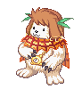2MegalopolisLV 30+ · Instant Adhesive × 4</a>
<a class="t" href="key-caballa-relics.html" style="--c:var(--z-caballa)">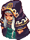3Caballa RelicsLV 55+ · Caballa Sticker × 10</a>
<a class="t" href="key-oops-wharf.html" style="--c:var(--z-oops)">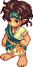4Oops WharfLV 70+ · Oops Sticker × 7</a>
<a class="t" href="key-mermaid-palace.html" style="--c:var(--z-mermaid)">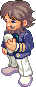5Mermaid PalaceLV 80+ · Palace Proof Sticker × 7</a>
<a class="t" href="key-ghost-blue.html" style="--c:var(--z-ghost)">6Ghost BlueLV 100+ · Ghost Sticker × 10</a>
<a class="t" href="key-rose-garden.html" style="--c:var(--z-rose)">7Rose GardenLV 125+ · Rose Garden Sticker × 13</a>
<a class="t" href="key-black-swamp.html" style="--c:var(--z-swamp)">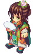8Black SwampLV 150+ · Swamp Sticker × 13</a>
<a class="t" href="key-snow-hill.html" style="--c:var(--z-snow)">9Snow HillLV 170+ · Snow Hill Sticker × 14</a>
<a class="t" href="key-techichi-volcano.html" style="--c:var(--z-techichi)">10Techichi VolcanoLV 210+ · Techichi Sticker × 13</a>
<a class="t" href="key-tapasco-volcano.html" style="--c:var(--z-tapasco)">11Tapasco VolcanoLV 235+ · Tapasco Sticker</a>

</section>

<section id="story">

<h2 id="story-h">เควสเนื้อเรื่อง</h2>

7 Episode ทำต่อกันตามลำดับ อ่านเนื้อเรื่องย่อและดูความคืบหน้ารวมที่ <a href="story-quest.html">ภาพรวมเนื้อเรื่อง</a>

<a class="t" href="episode-0.html" style="--c:var(--s-story)">0The Start of an AdventureLV 1+ · 3 บท · 36 เควส</a>
<a class="t" href="episode-1.html" style="--c:var(--s-story)">1Secret of the Alteo EmpireLV 45+ · 3 บท · 22 เควส</a>
<a class="t" href="episode-2.html" style="--c:var(--s-story)">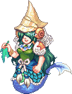2Mirage IslandLV 80+ · 3 บท · 29 เควส</a>
<a class="t" href="episode-3.html" style="--c:var(--s-story)">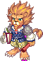3Dreams of an EmpireLV 130+ · 4 บท · 37 เควส</a>
<a class="t" href="episode-4.html" style="--c:var(--s-story)">4Beyond the VeilLV 150+ · 4 บท · 25 เควส</a>
<a class="t" href="episode-5.html" style="--c:var(--s-story)">5Rebirth of MemoriesLV 160+ · 4 บท · 32 เควส</a>
<a class="t" href="episode-6.html" style="--c:var(--s-story)">6Songs of Love and FateLV 200+ · 5 บท · 42 เควส</a>

</section>

