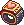
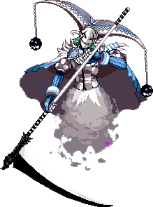
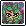
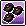

<header style="display:flex;flex-direction:column;gap:8px">

# เปลี่ยนอาชีพ ขั้น 2 และ 3

สรุปเงื่อนไข ของที่ต้องเตรียม และลำดับเควสเปลี่ยนอาชีพ ติ๊กเก็บความคืบหน้าของตัวละครได้

<ul class="notes"><li>Dark Lord มีเส้นทางเปลี่ยนอาชีพแบบใหม่แยกต่างหาก ดู <a href="https://wikimirror.lifeto.co/wiki.ggftw.com/trickster/New_Dark_Lord_Job_Advancement.html" rel="noopener" target="_blank">New Dark Lord Job Advancement</a> ในวิกิ</li></ul>

</header>

<input id="q" placeholder="ค้นอาชีพ ไอเทม หรือสกิล" type="search"/>

<label><input id="hidedone" type="checkbox"/> ซ่อนที่ทำแล้ว</label><button id="reset" type="button">ล้างติ๊ก</button>

<nav class="toc"><a href="#j2">อาชีพ 2</a><a href="#j2m">Job Master</a><a href="#p3">อาชีพ 3 ของเตรียม</a><a href="#s3">ลำดับเควส</a><a href="#c3">เลือกอาชีพ</a><a href="#tr">Tribunal</a><a href="#sk">สกิลอาชีพ 3</a></nav>

<section data-c="" id="j2">

<h2>เปลี่ยนอาชีพขั้น 2 </h2>

เปลี่ยนหลังเลเวลนี้ได้ ไม่มีโทษ นอกจากจะเรียนสกิลใหม่ช้าลง หลังเปลี่ยนจะใส่ผ้าคลุม (Cape) ได้

<table><thead><tr><th></th><th>ต้องเตรียม</th><th>หาจาก</th><th>ได้</th></tr></thead><tbody>
<tr><td class="ck"><input aria-label="ทำแล้ว" id="j2p1" type="checkbox"/></td><td class="nm" data-l="ต้องเตรียม">Base Lv 60, TM Lv 50</td><td class="nw" data-l="หาจาก"></td><td class="nw" data-l="ได้"></td></tr>
<tr><td class="ck"><input aria-label="ทำแล้ว" id="j2p2" type="checkbox"/></td><td class="nm" data-l="ต้องเตรียม">100k Galder Check × 3</td><td data-l="หาจาก">ซื้อจาก Andrew ที่ Relics Town - Azteca หรือ Megalopolis Bank ใบละ 105,000 (รวม 315,000)</td><td class="nw" data-l="ได้"></td></tr>
<tr><td class="ck"><input aria-label="ทำแล้ว" id="j2p3" type="checkbox"/></td><td class="nm" data-l="ต้องเตรียม">Growth Badge × 1</td><td data-l="หาจาก">ล่า Kaboom ที่ Caballa Relics Dungeon 4</td><td class="nw" data-l="ได้"></td></tr>
<tr><td class="ck"><input aria-label="ทำแล้ว" id="j2p4" type="checkbox"/></td><td class="nm" data-l="ต้องเตรียม">ส่งของให้ Job Master ของสายตัวเอง</td><td data-l="หาจาก">ที่ Relics Town - Azteca หรือ Room of Job Master 1, 2 ใน Garden of Skill Master (ประตูอยู่ฝั่งตะวันออกของ Megalopolis Square)</td><td data-l="ได้">1,000,000 EXP / 12,000,000 TM</td></tr>
</tbody></table>

</section>

<section id="j2m">

## Job Master ของแต่ละสาย

<table><thead><tr><th>สาย</th><th>อาชีพ 1 → 2</th><th>Job Master</th><th>ได้รับ</th></tr></thead><tbody>
<tr><td class="nm" data-l="สาย">Bunny</td><td data-l="อาชีพ 1 → 2">Schoolgirl → <b>Boxer</b></td><td class="nw" data-l="Job Master">Boxer Jeanne</td><td data-l="ได้รับ">Sign of Fighting Spirit</td></tr>
<tr><td class="nm" data-l="สาย">Buffalo</td><td data-l="อาชีพ 1 → 2">Fighter → <b>Warrior</b></td><td class="nw" data-l="Job Master">Warrior Kei</td><td data-l="ได้รับ">Sign of Sword</td></tr>
<tr><td class="nm" data-l="สาย">Sheep</td><td data-l="อาชีพ 1 → 2">Librarian → <b>Bard</b></td><td data-l="Job Master">Bard La Fimmel</td><td data-l="ได้รับ">Sign of Sound</td></tr>
<tr><td class="nm" data-l="สาย">Dragon</td><td data-l="อาชีพ 1 → 2">Shaman → <b>Magician</b></td><td data-l="Job Master">Magician Louie</td><td data-l="ได้รับ">Sign of Magical Tricks</td></tr>
<tr><td class="nm" data-l="สาย">Fox</td><td data-l="อาชีพ 1 → 2">Archaeologist → <b>Explorer</b></td><td data-l="Job Master">Explorer Reina</td><td data-l="ได้รับ">Sign of Excavation</td></tr>
<tr><td class="nm" data-l="สาย">Lion</td><td data-l="อาชีพ 1 → 2">Engineer → <b>Inventor</b></td><td data-l="Job Master">Inventor Gale</td><td data-l="ได้รับ">Sign of Creation</td></tr>
<tr><td class="nm" data-l="สาย">Cat</td><td data-l="อาชีพ 1 → 2">Model → <b>Entertainer</b></td><td data-l="Job Master">Entertainer Elicia</td><td data-l="ได้รับ">Sign of Popularity</td></tr>
<tr><td class="nm" data-l="สาย">Raccoon</td><td data-l="อาชีพ 1 → 2">Teacher → <b>Card Master</b></td><td data-l="Job Master">Card Master Taniel</td><td class="nw" data-l="ได้รับ">Sign of Card</td></tr>
</tbody></table>

อยากกลับไปใช้ชุดอาชีพเดิมจ่าย 50,000 ให้ Louis Bitton (น้ำพุ Megalopolis Square, Azteca หรือ Carbigal) เปลี่ยนกลับอีกครั้งก็ 50,000

</section>

<section data-c="" id="p3">

<h2>อาชีพขั้น 3: ของที่ต้องเตรียม </h2>

ได้เฉพาะสายที่เลือกในขั้น 3 เลือกให้ดีก่อน ของที่เหลือได้ระหว่างทำเควส

<table><thead><tr><th></th><th>ของ</th><th>หาจาก</th><th>ใช้ในขั้น</th></tr></thead><tbody>
<tr><td class="ck"><input aria-label="ทำแล้ว" id="p3-0" type="checkbox"/></td><td class="nm" data-l="ของ">Base Lv 130, TM Lv 120</td><td class="nw" data-l="หาจาก"></td><td class="nw" data-l="ใช้ในขั้น"></td></tr>
<tr><td class="ck"><input aria-label="ทำแล้ว" id="p3-1" type="checkbox"/></td><td class="nm" data-l="ของ">Ticket of the Valiant × 1</td><td data-l="หาจาก">ดรอปจาก Clurican (Lv 240) / Tenter Lion หรือขุดใน Swamp Dungeon</td><td class="nw" data-l="ใช้ในขั้น">ขั้น 1</td></tr>
<tr><td class="ck"><input aria-label="ทำแล้ว" id="p3-2" type="checkbox"/></td><td class="nm" data-l="ของ">1 Mil Galder Check × 3</td><td data-l="หาจาก">ซื้อจาก Andrew ที่ Megalopolis Bank ใบละ 1,050,000</td><td class="nw" data-l="ใช้ในขั้น">ขั้น 1</td></tr>
<tr><td class="ck"><input aria-label="ทำแล้ว" id="p3-3" type="checkbox"/></td><td class="nm" data-l="ของ">Sacred Water × 1</td><td data-l="หาจาก">ขุดใน Black Swamp Fields</td><td class="nw" data-l="ใช้ในขั้น">ขั้น 3</td></tr>
<tr><td class="ck"><input aria-label="ทำแล้ว" id="p3-4" type="checkbox"/></td><td class="nm" data-l="ของ">Brass × 3</td><td data-l="หาจาก">ดรอปจาก Brass Knight (Lv 186)</td><td class="nw" data-l="ใช้ในขั้น">ขั้น 4</td></tr>
<tr><td class="ck"><input aria-label="ทำแล้ว" id="p3-5" type="checkbox"/></td><td class="nm" data-l="ของ">Magnetite × 3</td><td data-l="หาจาก">ดรอปจาก Iron Knight (Lv 184)</td><td class="nw" data-l="ใช้ในขั้น">ขั้น 4</td></tr>
<tr><td class="ck"><input aria-label="ทำแล้ว" id="p3-6" type="checkbox"/></td><td class="nm" data-l="ของ">Magic Powder × 3</td><td data-l="หาจาก">ดรอปจาก Bone Magician (Lv 231)</td><td class="nw" data-l="ใช้ในขั้น">ขั้น 4</td></tr>
<tr><td class="ck"><input aria-label="ทำแล้ว" id="p3-7" type="checkbox"/></td><td class="nm" data-l="ของ">Glass Piece × 3</td><td data-l="หาจาก">ดรอปจาก Bone Warrior (Lv 225)</td><td class="nw" data-l="ใช้ในขั้น">ขั้น 4</td></tr>
<tr><td class="ck"><input aria-label="ทำแล้ว" id="p3-8" type="checkbox"/></td><td class="nm" data-l="ของ">Guardian Stone ของอาชีพที่เลือก × 1</td><td data-l="หาจาก">ดูตาราง “เลือกอาชีพ” ด้านล่าง</td><td class="nw" data-l="ใช้ในขั้น">ขั้น 3</td></tr>
<tr><td class="ck"><input aria-label="ทำแล้ว" id="p3-9" type="checkbox"/></td><td class="nm" data-l="ของ">Harkon × 1</td><td data-l="หาจาก">ขุดใน Techichi / Tapasco Fields, ชั้นต่อสู้ของ Tower of Chaos, Gate of Abyss, Abyss Fields หรือจากเควส Blacksmith Marx (Find Ingredients for Precious Jewel, Silent Lava Mine Collection)</td><td data-l="ใช้ในขั้น">ขั้น 2 (ยกเว้น Dark Lord)</td></tr>
<tr><td class="ck"><input aria-label="ทำแล้ว" id="p3-10" type="checkbox"/></td><td class="nm" data-l="ของ">เฉพาะ Dark Lord: Adamantite × 1 + Alexandrite × 2 แทน Harkon</td><td data-l="หาจาก">Adamantite ขุดที่ 1st Mining Lot of Precious Jewel / Tapasco Mine 1 · Alexandrite ขุดที่ 2nd Mining Lot / Tapasco Mine 2</td><td class="nw" data-l="ใช้ในขั้น">ขั้น 2</td></tr>
</tbody></table>

</section>

<section data-c="" id="s3">

<h2>อาชีพขั้น 3: ลำดับเควส </h2>

เรียงตามลำดับที่ทำจริง เควสหมายเลข 2 ของวิกิ (Guardian's Messenger) เป็นขั้นสุดท้าย รางวัลรวม: Flower of Revival × 3, Light Compass, เครื่องประดับของอาชีพ, 22,848,875 EXP / 48,848,875 TM

<table><thead><tr><th></th><th>เควส</th><th>ที่</th><th>ต้องทำ</th><th>ได้</th></tr></thead><tbody>
<tr><td class="ck"><input aria-label="ทำแล้ว" id="s3-0" type="checkbox"/></td><td class="nm" data-l="เควส">ขั้น 1 Door of Tribulation - Path of Tribulation</td><td data-l="ที่">Garden of Skill Master</td><td data-l="ต้องทำ">ส่ง Ticket of the Valiant + 1 Mil Galder Check × 3</td><td data-l="ได้">Marble of Triumph, TM 10,000,000</td></tr>
<tr><td class="ck"><input aria-label="ทำแล้ว" id="s3-1" type="checkbox"/></td><td class="nm" data-l="เควส">ขั้น 3 Find 3rd Job Guardian Stone</td><td data-l="ที่">Job Master ของสายตัวเอง (ดูตารางเลือกอาชีพ)</td><td data-l="ต้องทำ">ถือ Marble of Triumph แล้วส่ง Guardian Stone + Sacred Water</td><td data-l="ได้">Sealed Guardian, Scroll</td></tr>
<tr><td class="ck"><input aria-label="ทำแล้ว" id="s3-2" type="checkbox"/></td><td class="nm" data-l="เควส">ขั้น 4 Happisto Stallone - Make Happisto's Compass Frame (3 รอบ)</td><td data-l="ที่">Gate of Snow Hill</td><td data-l="ต้องทำ">ส่ง Brass, Glass Piece, Magnetite, Magic Powder อย่างละ 1 ต่อรอบ</td><td data-l="ได้">รอบ 3 ได้ Compass Frame</td></tr>
<tr><td class="ck"><input aria-label="ทำแล้ว" id="s3-3" type="checkbox"/></td><td class="nm" data-l="เควส">ขั้น 5 Room of Ordeal Key - Find Compass Frame</td><td data-l="ที่">Job Master คนเดิม</td><td data-l="ต้องทำ">ส่ง Compass Frame</td><td data-l="ได้">The Key of Trials</td></tr>
<tr><td class="ck"><input aria-label="ทำแล้ว" id="s3-4" type="checkbox"/></td><td class="nm" data-l="เควส">ขั้น 6 Find 16 Guardian Stone for the Needleless Compass</td><td data-l="ที่">Job Master คนเดิม</td><td data-l="ต้องทำ">รับเควสไว้ แล้วไปล่ามอน Tribunal 16 ห้อง (ตารางด้านล่าง) ได้ Stone of Patience มาส่งพร้อม Marble of Triumph</td><td data-l="ได้">Needleless Compass</td></tr>
<tr><td class="ck"><input aria-label="ทำแล้ว" id="s3-5" type="checkbox"/></td><td class="nm" data-l="เควส">ขั้น 2 Guardian's Messenger's 3rd Job Quest</td><td data-l="ที่">Room of Guardian</td><td data-l="ต้องทำ">ส่ง Harkon (หรือ Adamantite + Alexandrite), Needleless Compass, Sealed Guardian</td><td data-l="ได้">เปลี่ยนเป็นอาชีพ 3, Light Compass, เครื่องประดับ Guardian ของอาชีพ, TM 16,000,000</td></tr>
</tbody></table>

</section>

<section id="c3">

## เลือกอาชีพขั้น 3 และ Guardian Stone

Messenger คือ NPC ที่ต้องคุยหลังจบขั้น 1 เพื่อเลือกอาชีพ ส่วน Guardian Stone ส่งให้ Job Master ตามตำแหน่งในคอลัมน์สุดท้าย

<table><thead><tr><th>อาชีพ 3</th><th>Messenger</th><th>Guardian Stone ← ได้จาก</th><th>ส่งให้</th></tr></thead><tbody>
<tr><td class="nm" data-l="อาชีพ 3"><b>Champion</b> สายเพียว Bunny</td><td data-l="Messenger">Vulcanus Phoenix's Messenger</td><td data-l="Guardian Stone ← ได้จาก">Red Ruby ← Chele (Lv 117)</td><td data-l="ส่งให้">Boxer Jeanne · Desert Beach Field 3 - Statue of Anubis</td></tr>
<tr><td class="nm" data-l="อาชีพ 3"><b>Duelist</b> สายไฮบริด Bunny</td><td data-l="Messenger">Alsiedo Bird's Messenger</td><td data-l="Guardian Stone ← ได้จาก">Special Jade ← Nora Joe (Lv 126)</td><td data-l="ส่งให้">Boxer Jeanne · Desert Beach Field 3 - Statue of Anubis</td></tr>
<tr><td class="nm" data-l="อาชีพ 3"><b>Gladiator</b> สายเพียว Buffalo</td><td data-l="Messenger">Dragon Tale's Messenger</td><td data-l="Guardian Stone ← ได้จาก">Blue Turquoise ← Siremaid (Lv 120)</td><td data-l="ส่งให้">Warrior Kei · Wharf Field 4 - Chrono Wharf</td></tr>
<tr><td class="nm" data-l="อาชีพ 3"><b>Mercenary</b> สายไฮบริด Buffalo</td><td data-l="Messenger">Black Wings' Messenger</td><td data-l="Guardian Stone ← ได้จาก">Onyx ← Tanya (Lv 150)</td><td data-l="ส่งให้">Warrior Kei · Wharf Field 4 - Chrono Wharf</td></tr>
<tr><td class="nm" data-l="อาชีพ 3"><b>Soul Master</b> สายเพียว Sheep</td><td data-l="Messenger">Sacred Esper's Messenger</td><td data-l="Guardian Stone ← ได้จาก">Pure Sapphire ← Popeyed Anemone (Lv 105)</td><td data-l="ส่งให้">Bard La Fimmel · Rose Field 3 - Maze of Blue Rose</td></tr>
<tr><td class="nm" data-l="อาชีพ 3"><b>Witch</b> สายไฮบริด Sheep</td><td data-l="Messenger">Golden Ant's Messenger</td><td data-l="Guardian Stone ← ได้จาก">Amber ← Captain Norman (Lv 148)</td><td data-l="ส่งให้">Bard La Fimmel · Rose Field 3 - Maze of Blue Rose</td></tr>
<tr><td class="nm" data-l="อาชีพ 3"><b>Dark Lord</b> สายเพียว Dark Dragon</td><td data-l="Messenger">Janus' Messenger</td><td data-l="Guardian Stone ← ได้จาก">Alexandrite ← ขุดที่ 2nd Mining Lot of Precious Jewel หรือ Tapasco Mine 2 - Silent Lava</td><td data-l="ส่งให้">Magician Louie · Mermaid Dungeon 2 - Legend of the Sea</td></tr>
<tr><td class="nm" data-l="อาชีพ 3"><b>Priest</b> สายเพียว Light Dragon</td><td data-l="Messenger">Eternal Knight's Messenger</td><td data-l="Guardian Stone ← ได้จาก">Shiny Diamond ← Captain Arman (Lv 145)</td><td data-l="ส่งให้">Magician Louie · Pyramid Dungeon 1 - Hall of the Slave</td></tr>
<tr><td class="nm" data-l="อาชีพ 3"><b>Wizard</b> สายไฮบริด Dragon</td><td data-l="Messenger">Silvanian's Messenger</td><td data-l="Guardian Stone ← ได้จาก">Green Emerald ← Merrow (Lv 118)</td><td data-l="ส่งให้">Magician Louie · Pyramid Dungeon 1 - Hall of the Slave</td></tr>
<tr><td class="nm" data-l="อาชีพ 3"><b>Thief Master</b> สายเพียว Fox</td><td data-l="Messenger">King Enigmo's Messenger</td><td data-l="Guardian Stone ← ได้จาก">Peridot ← Cora Pyupyu (Lv 115)</td><td data-l="ส่งให้">Explorer Reina · Caballa Relics Dungeon 1</td></tr>
<tr><td class="nm" data-l="อาชีพ 3"><b>Hunter Lord</b> สายไฮบริด Fox</td><td data-l="Messenger">Enigmo Van Peruoza's Messenger</td><td data-l="Guardian Stone ← ได้จาก">Silver Aquamarine ← Water Weed Witch (Lv 95)</td><td data-l="ส่งให้">Explorer Reina · Caballa Relics Dungeon 1</td></tr>
<tr><td class="nm" data-l="อาชีพ 3"><b>Scientist</b> สายเพียว Lion</td><td data-l="Messenger">Centakonus' Messenger</td><td data-l="Guardian Stone ← ได้จาก">Water Agate ← Merman Ale (Lv 89)</td><td data-l="ส่งให้">Inventor Gale · Wharf Field 4 - Chrono Wharf</td></tr>
<tr><td class="nm" data-l="อาชีพ 3"><b>Cyber Hunter</b> สายไฮบริด Lion</td><td data-l="Messenger">Oddeye Dragon's Messenger</td><td data-l="Guardian Stone ← ได้จาก">Sky Topaz ← Dancer Isabelle (Lv 141)</td><td data-l="ส่งให้">Inventor Gale · Wharf Field 4 - Chrono Wharf</td></tr>
<tr><td class="nm" data-l="อาชีพ 3"><b>Primadonna</b> สายเพียว Cat</td><td data-l="Messenger">Rosaspina's Messenger</td><td data-l="Guardian Stone ← ได้จาก">Rodonite ← Beast Vincento (Lv 156)</td><td data-l="ส่งให้">Entertainer Elicia · Rose Field 3 - Maze of Blue Rose</td></tr>
<tr><td class="nm" data-l="อาชีพ 3"><b>Diva</b> สายไฮบริด Cat</td><td data-l="Messenger">Amethysta's Messenger</td><td data-l="Guardian Stone ← ได้จาก">Dusk Amethyst ← Fish Guardian Tink (Lv 85)</td><td data-l="ส่งให้">Entertainer Elicia · Rose Field 3 - Maze of Blue Rose</td></tr>
<tr><td class="nm" data-l="อาชีพ 3"><b>Gambler</b> สายเพียว Raccoon</td><td data-l="Messenger">Delphinus' Messenger</td><td data-l="Guardian Stone ← ได้จาก">Blue Lapis Lazuli ← Okto (Lv 129)</td><td data-l="ส่งให้">Card Master Taniel · Northwest Forest</td></tr>
<tr><td class="nm" data-l="อาชีพ 3"><b>Duke</b> สายไฮบริด Raccoon</td><td data-l="Messenger">Flashire Snake's Messenger</td><td data-l="Guardian Stone ← ได้จาก">White Opal ← Madam Fondue (Lv 155)</td><td data-l="ส่งให้">Card Master Taniel · Northwest Forest</td></tr>
</tbody></table>

</section>

<section data-c="" id="tr">

<h2>ล่ามอน Tribunal 16 ห้อง (ขั้น 6) </h2>

ต้องมีเควสขั้น 6 ค้างในสมุด ทำต่อกันตามลำดับ ห้องละ 3 ตัวใน 5 นาที แต่ละห้องให้ 749,730 EXP / 761,562 TM

<table><thead><tr><th></th><th>Messenger</th><th>ห้อง</th><th>ล่า</th><th>ได้</th></tr></thead><tbody>
<tr><td class="ck"><input aria-label="ทำแล้ว" id="tr0" type="checkbox"/></td><td class="nm" data-l="Messenger">1. Vulcanus Phoenix's Messenger</td><td data-l="ห้อง">Room of Tribulation 1</td><td data-l="ล่า">3 × Tribunal Flame Moth (Lv 150) ใน 5 นาที</td><td data-l="ได้">Flower of Revival</td></tr>
<tr><td class="ck"><input aria-label="ทำแล้ว" id="tr1" type="checkbox"/></td><td class="nm" data-l="Messenger">2. Alsiedo Bird's Messenger</td><td data-l="ห้อง">Room of Tribulation 2</td><td data-l="ล่า">3 × Tribunal Siremaid (Lv 150) ใน 5 นาที</td><td class="nw" data-l="ได้">–</td></tr>
<tr><td class="ck"><input aria-label="ทำแล้ว" id="tr2" type="checkbox"/></td><td class="nm" data-l="Messenger">3. Dragon Tale's Messenger</td><td data-l="ห้อง">Room of Tribulation 3</td><td data-l="ล่า">3 × Tribunal Crow (Lv 150) ใน 5 นาที</td><td class="nw" data-l="ได้">–</td></tr>
<tr><td class="ck"><input aria-label="ทำแล้ว" id="tr3" type="checkbox"/></td><td class="nm" data-l="Messenger">4. Black Wings' Messenger</td><td data-l="ห้อง">Room of Tribulation 4</td><td data-l="ล่า">3 × Tribunal Seth (Lv 150) ใน 5 นาที</td><td class="nw" data-l="ได้">–</td></tr>
<tr><td class="ck"><input aria-label="ทำแล้ว" id="tr4" type="checkbox"/></td><td class="nm" data-l="Messenger">5. Sacred Esper's Messenger</td><td data-l="ห้อง">Room of Tribulation 5</td><td data-l="ล่า">3 × Tribunal Shadow (Lv 160) ใน 5 นาที</td><td class="nw" data-l="ได้">–</td></tr>
<tr><td class="ck"><input aria-label="ทำแล้ว" id="tr5" type="checkbox"/></td><td class="nm" data-l="Messenger">6. Golden Ant's Messenger</td><td data-l="ห้อง">Room of Tribulation 6</td><td data-l="ล่า">3 × Tribunal Tooth Flower (Lv 160) ใน 5 นาที</td><td data-l="ได้">Flower of Revival</td></tr>
<tr><td class="ck"><input aria-label="ทำแล้ว" id="tr6" type="checkbox"/></td><td class="nm" data-l="Messenger">7. Eternal Knight's Messenger</td><td data-l="ห้อง">Room of Tribulation 7</td><td data-l="ล่า">3 × Tribunal Hell Knight (Lv 160) ใน 5 นาที</td><td class="nw" data-l="ได้">–</td></tr>
<tr><td class="ck"><input aria-label="ทำแล้ว" id="tr7" type="checkbox"/></td><td class="nm" data-l="Messenger">8. Silvanian's Messenger</td><td data-l="ห้อง">Room of Tribulation 8</td><td data-l="ล่า">3 × Tribunal Yeti (Lv 160) ใน 5 นาที</td><td class="nw" data-l="ได้">–</td></tr>
<tr><td class="ck"><input aria-label="ทำแล้ว" id="tr8" type="checkbox"/></td><td class="nm" data-l="Messenger">9. King Enigmo's Messenger</td><td data-l="ห้อง">Room of Tribulation 9</td><td data-l="ล่า">3 × Tribunal Koom (Lv 170) ใน 5 นาที</td><td class="nw" data-l="ได้">–</td></tr>
<tr><td class="ck"><input aria-label="ทำแล้ว" id="tr9" type="checkbox"/></td><td class="nm" data-l="Messenger">10. Enigmo Van Peruoza's Messenger</td><td data-l="ห้อง">Room of Tribulation 10</td><td data-l="ล่า">3 × Tribunal Merman Aku (Lv 170) ใน 5 นาที</td><td class="nw" data-l="ได้">–</td></tr>
<tr><td class="ck"><input aria-label="ทำแล้ว" id="tr10" type="checkbox"/></td><td class="nm" data-l="Messenger">11. Centakonus' Messenger</td><td data-l="ห้อง">Room of Tribulation 11</td><td data-l="ล่า">3 × Tribunal Addax (Lv 170) ใน 5 นาที</td><td class="nw" data-l="ได้">–</td></tr>
<tr><td class="ck"><input aria-label="ทำแล้ว" id="tr11" type="checkbox"/></td><td class="nm" data-l="Messenger">12. Oddeye Dragon's Messenger</td><td data-l="ห้อง">Room of Tribulation 12</td><td data-l="ล่า">3 × Tribunal Stoor Worm (Lv 170) ใน 5 นาที</td><td data-l="ได้">Flower of Revival</td></tr>
<tr><td class="ck"><input aria-label="ทำแล้ว" id="tr12" type="checkbox"/></td><td class="nm" data-l="Messenger">13. Rosaspina's Messenger</td><td data-l="ห้อง">Room of Tribulation 13</td><td data-l="ล่า">3 × Tribunal Madame Chiffon (Lv 180) ใน 5 นาที</td><td class="nw" data-l="ได้">–</td></tr>
<tr><td class="ck"><input aria-label="ทำแล้ว" id="tr13" type="checkbox"/></td><td class="nm" data-l="Messenger">14. Amethysta's Messenger</td><td data-l="ห้อง">Room of Tribulation 14</td><td data-l="ล่า">3 × Tribunal Freyja (Lv 180) ใน 5 นาที</td><td class="nw" data-l="ได้">–</td></tr>
<tr><td class="ck"><input aria-label="ทำแล้ว" id="tr14" type="checkbox"/></td><td class="nm" data-l="Messenger">15. Delphinus' Messenger</td><td data-l="ห้อง">Room of Tribulation 15</td><td data-l="ล่า">3 × Tribunal Fish Guardian Tink (Lv 180) ใน 5 นาที</td><td class="nw" data-l="ได้">–</td></tr>
<tr><td class="ck"><input aria-label="ทำแล้ว" id="tr15" type="checkbox"/></td><td class="nm" data-l="Messenger">16. Flashire Snake's Messenger</td><td data-l="ห้อง">Room of Tribulation 16</td><td data-l="ล่า">3 × Tribunal Leviathan (Lv 180) ใน 5 นาที</td><td data-l="ได้">Stone of Patience</td></tr>
</tbody></table>

</section>

<section data-c="" id="sk">

<h2>สกิลอาชีพ 3 (สายเพียว) </h2>

สกิลอาชีพ 2 ซื้อจาก Job Master ได้เลย ส่วนสกิลอาชีพ 3 ต้องหาตามนี้ Card Pack ขายที่ Card Girl และ Merchant Miguel (สุ่ม 3 ใบ ไม่ได้ออกสกิลทุกครั้ง)

<table><thead><tr><th></th><th>สกิล</th><th>อาชีพ</th><th>ได้จาก</th></tr></thead><tbody>
<tr><td class="ck"><input aria-label="ทำแล้ว" id="sk0" type="checkbox"/></td><td class="nm" data-l="สกิล">Adrenaline</td><td class="nw" data-l="อาชีพ">Champion</td><td data-l="ได้จาก">เปิด Card Pack Feoh</td></tr>
<tr><td class="ck"><input aria-label="ทำแล้ว" id="sk1" type="checkbox"/></td><td class="nm" data-l="สกิล">Flash Cut</td><td class="nw" data-l="อาชีพ">Champion</td><td data-l="ได้จาก">เปิด Card Pack Ur</td></tr>
<tr><td class="ck"><input aria-label="ทำแล้ว" id="sk2" type="checkbox"/></td><td class="nm" data-l="สกิล">Sonic Slash</td><td class="nw" data-l="อาชีพ">Gladiator</td><td data-l="ได้จาก">เปิด Card Pack Feoh</td></tr>
<tr><td class="ck"><input aria-label="ทำแล้ว" id="sk3" type="checkbox"/></td><td class="nm" data-l="สกิล">Suffocate</td><td class="nw" data-l="อาชีพ">Gladiator</td><td data-l="ได้จาก">เปิด Card Pack Ur</td></tr>
<tr><td class="ck"><input aria-label="ทำแล้ว" id="sk4" type="checkbox"/></td><td class="nm" data-l="สกิล">Shadow</td><td class="nw" data-l="อาชีพ">Gladiator</td><td data-l="ได้จาก">เปิด Card Pack Thorn</td></tr>
<tr><td class="ck"><input aria-label="ทำแล้ว" id="sk5" type="checkbox"/></td><td class="nm" data-l="สกิล">Aqua Bomb</td><td class="nw" data-l="อาชีพ">Soul Master</td><td data-l="ได้จาก">เปิด Card Pack Feoh</td></tr>
<tr><td class="ck"><input aria-label="ทำแล้ว" id="sk6" type="checkbox"/></td><td class="nm" data-l="สกิล">Staff of Thunder</td><td class="nw" data-l="อาชีพ">Soul Master</td><td data-l="ได้จาก">เปิด Card Pack Ur</td></tr>
<tr><td class="ck"><input aria-label="ทำแล้ว" id="sk7" type="checkbox"/></td><td class="nm" data-l="สกิล">Dragon Storm</td><td class="nw" data-l="อาชีพ">Soul Master</td><td data-l="ได้จาก">เปิด Card Pack Thorn</td></tr>
<tr><td class="ck"><input aria-label="ทำแล้ว" id="sk8" type="checkbox"/></td><td class="nm" data-l="สกิล">Earthquake</td><td class="nw" data-l="อาชีพ">Soul Master</td><td data-l="ได้จาก">เปิด Card Pack Ansur</td></tr>
<tr><td class="ck"><input aria-label="ทำแล้ว" id="sk9" type="checkbox"/></td><td class="nm" data-l="สกิล">Raging Storm</td><td class="nw" data-l="อาชีพ">Soul Master</td><td data-l="ได้จาก">เปิด Card Pack Rad</td></tr>
<tr><td class="ck"><input aria-label="ทำแล้ว" id="sk10" type="checkbox"/></td><td class="nm" data-l="สกิล">Med. Cure</td><td class="nw" data-l="อาชีพ">Priest</td><td data-l="ได้จาก">เปิด Card Pack Ur</td></tr>
<tr><td class="ck"><input aria-label="ทำแล้ว" id="sk11" type="checkbox"/></td><td class="nm" data-l="สกิล">Searing Light</td><td class="nw" data-l="อาชีพ">Priest</td><td data-l="ได้จาก">เปิด Card Pack Thorn</td></tr>
<tr><td class="ck"><input aria-label="ทำแล้ว" id="sk12" type="checkbox"/></td><td class="nm" data-l="สกิล">Fear</td><td class="nw" data-l="อาชีพ">Dark Lord</td><td data-l="ได้จาก">เปิด Card Pack Thorn</td></tr>
<tr><td class="ck"><input aria-label="ทำแล้ว" id="sk13" type="checkbox"/></td><td class="nm" data-l="สกิล">Scythe</td><td class="nw" data-l="อาชีพ">Dark Lord</td><td data-l="ได้จาก">เปิด Card Pack Ansur</td></tr>
<tr><td class="ck"><input aria-label="ทำแล้ว" id="sk14" type="checkbox"/></td><td class="nm" data-l="สกิล">Staff of Agony</td><td class="nw" data-l="อาชีพ">Dark Lord</td><td data-l="ได้จาก">เปิด Card Pack Rad</td></tr>
<tr><td class="ck"><input aria-label="ทำแล้ว" id="sk15" type="checkbox"/></td><td class="nm" data-l="สกิล">Hide</td><td class="nw" data-l="อาชีพ">Thief Master</td><td data-l="ได้จาก">เปิด Card Pack Feoh</td></tr>
<tr><td class="ck"><input aria-label="ทำแล้ว" id="sk16" type="checkbox"/></td><td class="nm" data-l="สกิล">Sudden Attack</td><td class="nw" data-l="อาชีพ">Thief Master</td><td data-l="ได้จาก">เปิด Card Pack Feoh</td></tr>
<tr><td class="ck"><input aria-label="ทำแล้ว" id="sk17" type="checkbox"/></td><td class="nm" data-l="สกิล">Strong Mind</td><td class="nw" data-l="อาชีพ">Thief Master</td><td data-l="ได้จาก">เปิด Card Pack Ur</td></tr>
<tr><td class="ck"><input aria-label="ทำแล้ว" id="sk18" type="checkbox"/></td><td class="nm" data-l="สกิล">Explosives Expert</td><td class="nw" data-l="อาชีพ">Thief Master</td><td data-l="ได้จาก">เปิด Card Pack Thorn</td></tr>
<tr><td class="ck"><input aria-label="ทำแล้ว" id="sk19" type="checkbox"/></td><td class="nm" data-l="สกิล">Revealing Eye</td><td class="nw" data-l="อาชีพ">Scientist</td><td data-l="ได้จาก">เปิด Card Pack Ansur</td></tr>
<tr><td class="ck"><input aria-label="ทำแล้ว" id="sk20" type="checkbox"/></td><td class="nm" data-l="สกิล">Berserk</td><td class="nw" data-l="อาชีพ">Scientist</td><td data-l="ได้จาก">เปิด Card Pack Ansur</td></tr>
<tr><td class="ck"><input aria-label="ทำแล้ว" id="sk21" type="checkbox"/></td><td class="nm" data-l="สกิล">2 Hit Combo</td><td class="nw" data-l="อาชีพ">Primadonna</td><td data-l="ได้จาก">เปิด Card Pack Rad</td></tr>
<tr><td class="ck"><input aria-label="ทำแล้ว" id="sk22" type="checkbox"/></td><td class="nm" data-l="สกิล">Entrancing Wink</td><td class="nw" data-l="อาชีพ">Primadonna</td><td data-l="ได้จาก">เปิด Card Pack Rad</td></tr>
<tr><td class="ck"><input aria-label="ทำแล้ว" id="sk23" type="checkbox"/></td><td class="nm" data-l="สกิล">Power Charging</td><td class="nw" data-l="อาชีพ">Gambler</td><td data-l="ได้จาก">เปิด Card Pack Ansur</td></tr>
<tr><td class="ck"><input aria-label="ทำแล้ว" id="sk24" type="checkbox"/></td><td class="nm" data-l="สกิล">Full House</td><td class="nw" data-l="อาชีพ">Gambler</td><td data-l="ได้จาก">เปิด Card Pack Rad</td></tr>
<tr><td class="ck"><input aria-label="ทำแล้ว" id="sk25" type="checkbox"/></td><td class="nm" data-l="สกิล">Flaming Fist</td><td class="nw" data-l="อาชีพ">Champion</td><td data-l="ได้จาก">ทำเควส Boxer Jeanne - Fist of Will</td></tr>
<tr><td class="ck"><input aria-label="ทำแล้ว" id="sk26" type="checkbox"/></td><td class="nm" data-l="สกิล">Gale Strike</td><td class="nw" data-l="อาชีพ">Gladiator</td><td data-l="ได้จาก">ดรอปจาก Iron Knight (Lv 203)</td></tr>
<tr><td class="ck"><input aria-label="ทำแล้ว" id="sk27" type="checkbox"/></td><td class="nm" data-l="สกิล">Undine's Blessing</td><td class="nw" data-l="อาชีพ">Soul Master</td><td data-l="ได้จาก">ดรอปจาก Icicler (Lv 228)</td></tr>
<tr><td class="ck"><input aria-label="ทำแล้ว" id="sk28" type="checkbox"/></td><td class="nm" data-l="สกิล">Raion's Blessing</td><td class="nw" data-l="อาชีพ">Soul Master</td><td data-l="ได้จาก">ดรอปจาก Bone Magician (Lv 231)</td></tr>
<tr><td class="ck"><input aria-label="ทำแล้ว" id="sk29" type="checkbox"/></td><td class="nm" data-l="สกิล">Salamander's Blessing</td><td class="nw" data-l="อาชีพ">Soul Master</td><td data-l="ได้จาก">ดรอปจาก Aabon (Lv 307)</td></tr>
<tr><td class="ck"><input aria-label="ทำแล้ว" id="sk30" type="checkbox"/></td><td class="nm" data-l="สกิล">Gnome's Blessing</td><td class="nw" data-l="อาชีพ">Soul Master</td><td data-l="ได้จาก">ดรอปจาก Laki (Lv 278)</td></tr>
<tr><td class="ck"><input aria-label="ทำแล้ว" id="sk31" type="checkbox"/></td><td class="nm" data-l="สกิล">Sylph's Blessing</td><td class="nw" data-l="อาชีพ">Soul Master</td><td data-l="ได้จาก">ดรอปจาก Mister Freaks (Lv 191)</td></tr>
<tr><td class="ck"><input aria-label="ทำแล้ว" id="sk32" type="checkbox"/></td><td class="nm" data-l="สกิล">Celestial Strike</td><td class="nw" data-l="อาชีพ">Priest</td><td data-l="ได้จาก">ทำเควส Magician Louie - Ancient Legacy</td></tr>
<tr><td class="ck"><input aria-label="ทำแล้ว" id="sk33" type="checkbox"/></td><td class="nm" data-l="สกิล">Dark Commando</td><td class="nw" data-l="อาชีพ">Dark Lord</td><td data-l="ได้จาก">ทำเควส Fortune Teller - Dark Commando</td></tr>
<tr><td class="ck"><input aria-label="ทำแล้ว" id="sk34" type="checkbox"/></td><td class="nm" data-l="สกิล">Poison Pouch</td><td class="nw" data-l="อาชีพ">Thief Master</td><td data-l="ได้จาก">ทำเควส Explorer Reina - Ancient Liquid</td></tr>
<tr><td class="ck"><input aria-label="ทำแล้ว" id="sk35" type="checkbox"/></td><td class="nm" data-l="สกิล">Gun Overdrive</td><td class="nw" data-l="อาชีพ">Scientist</td><td data-l="ได้จาก">เปิด Card Pack Ken</td></tr>
<tr><td class="ck"><input aria-label="ทำแล้ว" id="sk36" type="checkbox"/></td><td class="nm" data-l="สกิล">Raging Nail</td><td class="nw" data-l="อาชีพ">Primadonna</td><td data-l="ได้จาก">เปิด Card Pack Ken</td></tr>
<tr><td class="ck"><input aria-label="ทำแล้ว" id="sk37" type="checkbox"/></td><td class="nm" data-l="สกิล">Heavy Hit</td><td class="nw" data-l="อาชีพ">Gambler</td><td data-l="ได้จาก">เปิด Card Pack Ken</td></tr>
<tr><td class="ck"><input aria-label="ทำแล้ว" id="sk38" type="checkbox"/></td><td class="nm" data-l="สกิล">Mega Flash Cut</td><td class="nw" data-l="อาชีพ">Champion</td><td data-l="ได้จาก">เปิด Card Pack Wunjo</td></tr>
<tr><td class="ck"><input aria-label="ทำแล้ว" id="sk39" type="checkbox"/></td><td class="nm" data-l="สกิล">Chi Sword</td><td class="nw" data-l="อาชีพ">Gladiator</td><td data-l="ได้จาก">ทำเควส Warrior Kei - Fight With Your Soul!</td></tr>
<tr><td class="ck"><input aria-label="ทำแล้ว" id="sk40" type="checkbox"/></td><td class="nm" data-l="สกิล">Undine's Garden</td><td class="nw" data-l="อาชีพ">Soul Master</td><td data-l="ได้จาก">ดรอปจาก Legendary Siremaid (Lv 130)</td></tr>
<tr><td class="ck"><input aria-label="ทำแล้ว" id="sk41" type="checkbox"/></td><td class="nm" data-l="สกิล">Raion's Space</td><td class="nw" data-l="อาชีพ">Soul Master</td><td data-l="ได้จาก">ดรอปจาก Electric Snail (Lv 164)</td></tr>
<tr><td class="ck"><input aria-label="ทำแล้ว" id="sk42" type="checkbox"/></td><td class="nm" data-l="สกิล">Salamander's Territory</td><td class="nw" data-l="อาชีพ">Soul Master</td><td data-l="ได้จาก">ดรอปจาก Fire Moth (Lv 289)</td></tr>
<tr><td class="ck"><input aria-label="ทำแล้ว" id="sk43" type="checkbox"/></td><td class="nm" data-l="สกิล">Gnome's Domain</td><td class="nw" data-l="อาชีพ">Soul Master</td><td data-l="ได้จาก">ดรอปจาก Kilimanjaro (Lv 273)</td></tr>
<tr><td class="ck"><input aria-label="ทำแล้ว" id="sk44" type="checkbox"/></td><td class="nm" data-l="สกิล">Sylph's Playground</td><td class="nw" data-l="อาชีพ">Soul Master</td><td data-l="ได้จาก">ดรอปจาก Moss Moth (Lv 48)</td></tr>
<tr><td class="ck"><input aria-label="ทำแล้ว" id="sk45" type="checkbox"/></td><td class="nm" data-l="สกิล">Sacred Oath</td><td class="nw" data-l="อาชีพ">Priest</td><td data-l="ได้จาก">ทำเควส Magician Louie - Power of Faith</td></tr>
<tr><td class="ck"><input aria-label="ทำแล้ว" id="sk46" type="checkbox"/></td><td class="nm" data-l="สกิล">Ghostly Whisper</td><td class="nw" data-l="อาชีพ">Dark Lord</td><td data-l="ได้จาก">เปิด Card Pack Wunjo</td></tr>
<tr><td class="ck"><input aria-label="ทำแล้ว" id="sk47" type="checkbox"/></td><td class="nm" data-l="สกิล">Poison Assault</td><td class="nw" data-l="อาชีพ">Thief Master</td><td data-l="ได้จาก">ทำเควส Explorer Reina - Poisonous Crafts</td></tr>
<tr><td class="ck"><input aria-label="ทำแล้ว" id="sk48" type="checkbox"/></td><td class="nm" data-l="สกิล">Sharp Sense</td><td class="nw" data-l="อาชีพ">Scientist</td><td data-l="ได้จาก">เปิด Card Pack Wunjo</td></tr>
<tr><td class="ck"><input aria-label="ทำแล้ว" id="sk49" type="checkbox"/></td><td class="nm" data-l="สกิล">Sharp Scream</td><td class="nw" data-l="อาชีพ">Primadonna</td><td data-l="ได้จาก">เปิด Card Pack Wunjo</td></tr>
<tr><td class="ck"><input aria-label="ทำแล้ว" id="sk50" type="checkbox"/></td><td class="nm" data-l="สกิล">(Summon) Card Soldier</td><td class="nw" data-l="อาชีพ">Gambler</td><td data-l="ได้จาก">ทำเควส Frog Shaman - Card Master Secret</td></tr>
</tbody></table>

</section>

<footer>สรุปจากวิกิ ggFTW ฉบับ mirror ของ LifeTO <a href="https://wikimirror.lifeto.co/wiki.ggftw.com/trickster/Second_Job_Advancement.html" rel="noopener" target="_blank">Second Job Advancement</a>, <a href="https://wikimirror.lifeto.co/wiki.ggftw.com/trickster/Third_Job_Advancement.html" rel="noopener" target="_blank">Third Job Advancement</a> และ <a href="https://wikimirror.lifeto.co/wiki.ggftw.com/trickster/How_to_Obtain_3rd_Job_Skills.html" rel="noopener" target="_blank">How to Obtain 3rd Job Skills</a> ติ๊กเก็บไว้ในเบราว์เซอร์ที่เปิดหน้านี้เท่านั้น</footer>

<PageBehavior />
