

<header style="display:flex;flex-direction:column;gap:8px">

# เควสกุญแจ Black Swamp

สรุปจากวิกิ ggFTW (ฉบับ mirror ของ LifeTO) หน้า [Pastor Tau - Swamp Stickers](https://wikimirror.lifeto.co/wiki.ggftw.com/trickster/Pastor_Tau_-_Swamp_Stickers.html), [Category Black Swamp Quest](https://wikimirror.lifeto.co/wiki.ggftw.com/trickster/Category_Black_Swamp_Quest.html) และหน้าเควส/มอน/แมพที่ลิงก์ไป

</header>

<section>

## ภาพรวม

โซนต่อจาก Rose Garden เควสกุญแจทำกับ **Pastor Tau** ที่ Swamp Town - Carbigal ต้อง<b>เลเวล 150+</b> และผ่าน Rosaline Gracia - Childhood Promise (ขั้นสุดท้ายของ Rose Garden) แล้ว

- ต้องได้ **Swamp Sticker 13 ใบ** จากเควสธรรมดา
- เตรียม **Adventurer's Book** เล่มที่ได้คืนจาก Childhood Promise ไว้ส่งในขั้น 1
- ขั้น 2 ต้องใช้ **Lotus Flower** จาก Lotus Wormhole ใน Swamp Dungeon 4–5

</section>

<section aria-live="polite" class="counter">

## ความคืบหน้า

0 Swamp Sticker ที่ควรมีตอนนี้

<button id="reset" type="button">ล้างทั้งหมด</button>

</section>

<section>

## เควสกุญแจ 3 ขั้น

<label class="done"><input class="key" id="k1" type="checkbox"/> ทำแล้ว</label>ขั้น 1<h3>Pastor Tau - Swamp Stickers</h3>

Swamp Town - CarbigalLv 150+หลังผ่าน Rosaline Gracia - Childhood Promise

ส่ง <b>Swamp Sticker × 13</b> และ <b>Adventurer's Book × 1</b>

รางวัล: Flower of Revival · ทำครั้งเดียว

<label class="done"><input class="key" id="k2" type="checkbox"/> ทำแล้ว</label>ขั้น 2<h3>Madam Sarah - Sarah's Flashback</h3>

Carbigal Tea HouseLv 150+หลังผ่านขั้น 1

ส่ง <b>Lotus Flower × 1</b> ← <b>Lotus Wormhole</b> Lv 219 (Swamp Dungeon 4, 5) และ 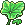<b>Lotus Leaf × 5</b> ← <b>Chameleon Frog</b> Lv 169 (Swamp Field 2, 4)

รางวัล: Flower Tea (เอาไปใช้ขั้น 3)

<label class="done"><input class="key" id="k3" type="checkbox"/> ทำแล้ว</label>ขั้น 3<h3>Pastor Tau - Tau's Dream</h3>

Swamp Town - Carbigalหลังผ่านขั้น 1

ส่ง <b>Flower Tea</b> ที่ได้จากขั้น 2

รางวัล: Flower of Revival

</section>

<section>

## เควสที่ให้ Swamp Sticker

มี 19 เควส ต้องการ 13 ใบ

เส้นทางแนะนำ 13 เควสติด ★ ส่วนใหญ่อยู่ใน Swamp Field มีแค่ Tau's Request 2, Clerk Z และ Poppuri ที่ต้องลง Swamp Dungeon ชั้นต้น ๆ

<button aria-pressed="false" id="hideUnstar" type="button">ซ่อนเควสที่ไม่ติดดาว</button><button hidden="" id="showAll" type="button">แสดงทั้งหมด</button>

<table>
<thead><tr><th>ได้แล้ว</th><th>เควส</th><th>รอบ</th><th>ที่อยู่</th><th>NPC</th><th>เงื่อนไข</th><th>ของที่ต้องส่ง และแหล่ง</th></tr></thead>
<tbody>
<tr class="pre-row"><td><input aria-label="ทำขั้นนี้ครบแล้ว" class="pre" id="sp1" type="checkbox"/></td><td>★ Genius Cochma - Black Swamp Survey 1 ขั้นก่อนหน้า · ไม่ได้สติ๊กเกอร์</td><td class="n">5</td><td>Gate of Black Swamp</td><td>Genius Cochma</td><td>Lv 140+ · รวม 50 ตัว</td><td>ล่า <b>Electric Snail</b> Lv 164 (Path to Black Swamp, Swamp Field 1, 2) × 10 ตัวภายใน 20 นาที</td></tr>
<tr class="pre-row"><td><input aria-label="ทำขั้นนี้ครบแล้ว" class="pre" id="sp2" type="checkbox"/></td><td>★ Genius Cochma - Black Swamp Survey 2 ขั้นก่อนหน้า · ไม่ได้สติ๊กเกอร์</td><td class="n">5</td><td>Gate of Black Swamp</td><td>Genius Cochma</td><td>รวม 25</td><td>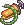Pump × 5 ← <b>Walking Tadpole</b> Lv 166 (Swamp Field 1)</td></tr>
<tr class="pre-row"><td><input aria-label="ทำขั้นนี้ครบแล้ว" class="pre" id="sp3" type="checkbox"/></td><td>★ Genius Cochma - Black Swamp Survey 3 ขั้นก่อนหน้า · ไม่ได้สติ๊กเกอร์</td><td class="n">5</td><td>Gate of Black Swamp</td><td>Genius Cochma</td><td>รวม 25</td><td>Colored Paper × 5 ← <b>Chameleon Frog</b> Lv 169 (Swamp Field 2, 4)</td></tr>
<tr><td><input aria-label="ได้สติ๊กเกอร์แล้ว" class="stk" id="s8" type="checkbox"/></td><td>★ Genius Cochma - Black Swamp Survey 4</td><td class="n">5</td><td>Gate of Black Swamp</td><td>Genius Cochma</td><td>ทำ Survey 1–3 ก่อน (แถวสีอ่อนด้านบน)</td><td>Mingo Jelly × 5 ← <b>Mingo</b> Lv 171 (Swamp Field 3)</td></tr>
<tr class="pre-row"><td><input aria-label="ทำขั้นนี้ครบแล้ว" class="pre" id="sp4" type="checkbox"/></td><td>★ Monkey T - Monkey T Business 3 ขั้นก่อนหน้า · ไม่ได้สติ๊กเกอร์</td><td class="n">5</td><td>Swamp Town - Carbigal</td><td>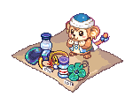Monkey T</td><td>Lv 140+ · รวม 15</td><td>Swamp Shark Leather × 3 ← <b>Swamp Shark</b> Lv 176 (Swamp Field 3, 5)</td></tr>
<tr><td><input aria-label="ได้สติ๊กเกอร์แล้ว" class="stk" id="s13" type="checkbox"/></td><td>★ Monkey T - Monkey T Business 4</td><td class="n">5</td><td>Swamp Town - Carbigal</td><td>Monkey T</td><td>ทำ Business 3 ก่อน</td><td>Snail Shell × 5 ← <b>Electric Snail</b> Lv 164 (Path to Black Swamp, Swamp Field 1, 2)</td></tr>
<tr class="pre-row"><td><input aria-label="ทำขั้นนี้ครบแล้ว" class="pre" id="sp5" type="checkbox"/></td><td>Farmer Tsetsech - Help the Plantation 1 ขั้นก่อนหน้า · ไม่ได้สติ๊กเกอร์</td><td class="n">5</td><td>Swamp Town - Carbigal</td><td>Farmer Tsetsech</td><td>Lv 140+ · รวม 15</td><td>Haro × 3 ← <b>Lotus Wormhole</b> Lv 219 (Swamp Dungeon 4, 5) · ได้ Tsetsech Honey รอบละ 2 (รวม 10) ใช้ต่อใน Honey Tea และ Skin Care</td></tr>
<tr><td><input aria-label="ได้สติ๊กเกอร์แล้ว" class="stk" id="s4" type="checkbox"/></td><td>Farmer Tsetsech - Help the Plantation 2</td><td class="n">5</td><td>Swamp Town - Carbigal</td><td>Farmer Tsetsech</td><td>ทำ Plantation 1 ก่อน</td><td>Poison Spore × 5 ← <b>Myconid</b> Lv 208 (Swamp Dungeon 1, 2)</td></tr>
<tr class="pre-row"><td><input aria-label="ทำขั้นนี้ครบแล้ว" class="pre" id="sp6" type="checkbox"/></td><td>Lethos - Black Swamp Treasure 1 ขั้นก่อนหน้า · ไม่ได้สติ๊กเกอร์</td><td class="n">1</td><td>Swamp Town - Carbigal</td><td>Lethos</td><td>Lv 150+</td><td>Swamp Shark Teeth × 5 ← <b>Swamp Shark</b> Lv 176 (Swamp Field 3, 5)</td></tr>
<tr class="pre-row"><td><input aria-label="ทำขั้นนี้ครบแล้ว" class="pre" id="sp7" type="checkbox"/></td><td>Lethos - Black Swamp Treasure 2 ขั้นก่อนหน้า · ไม่ได้สติ๊กเกอร์</td><td class="n">1</td><td>Swamp Town - Carbigal</td><td>Lethos</td><td></td><td>Lotus Fruit × 5 ← <b>Lotus Wormhole</b> Lv 219 (Swamp Dungeon 4, 5)</td></tr>
<tr class="pre-row"><td><input aria-label="ทำขั้นนี้ครบแล้ว" class="pre" id="sp8" type="checkbox"/></td><td>Lethos - Black Swamp Treasure 3 ขั้นก่อนหน้า · ไม่ได้สติ๊กเกอร์</td><td class="n">1</td><td>Swamp Town - Carbigal</td><td>Lethos</td><td></td><td>Stoor Worm's Horn × 3 ← <b>Stoor Worm</b> Lv 221 (Swamp Dungeon 5, 6)</td></tr>
<tr><td><input aria-label="ได้สติ๊กเกอร์แล้ว" class="stk" id="s10" type="checkbox"/></td><td>Lethos - Black Swamp Treasure 4</td><td class="n">1</td><td>Swamp Town - Carbigal</td><td>Lethos</td><td>ทำ Treasure 1–3 ก่อน · รอบเดียวได้สติ๊กเกอร์</td><td>Feeler Eyes × 3 ← <b>Slug G</b> Lv 224 (Swamp Dungeon 6)</td></tr>
<tr><td><input aria-label="ได้สติ๊กเกอร์แล้ว" class="stk" id="s11" type="checkbox"/></td><td>Madam Sarah - Exclusive Honey Tea</td><td class="n">5</td><td>Swamp Town - Carbigal</td><td>Madam Sarah</td><td>Lv 140+ · ร้าน Tea House</td><td>Tsetsech Honey × 1 ← เควส Help the Plantation 1 · Lotus Leaf × 3 ← <b>Chameleon Frog</b> Lv 169 (Swamp Field 2, 4)</td></tr>
<tr><td><input aria-label="ได้สติ๊กเกอร์แล้ว" class="stk" id="s18" type="checkbox"/></td><td>Vagabond Eloy - Skin Care</td><td class="n">5</td><td>Swamp Town - Carbigal</td><td>Vagabond Eloy</td><td>Lv 140+</td><td>Mud Pack × 2 ← <b>Mud Bigfoot</b> Lv 180 (Swamp Field 6) · Tsetsech Honey × 2 ← เควส Help the Plantation 1</td></tr>
<tr><td><input aria-label="ได้สติ๊กเกอร์แล้ว" class="stk" id="s5" type="checkbox"/></td><td>★ Favian - Finding Her Favorite Food</td><td class="n">5</td><td>Swamp Field 1 - Black Hole</td><td>Favian</td><td>Lv 140+</td><td>Snail Dish × 10 ← <b>Electric Snail</b> Lv 164 (Path to Black Swamp, Swamp Field 1, 2)</td></tr>
<tr class="pre-row"><td><input aria-label="ทำขั้นนี้ครบแล้ว" class="pre" id="sp9" type="checkbox"/></td><td>★ Frog Shaman - Swamp Magic 1 ขั้นก่อนหน้า · ไม่ได้สติ๊กเกอร์</td><td class="n">5</td><td>Swamp Field 1 - Black Hole</td><td>Frog Shaman</td><td>Lv 140+ · รวม 25</td><td>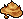Squishy Mud × 5 ← <b>Walking Tadpole</b> Lv 166 (Swamp Field 1)</td></tr>
<tr class="pre-row"><td><input aria-label="ทำขั้นนี้ครบแล้ว" class="pre" id="sp10" type="checkbox"/></td><td>★ Frog Shaman - Swamp Magic 2 ขั้นก่อนหน้า · ไม่ได้สติ๊กเกอร์</td><td class="n">5</td><td>Swamp Field 1 - Black Hole</td><td>Frog Shaman</td><td>รวม 25</td><td>Tadpole Egg × 5 ← <b>Chameleon Frog</b> Lv 169 (Swamp Field 2, 4)</td></tr>
<tr class="pre-row"><td><input aria-label="ทำขั้นนี้ครบแล้ว" class="pre" id="sp11" type="checkbox"/></td><td>★ Frog Shaman - Swamp Magic 3 ขั้นก่อนหน้า · ไม่ได้สติ๊กเกอร์</td><td class="n">5</td><td>Swamp Field 1 - Black Hole</td><td>Frog Shaman</td><td>รวม 25</td><td>Dancing for Idiots × 5 ← <b>Monkya</b> Lv 173 (Swamp Field 3)</td></tr>
<tr><td><input aria-label="ได้สติ๊กเกอร์แล้ว" class="stk" id="s7" type="checkbox"/></td><td>★ Frog Shaman - Swamp Magic 4</td><td class="n">5</td><td>Swamp Field 1 - Black Hole</td><td>Frog Shaman</td><td>ทำ Magic 1–3 ก่อน</td><td>Viscous Saliva × 5 ← <b>Mud Bigfoot</b> Lv 180 (Swamp Field 6)</td></tr>
<tr class="pre-row"><td><input aria-label="ทำขั้นนี้ครบแล้ว" class="pre" id="sp12" type="checkbox"/></td><td>★ Cluck Cluck Warrior - Food for Cluck ขั้นก่อนหน้า · ไม่ได้สติ๊กเกอร์</td><td class="n">5</td><td>Swamp Field 2 - Beaver's Swamp</td><td>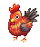Cluck Cluck Warrior</td><td>Lv 140+ · ต้องผ่าน The Great Chicken War ก่อน</td><td>Tadpole Egg × 5 ← <b>Chameleon Frog</b> Lv 169 (Swamp Field 2, 4) · 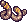Swamp Worms × 5 ← ขุดใน Black Swamp Fields</td></tr>
<tr><td><input aria-label="ได้สติ๊กเกอร์แล้ว" class="stk" id="s3" type="checkbox"/></td><td>★ Cluck Cluck Warrior - Remember the Chicken Warriors</td><td class="n">5</td><td>Swamp Field 2 - Beaver's Swamp</td><td>Cluck Cluck Warrior</td><td>ทำ Food for Cluck ก่อน</td><td>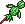Grass-Leaf Doll* · Swamp Leaf × 5 ← ขุดใน Black Swamp Fields</td></tr>
<tr class="pre-row"><td><input aria-label="ทำขั้นนี้ครบแล้ว" class="pre" id="sp13" type="checkbox"/></td><td>★ Kristoffer J. - Bait for Swamp Fishing ขั้นก่อนหน้า · ไม่ได้สติ๊กเกอร์</td><td class="n">?</td><td>Swamp Field 2 - Beaver's Swamp</td><td>Kristoffer J.</td><td>Lv 140+</td><td>วิกิไม่มีหน้ารายละเอียด ดูของที่ขอจาก NPC ในเกม</td></tr>
<tr><td><input aria-label="ได้สติ๊กเกอร์แล้ว" class="stk" id="s9" type="checkbox"/></td><td>★ Kristoffer J. - Protect the Swamp</td><td class="n">5</td><td>Swamp Field 2 - Beaver's Swamp</td><td>Kristoffer J.</td><td>ทำ Bait for Swamp Fishing ก่อน</td><td>Candy Light Bulb × 3 ← <b>Electric Snail</b> Lv 164 (Path to Black Swamp, Swamp Field 1, 2)</td></tr>
<tr><td><input aria-label="ได้สติ๊กเกอร์แล้ว" class="stk" id="s6" type="checkbox"/></td><td>★ Frog Prince - I am the Frog Prince</td><td class="n">5</td><td>Swamp Field 4 - Dark Omen</td><td>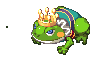Frog Prince</td><td>Lv 140+</td><td>Golden Ball* ← ขุดใน Black Swamp Fields</td></tr>
<tr><td><input aria-label="ได้สติ๊กเกอร์แล้ว" class="stk" id="s16" type="checkbox"/></td><td>★ Princess Rosetta - Busy Princess</td><td class="n">5</td><td>Swamp Field 4 - Dark Omen</td><td>Princess Rosetta</td><td>Lv 140+</td><td>White Ball × 5 ← <b>Monkya</b> Lv 173 (Swamp Field 3) · 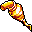Gold Colored Paint* ← <b>Mingo</b> Lv 171 (Swamp Field 3)</td></tr>
<tr><td><input aria-label="ได้สติ๊กเกอร์แล้ว" class="stk" id="s12" type="checkbox"/></td><td>★ Madam Sarah - Making New Robes</td><td class="n">5</td><td>Swamp Field 5 - Further Maze of Forest</td><td>Madam Sarah</td><td>Lv 140+</td><td>1st Class Silk Thread × 5 ← <b>Arachne</b> Lv 178 (Swamp Field 4, 5, 6)</td></tr>
<tr><td><input aria-label="ได้สติ๊กเกอร์แล้ว" class="stk" id="s19" type="checkbox"/></td><td>★ Vinosh - I Love Special Jewelry</td><td class="n">5</td><td>Swamp Field 6 - Lake of Illusion</td><td>Vinosh</td><td>Lv 140+</td><td>Arachne's Earrings × 10 ← <b>Arachne</b> Lv 178 (Swamp Field 4, 5, 6)</td></tr>
<tr class="pre-row"><td><input aria-label="ทำขั้นนี้ครบแล้ว" class="pre" id="sp14" type="checkbox"/></td><td>★ Pastor Tau - Tau's Request 1 ขั้นก่อนหน้า · ไม่ได้สติ๊กเกอร์</td><td class="n">5</td><td>Swamp Dungeon 1 - Marshy Trail</td><td>Pastor Tau</td><td>Lv 150+ · รวม 15</td><td>Fragrant Candle × 3 ← ขุดใน Swamp Dungeon (1–6 ขุดได้เหมือนกัน)</td></tr>
<tr><td><input aria-label="ได้สติ๊กเกอร์แล้ว" class="stk" id="s14" type="checkbox"/></td><td>★ Pastor Tau - Tau's Request 2</td><td class="n">5</td><td>Swamp Dungeon 1 - Marshy Trail</td><td>Pastor Tau</td><td>ทำ Request 1 ก่อน</td><td>Slythis Jelly × 3 ← <b>Slithis</b> Lv 203 (Swamp Dungeon 1)</td></tr>
<tr><td><input aria-label="ได้สติ๊กเกอร์แล้ว" class="stk" id="s2" type="checkbox"/></td><td>★ Clerk Z. Smith - Clerk Z's Split Personality</td><td class="n">5</td><td>Swamp Dungeon 2 - Marshy Pool</td><td>Clerk Z. Smith</td><td>Lv 150+</td><td>Siam Marble* ← <b>Cobra Flower</b> Lv 210 (Swamp Dungeon 2, 3)</td></tr>
<tr><td><input aria-label="ได้สติ๊กเกอร์แล้ว" class="stk" id="s1" type="checkbox"/></td><td>Bard La Fimmel - A Gift La Fimmel Wants</td><td class="n">5</td><td>Swamp Dungeon 3 - Marshy Vacant Lot</td><td>Bard La Fimmel</td><td>Lv 150+</td><td>Feel Eye × 2 ← <b>Purple Worm</b> Lv 215 (Swamp Dungeon 4)</td></tr>
<tr><td><input aria-label="ได้สติ๊กเกอร์แล้ว" class="stk" id="s15" type="checkbox"/></td><td>★ Poppuri - Moss Collecting Poppuri</td><td class="n">5</td><td>Swamp Dungeon 4 - Marshy Garden</td><td>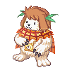Poppuri</td><td>Lv 150+</td><td>White Hair Moss × 5 · Wing Moss × 5 ← ขุดใน Swamp Dungeon (1–6 ขุดได้เหมือนกัน)</td></tr>
<tr><td><input aria-label="ได้สติ๊กเกอร์แล้ว" class="stk" id="s17" type="checkbox"/></td><td>Swampy Suu - Suu's Request</td><td class="n">5</td><td>Swamp Dungeon 6 - Suu's Muddy Pool</td><td>Swampy Suu</td><td>Lv 150+</td><td>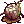Mud × 5 ← ขุดใน Swamp Dungeon (1–6 ขุดได้เหมือนกัน)</td></tr>
</tbody>
</table>

* ไม่ทราบจำนวนต่อรอบ · Remember the Chicken Warriors ต้องผ่าน Cluck Cluck Warrior - The Great Chicken War ก่อน

</section>

<section>

## จุดขุดและมอน เรียงตามแมพ

<table>
<thead><tr><th>ครบแล้ว</th><th>แมพ</th><th>ขุด / มอน</th><th>ไอเทม</th><th>จำนวนรวม</th><th>ใช้ในเควส</th></tr></thead>
<tbody>
<tr class="mon-row" data-q='[["sp12", 25, "Food for Cluck (5 × 5 รอบ)", 0]]'><td><input aria-label="หาครบแล้ว" class="mon" id="sm1" type="checkbox"/></td><td>★ Black Swamp Fields (ขุดได้ทุก Field)</td><td>ขุด</td><td>Swamp Worms</td><td class="n">25</td><td>Food for Cluck (5 × 5 รอบ)</td></tr>
<tr class="mon-row" data-q='[["s3", 25, "Chicken Warriors (5 × 5 รอบ)", 0]]'><td><input aria-label="หาครบแล้ว" class="mon" id="sm2" type="checkbox"/></td><td>★ Black Swamp Fields (ขุดได้ทุก Field)</td><td>ขุด</td><td>Swamp Leaf</td><td class="n">25</td><td>Chicken Warriors (5 × 5 รอบ)</td></tr>
<tr class="mon-row" data-q='[["s3", 5, "Chicken Warriors (1 × 5 รอบ)", 0]]'><td><input aria-label="หาครบแล้ว" class="mon" id="sm3" type="checkbox"/></td><td>★ Black Swamp Fields (ขุดได้ทุก Field)</td><td>ขุด</td><td>Grass-Leaf Doll</td><td class="n">5</td><td>Chicken Warriors (1 × 5 รอบ)</td></tr>
<tr class="mon-row" data-q='[["s6", 5, "Frog Prince (1 × 5 รอบ)", 0]]'><td><input aria-label="หาครบแล้ว" class="mon" id="sm4" type="checkbox"/></td><td>★ Black Swamp Fields (ขุดได้ทุก Field)</td><td>ขุด</td><td>Golden Ball</td><td class="n">5</td><td>Frog Prince (1 × 5 รอบ)</td></tr>
<tr class="mon-row" data-q="[[&quot;sp14&quot;, 15, &quot;Tau's Request 1 (3 × 5 รอบ)&quot;, 0]]"><td><input aria-label="หาครบแล้ว" class="mon" id="sm5" type="checkbox"/></td><td>★ Swamp Dungeon 1–6</td><td>ขุด</td><td>Fragrant Candle</td><td class="n">15</td><td>Tau's Request 1 (3 × 5 รอบ)</td></tr>
<tr class="mon-row" data-q='[["s15", 25, "Poppuri (5 × 5 รอบ)", 0]]'><td><input aria-label="หาครบแล้ว" class="mon" id="sm6" type="checkbox"/></td><td>★ Swamp Dungeon 1–6</td><td>ขุด</td><td>White Hair Moss</td><td class="n">25</td><td>Poppuri (5 × 5 รอบ)</td></tr>
<tr class="mon-row" data-q='[["s15", 25, "Poppuri (5 × 5 รอบ)", 0]]'><td><input aria-label="หาครบแล้ว" class="mon" id="sm7" type="checkbox"/></td><td>★ Swamp Dungeon 1–6</td><td>ขุด</td><td>Wing Moss</td><td class="n">25</td><td>Poppuri (5 × 5 รอบ)</td></tr>
<tr class="mon-row" data-q='[["s17", 25, "Swampy Suu (5 × 5 รอบ)", 0]]'><td><input aria-label="หาครบแล้ว" class="mon" id="sm8" type="checkbox"/></td><td>Swamp Dungeon 1–6</td><td>ขุด</td><td>Mud</td><td class="n">25</td><td>Swampy Suu (5 × 5 รอบ)</td></tr>
<tr class="mon-row" data-q='[["sp1", 50, "Cochma Survey 1 (10 ตัวใน 20 นาที × 5 รอบ)", 0]]' data-unit="ตัว"><td><input aria-label="หาครบแล้ว" class="mon" id="sm9" type="checkbox"/></td><td>★ Path to Black Swamp, Swamp Field 1, 2</td><td>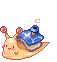Electric Snail (Lv 164)</td><td>ล่า (ไม่ต้องเก็บของ)</td><td class="n">50 ตัว</td><td>Cochma Survey 1 (10 ตัวใน 20 นาที × 5 รอบ)</td></tr>
<tr class="mon-row" data-q='[["s5", 50, "Favian (10 × 5 รอบ)", 0]]'><td><input aria-label="หาครบแล้ว" class="mon" id="sm10" type="checkbox"/></td><td>★ Path to Black Swamp, Swamp Field 1, 2</td><td>Electric Snail (Lv 164)</td><td>Snail Dish</td><td class="n">50</td><td>Favian (10 × 5 รอบ)</td></tr>
<tr class="mon-row" data-q='[["s13", 25, "Monkey T 4 (5 × 5 รอบ)", 0]]'><td><input aria-label="หาครบแล้ว" class="mon" id="sm11" type="checkbox"/></td><td>★ Path to Black Swamp, Swamp Field 1, 2</td><td>Electric Snail (Lv 164)</td><td>Snail Shell</td><td class="n">25</td><td>Monkey T 4 (5 × 5 รอบ)</td></tr>
<tr class="mon-row" data-q='[["s9", 15, "Protect the Swamp (3 × 5 รอบ)", 0]]'><td><input aria-label="หาครบแล้ว" class="mon" id="sm12" type="checkbox"/></td><td>★ Path to Black Swamp, Swamp Field 1, 2</td><td>Electric Snail (Lv 164)</td><td>Candy Light Bulb</td><td class="n">15</td><td>Protect the Swamp (3 × 5 รอบ)</td></tr>
<tr class="mon-row" data-q='[["sp9", 25, "Swamp Magic 1 (5 × 5 รอบ)", 0]]'><td><input aria-label="หาครบแล้ว" class="mon" id="sm13" type="checkbox"/></td><td>★ Swamp Field 1 - Black Hole</td><td>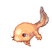Walking Tadpole (Lv 166)</td><td>Squishy Mud</td><td class="n">25</td><td>Swamp Magic 1 (5 × 5 รอบ)</td></tr>
<tr class="mon-row" data-q='[["sp2", 25, "Cochma Survey 2 (5 × 5 รอบ)", 0]]'><td><input aria-label="หาครบแล้ว" class="mon" id="sm14" type="checkbox"/></td><td>★ Swamp Field 1 - Black Hole</td><td>Walking Tadpole (Lv 166)</td><td>Pump</td><td class="n">25</td><td>Cochma Survey 2 (5 × 5 รอบ)</td></tr>
<tr class="mon-row" data-q='[["sp10", 25, "Swamp Magic 2 (5 × 5 รอบ)", 0], ["sp12", 25, "Food for Cluck (5 × 5 รอบ)", 0]]'><td><input aria-label="หาครบแล้ว" class="mon" id="sm15" type="checkbox"/></td><td>★ Swamp Field 2, 4</td><td>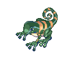Chameleon Frog (Lv 169)</td><td>Tadpole Egg</td><td class="n">50</td><td>Swamp Magic 2 (5 × 5 รอบ) + Food for Cluck (5 × 5 รอบ)</td></tr>
<tr class="mon-row" data-q='[["sp3", 25, "Cochma Survey 3 (5 × 5 รอบ)", 0]]'><td><input aria-label="หาครบแล้ว" class="mon" id="sm16" type="checkbox"/></td><td>★ Swamp Field 2, 4</td><td>Chameleon Frog (Lv 169)</td><td>Colored Paper</td><td class="n">25</td><td>Cochma Survey 3 (5 × 5 รอบ)</td></tr>
<tr class="mon-row" data-q="[[&quot;k2&quot;, 5, &quot;ขั้น 2 Sarah's Flashback (5)&quot;, 0], [&quot;s11&quot;, 15, &quot;Honey Tea (3 × 5 รอบ)&quot;, 0]]"><td><input aria-label="หาครบแล้ว" class="mon" id="sm17" type="checkbox"/></td><td>★ Swamp Field 2, 4</td><td>Chameleon Frog (Lv 169)</td><td>Lotus Leaf</td><td class="n">20</td><td>ขั้น 2 Sarah's Flashback (5) + Honey Tea (3 × 5 รอบ)</td></tr>
<tr class="mon-row" data-q='[["s8", 25, "Cochma Survey 4 (5 × 5 รอบ)", 0]]'><td><input aria-label="หาครบแล้ว" class="mon" id="sm18" type="checkbox"/></td><td>★ Swamp Field 3 - Maze of Forest</td><td>Mingo (Lv 171)</td><td>Mingo Jelly</td><td class="n">25</td><td>Cochma Survey 4 (5 × 5 รอบ)</td></tr>
<tr class="mon-row" data-q='[["s16", 5, "Busy Princess (1 × 5 รอบ)", 0]]'><td><input aria-label="หาครบแล้ว" class="mon" id="sm19" type="checkbox"/></td><td>★ Swamp Field 3 - Maze of Forest</td><td>Mingo (Lv 171)</td><td>Gold Colored Paint</td><td class="n">5</td><td>Busy Princess (1 × 5 รอบ)</td></tr>
<tr class="mon-row" data-q='[["sp11", 25, "Swamp Magic 3 (5 × 5 รอบ)", 0]]'><td><input aria-label="หาครบแล้ว" class="mon" id="sm20" type="checkbox"/></td><td>★ Swamp Field 3 - Maze of Forest</td><td>Monkya (Lv 173)</td><td>Dancing for Idiots</td><td class="n">25</td><td>Swamp Magic 3 (5 × 5 รอบ)</td></tr>
<tr class="mon-row" data-q='[["s16", 25, "Busy Princess (5 × 5 รอบ)", 0]]'><td><input aria-label="หาครบแล้ว" class="mon" id="sm21" type="checkbox"/></td><td>★ Swamp Field 3 - Maze of Forest</td><td>Monkya (Lv 173)</td><td>White Ball</td><td class="n">25</td><td>Busy Princess (5 × 5 รอบ)</td></tr>
<tr class="mon-row" data-q='[["sp4", 15, "Monkey T 3 (3 × 5 รอบ)", 0]]'><td><input aria-label="หาครบแล้ว" class="mon" id="sm22" type="checkbox"/></td><td>★ Swamp Field 3, 5</td><td>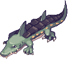Swamp Shark (Lv 176)</td><td>Swamp Shark Leather</td><td class="n">15</td><td>Monkey T 3 (3 × 5 รอบ)</td></tr>
<tr class="mon-row" data-q='[["sp6", 5, "Lethos Treasure 1 (5)", 0]]'><td><input aria-label="หาครบแล้ว" class="mon" id="sm23" type="checkbox"/></td><td>Swamp Field 3, 5</td><td>Swamp Shark (Lv 176)</td><td>Swamp Shark Teeth</td><td class="n">5</td><td>Lethos Treasure 1 (5)</td></tr>
<tr class="mon-row" data-q='[["s12", 25, "Making New Robes (5 × 5 รอบ)", 0]]'><td><input aria-label="หาครบแล้ว" class="mon" id="sm24" type="checkbox"/></td><td>★ Swamp Field 4, 5, 6</td><td>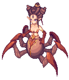Arachne (Lv 178)</td><td>1st Class Silk Thread</td><td class="n">25</td><td>Making New Robes (5 × 5 รอบ)</td></tr>
<tr class="mon-row" data-q='[["s19", 50, "Vinosh (10 × 5 รอบ)", 0]]'><td><input aria-label="หาครบแล้ว" class="mon" id="sm25" type="checkbox"/></td><td>★ Swamp Field 4, 5, 6</td><td>Arachne (Lv 178)</td><td>Arachne's Earrings</td><td class="n">50</td><td>Vinosh (10 × 5 รอบ)</td></tr>
<tr class="mon-row" data-q='[["s7", 25, "Swamp Magic 4 (5 × 5 รอบ)", 0]]'><td><input aria-label="หาครบแล้ว" class="mon" id="sm26" type="checkbox"/></td><td>★ Swamp Field 6 - Lake of Illusion</td><td>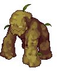Mud Bigfoot (Lv 180)</td><td>Viscous Saliva</td><td class="n">25</td><td>Swamp Magic 4 (5 × 5 รอบ)</td></tr>
<tr class="mon-row" data-q='[["s18", 10, "Skin Care (2 × 5 รอบ)", 0]]'><td><input aria-label="หาครบแล้ว" class="mon" id="sm27" type="checkbox"/></td><td>Swamp Field 6 - Lake of Illusion</td><td>Mud Bigfoot (Lv 180)</td><td>Mud Pack</td><td class="n">10</td><td>Skin Care (2 × 5 รอบ)</td></tr>
<tr class="mon-row" data-q="[[&quot;s14&quot;, 15, &quot;Tau's Request 2 (3 × 5 รอบ)&quot;, 0]]"><td><input aria-label="หาครบแล้ว" class="mon" id="sm28" type="checkbox"/></td><td>★ Swamp Dungeon 1 - Marshy Trail</td><td>Slithis (Lv 203)</td><td>Slythis Jelly</td><td class="n">15</td><td>Tau's Request 2 (3 × 5 รอบ)</td></tr>
<tr class="mon-row" data-q='[["s4", 25, "Help the Plantation 2 (5 × 5 รอบ)", 0]]'><td><input aria-label="หาครบแล้ว" class="mon" id="sm29" type="checkbox"/></td><td>Swamp Dungeon 1, 2</td><td>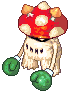Myconid (Lv 208)</td><td>Poison Spore</td><td class="n">25</td><td>Help the Plantation 2 (5 × 5 รอบ)</td></tr>
<tr class="mon-row" data-q='[["s2", 5, "Clerk Z. Smith (1 × 5 รอบ)", 0]]'><td><input aria-label="หาครบแล้ว" class="mon" id="sm30" type="checkbox"/></td><td>★ Swamp Dungeon 2, 3</td><td>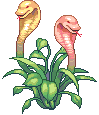Cobra Flower (Lv 210)</td><td>Siam Marble</td><td class="n">5</td><td>Clerk Z. Smith (1 × 5 รอบ)</td></tr>
<tr class="mon-row" data-q='[["s1", 10, "La Fimmel (2 × 5 รอบ)", 0]]'><td><input aria-label="หาครบแล้ว" class="mon" id="sm31" type="checkbox"/></td><td>Swamp Dungeon 4 - Marshy Garden</td><td>Purple Worm (Lv 215)</td><td>Feel Eye</td><td class="n">10</td><td>La Fimmel (2 × 5 รอบ)</td></tr>
<tr class="mon-row" data-q="[[&quot;k2&quot;, 1, &quot;ขั้น 2 Sarah's Flashback (1)&quot;, 0]]"><td><input aria-label="หาครบแล้ว" class="mon" id="sm32" type="checkbox"/></td><td>★ Swamp Dungeon 4, 5</td><td>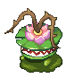Lotus Wormhole (Lv 219)</td><td>Lotus Flower</td><td class="n">1</td><td>ขั้น 2 Sarah's Flashback (1)</td></tr>
<tr class="mon-row" data-q='[["sp5", 15, "Help the Plantation 1 (3 × 5 รอบ)", 0]]'><td><input aria-label="หาครบแล้ว" class="mon" id="sm33" type="checkbox"/></td><td>Swamp Dungeon 4, 5</td><td>Lotus Wormhole (Lv 219)</td><td>Haro</td><td class="n">15</td><td>Help the Plantation 1 (3 × 5 รอบ)</td></tr>
<tr class="mon-row" data-q='[["sp7", 5, "Lethos Treasure 2 (5)", 0]]'><td><input aria-label="หาครบแล้ว" class="mon" id="sm34" type="checkbox"/></td><td>Swamp Dungeon 4, 5</td><td>Lotus Wormhole (Lv 219)</td><td>Lotus Fruit</td><td class="n">5</td><td>Lethos Treasure 2 (5)</td></tr>
<tr class="mon-row" data-q='[["sp8", 3, "Lethos Treasure 3 (3)", 0]]'><td><input aria-label="หาครบแล้ว" class="mon" id="sm35" type="checkbox"/></td><td>Swamp Dungeon 5, 6</td><td>Stoor Worm (Lv 221)</td><td>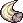Stoor Worm's Horn</td><td class="n">3</td><td>Lethos Treasure 3 (3)</td></tr>
<tr class="mon-row" data-q='[["s10", 3, "Lethos Treasure 4 (3)", 0]]'><td><input aria-label="หาครบแล้ว" class="mon" id="sm36" type="checkbox"/></td><td>Swamp Dungeon 6 - Suu's Muddy Pool</td><td>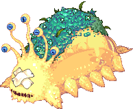Slug G (Lv 224)</td><td>Feeler Eyes</td><td class="n">3</td><td>Lethos Treasure 4 (3)</td></tr>
</tbody>
</table>

* ไม่ทราบจำนวนต่อรอบ · Swamp Dungeon ขุดที่ความลึก 160–200 m ดิน Land · Tsetsech Honey ได้จาก Help the Plantation 1 (รอบละ 2)

</section>

<section>

## รูปจากวิกิ

### NPC

<a href="https://wikimirror.lifeto.co/asset.103.ggftw.net/wiki/to-w/images/a/a4/Pastor_Tau.png" rel="noopener" target="_blank">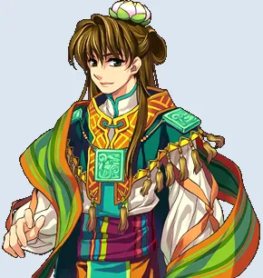Pastor Tauขั้น 1, 3 · Carbigal ↗</a>
<a href="https://wikimirror.lifeto.co/wiki.ggftw.com/trickster/Image_Madam_Sarah-2.html" rel="noopener" target="_blank">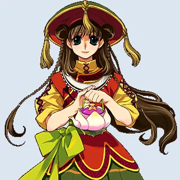Madam Sarahขั้น 2 · Carbigal Tea House ↗</a>
<a href="https://wikimirror.lifeto.co/wiki.ggftw.com/trickster/Genius_Cochma.html" rel="noopener" target="_blank">Genius CochmaGate of Black Swamp · หน้าวิกิ ↗</a>
<a href="https://wikimirror.lifeto.co/wiki.ggftw.com/trickster/Frog_Shaman.html" rel="noopener" target="_blank">Frog ShamanSwamp Field 1 · หน้าวิกิ ↗</a>

### มอนสเตอร์

<a href="https://wikimirror.lifeto.co/wiki.ggftw.com/trickster/Electric_Snail.html" rel="noopener" target="_blank">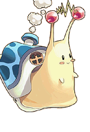Electric SnailLv 164 · หน้าวิกิ ↗</a>
<a href="https://wikimirror.lifeto.co/wiki.ggftw.com/trickster/Walking_Tadpole.html" rel="noopener" target="_blank">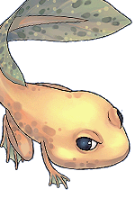Walking TadpoleLv 166 · หน้าวิกิ ↗</a>
<a href="https://wikimirror.lifeto.co/wiki.ggftw.com/trickster/Chameleon_Frog.html" rel="noopener" target="_blank">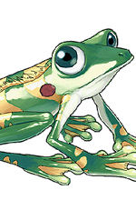Chameleon FrogLv 169 · หน้าวิกิ ↗</a>
<a href="https://wikimirror.lifeto.co/wiki.ggftw.com/trickster/Mingo.html" rel="noopener" target="_blank">MingoLv 171 · หน้าวิกิ ↗</a>
<a href="https://wikimirror.lifeto.co/wiki.ggftw.com/trickster/Monkya.html" rel="noopener" target="_blank">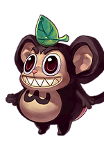MonkyaLv 173 · หน้าวิกิ ↗</a>
<a href="https://wikimirror.lifeto.co/wiki.ggftw.com/trickster/Swamp_Shark.html" rel="noopener" target="_blank">Swamp SharkLv 176 · หน้าวิกิ ↗</a>
<a href="https://wikimirror.lifeto.co/wiki.ggftw.com/trickster/Arachne.html" rel="noopener" target="_blank">ArachneLv 178 · หน้าวิกิ ↗</a>
<a href="https://wikimirror.lifeto.co/wiki.ggftw.com/trickster/Mud_Bigfoot.html" rel="noopener" target="_blank">Mud BigfootLv 180 · หน้าวิกิ ↗</a>
<a href="https://wikimirror.lifeto.co/wiki.ggftw.com/trickster/Slithis.html" rel="noopener" target="_blank">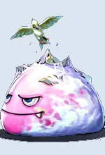SlithisLv 203 · หน้าวิกิ ↗</a>
<a href="https://wikimirror.lifeto.co/wiki.ggftw.com/trickster/Myconid.html" rel="noopener" target="_blank">MyconidLv 208 · หน้าวิกิ ↗</a>
<a href="https://wikimirror.lifeto.co/wiki.ggftw.com/trickster/Cobra_Flower.html" rel="noopener" target="_blank">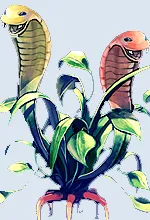Cobra FlowerLv 210 · หน้าวิกิ ↗</a>
<a href="https://wikimirror.lifeto.co/wiki.ggftw.com/trickster/Purple_Worm.html" rel="noopener" target="_blank">Purple WormLv 215 · หน้าวิกิ ↗</a>
<a href="https://wikimirror.lifeto.co/wiki.ggftw.com/trickster/Lotus_Wormhole.html" rel="noopener" target="_blank">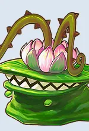Lotus WormholeLv 219 · หน้าวิกิ ↗</a>
<a href="https://wikimirror.lifeto.co/wiki.ggftw.com/trickster/Stoor_Worm.html" rel="noopener" target="_blank">Stoor WormLv 221 · หน้าวิกิ ↗</a>
<a href="https://wikimirror.lifeto.co/wiki.ggftw.com/trickster/Slug_G.html" rel="noopener" target="_blank">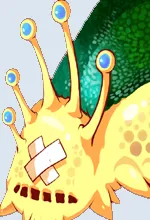Slug GLv 224 · หน้าวิกิ ↗</a>

### แมพ

<a href="https://wikimirror.lifeto.co/asset.103.ggftw.net/wiki/to-w/images/4/4e/Black_Swamp_Map.png" rel="noopener" target="_blank">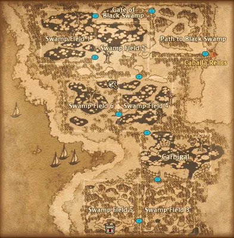แผนที่ Black Swampทั้งโซน ↗</a>
<a href="https://wikimirror.lifeto.co/wiki.ggftw.com/trickster/Swamp_Dungeon_1_-_Marshy_Trail.html" rel="noopener" target="_blank">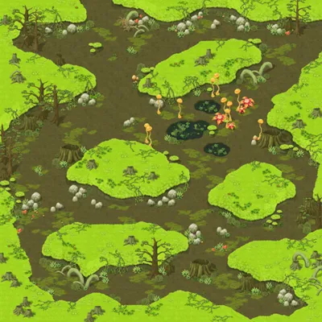Swamp Dungeon 1 - Marshy Trailหน้าแมพ ↗</a>
<a href="https://wikimirror.lifeto.co/wiki.ggftw.com/trickster/Swamp_Dungeon_4_-_Marshy_Garden.html" rel="noopener" target="_blank">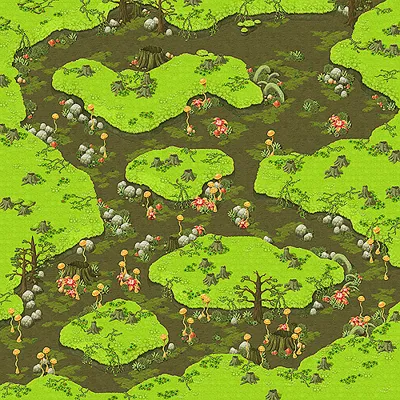Swamp Dungeon 4 - Marshy Gardenหน้าแมพ ↗</a>
<a href="https://wikimirror.lifeto.co/wiki.ggftw.com/trickster/Category_Black_Swamp.html" rel="noopener" target="_blank">Black Swamp ทั้งหมดหน้าโซน ↗</a>
<a href="https://wikimirror.lifeto.co/wiki.ggftw.com/trickster/Swamp_Town_-_Carbigal.html" rel="noopener" target="_blank">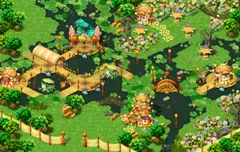Swamp Town - Carbigalหน้าแมพ ↗</a>
<a href="https://wikimirror.lifeto.co/wiki.ggftw.com/trickster/Carbigal_Tea_House.html" rel="noopener" target="_blank">Carbigal Tea Houseหน้าแมพ ↗</a>
<a href="https://wikimirror.lifeto.co/wiki.ggftw.com/trickster/Gate_of_Black_Swamp.html" rel="noopener" target="_blank">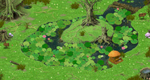Gate of Black Swampหน้าแมพ ↗</a>
<a href="https://wikimirror.lifeto.co/wiki.ggftw.com/trickster/Path_to_Black_Swamp.html" rel="noopener" target="_blank">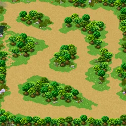Path to Black Swampหน้าแมพ ↗</a>
<a href="https://wikimirror.lifeto.co/wiki.ggftw.com/trickster/Swamp_Field_1_-_Black_Hole.html" rel="noopener" target="_blank">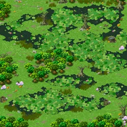Swamp Field 1 - Black Holeหน้าแมพ ↗</a>
<a href="https://wikimirror.lifeto.co/wiki.ggftw.com/trickster/Swamp_Field_2_-_Beaver%27s_Swamp.html" rel="noopener" target="_blank">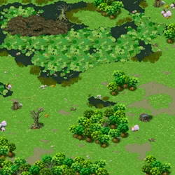Swamp Field 2 - Beaver's Swampหน้าแมพ ↗</a>
<a href="https://wikimirror.lifeto.co/wiki.ggftw.com/trickster/Swamp_Field_3_-_Maze_of_Forest.html" rel="noopener" target="_blank">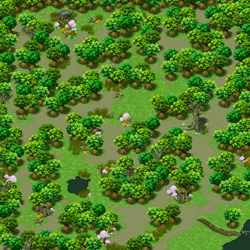Swamp Field 3 - Maze of Forestหน้าแมพ ↗</a>
<a href="https://wikimirror.lifeto.co/wiki.ggftw.com/trickster/Swamp_Field_4_-_Dark_Omen.html" rel="noopener" target="_blank">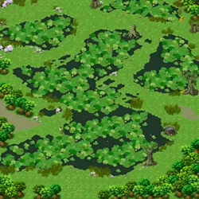Swamp Field 4 - Dark Omenหน้าแมพ ↗</a>
<a href="https://wikimirror.lifeto.co/wiki.ggftw.com/trickster/Swamp_Field_5_-_Further_Maze_of_Forest.html" rel="noopener" target="_blank">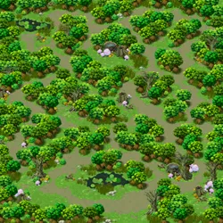Swamp Field 5 - Further Maze of Forestหน้าแมพ ↗</a>
<a href="https://wikimirror.lifeto.co/wiki.ggftw.com/trickster/Swamp_Field_6_-_Lake_of_Illusion.html" rel="noopener" target="_blank">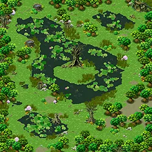Swamp Field 6 - Lake of Illusionหน้าแมพ ↗</a>
<a href="https://wikimirror.lifeto.co/wiki.ggftw.com/trickster/Swamp_Dungeon_2_-_Marshy_Pool.html" rel="noopener" target="_blank">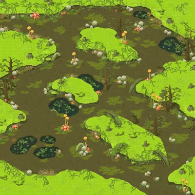Swamp Dungeon 2 - Marshy Poolหน้าแมพ ↗</a>
<a href="https://wikimirror.lifeto.co/wiki.ggftw.com/trickster/Swamp_Dungeon_3_-_Marshy_Vacant_Lot.html" rel="noopener" target="_blank">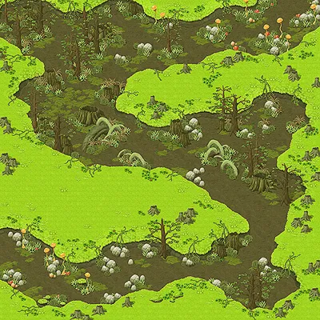Swamp Dungeon 3 - Marshy Vacant Lotหน้าแมพ ↗</a>
<a href="https://wikimirror.lifeto.co/wiki.ggftw.com/trickster/Swamp_Dungeon_5_-_Marshy_Lawn.html" rel="noopener" target="_blank">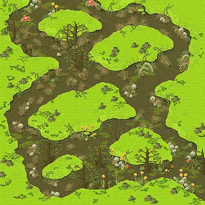Swamp Dungeon 5 - Marshy Lawnหน้าแมพ ↗</a>
<a href="https://wikimirror.lifeto.co/wiki.ggftw.com/trickster/Swamp_Dungeon_6_-_Suu%27s_Muddy_Pool.html" rel="noopener" target="_blank">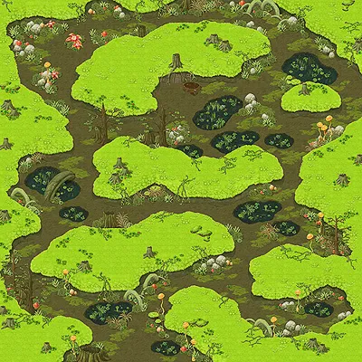Swamp Dungeon 6 - Suu's Muddy Poolหน้าแมพ ↗</a>

</section>

<PageBehavior />
