

<header style="display:flex;flex-direction:column;gap:8px">

# เควสกุญแจ Caballa Relics

สรุปจากวิกิ ggFTW (ฉบับ mirror ของ LifeTO) หน้า [Fortune Teller - Caballa Stickers](https://wikimirror.lifeto.co/wiki.ggftw.com/trickster/Fortune_Teller_-_Caballa_Stickers.html), [Category Caballa Relics Quest](https://wikimirror.lifeto.co/wiki.ggftw.com/trickster/Category_Caballa_Relics_Quest.html) และหน้าเควส/มอน/แมพที่ลิงก์ไป

</header>

<section>

## ภาพรวม

โซนต่อจาก Megalopolis เควสกุญแจเริ่มกับ **Fortune Teller** ที่ Relics Town - Azteca ต้อง<b>เลเวล 55+</b> และผ่าน **Sandman - The Miracle of Sand** แล้ว

- ต้องได้ **Caballa Sticker 10 ใบ** จากเควสธรรมดา
- เตรียม **Adventurer's Book** เล่มที่ได้จาก The Miracle of Sand ไว้ส่งในขั้น 2 และ 4
- ใช้ Wing Port จากขั้นสุดท้ายของ Megalopolis มาที่ Caballa Relics
- เควสถัดไปคือ Keeper Julio - Path to Oops Wharf (อยู่ในหน้า Oops Wharf)

</section>

<section aria-live="polite" class="counter">

## ความคืบหน้า

0 Caballa Sticker ที่ควรมีตอนนี้

<button id="reset" type="button">ล้างทั้งหมด</button>

</section>

<section>

## เควสกุญแจ 4 ขั้น

ลำดับสำคัญ: ขั้น 1 → รับขั้น 2 ค้างไว้ → ทำขั้น 3 กับ Keeper Julio ได้ Gold Silk Pouch → กลับไปส่งขั้น 2 → ขั้น 4

<label class="done"><input class="key" id="k1" type="checkbox"/> ทำแล้ว</label>ขั้น 1<h3>Fortune Teller - Caballa Stickers</h3>

Relics Town - AztecaLv 55+หลังผ่าน The Miracle of Sand

ส่ง <b>Caballa Sticker × 10</b>

รางวัล: 500 Galder Coupon × 5

<label class="done"><input class="key" id="k2" type="checkbox"/> ทำแล้ว</label>ขั้น 2<h3>Fortune Teller - Borrow Gold Silk Pouch</h3>

Relics Town - AztecaLv 55+รับค้างไว้ก่อน

ส่ง<ul><li><b>Adventurer's Book</b></li><li><b>Gold Silk Pouch</b> (ได้จากขั้น 3)</li></ul>

รับเควสนี้ค้างไว้ก่อน แล้วไปทำขั้น 3

รางวัล<ul><li>Adventurer's Book คืน</li><li>Gold Silk Pouch คืน (ใช้ขั้น 4)</li><li>500 Galder Coupon × 5</li></ul>

<label class="done"><input class="key" id="k3" type="checkbox"/> ทำแล้ว</label>ขั้น 3<h3>Keeper Julio - Recover Julio's Storage Key</h3>

Relics Field 4 - An Altar for Sacrificeต้องมี Borrow Gold Silk Pouch ค้างในสมุดเควส

ส่ง 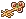<b>Julio's Key</b> ← 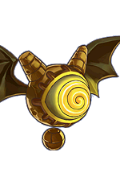<b>Lima</b> (Caballa Relics Dungeon 1–4)

รางวัล: Gold Silk Pouch → เอาไปส่งขั้น 2

<label class="done"><input class="key" id="k4" type="checkbox"/> ทำแล้ว</label>ขั้น 4<h3>Keeper Julio - Return Gold Silk Pouch</h3>

Relics Field 4 - An Altar for Sacrificeหลังผ่าน Borrow Gold Silk Pouch

ส่ง<ul><li><b>Gold Silk Pouch</b></li><li><b>Adventurer's Book</b> (ได้คืนจากขั้น 2)</li></ul>

รางวัล<ul><li><b>Adventurer's Book</b> (เก็บไว้ใช้โซนต่อไป)</li><li>Weapon Ticket B</li></ul>

ต่อด้วย Path to Oops Wharf

</section>

<section>

## เควสที่ให้ Caballa Sticker

มี 12 เควส ต้องการ 10 ใบ

เส้นทางแนะนำ 10 เควสติด ★ Dr. Cat ทั้ง 4 เควสให้ชิ้นส่วนที่ Launch! Caballa V ต้องใช้ · รับ Catch That Thief ค้างไว้ก่อน รอบ 5 ของ Fairy Feria ให้ Yellow Monkey Fur ไปส่ง

<button aria-pressed="false" id="hideUnstar" type="button">ซ่อนเควสที่ไม่ติดดาว</button><button hidden="" id="showAll" type="button">แสดงทั้งหมด</button>

<table>
<thead><tr><th>ได้แล้ว</th><th>เควส</th><th>รอบ</th><th>ที่อยู่</th><th>NPC</th><th>เงื่อนไข</th><th>ของที่ต้องส่ง และแหล่ง</th></tr></thead>
<tbody>
<tr><td><input aria-label="ได้ Caballa Sticker แล้ว" class="stk" id="w1" type="checkbox"/></td><td>★ Wise Hen - Wise Hen's Lunch</td><td class="n">5</td><td>Gate of Caballa Relics</td><td>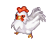Wise Hen</td><td>Lv 45+</td><td>Millet × 3 ← 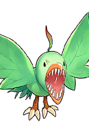<b>Leaf Bird</b> (Path to Caballa Relics)</td></tr>
<tr><td><input aria-label="ได้ Caballa Sticker แล้ว" class="stk" id="w2" type="checkbox"/></td><td>★ Guide Sabrina - Contributing to the Fund</td><td class="n">5</td><td>Relics Town - Azteca</td><td>Guide Sabrina</td><td>Lv 50+</td><td>Gold × 3 ← 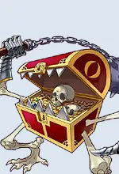<b>Mimic</b> (Relics Field 2–4) Golden Egg × 1 ← ขุดใน Relics Field</td></tr>
<tr><td><input aria-label="ได้ Caballa Sticker แล้ว" class="stk" id="w3" type="checkbox"/></td><td>★ Guide Sabrina - Catch That Thief <b>(รอบเดียว)</b></td><td class="n">1</td><td>Relics Town - Azteca</td><td>Guide Sabrina</td><td>Lv 50+ · รับค้างไว้ก่อนไปหา Fairy Feria</td><td>Yellow Monkey Fur × 1 ← รางวัลรอบ 5 ของ Fairy Feria</td></tr>
<tr><td><input aria-label="ได้ Caballa Sticker แล้ว" class="stk" id="w5" type="checkbox"/></td><td>★ Officer Tera - Aposis Data Collection</td><td class="n">5</td><td>Relics Town - Azteca</td><td>Officer Tera</td><td>Lv 50+</td><td>Aposis Statue × 2 ← ขุดใน Relics Field Aposis' Stick × 2 ← <b>Aposis</b> (Relics Field 3, 4)</td></tr>
<tr><td><input aria-label="ได้ Caballa Sticker แล้ว" class="stk" id="w6" type="checkbox"/></td><td>★ Genius Cochma - Launch! Caballa V <b>(รอบเดียว)</b></td><td class="n">1</td><td>Relics Town - Azteca</td><td>Genius Cochma</td><td>Lv 55+</td><td>Steel Punch, Steel Heart, Steel Body, Laser Eyes ← รางวัลจากเควส Dr. Cat ทั้ง 4</td></tr>
<tr><td><input aria-label="ได้ Caballa Sticker แล้ว" class="stk" id="w7" type="checkbox"/></td><td>★ Dr. Cat - Caballa V - Steel Punch</td><td class="n">?</td><td>Relics Town - Azteca</td><td>Dr. Cat</td><td>ไม่ทราบ</td><td>หน้าเควสนี้ไม่มีใน wiki mirror ดูของที่ต้องใช้ตอนรับเควสในเกม</td></tr>
<tr><td><input aria-label="ได้ Caballa Sticker แล้ว" class="stk" id="w8" type="checkbox"/></td><td>★ Dr. Cat - Caballa V - Steel Heart</td><td class="n">?</td><td>Relics Town - Azteca</td><td>Dr. Cat</td><td>ไม่ทราบ</td><td>หน้าเควสนี้ไม่มีใน wiki mirror ดูของที่ต้องใช้ตอนรับเควสในเกม</td></tr>
<tr><td><input aria-label="ได้ Caballa Sticker แล้ว" class="stk" id="w9" type="checkbox"/></td><td>★ Dr. Cat - Caballa V - Steel Body</td><td class="n">?</td><td>Relics Town - Azteca</td><td>Dr. Cat</td><td>ไม่ทราบ</td><td>หน้าเควสนี้ไม่มีใน wiki mirror ดูของที่ต้องใช้ตอนรับเควสในเกม</td></tr>
<tr><td><input aria-label="ได้ Caballa Sticker แล้ว" class="stk" id="w10" type="checkbox"/></td><td>★ Dr. Cat - Caballa V - Laser Eyes</td><td class="n">?</td><td>Relics Town - Azteca</td><td>Dr. Cat</td><td>ไม่ทราบ</td><td>หน้าเควสนี้ไม่มีใน wiki mirror ดูของที่ต้องใช้ตอนรับเควสในเกม</td></tr>
<tr><td><input aria-label="ได้ Caballa Sticker แล้ว" class="stk" id="w11" type="checkbox"/></td><td>Vagabond Eloy - Need Coffee!</td><td class="n">5</td><td>Relics Town - Azteca</td><td>Vagabond Eloy</td><td>Lv 55+</td><td>Caballa Coffee × 1 ← ผสมที่ Compounder Paul (ดูหมายเหตุใต้ตารางมอน)</td></tr>
<tr><td><input aria-label="ได้ Caballa Sticker แล้ว" class="stk" id="w12" type="checkbox"/></td><td>Indiana John - John's Request</td><td class="n">5</td><td>Relics Field 2 - Hand of Giant</td><td>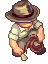Indiana John</td><td>Lv 55+</td><td>Incense Burner × 2 + Ash Box × 2 ← ขุดใน Caballa Relics Dungeon</td></tr>
<tr><td><input aria-label="ได้ Caballa Sticker แล้ว" class="stk" id="w4" type="checkbox"/></td><td>★ Fairy Feria - I'm Not a Crook!</td><td class="n">5</td><td>Relics Field 3 - Monkey Statues</td><td>Fairy Feria</td><td>Lv 50+ · ต้องมี Catch That Thief ค้างในสมุดเควส</td><td>Patterned Pottery × 3 + Plain Pottery × 3 ← ขุดใน Relics Field</td></tr>
</tbody>
</table>

หน้าเควสของ Dr. Cat ทั้ง 4 เควสหายไปจากวิกิ เลยไม่มีรายละเอียดของที่ต้องใช้

</section>

<section>

## จุดขุดและมอน เรียงตามแมพ

<table>
<thead><tr><th>ครบแล้ว</th><th>แมพ</th><th>ขุด / มอน</th><th>ไอเทม</th><th>จำนวนรวม</th><th>ใช้ในเควส</th></tr></thead>
<tbody>
<tr class="mon-row" data-q='[["w1", 15, "Wise Hen (3 × 5 รอบ)", 0]]'><td><input aria-label="หาครบแล้ว" class="mon" id="cm1" type="checkbox"/></td><td>★ Path to Caballa Relics</td><td>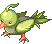Leaf Bird</td><td>Millet</td><td class="n">15</td><td>Wise Hen (3 × 5 รอบ)</td></tr>
<tr class="mon-row" data-q='[["w2", 5, "Contributing to the Fund (1 × 5 รอบ)", 0]]'><td><input aria-label="หาครบแล้ว" class="mon" id="cm2" type="checkbox"/></td><td>★ Relics Field (ขุด)</td><td>ขุด</td><td>Golden Egg</td><td class="n">5</td><td>Contributing to the Fund (1 × 5 รอบ)</td></tr>
<tr class="mon-row" data-q='[["w4", 15, "Fairy Feria (3 × 5 รอบ)", 0]]' data-unit="ต่อชนิด"><td><input aria-label="หาครบแล้ว" class="mon" id="cm3" type="checkbox"/></td><td>★ Relics Field (ขุด)</td><td>ขุด</td><td>Patterned Pottery, Plain Pottery</td><td class="n">15 ต่อชนิด</td><td>Fairy Feria (3 × 5 รอบ)</td></tr>
<tr class="mon-row" data-q='[["w5", 10, "Aposis Data Collection (2 × 5 รอบ)", 0]]'><td><input aria-label="หาครบแล้ว" class="mon" id="cm4" type="checkbox"/></td><td>★ Relics Field (ขุด)</td><td>ขุด</td><td>Aposis Statue</td><td class="n">10</td><td>Aposis Data Collection (2 × 5 รอบ)</td></tr>
<tr class="mon-row" data-q='[["w2", 15, "Contributing to the Fund (3 × 5 รอบ)", 0]]'><td><input aria-label="หาครบแล้ว" class="mon" id="cm5" type="checkbox"/></td><td>★ Relics Field 2–4</td><td>Mimic</td><td>Gold</td><td class="n">15</td><td>Contributing to the Fund (3 × 5 รอบ)</td></tr>
<tr class="mon-row" data-q='[["w5", 10, "Aposis Data Collection (2 × 5 รอบ)", 0]]'><td><input aria-label="หาครบแล้ว" class="mon" id="cm6" type="checkbox"/></td><td>★ Relics Field 3, 4</td><td>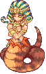Aposis</td><td>Aposis' Stick</td><td class="n">10</td><td>Aposis Data Collection (2 × 5 รอบ)</td></tr>
<tr class="mon-row" data-q='[["w11", 10, "Need Coffee! (2 × 5 รอบ)", 0]]'><td><input aria-label="หาครบแล้ว" class="mon" id="cm7" type="checkbox"/></td><td>Caballa Relics Dungeon 1, 2</td><td>Guiana</td><td>Coffee Beans</td><td class="n">10</td><td>Need Coffee! (2 × 5 รอบ)</td></tr>
<tr class="mon-row" data-q="[[&quot;k3&quot;, 1, &quot;ขั้น 3 Recover Julio's Storage Key&quot;, 0]]"><td><input aria-label="หาครบแล้ว" class="mon" id="cm8" type="checkbox"/></td><td>★ Caballa Relics Dungeon 1–4</td><td>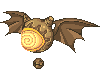Lima</td><td>Julio's Key</td><td class="n">1</td><td>ขั้น 3 Recover Julio's Storage Key</td></tr>
<tr class="mon-row" data-q="[[&quot;w12&quot;, 10, &quot;John's Request (2 × 5 รอบ)&quot;, 0]]" data-unit="ต่อชนิด"><td><input aria-label="หาครบแล้ว" class="mon" id="cm9" type="checkbox"/></td><td>Caballa Relics Dungeon (ขุด)</td><td>ขุด</td><td>Incense Burner, Ash Box</td><td class="n">10 ต่อชนิด</td><td>John's Request (2 × 5 รอบ)</td></tr>
</tbody>
</table>

Caballa Coffee ผสมที่ Compounder Paul (Azteca หรือ Megalopolis Square ค่าผสม 1,000 Galder) จาก Coffee Beans × 2 ← 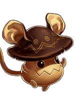<b>Guiana</b> (Caballa Relics Dungeon 1, 2) + Distilled Water + Empty Potion Bottle (ซื้อในร้าน)

</section>

<section>

## เควสอื่นในโซน (ไม่ให้สติ๊กเกอร์)

ไม่รวมเควส Card Girl เควสเปลี่ยนอาชีพ และเควส Guardian

<table>
<thead><tr><th>เควส</th><th>รอบ</th><th>ที่อยู่</th><th>ของที่ต้องส่ง</th><th>รางวัล</th></tr></thead>
<tbody>
<tr><td>Keeper Julio - Return the Gold Silk Pouch Lv 55+, หลังผ่าน Keeper Julio - Recover Julio's Storage Key</td><td class="n">1</td><td>Relics Field 4 - An Altar for Sacrifice</td><td>Gold Silk Pouch ← รางวัลจาก Borrow Gold Silk Pouch Adventurer's Book ← รางวัลจาก Borrow Gold Silk Pouch</td><td>Weapon Ticket B, Adventurer's Book</td></tr>
<tr><td>Kochi - Register New Teleport Service (Caballa Relics)</td><td class="n">1</td><td>Gate of Caballa Relics</td><td>ลงทะเบียนวาร์ปกับ Kochi</td><td>เปิดวาร์ปมา Gate of Caballa Relics</td></tr>
<tr><td>Poirot - Make a Missing Ed Flyer Have completed 2nd Job Advancement (Lv 60+)</td><td class="n">1</td><td>Gate of Caballa Relics</td><td>Brother's Pendant Enlarged Brother's Picture ← รางวัลจาก Wandering Photographer Ren - Flyer Picture Request (2)</td><td>ไม่มี</td></tr>
<tr><td>Weirdo Hen - Ordinary Hen's Lunch Lv 45+</td><td class="n">5</td><td>Gate of Caballa Relics</td><td>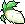Thick Radish × 3 ← Mandragora</td><td>รอบ 1–4: Caballa Slate รอบ 5: Caballa Slate, Wing Port (Caballa Relics), 50,000 Galder</td></tr>
<tr><td>Wandering Photographer Ren - Flyer Picture Request (1) Have Poirot - Make a Missing Ed Flyer in quest log</td><td class="n">1</td><td>Gate of Caballa Relics</td><td>Gold Lens</td><td>ไม่มี</td></tr>
<tr><td>Wandering Photographer Ren - Flyer Picture Request (2) Have completed Wandering Photographer Ren - Flyer Picture Request (1)</td><td class="n">1</td><td>Gate of Caballa Relics</td><td>Expensive Film × 20 ← ขุดใน Caballa Relics Fields</td><td>Enlarged Brother's Picture</td></tr>
<tr><td>Poirot - Get to the Bottom of the Rumours Have completed Poirot - Make a Missing Ed Flyer</td><td class="n">1</td><td>Gate of Caballa Relics</td><td>คุยกับ Poirot in Tower of Chaos Entrance (1st Floor)</td><td>ไม่มี</td></tr>
<tr><td>Bunny Maid - Protecting Caballa Relics Lv 45+</td><td class="n">5</td><td>Gate of Caballa Relics</td><td>Coin × 3 ← ขุดใน Coral Beach Fields , Gate of Desert Beach , Desert Beach Fields , Pyramid Dungeon Halls , Emeral Forests , Poppuri Dungeons , Gate of Caballa Relics , and Caballa Relics Fields</td><td>รอบ 1–4: Caballa Slate รอบ 5: Caballa Slate, Wing Port (Caballa Relics), 50,000 Galder</td></tr>
<tr><td>Favian - A Snack for Vinosh Lv 50+</td><td class="n">5</td><td>Gate of Caballa Relics</td><td>Boiled Corn × 3 ← Leaf Bird</td><td>รอบ 1–4: Caballa Slate รอบ 5: Caballa Slate, Wing Port (Caballa Relics), 50,000 Galder</td></tr>
<tr><td>Vinosh - Wanna Have Unique Food Lv 50+</td><td class="n">5</td><td>Gate of Caballa Relics</td><td>Ginseng Root × 3 ← Mandragora</td><td>รอบ 1–4: Caballa Slate รอบ 5: Caballa Slate, Wing Port (Caballa Relics), 50,000 Galder</td></tr>
<tr><td>Mirabo Watty - Mirabo Watty's Hobby Lv 50+</td><td class="n">5</td><td>Gate of Caballa Relics</td><td>Stone Soldier Hat × 3 ← Stone Soldier</td><td>รอบ 1–4: Caballa Slate รอบ 5: Caballa Slate, Wing Port (Caballa Relics), 50,000 Galder</td></tr>
<tr><td>Wise Hen - Caballa Relics Town - Azteca Lv 50+, หลังผ่าน Stern Poppuri - Journey to Caballa Relics</td><td class="n">1</td><td>Gate of Caballa Relics</td><td>ไปคุยกับ Fortune Teller</td><td>Wing Port (Caballa Relics)</td></tr>
<tr><td>Monkey T - Caballa Island's Best Merchant Lv 45+</td><td class="n">5</td><td>Relics Town - Azteca</td><td>Gold Ring × 2 ← ขุดใน Caballa Relics Fields Gold Necklace × 2 ← ขุดใน Caballa Relics Fields Gold Plated Wheel × 2 ← Stone Soldier</td><td>5 Galder Coupon, 10 Galder Coupon, 50 Galder Coupon or Caballa Slate</td></tr>
<tr><td>Clerk Z. Smith - Rare Stone Collection Lv 50+</td><td class="n">5</td><td>Azteca Sauna</td><td>Jade ← ขุดใน Caballa Relics Dungeon Copal ← ขุดใน Caballa Relics Dungeon Obsidian ← ขุดใน Caballa Relics Dungeon</td><td>Caballa Slate or 1~3x 500 Galder Coupon</td></tr>
<tr><td>Sissy Cello - Find Scaredy Cat Cello's Lamp Lv 55+</td><td class="n">5</td><td>Caballa Relics Dungeon 4</td><td>Lamplight ← Naranjo Smiling Face ← Chimu</td><td>รอบ 1: Light Attribute Stone, Caballa Slate รอบ 2: Caballa Slate รอบ 3: Light Attribute Stone, Caballa Slate รอบ 4: Caballa Slate รอบ 5: Light Attribute Stone, Caballa Slate × 2, 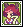Sissy Cello Card, Caballa Sticker</td></tr>
<tr><td>Eclipse - The Story of the Gods 4 Lv 225+, ใช้ Mind's Eye, หลังผ่าน The Story of the Gods 3 และ หลังผ่าน Shadow Star 4 อย่างน้อย 1 ครั้ง</td><td class="n">1</td><td>Relics Town - Azteca</td><td>God's Molar × 3 ← Shadow Relics Dungeon Monsters</td><td>10,000 Galder Coupon × 2</td></tr>
<tr><td>Blacksmith Marx - Jade Steel Lv 50+</td><td class="n">5</td><td>Caballa Relics Mine - Jade Steel</td><td>Pure Soft Iron × 3 ← ขุดใน 1st Mining Lot of Jade Steel Flawless Cat's Eye × 3 ← ขุดใน 2nd Mining Lot of Jade Steel</td><td>รอบ 1–4: Tornado Stone or 2~4x 500 Galder Coupon รอบ 5: Ancient Steel, Moonstone</td></tr>
<tr><td>Stella - Shadow Star 4 Lv 225+, ใช้ Mind's Eye</td><td class="n">1</td><td>Relics Town - Azteca</td><td>Lock of Hair × 5 ← Shadow Mandragora / Shadow Aposis</td><td>Star Card Pack No.5, Half Pink Potion × 7, Half Blue Potion or Story of the Star Gazer Girl 4 × 7</td></tr>
<tr><td>Fortune Teller - Dark Commando Dark Lord, Dark Barrier (M), Fear (Lv.1)</td><td class="n">1</td><td>Gate of Caballa Relics</td><td>Crow's Claw × 10 ← Crow Serpentine × 10 ← ขุดใน Techichi Volcano Fields</td><td>Dark Commando Card</td></tr>
<tr><td>Driller King Marky - Romance of Drilling - Caballa Relics Lv 40+~140, หลังผ่าน Indiana John - Old Man's Dream</td><td class="n">1</td><td>Relics Field 3 - Monkey Statues</td><td>Weird Relics Map A ← ขุดใน Caballa Relics Fields Weird Relics Map B ← ขุดใน Caballa Relics Fields</td><td>Weird Relics Treasure Map</td></tr>
<tr><td>Explorer Reina - Treasure Hunting 2 - Caballa Relics Lv 40+~140, หลังผ่าน Indiana John - Old Man's Dream, ไม่มี Old Relics Treasure Map ในกระเป๋า, finished Explorer Reina - Treasure Hunting 1 - Caballa Relics 50 times</td><td class="n">1</td><td>Gate of Caballa Relics</td><td>Old Relics Map A ← ขุดใน Caballa Relics Fields Old Relics Map B ← ขุดใน Caballa Relics Fields</td><td>Old Relics Treasure Map</td></tr>
<tr><td>Explorer Reina - Find Torn Clue 1 Have completed Explorer Reina - The Sleeping Soul of the Ancient Relics 1</td><td class="n">1</td><td>Caballa Relics Boss Path 1 - Waking Dream</td><td>Torn Clue 1 ← ขุดใน Caballa Relics Boss Path 1 - Waking Dream</td><td>Decoded Clue 1</td></tr>
<tr><td>Explorer Reina - Find Torn Clue 2 Have completed Explorer Reina - The Sleeping Soul of the Ancient Relics 2</td><td class="n">1</td><td>Caballa Relics Boss Path 1 - Waking Dream</td><td>Torn Clue 2 ← ขุดใน Caballa Relics Boss Path 1 - Waking Dream</td><td>Decoded Clue 2</td></tr>
<tr><td>Fortune Teller - Waking the Ancients Have Decoded Clue 1 และ 2 in inventory</td><td class="n">1</td><td>Caballa Relics Boss Path 1 - Waking Dream</td><td>Philosopher's Stone × 5 ← Awoken Mimic (Lv 65 / found in Caballa Relics Boss Path 1 - Waking Dream )</td><td>Complete Decoded Doc</td></tr>
<tr><td>Explorer Reina - Proof of Thanks Lv 90+~150, have Guardian's Soul Helm, Guardian's Soul Staff, Guardian's Soul Shield in inventory</td><td class="n">1</td><td>Relics Field 4 - An Altar for Sacrifice</td><td>Tombeth's Bijou ← รางวัลจาก Keeper Julio - Tombeth's Bijou</td><td>Guardian's Soul Pendant</td></tr>
<tr><td>Keeper Julio - Tombeth's Bijou Lv 90+~150, Have Explorer Reina - Proof of Thanks in quest log</td><td class="n">1</td><td>The Trident Maze</td><td>Guardian's Key ← Awakened Naranjo (Lv 87 / found in Caballa Relics Boss Path 2 - Dread Slumber in Room 6)</td><td>Tombeth's Bijou</td></tr>
</tbody>
</table>

</section>

<section>

## รูปจากวิกิ

### NPC

<a href="https://wikimirror.lifeto.co/wiki.ggftw.com/trickster/Fortune_Teller.html" rel="noopener" target="_blank">Fortune Tellerขั้น 1, 2 · Azteca ↗</a>
<a href="https://wikimirror.lifeto.co/wiki.ggftw.com/trickster/Keeper_Julio.html" rel="noopener" target="_blank">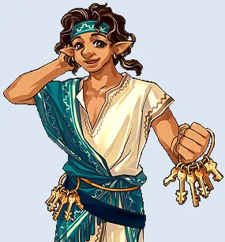Keeper Julioขั้น 3, 4 · Relics Field 4 ↗</a>
<a href="https://wikimirror.lifeto.co/wiki.ggftw.com/trickster/Guide_Sabrina.html" rel="noopener" target="_blank">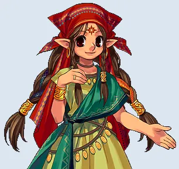Guide SabrinaAzteca ↗</a>
<a href="https://wikimirror.lifeto.co/wiki.ggftw.com/trickster/Fairy_Feria.html" rel="noopener" target="_blank">Fairy FeriaRelics Field 3 ↗</a>
<a href="https://wikimirror.lifeto.co/wiki.ggftw.com/trickster/Genius_Cochma.html" rel="noopener" target="_blank">Genius CochmaAzteca ↗</a>

### มอนสเตอร์

<a href="https://wikimirror.lifeto.co/wiki.ggftw.com/trickster/Leaf_Bird.html" rel="noopener" target="_blank">Leaf BirdLv 50 · หน้าวิกิ ↗</a>
<a href="https://wikimirror.lifeto.co/wiki.ggftw.com/trickster/Mimic.html" rel="noopener" target="_blank">MimicLv 61 · หน้าวิกิ ↗</a>
<a href="https://wikimirror.lifeto.co/wiki.ggftw.com/trickster/Aposis.html" rel="noopener" target="_blank">AposisLv 66 · หน้าวิกิ ↗</a>
<a href="https://wikimirror.lifeto.co/wiki.ggftw.com/trickster/Guiana.html" rel="noopener" target="_blank">GuianaLv 66 · หน้าวิกิ ↗</a>
<a href="https://wikimirror.lifeto.co/wiki.ggftw.com/trickster/Lima.html" rel="noopener" target="_blank">LimaLv 70 · หน้าวิกิ ↗</a>

### แมพ

<a href="https://wikimirror.lifeto.co/asset.103.ggftw.net/wiki/to-w/images/7/73/Caballa_Relics_Map.png" rel="noopener" target="_blank">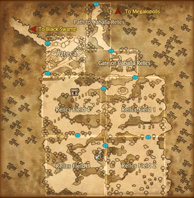แผนที่ Caballa Relicsทั้งโซน ↗</a>
<a href="https://wikimirror.lifeto.co/wiki.ggftw.com/trickster/Path_to_Caballa_Relics.html" rel="noopener" target="_blank">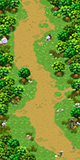Path to Caballa Relicsหน้าแมพ ↗</a>
<a href="https://wikimirror.lifeto.co/wiki.ggftw.com/trickster/Gate_of_Caballa_Relics.html" rel="noopener" target="_blank">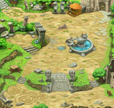Gate of Caballa Relicsหน้าแมพ ↗</a>
<a href="https://wikimirror.lifeto.co/wiki.ggftw.com/trickster/Relics_Town_-_Azteca.html" rel="noopener" target="_blank">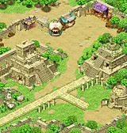Relics Town - Aztecaหน้าแมพ ↗</a>
<a href="https://wikimirror.lifeto.co/wiki.ggftw.com/trickster/Relics_Field_2_-_Hand_of_Giant.html" rel="noopener" target="_blank">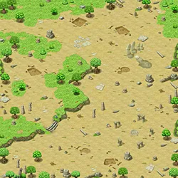Relics Field 2 - Hand of Giantหน้าแมพ ↗</a>
<a href="https://wikimirror.lifeto.co/wiki.ggftw.com/trickster/Relics_Field_3_-_Monkey_Statues.html" rel="noopener" target="_blank">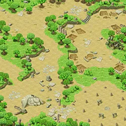Relics Field 3 - Monkey Statuesหน้าแมพ ↗</a>
<a href="https://wikimirror.lifeto.co/wiki.ggftw.com/trickster/Relics_Field_4_-_An_Altar_for_Sacrifice.html" rel="noopener" target="_blank">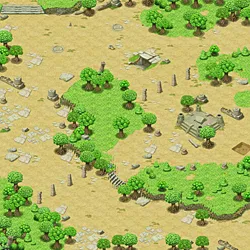Relics Field 4 - An Altar for Sacrificeหน้าแมพ ↗</a>
<a href="https://wikimirror.lifeto.co/wiki.ggftw.com/trickster/Caballa_Relics_Dungeon_1.html" rel="noopener" target="_blank">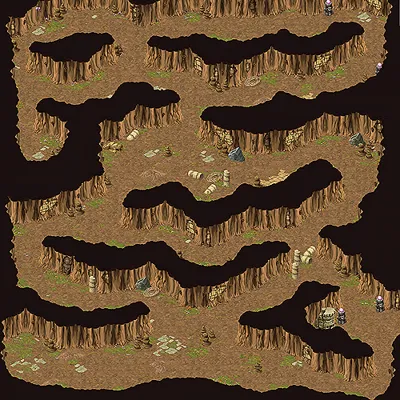Caballa Relics Dungeon 1หน้าแมพ ↗</a>

</section>

<PageBehavior />
