

<header style="display:flex;flex-direction:column;gap:8px">

# เควสกุญแจ Desert Beach

สรุปจากวิกิ ggFTW (ฉบับ mirror ของ LifeTO) หน้า [Sandman - Desert Sticker](https://wikimirror.lifeto.co/wiki.ggftw.com/trickster/Sandman_-_Desert_Sticker.html), [Category Desert Beach Quest](https://wikimirror.lifeto.co/wiki.ggftw.com/trickster/Category_Desert_Beach_Quest.html) และหน้าเควส/มอน/แมพที่ลิงก์ไป

</header>

<section>

## ภาพรวม

โซนแรกของเควสกุญแจ เริ่มกับ **Sandman** ที่ Beach Town - Paradise ต้อง<b>เลเวล 25+</b> ไม่มีเควสกุญแจก่อนหน้า

- ต้องได้ **Desert Sticker 5 ใบ** จากเควสธรรมดา
- ขั้น 3 ให้ **Adventurer's Book** เล่มแรก เก็บไว้ใช้ต่อทุกโซน
- เควสถัดไปคือ Megalopolis: Scared Poppuri ที่ Southeast Forest

</section>

<section aria-live="polite" class="counter">

## ความคืบหน้า

0 Desert Sticker ที่ควรมีตอนนี้

<button id="reset" type="button">ล้างทั้งหมด</button>

</section>

<section>

## เควสกุญแจ 3 ขั้น

<label class="done"><input class="key" id="k1" type="checkbox"/> ทำแล้ว</label>ขั้น 1<h3>Sandman - Desert Sticker</h3>

Beach Town - ParadiseLv 25+

ส่ง <b>Desert Sticker × 5</b>

รางวัล: 500 Galder Coupon × 5

<label class="done"><input class="key" id="k2" type="checkbox"/> ทำแล้ว</label>ขั้น 2<h3>Sandman - Legendary Recipe</h3>

Beach Town - Paradiseหลังผ่าน Desert Sticker

ส่ง<ul><li><b>Sand Cake × 5</b> ← <b>Sand Demon</b> (Field 3)</li><li><b>Sand Glass × 1</b> ← <b>Sand Demon</b> (Field 3)</li><li><b>Limestone × 2</b> ← ขุดใน Desert Beach Field</li><li><b>Garden Trowel × 1</b> ← ขุดใน Desert Beach Field</li><li><b>Oasis Water × 1</b> ← ขุดใน Desert Beach Field</li></ul>

รางวัล: 500 Galder Coupon × 5

<label class="done"><input class="key" id="k3" type="checkbox"/> ทำแล้ว</label>ขั้น 3<h3>Sandman - The Miracle of Sand</h3>

Beach Town - Paradiseหลังผ่าน Legendary Recipe

ส่ง<ul><li><b>Legendary Recipe</b> ← <b>Sand Demon</b> (Field 3)</li><li><b>Glyph Tablet</b> ← ขุดใน Pyramid Dungeon</li></ul>

รางวัล<ul><li><b>Adventurer's Book</b> (เก็บไว้ใช้โซนต่อไป)</li><li>Weapon Ticket A</li></ul>

</section>

<section>

## เควสที่ให้ Desert Sticker

มี 7 เควส ต้องการ 5 ใบ

เส้นทางแนะนำ 5 เควสติด ★ ชุดต่อกัน: Homeless Ian ให้ Water Bucket → Bunny Maid ให้ Filled Water Bucket → ส่ง Al-Hauri

<button aria-pressed="false" id="hideUnstar" type="button">ซ่อนเควสที่ไม่ติดดาว</button><button hidden="" id="showAll" type="button">แสดงทั้งหมด</button>

<table>
<thead><tr><th>ได้แล้ว</th><th>เควส</th><th>รอบ</th><th>ที่อยู่</th><th>NPC</th><th>เงื่อนไข</th><th>ของที่ต้องส่ง และแหล่ง</th></tr></thead>
<tbody>
<tr><td><input aria-label="ได้ Desert Sticker แล้ว" class="stk" id="w1" type="checkbox"/></td><td>★ Homeless Ian - This Generation's Last Romantic</td><td class="n">5</td><td>Beach Town - Paradise</td><td>Homeless Ian</td><td>Lv 25+</td><td>Flower Necklace × 2 ← <b>Sea Scorpion</b> (Field 3)</td></tr>
<tr><td><input aria-label="ได้ Desert Sticker แล้ว" class="stk" id="w2" type="checkbox"/></td><td>★ Bunny Maid - Well Watching Bunny Maid</td><td class="n">5</td><td>Beach Town - Paradise</td><td>Bunny Maid</td><td>Lv 25+</td><td>Water Bucket × 1 ← รางวัลจาก Homeless Ian Octopus Legs × 2 ← <b>Hula Octopus</b> (Field 2)</td></tr>
<tr><td><input aria-label="ได้ Desert Sticker แล้ว" class="stk" id="w4" type="checkbox"/></td><td>★ Miranda Watty - Miranda Watty's Hobbies</td><td class="n">5</td><td>Beach Town - Paradise</td><td>Miranda Watty</td><td>Lv 25+</td><td>Pineapple Mask × 2 ← <b>Pineapple</b> (Field 3)</td></tr>
<tr><td><input aria-label="ได้ Desert Sticker แล้ว" class="stk" id="w5" type="checkbox"/></td><td>★ Vagabond Eloy - Eloy's Sensitive Skin (1)</td><td class="n">5</td><td>Beach Town - Paradise</td><td>Vagabond Eloy</td><td>Lv 25+</td><td>Sun Cream × 2 ← ขุดใน Field 2 - Sand Palace</td></tr>
<tr><td><input aria-label="ได้ Desert Sticker แล้ว" class="stk" id="w6" type="checkbox"/></td><td>Skipper Min - Dude Needs a Bath!</td><td class="n">5</td><td>Beach Town - Paradise</td><td>Skipper Min</td><td>Lv 25+</td><td>Soap × 1, Shampoo × 1, Bath Sponge × 1 ← ขุดใน Field 3</td></tr>
<tr><td><input aria-label="ได้ Desert Sticker แล้ว" class="stk" id="w3" type="checkbox"/></td><td>★ Al-Hauri - Help Al-Hauri</td><td class="n">5</td><td>Paradise Spa</td><td>Al-Hauri</td><td>Lv 25+</td><td>Filled Water Bucket × 1 ← รางวัลจาก Bunny Maid</td></tr>
<tr><td><input aria-label="ได้ Desert Sticker แล้ว" class="stk" id="w7" type="checkbox"/></td><td>Eliza Bath - Eliza Bath's Curiousity</td><td class="n">5</td><td>Paradise Spa</td><td>Eliza Bath</td><td>Lv 15+</td><td>Lucky Letter, Cursed Letter, Love Letter, Confession Letter, Farewell Letter อย่างละ 1 ← ขุดใน Field 4 - Parasol River</td></tr>
</tbody>
</table>

</section>

<section>

## จุดขุดและมอน เรียงตามแมพ

<table>
<thead><tr><th>ครบแล้ว</th><th>แมพ</th><th>ขุด / มอน</th><th>ไอเทม</th><th>จำนวนรวม</th><th>ใช้ในเควส</th></tr></thead>
<tbody>
<tr class="mon-row" data-q='[["w2", 10, "Bunny Maid (2 × 5 รอบ)", 0]]'><td><input aria-label="หาครบแล้ว" class="mon" id="dm1" type="checkbox"/></td><td>★ Desert Beach Field 2 - Sand Palace</td><td>Hula Octopus</td><td>Octopus Legs</td><td class="n">10</td><td>Bunny Maid (2 × 5 รอบ)</td></tr>
<tr class="mon-row" data-q='[["w5", 10, "Eloy (2 × 5 รอบ)", 0]]'><td><input aria-label="หาครบแล้ว" class="mon" id="dm2" type="checkbox"/></td><td>★ Desert Beach Field 2 - Sand Palace (ขุด)</td><td>ขุด</td><td>Sun Cream</td><td class="n">10</td><td>Eloy (2 × 5 รอบ)</td></tr>
<tr class="mon-row" data-q='[["w1", 10, "Homeless Ian (2 × 5 รอบ)", 0]]'><td><input aria-label="หาครบแล้ว" class="mon" id="dm3" type="checkbox"/></td><td>★ Desert Beach Field 3 - Statue of Anubis</td><td>Sea Scorpion</td><td>Flower Necklace</td><td class="n">10</td><td>Homeless Ian (2 × 5 รอบ)</td></tr>
<tr class="mon-row" data-q='[["w4", 10, "Miranda Watty (2 × 5 รอบ)", 0]]'><td><input aria-label="หาครบแล้ว" class="mon" id="dm4" type="checkbox"/></td><td>★ Desert Beach Field 3 - Statue of Anubis</td><td>Pineapple</td><td>Pineapple Mask</td><td class="n">10</td><td>Miranda Watty (2 × 5 รอบ)</td></tr>
<tr class="mon-row" data-q='[["k2", 5, "ขั้น 2 Legendary Recipe", 0]]'><td><input aria-label="หาครบแล้ว" class="mon" id="dm5" type="checkbox"/></td><td>★ Desert Beach Field 3 - Statue of Anubis</td><td>Sand Demon</td><td>Sand Cake</td><td class="n">5</td><td>ขั้น 2 Legendary Recipe</td></tr>
<tr class="mon-row" data-q='[["k2", 1, "ขั้น 2 Legendary Recipe", 0]]'><td><input aria-label="หาครบแล้ว" class="mon" id="dm6" type="checkbox"/></td><td>★ Desert Beach Field 3 - Statue of Anubis</td><td>Sand Demon</td><td>Sand Glass</td><td class="n">1</td><td>ขั้น 2 Legendary Recipe</td></tr>
<tr class="mon-row" data-q='[["k3", 1, "ขั้น 3 The Miracle of Sand", 0]]'><td><input aria-label="หาครบแล้ว" class="mon" id="dm7" type="checkbox"/></td><td>★ Desert Beach Field 3 - Statue of Anubis</td><td>Sand Demon</td><td>Legendary Recipe</td><td class="n">1</td><td>ขั้น 3 The Miracle of Sand</td></tr>
<tr class="mon-row" data-q='[["w6", 5, "Skipper Min (1 × 5 รอบ)", 0]]' data-unit="ต่อชนิด"><td><input aria-label="หาครบแล้ว" class="mon" id="dm8" type="checkbox"/></td><td>Desert Beach Field 3 - Statue of Anubis (ขุด)</td><td>ขุด</td><td>Soap, Shampoo, Bath Sponge</td><td class="n">5 ต่อชนิด</td><td>Skipper Min (1 × 5 รอบ)</td></tr>
<tr class="mon-row" data-q='[["w7", 5, "Eliza Bath (1 × 5 รอบ)", 0]]' data-unit="ต่อชนิด"><td><input aria-label="หาครบแล้ว" class="mon" id="dm9" type="checkbox"/></td><td>Desert Beach Field 4 - Parasol River (ขุด)</td><td>ขุด</td><td>Lucky Letter, Cursed Letter, Love Letter, Confession Letter, Farewell Letter</td><td class="n">5 ต่อชนิด</td><td>Eliza Bath (1 × 5 รอบ)</td></tr>
<tr class="mon-row" data-q='[["k2", 2, "ขั้น 2 Legendary Recipe", 0]]'><td><input aria-label="หาครบแล้ว" class="mon" id="dm10" type="checkbox"/></td><td>★ Desert Beach Field (ขุด)</td><td>ขุด</td><td>Limestone</td><td class="n">2</td><td>ขั้น 2 Legendary Recipe</td></tr>
<tr class="mon-row" data-q='[["k2", 1, "ขั้น 2 Legendary Recipe", 0]]' data-unit="ต่อชนิด"><td><input aria-label="หาครบแล้ว" class="mon" id="dm11" type="checkbox"/></td><td>★ Desert Beach Field (ขุด)</td><td>ขุด</td><td>Garden Trowel, Oasis Water</td><td class="n">1 ต่อชนิด</td><td>ขั้น 2 Legendary Recipe</td></tr>
<tr class="mon-row" data-q='[["k3", 1, "ขั้น 3 The Miracle of Sand", 0]]'><td><input aria-label="หาครบแล้ว" class="mon" id="dm12" type="checkbox"/></td><td>★ Pyramid Dungeon (ขุด)</td><td>ขุด</td><td>Glyph Tablet</td><td class="n">1</td><td>ขั้น 3 The Miracle of Sand</td></tr>
</tbody>
</table>

Water Bucket และ Filled Water Bucket ได้จากเควสอื่น

</section>

<section>

## เควสอื่นในโซน (ไม่ให้สติ๊กเกอร์)

ไม่รวมเควส Card Girl เควสเปลี่ยนอาชีพ และเควส Guardian

<table>
<thead><tr><th>เควส</th><th>รอบ</th><th>ที่อยู่</th><th>ของที่ต้องส่ง</th><th>รางวัล</th></tr></thead>
<tbody>
<tr><td>Monkey T - Monkey T's Loyalty - 2 Lv 20+</td><td class="n">25</td><td>Desert Beach Field 1 - Delta Island</td><td>Iron Grass × 5 ← Shell Trap</td><td>50 Galder Coupon, 100 Galder Coupon or 500 Galder Coupon</td></tr>
<tr><td>Star Gazer Stella (2) - The Star Gazer Lv 15+</td><td class="n">1</td><td>Desert Beach Field 2 - Sand Palace</td><td>ทำ Don Giuvanni - Calming Down Don Giuvanni ให้จบ</td><td>Star Card Pack No.5, 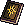Stars and Fortunes Book, liberate Star Gazing</td></tr>
<tr><td>Don Giuvanni - Calming Down Don Giuvanni Lv 15+, มี Stella - The Star Gazer ค้างในสมุดเควส</td><td class="n">3</td><td>Desert Beach Field 2 - Sand Palace</td><td>Soap ← ขุดใน Desert Beach Field 3 - Statue of Anubis</td><td>รอบ 1–2: 500 Galder Coupon รอบ 3: 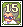Don Giuvanni Card</td></tr>
<tr><td>Sandman - Go to Megalopolis Square Lv 25+, หลังผ่าน Sandman - The Miracle of Sand</td><td class="n">1</td><td>Beach Town - Paradise</td><td>ไปคุยกับ Guild Clerk Esther</td><td>500 Galder Coupon × 5</td></tr>
<tr><td>Pharaoh Boy - Young Pharaoh's Request Lv 25+, ไม่มี Pharaoh Hat, Golden Sword, Golden Lion Shield ในกระเป๋า</td><td class="n">5</td><td>Desert Beach Field 3 - Statue of Anubis</td><td>Uraeus Statue ← ขุดใน Pyramid Dungeon Halls 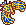Nekhbet Statue ← ขุดใน Pyramid Dungeon Halls 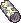Round Bone Seal</td><td>รอบ 1: 500 Galder Coupon รอบ 2: 500 Galder Coupon × 2 รอบ 3: 500 Galder Coupon × 3 รอบ 4: 500 Galder Coupon × 4 รอบ 5: 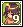Pharaoh Boy Card</td></tr>
<tr><td>Eclipse - The Story of the Gods 2 Lv 195+, ใช้ Mind's Eye, หลังผ่าน The Story of the Gods 1 และ หลังผ่าน Shadow Star 2 อย่างน้อย 1 ครั้ง</td><td class="n">1</td><td>Beach Town - Paradise</td><td>Shadow Anchor × 3 ← Shadow Pyramid Dungeon Monsters</td><td>10,000 Galder Coupon</td></tr>
<tr><td>Blacksmith Marx - Collection! Lv 25+</td><td class="n">5</td><td>Desert Beach Mine - Crystal Copper</td><td>Pure Tin × 3 ← ขุดใน 1st Mining Lot of Crystal Copper Flawless Amethyst × 3 ← ขุดใน 2nd Mining Lot of Crystal Copper</td><td>รอบ 1–4: Tornado Stone, 2~4x 500 Galder Coupon or 4~5x Pink Potion C รอบ 5: Pure Sulfur × 2, Flawless Agate × 2</td></tr>
<tr><td>Nefertiti 1 - Canopic Jar Lv 25+~80</td><td class="n">5</td><td>Pyramid Dungeon 6 - Hall of the Queen</td><td>Harpy × 3 ← ขุดใน Pyramid Dungeon Imsety × 3 ← ขุดใน Pyramid Dungeon Duamutef × 3 ← ขุดใน Pyramid Dungeon Qebehsenuef × 3</td><td>รอบ 1: Pink Potion C × 10, Blue Potion C × 10 รอบ 2: Pink Potion C × 15, Blue Potion C × 15 รอบ 3: Pink Potion C × 20, Blue Potion C × 20 รอบ 4: Pink Potion C × 25, Blue Potion C × 25 รอบ 5: 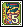Nefertiti Card</td></tr>
<tr><td>Stella - Shadow Star 2 Lv 195+, ใช้ Mind's Eye</td><td class="n">1</td><td>Beach Town - Paradise</td><td>Talisman of Darkness × 5 ← Shadow Shell Trap / Shadow Golden Mole / Shadow Fanta Fish / Shadow Sand Demon / Shadow Pineapple / Shadow Fan Lizard / Shadow Cannon Shell</td><td>Star Card Pack No.5, Half Pink Potion × 5, Half Blue Potion or Story of the Star Gazer Girl 2 × 5</td></tr>
<tr><td>Driller King Marky - Romance of Drilling - Desert Beach Lv 15+~115, หลังผ่าน Indiana John - Old Man's Dream</td><td class="n">1</td><td>Desert Beach Field 4 - Parasol River</td><td>Weird Beach Map A ← ขุดใน Desert Beach Fields Weird Beach Map B ← ขุดใน Desert Beach Fields</td><td>Weird Beach Treasure Map</td></tr>
<tr><td>Explorer Reina - Treasure Hunting 2 - Desert Beach Lv 15+~115, หลังผ่าน Indiana John - Old Man's Dream, finished Explorer Reina - Treasure Hunting 1 - Desert Beach 50 times, ไม่มี Old Beach Treasure Map ในกระเป๋า</td><td class="n">1</td><td>Desert Beach Field 3 - Statue of Anubis</td><td>Old Beach Map A ← ขุดใน Desert Beach Fields Old Beach Map B ← ขุดใน Desert Beach Fields</td><td>Old Beach Treasure Map</td></tr>
<tr><td>Driller Marky - Crazy Drilling! Lv 25+</td><td class="n">1</td><td>Beach Town - Paradise</td><td>Earth Charm ← รางวัลจาก Indiana John - Acquire Rare Artifacts Drilling Certification ← รางวัลจาก Explorer Reina - Driller Master Test</td><td>Crazy Drilling Card, Basic Detection Scroll S × 30</td></tr>
<tr><td>Indiana John - Acquire Rare Artifacts Have Driller Marky - Crazy Drilling! in quest log</td><td class="n">1</td><td>Beach Town - Paradise</td><td>Broken Artifact 1 ← Sand Demon Broken Artifact 2 ← Fan Lizard Broken Artifact 3 ← Cannon Shell</td><td>Earth Charm</td></tr>
<tr><td>Explorer Reina - Driller Master Test Lv 20+, มี Driller Marky - Driller King's Crazy Skill ค้างในสมุดเควส</td><td class="n">1</td><td>Beach Town - Paradise</td><td>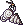Driller King Necklace ← ขุดใน Desert Beach Field 2 - Sand Palace Driller King Ring ← ขุดใน Desert Beach Field 3 - Statue of Anubis Driller King Bag ← ขุดใน Desert Beach Field 4 - Parasol River</td><td>Drilling Certification</td></tr>
<tr><td>Explorer Reina - Ancient Liquid Explorer, Thief Master or Cyber Hunter, Pouch of Pain (M)</td><td class="n">1</td><td>Pyramid Dungeon 2 - Hall of Harpy</td><td>Neurotoxin × 10 ← Aabon 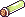Formic Acid × 10 ← Forest Tickler</td><td>Poison Pouch Card</td></tr>
<tr><td>Explorer Reina - Poisonous Crafts Thief Master, Shuriken Master (Lv.1), Hide (Lv.5)</td><td class="n">1</td><td>Pyramid Dungeon 3 - Hall of Bastet</td><td>Formic Acid × 5 ← Forest Tickler Neurotoxin × 5 ← Aabon Brush × 2 ← ขุดใน Ghost Blue Seabed Fields</td><td>Poison Assault Card</td></tr>
<tr><td>Captain - Test of Knowledge Lv 1+~90</td><td class="n">1</td><td>Room of Guardian - Test of Knowledge</td><td>Answer the questions correctly</td><td>Teleport to Room of Guardian - Test of Power</td></tr>
<tr><td>Bastet - Test of Power Lv 1+~90</td><td class="n">1</td><td>Room of Guardian - Test of Power</td><td>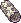Gray Round Seal ← Guardian 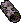Dark Round Seal ← Captain (1) 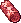Red Round Seal ← Captain (2)</td><td>Teleport to Pyramid Dungeon 7 - Doom of Pharaoh</td></tr>
<tr><td>Pharaoh Boy - Young Pharaoh's Awakening Lv 35+~90, have Pharaoh Hat, Golden Sword, Golden Lion Shield in inventory</td><td class="n">1</td><td>Desert Beach Field 3 - Statue of Anubis</td><td>Piece of Free Soul 1 ← รางวัลจาก Anubis - Anubis' Mission (2) Piece of Free Soul 2 ← รางวัลจาก Nefertiti - Nefertiti's Mission Piece of Free Soul 3 ← รางวัลจาก Bastet - Bastet's Mission</td><td>Pharaoh Boy Card, Ankh Pendant</td></tr>
<tr><td>Nefertiti 1 - Nefertiti's Mission Lv 35+~90, have Pharaoh Hat</td><td class="n">1</td><td>Pyramid Dungeon 6 - Hall of the Queen</td><td>Book of the Dead × 15 ← ขุดใน Pyramid Dungeon Halls</td><td>Nefertiti Card, Piece of Free Soul 2</td></tr>
<tr><td>Bastet - Bastet's Mission Lv 35+~90, have Golden Lion Shield</td><td class="n">1</td><td>Pyramid Dungeon 3 - Hall of Bastet</td><td>Blue Feather ← Nephthys Nephthys Song ← Nephthys Red Feather ← Isis 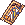Isis' Song ← Isis</td><td>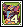Bastet Card, Piece of Free Soul 3</td></tr>
</tbody>
</table>

</section>

<section>

## รูปจากวิกิ

### NPC

<a href="https://wikimirror.lifeto.co/asset.103.ggftw.net/wiki/to-w/images/b/b4/Sandman.gif" rel="noopener" target="_blank">Sandmanขั้น 1–3 · Paradise ↗</a>
<a href="https://wikimirror.lifeto.co/wiki.ggftw.com/trickster/Homeless_Ian.html" rel="noopener" target="_blank">Homeless IanParadise ↗</a>
<a href="https://wikimirror.lifeto.co/wiki.ggftw.com/trickster/Bunny_Maid.html" rel="noopener" target="_blank">Bunny MaidParadise ↗</a>
<a href="https://wikimirror.lifeto.co/wiki.ggftw.com/trickster/Al-Hauri.html" rel="noopener" target="_blank">Al-HauriParadise Spa ↗</a>

### มอนสเตอร์

<a href="https://wikimirror.lifeto.co/wiki.ggftw.com/trickster/Sea_Scorpion.html" rel="noopener" target="_blank">Sea ScorpionLv 22 · หน้าวิกิ ↗</a>
<a href="https://wikimirror.lifeto.co/wiki.ggftw.com/trickster/Pineapple.html" rel="noopener" target="_blank">PineappleLv 24 · หน้าวิกิ ↗</a>
<a href="https://wikimirror.lifeto.co/wiki.ggftw.com/trickster/Hula_Octopus.html" rel="noopener" target="_blank">Hula OctopusLv 25 · หน้าวิกิ ↗</a>
<a href="https://wikimirror.lifeto.co/wiki.ggftw.com/trickster/Sand_Demon.html" rel="noopener" target="_blank">Sand DemonLv 28 · หน้าวิกิ ↗</a>

### แมพ

<a href="https://wikimirror.lifeto.co/asset.103.ggftw.net/wiki/to-w/images/2/29/Desert_Beach_Map.png" rel="noopener" target="_blank">แผนที่ Desert Beachทั้งโซน ↗</a>
<a href="https://wikimirror.lifeto.co/wiki.ggftw.com/trickster/Desert_Beach_Field_2_-_Sand_Palace.html" rel="noopener" target="_blank">Desert Beach Field 2 - Sand Palaceหน้าแมพ ↗</a>
<a href="https://wikimirror.lifeto.co/wiki.ggftw.com/trickster/Desert_Beach_Field_3_-_Statue_of_Anubis.html" rel="noopener" target="_blank">Desert Beach Field 3 - Statue of Anubisหน้าแมพ ↗</a>
<a href="https://wikimirror.lifeto.co/wiki.ggftw.com/trickster/Desert_Beach_Field_4_-_Parasol_River.html" rel="noopener" target="_blank">Desert Beach Field 4 - Parasol Riverหน้าแมพ ↗</a>

</section>

<PageBehavior />
