

<header style="display:flex;flex-direction:column;gap:8px">

# เควสกุญแจ Ghost Blue

สรุปจากวิกิ ggFTW (ฉบับ mirror ของ LifeTO) หน้า [Category: Ghost Blue Quest](https://wikimirror.lifeto.co/wiki.ggftw.com/trickster/Category_Ghost_Blue_Quest.html) และหน้าเควส/มอนที่ลิงก์ไป

</header>

<section>

## ภาพรวม

เควสกุญแจมี 4 ขั้น ทำกับ **Chief Koha** ที่ Ghost Blue Seabed Town - Aquarius และ **Shaman Girl Jia** ที่ Aquarius Shrine ต้องเลเวล 100+

- ต้องผ่าน **Mermaid Marin - Marin's Sister** และเก็บ **Adventurer's Book** ไว้ใช้ขั้น 3
- คุยกับ **Kochi** ที่ Gate of Ghost Blue เพื่อเปิดวาร์ป
- ขั้น 1 ต้องได้ **Ghost Sticker 10 ใบ** จากเควสธรรมดา

</section>

<section aria-live="polite" class="counter">

## ความคืบหน้า

0 Ghost Sticker ที่ควรมีตอนนี้

<button id="reset" type="button">ล้างทั้งหมด</button>

</section>

<section>

## ก่อนเริ่ม: Mermaid Marin - Marin's Sister

<label class="done"><input class="key" id="pre" type="checkbox"/> ทำแล้ว</label>

NPC: Mermaid MarinMermaid Palace Field 4 - Rock SquareLv 80+

เงื่อนไข: มีเควส <b>Captain Stan - Captain's Stan Past</b> อยู่ในสมุดเควส

<ul>
<li><b>Adventurer's Book</b> (ได้จาก Skipper Min - Min's Weakness ที่ Oops Wharf)</li>
<li><b>Tanya's Sword</b> ดรอปจาก <b>Tanya</b> (Lv 150) แมพ <b>Mermaid Dungeon 2 - Legend of the Sea</b></li>
</ul>

รางวัล: Tanya's Letter (เอาไปส่ง Captain Stan) และ <b>Adventurer's Book คืนมา</b> เก็บไว้ใช้ขั้นที่ 3

</section>

<section>

## เควสกุญแจ 4 ขั้น

<label class="done"><input class="key" id="k1" type="checkbox"/> ทำแล้ว</label>ขั้น 1<h3>Chief Koha - Ghost Blue Sticker</h3>

Ghost Blue Seabed Town - AquariusLv 100+หลังผ่าน Marin's Sister

ส่ง <b>Ghost Sticker × 10</b> (ดูตารางแหล่งสติ๊กเกอร์ด้านล่าง)

รางวัล: Herb Potion × 10, Gold Pearl Potion × 10

<label class="done"><input class="key" id="k2" type="checkbox"/> ทำแล้ว</label>ขั้น 2<h3>Chief Koha - Collect Ritual Supplies</h3>

Aquariusหลังผ่านขั้น 1

<ul>
<li><b>Pure Water × 3</b> ขุดใน Seabed Fields (มีในตารางขุดของ Seabed Field 1 - North และ 4 - Undersea Grave)</li>
<li><b>Whale Essence × 3</b> ขุดใน <b>Seabed Field 1 - North</b></li>
<li><b>Dead Man's Incense × 3</b> ดรอปจาก <b>Merrow</b> (Lv 118) แมพ Seabed Field 3 - Undersea Park / Seabed Field 4 - Undersea Grave</li>
</ul>

รางวัล: 10,000 Galder Coupon · ทั้ง Seabed Field 1 และ 4 ขุดที่ความลึก 80–100 m ดินหิน (Rock)

<label class="done"><input class="key" id="k3" type="checkbox"/> ทำแล้ว</label>ขั้น 3<h3>Chief Koha - Get a Date</h3>

Aquariusหลังผ่านขั้น 2

ส่ง <b>Jia's Pouch</b> (ได้จากขั้น 4) และ <b>Adventurer's Book</b> (จาก Marin's Sister) รับเควสนี้ค้างไว้ก่อน แล้วไปทำขั้น 4

รางวัล: Adventurer's Book คืน, Wep Exchange Ticket E

<label class="done"><input class="key" id="k4" type="checkbox"/> ทำแล้ว</label>ขั้น 4<h3>Shaman Girl Jia - Collect the Changed Spirits</h3>

Aquarius Shrineต้องมี Get a Date ค้างในสมุดเควส

ส่ง <b>Ghost Blue Spirit × 5</b> ดรอปจาก <b>Pirate Ghost</b> (Lv 121) แมพ <b>Seabed Field 4 - Undersea Grave</b>

รางวัล: Jia's Pouch, Jia's Amulet → เอา Jia's Pouch กลับไปส่ง Chief Koha ปิดขั้น 3

</section>

<section>

## เควสที่ให้ Ghost Sticker

ต้องการ 10 ใบ

เส้นทางแนะนำ 11 เควสติด ★ อยู่แถว Seabed Field ไม่ต้องลง Nora Sewer

<button aria-pressed="false" id="hideUnstar" type="button">ซ่อนเควสที่ไม่ติดดาว</button><button hidden="" id="showAll" type="button">แสดงทั้งหมด</button>

<table>
<thead><tr><th>ครบ 5 รอบ</th><th>เควส</th><th>รอบ</th><th>ที่อยู่</th><th>NPC</th><th>เงื่อนไข</th><th>ของที่ต้องส่ง และแหล่ง</th></tr></thead>
<tbody>
<tr><td><input aria-label="ทำเควสนี้ครบแล้ว" class="stk" id="stk3" type="checkbox"/></td><td>★ Officer Robert - Help Transport the Cash Box</td><td class="n">5</td><td>Aquarius</td><td>Officer Robert</td><td>มี Lisa's 2nd ค้างอยู่</td><td>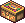Cash Box ← Bad Anemone Lv 116 (Seabed Field 1)</td></tr>
<tr><td><input aria-label="ทำเควสนี้ครบแล้ว" class="stk" id="stk9" type="checkbox"/></td><td>★ Sissy Viole - Viole's Violin</td><td class="n">5</td><td>Aquarius</td><td>Sissy Viole</td><td>Lv 95+</td><td>Whale Sinew × 3 ← Siremaid Lv 120 (Seabed Field 4) + Heavenly Melody Potion (รางวัลจากเควส Paul)</td></tr>
<tr><td><input aria-label="ทำเควสนี้ครบแล้ว" class="stk" id="stk12" type="checkbox"/></td><td>La Vida - La Vida's Treasure Map 3</td><td class="n">5</td><td>Aquarius</td><td>La Vida</td><td>ผ่าน Treasure Map 2 (Mermaid Palace)</td><td>Fragmented Map 3 ← ขุดใน Seabed Fields</td></tr>
<tr><td><input aria-label="ทำเควสนี้ครบแล้ว" class="stk" id="stk8" type="checkbox"/></td><td>★ Compounder Paul - Help Paul with his New Study</td><td class="n">5</td><td>Gate of Ghost Blue</td><td>Compounder Paul</td><td>Lv 95+</td><td>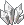Crystal × 2 ← ขุดใน Seabed Fields · Light Pink Coral × 2 ← <b>Popeyed Anemone</b> Lv 105 (Seabed Field 1) · Mermaid's Feather × 2 ← <b>Siremaid</b> Lv 120 (Seabed Field 4)</td></tr>
<tr class="pre-row"><td><input aria-label="ทำขั้นนี้ครบแล้ว" class="pre" id="gp1" type="checkbox"/></td><td>★ Genius Cochma - Ghost Blue Survey - 1 ขั้นก่อนหน้า · ไม่ได้สติ๊กเกอร์</td><td class="n">5</td><td>Gate of Ghost Blue</td><td>Genius Cochma</td><td>รวม 75 ตัว</td><td>ล่า <b>Armor Squirt</b> Lv 108 × 15 ตัวภายใน 10 นาที (Seabed Field 1, 2) · 5 รอบ</td></tr>
<tr class="pre-row"><td><input aria-label="ทำขั้นนี้ครบแล้ว" class="pre" id="gp2" type="checkbox"/></td><td>★ Genius Cochma - Ghost Blue Survey - 2 ขั้นก่อนหน้า · ไม่ได้สติ๊กเกอร์</td><td class="n">5</td><td>Gate of Ghost Blue</td><td>Genius Cochma</td><td>รวม 25</td><td>Black Gunpowder × 5 ← <b>Torpedo Fish</b> Lv 112 (Seabed Field 2, 3) · 5 รอบ</td></tr>
<tr class="pre-row"><td><input aria-label="ทำขั้นนี้ครบแล้ว" class="pre" id="gp3" type="checkbox"/></td><td>★ Genius Cochma - Ghost Blue Survey - 3 ขั้นก่อนหน้า · ไม่ได้สติ๊กเกอร์</td><td class="n">5</td><td>Gate of Ghost Blue</td><td>Genius Cochma</td><td>รวม 25</td><td>Hair Curling Iron × 5 ← <b>Cora Pyupyu</b> Lv 115 (Seabed Field 2, 3) · 5 รอบ</td></tr>
<tr><td><input aria-label="ทำเควสนี้ครบแล้ว" class="stk" id="stk10" type="checkbox"/></td><td>★ Genius Cochma - Ghost Blue Survey - 4</td><td class="n">5</td><td>Gate of Ghost Blue</td><td>Genius Cochma</td><td>ทำ Survey 1–3 ก่อน (แถวสีอ่อนด้านบน)</td><td>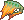Merrow's Trunk × 5 ← <b>Merrow</b> Lv 118 (Seabed Field 3, 4)</td></tr>
<tr class="pre-row"><td><input aria-label="ทำขั้นนี้ครบแล้ว" class="pre" id="gp8" type="checkbox"/></td><td>Lethos - Nora Tribe Research - 1 ขั้นก่อนหน้า · ไม่ได้สติ๊กเกอร์</td><td class="n">5</td><td>Nora Sewer</td><td>Lethos</td><td>รวม 25</td><td>Copper Nora Stone × 5 ← ขุดใน Nora Sewer · 5 รอบ</td></tr>
<tr class="pre-row"><td><input aria-label="ทำขั้นนี้ครบแล้ว" class="pre" id="gp9" type="checkbox"/></td><td>Lethos - Nora Tribe Research - 2 ขั้นก่อนหน้า · ไม่ได้สติ๊กเกอร์</td><td class="n">5</td><td>Nora Sewer</td><td>Lethos</td><td>รวม 25</td><td>Bronze Nora Stone × 5 ← Nora Joe Lv 126 · 5 รอบ</td></tr>
<tr class="pre-row"><td><input aria-label="ทำขั้นนี้ครบแล้ว" class="pre" id="gp10" type="checkbox"/></td><td>Lethos - Nora Tribe Research - 3 ขั้นก่อนหน้า · ไม่ได้สติ๊กเกอร์</td><td class="n">5</td><td>Nora Sewer</td><td>Lethos</td><td>รวม 25</td><td>Silver Nora Stone × 5 ← Nora Mummy Lv 132 · 5 รอบ</td></tr>
<tr><td><input aria-label="ทำเควสนี้ครบแล้ว" class="stk" id="stk14" type="checkbox"/></td><td>Lethos - Nora Tribe Research - 4</td><td class="n">5</td><td>Nora Sewer</td><td>Lethos</td><td>ทำ Research 1–3 ก่อน</td><td>Gold Nora Stone × 5 ← <b>Nora Big</b> Lv 144 (Nora Sewer)</td></tr>
<tr class="pre-row"><td><input aria-label="ทำขั้นนี้ครบแล้ว" class="pre" id="gp11" type="checkbox"/></td><td>Monkey T - Business Proposal 1 ขั้นก่อนหน้า · ไม่ได้สติ๊กเกอร์</td><td class="n">5</td><td>Nora Sewer</td><td>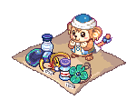Monkey T</td><td>รวม 3</td><td>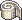Nora Bandage × 3 ← Nora Mummy Lv 132 · วิกิเขียนว่า 5 รอบแต่ส่งครั้งเดียว</td></tr>
<tr><td><input aria-label="ทำเควสนี้ครบแล้ว" class="stk" id="stk15" type="checkbox"/></td><td>Monkey T - Business Proposal 2</td><td class="n">5</td><td>Nora Sewer</td><td>Monkey T</td><td>ผ่าน Business Proposal 1</td><td>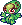Nora Doll × 3 ← Nora Mummy Lv 132 / Nora Big Lv 144 (Nora Sewer)</td></tr>
<tr class="pre-row"><td><input aria-label="ทำขั้นนี้ครบแล้ว" class="pre" id="gp12" type="checkbox"/></td><td>Weepy Nora - Feed Nora Ron ขั้นก่อนหน้า · ไม่ได้สติ๊กเกอร์</td><td class="n">5</td><td>Nora Sewer</td><td>Weepy Nora</td><td>รวม 5 ต่อสี</td><td>R, Y, B, P, 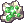G Stone ← ขุดใน Nora Sewer · 5 รอบ (ไม่บอกจำนวน นับสีละ 1)</td></tr>
<tr><td><input aria-label="ทำเควสนี้ครบแล้ว" class="stk" id="stk16" type="checkbox"/></td><td>Weepy Nora - Returning to the Nora</td><td class="n">5</td><td>Nora Sewer</td><td>Weepy Nora</td><td>ผ่าน Feed Nora Ron</td><td>Kryptonite × 2 ← ขุดใน Nora Sewer</td></tr>
<tr><td><input aria-label="ทำเควสนี้ครบแล้ว" class="stk" id="stk1" type="checkbox"/></td><td>★ Banker Lisa - Lisa's 1st Urgent Request</td><td class="n">5</td><td>Seabed Field 1 - North</td><td>Banker Lisa</td><td>Lv 95+</td><td>Cash Box ← <b>Bad Anemone</b> Lv 116 (Seabed Field 1)</td></tr>
<tr><td><input aria-label="ทำเควสนี้ครบแล้ว" class="stk" id="stk2" type="checkbox"/></td><td>★ Banker Lisa - Lisa's 2nd Urgent Request</td><td class="n">5</td><td>Seabed Field 1 - North</td><td>Banker Lisa</td><td>ผ่าน 1st</td><td>Cash Box + Robert's Receipt (จากเควส Officer Robert)</td></tr>
<tr><td><input aria-label="ทำเควสนี้ครบแล้ว" class="stk" id="stk4" type="checkbox"/></td><td>★ Favian - Devoted Favian</td><td class="n">5</td><td>Seabed Field 1 - North</td><td>Favian</td><td>Lv 95+</td><td>Cash Box ← Bad Anemone Lv 116 (Seabed Field 1)</td></tr>
<tr><td><input aria-label="ทำเควสนี้ครบแล้ว" class="stk" id="stk6" type="checkbox"/></td><td>★ Favian - Romantic Favian</td><td class="n">5</td><td>Seabed Field 1 - North</td><td>Favian</td><td>ผ่าน Vinosh</td><td>Premium Wine ← ขุดใน Seabed Fields</td></tr>
<tr><td><input aria-label="ทำเควสนี้ครบแล้ว" class="stk" id="stk7" type="checkbox"/></td><td>★ Favian - Favian's Helm</td><td class="n">5</td><td>Seabed Field 1 - North</td><td>Favian</td><td>ผ่าน Romantic Favian</td><td>Monguse Helmet × 5 ← <b>Armor Squirt</b> Lv 108 (Seabed Field 1, 2)</td></tr>
<tr class="pre-row"><td><input aria-label="ทำขั้นนี้ครบแล้ว" class="pre" id="gp5" type="checkbox"/></td><td>Frog Shaman - Ghost Blue Magic - 1 ขั้นก่อนหน้า · ไม่ได้สติ๊กเกอร์</td><td class="n">5</td><td>Seabed Field 2</td><td>Frog Shaman</td><td>รวม 25</td><td>Merrow's Gills × 5 ← Merrow Lv 118 (Seabed Field 3, 4) · 5 รอบ</td></tr>
<tr class="pre-row"><td><input aria-label="ทำขั้นนี้ครบแล้ว" class="pre" id="gp6" type="checkbox"/></td><td>Frog Shaman - Ghost Blue Magic - 2 ขั้นก่อนหน้า · ไม่ได้สติ๊กเกอร์</td><td class="n">5</td><td>Seabed Field 2</td><td>Frog Shaman</td><td>รวม 25</td><td>Maid's Scales × 5 ← Siremaid Lv 120 (Seabed Field 4) · 5 รอบ</td></tr>
<tr class="pre-row"><td><input aria-label="ทำขั้นนี้ครบแล้ว" class="pre" id="gp7" type="checkbox"/></td><td>Frog Shaman - Ghost Blue Magic - 3 ขั้นก่อนหน้า · ไม่ได้สติ๊กเกอร์</td><td class="n">5</td><td>Seabed Field 2</td><td>Frog Shaman</td><td>รวม 25</td><td>Transparent Cloth × 5 ← Pirate Ghost Lv 121 (Seabed Field 4) · 5 รอบ</td></tr>
<tr><td><input aria-label="ทำเควสนี้ครบแล้ว" class="stk" id="stk13" type="checkbox"/></td><td>Frog Shaman - Ghost Blue Magic - 4</td><td class="n">5</td><td>Seabed Field 2 - East</td><td>Frog Shaman</td><td>ทำ Magic 1–3 ก่อน</td><td>Nora's Reed × 5 ← <b>Nora Joe</b> Lv 126 (Nora Sewer)</td></tr>
<tr><td><input aria-label="ทำเควสนี้ครบแล้ว" class="stk" id="stk5" type="checkbox"/></td><td>★ Vinosh - Vinosh's Sleepwalking Med</td><td class="n">5</td><td>Seabed Field 3 - Undersea Park</td><td>Vinosh</td><td>ผ่าน Devoted Favian</td><td>Cure for Sleepwalking ← <b>Pirate Ghost</b> Lv 121 (Seabed Field 4)</td></tr>
<tr class="pre-row"><td><input aria-label="ทำขั้นนี้ครบแล้ว" class="pre" id="gp4" type="checkbox"/></td><td>★ Lethos - Beat Lethos ขั้นก่อนหน้า · ไม่ได้สติ๊กเกอร์</td><td class="n">1</td><td>Seabed Field 4</td><td>Lethos</td><td>รวม 25 ตัว</td><td>ล่า Armor Squirt Lv 108 × 25 ตัวภายใน 10 นาที (Seabed Field 1, 2) · รอบเดียว</td></tr>
<tr><td><input aria-label="ทำเควสนี้ครบแล้ว" class="stk" id="stk11" type="checkbox"/></td><td>★ Lethos - Collect Steel Pieces and Hook</td><td class="n">5</td><td>Seabed Field 4 - Undersea Grave</td><td>Lethos</td><td>ผ่าน Beat Lethos</td><td>Steel Piece × 5 ← <b>Torpedo Fish</b> Lv 112 (Seabed Field 2, 3) · Hook × 5 ← Pirate Ghost Lv 121 (Seabed Field 4)</td></tr>
</tbody>
</table>

Weepy Nora - Feed Nora Ron ต้องผ่าน Third Eye Nora Ron's Request ก่อน · เควสเหล่านี้ให้ 500 Galder Coupon และ Herb / Gold Pearl Potion

</section>

<section>

## จุดขุดและมอน เรียงตามแมพ

<table>
<thead><tr><th>ครบแล้ว</th><th>แมพ</th><th>ขุด / มอน</th><th>ไอเทม</th><th>จำนวนรวม</th><th>ใช้ในเควส</th></tr></thead>
<tbody>
<tr class="mon-row" data-q='[["gp8", 25, "Lethos Nora Research 1 (5 × 5 รอบ)", 0]]'><td><input aria-label="หาครบแล้ว" class="mon" id="gm8" type="checkbox"/></td><td>Nora Sewer</td><td>ขุด</td><td>Copper Nora Stone</td><td class="n">25</td><td>Lethos Nora Research 1 (5 × 5 รอบ)</td></tr>
<tr class="mon-row" data-q='[["gp12", 5, "Weepy Nora Feed Nora Ron", 0]]' data-unit="ต่อสี"><td><input aria-label="หาครบแล้ว" class="mon" id="gm9" type="checkbox"/></td><td>Nora Sewer</td><td>ขุด</td><td>R, Y, B, P, G Stone</td><td class="n">5 ต่อสี</td><td>Weepy Nora Feed Nora Ron</td></tr>
<tr class="mon-row" data-q='[["stk16", 10, "Weepy Nora (2 × 5 รอบ)", 0]]'><td><input aria-label="หาครบแล้ว" class="mon" id="gm10" type="checkbox"/></td><td>Nora Sewer</td><td>ขุด</td><td>Kryptonite</td><td class="n">10</td><td>Weepy Nora (2 × 5 รอบ)</td></tr>
<tr class="mon-row" data-q='[["k2", 3, "ขั้น 2", 0]]'><td><input aria-label="หาครบแล้ว" class="mon" id="gm16" type="checkbox"/></td><td>★ Seabed Field 1 - North</td><td>ขุด</td><td>Whale Essence</td><td class="n">3</td><td>ขั้น 2</td></tr>
<tr class="mon-row" data-q='[["k2", 3, "ขั้น 2", 0]]'><td><input aria-label="หาครบแล้ว" class="mon" id="gm17" type="checkbox"/></td><td>★ Seabed Field 1 - North (+ Field 4)</td><td>ขุด</td><td>Pure Water</td><td class="n">3</td><td>ขั้น 2</td></tr>
<tr class="mon-row" data-q='[["stk8", 10, "Compounder Paul (2 × 5 รอบ)", 0]]'><td><input aria-label="หาครบแล้ว" class="mon" id="gm18" type="checkbox"/></td><td>★ Seabed Field 1 - North (+ Field 4)</td><td>ขุด</td><td>Crystal</td><td class="n">10</td><td>Compounder Paul (2 × 5 รอบ)</td></tr>
<tr class="mon-row" data-q='[["stk6", 5, "Romantic Favian (1 × 5 รอบ)", 0]]'><td><input aria-label="หาครบแล้ว" class="mon" id="gm19" type="checkbox"/></td><td>★ Seabed Field 1 - North (+ Field 4)</td><td>ขุด</td><td>Premium Wine</td><td class="n">5</td><td>Romantic Favian (1 × 5 รอบ)</td></tr>
<tr class="mon-row" data-q='[["stk12", 5, "La Vida Treasure Map 3 (1 × 5 รอบ)", 0]]'><td><input aria-label="หาครบแล้ว" class="mon" id="gm20" type="checkbox"/></td><td>Seabed Field 1 - North (+ Field 4)</td><td>ขุด</td><td>Fragmented Map 3</td><td class="n">5</td><td>La Vida Treasure Map 3 (1 × 5 รอบ)</td></tr>
<tr class="mon-row" data-q="[[&quot;pre&quot;, 1, &quot;Marin's Sister (ก่อนเริ่ม)&quot;, 0]]"><td><input aria-label="หาครบแล้ว" class="mon" id="gm1" type="checkbox"/></td><td>Mermaid Dungeon 2 - Legend of the Sea</td><td>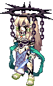Tanya (Lv 150)</td><td>Tanya's Sword</td><td class="n">1</td><td>Marin's Sister (ก่อนเริ่ม)</td></tr>
<tr class="mon-row" data-q='[["stk13", 25, "Frog Shaman Magic 4 (5 × 5 รอบ)", 0]]'><td><input aria-label="หาครบแล้ว" class="mon" id="gm2" type="checkbox"/></td><td>Nora Sewer</td><td>Nora Joe (Lv 126)</td><td>Nora's Reed</td><td class="n">25</td><td>Frog Shaman Magic 4 (5 × 5 รอบ)</td></tr>
<tr class="mon-row" data-q='[["stk14", 25, "Lethos Nora Research 4 (5 × 5 รอบ)", 0]]'><td><input aria-label="หาครบแล้ว" class="mon" id="gm3" type="checkbox"/></td><td>Nora Sewer</td><td>Nora Big (Lv 144)</td><td>Gold Nora Stone</td><td class="n">25</td><td>Lethos Nora Research 4 (5 × 5 รอบ)</td></tr>
<tr class="mon-row" data-q='[["stk15", 15, "Monkey T Business Proposal 2 (3 × 5 รอบ)", 0]]'><td><input aria-label="หาครบแล้ว" class="mon" id="gm4" type="checkbox"/></td><td>Nora Sewer</td><td>Nora Mummy (Lv 132) / Nora Big (Lv 144)</td><td>Nora Doll</td><td class="n">15</td><td>Monkey T Business Proposal 2 (3 × 5 รอบ)</td></tr>
<tr class="mon-row" data-q='[["gp9", 25, "Lethos Nora Research 2 (5 × 5 รอบ)", 0]]'><td><input aria-label="หาครบแล้ว" class="mon" id="gm5" type="checkbox"/></td><td>Nora Sewer</td><td>Nora Joe (Lv 126)</td><td>Bronze Nora Stone</td><td class="n">25</td><td>Lethos Nora Research 2 (5 × 5 รอบ)</td></tr>
<tr class="mon-row" data-q='[["gp10", 25, "Lethos Nora Research 3 (5 × 5 รอบ)", 0]]'><td><input aria-label="หาครบแล้ว" class="mon" id="gm6" type="checkbox"/></td><td>Nora Sewer</td><td>Nora Mummy (Lv 132)</td><td>Silver Nora Stone</td><td class="n">25</td><td>Lethos Nora Research 3 (5 × 5 รอบ)</td></tr>
<tr class="mon-row" data-q='[["gp11", 3, "Monkey T Business Proposal 1", 0]]'><td><input aria-label="หาครบแล้ว" class="mon" id="gm7" type="checkbox"/></td><td>Nora Sewer</td><td>Nora Mummy (Lv 132)</td><td>Nora Bandage</td><td class="n">3</td><td>Monkey T Business Proposal 1</td></tr>
<tr class="mon-row" data-q='[["stk1", 5, "Lisa 1st (1 × 5 รอบ)", 0], ["stk2", 5, "Lisa 2nd (1 × 5 รอบ)", 0], ["stk3", 5, "Officer Robert (1 × 5 รอบ)", 0], ["stk4", 5, "Devoted Favian (1 × 5 รอบ)", 0]]'><td><input aria-label="หาครบแล้ว" class="mon" id="gm11" type="checkbox"/></td><td>★ Seabed Field 1 - North</td><td>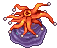Bad Anemone (Lv 116)</td><td>Cash Box</td><td class="n">20</td><td>Lisa 1st, Lisa 2nd, Officer Robert, Devoted Favian (1 × 5 รอบ × 4 เควส)</td></tr>
<tr class="mon-row" data-q='[["stk8", 10, "Compounder Paul (2 × 5 รอบ)", 0]]'><td><input aria-label="หาครบแล้ว" class="mon" id="gm12" type="checkbox"/></td><td>★ Seabed Field 1 - North</td><td>Popeyed Anemone (Lv 105)</td><td>Light Pink Coral</td><td class="n">10</td><td>Compounder Paul (2 × 5 รอบ)</td></tr>
<tr class="mon-row" data-q="[[&quot;stk7&quot;, 25, &quot;Favian's Helm (5 × 5 รอบ)&quot;, 0]]"><td><input aria-label="หาครบแล้ว" class="mon" id="gm13" type="checkbox"/></td><td>★ Seabed Field 1 - North (+ Field 2)</td><td>Armor Squirt (Lv 108)</td><td>Monguse Helmet</td><td class="n">25</td><td>Favian's Helm (5 × 5 รอบ)</td></tr>
<tr class="mon-row" data-q='[["gp1", 75, "Cochma Survey 1 (15 ตัวใน 10 นาที × 5 รอบ)", 0]]' data-unit="ตัว"><td><input aria-label="หาครบแล้ว" class="mon" id="gm14" type="checkbox"/></td><td>★ Seabed Field 1 - North (+ Field 2)</td><td>Armor Squirt (Lv 108)</td><td>ล่า (ไม่ต้องเก็บของ)</td><td class="n">75 ตัว</td><td>Cochma Survey 1 (15 ตัวใน 10 นาที × 5 รอบ)</td></tr>
<tr class="mon-row" data-q='[["gp4", 25, "Beat Lethos (25 ตัวใน 10 นาที รอบเดียว)", 0]]' data-unit="ตัว"><td><input aria-label="หาครบแล้ว" class="mon" id="gm15" type="checkbox"/></td><td>★ Seabed Field 1 - North (+ Field 2)</td><td>Armor Squirt (Lv 108)</td><td>ล่า (ไม่ต้องเก็บของ)</td><td class="n">25 ตัว</td><td>Beat Lethos (25 ตัวใน 10 นาที รอบเดียว)</td></tr>
<tr class="mon-row" data-q='[["stk11", 25, "Lethos Steel Pieces and Hook (5 × 5 รอบ)", 0]]'><td><input aria-label="หาครบแล้ว" class="mon" id="gm21" type="checkbox"/></td><td>★ Seabed Field 2 - East (+ Field 3)</td><td>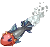Torpedo Fish (Lv 112)</td><td>Steel Piece</td><td class="n">25</td><td>Lethos Steel Pieces and Hook (5 × 5 รอบ)</td></tr>
<tr class="mon-row" data-q='[["gp2", 25, "Cochma Survey 2 (5 × 5 รอบ)", 0]]'><td><input aria-label="หาครบแล้ว" class="mon" id="gm22" type="checkbox"/></td><td>★ Seabed Field 2 - East (+ Field 3)</td><td>Torpedo Fish (Lv 112)</td><td>Black Gunpowder</td><td class="n">25</td><td>Cochma Survey 2 (5 × 5 รอบ)</td></tr>
<tr class="mon-row" data-q='[["gp3", 25, "Cochma Survey 3 (5 × 5 รอบ)", 0]]'><td><input aria-label="หาครบแล้ว" class="mon" id="gm23" type="checkbox"/></td><td>★ Seabed Field 2 - East (+ Field 3)</td><td>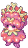Cora Pyupyu (Lv 115)</td><td>Hair Curling Iron</td><td class="n">25</td><td>Cochma Survey 3 (5 × 5 รอบ)</td></tr>
<tr class="mon-row" data-q='[["k2", 3, "ขั้น 2", 0]]'><td><input aria-label="หาครบแล้ว" class="mon" id="gm24" type="checkbox"/></td><td>★ Seabed Field 3 - Undersea Park (+ Field 4)</td><td>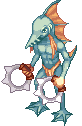Merrow (Lv 118)</td><td>Dead Man's Incense</td><td class="n">3</td><td>ขั้น 2</td></tr>
<tr class="mon-row" data-q='[["stk10", 25, "Genius Cochma Survey 4 (5 × 5 รอบ)", 0]]'><td><input aria-label="หาครบแล้ว" class="mon" id="gm25" type="checkbox"/></td><td>★ Seabed Field 3 - Undersea Park (+ Field 4)</td><td>Merrow (Lv 118)</td><td>Merrow's Trunk</td><td class="n">25</td><td>Genius Cochma Survey 4 (5 × 5 รอบ)</td></tr>
<tr class="mon-row" data-q='[["gp5", 25, "Frog Shaman Magic 1 (5 × 5 รอบ)", 0]]'><td><input aria-label="หาครบแล้ว" class="mon" id="gm26" type="checkbox"/></td><td>Seabed Field 3 - Undersea Park (+ Field 4)</td><td>Merrow (Lv 118)</td><td>Merrow's Gills</td><td class="n">25</td><td>Frog Shaman Magic 1 (5 × 5 รอบ)</td></tr>
<tr class="mon-row" data-q='[["k4", 5, "ขั้น 4", 0]]'><td><input aria-label="หาครบแล้ว" class="mon" id="gm27" type="checkbox"/></td><td>★ Seabed Field 4 - Undersea Grave</td><td>Pirate Ghost (Lv 121)</td><td>Ghost Blue Spirit</td><td class="n">5</td><td>ขั้น 4</td></tr>
<tr class="mon-row" data-q='[["stk11", 25, "Lethos Steel Pieces and Hook (5 × 5 รอบ)", 0]]'><td><input aria-label="หาครบแล้ว" class="mon" id="gm28" type="checkbox"/></td><td>★ Seabed Field 4 - Undersea Grave</td><td>Pirate Ghost (Lv 121)</td><td>Hook</td><td class="n">25</td><td>Lethos Steel Pieces and Hook (5 × 5 รอบ)</td></tr>
<tr class="mon-row" data-q='[["gp7", 25, "Frog Shaman Magic 3 (5 × 5 รอบ)", 0]]'><td><input aria-label="หาครบแล้ว" class="mon" id="gm29" type="checkbox"/></td><td>Seabed Field 4 - Undersea Grave</td><td>Pirate Ghost (Lv 121)</td><td>Transparent Cloth</td><td class="n">25</td><td>Frog Shaman Magic 3 (5 × 5 รอบ)</td></tr>
<tr class="mon-row" data-q='[["stk5", 5, "Vinosh (1 × 5 รอบ)", 0]]'><td><input aria-label="หาครบแล้ว" class="mon" id="gm30" type="checkbox"/></td><td>★ Seabed Field 4 - Undersea Grave</td><td>Pirate Ghost (Lv 121)</td><td>Cure for Sleepwalking</td><td class="n">5</td><td>Vinosh (1 × 5 รอบ)</td></tr>
<tr class="mon-row" data-q='[["stk8", 10, "Compounder Paul (2 × 5 รอบ)", 0]]'><td><input aria-label="หาครบแล้ว" class="mon" id="gm31" type="checkbox"/></td><td>★ Seabed Field 4 - Undersea Grave</td><td>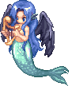Siremaid (Lv 120)</td><td>Mermaid's Feather</td><td class="n">10</td><td>Compounder Paul (2 × 5 รอบ)</td></tr>
<tr class="mon-row" data-q='[["stk9", 15, "Sissy Viole (3 × 5 รอบ)", 0]]'><td><input aria-label="หาครบแล้ว" class="mon" id="gm32" type="checkbox"/></td><td>★ Seabed Field 4 - Undersea Grave</td><td>Siremaid (Lv 120)</td><td>Whale Sinew</td><td class="n">15</td><td>Sissy Viole (3 × 5 รอบ)</td></tr>
<tr class="mon-row" data-q='[["gp6", 25, "Frog Shaman Magic 2 (5 × 5 รอบ)", 0]]'><td><input aria-label="หาครบแล้ว" class="mon" id="gm33" type="checkbox"/></td><td>Seabed Field 4 - Undersea Grave</td><td>Siremaid (Lv 120)</td><td>Maid's Scales</td><td class="n">25</td><td>Frog Shaman Magic 2 (5 × 5 รอบ)</td></tr>
</tbody>
</table>

* ไม่ทราบจำนวนต่อรอบ · Robert's Receipt และ Heavenly Melody Potion ได้จากเควสอื่น

</section>

<section>

## รูปจากวิกิ

### NPC

<a href="https://wikimirror.lifeto.co/asset.103.ggftw.net/wiki/to-w/images/0/02/Chief_Koha.gif" rel="noopener" target="_blank">Chief Kohaขั้น 1–3 · Aquarius ↗</a>
<a href="https://wikimirror.lifeto.co/asset.103.ggftw.net/wiki/to-w/images/6/6b/Shaman_Girl_Jia.gif" rel="noopener" target="_blank">Shaman Girl Jiaขั้น 4 · Aquarius Shrine ↗</a>
<a href="https://wikimirror.lifeto.co/asset.103.ggftw.net/wiki/to-w/images/6/6f/Mermaid_Marin.gif" rel="noopener" target="_blank">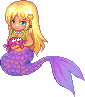Mermaid Marinเควสก่อนเริ่ม ↗</a>

### มอนสเตอร์

<a href="https://wikimirror.lifeto.co/asset.103.ggftw.net/wiki/to-w/images/f/f0/Pirate_Ghost_big.png" rel="noopener" target="_blank">Pirate GhostLv 121 ↗</a>
<a href="https://wikimirror.lifeto.co/asset.103.ggftw.net/wiki/to-w/images/b/b6/Merrow.gif" rel="noopener" target="_blank">MerrowLv 118 ↗</a>
<a href="https://wikimirror.lifeto.co/asset.103.ggftw.net/wiki/to-w/images/c/ce/Siremaid.gif" rel="noopener" target="_blank">SiremaidLv 120 ↗</a>
<a href="https://wikimirror.lifeto.co/asset.103.ggftw.net/wiki/to-w/images/c/c2/Popeyed_Anemone_big.png" rel="noopener" target="_blank">Popeyed AnemoneLv 105 ↗</a>
<a href="https://wikimirror.lifeto.co/asset.103.ggftw.net/wiki/to-w/images/7/72/Armor_Squirt_big.png" rel="noopener" target="_blank">Armor SquirtLv 108 ↗</a>
<a href="https://wikimirror.lifeto.co/asset.103.ggftw.net/wiki/to-w/images/f/f2/Torpedo_Fish_big.png" rel="noopener" target="_blank">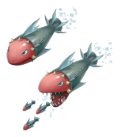Torpedo FishLv 112 ↗</a>
<a href="https://wikimirror.lifeto.co/wiki.ggftw.com/trickster/Cora_Pyupyu.html" rel="noopener" target="_blank">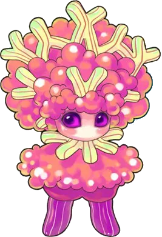Cora PyupyuLv 115 · หน้าวิกิ ↗</a>
<a href="https://wikimirror.lifeto.co/asset.103.ggftw.net/wiki/to-w/images/7/7c/Nora_Joe_big.png" rel="noopener" target="_blank">Nora JoeLv 126 ↗</a>
<a href="https://wikimirror.lifeto.co/asset.103.ggftw.net/wiki/to-w/images/d/dc/Tanya2_big.png" rel="noopener" target="_blank">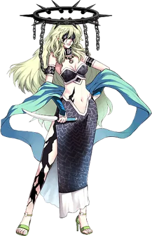TanyaLv 150 ↗</a>
<a href="https://wikimirror.lifeto.co/wiki.ggftw.com/trickster/Bad_Anemone.html" rel="noopener" target="_blank">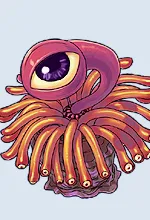Bad AnemoneLv 116 · หน้าวิกิ ↗</a>

### แมพ

<a href="https://wikimirror.lifeto.co/asset.103.ggftw.net/wiki/to-w/images/0/08/Ghost_Blue_Map.png" rel="noopener" target="_blank">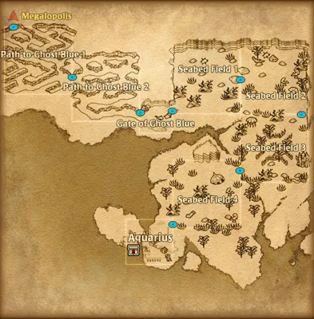แผนที่ Ghost Blueทั้งโซน ↗</a>
<a href="https://wikimirror.lifeto.co/asset.103.ggftw.net/wiki/to-w/images/2/24/Ghost_Blue_Seabed_Town_-_Aquarius.png" rel="noopener" target="_blank">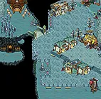Aquariusเมือง ↗</a>
<a href="https://wikimirror.lifeto.co/asset.103.ggftw.net/wiki/to-w/images/e/ef/Aquarius_Shrine.png" rel="noopener" target="_blank">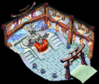Aquarius Shrineที่อยู่ Jia ↗</a>
<a href="https://wikimirror.lifeto.co/wiki.ggftw.com/trickster/Seabed_Field_1_-_North.html" rel="noopener" target="_blank">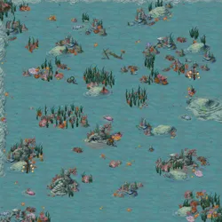Seabed Field 1 - Northหน้าแมพ ↗</a>
<a href="https://wikimirror.lifeto.co/wiki.ggftw.com/trickster/Seabed_Field_4_-_Undersea_Grave.html" rel="noopener" target="_blank">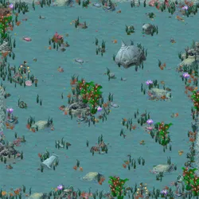Seabed Field 4 - Undersea Graveหน้าแมพ ↗</a>
<a href="https://wikimirror.lifeto.co/wiki.ggftw.com/trickster/Gate_of_Ghost_Blue.html" rel="noopener" target="_blank">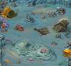Gate of Ghost Blueหน้าแมพ ↗</a>
<a href="https://wikimirror.lifeto.co/wiki.ggftw.com/trickster/Seabed_Field_2_-_East.html" rel="noopener" target="_blank">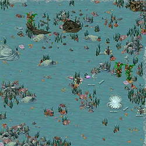Seabed Field 2 - Eastหน้าแมพ ↗</a>
<a href="https://wikimirror.lifeto.co/wiki.ggftw.com/trickster/Seabed_Field_3_-_Undersea_Park.html" rel="noopener" target="_blank">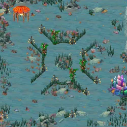Seabed Field 3 - Undersea Parkหน้าแมพ ↗</a>
<a href="https://wikimirror.lifeto.co/wiki.ggftw.com/trickster/Nora_Sewer.html" rel="noopener" target="_blank">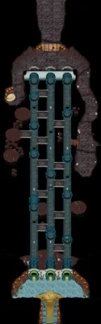Nora Sewerหน้าแมพ ↗</a>

### ไอเท็มเควสกุญแจ

<a href="https://wikimirror.lifeto.co/asset.103.ggftw.net/wiki/to-w/images/b/b9/Shard_of_Spirit.gif" rel="noopener" target="_blank">Ghost Blue Spiritขั้น 4 ↗</a>
<a href="https://wikimirror.lifeto.co/asset.103.ggftw.net/wiki/to-w/images/0/06/Incense_Burner.gif" rel="noopener" target="_blank">Dead Man's Incenseขั้น 2 ↗</a>

</section>

<PageBehavior />
