

<header style="display:flex;flex-direction:column;gap:8px">

# เควสกุญแจ Megalopolis

สรุปจากวิกิ ggFTW (ฉบับ mirror ของ LifeTO) หน้า [Scared Poppuri - Scared Poppuri's Concern](https://wikimirror.lifeto.co/wiki.ggftw.com/trickster/Scared_Poppuri_-_Scared_Poppuri%27s_Concern.html), [Category Megalopolis Quest](https://wikimirror.lifeto.co/wiki.ggftw.com/trickster/Category_Megalopolis_Quest.html) และหน้าเควส/มอน/แมพที่ลิงก์ไป

</header>

<section>

## ภาพรวม

โซนต่อจาก Desert Beach เควสกุญแจเริ่มกับ **Scared Poppuri** ที่ Southeast Forest ต้อง<b>เลเวล 30+</b> และผ่าน **Sandman - The Miracle of Sand** แล้ว

- ไม่มีสติ๊กเกอร์ แต่ขั้น 3 ต้องใช้ **Instant Adhesive 4 อัน** จากเควสธรรมดา
- ของเกือบทั้งหมดอยู่ใน Poppuri Dungeon
- โซนนี้ไม่ใช้ Adventurer's Book
- ขั้น 5 ได้ Wing Port (Caballa Relics) พาไปโซนต่อไป

</section>

<section aria-live="polite" class="counter">

## ความคืบหน้า

0 Instant Adhesive ที่ควรมีตอนนี้

<button id="reset" type="button">ล้างทั้งหมด</button>

</section>

<section>

## เควสกุญแจ 5 ขั้น

<label class="done"><input class="key" id="k1" type="checkbox"/> ทำแล้ว</label>ขั้น 1<h3>Scared Poppuri - Scared Poppuri's Concern</h3>

Southeast ForestLv 30+หลังผ่าน The Miracle of Sand

ส่ง <b>Toy Box × 1</b> ← <b>Kokebi</b> Lv 39 (Slide Cave, Root Cave)

รางวัล: 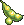Poppuri Bean

<label class="done"><input class="key" id="k2" type="checkbox"/> ทำแล้ว</label>ขั้น 2<h3>Scared Poppuri - Look for Toys</h3>

Southeast ForestLv 30+

ส่ง<ul><li><b>Teddy Bear</b> ← <b>Moss Moth</b> Lv 48</li><li><b>Robot Model Kit</b> ← <b>Larva</b> Lv 52</li><li><b>Exchange Diary</b> ← <b>Sppo</b> Lv 46</li><li><b>Squeaky Hammer</b> ← <b>Simbatta</b> Lv 42</li></ul>

รางวัล: ได้ของเล่นทั้ง 4 ชิ้นคืน (ใช้ขั้น 3)

<label class="done"><input class="key" id="k3" type="checkbox"/> ทำแล้ว</label>ขั้น 3<h3>Artisan Poppuri - Fix Toys</h3>

Gate of Poppuri DungeonLv 30+

ส่ง<ul><li><b>Teddy Bear</b> (ได้คืนจากขั้น 2)</li><li><b>Robot Model Kit</b> (ได้คืนจากขั้น 2)</li><li><b>Exchange Diary</b> (ได้คืนจากขั้น 2)</li><li><b>Squeaky Hammer</b> (ได้คืนจากขั้น 2)</li><li><b>Instant Adhesive × 4</b></li></ul>

รางวัล: Mended Toy Box

<label class="done"><input class="key" id="k4" type="checkbox"/> ทำแล้ว</label>ขั้น 4<h3>Scared Poppuri - Poppuri Redemption</h3>

Southeast Forestหลังผ่าน Fix Toys

เอา <b>Mended Toy Box</b> ไปให้ <b>Stern Poppuri</b> ที่ Poppuri Dungeon - Slide Cave ไม่ต้องกลับไปหา Scared Poppuri

รางวัล: Poppuri Bean × 9

<label class="done"><input class="key" id="k5" type="checkbox"/> ทำแล้ว</label>ขั้น 5<h3>Stern Poppuri - Journey to Caballa Relics</h3>

Poppuri Dungeon - Slide Caveหลังผ่าน Poppuri Redemption

ไปคุยกับ <b>Wise Hen</b> ที่ Gate of Caballa Relics

รางวัล: Wing Port (Caballa Relics), 10,000 Galder

</section>

<section>

## เควสที่ให้ Instant Adhesive

มี 8 เควส ต้องการ 4 อัน

เส้นทางแนะนำ 4 เควสติด ★ Hungry Poppuri รับได้เมื่อมี Red Petal ในกระเป๋า · Blue Muffler Poppuri ต้องมี Super Alarm Clock จาก Artisan Poppuri

<button aria-pressed="false" id="hideUnstar" type="button">ซ่อนเควสที่ไม่ติดดาว</button><button hidden="" id="showAll" type="button">แสดงทั้งหมด</button>

<table>
<thead><tr><th>ได้แล้ว</th><th>เควส</th><th>รอบ</th><th>ที่อยู่</th><th>NPC</th><th>เงื่อนไข</th><th>ของที่ต้องส่ง และแหล่ง</th></tr></thead>
<tbody>
<tr><td><input aria-label="ได้ Instant Adhesive แล้ว" class="stk" id="w1" type="checkbox"/></td><td>★ Vagabond Eloy - Eloy's Skin Care</td><td class="n">5</td><td>Southeast Forest</td><td>Vagabond Eloy</td><td>Lv 30+</td><td>Multi-Vitamin × 3 ← <b>Pochi</b> Lv 35 (Southeast Forest)</td></tr>
<tr class="pre-row"><td><input aria-label="ทำขั้นนี้ครบแล้ว" class="pre" id="wp1" type="checkbox"/></td><td>Artisan Poppuri - Artisan Poppuri That Makes Alarm Clocks <b>(10 รอบ)</b> ขั้นก่อนหน้า · ไม่ได้ Instant Adhesive</td><td class="n">10</td><td>Gate of Poppuri Dungeon</td><td>Artisan Poppuri</td><td>Lv 30+ · ได้ Super Alarm Clock รอบ 2, 4, 6, 8, 9, 10</td><td>Talky Mushroom × 1 ← <b>Kokebi</b> Lv 39 (Slide Cave, Root Cave) · Battery Lasting Long × 1 ← ขุดใน Poppuri Dungeon</td></tr>
<tr><td><input aria-label="ได้ Instant Adhesive แล้ว" class="stk" id="w2" type="checkbox"/></td><td>★ Hungry Poppuri - Poppuri's Special Snack</td><td class="n">5</td><td>Poppuri Dungeon - Rainbow Cave</td><td>Hungry Poppuri</td><td>Lv 30+ · ต้องมี Red Petal ในกระเป๋า</td><td>Red Petal × 3 ← ขุดใน Poppuri Dungeon</td></tr>
<tr><td><input aria-label="ได้ Instant Adhesive แล้ว" class="stk" id="w3" type="checkbox"/></td><td>★ Poppuri - Poppuri's Request</td><td class="n">5</td><td>Poppuri Dungeon - Moss Cave</td><td>Poppuri</td><td>Lv 30+</td><td>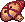Poppuri Whistle × 3 ← ขุดใน Poppuri Dungeon</td></tr>
<tr><td><input aria-label="ได้ Instant Adhesive แล้ว" class="stk" id="w5" type="checkbox"/></td><td>Poppuri - Get the Special Whistle</td><td class="n">5</td><td>Poppuri Dungeon - Moss Cave</td><td>Poppuri</td><td>ทำ Poppuri's Request ก่อน</td><td>Special Whistle × 1 ← <b>Koom</b> Lv 55 (Moss Cave)</td></tr>
<tr><td><input aria-label="ได้ Instant Adhesive แล้ว" class="stk" id="w6" type="checkbox"/></td><td>Blue Muffler Poppuri - I Don't Like Vampire Bats</td><td class="n">5</td><td>Poppuri Dungeon - Spore Cave</td><td>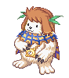Blue Muffler Poppuri</td><td>Lv 30+ · ต้องมี Super Alarm Clock</td><td>Super Alarm Clock × 1 ← รางวัลจาก Artisan Poppuri · Turvy's Tooth × 3 ← <b>Turvy</b> Lv 45 (Spore Cave)</td></tr>
<tr><td><input aria-label="ได้ Instant Adhesive แล้ว" class="stk" id="w7" type="checkbox"/></td><td>Blue Muffler Poppuri - Purifying Poppuri Dungeon</td><td class="n">5</td><td>Poppuri Dungeon - Spore Cave</td><td>Blue Muffler Poppuri</td><td>ทำ Vampire Bats ก่อน · ต้องมี Super Alarm Clock</td><td>Poisonous Moss × 3 ← <b>Larva</b> Lv 52 (Moss Cave, Spore Cave)</td></tr>
<tr><td><input aria-label="ได้ Instant Adhesive แล้ว" class="stk" id="w4" type="checkbox"/></td><td>★ Indiana John - Indiana John at Poppuri Dungeon (1)</td><td class="n">5</td><td>Poppuri Dungeon - Root Cave</td><td>Indiana John</td><td>Lv 30+</td><td>Amber × 1 ← ขุดใน Poppuri Dungeon · Gold Powder × 1 ← <b>Sppo</b> Lv 46 (Rainbow Cave, Root Cave)</td></tr>
<tr><td><input aria-label="ได้ Instant Adhesive แล้ว" class="stk" id="w8" type="checkbox"/></td><td>Indiana John - Indiana John at Poppuri Dungeon (2)</td><td class="n">5</td><td>Poppuri Dungeon - Root Cave</td><td>Indiana John</td><td>Lv 35+ · ทำ (1) ก่อน</td><td>Peridot Gemstone × 1 ← รางวัลจากเควส Poppuri · Moss Water × 1 ← ขุดใน Poppuri Dungeon</td></tr>
</tbody>
</table>

Peridot Gemstone ได้จาก Poppuri's Request, Get the Special Whistle, Blue Muffler Poppuri หรือ Alarm Clocks

</section>

<section>

## จุดขุดและมอน เรียงตามแมพ

<table>
<thead><tr><th>ครบแล้ว</th><th>แมพ</th><th>ขุด / มอน</th><th>ไอเทม</th><th>จำนวนรวม</th><th>ใช้ในเควส</th></tr></thead>
<tbody>
<tr class="mon-row" data-q="[[&quot;w1&quot;, 15, &quot;Eloy's Skin Care (3 × 5 รอบ)&quot;, 0]]"><td><input aria-label="หาครบแล้ว" class="mon" id="gm1" type="checkbox"/></td><td>★ Southeast Forest</td><td>Pochi (Lv 35)</td><td>Multi-Vitamin</td><td class="n">15</td><td>Eloy's Skin Care (3 × 5 รอบ)</td></tr>
<tr class="mon-row" data-q="[[&quot;k1&quot;, 1, &quot;ขั้น 1 Scared Poppuri's Concern&quot;, 0]]"><td><input aria-label="หาครบแล้ว" class="mon" id="gm2" type="checkbox"/></td><td>★ Poppuri Dungeon - Slide Cave, Root Cave</td><td>Kokebi (Lv 39)</td><td>Toy Box</td><td class="n">1</td><td>ขั้น 1 Scared Poppuri's Concern</td></tr>
<tr class="mon-row" data-q='[["wp1", 10, "Alarm Clocks (1 × 10 รอบ)", 0]]'><td><input aria-label="หาครบแล้ว" class="mon" id="gm3" type="checkbox"/></td><td>Poppuri Dungeon - Slide Cave, Root Cave</td><td>Kokebi (Lv 39)</td><td>Talky Mushroom</td><td class="n">10</td><td>Alarm Clocks (1 × 10 รอบ)</td></tr>
<tr class="mon-row" data-q='[["k2", 1, "ขั้น 2 Look for Toys", 0]]'><td><input aria-label="หาครบแล้ว" class="mon" id="gm4" type="checkbox"/></td><td>★ Poppuri Dungeon - Slide Cave, Spore Cave</td><td>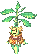Simbatta (Lv 42)</td><td>Squeaky Hammer</td><td class="n">1</td><td>ขั้น 2 Look for Toys</td></tr>
<tr class="mon-row" data-q='[["w6", 15, "Vampire Bats (3 × 5 รอบ)", 0]]'><td><input aria-label="หาครบแล้ว" class="mon" id="gm5" type="checkbox"/></td><td>Poppuri Dungeon - Spore Cave</td><td>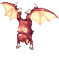Turvy (Lv 45)</td><td>Turvy's Tooth</td><td class="n">15</td><td>Vampire Bats (3 × 5 รอบ)</td></tr>
<tr class="mon-row" data-q='[["k2", 1, "ขั้น 2 Look for Toys", 0]]'><td><input aria-label="หาครบแล้ว" class="mon" id="gm6" type="checkbox"/></td><td>★ Poppuri Dungeon - Rainbow Cave, Root Cave</td><td>Sppo (Lv 46)</td><td>Exchange Diary</td><td class="n">1</td><td>ขั้น 2 Look for Toys</td></tr>
<tr class="mon-row" data-q='[["w4", 5, "Indiana John (1) (1 × 5 รอบ)", 0]]'><td><input aria-label="หาครบแล้ว" class="mon" id="gm7" type="checkbox"/></td><td>★ Poppuri Dungeon - Rainbow Cave, Root Cave</td><td>Sppo (Lv 46)</td><td>Gold Powder</td><td class="n">5</td><td>Indiana John (1) (1 × 5 รอบ)</td></tr>
<tr class="mon-row" data-q='[["k2", 1, "ขั้น 2 Look for Toys", 0]]'><td><input aria-label="หาครบแล้ว" class="mon" id="gm8" type="checkbox"/></td><td>★ Poppuri Dungeon - Rainbow Cave, Moss Cave</td><td>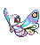Moss Moth (Lv 48)</td><td>Teddy Bear</td><td class="n">1</td><td>ขั้น 2 Look for Toys</td></tr>
<tr class="mon-row" data-q='[["k2", 1, "ขั้น 2 Look for Toys", 0]]'><td><input aria-label="หาครบแล้ว" class="mon" id="gm9" type="checkbox"/></td><td>★ Poppuri Dungeon - Moss Cave, Spore Cave</td><td>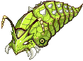Larva (Lv 52)</td><td>Robot Model Kit</td><td class="n">1</td><td>ขั้น 2 Look for Toys</td></tr>
<tr class="mon-row" data-q='[["w7", 15, "Purifying Poppuri Dungeon (3 × 5 รอบ)", 0]]'><td><input aria-label="หาครบแล้ว" class="mon" id="gm10" type="checkbox"/></td><td>Poppuri Dungeon - Moss Cave, Spore Cave</td><td>Larva (Lv 52)</td><td>Poisonous Moss</td><td class="n">15</td><td>Purifying Poppuri Dungeon (3 × 5 รอบ)</td></tr>
<tr class="mon-row" data-q='[["w5", 5, "Get the Special Whistle (1 × 5 รอบ)", 0]]'><td><input aria-label="หาครบแล้ว" class="mon" id="gm11" type="checkbox"/></td><td>Poppuri Dungeon - Moss Cave</td><td>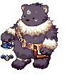Koom (Lv 55)</td><td>Special Whistle</td><td class="n">5</td><td>Get the Special Whistle (1 × 5 รอบ)</td></tr>
<tr class="mon-row" data-q='[["w2", 15, "Hungry Poppuri (3 × 5 รอบ)", 0]]'><td><input aria-label="หาครบแล้ว" class="mon" id="gm12" type="checkbox"/></td><td>★ Poppuri Dungeon (ขุด)</td><td>ขุด</td><td>Red Petal</td><td class="n">15</td><td>Hungry Poppuri (3 × 5 รอบ)</td></tr>
<tr class="mon-row" data-q="[[&quot;w3&quot;, 15, &quot;Poppuri's Request (3 × 5 รอบ)&quot;, 0]]"><td><input aria-label="หาครบแล้ว" class="mon" id="gm13" type="checkbox"/></td><td>★ Poppuri Dungeon (ขุด)</td><td>ขุด</td><td>Poppuri Whistle</td><td class="n">15</td><td>Poppuri's Request (3 × 5 รอบ)</td></tr>
<tr class="mon-row" data-q='[["w4", 5, "Indiana John (1) (1 × 5 รอบ)", 0]]'><td><input aria-label="หาครบแล้ว" class="mon" id="gm14" type="checkbox"/></td><td>★ Poppuri Dungeon (ขุด)</td><td>ขุด</td><td>Amber</td><td class="n">5</td><td>Indiana John (1) (1 × 5 รอบ)</td></tr>
<tr class="mon-row" data-q='[["w8", 5, "Indiana John (2) (1 × 5 รอบ)", 0]]'><td><input aria-label="หาครบแล้ว" class="mon" id="gm15" type="checkbox"/></td><td>Poppuri Dungeon (ขุด)</td><td>ขุด</td><td>Moss Water</td><td class="n">5</td><td>Indiana John (2) (1 × 5 รอบ)</td></tr>
<tr class="mon-row" data-q='[["wp1", 10, "Alarm Clocks (1 × 10 รอบ)", 0]]'><td><input aria-label="หาครบแล้ว" class="mon" id="gm16" type="checkbox"/></td><td>Poppuri Dungeon (ขุด)</td><td>ขุด</td><td>Battery Lasting Long</td><td class="n">10</td><td>Alarm Clocks (1 × 10 รอบ)</td></tr>
</tbody>
</table>

Peridot Gemstone และ Super Alarm Clock ได้จากเควสอื่น

</section>

<section>

## รูปจากวิกิ

### NPC

<a href="https://wikimirror.lifeto.co/wiki.ggftw.com/trickster/Scared_Poppuri.html" rel="noopener" target="_blank">Scared Poppuriขั้น 1, 2, 4 · Southeast Forest ↗</a>
<a href="https://wikimirror.lifeto.co/wiki.ggftw.com/trickster/Artisan_Poppuri.html" rel="noopener" target="_blank">Artisan Poppuriขั้น 3 · Gate of Poppuri Dungeon ↗</a>
<a href="https://wikimirror.lifeto.co/wiki.ggftw.com/trickster/Stern_Poppuri.html" rel="noopener" target="_blank">Stern Poppuriขั้น 4, 5 · Slide Cave ↗</a>
<a href="https://wikimirror.lifeto.co/wiki.ggftw.com/trickster/Wise_Hen.html" rel="noopener" target="_blank">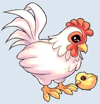Wise Henขั้น 5 · Gate of Caballa Relics ↗</a>

### มอนสเตอร์

<a href="https://wikimirror.lifeto.co/wiki.ggftw.com/trickster/Pochi.html" rel="noopener" target="_blank">PochiLv 35 · หน้าวิกิ ↗</a>
<a href="https://wikimirror.lifeto.co/wiki.ggftw.com/trickster/Kokebi.html" rel="noopener" target="_blank">KokebiLv 39 · หน้าวิกิ ↗</a>
<a href="https://wikimirror.lifeto.co/wiki.ggftw.com/trickster/Simbatta.html" rel="noopener" target="_blank">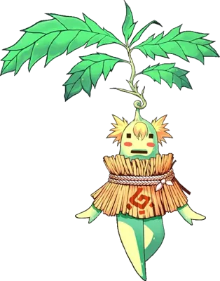SimbattaLv 42 · หน้าวิกิ ↗</a>
<a href="https://wikimirror.lifeto.co/wiki.ggftw.com/trickster/Turvy.html" rel="noopener" target="_blank">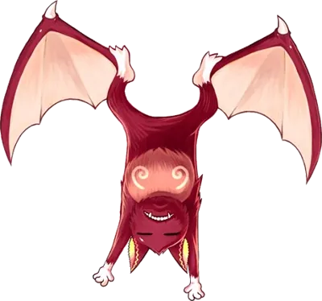TurvyLv 45 · หน้าวิกิ ↗</a>
<a href="https://wikimirror.lifeto.co/wiki.ggftw.com/trickster/Sppo.html" rel="noopener" target="_blank">SppoLv 46 · หน้าวิกิ ↗</a>
<a href="https://wikimirror.lifeto.co/wiki.ggftw.com/trickster/Moss_Moth.html" rel="noopener" target="_blank">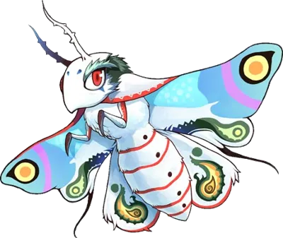Moss MothLv 48 · หน้าวิกิ ↗</a>
<a href="https://wikimirror.lifeto.co/wiki.ggftw.com/trickster/Larva.html" rel="noopener" target="_blank">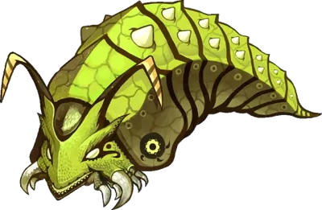LarvaLv 52 · หน้าวิกิ ↗</a>
<a href="https://wikimirror.lifeto.co/wiki.ggftw.com/trickster/Koom.html" rel="noopener" target="_blank">KoomLv 55 · หน้าวิกิ ↗</a>

### แมพ

<a href="https://wikimirror.lifeto.co/asset.103.ggftw.net/wiki/to-w/images/e/ed/Megalopolis_Map.png" rel="noopener" target="_blank">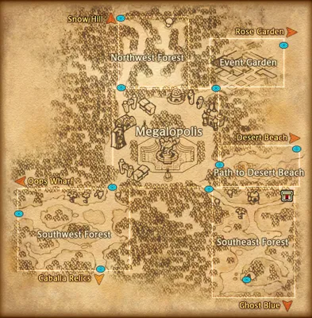แผนที่ Megalopolisทั้งโซน ↗</a>
<a href="https://wikimirror.lifeto.co/wiki.ggftw.com/trickster/Southeast_Forest.html" rel="noopener" target="_blank">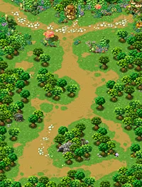Southeast Forestหน้าแมพ ↗</a>
<a href="https://wikimirror.lifeto.co/wiki.ggftw.com/trickster/Gate_of_Poppuri_Dungeon.html" rel="noopener" target="_blank">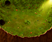Gate of Poppuri Dungeonหน้าแมพ ↗</a>
<a href="https://wikimirror.lifeto.co/wiki.ggftw.com/trickster/Poppuri_Dungeon_-_Slide_Cave.html" rel="noopener" target="_blank">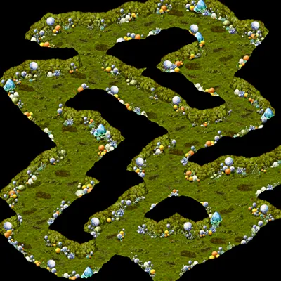Poppuri Dungeon - Slide Caveหน้าแมพ ↗</a>
<a href="https://wikimirror.lifeto.co/wiki.ggftw.com/trickster/Poppuri_Dungeon_-_Rainbow_Cave.html" rel="noopener" target="_blank">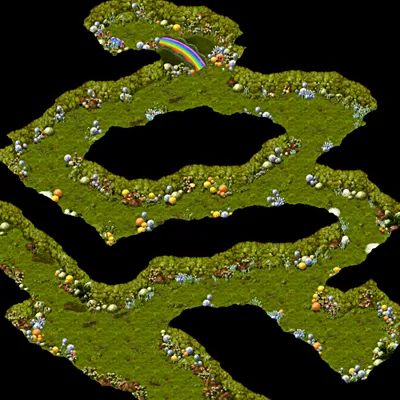Poppuri Dungeon - Rainbow Caveหน้าแมพ ↗</a>
<a href="https://wikimirror.lifeto.co/wiki.ggftw.com/trickster/Poppuri_Dungeon_-_Moss_Cave.html" rel="noopener" target="_blank">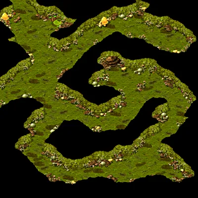Poppuri Dungeon - Moss Caveหน้าแมพ ↗</a>
<a href="https://wikimirror.lifeto.co/wiki.ggftw.com/trickster/Poppuri_Dungeon_-_Spore_Cave.html" rel="noopener" target="_blank">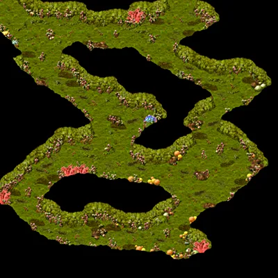Poppuri Dungeon - Spore Caveหน้าแมพ ↗</a>
<a href="https://wikimirror.lifeto.co/wiki.ggftw.com/trickster/Poppuri_Dungeon_-_Root_Cave.html" rel="noopener" target="_blank">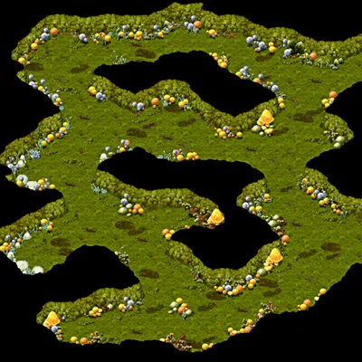Poppuri Dungeon - Root Caveหน้าแมพ ↗</a>

</section>

<PageBehavior />
