

<header style="display:flex;flex-direction:column;gap:8px">

# เควสกุญแจ Mermaid Palace

สรุปจากวิกิ ggFTW (ฉบับ mirror ของ LifeTO) หน้า [Captain Stan - Mermaid Palace Stickers](https://wikimirror.lifeto.co/wiki.ggftw.com/trickster/Captain_Stan_-_Mermaid_Palace_Stickers.html), [Category Mermaid Palace Quest](https://wikimirror.lifeto.co/wiki.ggftw.com/trickster/Category_Mermaid_Palace_Quest.html) และหน้าเควส/มอน/แมพที่ลิงก์ไป

</header>

<section>

## ภาพรวม

โซนต่อจาก Oops Wharf เควสกุญแจเริ่มกับ **Captain Stan** ที่ Gate of Mermaid Palace ต้อง<b>เลเวล 80+</b> และผ่าน **Skipper Min - Min's Weakness** ของ Oops Wharf แล้ว

- ต้องได้ **Palace Proof Sticker 7 ใบ** และ **Old Picture** (ขุดใน Mermaid Palace Field)
- เก็บ **Adventurer's Book** ที่ได้คืนจาก Min's Weakness ไว้ส่งในขั้น 3
- ทางเข้า: Oops Wharf → Path to Mermaid Palace 1 → 2 → Gate of Mermaid Palace คุยกับ **Kochi** ที่ Gate of Mermaid Dungeon เพื่อเปิดวาร์ป
- ขั้น 3 ต้องตี **Tanya** Lv 150 ใน Mermaid Dungeon 2

</section>

<section aria-live="polite" class="counter">

## ความคืบหน้า

0 Palace Proof Sticker ที่ควรมีตอนนี้

<button id="reset" type="button">ล้างทั้งหมด</button>

</section>

<section>

## เควสกุญแจ 4 ขั้น

ลำดับสำคัญ: ขั้น 1 → รับขั้น 2 ค้างไว้ → ทำขั้น 3 กับ Mermaid Marin → กลับไปส่งขั้น 2 → ขั้น 4

<label class="done"><input class="key" id="k1" type="checkbox"/> ทำแล้ว</label>ขั้น 1<h3>Captain Stan - Mermaid Palace Stickers</h3>

Gate of Mermaid PalaceLv 80+หลังผ่าน Min's Weakness

ส่ง<ul><li><b>Palace Proof Sticker × 7</b></li><li><b>Old Picture × 1</b> ← ขุดใน Mermaid Palace Field</li></ul>

รางวัล: Captain Stan's Log

<label class="done"><input class="key" id="k2" type="checkbox"/> ทำแล้ว</label>ขั้น 2<h3>Captain Stan - Captain's Stan Past</h3>

Gate of Mermaid PalaceLv 80+รับค้างไว้ก่อน

ส่ง <b>Tanya's Letter</b> (ได้จากขั้น 3) รับเควสนี้ค้างไว้ก่อน แล้วไปทำขั้น 3

รางวัล<ul><li>Wep Exchange D</li><li>10,000 Galder Coupon</li></ul>

<label class="done"><input class="key" id="k3" type="checkbox"/> ทำแล้ว</label>ขั้น 3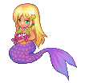<h3>Mermaid Marin - Marin's Sister</h3>

Mermaid Palace Field 4 - Rock SquareLv 80+ต้องมี Captain's Stan Past ค้างในสมุดเควส

ถือ <b>Tanya's Sword</b> ← <b>Tanya</b> Lv 150 (Mermaid Dungeon 2) ไปคุยเพื่อรับเควส แล้วส่ง <b>Tanya's Sword × 1</b> และ <b>Adventurer's Book × 1</b>

รางวัล<ul><li>Tanya's Letter → เอาไปส่งขั้น 2</li><li><b>Adventurer's Book</b> (เก็บไว้ใช้โซนต่อไป)</li></ul>

<label class="done"><input class="key" id="k4" type="checkbox"/> ทำแล้ว</label>ขั้น 4<h3>Captain Stan - Megalo Ship's Heidi</h3>

Gate of Mermaid PalaceLv 80+หลังผ่าน Captain's Stan Past

ไปหา <b>Heidi</b> ที่ Southeast Forest ใกล้ทางเข้า Path to Ghost Blue 1 แล้วคุยด้วย

รางวัล: 1,000 Galder Coupon · ต่อไปโซน Ghost Blue

</section>

<section>

## เควสที่ให้ Palace Proof Sticker

มี 11 เควส ต้องการ 7 ใบ

เส้นทางแนะนำ 7 เควสติด ★ อยู่ใน Mermaid Palace Field 1–4 · ชุดต่อกัน: Prince the Merman 1 → รับ Prince the Merman 2 ค้างไว้ → I Want to Ride a Fish ได้ Rumo's Remedy → Make a Merperson Potion ได้ยารอบ 1, 3, 5 → ส่ง Prince the Merman 2 ครบ 3 รอบ

<button aria-pressed="false" id="hideUnstar" type="button">ซ่อนเควสที่ไม่ติดดาว</button><button hidden="" id="showAll" type="button">แสดงทั้งหมด</button>

<table>
<thead><tr><th>ได้แล้ว</th><th>เควส</th><th>รอบ</th><th>ที่อยู่</th><th>NPC</th><th>เงื่อนไข</th><th>ของที่ต้องส่ง และแหล่ง</th></tr></thead>
<tbody>
<tr class="pre-row"><td><input aria-label="ทำขั้นนี้ครบแล้ว" class="pre" id="wp1" type="checkbox"/></td><td>★ Genius Cochma - Mermaid Palace Survey - 1 ขั้นก่อนหน้า · ไม่ได้สติ๊กเกอร์</td><td class="n">5</td><td>Gate of Mermaid Palace</td><td>Genius Cochma</td><td>Lv 75+ · รวม 75 ตัว</td><td>ล่า <b>Mermaid Little</b> Lv 73 × 15 ตัวภายใน 10 นาที (Field 1, 2)</td></tr>
<tr class="pre-row"><td><input aria-label="ทำขั้นนี้ครบแล้ว" class="pre" id="wp2" type="checkbox"/></td><td>★ Genius Cochma - Mermaid Palace Survey - 2 ขั้นก่อนหน้า · ไม่ได้สติ๊กเกอร์</td><td class="n">5</td><td>Gate of Mermaid Palace</td><td>Genius Cochma</td><td>ทำ Survey 1 ก่อน · รวม 25</td><td>Lip Gloss × 5 ← <b>Mermaid Little</b> Lv 73 (Field 1, 2)</td></tr>
<tr class="pre-row"><td><input aria-label="ทำขั้นนี้ครบแล้ว" class="pre" id="wp3" type="checkbox"/></td><td>★ Genius Cochma - Mermaid Palace Survey - 3 ขั้นก่อนหน้า · ไม่ได้สติ๊กเกอร์</td><td class="n">5</td><td>Gate of Mermaid Palace</td><td>Genius Cochma</td><td>ทำ Survey 2 ก่อน · รวม 15</td><td>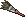Lip Brush × 3 ← ขุดใน Mermaid Palace Field 1–3</td></tr>
<tr><td><input aria-label="ได้สติ๊กเกอร์แล้ว" class="stk" id="w7" type="checkbox"/></td><td>★ Genius Cochma - Mermaid Palace Survey - 4</td><td class="n">5</td><td>Gate of Mermaid Palace</td><td>Genius Cochma</td><td>ทำ Survey 3 ก่อน (แถวสีอ่อนด้านบน)</td><td>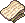Scraggy Towel × 5 ← ขุดใน Mermaid Palace Field 1–3</td></tr>
<tr><td><input aria-label="ได้สติ๊กเกอร์แล้ว" class="stk" id="w1" type="checkbox"/></td><td>★ La Vida - La Vida's Treasure Map 1</td><td class="n">5</td><td>Mermaid Palace Field 1 - Water Park</td><td>La Vida</td><td>Lv 75+</td><td>Fragmented Map 1 × 1 ← <b>Merman Ale</b> Lv 89 (ถูกเรียกใน Field 1–3)</td></tr>
<tr><td><input aria-label="ได้สติ๊กเกอร์แล้ว" class="stk" id="w2" type="checkbox"/></td><td>★ La Vida - La Vida's Treasure Map 2</td><td class="n">5</td><td>Mermaid Palace Field 1 - Water Park</td><td>La Vida</td><td>ทำ Treasure Map 1 ก่อน</td><td>Fragmented Map 2 × 1 ← ขุดใน Mermaid Palace Field 1–3</td></tr>
<tr class="pre-row"><td><input aria-label="ทำขั้นนี้ครบแล้ว" class="pre" id="wp4" type="checkbox"/></td><td>★ Prince Sebastian - Prince the Merman 1 ขั้นก่อนหน้า · ไม่ได้สติ๊กเกอร์</td><td class="n">5</td><td>Mermaid Palace Field 2 - Seaweeds Square</td><td>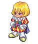Prince Sebastian</td><td>Lv 75+ · รวม 25</td><td>Lip Gloss × 5 ← <b>Mermaid Little</b> Lv 73 (Field 1, 2)</td></tr>
<tr><td><input aria-label="ได้สติ๊กเกอร์แล้ว" class="stk" id="w3" type="checkbox"/></td><td>★ Prince Sebastian - Prince the Merman 2 <b>(3 รอบ)</b></td><td class="n">3</td><td>Mermaid Palace Field 2 - Seaweeds Square</td><td>Prince Sebastian</td><td>ทำ Prince the Merman 1 ก่อน · รับค้างไว้ก่อนไปหา Fairy Asrai</td><td>Merperson Potion × 1 ← รางวัลจาก Fairy Asrai (ได้รอบ 1, 3, 5)</td></tr>
<tr class="pre-row"><td><input aria-label="ทำขั้นนี้ครบแล้ว" class="pre" id="wp5" type="checkbox"/></td><td>Frog Shaman - Mermaid Palace Magic Ingredient - 1 ขั้นก่อนหน้า · ไม่ได้สติ๊กเกอร์</td><td class="n">5</td><td>Mermaid Palace Field 2 - Seaweeds Square</td><td>Frog Shaman</td><td>Lv 75+ · รวม 25</td><td>Nail Polish × 5 ← <b>Fish Guardian Bell</b> Lv 80 (Field 3)</td></tr>
<tr class="pre-row"><td><input aria-label="ทำขั้นนี้ครบแล้ว" class="pre" id="wp6" type="checkbox"/></td><td>Frog Shaman - Mermaid Palace Magic Ingredient - 2 ขั้นก่อนหน้า · ไม่ได้สติ๊กเกอร์</td><td class="n">5</td><td>Mermaid Palace Field 2 - Seaweeds Square</td><td>Frog Shaman</td><td>ทำ Magic 1 ก่อน · รวม 25</td><td>Fur Brush × 5 ← <b>Fish Guardian Tink</b> Lv 78 (Field 2, 3) หรือ <b>Merman Aqu</b> Lv 86 (Field 4)</td></tr>
<tr class="pre-row"><td><input aria-label="ทำขั้นนี้ครบแล้ว" class="pre" id="wp7" type="checkbox"/></td><td>Frog Shaman - Mermaid Palace Magic Ingredient - 3 ขั้นก่อนหน้า · ไม่ได้สติ๊กเกอร์</td><td class="n">5</td><td>Mermaid Palace Field 2 - Seaweeds Square</td><td>Frog Shaman</td><td>ทำ Magic 2 ก่อน · รวม 25</td><td>Bubble × 5 ← <b>Waterweed Witch</b> Lv 95 (Field 3)</td></tr>
<tr><td><input aria-label="ได้สติ๊กเกอร์แล้ว" class="stk" id="w8" type="checkbox"/></td><td>Frog Shaman - Mermaid Palace Magic Ingredient - 4</td><td class="n">5</td><td>Mermaid Palace Field 2 - Seaweeds Square</td><td>Frog Shaman</td><td>ทำ Magic 3 ก่อน (แถวสีอ่อนด้านบน)</td><td>Whale Jawbone × 3 ← ขุดใน Mermaid Palace Field 1–3</td></tr>
<tr><td><input aria-label="ได้สติ๊กเกอร์แล้ว" class="stk" id="w4" type="checkbox"/></td><td>★ Fairy Asrai - Make a Merperson Potion</td><td class="n">5</td><td>Mermaid Palace Field 3 - Coral Square</td><td>Fairy Asrai</td><td>Lv 75+ · ต้องมี Prince the Merman 2 ค้างในสมุดเควส</td><td>Rumo's Remedy × 1 ← รางวัลจาก Sea Spirit Rumo · Whale Jawbone × 1 ← ขุดใน Mermaid Palace Field 1–3 · Sea Herbs × 3 ← <b>Waterweed Witch</b> Lv 95 (Field 3)</td></tr>
<tr><td><input aria-label="ได้สติ๊กเกอร์แล้ว" class="stk" id="w5" type="checkbox"/></td><td>★ Sea Spirit Rumo - I Want to Ride a Fish</td><td class="n">5</td><td>Mermaid Palace Field 4 - Rock Square</td><td>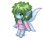Sea Spirit Rumo</td><td>Lv 75+</td><td>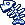Tink's Fishbone × 3 ← <b>Fish Guardian Tink</b> Lv 78 (Field 2, 3) · 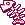Bell's Fishbone × 3 ← <b>Fish Guardian Bell</b> Lv 80 (Field 3)</td></tr>
<tr><td><input aria-label="ได้สติ๊กเกอร์แล้ว" class="stk" id="w9" type="checkbox"/></td><td>Sea Spirit Rumo - I Want Okto's Staff</td><td class="n">5</td><td>Mermaid Palace Field 4 - Rock Square</td><td>Sea Spirit Rumo</td><td>ทำ I Want to Ride a Fish ก่อน</td><td>Okto's Staff × 1 ← <b>Okto</b> Lv 129 (Mermaid Dungeon 2)</td></tr>
<tr><td><input aria-label="ได้สติ๊กเกอร์แล้ว" class="stk" id="w6" type="checkbox"/></td><td>★ Mermaid Marin - Marin's Worry</td><td class="n">5</td><td>Mermaid Palace Field 4 - Rock Square</td><td>Mermaid Marin</td><td>Lv 75+</td><td>Royal Mermaid Linen × 3 ← ขุดใน Mermaid Palace Field 1–3</td></tr>
<tr class="pre-row"><td><input aria-label="ทำขั้นนี้ครบแล้ว" class="pre" id="wp8" type="checkbox"/></td><td>Lethos - Beauty Secrets of Mermaids - 1 ขั้นก่อนหน้า · ไม่ได้สติ๊กเกอร์</td><td class="n">5</td><td>Gate of Mermaid Dungeon</td><td>Lethos</td><td>Lv 85+ · รวม 25</td><td>Pearl × 5 ← ขุดใน Mermaid Palace Field และ Mermaid Dungeon</td></tr>
<tr class="pre-row"><td><input aria-label="ทำขั้นนี้ครบแล้ว" class="pre" id="wp9" type="checkbox"/></td><td>Lethos - Beauty Secrets of Mermaids - 2 ขั้นก่อนหน้า · ไม่ได้สติ๊กเกอร์</td><td class="n">5</td><td>Gate of Mermaid Dungeon</td><td>Lethos</td><td>ทำ 1 ก่อน · รวม 25</td><td>Sulaphat's Shell × 5 ← <b>Sulaphat</b> Lv 123 (Mermaid Dungeon 1, 2)</td></tr>
<tr class="pre-row"><td><input aria-label="ทำขั้นนี้ครบแล้ว" class="pre" id="wp10" type="checkbox"/></td><td>Lethos - Beauty Secrets of Mermaids - 3 ขั้นก่อนหน้า · ไม่ได้สติ๊กเกอร์</td><td class="n">5</td><td>Gate of Mermaid Dungeon</td><td>Lethos</td><td>ทำ 2 ก่อน · รวม 25</td><td>Okto's Staff × 5 ← <b>Okto</b> Lv 129 (Mermaid Dungeon 2)</td></tr>
<tr><td><input aria-label="ได้สติ๊กเกอร์แล้ว" class="stk" id="w10" type="checkbox"/></td><td>Lethos - Beauty Secrets of Mermaids - 4</td><td class="n">5</td><td>Gate of Mermaid Dungeon</td><td>Lethos</td><td>ทำ 3 ก่อน</td><td>Tanya's Sword × 2 ← <b>Tanya</b> Lv 150 (Mermaid Dungeon 2)</td></tr>
<tr><td><input aria-label="ได้สติ๊กเกอร์แล้ว" class="stk" id="w11" type="checkbox"/></td><td>Guard Gilbert - Gilbert Wants Better Weapons</td><td class="n">5</td><td>Mermaid Dungeon 1 - Underworld</td><td>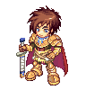Guard Gilbert</td><td>Lv 80+</td><td>Chele's Claw × 5 ← <b>Chele</b> Lv 117 (Mermaid Dungeon 1)</td></tr>
</tbody>
</table>

</section>

<section>

## จุดขุดและมอน เรียงตามแมพ

<table>
<thead><tr><th>ครบแล้ว</th><th>แมพ</th><th>ขุด / มอน</th><th>ไอเทม</th><th>จำนวนรวม</th><th>ใช้ในเควส</th></tr></thead>
<tbody>
<tr class="mon-row" data-q='[["wp1", 75, "Cochma Survey 1 (15 ตัวใน 10 นาที × 5 รอบ)", 0]]' data-unit="ตัว"><td><input aria-label="หาครบแล้ว" class="mon" id="mm1" type="checkbox"/></td><td>★ Mermaid Palace Field 1, 2</td><td>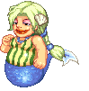Mermaid Little (Lv 73)</td><td>ล่า (ไม่ต้องเก็บของ)</td><td class="n">75 ตัว</td><td>Cochma Survey 1 (15 ตัวใน 10 นาที × 5 รอบ)</td></tr>
<tr class="mon-row" data-q='[["wp2", 25, "Cochma Survey 2 (5 × 5 รอบ)", 0], ["wp4", 25, "Prince the Merman 1 (5 × 5 รอบ)", 0]]'><td><input aria-label="หาครบแล้ว" class="mon" id="mm2" type="checkbox"/></td><td>★ Mermaid Palace Field 1, 2</td><td>Mermaid Little (Lv 73)</td><td>Lip Gloss</td><td class="n">50</td><td>Cochma Survey 2 (5 × 5 รอบ) + Prince the Merman 1 (5 × 5 รอบ)</td></tr>
<tr class="mon-row" data-q='[["k1", 1, "ขั้น 1 Mermaid Palace Stickers", 0]]'><td><input aria-label="หาครบแล้ว" class="mon" id="mm3" type="checkbox"/></td><td>★ Mermaid Palace Field 1–3 (ขุด)</td><td>ขุด</td><td>Old Picture</td><td class="n">1</td><td>ขั้น 1 Mermaid Palace Stickers</td></tr>
<tr class="mon-row" data-q='[["wp3", 15, "Cochma Survey 3 (3 × 5 รอบ)", 0]]'><td><input aria-label="หาครบแล้ว" class="mon" id="mm4" type="checkbox"/></td><td>★ Mermaid Palace Field 1–3 (ขุด)</td><td>ขุด</td><td>Lip Brush</td><td class="n">15</td><td>Cochma Survey 3 (3 × 5 รอบ)</td></tr>
<tr class="mon-row" data-q='[["w7", 25, "Cochma Survey 4 (5 × 5 รอบ)", 0]]'><td><input aria-label="หาครบแล้ว" class="mon" id="mm5" type="checkbox"/></td><td>★ Mermaid Palace Field 1–3 (ขุด)</td><td>ขุด</td><td>Scraggy Towel</td><td class="n">25</td><td>Cochma Survey 4 (5 × 5 รอบ)</td></tr>
<tr class="mon-row" data-q='[["w2", 5, "Treasure Map 2 (1 × 5 รอบ)", 0]]'><td><input aria-label="หาครบแล้ว" class="mon" id="mm6" type="checkbox"/></td><td>★ Mermaid Palace Field 1–3 (ขุด)</td><td>ขุด</td><td>Fragmented Map 2</td><td class="n">5</td><td>Treasure Map 2 (1 × 5 รอบ)</td></tr>
<tr class="mon-row" data-q="[[&quot;w6&quot;, 15, &quot;Marin's Worry (3 × 5 รอบ)&quot;, 0]]"><td><input aria-label="หาครบแล้ว" class="mon" id="mm7" type="checkbox"/></td><td>★ Mermaid Palace Field 1–3 (ขุด)</td><td>ขุด</td><td>Royal Mermaid Linen</td><td class="n">15</td><td>Marin's Worry (3 × 5 รอบ)</td></tr>
<tr class="mon-row" data-q='[["w4", 5, "Merperson Potion (1 × 5 รอบ)", 0], ["w8", 15, "Magic Ingredient 4 (3 × 5 รอบ)", 0]]'><td><input aria-label="หาครบแล้ว" class="mon" id="mm8" type="checkbox"/></td><td>★ Mermaid Palace Field 1–3 (ขุด)</td><td>ขุด</td><td>Whale Jawbone</td><td class="n">20</td><td>Merperson Potion (1 × 5 รอบ) + Magic Ingredient 4 (3 × 5 รอบ)</td></tr>
<tr class="mon-row" data-q='[["wp8", 25, "Beauty Secrets 1 (5 × 5 รอบ)", 0]]'><td><input aria-label="หาครบแล้ว" class="mon" id="mm9" type="checkbox"/></td><td>Mermaid Palace Field 1–4, Mermaid Dungeon 1, 2 (ขุด)</td><td>ขุด</td><td>Pearl</td><td class="n">25</td><td>Beauty Secrets 1 (5 × 5 รอบ)</td></tr>
<tr class="mon-row" data-q='[["w1", 5, "Treasure Map 1 (1 × 5 รอบ)", 0]]'><td><input aria-label="หาครบแล้ว" class="mon" id="mm10" type="checkbox"/></td><td>★ Mermaid Palace Field 1–3 (ถูกเรียก)</td><td>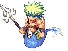Merman Ale (Lv 89)</td><td>Fragmented Map 1</td><td class="n">5</td><td>Treasure Map 1 (1 × 5 รอบ)</td></tr>
<tr class="mon-row" data-q='[["w5", 15, "Ride a Fish (3 × 5 รอบ)", 0]]'><td><input aria-label="หาครบแล้ว" class="mon" id="mm11" type="checkbox"/></td><td>★ Mermaid Palace Field 2, 3</td><td>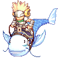Fish Guardian Tink (Lv 78)</td><td>Tink's Fishbone</td><td class="n">15</td><td>Ride a Fish (3 × 5 รอบ)</td></tr>
<tr class="mon-row" data-q='[["wp6", 25, "Magic Ingredient 2 (5 × 5 รอบ)", 0]]'><td><input aria-label="หาครบแล้ว" class="mon" id="mm12" type="checkbox"/></td><td>Mermaid Palace Field 2, 3</td><td>Fish Guardian Tink (Lv 78)</td><td>Fur Brush</td><td class="n">25</td><td>Magic Ingredient 2 (5 × 5 รอบ)</td></tr>
<tr class="mon-row" data-q='[["w5", 15, "Ride a Fish (3 × 5 รอบ)", 0]]'><td><input aria-label="หาครบแล้ว" class="mon" id="mm13" type="checkbox"/></td><td>★ Mermaid Palace Field 3 - Coral Square</td><td>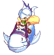Fish Guardian Bell (Lv 80)</td><td>Bell's Fishbone</td><td class="n">15</td><td>Ride a Fish (3 × 5 รอบ)</td></tr>
<tr class="mon-row" data-q='[["wp5", 25, "Magic Ingredient 1 (5 × 5 รอบ)", 0]]'><td><input aria-label="หาครบแล้ว" class="mon" id="mm14" type="checkbox"/></td><td>Mermaid Palace Field 3 - Coral Square</td><td>Fish Guardian Bell (Lv 80)</td><td>Nail Polish</td><td class="n">25</td><td>Magic Ingredient 1 (5 × 5 รอบ)</td></tr>
<tr class="mon-row" data-q='[["w4", 15, "Merperson Potion (3 × 5 รอบ)", 0]]'><td><input aria-label="หาครบแล้ว" class="mon" id="mm15" type="checkbox"/></td><td>★ Mermaid Palace Field 3 - Coral Square</td><td>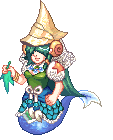Waterweed Witch (Lv 95)</td><td>Sea Herbs</td><td class="n">15</td><td>Merperson Potion (3 × 5 รอบ)</td></tr>
<tr class="mon-row" data-q='[["wp7", 25, "Magic Ingredient 3 (5 × 5 รอบ)", 0]]'><td><input aria-label="หาครบแล้ว" class="mon" id="mm16" type="checkbox"/></td><td>Mermaid Palace Field 3 - Coral Square</td><td>Waterweed Witch (Lv 95)</td><td>Bubble</td><td class="n">25</td><td>Magic Ingredient 3 (5 × 5 รอบ)</td></tr>
<tr class="mon-row" data-q='[["w11", 25, "Gilbert (5 × 5 รอบ)", 0]]'><td><input aria-label="หาครบแล้ว" class="mon" id="mm17" type="checkbox"/></td><td>Mermaid Dungeon 1 - Underworld</td><td>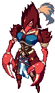Chele (Lv 117)</td><td>Chele's Claw</td><td class="n">25</td><td>Gilbert (5 × 5 รอบ)</td></tr>
<tr class="mon-row" data-q='[["wp9", 25, "Beauty Secrets 2 (5 × 5 รอบ)", 0]]'><td><input aria-label="หาครบแล้ว" class="mon" id="mm18" type="checkbox"/></td><td>Mermaid Dungeon 1, 2</td><td>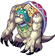Sulaphat (Lv 123)</td><td>Sulaphat's Shell</td><td class="n">25</td><td>Beauty Secrets 2 (5 × 5 รอบ)</td></tr>
<tr class="mon-row" data-q="[[&quot;w9&quot;, 5, &quot;I Want Okto's Staff (1 × 5 รอบ)&quot;, 0], [&quot;wp10&quot;, 25, &quot;Beauty Secrets 3 (5 × 5 รอบ)&quot;, 0]]"><td><input aria-label="หาครบแล้ว" class="mon" id="mm19" type="checkbox"/></td><td>Mermaid Dungeon 2 - Legend of the Sea</td><td>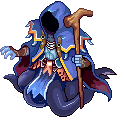Okto (Lv 129)</td><td>Okto's Staff</td><td class="n">30</td><td>I Want Okto's Staff (1 × 5 รอบ) + Beauty Secrets 3 (5 × 5 รอบ)</td></tr>
<tr class="mon-row" data-q="[[&quot;k3&quot;, 1, &quot;ขั้น 3 Marin's Sister&quot;, 0], [&quot;w10&quot;, 10, &quot;Beauty Secrets 4 (2 × 5 รอบ)&quot;, 0]]"><td><input aria-label="หาครบแล้ว" class="mon" id="mm20" type="checkbox"/></td><td>★ Mermaid Dungeon 2 - Legend of the Sea</td><td>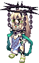Tanya (Lv 150)</td><td>Tanya's Sword</td><td class="n">11</td><td>ขั้น 3 Marin's Sister + Beauty Secrets 4 (2 × 5 รอบ)</td></tr>
</tbody>
</table>

Rumo's Remedy และ Merperson Potion ได้จากเควสอื่น · Fur Brush ได้จาก Merman Aqu (Field 4) ด้วย

</section>

<section>

## รูปจากวิกิ

### NPC

<a href="https://wikimirror.lifeto.co/wiki.ggftw.com/trickster/Captain_Stan_-_Mermaid_Palace_Stickers.html" rel="noopener" target="_blank">Captain Stanขั้น 1, 2, 4 · Gate of Mermaid Palace ↗</a>
<a href="https://wikimirror.lifeto.co/wiki.ggftw.com/trickster/Mermaid_Marin.html" rel="noopener" target="_blank">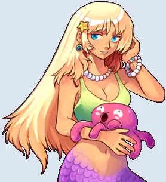Mermaid Marinขั้น 3 · Field 4 ↗</a>
<a href="https://wikimirror.lifeto.co/wiki.ggftw.com/trickster/Heidi.html" rel="noopener" target="_blank">Heidiขั้น 4 · Southeast Forest ↗</a>
<a href="https://wikimirror.lifeto.co/wiki.ggftw.com/trickster/Fairy_Asrai.html" rel="noopener" target="_blank">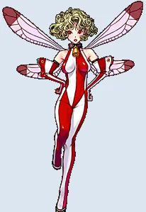Fairy AsraiMerperson Potion · Field 3 ↗</a>
<a href="https://wikimirror.lifeto.co/wiki.ggftw.com/trickster/Sea_Spirit_Rumo.html" rel="noopener" target="_blank">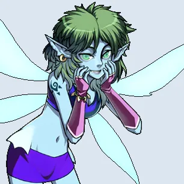Sea Spirit RumoRumo's Remedy · Field 4 ↗</a>
<a href="https://wikimirror.lifeto.co/wiki.ggftw.com/trickster/Kochi.html" rel="noopener" target="_blank">Kochiวาร์ป · Gate of Mermaid Dungeon ↗</a>

### มอนสเตอร์

<a href="https://wikimirror.lifeto.co/wiki.ggftw.com/trickster/Mermaid_Little.html" rel="noopener" target="_blank">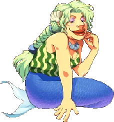Mermaid LittleLv 73 · หน้าวิกิ ↗</a>
<a href="https://wikimirror.lifeto.co/wiki.ggftw.com/trickster/Fish_Guardian_Tink.html" rel="noopener" target="_blank">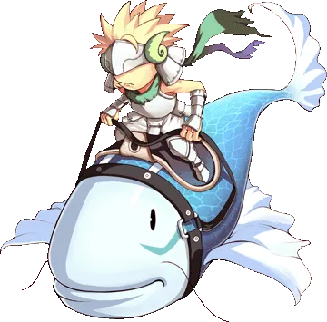Fish Guardian TinkLv 78 · หน้าวิกิ ↗</a>
<a href="https://wikimirror.lifeto.co/wiki.ggftw.com/trickster/Fish_Guardian_Bell.html" rel="noopener" target="_blank">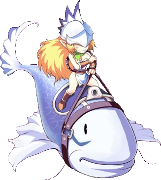Fish Guardian BellLv 80 · หน้าวิกิ ↗</a>
<a href="https://wikimirror.lifeto.co/wiki.ggftw.com/trickster/Merman_Aqu.html" rel="noopener" target="_blank">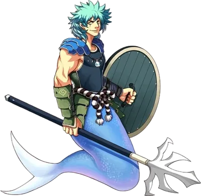Merman AquLv 86 · หน้าวิกิ ↗</a>
<a href="https://wikimirror.lifeto.co/wiki.ggftw.com/trickster/Merman_Ale.html" rel="noopener" target="_blank">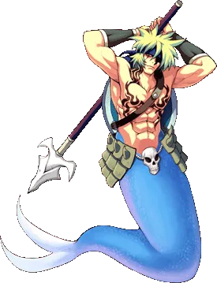Merman AleLv 89 · หน้าวิกิ ↗</a>
<a href="https://wikimirror.lifeto.co/wiki.ggftw.com/trickster/Waterweed_Witch.html" rel="noopener" target="_blank">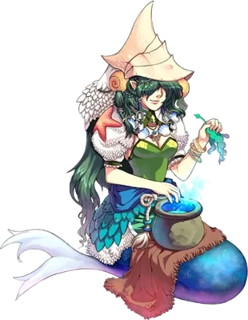Waterweed WitchLv 95 · หน้าวิกิ ↗</a>
<a href="https://wikimirror.lifeto.co/wiki.ggftw.com/trickster/Chele.html" rel="noopener" target="_blank">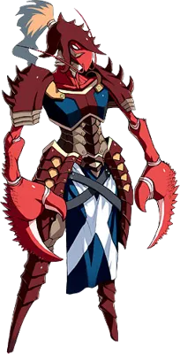CheleLv 117 · หน้าวิกิ ↗</a>
<a href="https://wikimirror.lifeto.co/wiki.ggftw.com/trickster/Sulaphat.html" rel="noopener" target="_blank">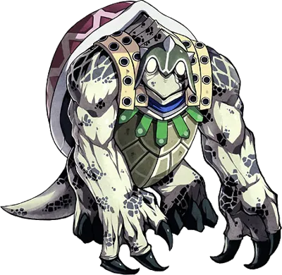SulaphatLv 123 · หน้าวิกิ ↗</a>
<a href="https://wikimirror.lifeto.co/wiki.ggftw.com/trickster/Okto.html" rel="noopener" target="_blank">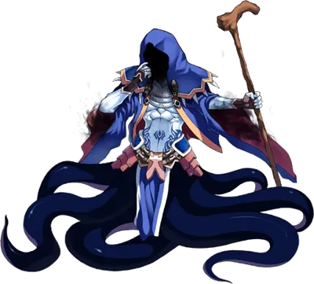OktoLv 129 · หน้าวิกิ ↗</a>
<a href="https://wikimirror.lifeto.co/wiki.ggftw.com/trickster/Tanya.html" rel="noopener" target="_blank">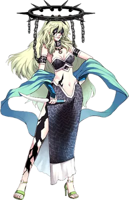TanyaLv 150 · หน้าวิกิ ↗</a>

### แมพ

<a href="https://wikimirror.lifeto.co/asset.103.ggftw.net/wiki/to-w/images/2/2b/Mermaid_Palace_Map.png" rel="noopener" target="_blank">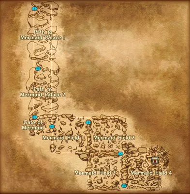แผนที่ Mermaid Palaceทั้งโซน ↗</a>
<a href="https://wikimirror.lifeto.co/wiki.ggftw.com/trickster/Gate_of_Mermaid_Palace.html" rel="noopener" target="_blank">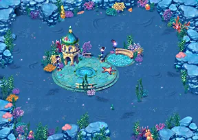Gate of Mermaid Palaceหน้าแมพ ↗</a>
<a href="https://wikimirror.lifeto.co/wiki.ggftw.com/trickster/Mermaid_Palace_Field_1_-_Water_Park.html" rel="noopener" target="_blank">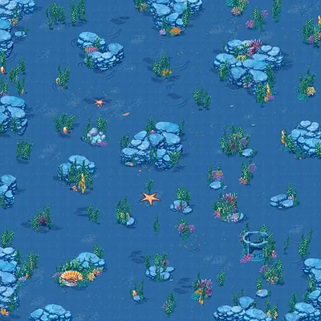Mermaid Palace Field 1 - Water Parkหน้าแมพ ↗</a>
<a href="https://wikimirror.lifeto.co/wiki.ggftw.com/trickster/Mermaid_Palace_Field_2_-_Seaweeds_Square.html" rel="noopener" target="_blank">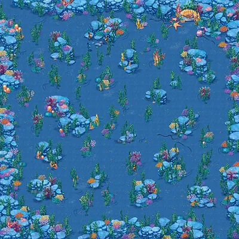Mermaid Palace Field 2 - Seaweeds Squareหน้าแมพ ↗</a>
<a href="https://wikimirror.lifeto.co/wiki.ggftw.com/trickster/Mermaid_Palace_Field_3_-_Coral_Square.html" rel="noopener" target="_blank">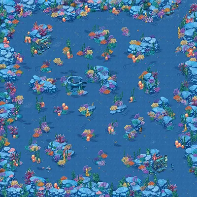Mermaid Palace Field 3 - Coral Squareหน้าแมพ ↗</a>
<a href="https://wikimirror.lifeto.co/wiki.ggftw.com/trickster/Mermaid_Palace_Field_4_-_Rock_Square.html" rel="noopener" target="_blank">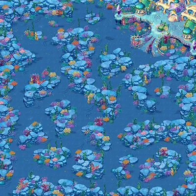Mermaid Palace Field 4 - Rock Squareหน้าแมพ ↗</a>
<a href="https://wikimirror.lifeto.co/wiki.ggftw.com/trickster/Gate_of_Mermaid_Dungeon.html" rel="noopener" target="_blank">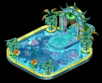Gate of Mermaid Dungeonหน้าแมพ ↗</a>
<a href="https://wikimirror.lifeto.co/wiki.ggftw.com/trickster/Mermaid_Dungeon_1_-_Underworld.html" rel="noopener" target="_blank">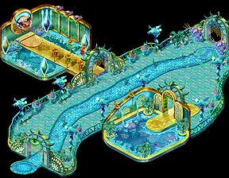Mermaid Dungeon 1 - Underworldหน้าแมพ ↗</a>
<a href="https://wikimirror.lifeto.co/wiki.ggftw.com/trickster/Mermaid_Dungeon_2_-_Legend_of_the_Sea.html" rel="noopener" target="_blank">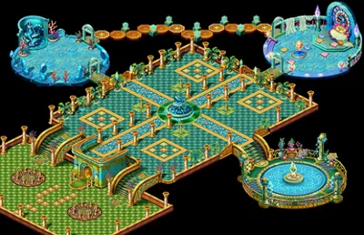Mermaid Dungeon 2 - Legend of the Seaหน้าแมพ ↗</a>

</section>

<PageBehavior />
