

<header style="display:flex;flex-direction:column;gap:8px">

# เควสกุญแจ Oops Wharf

สรุปจากวิกิ ggFTW (ฉบับ mirror ของ LifeTO) หน้า [Skipper Min - Urgent Issue](https://wikimirror.lifeto.co/wiki.ggftw.com/trickster/Skipper_Min_-_Urgent_Issue.html), [Category Oops Wharf Quest](https://wikimirror.lifeto.co/wiki.ggftw.com/trickster/Category_Oops_Wharf_Quest.html) และหน้าเควส/มอน/แมพที่ลิงก์ไป

</header>

<section>

## ภาพรวม

โซนต่อจาก Caballa Relics เควสกุญแจเริ่มกับ **Mighty Captain Stan** ที่ Oops Wharf (เมือง) ต้อง<b>เลเวล 70+</b> และผ่าน **Keeper Julio - Return Gold Silk Pouch** ของ Caballa Relics แล้ว

- ต้องได้ **Oops Sticker 7 ใบ** จากเควสธรรมดา
- เก็บ **Adventurer's Book** ที่ได้คืนจาก Return Gold Silk Pouch ไว้ส่งในขั้น 4
- คุยกับ **Kochi** ที่ Gate of Oops Wharf เพื่อเปิดวาร์ป
- Lethos - Elixir of Life ต้องตีมอนที่ Path to Mermaid Palace 1, 2
- Promise with Rookie Heidi รับได้เฉพาะคนที่ทำเควสกุญแจตามลำดับตั้งแต่ Desert Beach

</section>

<section aria-live="polite" class="counter">

## ความคืบหน้า

0 Oops Sticker ที่ควรมีตอนนี้

<button id="reset" type="button">ล้างทั้งหมด</button>

</section>

<section>

## ก่อนเริ่ม: เควสของ Keeper Julio

ต่อจาก Keeper Julio - Return Gold Silk Pouch ที่จบ Caballa Relics ทั้ง 2 ขั้นทำครั้งเดียว

<label class="done"><input class="key" id="c1" type="checkbox"/> ทำแล้ว</label>ก่อนเริ่ม 1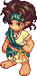<h3>Keeper Julio - Path to Oops Wharf</h3>

Relics Field 4 - An Altar for SacrificeLv 55+หลังผ่าน Return Gold Silk Pouch

ไปคุยกับ <b>Keeper Julio</b> อีกครั้งที่ Gate of Oops Wharf

รางวัล: 1,000 Galder Coupon

<label class="done"><input class="key" id="c2" type="checkbox"/> ทำแล้ว</label>ก่อนเริ่ม 2<h3>Keeper Julio - Captain Stan at Oops Wharf</h3>

Gate of Oops WharfLv 70+

ไปคุยกับ <b>Mighty Captain Stan</b> ที่ Oops Wharf (ต้อง Lv 70 ถึงจะคุยได้)

รางวัล: 1,000 Galder Coupon

</section>

<section>

## เควสกุญแจ 5 ขั้น

<label class="done"><input class="key" id="k1" type="checkbox"/> ทำแล้ว</label>ขั้น 1<h3>Mighty Captain Stan - Promise with Rookie Heidi</h3>

Oops WharfLv 70+

คุยกับ Mighty Captain Stan อีกครั้ง

รางวัล: ไม่มี · ปลดล็อกขั้น 2

<label class="done"><input class="key" id="k2" type="checkbox"/> ทำแล้ว</label>ขั้น 2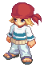<h3>Skipper Min - Urgent Issue</h3>

Oops WharfLv 70+

ส่ง <b>Oops Sticker × 7</b>

รางวัล: 500 Galder Coupon × 5

<label class="done"><input class="key" id="k3" type="checkbox"/> ทำแล้ว</label>ขั้น 3<h3>Mighty Captain Stan - Lost Ship's Log</h3>

Oops Wharfหลังผ่าน Urgent Issue

ส่ง<ul><li><b>Voyage Log p9</b> ← 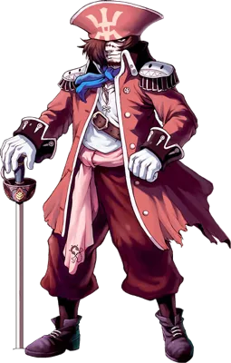<b>Master Foe</b> (Wharf Field 4)</li><li><b>Voyage Log p25</b> ← <b>Quiem</b> (Wharf Field 1, 3)</li><li><b>Voyage Log p31</b> ← <b>Requi</b> (Wharf Field 1–3)</li></ul>

รางวัล<ul><li>500 Galder Coupon × 5</li><li>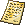Old Unsigned Letter</li></ul>

<label class="done"><input class="key" id="k4" type="checkbox"/> ทำแล้ว</label>ขั้น 4<h3>Skipper Min - Min's Weakness</h3>

Oops Wharfหลังผ่าน Lost Ship's Log

ส่ง<ul><li>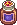<b>Nausea Drink × 5</b> ← ขุดใน Wharf Field 4</li><li><b>Nausea Patch × 5</b> ← ขุดใน Wharf Field 4</li><li>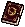<b>Adventurer's Book × 1</b></li></ul>

รางวัล<ul><li>Weapon Ticket C</li><li><b>Adventurer's Book</b> (เก็บไว้ใช้โซนต่อไป)</li></ul>

<label class="done"><input class="key" id="k5" type="checkbox"/> ทำแล้ว</label>ขั้น 5<h3>Skipper Min - The Way to Mermaid Palace</h3>

Oops WharfLv 70+หลังผ่าน Min's Weakness

ซื้อ 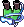<b>Diving Gear</b> จากร้าน <b>Item Girl</b> แล้วไปคุยกับ <b>Marinel</b> ที่ Oops Wharf

รางวัล: 1,000 Galder Coupon · เปิดทางไป Mermaid Palace

</section>

<section>

## เควสที่ให้ Oops Sticker

มี 12 เควส ต้องการ 7 ใบ

เส้นทางแนะนำ 7 เควสติด ★ ใช้มอนที่ Path to Oops Wharf และ Wharf Field 1–3 หรือขุดใน Wharf Field

<button aria-pressed="false" id="hideUnstar" type="button">ซ่อนเควสที่ไม่ติดดาว</button><button hidden="" id="showAll" type="button">แสดงทั้งหมด</button>

<table>
<thead><tr><th>ได้แล้ว</th><th>เควส</th><th>รอบ</th><th>ที่อยู่</th><th>NPC</th><th>เงื่อนไข</th><th>ของที่ต้องส่ง และแหล่ง</th></tr></thead>
<tbody>
<tr><td><input aria-label="ได้สติ๊กเกอร์แล้ว" class="stk" id="w1" type="checkbox"/></td><td>★ Grandpa Tango - Destination: Sea Palace!</td><td class="n">5</td><td>Gate of Oops Wharf</td><td>Grandpa Tango</td><td>Lv 60+</td><td>Sea Palace Ticket × 1 ← 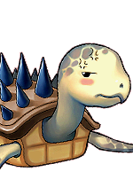<b>Ironclad Turtle</b> (Path to Oops Wharf)</td></tr>
<tr><td><input aria-label="ได้สติ๊กเกอร์แล้ว" class="stk" id="w2" type="checkbox"/></td><td>★ Rosemary - Make a Luxury Coat</td><td class="n">5</td><td>Gate of Oops Wharf</td><td>Rosemary</td><td>Lv 60+</td><td>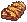Tiger Blanket × 5 ← 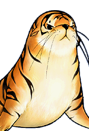<b>Sea Tiger</b> (Path to Oops Wharf)</td></tr>
<tr><td><input aria-label="ได้สติ๊กเกอร์แล้ว" class="stk" id="w3" type="checkbox"/></td><td>★ Sophia - Let's be Healthy!</td><td class="n">5</td><td>Gate of Oops Wharf</td><td>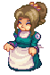Sophia</td><td>Lv 60+</td><td>Turtle Shell × 2 + Ironclad Turtle's Egg × 2 ← <b>Ironclad Turtle</b> (Path to Oops Wharf)</td></tr>
<tr><td><input aria-label="ได้สติ๊กเกอร์แล้ว" class="stk" id="w4" type="checkbox"/></td><td>★ Fortune Teller - Ghost Exorcism 1</td><td class="n">5</td><td>Gate of Oops Wharf</td><td>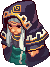Fortune Teller</td><td>Lv 60+</td><td>Blue Soul Bottle × 5 ← <b>Requi</b> (Wharf Field 1–3)</td></tr>
<tr><td><input aria-label="ได้สติ๊กเกอร์แล้ว" class="stk" id="w5" type="checkbox"/></td><td>★ Fortune Teller - Ghost Exorcism 2</td><td class="n">5</td><td>Gate of Oops Wharf</td><td>Fortune Teller</td><td>ทำ Ghost Exorcism 1 ก่อน</td><td>Red Soul Bottle × 5 ← <b>Quiem</b> (Wharf Field 1, 3)</td></tr>
<tr><td><input aria-label="ได้สติ๊กเกอร์แล้ว" class="stk" id="w8" type="checkbox"/></td><td>Fortune Teller - Ghost Exorcism 3</td><td class="n">5</td><td>Gate of Oops Wharf</td><td>Fortune Teller</td><td>ทำ Ghost Exorcism 2 ก่อน</td><td>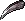Crow's Claw × 5 ← 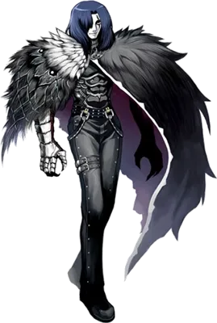<b>Crow</b> (Wharf Field 2, 3)</td></tr>
<tr class="pre-row"><td><input aria-label="ทำขั้นนี้ครบแล้ว" class="pre" id="wp1" type="checkbox"/></td><td>Genius Cochma - Oops Wharf Survey - 1 ขั้นก่อนหน้า · ไม่ได้สติ๊กเกอร์</td><td class="n">5</td><td>Gate of Oops Wharf</td><td>Genius Cochma</td><td>Lv 60+ · รวม 75 ตัว</td><td>ล่า <b>Ironclad Turtle</b> × 15 ตัวภายใน 10 นาที (Path to Oops Wharf)</td></tr>
<tr class="pre-row"><td><input aria-label="ทำขั้นนี้ครบแล้ว" class="pre" id="wp2" type="checkbox"/></td><td>Genius Cochma - Oops Wharf Survey - 2 ขั้นก่อนหน้า · ไม่ได้สติ๊กเกอร์</td><td class="n">5</td><td>Gate of Oops Wharf</td><td>Genius Cochma</td><td>รวม 25</td><td>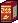Black Herbal Medicine × 5 ← <b>Sea Tiger</b> (Path to Oops Wharf)</td></tr>
<tr class="pre-row"><td><input aria-label="ทำขั้นนี้ครบแล้ว" class="pre" id="wp3" type="checkbox"/></td><td>Genius Cochma - Oops Wharf Survey - 3 ขั้นก่อนหน้า · ไม่ได้สติ๊กเกอร์</td><td class="n">5</td><td>Gate of Oops Wharf</td><td>Genius Cochma</td><td>รวม 25</td><td>A Boy's Dream × 5 ← <b>Requi</b> (Wharf Field 1–3)</td></tr>
<tr><td><input aria-label="ได้สติ๊กเกอร์แล้ว" class="stk" id="w9" type="checkbox"/></td><td>Genius Cochma - Oops Wharf Survey - 4</td><td class="n">5</td><td>Gate of Oops Wharf</td><td>Genius Cochma</td><td>ทำ Survey 1–3 ก่อน (แถวสีอ่อนด้านบน)</td><td>A Girl's Wish × 5 ← <b>Quiem</b> (Wharf Field 1, 3)</td></tr>
<tr class="pre-row"><td><input aria-label="ทำขั้นนี้ครบแล้ว" class="pre" id="wp4" type="checkbox"/></td><td>Frog Shaman - Oops Wharf Magic - 1 ขั้นก่อนหน้า · ไม่ได้สติ๊กเกอร์</td><td class="n">5</td><td>Wharf Field 2 - Devil Crow</td><td>Frog Shaman</td><td>Lv 60+ · รวม 25</td><td>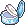Baby Powder × 5 ← <b>Quiem</b> (Wharf Field 1, 3)</td></tr>
<tr class="pre-row"><td><input aria-label="ทำขั้นนี้ครบแล้ว" class="pre" id="wp5" type="checkbox"/></td><td>Frog Shaman - Oops Wharf Magic - 2 ขั้นก่อนหน้า · ไม่ได้สติ๊กเกอร์</td><td class="n">5</td><td>Wharf Field 2 - Devil Crow</td><td>Frog Shaman</td><td>รวม 25</td><td>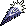Black Feather × 5 ← <b>Crow</b> (Wharf Field 2, 3)</td></tr>
<tr class="pre-row"><td><input aria-label="ทำขั้นนี้ครบแล้ว" class="pre" id="wp6" type="checkbox"/></td><td>Frog Shaman - Oops Wharf Magic - 3 ขั้นก่อนหน้า · ไม่ได้สติ๊กเกอร์</td><td class="n">5</td><td>Wharf Field 2 - Devil Crow</td><td>Frog Shaman</td><td>รวม 25</td><td>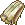Pirate Towel × 5 ← 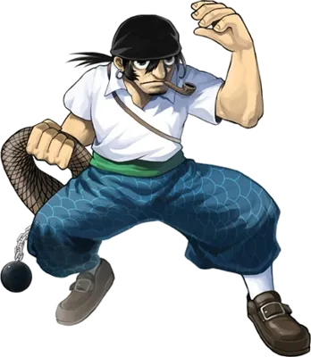<b>Black Foe</b> (Wharf Field 4)</td></tr>
<tr><td><input aria-label="ได้สติ๊กเกอร์แล้ว" class="stk" id="w10" type="checkbox"/></td><td>Frog Shaman - Oops Wharf Magic - 4</td><td class="n">5</td><td>Wharf Field 2 - Devil Crow</td><td>Frog Shaman</td><td>ทำ Magic 1–3 ก่อน (แถวสีอ่อนด้านบน)</td><td>Golden Eyepatch × 5 ← <b>Master Foe</b> (Wharf Field 4)</td></tr>
<tr><td><input aria-label="ได้สติ๊กเกอร์แล้ว" class="stk" id="w6" type="checkbox"/></td><td>★ Explorer Reina - God of Sea Poseidon</td><td class="n">5</td><td>Oops Wharf</td><td>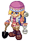Explorer Reina</td><td>Lv 65+</td><td>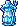Sculpture of Poseidon × 1 ← ขุดใน Wharf Field 1–4</td></tr>
<tr><td><input aria-label="ได้สติ๊กเกอร์แล้ว" class="stk" id="w7" type="checkbox"/></td><td>★ Merchant Miguel - Rare Ivory</td><td class="n">5</td><td>Oops Wharf</td><td>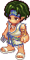Merchant Miguel</td><td>Lv 65+</td><td>Sea Ivory × 4 ← ขุดใน Wharf Field 1–4</td></tr>
<tr class="pre-row"><td><input aria-label="ทำขั้นนี้ครบแล้ว" class="pre" id="wp7" type="checkbox"/></td><td>Officer Tera - Fend Off Pirates! 1 ขั้นก่อนหน้า · ไม่ได้สติ๊กเกอร์</td><td class="n">5</td><td>Oops Wharf</td><td>Officer Tera</td><td>Lv 65+ · รวม 50</td><td>Pirate Hood × 10 ← <b>Black Foe</b> (Wharf Field 4)</td></tr>
<tr><td><input aria-label="ได้สติ๊กเกอร์แล้ว" class="stk" id="w11" type="checkbox"/></td><td>Officer Tera - Fend Off Pirates! 2</td><td class="n">5</td><td>Oops Wharf</td><td>Officer Tera</td><td>ทำ Fend Off Pirates! 1 ก่อน</td><td>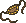Pirate Eye Patch × 10 ← <b>Master Foe</b> (Wharf Field 4)</td></tr>
<tr class="pre-row"><td><input aria-label="ทำขั้นนี้ครบแล้ว" class="pre" id="wp8" type="checkbox"/></td><td>Lethos - Elixir of Life? - 1 ขั้นก่อนหน้า · ไม่ได้สติ๊กเกอร์</td><td class="n">5</td><td>Oops Wharf</td><td>Lethos</td><td>Lv 70+ · รวม 25</td><td>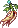Stone Ginseng × 5 ← ขุดใน Path to Mermaid Palace 1, 2</td></tr>
<tr class="pre-row"><td><input aria-label="ทำขั้นนี้ครบแล้ว" class="pre" id="wp9" type="checkbox"/></td><td>Lethos - Elixir of Life? - 2 ขั้นก่อนหน้า · ไม่ได้สติ๊กเกอร์</td><td class="n">5</td><td>Oops Wharf</td><td>Lethos</td><td>รวม 25</td><td>Waterworm × 5 ← 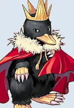<b>Super Golden Mole</b> (Path to Mermaid Palace 1)</td></tr>
<tr class="pre-row"><td><input aria-label="ทำขั้นนี้ครบแล้ว" class="pre" id="wp10" type="checkbox"/></td><td>Lethos - Elixir of Life? - 3 ขั้นก่อนหน้า · ไม่ได้สติ๊กเกอร์</td><td class="n">5</td><td>Oops Wharf</td><td>Lethos</td><td>รวม 25</td><td>Premium Limestone × 5 ← 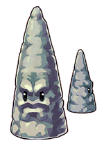<b>Cone Stone</b> (Path to Mermaid Palace 1, 2)</td></tr>
<tr><td><input aria-label="ได้สติ๊กเกอร์แล้ว" class="stk" id="w12" type="checkbox"/></td><td>Lethos - Elixir of Life? - 4</td><td class="n">5</td><td>Oops Wharf</td><td>Lethos</td><td>ทำ 1–3 ก่อน</td><td>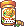Turtle Medicine × 5 ← 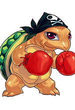<b>Pirate Boxer B</b> (Path to Mermaid Palace 2)</td></tr>
</tbody>
</table>

</section>

<section>

## จุดขุดและมอน เรียงตามแมพ

<table>
<thead><tr><th>ครบแล้ว</th><th>แมพ</th><th>ขุด / มอน</th><th>ไอเทม</th><th>จำนวนรวม</th><th>ใช้ในเควส</th></tr></thead>
<tbody>
<tr class="mon-row" data-q='[["w1", 5, "Grandpa Tango (1 × 5 รอบ)", 0]]'><td><input aria-label="หาครบแล้ว" class="mon" id="om1" type="checkbox"/></td><td>★ Path to Oops Wharf</td><td>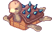Ironclad Turtle</td><td>Sea Palace Ticket</td><td class="n">5</td><td>Grandpa Tango (1 × 5 รอบ)</td></tr>
<tr class="mon-row" data-q='[["w3", 10, "Sophia (2 × 5 รอบ)", 0]]' data-unit="ต่อชนิด"><td><input aria-label="หาครบแล้ว" class="mon" id="om2" type="checkbox"/></td><td>★ Path to Oops Wharf</td><td>Ironclad Turtle</td><td>Turtle Shell, Ironclad Turtle's Egg</td><td class="n">10 ต่อชนิด</td><td>Sophia (2 × 5 รอบ)</td></tr>
<tr class="mon-row" data-q='[["wp1", 75, "Cochma Survey 1 (15 ตัวใน 10 นาที × 5 รอบ)", 0]]' data-unit="ตัว"><td><input aria-label="หาครบแล้ว" class="mon" id="om3" type="checkbox"/></td><td>Path to Oops Wharf</td><td>Ironclad Turtle</td><td>ล่า (ไม่ต้องเก็บของ)</td><td class="n">75 ตัว</td><td>Cochma Survey 1 (15 ตัวใน 10 นาที × 5 รอบ)</td></tr>
<tr class="mon-row" data-q='[["w2", 25, "Rosemary (5 × 5 รอบ)", 0]]'><td><input aria-label="หาครบแล้ว" class="mon" id="om4" type="checkbox"/></td><td>★ Path to Oops Wharf</td><td>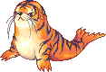Sea Tiger</td><td>Tiger Blanket</td><td class="n">25</td><td>Rosemary (5 × 5 รอบ)</td></tr>
<tr class="mon-row" data-q='[["wp2", 25, "Cochma Survey 2 (5 × 5 รอบ)", 0]]'><td><input aria-label="หาครบแล้ว" class="mon" id="om5" type="checkbox"/></td><td>Path to Oops Wharf</td><td>Sea Tiger</td><td>Black Herbal Medicine</td><td class="n">25</td><td>Cochma Survey 2 (5 × 5 รอบ)</td></tr>
<tr class="mon-row" data-q='[["w6", 5, "Explorer Reina (1 × 5 รอบ)", 0]]'><td><input aria-label="หาครบแล้ว" class="mon" id="om6" type="checkbox"/></td><td>★ Wharf Field 1–4 (ขุดได้ทุก Field)</td><td>ขุด</td><td>Sculpture of Poseidon</td><td class="n">5</td><td>Explorer Reina (1 × 5 รอบ)</td></tr>
<tr class="mon-row" data-q='[["w7", 20, "Merchant Miguel (4 × 5 รอบ)", 0]]'><td><input aria-label="หาครบแล้ว" class="mon" id="om7" type="checkbox"/></td><td>★ Wharf Field 1–4 (ขุดได้ทุก Field)</td><td>ขุด</td><td>Sea Ivory</td><td class="n">20</td><td>Merchant Miguel (4 × 5 รอบ)</td></tr>
<tr class="mon-row" data-q='[["w4", 25, "Ghost Exorcism 1 (5 × 5 รอบ)", 0]]'><td><input aria-label="หาครบแล้ว" class="mon" id="om8" type="checkbox"/></td><td>★ Wharf Field 1–3</td><td>Requi</td><td>Blue Soul Bottle</td><td class="n">25</td><td>Ghost Exorcism 1 (5 × 5 รอบ)</td></tr>
<tr class="mon-row" data-q='[["wp3", 25, "Cochma Survey 3 (5 × 5 รอบ)", 0]]'><td><input aria-label="หาครบแล้ว" class="mon" id="om9" type="checkbox"/></td><td>Wharf Field 1–3</td><td>Requi</td><td>A Boy's Dream</td><td class="n">25</td><td>Cochma Survey 3 (5 × 5 รอบ)</td></tr>
<tr class="mon-row" data-q="[[&quot;k3&quot;, 1, &quot;ขั้น 3 Lost Ship's Log&quot;, 0]]"><td><input aria-label="หาครบแล้ว" class="mon" id="om10" type="checkbox"/></td><td>★ Wharf Field 1–3</td><td>Requi</td><td>Voyage Log p31</td><td class="n">1</td><td>ขั้น 3 Lost Ship's Log</td></tr>
<tr class="mon-row" data-q='[["w5", 25, "Ghost Exorcism 2 (5 × 5 รอบ)", 0]]'><td><input aria-label="หาครบแล้ว" class="mon" id="om11" type="checkbox"/></td><td>★ Wharf Field 1, 3</td><td>Quiem</td><td>Red Soul Bottle</td><td class="n">25</td><td>Ghost Exorcism 2 (5 × 5 รอบ)</td></tr>
<tr class="mon-row" data-q='[["w9", 25, "Cochma Survey 4 (5 × 5 รอบ)", 0]]'><td><input aria-label="หาครบแล้ว" class="mon" id="om12" type="checkbox"/></td><td>Wharf Field 1, 3</td><td>Quiem</td><td>A Girl's Wish</td><td class="n">25</td><td>Cochma Survey 4 (5 × 5 รอบ)</td></tr>
<tr class="mon-row" data-q='[["wp4", 25, "Oops Wharf Magic 1 (5 × 5 รอบ)", 0]]'><td><input aria-label="หาครบแล้ว" class="mon" id="om13" type="checkbox"/></td><td>Wharf Field 1, 3</td><td>Quiem</td><td>Baby Powder</td><td class="n">25</td><td>Oops Wharf Magic 1 (5 × 5 รอบ)</td></tr>
<tr class="mon-row" data-q="[[&quot;k3&quot;, 1, &quot;ขั้น 3 Lost Ship's Log&quot;, 0]]"><td><input aria-label="หาครบแล้ว" class="mon" id="om14" type="checkbox"/></td><td>★ Wharf Field 1, 3</td><td>Quiem</td><td>Voyage Log p25</td><td class="n">1</td><td>ขั้น 3 Lost Ship's Log</td></tr>
<tr class="mon-row" data-q='[["w8", 25, "Ghost Exorcism 3 (5 × 5 รอบ)", 0]]'><td><input aria-label="หาครบแล้ว" class="mon" id="om15" type="checkbox"/></td><td>Wharf Field 2, 3</td><td>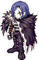Crow</td><td>Crow's Claw</td><td class="n">25</td><td>Ghost Exorcism 3 (5 × 5 รอบ)</td></tr>
<tr class="mon-row" data-q='[["wp5", 25, "Oops Wharf Magic 2 (5 × 5 รอบ)", 0]]'><td><input aria-label="หาครบแล้ว" class="mon" id="om16" type="checkbox"/></td><td>Wharf Field 2, 3</td><td>Crow</td><td>Black Feather</td><td class="n">25</td><td>Oops Wharf Magic 2 (5 × 5 รอบ)</td></tr>
<tr class="mon-row" data-q="[[&quot;k4&quot;, 5, &quot;ขั้น 4 Min's Weakness&quot;, 0]]" data-unit="ต่อชนิด"><td><input aria-label="หาครบแล้ว" class="mon" id="om17" type="checkbox"/></td><td>★ Wharf Field 4 - Chrono Wharf</td><td>ขุด</td><td>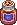Nausea Drink, Nausea Patch</td><td class="n">5 ต่อชนิด</td><td>ขั้น 4 Min's Weakness</td></tr>
<tr class="mon-row" data-q='[["wp7", 50, "Fend Off Pirates! 1 (10 × 5 รอบ)", 0]]'><td><input aria-label="หาครบแล้ว" class="mon" id="om18" type="checkbox"/></td><td>Wharf Field 4 - Chrono Wharf</td><td>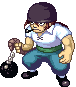Black Foe</td><td>Pirate Hood</td><td class="n">50</td><td>Fend Off Pirates! 1 (10 × 5 รอบ)</td></tr>
<tr class="mon-row" data-q='[["wp6", 25, "Oops Wharf Magic 3 (5 × 5 รอบ)", 0]]'><td><input aria-label="หาครบแล้ว" class="mon" id="om19" type="checkbox"/></td><td>Wharf Field 4 - Chrono Wharf</td><td>Black Foe</td><td>Pirate Towel</td><td class="n">25</td><td>Oops Wharf Magic 3 (5 × 5 รอบ)</td></tr>
<tr class="mon-row" data-q="[[&quot;k3&quot;, 1, &quot;ขั้น 3 Lost Ship's Log&quot;, 0]]"><td><input aria-label="หาครบแล้ว" class="mon" id="om20" type="checkbox"/></td><td>★ Wharf Field 4 - Chrono Wharf</td><td>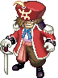Master Foe</td><td>Voyage Log p9</td><td class="n">1</td><td>ขั้น 3 Lost Ship's Log</td></tr>
<tr class="mon-row" data-q='[["w11", 50, "Fend Off Pirates! 2 (10 × 5 รอบ)", 0]]'><td><input aria-label="หาครบแล้ว" class="mon" id="om21" type="checkbox"/></td><td>Wharf Field 4 - Chrono Wharf</td><td>Master Foe</td><td>Pirate Eye Patch</td><td class="n">50</td><td>Fend Off Pirates! 2 (10 × 5 รอบ)</td></tr>
<tr class="mon-row" data-q='[["w10", 25, "Oops Wharf Magic 4 (5 × 5 รอบ)", 0]]'><td><input aria-label="หาครบแล้ว" class="mon" id="om22" type="checkbox"/></td><td>Wharf Field 4 - Chrono Wharf</td><td>Master Foe</td><td>Golden Eyepatch</td><td class="n">25</td><td>Oops Wharf Magic 4 (5 × 5 รอบ)</td></tr>
<tr class="mon-row" data-q='[["wp8", 25, "Elixir of Life 1 (5 × 5 รอบ)", 0]]'><td><input aria-label="หาครบแล้ว" class="mon" id="om23" type="checkbox"/></td><td>Path to Mermaid Palace 1, 2</td><td>ขุด</td><td>Stone Ginseng</td><td class="n">25</td><td>Elixir of Life 1 (5 × 5 รอบ)</td></tr>
<tr class="mon-row" data-q='[["wp9", 25, "Elixir of Life 2 (5 × 5 รอบ)", 0]]'><td><input aria-label="หาครบแล้ว" class="mon" id="om24" type="checkbox"/></td><td>Path to Mermaid Palace 1</td><td>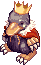Super Golden Mole</td><td>Waterworm</td><td class="n">25</td><td>Elixir of Life 2 (5 × 5 รอบ)</td></tr>
<tr class="mon-row" data-q='[["wp10", 25, "Elixir of Life 3 (5 × 5 รอบ)", 0]]'><td><input aria-label="หาครบแล้ว" class="mon" id="om25" type="checkbox"/></td><td>Path to Mermaid Palace 1, 2</td><td>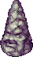Cone Stone</td><td>Premium Limestone</td><td class="n">25</td><td>Elixir of Life 3 (5 × 5 รอบ)</td></tr>
<tr class="mon-row" data-q='[["w12", 25, "Elixir of Life 4 (5 × 5 รอบ)", 0]]'><td><input aria-label="หาครบแล้ว" class="mon" id="om26" type="checkbox"/></td><td>Path to Mermaid Palace 2</td><td>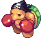Pirate Boxer B</td><td>Turtle Medicine</td><td class="n">25</td><td>Elixir of Life 4 (5 × 5 รอบ)</td></tr>
</tbody>
</table>

Diving Gear (ขั้น 5) ซื้อจากร้าน Item Girl ที่ Oops Wharf

</section>

<section>

## รูปจากวิกิ

### NPC

<a href="https://wikimirror.lifeto.co/wiki.ggftw.com/trickster/Mighty_Captain_Stan.html" rel="noopener" target="_blank">Mighty Captain Stanขั้น 1, 3 · Oops Wharf ↗</a>
<a href="https://wikimirror.lifeto.co/wiki.ggftw.com/trickster/Skipper_Min.html" rel="noopener" target="_blank">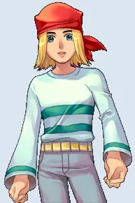Skipper Minขั้น 2, 4, 5 · Oops Wharf ↗</a>
<a href="https://wikimirror.lifeto.co/wiki.ggftw.com/trickster/Keeper_Julio.html" rel="noopener" target="_blank">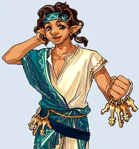Keeper Julioก่อนเริ่ม · Relics Field 4 / Gate ↗</a>
<a href="https://wikimirror.lifeto.co/wiki.ggftw.com/trickster/Item_Girl.html" rel="noopener" target="_blank">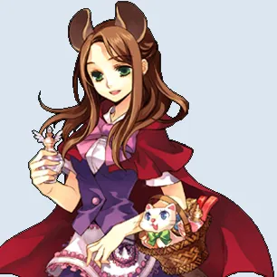Item Girlขาย Diving Gear (ขั้น 5) ↗</a>
<a href="https://wikimirror.lifeto.co/wiki.ggftw.com/trickster/Marinel.html" rel="noopener" target="_blank">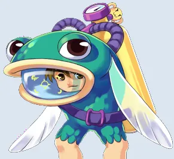Marinelขั้น 5 · Oops Wharf ↗</a>
<a href="https://wikimirror.lifeto.co/wiki.ggftw.com/trickster/Kochi.html" rel="noopener" target="_blank">Kochiวาร์ป · Gate of Oops Wharf ↗</a>

### มอนสเตอร์

<a href="https://wikimirror.lifeto.co/wiki.ggftw.com/trickster/Ironclad_Turtle.html" rel="noopener" target="_blank">Ironclad TurtleLv 68 · หน้าวิกิ ↗</a>
<a href="https://wikimirror.lifeto.co/wiki.ggftw.com/trickster/Sea_Tiger.html" rel="noopener" target="_blank">Sea TigerLv 70 · หน้าวิกิ ↗</a>
<a href="https://wikimirror.lifeto.co/wiki.ggftw.com/trickster/Requi.html" rel="noopener" target="_blank">RequiLv 72 · หน้าวิกิ ↗</a>
<a href="https://wikimirror.lifeto.co/wiki.ggftw.com/trickster/Quiem.html" rel="noopener" target="_blank">QuiemLv 75 · หน้าวิกิ ↗</a>
<a href="https://wikimirror.lifeto.co/wiki.ggftw.com/trickster/Black_Foe.html" rel="noopener" target="_blank">Black FoeLv 79 · หน้าวิกิ ↗</a>
<a href="https://wikimirror.lifeto.co/wiki.ggftw.com/trickster/Super_Golden_Mole.html" rel="noopener" target="_blank">Super Golden MoleLv 80 · หน้าวิกิ ↗</a>
<a href="https://wikimirror.lifeto.co/wiki.ggftw.com/trickster/Master_Foe.html" rel="noopener" target="_blank">Master FoeLv 84 · หน้าวิกิ ↗</a>
<a href="https://wikimirror.lifeto.co/wiki.ggftw.com/trickster/Cone_Stone.html" rel="noopener" target="_blank">Cone StoneLv 84 · หน้าวิกิ ↗</a>
<a href="https://wikimirror.lifeto.co/wiki.ggftw.com/trickster/Pirate_Boxer_B.html" rel="noopener" target="_blank">Pirate Boxer BLv 86 · หน้าวิกิ ↗</a>
<a href="https://wikimirror.lifeto.co/wiki.ggftw.com/trickster/Crow.html" rel="noopener" target="_blank">CrowLv 88 · หน้าวิกิ ↗</a>

### แมพ

<a href="https://wikimirror.lifeto.co/asset.103.ggftw.net/wiki/to-w/images/6/69/Oops_Wharf_Map.png" rel="noopener" target="_blank">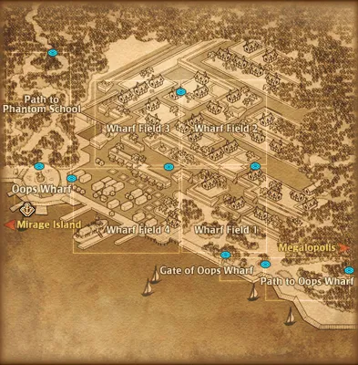แผนที่ Oops Wharfทั้งโซน ↗</a>
<a href="https://wikimirror.lifeto.co/wiki.ggftw.com/trickster/Path_to_Oops_Wharf.html" rel="noopener" target="_blank">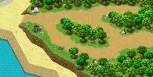Path to Oops Wharfหน้าแมพ ↗</a>
<a href="https://wikimirror.lifeto.co/wiki.ggftw.com/trickster/Gate_of_Oops_Wharf.html" rel="noopener" target="_blank">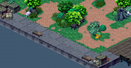Gate of Oops Wharfหน้าแมพ ↗</a>
<a href="https://wikimirror.lifeto.co/wiki.ggftw.com/trickster/Wharf_Field_1_-_Haunted_Town.html" rel="noopener" target="_blank">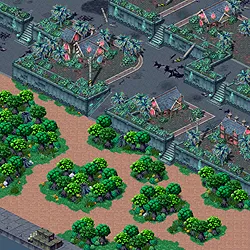Wharf Field 1 - Haunted Townหน้าแมพ ↗</a>
<a href="https://wikimirror.lifeto.co/wiki.ggftw.com/trickster/Wharf_Field_2_-_Devil_Crow.html" rel="noopener" target="_blank">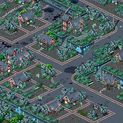Wharf Field 2 - Devil Crowหน้าแมพ ↗</a>
<a href="https://wikimirror.lifeto.co/wiki.ggftw.com/trickster/Wharf_Field_3_-_Phantom_Park.html" rel="noopener" target="_blank">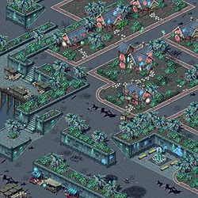Wharf Field 3 - Phantom Parkหน้าแมพ ↗</a>
<a href="https://wikimirror.lifeto.co/wiki.ggftw.com/trickster/Wharf_Field_4_-_Chrono_Wharf.html" rel="noopener" target="_blank">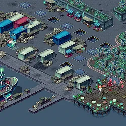Wharf Field 4 - Chrono Wharfหน้าแมพ ↗</a>
<a href="https://wikimirror.lifeto.co/wiki.ggftw.com/trickster/Path_to_Mermaid_Palace_2.html" rel="noopener" target="_blank">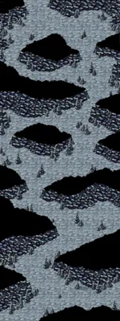Path to Mermaid Palace 2หน้าแมพ ↗</a>

</section>

<PageBehavior />
