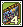
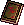

<header style="display:flex;flex-direction:column;gap:8px">

# เควสกุญแจ Rose Garden

สรุปจากวิกิ ggFTW (ฉบับ mirror ของ LifeTO) หน้า [Rosaline Gracia - Rose Garden Stickers](https://wikimirror.lifeto.co/wiki.ggftw.com/trickster/Rosaline_Gracia_-_Rose_Garden_Stickers.html), [Rose Garden Sticker](https://wikimirror.lifeto.co/wiki.ggftw.com/trickster/Rose_Garden_Sticker.html) และหน้าเควส/มอนที่ลิงก์ไป

</header>

ประเภท<button type="button" data-t="all">ทั้งหมด</button><button type="button" data-t="key">เควสกุญแจ / สติ๊กเกอร์</button><button type="button" data-t="town">เควสอื่น</button>

<section>

## ภาพรวม

โซนต่อจาก Ghost Blue เควสกุญแจทำกับ **Rosaline Gracia** ที่ Rose Field 1 - Stairway to Sorrow ต้อง<b>เลเวล 125+</b> และผ่าน Chief Koha - Get a Date แล้ว

- ต้องได้ **Rose Garden Sticker 13 ใบ** จากเควสธรรมดา
- เตรียม **Adventurer's Book** เล่มที่ได้คืนจาก Get a Date ไว้ส่งในขั้น 1
- ช่วงท้ายต้องเข้า **Beast Garden**: ขุด **Rosaline's Jewel Box** ใน Rose Field เปิดได้ Rosaline's Story Book (A) ดับเบิลคลิกเพื่อวาร์ป

</section>

<section aria-live="polite" class="counter">

## ความคืบหน้า

0 Rose Garden Sticker ที่ควรมีตอนนี้

<button id="reset" type="button">ล้างทั้งหมด</button>

</section>

<section data-qt="key">

## เควสกุญแจ 4 ขั้น

<label class="done"><input class="key" id="k1" type="checkbox"/> ทำแล้ว</label>ขั้น 1<h3>Rosaline Gracia - Rose Garden Stickers</h3>

Rose Field 1 - Stairway to SorrowLv 125+หลังผ่าน Chief Koha - Get a DateEXP 3.49M · TM 5.31M

ส่ง<ul><li><b>Rose Garden Sticker × 13</b></li><li><b>Adventurer's Book × 1</b></li></ul>

รางวัล: Blue Potion C × 20 · ทำครั้งเดียว

<label class="done"><input class="key" id="k3" type="checkbox"/> ทำแล้ว</label>ขั้น 2<h3>Princess Rosetta - Unbroken Magic</h3>

Beast GardenLv 125+ต้องรับ Childhood Promise ค้างไว้ก่อนEXP 3.49M · TM 5.31M

ไปรับเควส <b>Rosaline Gracia - Childhood Promise</b> ค้างไว้ แล้วเข้า Beast Garden (ขุด Rosaline's Jewel Box → Story Book (A))

ส่ง <b>Rose of Love × 1</b> ได้จากการเปิด <b>Beast's Rose</b> ที่ดรอปจาก <b>Rose Bush</b> (Beast Garden) Rose Bush เกิดน้อย และเปิดแล้วไม่ได้ Rose of Love ทุกครั้ง อาจต้องขุด Story Book (A) หลายเล่มเพื่อเข้าซ้ำ

รางวัล<ul><li>Rose of True Love</li><li>Rosaline's Story Book (B)</li></ul>

<label class="done"><input class="key" id="k4" type="checkbox"/> ทำแล้ว</label>ขั้น 3<h3>Prince Stephano - A Happy Ending</h3>

Beast GardenLv 125+EXP 3.49M · TM 5.31M

เอา <b>Rose of True Love</b> ไปให้ NPC <b>Beast Vincento</b> ใน Beast Garden ก่อน แล้วกลับมาคุยกับ Prince Stephano อีกครั้ง

รางวัล<ul><li>D's Letter</li><li>10,000 Galder Coupon × 2</li></ul>

<label class="done"><input class="key" id="k2" type="checkbox"/> ทำแล้ว</label>ขั้น 4<h3>Rosaline Gracia - Childhood Promise</h3>

Rose Field 1 - Stairway to Sorrowหลังผ่านขั้น 1EXP 5.05M · TM 6.91M

ส่ง<ul><li><b>D's Letter</b> (จากขั้น 3)</li><li><b>Rosaline's Story Book (B)</b> (จากขั้น 2)</li></ul>

รางวัล<ul><li>Adventurer's Book (เก็บไว้ใช้โซนต่อไป)</li><li>Weapon Exchange Ticket F</li></ul>

</section>

<section data-qt="key">

## เควสที่ให้ Rose Garden Sticker

มี 19 เควส ต้องการ 13 ใบ

เส้นทางแนะนำ 13 เควสติด ★ อยู่ใน Rose Field 1–3 และ Secret Garden of Rosetta ไม่ต้องลง Vamp Dungeon · Survey 4 และ Magic 4 ต้องทำขั้น 1–3 ก่อน

<button aria-pressed="false" id="hideUnstar" type="button">ซ่อนเควสที่ไม่ติดดาว</button><button hidden="" id="showAll" type="button">แสดงทั้งหมด</button>

<table>
<thead><tr><th>ได้แล้ว</th><th>เควส</th><th>รอบ</th><th>ที่อยู่</th><th>NPC</th><th>เงื่อนไข</th><th>ของที่ต้องส่ง และแหล่ง</th></tr></thead>
<tbody>
<tr class="pre-row"><td><input aria-label="ทำขั้นนี้ครบแล้ว" class="pre" id="rp7" type="checkbox"/></td><td>Lethos - Vampire Collections? 1 ขั้นก่อนหน้า · ไม่ได้สติ๊กเกอร์ EXP 2.23M</td><td class="n">5</td><td>Gate of Vamp Castle</td><td>Lethos</td><td>Lv 130+ · รวม 15</td><td>Diary × 3 ← ขุดใน Vamp Dungeon</td></tr>
<tr class="pre-row"><td><input aria-label="ทำขั้นนี้ครบแล้ว" class="pre" id="rp8" type="checkbox"/></td><td>Lethos - Vampire Collections? 2 ขั้นก่อนหน้า · ไม่ได้สติ๊กเกอร์ EXP 2.23M</td><td class="n">5</td><td>Gate of Vamp Castle</td><td>Lethos</td><td>Lv 130+ · รวม 15</td><td>Kerbero's Paw × 3 ← <b>Kerberos</b> (Vamp Dungeon 1)</td></tr>
<tr class="pre-row"><td><input aria-label="ทำขั้นนี้ครบแล้ว" class="pre" id="rp9" type="checkbox"/></td><td>Lethos - Vampire Collections? 3 ขั้นก่อนหน้า · ไม่ได้สติ๊กเกอร์ EXP 2.23M</td><td class="n">5</td><td>Gate of Vamp Castle</td><td>Lethos</td><td>Lv 130+ · รวม 15</td><td>Lacey Headband × 3 ← <b>Maid Lydia</b> (Vamp Dungeon 1, 2)</td></tr>
<tr><td><input aria-label="ได้สติ๊กเกอร์แล้ว" class="stk" id="r19" type="checkbox"/></td><td>Lethos - Vampire Collections? 4 EXP 2.23M</td><td class="n">5</td><td>Gate of Vamp Castle</td><td>Lethos</td><td>Lv 130+</td><td>Vampire's Canine × 3 ← <b>Mister Freaks</b> (Vamp Dungeon 2)</td></tr>
<tr><td><input aria-label="ได้สติ๊กเกอร์แล้ว" class="stk" id="r5" type="checkbox"/></td><td>★ Rosemary - Dance Woman! EXP 830.9K</td><td class="n">5</td><td>Rose Field 1</td><td>Rosemary</td><td>Lv 120+</td><td>Ballet Manual ← <b>Dancer Isabelle</b> (Rose Field 1) Red Clay Doll Shoes ← ขุดใน Rose Garden Fields</td></tr>
<tr class="pre-row"><td><input aria-label="ทำขั้นนี้ครบแล้ว" class="pre" id="rp1" type="checkbox"/></td><td>★ Genius Cochma - Rose Garden Survey 1 ขั้นก่อนหน้า · ไม่ได้สติ๊กเกอร์</td><td class="n">5</td><td>Rose Field 1</td><td>Genius Cochma</td><td>รวม 75 ตัว</td><td>ล่า <b>Captain Arman</b> × 15 ตัวภายใน 10 นาที (Rose Field 2)</td></tr>
<tr class="pre-row"><td><input aria-label="ทำขั้นนี้ครบแล้ว" class="pre" id="rp2" type="checkbox"/></td><td>★ Genius Cochma - Rose Garden Survey 2 ขั้นก่อนหน้า · ไม่ได้สติ๊กเกอร์ EXP 1.87M</td><td class="n">5</td><td>Rose Field 1</td><td>Genius Cochma</td><td>รวม 25</td><td>Delicate Doll × 5 ← <b>Dancer Michel</b> (Rose Field 1)</td></tr>
<tr class="pre-row"><td><input aria-label="ทำขั้นนี้ครบแล้ว" class="pre" id="rp3" type="checkbox"/></td><td>★ Genius Cochma - Rose Garden Survey 3 ขั้นก่อนหน้า · ไม่ได้สติ๊กเกอร์ EXP 1.87M</td><td class="n">5</td><td>Rose Field 1</td><td>Genius Cochma</td><td>รวม 25</td><td>Ballet Manual × 5 ← <b>Dancer Isabelle</b> (Rose Field 1)</td></tr>
<tr><td><input aria-label="ได้สติ๊กเกอร์แล้ว" class="stk" id="r6" type="checkbox"/></td><td>★ Genius Cochma - Rose Garden Survey 4 EXP 2.24M</td><td class="n">5</td><td>Rose Field 1</td><td>Genius Cochma</td><td>ทำ Survey 1–3 ก่อน (แถวสีอ่อนด้านบน)</td><td>Gold Tights × 5 ← <b>Captain Norman</b> (Rose Field 2, 4)</td></tr>
<tr><td><input aria-label="ได้สติ๊กเกอร์แล้ว" class="stk" id="r10" type="checkbox"/></td><td>★ Louis Bitton - Maintaining Dignity EXP 830.9K</td><td class="n">5</td><td>Rose Field 1</td><td>Louis Bitton</td><td>มี New Garments are Here ค้างอยู่</td><td>Extravagant Lace ← <b>Madam Moncher</b> Extravagant Silk ← <b>Madam Chiffon</b> Extravagant Thread ← <b>Madam Fondue</b> (Rose Field 3, 4) Jewel Box ← ขุดใน Rose Garden Fields</td></tr>
<tr><td><input aria-label="ได้สติ๊กเกอร์แล้ว" class="stk" id="r2" type="checkbox"/></td><td>★ Vamp Lydia - Troublemaker Lydia EXP 1.87M</td><td class="n">5</td><td>Rose Field 2</td><td>Vamp Lydia</td><td>Lv 120+</td><td>Monocle ← ขุดใน Rose Garden Fields</td></tr>
<tr><td><input aria-label="ได้สติ๊กเกอร์แล้ว" class="stk" id="r14" type="checkbox"/></td><td>Clever Owl - Owl's Letter Delivery EXP 823.8K</td><td class="n">5</td><td>Rose Field 2</td><td>Clever Owl</td><td>ต้องมี Princess's Hair ในกระเป๋า</td><td>Worm from Rose Garden × 3 + 100 Galder Coupon ← ขุดใน Rose Garden Fields</td></tr>
<tr><td><input aria-label="ได้สติ๊กเกอร์แล้ว" class="stk" id="r1" type="checkbox"/></td><td>★ Prince Sebastian - Sebastian's Okay Plan EXP 830.9K</td><td class="n">5</td><td>Rose Field 3</td><td>Prince Sebastian</td><td>Lv 120+</td><td>Rose Petal × 10 ← ขุดใน Rose Garden Fields</td></tr>
<tr><td><input aria-label="ได้สติ๊กเกอร์แล้ว" class="stk" id="r3" type="checkbox"/></td><td>★ Majordomo Felix - Stern Majordomo Felix TM 2.97M</td><td class="n">5</td><td>Rose Field 3</td><td>Majordomo Felix</td><td>Lv 120+</td><td>Silver Rose ← ขุดใน Rose Garden Fields</td></tr>
<tr><td><input aria-label="ได้สติ๊กเกอร์แล้ว" class="stk" id="r4" type="checkbox"/></td><td>★ Farmer Tsetsech - Farmer Tsetsech's Worry <b>(รอบเดียว)</b> EXP 2.23M</td><td class="n">1</td><td>Rose Field 3</td><td>Farmer Tsetsech</td><td>Lv 125+</td><td>Worm from Rose Garden × 10 ← ขุดใน Rose Garden Fields</td></tr>
<tr class="pre-row"><td><input aria-label="ทำขั้นนี้ครบแล้ว" class="pre" id="rp4" type="checkbox"/></td><td>★ Frog Shaman - Rose Garden Magic 1 ขั้นก่อนหน้า · ไม่ได้สติ๊กเกอร์ EXP 1.87M</td><td class="n">5</td><td>Rose Field 3</td><td>Frog Shaman</td><td>รวม 25</td><td>Coffee Creamer × 5 ← <b>Dancer Isabelle</b> (Rose Field 1)</td></tr>
<tr class="pre-row"><td><input aria-label="ทำขั้นนี้ครบแล้ว" class="pre" id="rp5" type="checkbox"/></td><td>★ Frog Shaman - Rose Garden Magic 2 ขั้นก่อนหน้า · ไม่ได้สติ๊กเกอร์ EXP 1.87M</td><td class="n">5</td><td>Rose Field 3</td><td>Frog Shaman</td><td>รวม 25</td><td>Red Eye Shadow × 5 ← <b>Captain Charman</b> (Rose Field 2)</td></tr>
<tr class="pre-row"><td><input aria-label="ทำขั้นนี้ครบแล้ว" class="pre" id="rp6" type="checkbox"/></td><td>★ Frog Shaman - Rose Garden Magic 3 ขั้นก่อนหน้า · ไม่ได้สติ๊กเกอร์ EXP 1.87M</td><td class="n">5</td><td>Rose Field 3</td><td>Frog Shaman</td><td>รวม 25</td><td>Ostrich Feather × 5 ← <b>Madam Fondue</b> (Rose Field 3, 4)</td></tr>
<tr><td><input aria-label="ได้สติ๊กเกอร์แล้ว" class="stk" id="r7" type="checkbox"/></td><td>★ Frog Shaman - Rose Garden Magic 4 EXP 2.24M</td><td class="n">5</td><td>Rose Field 3</td><td>Frog Shaman</td><td>ทำ Magic 1–3 ก่อน (แถวสีอ่อนด้านบน)</td><td>Red Rose of Passion × 5 ← <b>Beast Vincento</b> (Rose Field 4 / ถูกเรียกออกมาใน Rose Field 1–4)</td></tr>
<tr><td><input aria-label="ได้สติ๊กเกอร์แล้ว" class="stk" id="r12" type="checkbox"/></td><td>★ Fairy Godmother - Fairy God Mother EXP 830.9K</td><td class="n">5</td><td>Rose Field 3</td><td>Fairy Godmother</td><td>มี Breaking Contract ค้างอยู่</td><td>Golden Carriage Contract ← ขุดใน Rose Field 3 Magic Crystal ← ขุดใน Rose Garden Fields / Beast Garden หรือดรอปจาก <b>Beast Vincento</b></td></tr>
<tr><td><input aria-label="ได้สติ๊กเกอร์แล้ว" class="stk" id="r13" type="checkbox"/></td><td>★ Horse Hiddink - Breaking Contract EXP 830.9K</td><td class="n">5</td><td>Rose Field 3</td><td>Horse Hiddink</td><td>Lv 120+</td><td>Horseshoe of Freedom ← รางวัลจาก Fairy Godmother (ทำสลับกันทีละรอบ)</td></tr>
<tr><td><input aria-label="ได้สติ๊กเกอร์แล้ว" class="stk" id="r8" type="checkbox"/></td><td>★ Queen Cecilia - Secret Garden Queen's Quest EXP 300K</td><td class="n">5</td><td>Secret Garden of Rosetta</td><td>Queen Cecilia</td><td>Lv 120+</td><td>Moncher Pie × 5 ← <b>Madam Moncher</b> (Rose Field 3) Cocoa Powder × 5 ← ขุดใน Rose Garden Fields</td></tr>
<tr><td><input aria-label="ได้สติ๊กเกอร์แล้ว" class="stk" id="r9" type="checkbox"/></td><td>★ Queen Cecilia - Fan Chat Method EXP 236.5K · TM 451.7K</td><td class="n">5</td><td>Secret Garden of Rosetta</td><td>Queen Cecilia</td><td>Lv 120+</td><td>Fan Chat Method × 1 + Aristocratic Fan × 2 ← <b>Madam Chiffon</b> (Rose Field 3)</td></tr>
<tr><td><input aria-label="ได้สติ๊กเกอร์แล้ว" class="stk" id="r11" type="checkbox"/></td><td>★ Queen Cecilia - New Garments are Here EXP 1.04M</td><td class="n">5</td><td>Secret Garden of Rosetta</td><td>Queen Cecilia</td><td>ผ่าน Fan Chat Method</td><td>Royal Garment Set ← รางวัลจาก Louis Bitton (ทำสลับกันทีละรอบ)</td></tr>
<tr class="pre-row"><td><input aria-label="ทำขั้นนี้ครบแล้ว" class="pre" id="rp10" type="checkbox"/></td><td>King Edward - Guardian Knight 1 ขั้นก่อนหน้า · ไม่ได้สติ๊กเกอร์ EXP 1.53M · TM 1.15M</td><td class="n">1</td><td>Secret Garden of Rosetta</td><td>King Edward</td><td>ผ่าน King Edward - Is the Princess Safe? ก่อน</td><td>Rusty Sword + Rusty Shield + Rusty Helmet ← ขุดใน Vamp Dungeon · ได้ Knight Appointment Letter</td></tr>
<tr class="pre-row"><td><input aria-label="ทำขั้นนี้ครบแล้ว" class="pre" id="rp11" type="checkbox"/></td><td>Werewolf Lycan - Lycan's Answer ขั้นก่อนหน้า · ไม่ได้สติ๊กเกอร์ EXP 4.5M · TM 3.3M</td><td class="n">1</td><td>Secret Room of Rosetta</td><td>Werewolf Lycan</td><td>รับ Guardian Knight 2 ค้างไว้ และมี Garden Key (จาก Servant Alfredo - Garden Key' Monster Quest)</td><td>Knight Appointment Letter (จาก Guardian Knight 1) + Moonstone × 3 ← ขุดใน Vamp Dungeon · ได้ Blood Moonstone</td></tr>
<tr><td><input aria-label="ได้สติ๊กเกอร์แล้ว" class="stk" id="r15" type="checkbox"/></td><td>King Edward - Guardian Knight 2 <b>(รอบเดียว)</b> EXP 1.53M · TM 1.15M</td><td class="n">1</td><td>Secret Garden of Rosetta</td><td>King Edward</td><td>ผ่าน Guardian Knight 1 แล้วรับเควสค้างไว้ก่อนไปทำ Lycan's Answer</td><td>Blood Moonstone ← รางวัลจาก Werewolf Lycan - Lycan's Answer</td></tr>
<tr><td><input aria-label="ได้สติ๊กเกอร์แล้ว" class="stk" id="r16" type="checkbox"/></td><td>Butler of Vamp Castle - Butler's Request EXP 992.3K</td><td class="n">5</td><td>Vamp Dungeon 1</td><td>Butler</td><td>Lv 130+</td><td>Pocket Watch + Monocle ← ขุดใน Rose Garden Fields</td></tr>
<tr><td><input aria-label="ได้สติ๊กเกอร์แล้ว" class="stk" id="r17" type="checkbox"/></td><td>Butler of Vamp Castle - Preparing for the Banquet EXP 992.3K</td><td class="n">5</td><td>Vamp Dungeon 1</td><td>Butler</td><td>Lv 130+</td><td>Golden Cup × 2 ← ขุดใน Rose Garden Fields</td></tr>
<tr><td><input aria-label="ได้สติ๊กเกอร์แล้ว" class="stk" id="r18" type="checkbox"/></td><td>Butler of Vamp Castle - Bloody Liquid EXP 992.3K</td><td class="n">5</td><td>Vamp Dungeon 1</td><td>Butler</td><td>ผ่าน Preparing for the Banquet</td><td>Wild Strawberry Juice × 5 ← <b>Maid Lydia</b> (Vamp Dungeon 1, 2)</td></tr>
</tbody>
</table>

Louis Bitton กับ New Garments are Here และ Fairy Godmother กับ Breaking Contract ต้องทำคู่กัน · Clever Owl ต้องมี Princess's Hair ในกระเป๋า

</section>

<section data-qt="key">

## จุดขุดและมอน เรียงตามแมพ

<table>
<thead><tr><th>ครบแล้ว</th><th>แมพ</th><th>ขุด / มอน</th><th>ไอเทม</th><th>จำนวนรวม</th><th>ใช้ในเควส</th></tr></thead>
<tbody>
<tr class="mon-row" data-q='[["r12", 5, "Fairy Godmother (1 × 5 รอบ)", 0]]'><td><input aria-label="หาครบแล้ว" class="mon" id="rm15" type="checkbox"/></td><td>★ Rose Field 3 - Maze of Blue Rose</td><td>ขุด</td><td>Golden Carriage Contract</td><td class="n">5</td><td>Fairy Godmother (1 × 5 รอบ)</td></tr>
<tr class="mon-row" data-q='[["k4", 1, "ขั้น 2–3 (เปิดได้ Story Book (A) ใช้วาร์ปเข้า Beast Garden)", 0]]'><td><input aria-label="หาครบแล้ว" class="mon" id="rm18" type="checkbox"/></td><td>★ Rose Garden Fields (ขุดได้ทุก Field)</td><td>ขุด</td><td>Rosaline's Jewel Box</td><td class="n">1</td><td>ขั้น 2–3 (เปิดได้ Story Book (A) ใช้วาร์ปเข้า Beast Garden)</td></tr>
<tr class="mon-row" data-q='[["r1", 50, "Prince Sebastian (10 × 5 รอบ)", 0]]'><td><input aria-label="หาครบแล้ว" class="mon" id="rm19" type="checkbox"/></td><td>★ Rose Garden Fields</td><td>ขุด</td><td>Rose Petal</td><td class="n">50</td><td>Prince Sebastian (10 × 5 รอบ)</td></tr>
<tr class="mon-row" data-q='[["r8", 25, "Cecilia Secret Garden (5 × 5 รอบ)", 0]]'><td><input aria-label="หาครบแล้ว" class="mon" id="rm20" type="checkbox"/></td><td>★ Rose Garden Fields</td><td>ขุด</td><td>Cocoa Powder</td><td class="n">25</td><td>Cecilia Secret Garden (5 × 5 รอบ)</td></tr>
<tr class="mon-row" data-q='[["r4", 10, "Farmer Tsetsech (10 × 1 รอบ)", 0]]'><td><input aria-label="หาครบแล้ว" class="mon" id="rm21" type="checkbox"/></td><td>★ Rose Garden Fields</td><td>ขุด</td><td>Worm from Rose Garden</td><td class="n">10</td><td>Farmer Tsetsech (10 × 1 รอบ)</td></tr>
<tr class="mon-row" data-q='[["r2", 5, "Vamp Lydia (1 × 5 รอบ)", 0]]'><td><input aria-label="หาครบแล้ว" class="mon" id="rm22" type="checkbox"/></td><td>★ Rose Garden Fields</td><td>ขุด</td><td>Monocle</td><td class="n">5</td><td>Vamp Lydia (1 × 5 รอบ)</td></tr>
<tr class="mon-row" data-q='[["r3", 5, "Majordomo Felix (1 × 5 รอบ)", 0]]'><td><input aria-label="หาครบแล้ว" class="mon" id="rm23" type="checkbox"/></td><td>★ Rose Garden Fields</td><td>ขุด</td><td>Silver Rose</td><td class="n">5</td><td>Majordomo Felix (1 × 5 รอบ)</td></tr>
<tr class="mon-row" data-q='[["r5", 5, "Rosemary (1 × 5 รอบ)", 0]]'><td><input aria-label="หาครบแล้ว" class="mon" id="rm24" type="checkbox"/></td><td>★ Rose Garden Fields</td><td>ขุด</td><td>Red Clay Doll Shoes</td><td class="n">5</td><td>Rosemary (1 × 5 รอบ)</td></tr>
<tr class="mon-row" data-q='[["r10", 5, "Louis Bitton (1 × 5 รอบ)", 0]]'><td><input aria-label="หาครบแล้ว" class="mon" id="rm25" type="checkbox"/></td><td>★ Rose Garden Fields (+ Vamp Dungeon)</td><td>ขุด</td><td>Jewel Box</td><td class="n">5</td><td>Louis Bitton (1 × 5 รอบ)</td></tr>
<tr class="mon-row" data-q='[["r14", 15, "Clever Owl (3 × 5 รอบ)", 0]]'><td><input aria-label="หาครบแล้ว" class="mon" id="rm26" type="checkbox"/></td><td>Rose Garden Fields</td><td>ขุด</td><td>Worm from Rose Garden (เพิ่ม)</td><td class="n">15</td><td>Clever Owl (3 × 5 รอบ)</td></tr>
<tr class="mon-row" data-q='[["r17", 10, "Butler Preparing for the Banquet (2 × 5 รอบ)", 0]]'><td><input aria-label="หาครบแล้ว" class="mon" id="rm27" type="checkbox"/></td><td>Rose Garden Fields</td><td>ขุด</td><td>Golden Cup</td><td class="n">10</td><td>Butler Preparing for the Banquet (2 × 5 รอบ)</td></tr>
<tr class="mon-row" data-q="[[&quot;r16&quot;, 5, &quot;Butler's Request (1 × 5 รอบ)&quot;, 0]]"><td><input aria-label="หาครบแล้ว" class="mon" id="rm28" type="checkbox"/></td><td>Rose Garden Fields</td><td>ขุด</td><td>Pocket Watch, Monocle (เพิ่ม)</td><td class="n">5</td><td>Butler's Request (1 × 5 รอบ)</td></tr>
<tr class="mon-row" data-q='[["rp7", 15, "Vampire Collections? 1 (3 × 5 รอบ)", 0]]'><td><input aria-label="หาครบแล้ว" class="mon" id="rm31" type="checkbox"/></td><td>Vamp Dungeon</td><td>ขุด</td><td>Diary</td><td class="n">15</td><td>Vampire Collections? 1 (3 × 5 รอบ)</td></tr>
<tr class="mon-row" data-q='[["rp10", 3, "Guardian Knight 1 (อย่างละ 1 ชิ้น)", 0]]'><td><input aria-label="หาครบแล้ว" class="mon" id="rm32" type="checkbox"/></td><td>Vamp Dungeon</td><td>ขุด</td><td>Rusty Sword, Rusty Shield, Rusty Helmet</td><td class="n">3</td><td>Guardian Knight 1 (อย่างละ 1 ชิ้น)</td></tr>
<tr class="mon-row" data-q="[[&quot;rp11&quot;, 3, &quot;Lycan's Answer (3 × 1 รอบ)&quot;, 0]]"><td><input aria-label="หาครบแล้ว" class="mon" id="rm33" type="checkbox"/></td><td>Vamp Dungeon</td><td>ขุด</td><td>Moonstone</td><td class="n">3</td><td>Lycan's Answer (3 × 1 รอบ)</td></tr>
<tr class="mon-row" data-q='[["k3", 1, "ขั้น 2 Princess Rosetta (เปิดหลายดอกกว่าจะได้)", 0]]'><td><input aria-label="หาครบแล้ว" class="mon" id="rm1" type="checkbox"/></td><td>★ Beast Garden</td><td>Rose Bush</td><td>Beast's Rose → Rose of Love</td><td class="n">1</td><td>ขั้น 2 Princess Rosetta (เปิดหลายดอกกว่าจะได้)</td></tr>
<tr class="mon-row" data-q='[["rp2", 25, "Cochma Survey 2 (5 × 5 รอบ)", 0]]'><td><input aria-label="หาครบแล้ว" class="mon" id="rm2" type="checkbox"/></td><td>★ Rose Field 1 - Stairway to Sorrow</td><td>Dancer Michel</td><td>Delicate Doll</td><td class="n">25</td><td>Cochma Survey 2 (5 × 5 รอบ)</td></tr>
<tr class="mon-row" data-q='[["rp3", 25, "Cochma Survey 3 (5 × 5 รอบ)", 0], ["r5", 5, "Rosemary (1 × 5 รอบ)", 0]]'><td><input aria-label="หาครบแล้ว" class="mon" id="rm3" type="checkbox"/></td><td>★ Rose Field 1 - Stairway to Sorrow</td><td>Dancer Isabelle</td><td>Ballet Manual</td><td class="n">30</td><td>Cochma Survey 3 (5 × 5 รอบ) + Rosemary (1 × 5 รอบ)</td></tr>
<tr class="mon-row" data-q='[["rp4", 25, "Frog Shaman Magic 1 (5 × 5 รอบ)", 0]]'><td><input aria-label="หาครบแล้ว" class="mon" id="rm4" type="checkbox"/></td><td>★ Rose Field 1 - Stairway to Sorrow</td><td>Dancer Isabelle</td><td>Coffee Creamer</td><td class="n">25</td><td>Frog Shaman Magic 1 (5 × 5 รอบ)</td></tr>
<tr class="mon-row" data-q='[["rp1", 75, "Cochma Survey 1 (15 ตัวใน 10 นาที × 5 รอบ)", 0]]' data-unit="ตัว"><td><input aria-label="หาครบแล้ว" class="mon" id="rm5" type="checkbox"/></td><td>★ Rose Field 2 - Maze of Black Rose</td><td>Captain Arman</td><td>ล่า (ไม่ต้องเก็บของ)</td><td class="n">75 ตัว</td><td>Cochma Survey 1 (15 ตัวใน 10 นาที × 5 รอบ)</td></tr>
<tr class="mon-row" data-q='[["rp5", 25, "Frog Shaman Magic 2 (5 × 5 รอบ)", 0]]'><td><input aria-label="หาครบแล้ว" class="mon" id="rm6" type="checkbox"/></td><td>★ Rose Field 2 - Maze of Black Rose</td><td>Captain Charman</td><td>Red Eye Shadow</td><td class="n">25</td><td>Frog Shaman Magic 2 (5 × 5 รอบ)</td></tr>
<tr class="mon-row" data-q='[["r6", 25, "Cochma Survey 4 (5 × 5 รอบ)", 0]]'><td><input aria-label="หาครบแล้ว" class="mon" id="rm7" type="checkbox"/></td><td>★ Rose Field 2 - Maze of Black Rose (+ Field 4)</td><td>Captain Norman</td><td>Gold Tights</td><td class="n">25</td><td>Cochma Survey 4 (5 × 5 รอบ)</td></tr>
<tr class="mon-row" data-q='[["r9", 10, "Cecilia Fan Chat Method (2 × 5 รอบ)", 0]]'><td><input aria-label="หาครบแล้ว" class="mon" id="rm8" type="checkbox"/></td><td>★ Rose Field 3 - Maze of Blue Rose</td><td>Madam Chiffon</td><td>Aristocratic Fan</td><td class="n">10</td><td>Cecilia Fan Chat Method (2 × 5 รอบ)</td></tr>
<tr class="mon-row" data-q='[["r9", 5, "Cecilia Fan Chat Method (1 × 5 รอบ)", 0]]'><td><input aria-label="หาครบแล้ว" class="mon" id="rm9" type="checkbox"/></td><td>★ Rose Field 3 - Maze of Blue Rose</td><td>Madam Chiffon</td><td>Fan Chat Method</td><td class="n">5</td><td>Cecilia Fan Chat Method (1 × 5 รอบ)</td></tr>
<tr class="mon-row" data-q='[["r10", 5, "Louis Bitton (1 × 5 รอบ)", 0]]'><td><input aria-label="หาครบแล้ว" class="mon" id="rm10" type="checkbox"/></td><td>★ Rose Field 3 - Maze of Blue Rose</td><td>Madam Chiffon</td><td>Extravagant Silk</td><td class="n">5</td><td>Louis Bitton (1 × 5 รอบ)</td></tr>
<tr class="mon-row" data-q='[["r8", 25, "Cecilia Secret Garden (5 × 5 รอบ)", 0]]'><td><input aria-label="หาครบแล้ว" class="mon" id="rm11" type="checkbox"/></td><td>★ Rose Field 3 - Maze of Blue Rose</td><td>Madam Moncher</td><td>Moncher Pie</td><td class="n">25</td><td>Cecilia Secret Garden (5 × 5 รอบ)</td></tr>
<tr class="mon-row" data-q='[["r10", 5, "Louis Bitton (1 × 5 รอบ)", 0]]'><td><input aria-label="หาครบแล้ว" class="mon" id="rm12" type="checkbox"/></td><td>★ Rose Field 3 - Maze of Blue Rose</td><td>Madam Moncher</td><td>Extravagant Lace</td><td class="n">5</td><td>Louis Bitton (1 × 5 รอบ)</td></tr>
<tr class="mon-row" data-q='[["r10", 5, "Louis Bitton (1 × 5 รอบ)", 0]]'><td><input aria-label="หาครบแล้ว" class="mon" id="rm13" type="checkbox"/></td><td>★ Rose Field 3 - Maze of Blue Rose (+ Field 4)</td><td>Madam Fondue</td><td>Extravagant Thread</td><td class="n">5</td><td>Louis Bitton (1 × 5 รอบ)</td></tr>
<tr class="mon-row" data-q='[["rp6", 25, "Frog Shaman Magic 3 (5 × 5 รอบ)", 0]]'><td><input aria-label="หาครบแล้ว" class="mon" id="rm14" type="checkbox"/></td><td>★ Rose Field 3 - Maze of Blue Rose (+ Field 4)</td><td>Madam Fondue</td><td>Ostrich Feather</td><td class="n">25</td><td>Frog Shaman Magic 3 (5 × 5 รอบ)</td></tr>
<tr class="mon-row" data-q='[["r7", 25, "Frog Shaman Magic 4 (5 × 5 รอบ)", 0]]'><td><input aria-label="หาครบแล้ว" class="mon" id="rm16" type="checkbox"/></td><td>★ Rose Field 4 - Bloom Grave (ถูกเรียกใน Field 1–4)</td><td>Beast Vincento</td><td>Red Rose of Passion</td><td class="n">25</td><td>Frog Shaman Magic 4 (5 × 5 รอบ)</td></tr>
<tr class="mon-row" data-q='[["r12", 5, "Fairy Godmother (1 × 5 รอบ)", 0]]'><td><input aria-label="หาครบแล้ว" class="mon" id="rm17" type="checkbox"/></td><td>★ Rose Field 4 - Bloom Grave / ขุด</td><td>Beast Vincento หรือขุด</td><td>Magic Crystal</td><td class="n">5</td><td>Fairy Godmother (1 × 5 รอบ)</td></tr>
<tr class="mon-row" data-q='[["rp8", 15, "Vampire Collections? 2 (3 × 5 รอบ)", 0]]'><td><input aria-label="หาครบแล้ว" class="mon" id="rm34" type="checkbox"/></td><td>Vamp Dungeon 1 - Banquet of the Vamp</td><td>Kerberos</td><td>Kerbero's Paw</td><td class="n">15</td><td>Vampire Collections? 2 (3 × 5 รอบ)</td></tr>
<tr class="mon-row" data-q='[["rp9", 15, "Vampire Collections? 3 (3 × 5 รอบ)", 0]]'><td><input aria-label="หาครบแล้ว" class="mon" id="rm35" type="checkbox"/></td><td>Vamp Dungeon 1 - Banquet of the Vamp (+ Dungeon 2)</td><td>Maid Lydia</td><td>Lacey Headband</td><td class="n">15</td><td>Vampire Collections? 3 (3 × 5 รอบ)</td></tr>
<tr class="mon-row" data-q='[["r18", 25, "Butler Bloody Liquid (5 × 5 รอบ)", 0]]'><td><input aria-label="หาครบแล้ว" class="mon" id="rm29" type="checkbox"/></td><td>Vamp Dungeon 1 - Banquet of the Vamp (+ Dungeon 2)</td><td>Maid Lydia</td><td>Wild Strawberry Juice</td><td class="n">25</td><td>Butler Bloody Liquid (5 × 5 รอบ)</td></tr>
<tr class="mon-row" data-q='[["r19", 15, "Lethos Vampire Collections? 4 (3 × 5 รอบ)", 0]]'><td><input aria-label="หาครบแล้ว" class="mon" id="rm30" type="checkbox"/></td><td>Vamp Dungeon 2 - Banquet of the Dead</td><td>Mister Freaks</td><td>Vampire's Canine</td><td class="n">15</td><td>Lethos Vampire Collections? 4 (3 × 5 รอบ)</td></tr>
</tbody>
</table>

* ไม่ทราบจำนวนต่อรอบ · Rose Field 1 ขุดที่ความลึก 110–130 m ดิน Land ปนหิน · Royal Garment Set และ Horseshoe of Freedom ได้จากเควสคู่กัน

</section>

<section data-qt="town">

## เควสอื่นในโซน (ไม่ให้สติ๊กเกอร์)

ไม่รวมเควส Card Girl เควสเปลี่ยนอาชีพ และเควส Guardian

<table>
<thead><tr><th>เควส</th><th>รอบ</th><th>ที่อยู่</th><th>ของที่ต้องส่ง</th><th>รางวัล</th></tr></thead>
<tbody>
<tr><td>Kochi - Vamp Castle Teleport Service EXP 100 · TM 100</td><td class="n">1</td><td>Gate of Vamp Castle</td><td>ลงทะเบียนวาร์ปกับ Kochi</td><td>เปิดวาร์ปมา Gate of Vamp Castle </td></tr>
<tr><td>Rosaline Gracia - The Swamp Beyond Azteca Lv 125+, หลังผ่าน Rosaline Gracia - Childhood Promise EXP 1.91M</td><td class="n">1</td><td>Rose Field 1 - Stairway to Sorrow</td><td>ไปคุยกับ Explorer Reina</td><td>ไม่มี</td></tr>
<tr><td>Hair of Rosetta - Recorded Message from the Princess Lv 120+, มี King Edward - Is the Princess Safe? ค้างในสมุดเควส EXP 1.11M</td><td class="n">1</td><td>Secret Garden of Rosetta</td><td>Spit Comb ← Madam Fondue</td><td>Rose Crest, Princess's Hair</td></tr>
<tr><td>Clerk Z. Smith - Vamp Castle's Rare Gems Lv 130+ TM 3.89M</td><td class="n">5</td><td>Rose Field 4 - Bloom Grave</td><td>Star Sapphire ← ขุดใน Vamp Dungeon Moonstone ← ขุดใน Vamp Dungeon Solar Stone ← ขุดใน Vamp Dungeon</td><td>1~4x 500 Galder Coupon</td></tr>
<tr><td>Monkey T - Monkey T's Request (7) Lv 120+ TM 1.51M</td><td class="n">25</td><td>Rose Field 2 - Maze of Black Rose</td><td>Eternal Charm Grass × 10 ← Beast Vincento</td><td>50 Galder Coupon, 100 Galder Coupon or 500 Galder Coupon</td></tr>
<tr><td>Guard Gilbert - Knight Test 1 - Basic Test Lv 130+ EXP 787.8K · TM 874K</td><td class="n">5</td><td>Gate of Vamp Castle</td><td>Rust Remover ← Iron Knight Anticorrosive Agent ← Brass Knight</td><td>500 Galder Coupon × 10, Pink Potion C or Dark Attribute Stone × 10</td></tr>
<tr><td>Guard Gilbert - Knight Test 3 - Bravery Test Lv 130+, หลังผ่าน Warrior Kei - Knight Test 2</td><td class="n">1</td><td>Gate of Vamp Castle</td><td>Dark Eye ← Count Blood</td><td>Warrior's Sword, Warrior's Helmet, Warrior's Shield</td></tr>
<tr><td>Werewolf Lycan - Vamp Castle Werewolf Quest Lv 120+, have Garden Key EXP 500K</td><td class="n">5</td><td>Secret Room of Rosetta</td><td>Solar Stone × 5 ← ขุดใน Vamp Dungeon</td><td>รอบ 1: Werewolf Lycan Card or Mystery Frame Card รอบ 2: Mystery Frame Card รอบ 3–5: Rose Crest</td></tr>
<tr><td>Happisto Stallone - 1st Harkon Sanctuary Collection Lv 30+~79 EXP 27.6K · TM 22.9K</td><td class="n">1</td><td>Event Garden - Ceremonia</td><td>Corrupt Soul 1 × 5 ← Wicked Addax / Wicked Silver Beetle Essence of Evil 1 × 3 ← Wicked Scylla / Wicked Hecate / Wicked Charybdis Chronos' Ancient Seal 1 ← Wicked Chronos</td><td>?</td></tr>
<tr><td>Happisto Stallone - 2nd Harkon Sanctuary Collection Lv 80+~129 EXP 285.1K · TM 473.5K</td><td class="n">1</td><td>Event Garden - Ceremonia</td><td>Corrupt Soul 2 × 5 ← Violent Master Foe / Violent Crow / Violent Siremaid / and Violent Merman Ale Essence of Evil 2 × 3 ← Violent Scylla / Violent Hecate / Violent Charybdis / and Violent Gorgon Chronos' Ancient Seal 2 ← Violent Chronos</td><td>?</td></tr>
<tr><td>Happisto Stallone - 3rd Harkon Sanctuary Collection Lv 130+~179 EXP 850.5K · TM 741.8K</td><td class="n">1</td><td>Event Garden - Ceremonia</td><td>Corrupt Soul 3 × 5 ← Corrupt Shadow / Corrupt Nora Big Essence of Evil 3 × 3 ← Corrupt Scylla / Corrupt Hecate / Corrupt Charybdis / and Corrupt Gorgon Chronos' Ancient Seal 3 ← Corrupt Chronos</td><td>Cleansed Chaos Stone 3 × 1</td></tr>
<tr><td>Eclipse - The Story of the Gods 7 Lv 270+, ใช้ Mind's Eye, หลังผ่าน The Story of the Gods 6 และ หลังผ่าน Shadow Star 7 อย่างน้อย 1 ครั้ง EXP 13.36M · TM 6.87M</td><td class="n">1</td><td>Event Garden - Ceremonia</td><td>Shadow Amber × 2 ← Shadow Vamp Castle Monsters Shadow Peridot × 2 ← Shadow Vamp Castle Monsters</td><td>10,000 Galder Coupon × 4</td></tr>
<tr><td>La Vida - Soul Essence Lv 135+, 3rd Job EXP 2.01M · TM 710.8K</td><td class="n">1</td><td>Vamp Castle Parlor - Soul Sanctuary</td><td>Iron Knight's Soul × 10 ← Iron Knight Brass Knight's Soul × 10 ← Brass Knight Bone Fighter's Soul × 10 ← Bone Fighter Bone Warrior's Soul × 10 ← Bone Warrior Bone Magician's Soul × 10 ← Bone Magician</td><td>Soul Essence</td></tr>
<tr><td>Stella - Shadow Star 7 Lv 270+, ใช้ Mind's Eye</td><td class="n">1</td><td>Event Garden - Ceremonia</td><td>Sharp Needle × 5 ← Shadow Dancer Isabelle / Shadow Captain Charman / Shadow Captain Arman / Shadow Madam Fondue / and Shadow Beast Vincento</td><td>Star Card Pack No.5, Half Pink Potion × 10, Half Blue Potion or Story of the Star Gazer Girl 7 × 10</td></tr>
<tr><td>Driller King Marky - Romance of Drilling - Rose Garden Lv 100+, หลังผ่าน Indiana John - Old Man's Dream EXP 251.7K · TM 251.7K</td><td class="n">1</td><td>Rose Field 4 - Bloom Grave</td><td>Weird Garden Map A ← ขุดใน Rose Garden Fields Weird Garden Map B ← ขุดใน Rose Garden Fields</td><td>Weird Garden Treasure Map</td></tr>
<tr><td>Explorer Reina - Treasure Hunting 2 - Rose Garden Lv 100+, หลังผ่าน Indiana John - Old Man's Dream และ finished Treasure Hunting 1 - Rose Garden 50 times, ไม่มี Old Garden Treasure Map ในกระเป๋า EXP 251.7K · TM 251.7K</td><td class="n">1</td><td>Rose Field 2 - Maze of Black Rose</td><td>Old Garden Map A ← ขุดใน Rose Garden Fields Old Garden Map B ← ขุดใน Rose Garden Fields</td><td>Old Garden Treasure Map</td></tr>
<tr><td>Kyu - Two in Harmony Lv 30+, have a partner</td><td class="n">1</td><td>Event Garden - Ceremonia</td><td>Pure Wedding Ticket ← รางวัลจาก Louis Bitton - Pure White (groom) Charming Wedding Ticket ← รางวัลจาก Louis Bitton - Charming Black (bride) Forever Wedding Ticket ← รางวัลจาก Fusion Master Arlene - Love Forever (groom) Promise Wedding Ticket ← รางวัลจาก Fusion Master Arlene - Promise of Love (bride)</td><td>Get a Wedding Title, select Wedding Rings and MyShop Outfits</td></tr>
<tr><td>Werewolf Lycan - Lycan's Question Lv 125+~360, have Mark of the Vampire in inventory EXP 10.19M · TM 3.99M</td><td class="n">1</td><td>Vamp Dungeon 4 - Center of the Dark</td><td>Dark Red Notebook ← Brass Knight</td><td>Count Blood's Notebook</td></tr>
<tr><td>King Edward - King Remembers 1 Lv 125+~360, have Blood Sword in inventory EXP 8.15M · TM 3.19M</td><td class="n">1</td><td>Secret Garden of Rosetta</td><td>Portrait of a Woman ← ขุดใน Vamp Dungeon</td><td>King Edward Card</td></tr>
<tr><td>King Edward - King Remembers 2 Lv 125+~360, หลังผ่าน King Edward - King Remembers 1 EXP 12.23M · TM 4.78M</td><td class="n">1</td><td>Secret Garden of Rosetta</td><td>Pendant ← Count Blood</td><td>Mary's Portrait</td></tr>
<tr><td>Queen Cecilia - Queen Remembers Lv 125+~360, have Blood Shield in inventory EXP 8.15M · TM 3.19M</td><td class="n">1</td><td>Secret Garden of Rosetta</td><td>Diary ← ขุดใน Vamp Dungeon</td><td>Mary's Diary</td></tr>
<tr><td>Werewolf Lycan - Lycan's Words Lv 125+~360, หลังผ่าน Lycan's Question และ have Mark of the Vampire in inventory EXP 15.28M · TM 5.98M</td><td class="n">1</td><td>Vamp Dungeon 4 - Center of the Dark</td><td>Mary's Portrait ← รางวัลจาก King Remembers 2 Mary's Diary ← รางวัลจาก Queen Remembers</td><td>Earring of Sacrifice</td></tr>
</tbody>
</table>

</section>

<section>

## รูปจากวิกิ

### NPC

<a href="https://wikimirror.lifeto.co/asset.103.ggftw.net/wiki/to-w/images/6/60/Rosaline_Gracia.gif" rel="noopener" target="_blank">Rosaline Graciaขั้น 1, 4 · Rose Field 1 ↗</a>
<a href="https://wikimirror.lifeto.co/asset.103.ggftw.net/wiki/to-w/images/c/ce/Princess_Rosetta.gif" rel="noopener" target="_blank">Princess Rosettaขั้น 2 · Beast Garden ↗</a>
<a href="https://wikimirror.lifeto.co/asset.103.ggftw.net/wiki/to-w/images/c/c7/Prince_Stephano.gif" rel="noopener" target="_blank">Prince Stephanoขั้น 3 · Beast Garden ↗</a>
<a href="https://wikimirror.lifeto.co/asset.103.ggftw.net/wiki/to-w/images/e/e9/Beast_Vincento_NPC.png" rel="noopener" target="_blank">Beast Vincento (NPC)รับ Rose of True Love ↗</a>

### มอนสเตอร์

<a href="https://wikimirror.lifeto.co/wiki.ggftw.com/trickster/Dancer_Michel.html" rel="noopener" target="_blank">Dancer MichelLv 138 · หน้าวิกิ ↗</a>
<a href="https://wikimirror.lifeto.co/wiki.ggftw.com/trickster/Captain_Arman.html" rel="noopener" target="_blank">Captain ArmanLv 145 · หน้าวิกิ ↗</a>
<a href="https://wikimirror.lifeto.co/wiki.ggftw.com/trickster/Captain_Charman.html" rel="noopener" target="_blank">Captain CharmanLv 142 · หน้าวิกิ ↗</a>
<a href="https://wikimirror.lifeto.co/asset.103.ggftw.net/wiki/to-w/images/e/eb/Dancer_Isabelle2_big.png" rel="noopener" target="_blank">Dancer IsabelleLv 141 ↗</a>
<a href="https://wikimirror.lifeto.co/asset.103.ggftw.net/wiki/to-w/images/3/3e/Captain_Norman2_big.png" rel="noopener" target="_blank">Captain NormanLv 148 ↗</a>
<a href="https://wikimirror.lifeto.co/asset.103.ggftw.net/wiki/to-w/images/8/83/Madam_Chiffon_big.png" rel="noopener" target="_blank">Madam ChiffonLv 150 ↗</a>
<a href="https://wikimirror.lifeto.co/asset.103.ggftw.net/wiki/to-w/images/0/07/Madam_Moncher2_big.png" rel="noopener" target="_blank">Madam MoncherLv 153 ↗</a>
<a href="https://wikimirror.lifeto.co/asset.103.ggftw.net/wiki/to-w/images/2/24/Madam_Fondue_big.png" rel="noopener" target="_blank">Madam FondueLv 155 ↗</a>
<a href="https://wikimirror.lifeto.co/wiki.ggftw.com/trickster/Beast_Vincento.html" rel="noopener" target="_blank">Beast VincentoLv 156 · หน้าวิกิ ↗</a>
<a href="https://wikimirror.lifeto.co/wiki.ggftw.com/trickster/Rose_Bush.html" rel="noopener" target="_blank">Rose BushLv 200 · หน้าวิกิ ↗</a>
<a href="https://wikimirror.lifeto.co/asset.103.ggftw.net/wiki/to-w/images/b/b1/Maid_Lydia_big.png" rel="noopener" target="_blank">Maid LydiaLv 185 ↗</a>
<a href="https://wikimirror.lifeto.co/asset.103.ggftw.net/wiki/to-w/images/d/d3/Mister_Freaks_big.png" rel="noopener" target="_blank">Mister FreaksLv 191 ↗</a>

### แมพ

<a href="https://wikimirror.lifeto.co/asset.103.ggftw.net/wiki/to-w/images/7/7f/Rose_Garden_Map.png" rel="noopener" target="_blank">แผนที่ Rose Gardenทั้งโซน ↗</a>
<a href="https://wikimirror.lifeto.co/wiki.ggftw.com/trickster/Rose_Field_1_-_Stairway_to_Sorrow.html" rel="noopener" target="_blank">Rose Field 1 - Stairway to Sorrowหน้าแมพ ↗</a>
<a href="https://wikimirror.lifeto.co/wiki.ggftw.com/trickster/Category_Rose_Garden.html" rel="noopener" target="_blank">Rose Garden ทั้งหมดหน้าโซน ↗</a>
<a href="https://wikimirror.lifeto.co/wiki.ggftw.com/trickster/Event_Garden_-_Ceremonia.html" rel="noopener" target="_blank">Event Garden - Ceremoniaหน้าแมพ ↗</a>
<a href="https://wikimirror.lifeto.co/wiki.ggftw.com/trickster/Rose_Field_2_-_Maze_of_Black_Rose.html" rel="noopener" target="_blank">Rose Field 2 - Maze of Black Roseหน้าแมพ ↗</a>
<a href="https://wikimirror.lifeto.co/wiki.ggftw.com/trickster/Rose_Field_3_-_Maze_of_Blue_Rose.html" rel="noopener" target="_blank">Rose Field 3 - Maze of Blue Roseหน้าแมพ ↗</a>
<a href="https://wikimirror.lifeto.co/wiki.ggftw.com/trickster/Rose_Field_4_-_Bloom_Grave.html" rel="noopener" target="_blank">Rose Field 4 - Bloom Graveหน้าแมพ ↗</a>
<a href="https://wikimirror.lifeto.co/wiki.ggftw.com/trickster/Secret_Garden_of_Rosetta.html" rel="noopener" target="_blank">Secret Garden of Rosettaหน้าแมพ ↗</a>
<a href="https://wikimirror.lifeto.co/wiki.ggftw.com/trickster/Secret_Room_of_Rosetta.html" rel="noopener" target="_blank">Secret Room of Rosettaหน้าแมพ ↗</a>
<a href="https://wikimirror.lifeto.co/wiki.ggftw.com/trickster/Beast_Garden.html" rel="noopener" target="_blank">Beast Gardenหน้าแมพ ↗</a>
<a href="https://wikimirror.lifeto.co/wiki.ggftw.com/trickster/Gate_of_Vamp_Castle.html" rel="noopener" target="_blank">Gate of Vamp Castleหน้าแมพ ↗</a>
<a href="https://wikimirror.lifeto.co/wiki.ggftw.com/trickster/Vamp_Dungeon_1_-_Banquet_of_the_Vamp.html" rel="noopener" target="_blank">Vamp Dungeon 1 - Banquet of the Vampหน้าแมพ ↗</a>
<a href="https://wikimirror.lifeto.co/wiki.ggftw.com/trickster/Vamp_Dungeon_2_-_Banquet_of_the_Dead.html" rel="noopener" target="_blank">Vamp Dungeon 2 - Banquet of the Deadหน้าแมพ ↗</a>

</section>

<PageBehavior />
