

<header style="display:flex;flex-direction:column;gap:8px">

# เควสกุญแจ Snow Hill

สรุปจากวิกิ ggFTW (ฉบับ mirror ของ LifeTO) หน้า [Fairy Godmother - Snow Hill Recommendation Sticker](https://wikimirror.lifeto.co/wiki.ggftw.com/trickster/Fairy_Godmother_-_Snow_Hill_Recommendation_Sticker.html), [Category Snow Hill Quest](https://wikimirror.lifeto.co/wiki.ggftw.com/trickster/Category_Snow_Hill_Quest.html) และหน้าเควส/มอน/แมพที่ลิงก์ไป

</header>

<section>

## ภาพรวม

โซนต่อจาก Black Swamp เควสกุญแจเริ่มกับ **Fairy Godmother** ที่ Snow Hill Town - Laplanoel ต้อง<b>เลเวล 170+</b> และผ่าน **Little Chagan - Interpret Chagan's Dream** แล้ว (ยังเป็นเควสที่ Carbigal ดูหัวข้อ "ก่อนเริ่ม")

- ต้องได้ **Snow Hill Sticker 14 ใบ** จากเควสธรรมดา ส่วนใหญ่ได้ 1 ใบในรอบที่ 5 มี Tacky - Christmas Tree Decoration 1 และ 2 ที่ทำรอบเดียวได้ใบเลย
- เตรียม **Adventurer's Book** เล่มที่ได้จาก Interpret Chagan's Dream ไว้ส่งในขั้น 1
- Snow Hill อยู่ฝั่ง Caballa Island ทางเข้าคือ Frost Wind Forest → Path to Snow Hill → Gate of Snow Hill คุยกับ **Kochi** ที่ Gate of Snow Hill เพื่อเปิดวาร์ป
- Snow Field 1–4 มอน Lv 198–228 ส่วน Ice Dungeon 1–4 (เข้าจาก Gate of Blue Ice Dungeon) มอน Lv 252–280
- ขั้น 2 ต้องใช้ของจาก Freyr, Freyja, Great Coolem และ Giant Coolem (Lv 259–280) ยังไงก็ต้องลง Ice Dungeon ถึงชั้น 4

</section>

<section aria-live="polite" class="counter">

## ความคืบหน้า

0 Snow Hill Sticker ที่ควรมีตอนนี้

<button id="reset" type="button">ล้างทั้งหมด</button>

</section>

<section>

## ก่อนเริ่ม: เควสของ Little Chagan (Black Swamp)

ต่อจาก Pastor Tau - Tau's Dream ที่จบ Black Swamp ทั้ง 3 ขั้นทำครั้งเดียว Lv 150+

<label class="done"><input class="key" id="c1" type="checkbox"/> ทำแล้ว</label>ก่อนเริ่ม 1<h3>Little Chagan - Chagan's Dream</h3>

Swamp Town - CarbigalLv 150+หลังผ่าน Tau's Dream

ส่ง <b>Lotus Fruit × 1</b> ← <b>Lotus Wormhole</b> Lv 219 (Swamp Dungeon 4, 5) · <b>Ginseng Root × 5</b> ← <b>Mandragora</b> Lv 53 (Path to Caballa Relics, Relics Field 1) · <b>Herb Potion × 5</b> (ซื้อที่ร้าน)

รางวัล: Dream Note

<label class="done"><input class="key" id="c2" type="checkbox"/> ทำแล้ว</label>ก่อนเริ่ม 2<h3>Fortune Teller - Dream Reader</h3>

Gate of Black Swampต้องรับ Interpret Chagan's Dream ค้างไว้

ส่ง <b>Dream Note</b> (จากก่อนเริ่ม 1) · <b>Crystal Marble</b> และ <b>Old Book</b> ← <b>Aposis</b> Lv 66 (Relics Field 3, 4)

รางวัล: Dream Interpretation

<label class="done"><input class="key" id="c3" type="checkbox"/> ทำแล้ว</label>ก่อนเริ่ม 3<h3>Little Chagan - Interpret Chagan's Dream</h3>

Swamp Town - Carbigalหลังผ่าน Chagan's Dream

ส่ง <b>Dream Interpretation</b> รับเควสนี้ค้างไว้ก่อนไปหา Fortune Teller แล้วค่อยกลับมาส่ง

รางวัล: <b>Adventurer's Book</b> (ใช้ขั้น 1), Weapon Exchange G · ต่อด้วย Little Chagan - Fairy at Snow Hill (คุยกับ Fairy Feria ที่ Snow Hill Gift Factory) ได้ ไม่บังคับ

</section>

<section>

## เควสกุญแจ 7 ขั้น

ลำดับสำคัญ: รับขั้น 2 ค้างไว้ → รับขั้น 3 ค้างไว้ → ทำขั้น 4 → ส่งขั้น 3 → หาของจาก Ice Dungeon ส่งขั้น 2 → เอาของที่ได้คืนไปผสม Fixed Remote กับ Inventor Gale → ขั้น 6 → ขั้น 7

<label class="done"><input class="key" id="k1" type="checkbox"/> ทำแล้ว</label>ขั้น 1<h3>Fairy Godmother - Snow Hill Recommendation Sticker</h3>

Snow Hill Town - LaplanoelLv 170+หลังผ่าน Interpret Chagan's Dream

ส่ง <b>Snow Hill Sticker × 14</b> และ <b>Adventurer's Book × 1</b>

รางวัล: 500 Galder Coupon × 20 · ทำครั้งเดียว

<label class="done"><input class="key" id="k2" type="checkbox"/> ทำแล้ว</label>ขั้น 2<h3>Santa Claus (2) - Save the Snow Machine</h3>

Laplanoel - Santa's Post OfficeLv 170+รับค้างไว้ก่อนได้

ส่ง <b>Broken Remote</b> ← <b>Giant Coolem</b> Lv 277 (Ice Dungeon 4) · <b>Remote Part A</b> ← <b>Great Coolem</b> Lv 280 (Ice Dungeon 3, 4) · <b>Remote Part B</b> ← <b>Freyr</b> Lv 259 (Ice Dungeon 1, 2) · <b>Remote Part C</b> ← <b>Freyja</b> Lv 264 (Ice Dungeon 1–3)

ต้องผ่านขั้น 3 (Broken Promise) ก่อนถึงจะส่งได้

รางวัล: Satisfaction Guarantee และได้ Broken Remote, Remote Part A, B, C คืน (เก็บไว้ผสมในขั้น 5)

<label class="done"><input class="key" id="k3" type="checkbox"/> ทำแล้ว</label>ขั้น 3<h3>Witch La Befana - Broken Promise</h3>

Snow Hill Town - Laplanoelต้องมี Save the Snow Machine ค้างในสมุดเควส

ส่ง <b>Truth Draught</b> และ <b>Ice Heart</b> (ได้จากขั้น 4) รับเควสนี้ค้างไว้ก่อน แล้วไปทำขั้น 4

รางวัล: La Befana's Broomstick A, B

<label class="done"><input class="key" id="k4" type="checkbox"/> ทำแล้ว</label>ขั้น 4<h3>Fairy Godmother - Truth Draught</h3>

Snow Hill Town - Laplanoelต้องมี Broken Promise ค้างในสมุดเควส

ส่ง <b>Blue Orchid × 1</b> และ <b>Udambara × 1</b> ← ขุดใน Snow Hill Fields

รางวัล: Truth Draught, Ice Heart → เอาไปส่งขั้น 3

<label class="done"><input class="key" id="k5" type="checkbox"/> ทำแล้ว</label>ขั้น 5<h3>ผสม Fixed Remote</h3>

Gate of Snow HillInventor Gale

ผสม <b>Satisfaction Guarantee + Broken Remote + Remote Part A + Remote Part B + Remote Part C</b> (ได้คืนจากขั้น 2) กับ <b>Inventor Gale</b> ได้ <b>Fixed Remote</b>

<label class="done"><input class="key" id="k6" type="checkbox"/> ทำแล้ว</label>ขั้น 6<h3>Santa Claus (2) - Fix the Remote Control</h3>

Laplanoel - Santa's Post OfficeLv 170+

ส่ง <b>Fixed Remote</b>

รางวัล: Santa's Emergency Cash

<label class="done"><input class="key" id="k7" type="checkbox"/> ทำแล้ว</label>ขั้น 7<h3>Fairy Godmother - Finding Peace Again</h3>

Snow Hill Town - LaplanoelLv 170+

คุยกับ Fairy Godmother

รางวัล: <b>Adventurer's Book</b> (เก็บไว้ใช้โซนต่อไป), Weapon Exchange H

</section>

<section>

## เควสที่ให้ Snow Hill Sticker

มี 22 เควส ต้องการ 14 ใบ ส่วนใหญ่ทำ 5 รอบได้ 1 ใบในรอบที่ 5 ของที่ระบุคือจำนวนต่อรอบ เรียงตามแมพของ NPC

เส้นทางแนะนำ 14 เควสติด ★ อยู่ใน Snow Hill Town และ Snow Field 1–4 ใช้มอน Lv 198–228 หรือขุด ไม่ต้องลง Ice Dungeon (Lv 252+) สำหรับสติ๊กเกอร์ ส่วน Tacky 2 ต้องตี Bug Bear ที่ Path to Snow Hill ระหว่างทางเข้าโซน ขั้นก่อนหน้าอยู่เป็นแถวสีอ่อนเหนือเควสนั้น ติ๊กได้แต่ไม่นับสติ๊กเกอร์

<button aria-pressed="false" id="hideUnstar" type="button">ซ่อนเควสที่ไม่ติดดาว</button><button hidden="" id="showAll" type="button">แสดงทั้งหมด</button>

<table>
<thead><tr><th>ได้แล้ว</th><th>เควส</th><th>รอบ</th><th>ที่อยู่</th><th>NPC</th><th>เงื่อนไข</th><th>ของที่ต้องส่ง และแหล่ง</th></tr></thead>
<tbody>
<tr class="pre-row"><td><input aria-label="ทำขั้นนี้ครบแล้ว" class="pre" id="wp4" type="checkbox"/></td><td>★ Genius Cochma - Snow Hill Survey - 1 ขั้นก่อนหน้า · ไม่ได้สติ๊กเกอร์</td><td class="n">5</td><td>Gate of Snow Hill</td><td>Genius Cochma</td><td>Lv 160+ · รวม 75 ตัว</td><td>ล่า <b>Snowman</b> Lv 200 × 15 ตัวภายใน 10 นาที (Snow Field 1)</td></tr>
<tr class="pre-row"><td><input aria-label="ทำขั้นนี้ครบแล้ว" class="pre" id="wp5" type="checkbox"/></td><td>★ Genius Cochma - Snow Hill Survey - 2 ขั้นก่อนหน้า · ไม่ได้สติ๊กเกอร์</td><td class="n">5</td><td>Gate of Snow Hill</td><td>Genius Cochma</td><td>รวม 25</td><td>Unidentifiable CD × 5 ← <b>Old Snow Kid</b> Lv 215 (Snow Field 1)</td></tr>
<tr class="pre-row"><td><input aria-label="ทำขั้นนี้ครบแล้ว" class="pre" id="wp6" type="checkbox"/></td><td>★ Genius Cochma - Snow Hill Survey - 3 ขั้นก่อนหน้า · ไม่ได้สติ๊กเกอร์</td><td class="n">5</td><td>Gate of Snow Hill</td><td>Genius Cochma</td><td>รวม 25</td><td>Pure White Mask × 5 ← <b>Polar Bear</b> Lv 207 (Snow Field 2, 3)</td></tr>
<tr><td><input aria-label="ได้สติ๊กเกอร์แล้ว" class="stk" id="w4" type="checkbox"/></td><td>★ Genius Cochma - Snow Hill Survey - 4</td><td class="n">5</td><td>Gate of Snow Hill</td><td>Genius Cochma</td><td>ทำ Survey 1–3 ก่อน (แถวสีอ่อนด้านบน)</td><td>Bear Paw × 5 ← <b>Santa Bear</b> Lv 212 (Snow Field 2)</td></tr>
<tr><td><input aria-label="ได้สติ๊กเกอร์แล้ว" class="stk" id="w11" type="checkbox"/></td><td>★ Tango - Finding Models</td><td class="n">5</td><td>Snow Hill Town - Laplanoel</td><td>Tango</td><td>Lv 160+</td><td>Modeling Contract* ← <b>Polar Bear</b> Lv 207 (Snow Field 2, 3)</td></tr>
<tr class="pre-row"><td><input aria-label="ทำขั้นนี้ครบแล้ว" class="pre" id="wp7" type="checkbox"/></td><td>★ Witch La Befana - Christmas Nightmare Project - 1 ขั้นก่อนหน้า · ไม่ได้สติ๊กเกอร์</td><td class="n">5</td><td>Snow Hill Town - Laplanoel</td><td>Witch La Befana</td><td>Lv 160+ · รวม 25</td><td>Snowman Jelly × 5 ← <b>Snowkid</b> Lv 198 (Snow Field 1)</td></tr>
<tr><td><input aria-label="ได้สติ๊กเกอร์แล้ว" class="stk" id="w12" type="checkbox"/></td><td>★ Witch La Befana - Christmas Nightmare Project - 2</td><td class="n">5</td><td>Snow Hill Town - Laplanoel</td><td>Witch La Befana</td><td>ทำ Project 1 ก่อน</td><td>Ice Pick × 5 ← <b>Icicler</b> Lv 228 (Snow Field 4)</td></tr>
<tr><td><input aria-label="ได้สติ๊กเกอร์แล้ว" class="stk" id="w13" type="checkbox"/></td><td>★ Tacky - Christmas Tree Decoration 1 <b>(รอบเดียว)</b></td><td class="n">1</td><td>Snow Hill Town - Laplanoel</td><td>Tacky</td><td>Lv 160+ · รอบเดียวได้สติ๊กเกอร์</td><td>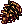Snow Pine Cone × 100 ← <b>Snow Pine Tree</b> Lv 100 (Snow Hill Town - Laplanoel)</td></tr>
<tr><td><input aria-label="ได้สติ๊กเกอร์แล้ว" class="stk" id="w14" type="checkbox"/></td><td>★ Tacky - Christmas Tree Decoration 2 <b>(รอบเดียว)</b></td><td class="n">1</td><td>Snow Hill Town - Laplanoel</td><td>Tacky</td><td>Lv 160+ · รอบเดียวได้สติ๊กเกอร์</td><td>Clean Floccus × 100 ← <b>Bug Bear</b> Lv 192 (Path to Snow Hill, Frost Wind Forest 2)</td></tr>
<tr><td><input aria-label="ได้สติ๊กเกอร์แล้ว" class="stk" id="w5" type="checkbox"/></td><td>★ Grandma Tango - Gathering Yarn</td><td class="n">5</td><td>Snow Hill Gift Factory</td><td>Grandma Tango</td><td>Lv 160+</td><td>Red Woolen Yarn × 2 ← <b>Snowkid</b> Lv 198 · Black Woolen Yarn × 2 ← <b>Snowman</b> Lv 200 (Snow Field 1)</td></tr>
<tr class="pre-row"><td><input aria-label="ทำขั้นนี้ครบแล้ว" class="pre" id="wp11" type="checkbox"/></td><td>Santa Claus - Santa's Severe Cold - 1 ขั้นก่อนหน้า · ไม่ได้สติ๊กเกอร์</td><td class="n">5</td><td>Snow Field 1 - Merry Christmas</td><td>Santa Claus</td><td>Lv 160+</td><td>Bear Stew* ← ผสมที่ Compounder Paul (Gift Factory / Laplanoel Mall) จาก Herb Potion + Bear Paw (<b>Santa Bear</b> Lv 212) + Edelweiss (ขุดใน Snow Hill Fields)</td></tr>
<tr><td><input aria-label="ได้สติ๊กเกอร์แล้ว" class="stk" id="w22" type="checkbox"/></td><td>Santa Claus - Santa's Severe Cold - 2</td><td class="n">5</td><td>Snow Field 1 - Merry Christmas</td><td>Santa Claus</td><td>ทำ Severe Cold 1 ก่อน · วิกิขัดกันเอง: หน้าเควสบอกว่ารอบ 5 ได้ Miniature Snowman ไม่ใช่สติ๊กเกอร์</td><td>Red Cardigan ← รางวัลจาก Grandma Tango · Red Scarf* ← <b>Santa Bear</b> Lv 212 (Snow Field 2)</td></tr>
<tr class="pre-row"><td><input aria-label="ทำขั้นนี้ครบแล้ว" class="pre" id="wp1" type="checkbox"/></td><td>★ Frog Shaman - Snow Hill Magic - 1 ขั้นก่อนหน้า · ไม่ได้สติ๊กเกอร์</td><td class="n">5</td><td>Snow Field 2 - Snowflake Park</td><td>Frog Shaman</td><td>Lv 160+ · รวม 25</td><td>Crumpled Socks × 5 ← <b>Old Snow Kid</b> Lv 215 (Snow Field 1)</td></tr>
<tr class="pre-row"><td><input aria-label="ทำขั้นนี้ครบแล้ว" class="pre" id="wp2" type="checkbox"/></td><td>★ Frog Shaman - Snow Hill Magic - 2 ขั้นก่อนหน้า · ไม่ได้สติ๊กเกอร์</td><td class="n">5</td><td>Snow Field 2 - Snowflake Park</td><td>Frog Shaman</td><td>รวม 25</td><td>Fresh Cream × 5 ← <b>Ice Cream</b> Lv 220 (Snow Field 3)</td></tr>
<tr class="pre-row"><td><input aria-label="ทำขั้นนี้ครบแล้ว" class="pre" id="wp3" type="checkbox"/></td><td>★ Frog Shaman - Snow Hill Magic - 3 ขั้นก่อนหน้า · ไม่ได้สติ๊กเกอร์</td><td class="n">5</td><td>Snow Field 2 - Snowflake Park</td><td>Frog Shaman</td><td>รวม 25</td><td>Footprint Fossil × 5 ← <b>Yeti</b> Lv 226 (Snow Field 3)</td></tr>
<tr><td><input aria-label="ได้สติ๊กเกอร์แล้ว" class="stk" id="w3" type="checkbox"/></td><td>★ Frog Shaman - Snow Hill Magic - 4</td><td class="n">5</td><td>Snow Field 2 - Snowflake Park</td><td>Frog Shaman</td><td>ทำ Magic 1–3 ก่อน (แถวสีอ่อนด้านบน)</td><td>Icicle × 5 ← <b>Icicler</b> Lv 228 (Snow Field 4)</td></tr>
<tr><td><input aria-label="ได้สติ๊กเกอร์แล้ว" class="stk" id="w6" type="checkbox"/></td><td>★ Grandpa Tango - Collecting Empty Bottles</td><td class="n">5</td><td>Snow Field 2 - Snowflake Park</td><td>Grandpa Tango</td><td>Lv 160+</td><td>Empty Coke Bottle × 5 ← <b>Santa Bear</b> Lv 212 (Snow Field 2)</td></tr>
<tr><td><input aria-label="ได้สติ๊กเกอร์แล้ว" class="stk" id="w9" type="checkbox"/></td><td>★ Louis Bitton - Fashion Show Prep</td><td class="n">5</td><td>Snow Field 2 - Snowflake Park</td><td>Louis Bitton</td><td>Lv 160+</td><td>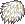Pure White Fur × 3 ← <b>Polar Bear</b> Lv 207 (Snow Field 2, 3)</td></tr>
<tr><td><input aria-label="ได้สติ๊กเกอร์แล้ว" class="stk" id="w15" type="checkbox"/></td><td>Ancient Polar Bear - Bring a Life Preserver</td><td class="n">5</td><td>Snow Field 2 - Snowflake Park</td><td>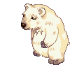Ancient Polar Bear</td><td>Lv 160+ · ต้องได้ห่วงยางจาก Lifeguard Deen ก่อน</td><td>XL Life Preserver ← รางวัลจาก Lifeguard Deen (วิกิบอกว่าได้รอบ 1–3 อาจไม่พอ 5 รอบ)</td></tr>
<tr><td><input aria-label="ได้สติ๊กเกอร์แล้ว" class="stk" id="w1" type="checkbox"/></td><td>★ Dorothy - Fossil Collecting</td><td class="n">5</td><td>Snow Field 3 - Stairway of Snowflake</td><td>Dorothy</td><td>Lv 160+</td><td>Dragonfly Fossil · Dinosaur Egg Fossil · Ammonite Fossil · Sea Scorpion Fossil* ← ขุดใน Snow Hill Fields</td></tr>
<tr><td><input aria-label="ได้สติ๊กเกอร์แล้ว" class="stk" id="w8" type="checkbox"/></td><td>★ Lifeguard Deen - Make Some Ice Cream!</td><td class="n">5</td><td>Snow Field 3 - Stairway of Snowflake</td><td>Lifeguard Deen</td><td>Lv 160+</td><td>Bubble Beater* + Fresh Cream* ← <b>Ice Cream</b> Lv 220 (Snow Field 3)</td></tr>
<tr><td><input aria-label="ได้สติ๊กเกอร์แล้ว" class="stk" id="w10" type="checkbox"/></td><td>★ Poppuri - Poppuri's Fur Care</td><td class="n">5</td><td>Snow Field 3 - Stairway of Snowflake</td><td>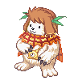Poppuri</td><td>Lv 160+</td><td>King Comb* ← <b>Yeti</b> Lv 226 (Snow Field 3)</td></tr>
<tr><td><input aria-label="ได้สติ๊กเกอร์แล้ว" class="stk" id="w2" type="checkbox"/></td><td>★ Farmer Tsetsech - Frozen Plants Study</td><td class="n">5</td><td>Snow Field 4 - Happy New Year</td><td>Farmer Tsetsech</td><td>Lv 160+</td><td>Agave · Bamboo Flower · Udambara · Edelweiss* ← ขุดใน Snow Hill Fields</td></tr>
<tr><td><input aria-label="ได้สติ๊กเกอร์แล้ว" class="stk" id="w7" type="checkbox"/></td><td>★ Horse Hiddink - Against Icy Roads</td><td class="n">5</td><td>Snow Field 4 - Happy New Year</td><td>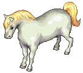Horse Hiddink</td><td>Lv 160+</td><td>Winter Horseshoe × 4 ← <b>Icicler</b> Lv 228 (Snow Field 4)</td></tr>
<tr class="pre-row"><td><input aria-label="ทำขั้นนี้ครบแล้ว" class="pre" id="wp8" type="checkbox"/></td><td>Lethos - How to Beat the Cold? - 1 ขั้นก่อนหน้า · ไม่ได้สติ๊กเกอร์</td><td class="n">5</td><td>Gate of Blue Ice Dungeon</td><td>Lethos</td><td>Lv 170+ · รวม 15</td><td>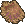Bear Fur × 3 ← ขุดใน Blue Ice Dungeon</td></tr>
<tr class="pre-row"><td><input aria-label="ทำขั้นนี้ครบแล้ว" class="pre" id="wp9" type="checkbox"/></td><td>Lethos - How to Beat the Cold? - 2 ขั้นก่อนหน้า · ไม่ได้สติ๊กเกอร์</td><td class="n">5</td><td>Gate of Blue Ice Dungeon</td><td>Lethos</td><td>รวม 15</td><td>Luxurious Blanket × 3 ← <b>Freyja</b> Lv 264 (Ice Dungeon 1–3)</td></tr>
<tr class="pre-row"><td><input aria-label="ทำขั้นนี้ครบแล้ว" class="pre" id="wp10" type="checkbox"/></td><td>Lethos - How to Beat the Cold? - 3 ขั้นก่อนหน้า · ไม่ได้สติ๊กเกอร์</td><td class="n">5</td><td>Gate of Blue Ice Dungeon</td><td>Lethos</td><td>รวม 15</td><td>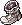Thick Socks × 3 ← <b>Niwerth</b> Lv 252 (Ice Dungeon 1)</td></tr>
<tr><td><input aria-label="ได้สติ๊กเกอร์แล้ว" class="stk" id="w18" type="checkbox"/></td><td>Lethos - How to Beat the Cold? - 4</td><td class="n">5</td><td>Gate of Blue Ice Dungeon</td><td>Lethos</td><td>ทำ 1–3 ก่อน</td><td>Queen's Spell × 3 ← <b>Coolem</b> Lv 272 (Ice Dungeon 2–4)</td></tr>
<tr><td><input aria-label="ได้สติ๊กเกอร์แล้ว" class="stk" id="w17" type="checkbox"/></td><td>Horse Hiddink - Errands from Fairy God Mother</td><td class="n">5</td><td>Ice Dungeon 1 - Cave of Dark Blue</td><td>Horse Hiddink</td><td>Lv 170+</td><td>Ice Cube × 5 ← <b>Coolem</b> Lv 272 (Ice Dungeon 2–4)</td></tr>
<tr><td><input aria-label="ได้สติ๊กเกอร์แล้ว" class="stk" id="w21" type="checkbox"/></td><td>Princess Rosetta - Ready to save the prince?</td><td class="n">5</td><td>Ice Dungeon 1 - Cave of Dark Blue</td><td>Princess Rosetta</td><td>Lv 170+ · ทำคู่กับ Errands from Fairy God Mother</td><td>All Mighty Firebolt ← รางวัลจาก Horse Hiddink · Throwing Dart × 5 ← <b>Niwerth</b> Lv 252 (Ice Dungeon 1)</td></tr>
<tr><td><input aria-label="ได้สติ๊กเกอร์แล้ว" class="stk" id="w16" type="checkbox"/></td><td>General Granada - Time Keeps Ticking...</td><td class="n">5</td><td>Ice Dungeon 2 - Cave of Crystal</td><td>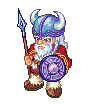General Granada</td><td>Lv 170+</td><td>Red Underpants × 2 ← <b>Freyr</b> Lv 259 · Red Undershirt × 2 ← <b>Niwerth</b> Lv 252</td></tr>
<tr><td><input aria-label="ได้สติ๊กเกอร์แล้ว" class="stk" id="w20" type="checkbox"/></td><td>Prince Stephano - Prince Stephano's Request</td><td class="n">5</td><td>Ice Dungeon 3 - Heart of Crystal</td><td>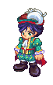Prince Stephano</td><td>Lv 170+</td><td>Ice Flower Ring* + Icy Flower Earrings* ← ขุดใน Blue Ice Dungeon · Ice Wristlet* ← <b>Great Coolem</b> Lv 280 (Ice Dungeon 3, 4)</td></tr>
<tr><td><input aria-label="ได้สติ๊กเกอร์แล้ว" class="stk" id="w19" type="checkbox"/></td><td>Old Artist - My hands are freezing!</td><td class="n">5</td><td>Ice Dungeon 4 - Teardrop Walkways</td><td>Old Artist</td><td>Lv 170+</td><td>Hot Pack × 3 ← <b>Freyr</b> Lv 259 (Ice Dungeon 1, 2)</td></tr>
</tbody>
</table>

* วิกิไม่ได้บอกจำนวนต่อรอบ นับเป็น 1 ชิ้นต่อรอบ · Survey, Magic, How to Beat the Cold และ Christmas Nightmare Project ที่เป็นขั้น 1–3 วิกิไม่ได้เขียนว่าต้องทำก่อนขั้น 4 แต่ทุกโซนก่อนหน้าเป็นแบบนั้น · Santa's Severe Cold - 2 อยู่ในรายชื่อเควสที่ให้สติ๊กเกอร์ แต่หน้าเควสบอกว่ารอบ 5 ได้ Miniature Snowman เลยไม่ติดดาว

</section>

<section>

## จุดขุดและมอน เรียงตามแมพ

<table>
<thead><tr><th>ครบแล้ว</th><th>แมพ</th><th>ขุด / มอน</th><th>ไอเทม</th><th>จำนวนรวม</th><th>ใช้ในเควส</th></tr></thead>
<tbody>
<tr class="mon-row" data-q='[["w1", 5, "Dorothy (1 × 5 รอบ)", 0]]' data-unit="ต่อชนิด"><td><input aria-label="หาครบแล้ว" class="mon" id="hm1" type="checkbox"/></td><td>★ Snow Hill Fields (ขุดได้ทุก Field)</td><td>ขุด</td><td>Dragonfly Fossil, Dinosaur Egg Fossil, Ammonite Fossil, Sea Scorpion Fossil</td><td class="n">5 ต่อชนิด</td><td>Dorothy (1 × 5 รอบ)</td></tr>
<tr class="mon-row" data-q='[["w2", 5, "Farmer Tsetsech (1 × 5 รอบ)", 0]]' data-unit="ต่อชนิด"><td><input aria-label="หาครบแล้ว" class="mon" id="hm2" type="checkbox"/></td><td>★ Snow Hill Fields (ขุดได้ทุก Field)</td><td>ขุด</td><td>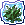Agave, Bamboo Flower</td><td class="n">5 ต่อชนิด</td><td>Farmer Tsetsech (1 × 5 รอบ)</td></tr>
<tr class="mon-row" data-q="[[&quot;w2&quot;, 5, &quot;Farmer Tsetsech (1 × 5 รอบ)&quot;, 0], [&quot;wp11&quot;, 5, &quot;Santa's Severe Cold 1 (Bear Stew)&quot;, 0]]"><td><input aria-label="หาครบแล้ว" class="mon" id="hm3" type="checkbox"/></td><td>★ Snow Hill Fields (ขุดได้ทุก Field)</td><td>ขุด</td><td>Edelweiss</td><td class="n">10</td><td>Farmer Tsetsech (1 × 5 รอบ) + Santa's Severe Cold 1 (Bear Stew)</td></tr>
<tr class="mon-row" data-q='[["k4", 1, "ขั้น 4 Truth Draught", 0], ["w2", 5, "Farmer Tsetsech (1 × 5 รอบ)", 0]]'><td><input aria-label="หาครบแล้ว" class="mon" id="hm4" type="checkbox"/></td><td>★ Snow Hill Fields (ขุดได้ทุก Field)</td><td>ขุด</td><td>Udambara</td><td class="n">6</td><td>ขั้น 4 Truth Draught + Farmer Tsetsech (1 × 5 รอบ)</td></tr>
<tr class="mon-row" data-q='[["k4", 1, "ขั้น 4 Truth Draught", 0]]'><td><input aria-label="หาครบแล้ว" class="mon" id="hm5" type="checkbox"/></td><td>★ Snow Hill Fields (ขุดได้ทุก Field)</td><td>ขุด</td><td>Blue Orchid</td><td class="n">1</td><td>ขั้น 4 Truth Draught</td></tr>
<tr class="mon-row" data-q='[["wp8", 15, "Lethos How to Beat the Cold 1 (3 × 5 รอบ)", 0]]'><td><input aria-label="หาครบแล้ว" class="mon" id="hm6" type="checkbox"/></td><td>Blue Ice Dungeon</td><td>ขุด</td><td>Bear Fur</td><td class="n">15</td><td>Lethos How to Beat the Cold 1 (3 × 5 รอบ)</td></tr>
<tr class="mon-row" data-q='[["w20", 5, "Prince Stephano (1 × 5 รอบ)", 0]]' data-unit="ต่อชนิด"><td><input aria-label="หาครบแล้ว" class="mon" id="hm7" type="checkbox"/></td><td>Blue Ice Dungeon</td><td>ขุด</td><td>Ice Flower Ring, Icy Flower Earrings</td><td class="n">5 ต่อชนิด</td><td>Prince Stephano (1 × 5 รอบ)</td></tr>
<tr class="mon-row" data-q="[[&quot;c1&quot;, 5, &quot;ก่อนเริ่ม Chagan's Dream&quot;, 0]]"><td><input aria-label="หาครบแล้ว" class="mon" id="hm8" type="checkbox"/></td><td>★ Path to Caballa Relics, Relics Field 1</td><td>Mandragora (Lv 53)</td><td>Ginseng Root</td><td class="n">5</td><td>ก่อนเริ่ม Chagan's Dream</td></tr>
<tr class="mon-row" data-q='[["c2", 1, "ก่อนเริ่ม Dream Reader", 0]]' data-unit="ต่อชนิด"><td><input aria-label="หาครบแล้ว" class="mon" id="hm9" type="checkbox"/></td><td>★ Relics Field 3, 4</td><td>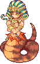Aposis (Lv 66)</td><td>Crystal Marble, Old Book</td><td class="n">1 ต่อชนิด</td><td>ก่อนเริ่ม Dream Reader</td></tr>
<tr class="mon-row" data-q="[[&quot;c1&quot;, 1, &quot;ก่อนเริ่ม Chagan's Dream&quot;, 0]]"><td><input aria-label="หาครบแล้ว" class="mon" id="hm10" type="checkbox"/></td><td>★ Swamp Dungeon 4, 5</td><td>Lotus Wormhole (Lv 219)</td><td>Lotus Fruit</td><td class="n">1</td><td>ก่อนเริ่ม Chagan's Dream</td></tr>
<tr class="mon-row" data-q='[["w13", 100, "Tacky 1 (100 × 1 รอบ)", 0]]'><td><input aria-label="หาครบแล้ว" class="mon" id="hm11" type="checkbox"/></td><td>★ Snow Hill Town - Laplanoel</td><td>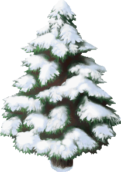Snow Pine Tree (Lv 100)</td><td>Snow Pine Cone</td><td class="n">100</td><td>Tacky 1 (100 × 1 รอบ)</td></tr>
<tr class="mon-row" data-q='[["w14", 100, "Tacky 2 (100 × 1 รอบ)", 0]]'><td><input aria-label="หาครบแล้ว" class="mon" id="hm12" type="checkbox"/></td><td>★ Path to Snow Hill, Frost Wind Forest 2</td><td>Bug Bear (Lv 192)</td><td>Clean Floccus</td><td class="n">100</td><td>Tacky 2 (100 × 1 รอบ)</td></tr>
<tr class="mon-row" data-q='[["w5", 10, "Grandma Tango (2 × 5 รอบ)", 0]]'><td><input aria-label="หาครบแล้ว" class="mon" id="hm13" type="checkbox"/></td><td>★ Snow Field 1 - Merry Christmas</td><td>Snowkid (Lv 198)</td><td>Red Woolen Yarn</td><td class="n">10</td><td>Grandma Tango (2 × 5 รอบ)</td></tr>
<tr class="mon-row" data-q='[["wp7", 25, "Christmas Nightmare 1 (5 × 5 รอบ)", 0]]'><td><input aria-label="หาครบแล้ว" class="mon" id="hm14" type="checkbox"/></td><td>★ Snow Field 1 - Merry Christmas</td><td>Snowkid (Lv 198)</td><td>Snowman Jelly</td><td class="n">25</td><td>Christmas Nightmare 1 (5 × 5 รอบ)</td></tr>
<tr class="mon-row" data-q='[["w5", 10, "Grandma Tango (2 × 5 รอบ)", 0]]'><td><input aria-label="หาครบแล้ว" class="mon" id="hm15" type="checkbox"/></td><td>★ Snow Field 1 - Merry Christmas</td><td>Snowman (Lv 200)</td><td>Black Woolen Yarn</td><td class="n">10</td><td>Grandma Tango (2 × 5 รอบ)</td></tr>
<tr class="mon-row" data-q='[["wp4", 75, "Cochma Survey 1 (15 ตัวใน 10 นาที × 5 รอบ)", 0]]' data-unit="ตัว"><td><input aria-label="หาครบแล้ว" class="mon" id="hm16" type="checkbox"/></td><td>★ Snow Field 1 - Merry Christmas</td><td>Snowman (Lv 200)</td><td>ล่า (ไม่ต้องเก็บของ)</td><td class="n">75 ตัว</td><td>Cochma Survey 1 (15 ตัวใน 10 นาที × 5 รอบ)</td></tr>
<tr class="mon-row" data-q='[["wp1", 25, "Snow Hill Magic 1 (5 × 5 รอบ)", 0]]'><td><input aria-label="หาครบแล้ว" class="mon" id="hm17" type="checkbox"/></td><td>★ Snow Field 1 - Merry Christmas</td><td>Old Snow Kid (Lv 215)</td><td>Crumpled Socks</td><td class="n">25</td><td>Snow Hill Magic 1 (5 × 5 รอบ)</td></tr>
<tr class="mon-row" data-q='[["wp5", 25, "Cochma Survey 2 (5 × 5 รอบ)", 0]]'><td><input aria-label="หาครบแล้ว" class="mon" id="hm18" type="checkbox"/></td><td>★ Snow Field 1 - Merry Christmas</td><td>Old Snow Kid (Lv 215)</td><td>Unidentifiable CD</td><td class="n">25</td><td>Cochma Survey 2 (5 × 5 รอบ)</td></tr>
<tr class="mon-row" data-q='[["wp6", 25, "Cochma Survey 3 (5 × 5 รอบ)", 0]]'><td><input aria-label="หาครบแล้ว" class="mon" id="hm19" type="checkbox"/></td><td>★ Snow Field 2 - Snowflake Park (+ Field 3)</td><td>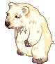Polar Bear (Lv 207)</td><td>Pure White Mask</td><td class="n">25</td><td>Cochma Survey 3 (5 × 5 รอบ)</td></tr>
<tr class="mon-row" data-q='[["w9", 15, "Louis Bitton (3 × 5 รอบ)", 0]]'><td><input aria-label="หาครบแล้ว" class="mon" id="hm20" type="checkbox"/></td><td>★ Snow Field 2 - Snowflake Park (+ Field 3)</td><td>Polar Bear (Lv 207)</td><td>Pure White Fur</td><td class="n">15</td><td>Louis Bitton (3 × 5 รอบ)</td></tr>
<tr class="mon-row" data-q='[["w11", 5, "Tango (1 × 5 รอบ)", 0]]'><td><input aria-label="หาครบแล้ว" class="mon" id="hm21" type="checkbox"/></td><td>★ Snow Field 2 - Snowflake Park (+ Field 3)</td><td>Polar Bear (Lv 207)</td><td>Modeling Contract</td><td class="n">5</td><td>Tango (1 × 5 รอบ)</td></tr>
<tr class="mon-row" data-q="[[&quot;w4&quot;, 25, &quot;Cochma Survey 4 (5 × 5 รอบ)&quot;, 0], [&quot;wp11&quot;, 5, &quot;Santa's Severe Cold 1 (Bear Stew)&quot;, 0]]"><td><input aria-label="หาครบแล้ว" class="mon" id="hm22" type="checkbox"/></td><td>★ Snow Field 2 - Snowflake Park</td><td>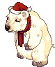Santa Bear (Lv 212)</td><td>Bear Paw</td><td class="n">30</td><td>Cochma Survey 4 (5 × 5 รอบ) + Santa's Severe Cold 1 (Bear Stew)</td></tr>
<tr class="mon-row" data-q='[["w6", 25, "Grandpa Tango (5 × 5 รอบ)", 0]]'><td><input aria-label="หาครบแล้ว" class="mon" id="hm23" type="checkbox"/></td><td>★ Snow Field 2 - Snowflake Park</td><td>Santa Bear (Lv 212)</td><td>Empty Coke Bottle</td><td class="n">25</td><td>Grandpa Tango (5 × 5 รอบ)</td></tr>
<tr class="mon-row" data-q="[[&quot;w22&quot;, 5, &quot;Santa's Severe Cold 2 (1 × 5 รอบ)&quot;, 0]]"><td><input aria-label="หาครบแล้ว" class="mon" id="hm24" type="checkbox"/></td><td>Snow Field 2 - Snowflake Park</td><td>Santa Bear (Lv 212)</td><td>Red Scarf</td><td class="n">5</td><td>Santa's Severe Cold 2 (1 × 5 รอบ)</td></tr>
<tr class="mon-row" data-q='[["wp2", 25, "Snow Hill Magic 2 (5 × 5 รอบ)", 0], ["w8", 5, "Lifeguard Deen (1 × 5 รอบ)", 0]]'><td><input aria-label="หาครบแล้ว" class="mon" id="hm25" type="checkbox"/></td><td>★ Snow Field 3 - Stairway of Snowflake</td><td>Ice Cream (Lv 220)</td><td>Fresh Cream</td><td class="n">30</td><td>Snow Hill Magic 2 (5 × 5 รอบ) + Lifeguard Deen (1 × 5 รอบ)</td></tr>
<tr class="mon-row" data-q='[["w8", 5, "Lifeguard Deen (1 × 5 รอบ)", 0]]'><td><input aria-label="หาครบแล้ว" class="mon" id="hm26" type="checkbox"/></td><td>★ Snow Field 3 - Stairway of Snowflake</td><td>Ice Cream (Lv 220)</td><td>Bubble Beater</td><td class="n">5</td><td>Lifeguard Deen (1 × 5 รอบ)</td></tr>
<tr class="mon-row" data-q='[["wp3", 25, "Snow Hill Magic 3 (5 × 5 รอบ)", 0]]'><td><input aria-label="หาครบแล้ว" class="mon" id="hm27" type="checkbox"/></td><td>★ Snow Field 3 - Stairway of Snowflake</td><td>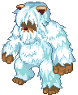Yeti (Lv 226)</td><td>Footprint Fossil</td><td class="n">25</td><td>Snow Hill Magic 3 (5 × 5 รอบ)</td></tr>
<tr class="mon-row" data-q='[["w10", 5, "Poppuri (1 × 5 รอบ)", 0]]'><td><input aria-label="หาครบแล้ว" class="mon" id="hm28" type="checkbox"/></td><td>★ Snow Field 3 - Stairway of Snowflake</td><td>Yeti (Lv 226)</td><td>King Comb</td><td class="n">5</td><td>Poppuri (1 × 5 รอบ)</td></tr>
<tr class="mon-row" data-q='[["w3", 25, "Snow Hill Magic 4 (5 × 5 รอบ)", 0]]'><td><input aria-label="หาครบแล้ว" class="mon" id="hm29" type="checkbox"/></td><td>★ Snow Field 4 - Happy New Year (ถูกเรียกใน Field 1–4)</td><td>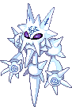Icicler (Lv 228)</td><td>Icicle</td><td class="n">25</td><td>Snow Hill Magic 4 (5 × 5 รอบ)</td></tr>
<tr class="mon-row" data-q='[["w7", 20, "Against Icy Roads (4 × 5 รอบ)", 0]]'><td><input aria-label="หาครบแล้ว" class="mon" id="hm30" type="checkbox"/></td><td>★ Snow Field 4 - Happy New Year (ถูกเรียกใน Field 1–4)</td><td>Icicler (Lv 228)</td><td>Winter Horseshoe</td><td class="n">20</td><td>Against Icy Roads (4 × 5 รอบ)</td></tr>
<tr class="mon-row" data-q='[["w12", 25, "Christmas Nightmare 2 (5 × 5 รอบ)", 0]]'><td><input aria-label="หาครบแล้ว" class="mon" id="hm31" type="checkbox"/></td><td>★ Snow Field 4 - Happy New Year (ถูกเรียกใน Field 1–4)</td><td>Icicler (Lv 228)</td><td>Ice Pick</td><td class="n">25</td><td>Christmas Nightmare 2 (5 × 5 รอบ)</td></tr>
<tr class="mon-row" data-q='[["w16", 10, "General Granada (2 × 5 รอบ)", 0]]'><td><input aria-label="หาครบแล้ว" class="mon" id="hm32" type="checkbox"/></td><td>Ice Dungeon 1 - Cave of Dark Blue</td><td>Niwerth (Lv 252)</td><td>Red Undershirt</td><td class="n">10</td><td>General Granada (2 × 5 รอบ)</td></tr>
<tr class="mon-row" data-q='[["wp10", 15, "How to Beat the Cold 3 (3 × 5 รอบ)", 0]]'><td><input aria-label="หาครบแล้ว" class="mon" id="hm33" type="checkbox"/></td><td>Ice Dungeon 1 - Cave of Dark Blue</td><td>Niwerth (Lv 252)</td><td>Thick Socks</td><td class="n">15</td><td>How to Beat the Cold 3 (3 × 5 รอบ)</td></tr>
<tr class="mon-row" data-q='[["w21", 25, "Princess Rosetta (5 × 5 รอบ)", 0]]'><td><input aria-label="หาครบแล้ว" class="mon" id="hm34" type="checkbox"/></td><td>Ice Dungeon 1 - Cave of Dark Blue</td><td>Niwerth (Lv 252)</td><td>Throwing Dart</td><td class="n">25</td><td>Princess Rosetta (5 × 5 รอบ)</td></tr>
<tr class="mon-row" data-q='[["k2", 1, "ขั้น 2 Save the Snow Machine", 0]]'><td><input aria-label="หาครบแล้ว" class="mon" id="hm35" type="checkbox"/></td><td>★ Ice Dungeon 1, 2</td><td>Freyr (Lv 259)</td><td>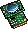Remote Part B</td><td class="n">1</td><td>ขั้น 2 Save the Snow Machine</td></tr>
<tr class="mon-row" data-q='[["w16", 10, "General Granada (2 × 5 รอบ)", 0]]'><td><input aria-label="หาครบแล้ว" class="mon" id="hm36" type="checkbox"/></td><td>Ice Dungeon 1, 2</td><td>Freyr (Lv 259)</td><td>Red Underpants</td><td class="n">10</td><td>General Granada (2 × 5 รอบ)</td></tr>
<tr class="mon-row" data-q='[["w19", 15, "Old Artist (3 × 5 รอบ)", 0]]'><td><input aria-label="หาครบแล้ว" class="mon" id="hm37" type="checkbox"/></td><td>Ice Dungeon 1, 2</td><td>Freyr (Lv 259)</td><td>Hot Pack</td><td class="n">15</td><td>Old Artist (3 × 5 รอบ)</td></tr>
<tr class="mon-row" data-q='[["k2", 1, "ขั้น 2 Save the Snow Machine", 0]]'><td><input aria-label="หาครบแล้ว" class="mon" id="hm38" type="checkbox"/></td><td>★ Ice Dungeon 1–3</td><td>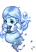Freyja (Lv 264)</td><td>Remote Part C</td><td class="n">1</td><td>ขั้น 2 Save the Snow Machine</td></tr>
<tr class="mon-row" data-q='[["wp9", 15, "How to Beat the Cold 2 (3 × 5 รอบ)", 0]]'><td><input aria-label="หาครบแล้ว" class="mon" id="hm39" type="checkbox"/></td><td>Ice Dungeon 1–3</td><td>Freyja (Lv 264)</td><td>Luxurious Blanket</td><td class="n">15</td><td>How to Beat the Cold 2 (3 × 5 รอบ)</td></tr>
<tr class="mon-row" data-q='[["w17", 25, "Errands from Fairy God Mother (5 × 5 รอบ)", 0]]'><td><input aria-label="หาครบแล้ว" class="mon" id="hm40" type="checkbox"/></td><td>Ice Dungeon 2–4</td><td>Coolem (Lv 272)</td><td>Ice Cube</td><td class="n">25</td><td>Errands from Fairy God Mother (5 × 5 รอบ)</td></tr>
<tr class="mon-row" data-q='[["w18", 15, "How to Beat the Cold 4 (3 × 5 รอบ)", 0]]'><td><input aria-label="หาครบแล้ว" class="mon" id="hm41" type="checkbox"/></td><td>Ice Dungeon 2–4</td><td>Coolem (Lv 272)</td><td>Queen's Spell</td><td class="n">15</td><td>How to Beat the Cold 4 (3 × 5 รอบ)</td></tr>
<tr class="mon-row" data-q='[["k2", 1, "ขั้น 2 Save the Snow Machine", 0]]'><td><input aria-label="หาครบแล้ว" class="mon" id="hm42" type="checkbox"/></td><td>★ Ice Dungeon 3, 4</td><td>Great Coolem (Lv 280)</td><td>Remote Part A</td><td class="n">1</td><td>ขั้น 2 Save the Snow Machine</td></tr>
<tr class="mon-row" data-q='[["w20", 5, "Prince Stephano (1 × 5 รอบ)", 0]]'><td><input aria-label="หาครบแล้ว" class="mon" id="hm43" type="checkbox"/></td><td>Ice Dungeon 3, 4</td><td>Great Coolem (Lv 280)</td><td>Ice Wristlet</td><td class="n">5</td><td>Prince Stephano (1 × 5 รอบ)</td></tr>
<tr class="mon-row" data-q='[["k2", 1, "ขั้น 2 Save the Snow Machine", 0]]'><td><input aria-label="หาครบแล้ว" class="mon" id="hm44" type="checkbox"/></td><td>★ Ice Dungeon 4 - Teardrop Walkways</td><td>Giant Coolem (Lv 277)</td><td>Broken Remote</td><td class="n">1</td><td>ขั้น 2 Save the Snow Machine</td></tr>
</tbody>
</table>

* วิกิไม่ได้บอกจำนวนต่อรอบ นับเป็น 1 ชิ้นต่อรอบ · Herb Potion (ก่อนเริ่ม 5 ขวด และ Bear Stew) ซื้อได้ที่ร้าน · XL Life Preserver, Red Cardigan และ All Mighty Firebolt ได้จากเควสอื่น ไม่ต้องตีมอน

</section>

<section>

## รูปจากวิกิ

รูปทั้งหมดดึงมาจากวิกิแล้วฝังไว้ในหน้านี้ กดการ์ดเพื่อเปิดหน้าวิกิหรือรูปต้นฉบับในแท็บใหม่

### NPC

<a href="https://wikimirror.lifeto.co/wiki.ggftw.com/trickster/Fairy_Godmother_-_Snow_Hill_Recommendation_Sticker.html" rel="noopener" target="_blank">Fairy Godmotherขั้น 1, 4, 7 · Laplanoel ↗</a>
<a href="https://wikimirror.lifeto.co/asset.103.ggftw.net/wiki/to-w/images/1/1f/Santa_Claus_(2).gif" rel="noopener" target="_blank">Santa Claus (2)ขั้น 2, 6 · Santa's Post Office ↗</a>
<a href="https://wikimirror.lifeto.co/wiki.ggftw.com/trickster/Witch_La_Befana_-_Broken_Promise.html" rel="noopener" target="_blank">Witch La Befanaขั้น 3 · Laplanoel ↗</a>
<a href="https://wikimirror.lifeto.co/wiki.ggftw.com/trickster/Little_Chagan_-_Chagan%27s_Dream.html" rel="noopener" target="_blank">Little Chaganก่อนเริ่ม · Carbigal ↗</a>
<a href="https://wikimirror.lifeto.co/wiki.ggftw.com/trickster/Fortune_Teller_-_Dream_Reader.html" rel="noopener" target="_blank">Fortune Tellerก่อนเริ่ม · Gate of Black Swamp ↗</a>
<a href="https://wikimirror.lifeto.co/wiki.ggftw.com/trickster/Inventor_Gale.html" rel="noopener" target="_blank">Inventor Galeผสม Fixed Remote · Gate of Snow Hill ↗</a>

### มอนสเตอร์

<a href="https://wikimirror.lifeto.co/wiki.ggftw.com/trickster/Snowkid.html" rel="noopener" target="_blank">SnowkidLv 198 · หน้าวิกิ ↗</a>
<a href="https://wikimirror.lifeto.co/wiki.ggftw.com/trickster/Snowman.html" rel="noopener" target="_blank">SnowmanLv 200 · หน้าวิกิ ↗</a>
<a href="https://wikimirror.lifeto.co/wiki.ggftw.com/trickster/Polar_Bear.html" rel="noopener" target="_blank">Polar BearLv 207 · หน้าวิกิ ↗</a>
<a href="https://wikimirror.lifeto.co/wiki.ggftw.com/trickster/Santa_Bear.html" rel="noopener" target="_blank">Santa BearLv 212 · หน้าวิกิ ↗</a>
<a href="https://wikimirror.lifeto.co/wiki.ggftw.com/trickster/Old_Snow_Kid.html" rel="noopener" target="_blank">Old Snow KidLv 215 · หน้าวิกิ ↗</a>
<a href="https://wikimirror.lifeto.co/wiki.ggftw.com/trickster/Ice_Cream.html" rel="noopener" target="_blank">Ice CreamLv 220 · หน้าวิกิ ↗</a>
<a href="https://wikimirror.lifeto.co/wiki.ggftw.com/trickster/Yeti.html" rel="noopener" target="_blank">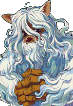YetiLv 226 · หน้าวิกิ ↗</a>
<a href="https://wikimirror.lifeto.co/wiki.ggftw.com/trickster/Icicler.html" rel="noopener" target="_blank">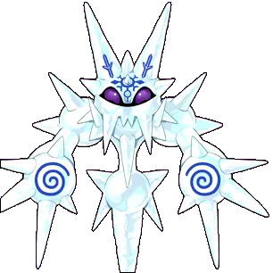IciclerLv 228 · หน้าวิกิ ↗</a>
<a href="https://wikimirror.lifeto.co/wiki.ggftw.com/trickster/Niwerth.html" rel="noopener" target="_blank">NiwerthLv 252 · หน้าวิกิ ↗</a>
<a href="https://wikimirror.lifeto.co/wiki.ggftw.com/trickster/Freyr.html" rel="noopener" target="_blank">FreyrLv 259 · หน้าวิกิ ↗</a>
<a href="https://wikimirror.lifeto.co/wiki.ggftw.com/trickster/Freyja.html" rel="noopener" target="_blank">FreyjaLv 264 · หน้าวิกิ ↗</a>
<a href="https://wikimirror.lifeto.co/wiki.ggftw.com/trickster/Coolem.html" rel="noopener" target="_blank">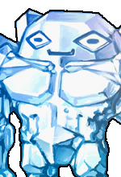CoolemLv 272 · หน้าวิกิ ↗</a>
<a href="https://wikimirror.lifeto.co/wiki.ggftw.com/trickster/Giant_Coolem.html" rel="noopener" target="_blank">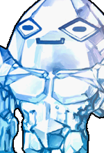Giant CoolemLv 277 · หน้าวิกิ ↗</a>
<a href="https://wikimirror.lifeto.co/wiki.ggftw.com/trickster/Great_Coolem.html" rel="noopener" target="_blank">Great CoolemLv 280 · หน้าวิกิ ↗</a>

### แมพ

<a href="https://wikimirror.lifeto.co/asset.103.ggftw.net/wiki/to-w/images/9/9c/Snow_Hill_Map.png" rel="noopener" target="_blank">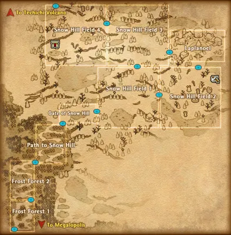แผนที่ Snow Hillทั้งโซน ↗</a>
<a href="https://wikimirror.lifeto.co/wiki.ggftw.com/trickster/Category_Snow_Hill.html" rel="noopener" target="_blank">Snow Hill ทั้งหมดหน้าโซน ↗</a>
<a href="https://wikimirror.lifeto.co/wiki.ggftw.com/trickster/Gate_of_Snow_Hill.html" rel="noopener" target="_blank">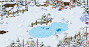Gate of Snow Hillหน้าแมพ ↗</a>
<a href="https://wikimirror.lifeto.co/wiki.ggftw.com/trickster/Snow_Hill_Town_-_Laplanoel.html" rel="noopener" target="_blank">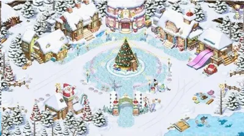Snow Hill Town - Laplanoelหน้าแมพ ↗</a>
<a href="https://wikimirror.lifeto.co/wiki.ggftw.com/trickster/Laplanoel_-_Santa%27s_Post_Office.html" rel="noopener" target="_blank">Laplanoel - Santa's Post Officeหน้าแมพ ↗</a>
<a href="https://wikimirror.lifeto.co/wiki.ggftw.com/trickster/Snow_Hill_Gift_Factory.html" rel="noopener" target="_blank">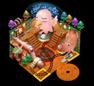Snow Hill Gift Factoryหน้าแมพ ↗</a>
<a href="https://wikimirror.lifeto.co/wiki.ggftw.com/trickster/Path_to_Snow_Hill.html" rel="noopener" target="_blank">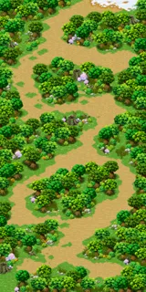Path to Snow Hillหน้าแมพ ↗</a>
<a href="https://wikimirror.lifeto.co/wiki.ggftw.com/trickster/Snow_Field_1_-_Merry_Christmas.html" rel="noopener" target="_blank">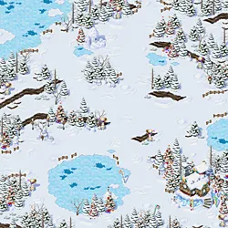Snow Field 1 - Merry Christmasหน้าแมพ ↗</a>
<a href="https://wikimirror.lifeto.co/wiki.ggftw.com/trickster/Snow_Field_2_-_Snowflake_Park.html" rel="noopener" target="_blank">Snow Field 2 - Snowflake Parkหน้าแมพ ↗</a>
<a href="https://wikimirror.lifeto.co/wiki.ggftw.com/trickster/Snow_Field_3_-_Stairway_of_Snowflake.html" rel="noopener" target="_blank">Snow Field 3 - Stairway of Snowflakeหน้าแมพ ↗</a>
<a href="https://wikimirror.lifeto.co/wiki.ggftw.com/trickster/Snow_Field_4_-_Happy_New_Year.html" rel="noopener" target="_blank">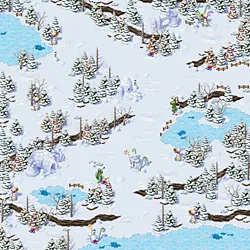Snow Field 4 - Happy New Yearหน้าแมพ ↗</a>
<a href="https://wikimirror.lifeto.co/wiki.ggftw.com/trickster/Gate_of_Blue_Ice_Dungeon.html" rel="noopener" target="_blank">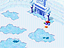Gate of Blue Ice Dungeonหน้าแมพ ↗</a>
<a href="https://wikimirror.lifeto.co/wiki.ggftw.com/trickster/Ice_Dungeon_1_-_Cave_of_Darkblue.html" rel="noopener" target="_blank">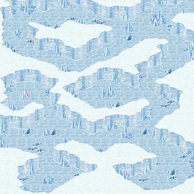Ice Dungeon 1 - Cave of Darkblueหน้าแมพ ↗</a>
<a href="https://wikimirror.lifeto.co/wiki.ggftw.com/trickster/Ice_Dungeon_2_-_Cave_of_Crystal.html" rel="noopener" target="_blank">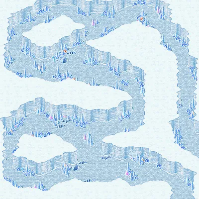Ice Dungeon 2 - Cave of Crystalหน้าแมพ ↗</a>
<a href="https://wikimirror.lifeto.co/wiki.ggftw.com/trickster/Ice_Dungeon_3_-_Heart_of_Crystal.html" rel="noopener" target="_blank">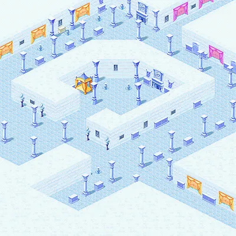Ice Dungeon 3 - Heart of Crystalหน้าแมพ ↗</a>
<a href="https://wikimirror.lifeto.co/wiki.ggftw.com/trickster/Ice_Dungeon_4_-_Teardrop_Walkways.html" rel="noopener" target="_blank">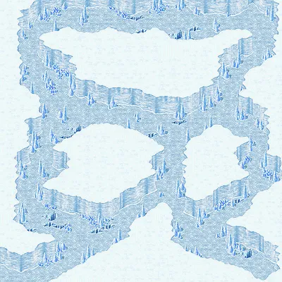Ice Dungeon 4 - Teardrop Walkwaysหน้าแมพ ↗</a>

</section>

<PageBehavior />
