

<header style="display:flex;flex-direction:column;gap:8px">

# เควสกุญแจ Tapasco Volcano

สรุปจากวิกิ ggFTW (ฉบับ mirror ของ LifeTO) หน้า [Category Tapasco Volcano](https://wikimirror.lifeto.co/wiki.ggftw.com/trickster/Category_Tapasco_Volcano.html), [Category Tapasco Volcano Quest](https://wikimirror.lifeto.co/wiki.ggftw.com/trickster/Category_Tapasco_Volcano_Quest.html) และหน้าเควส/มอน/แมพที่ลิงก์ไป

</header>

<section>

## ภาพรวม

โซนต่อจาก Techichi Volcano เควสกุญแจเริ่มกับ **Clerk Z. Smith** ที่ Tapasco Field 1 - Net of Lava ต้อง<b>เลเวล 235+</b>

- หน้าเควส Tapasco Recommendation Sticker และ Absolute Ring หายจากวิกิ เลยไม่รู้จำนวนสติ๊กเกอร์ที่ต้องใช้ ตัวนับนับเทียบกับ 14 ใบ
- Tapasco Sticker ได้จากเควสธรรมดา 14 เควส
- เตรียม **Adventurer's Book** เล่มที่ได้จาก Techichi ไว้
- คุยกับ Kochi ที่ Gate of Tapasco Volcano เพื่อเปิดวาร์ป

</section>

<section aria-live="polite" class="counter">

## ความคืบหน้า

0 Tapasco Sticker ที่ควรมีตอนนี้

<button id="reset" type="button">ล้างทั้งหมด</button>

</section>

<section>

## เควสกุญแจ 7 ขั้น

ลำดับสำคัญ: ขั้น 1 → 2 → 3 → 4 → รับขั้น 5 ค้างไว้ → ทำขั้น 6 ได้ Hunter's Certificate → กลับไปส่งขั้น 5 → ขั้น 7

<label class="done"><input class="key" id="k1" type="checkbox"/> ทำแล้ว</label>ขั้น 1<h3>Clerk Z. Smith - Tapasco Recommendation Sticker</h3>

Tapasco Field 1 - Net of LavaLv 235+

ส่ง <b>Tapasco Sticker</b> (หน้าเควสหาย ไม่รู้จำนวน)

รางวัล: Adventurer's Book

<label class="done"><input class="key" id="k2" type="checkbox"/> ทำแล้ว</label>ขั้น 2<h3>Clerk Z. Smith - Absolute Ring</h3>

Tapasco Field 1 - Net of LavaLv 235+

หน้าเควสหาย ไอเทม <b>Absolute Ring</b> ดรอปจาก <b>Fire Golem</b> Lv 357 (Field 1–4) น่าจะต้องใช้อันนี้ แต่ยังไม่ยืนยัน

รางวัล: ไม่ทราบ

<label class="done"><input class="key" id="k3" type="checkbox"/> ทำแล้ว</label>ขั้น 3<h3>Blacksmith Marx - Ptah's Secrets</h3>

Tapasco Field 1 - Net of LavaLv 235+หลังผ่าน Absolute Ring

ส่ง <b>Hot Iron × 2</b> และ 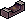<b>Whetstone × 2</b> ← ขุดใน Tapasco Field

รางวัล: 10,000 Galder Coupon

<label class="done"><input class="key" id="k4" type="checkbox"/> ทำแล้ว</label>ขั้น 4<h3>Blacksmith Marx - Special Flame</h3>

Tapasco Field 1 - Net of LavaLv 235+

ส่ง <b>Slag Orb × 2</b> ← <b>Fire Golem</b> Lv 357 หรือ Punisher Fire Golem Lv 383

รางวัล: Polished Trickster Ring (ใช้ขั้น 5)

<label class="done"><input class="key" id="k5" type="checkbox"/> ทำแล้ว</label>ขั้น 5<h3>Blacksmith Marx - The Ring's Abilities</h3>

Tapasco Field 2 - Rhythm of HammerLv 235+รับค้างไว้ก่อน

ส่ง <b>Hunter's Certificate</b> (ได้จากขั้น 6) และ <b>Polished Trickster Ring</b> รับเควสนี้ค้างไว้ก่อน แล้วไปทำขั้น 6

รางวัล: The Trickster Ring

<label class="done"><input class="key" id="k6" type="checkbox"/> ทำแล้ว</label>ขั้น 6<h3>Hunter Master - Show Me Your Skill</h3>

Tapasco Field 1 - Net of Lavaต้องมี The Ring's Abilities ค้างในสมุดเควส

ล่า <b>Fire Moth</b> Lv 289 × 30 ตัวภายใน 20 นาที (Field 1, 2)

รางวัล: Hunter's Certificate → เอาไปส่งขั้น 5

<label class="done"><input class="key" id="k7" type="checkbox"/> ทำแล้ว</label>ขั้น 7<h3>Blacksmith Marx - For Their Goals</h3>

Tapasco Field 2 - Rhythm of HammerLv 235+

ส่ง <b>Adventurer's Book</b>

รางวัล: <b>Adventurer's Book</b>, Weapon Exchange Ticket J

</section>

<section>

## เควสที่ให้ Tapasco Sticker

มี 14 เควส

ชุดต่อกัน: Eliza Bath กับ Al-Hauri ให้ Body Wash และ Exfoliation Towel ไปส่ง Skipper Min · Captain Stan รอบ 5 ให้ Freezer Ticket ไปส่ง Ancient Polar Bear

<button aria-pressed="false" id="hideUnstar" type="button">ซ่อนเควสที่ไม่ติดดาว</button><button hidden="" id="showAll" type="button">แสดงทั้งหมด</button>

<table>
<thead><tr><th>ได้แล้ว</th><th>เควส</th><th>รอบ</th><th>ที่อยู่</th><th>NPC</th><th>เงื่อนไข</th><th>ของที่ต้องส่ง และแหล่ง</th></tr></thead>
<tbody>
<tr><td><input aria-label="ได้ Tapasco Sticker แล้ว" class="stk" id="w1" type="checkbox"/></td><td>★ Eliza Bath - Therma Spa Grand Opening</td><td class="n">5</td><td>Gate of Tapasco Theme Spa</td><td>Eliza Bath</td><td>Lv 230+</td><td>Therma Spa Coupon × 1 ← <b>Funky Orc</b> Lv 343 (Field 2, 3)</td></tr>
<tr><td><input aria-label="ได้ Tapasco Sticker แล้ว" class="stk" id="w2" type="checkbox"/></td><td>★ Al-Hauri - Tapasco Exfoliation Towels</td><td class="n">5</td><td>Tapasco Theme Spa 1st Floor - Bath</td><td>Al-Hauri</td><td>Lv 230+</td><td>Red Leather ← <b>Red Salamander</b> Lv 334 · Blue Leather ← <b>Blue Salamander</b> Lv 339 (Field 1)</td></tr>
<tr><td><input aria-label="ได้ Tapasco Sticker แล้ว" class="stk" id="w3" type="checkbox"/></td><td>★ Skipper Min - Skipper Min's "RnR"</td><td class="n">5</td><td>Tapasco Theme Spa 1st Floor - Bath</td><td>Skipper Min</td><td>Lv 230+ · ทำ Eliza Bath กับ Al-Hauri ก่อน</td><td>Tapasco Body Wash ← รางวัลจาก Eliza Bath · Exfoliation Towel ← รางวัลจาก Al-Hauri</td></tr>
<tr><td><input aria-label="ได้ Tapasco Sticker แล้ว" class="stk" id="w4" type="checkbox"/></td><td>★ Mighty Captain Stan - Fundraiser for the Polar Bear</td><td class="n">5</td><td>Tapasco Field 1 - Net of Lava</td><td>Mighty Captain Stan</td><td>Lv 230+</td><td>Diamond × 2 + Ruby × 2 ← ขุดใน Tapasco Field · Sapphire × 2 ← ขุดใน Black Swamp หรือ Snow Hill Field</td></tr>
<tr><td><input aria-label="ได้ Tapasco Sticker แล้ว" class="stk" id="w5" type="checkbox"/></td><td>★ Ancient Polar Bear - Always Lost <b>(รอบเดียว)</b></td><td class="n">1</td><td>Tapasco Field 2 - Rhythm of Hammer</td><td>Ancient Polar Bear</td><td>Lv 230+</td><td>Freezer Ticket × 1 ← รางวัลรอบ 5 ของ Captain Stan</td></tr>
<tr><td><input aria-label="ได้ Tapasco Sticker แล้ว" class="stk" id="w6" type="checkbox"/></td><td>★ Cluck Cluck Warrior - Flaming Chicken Warriors</td><td class="n">5</td><td>Tapasco Field 2 - Rhythm of Hammer</td><td>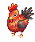Cluck Cluck Warrior</td><td>Lv 230+</td><td>Fire Flower × 2 ← <b>Fire Moth</b> Lv 289 (Field 1, 2) · Tapasco Pepper × 2 ← ขุดใน Tapasco Field</td></tr>
<tr><td><input aria-label="ได้ Tapasco Sticker แล้ว" class="stk" id="w7" type="checkbox"/></td><td>★ Sophia - For the Best Salt...</td><td class="n">5</td><td>Tapasco Field 2 - Rhythm of Hammer</td><td>Sophia</td><td>Lv 230+</td><td>Salt Jar × 3 ← ขุดใน Tapasco Field</td></tr>
<tr><td><input aria-label="ได้ Tapasco Sticker แล้ว" class="stk" id="w8" type="checkbox"/></td><td>★ Dorothy - I Want to Eat Something Sweet</td><td class="n">5</td><td>Tapasco Field 3 - Valley of Flame</td><td>Dorothy</td><td>Lv 230+</td><td>Roll Cake × 3 ← <b>Regent Orc</b> Lv 347 (Field 2–4)</td></tr>
<tr><td><input aria-label="ได้ Tapasco Sticker แล้ว" class="stk" id="w9" type="checkbox"/></td><td>★ Monkey T - Monkey T's Business Item (8)</td><td class="n">5</td><td>Tapasco Field 3 - Valley of Flame</td><td>Monkey T</td><td>Lv 230+</td><td>Volcano Water × 1 + Salt Jar × 1 ← ขุดใน Tapasco Field</td></tr>
<tr><td><input aria-label="ได้ Tapasco Sticker แล้ว" class="stk" id="w10" type="checkbox"/></td><td>★ Officer Tera - Misbehaving Monsters</td><td class="n">5</td><td>Tapasco Field 3 - Valley of Flame</td><td>Officer Tera</td><td>Lv 230+</td><td>Orc's Chain × 3 ← <b>Regent Orc</b> Lv 347 (Field 2–4)</td></tr>
<tr><td><input aria-label="ได้ Tapasco Sticker แล้ว" class="stk" id="w11" type="checkbox"/></td><td>★ Vinosh - "I want Spicy food!"</td><td class="n">5</td><td>Tapasco Field 3 - Valley of Flame</td><td>Vinosh</td><td>Lv 230+</td><td>Spicy Egg × 2 + Pupa of Tiger Moth × 2 ← ขุดใน Tapasco Field</td></tr>
<tr><td><input aria-label="ได้ Tapasco Sticker แล้ว" class="stk" id="w12" type="checkbox"/></td><td>★ Inventor Gale - Suspenders for the Inventor!</td><td class="n">5</td><td>Tapasco Field 4 - Stairway to Fire</td><td>Inventor Gale</td><td>Lv 230+</td><td>Black Suspenders × 2 ← <b>Reggae Orc</b> Lv 351 (Field 3, 4)</td></tr>
<tr><td><input aria-label="ได้ Tapasco Sticker แล้ว" class="stk" id="w13" type="checkbox"/></td><td>★ Burner - Burner's Secret</td><td class="n">5</td><td>Spicy Island</td><td>Burner</td><td>Lv 230+</td><td>Tapasco Pepper × 2 ← ขุดใน Tapasco Field</td></tr>
<tr><td><input aria-label="ได้ Tapasco Sticker แล้ว" class="stk" id="w14" type="checkbox"/></td><td>★ Burner - Burner's Secret Pt. 2</td><td class="n">5</td><td>Spicy Island</td><td>Burner</td><td>ทำ Burner's Secret ก่อน</td><td>Red Fire × 2 ← <b>Red Salamander</b> Lv 334 · Blue Fire × 2 ← <b>Blue Salamander</b> Lv 339 (Field 1)</td></tr>
</tbody>
</table>

</section>

<section>

## จุดขุดและมอน เรียงตามแมพ

<table>
<thead><tr><th>ครบแล้ว</th><th>แมพ</th><th>ขุด / มอน</th><th>ไอเทม</th><th>จำนวนรวม</th><th>ใช้ในเควส</th></tr></thead>
<tbody>
<tr class="mon-row" data-q="[[&quot;w6&quot;, 10, &quot;Cluck Cluck (2 × 5 รอบ)&quot;, 0], [&quot;w13&quot;, 10, &quot;Burner's Secret (2 × 5 รอบ)&quot;, 0]]"><td><input aria-label="หาครบแล้ว" class="mon" id="pm1" type="checkbox"/></td><td>★ Tapasco Field (ขุด)</td><td>ขุด</td><td>Tapasco Pepper</td><td class="n">20</td><td>Cluck Cluck (2 × 5 รอบ) + Burner's Secret (2 × 5 รอบ)</td></tr>
<tr class="mon-row" data-q='[["w7", 15, "Sophia (3 × 5 รอบ)", 0], ["w9", 5, "Monkey T (1 × 5 รอบ)", 0]]'><td><input aria-label="หาครบแล้ว" class="mon" id="pm2" type="checkbox"/></td><td>★ Tapasco Field (ขุด)</td><td>ขุด</td><td>Salt Jar</td><td class="n">20</td><td>Sophia (3 × 5 รอบ) + Monkey T (1 × 5 รอบ)</td></tr>
<tr class="mon-row" data-q='[["w9", 5, "Monkey T (1 × 5 รอบ)", 0]]'><td><input aria-label="หาครบแล้ว" class="mon" id="pm3" type="checkbox"/></td><td>★ Tapasco Field (ขุด)</td><td>ขุด</td><td>Volcano Water</td><td class="n">5</td><td>Monkey T (1 × 5 รอบ)</td></tr>
<tr class="mon-row" data-q='[["w4", 10, "Captain Stan (2 × 5 รอบ)", 0]]' data-unit="ต่อชนิด"><td><input aria-label="หาครบแล้ว" class="mon" id="pm4" type="checkbox"/></td><td>★ Tapasco Field (ขุด)</td><td>ขุด</td><td>Diamond, Ruby</td><td class="n">10 ต่อชนิด</td><td>Captain Stan (2 × 5 รอบ)</td></tr>
<tr class="mon-row" data-q='[["w11", 10, "Vinosh (2 × 5 รอบ)", 0]]' data-unit="ต่อชนิด"><td><input aria-label="หาครบแล้ว" class="mon" id="pm5" type="checkbox"/></td><td>★ Tapasco Field (ขุด)</td><td>ขุด</td><td>Spicy Egg, Pupa of Tiger Moth</td><td class="n">10 ต่อชนิด</td><td>Vinosh (2 × 5 รอบ)</td></tr>
<tr class="mon-row" data-q="[[&quot;k3&quot;, 2, &quot;ขั้น 3 Ptah's Secrets&quot;, 0]]" data-unit="ต่อชนิด"><td><input aria-label="หาครบแล้ว" class="mon" id="pm6" type="checkbox"/></td><td>★ Tapasco Field (ขุด)</td><td>ขุด</td><td>Hot Iron, Whetstone</td><td class="n">2 ต่อชนิด</td><td>ขั้น 3 Ptah's Secrets</td></tr>
<tr class="mon-row" data-q='[["w4", 10, "Captain Stan (2 × 5 รอบ)", 0]]'><td><input aria-label="หาครบแล้ว" class="mon" id="pm7" type="checkbox"/></td><td>★ Black Swamp / Snow Hill Field (ขุด)</td><td>ขุด</td><td>Sapphire</td><td class="n">10</td><td>Captain Stan (2 × 5 รอบ)</td></tr>
<tr class="mon-row" data-q='[["w6", 10, "Cluck Cluck (2 × 5 รอบ)", 0]]'><td><input aria-label="หาครบแล้ว" class="mon" id="pm8" type="checkbox"/></td><td>★ Tapasco Field 1, 2</td><td>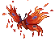Fire Moth (Lv 289)</td><td>Fire Flower</td><td class="n">10</td><td>Cluck Cluck (2 × 5 รอบ)</td></tr>
<tr class="mon-row" data-q='[["k6", 30, "ขั้น 6 Show Me Your Skill (30 ตัวใน 20 นาที)", 0]]' data-unit="ตัว"><td><input aria-label="หาครบแล้ว" class="mon" id="pm9" type="checkbox"/></td><td>★ Tapasco Field 1, 2</td><td>Fire Moth (Lv 289)</td><td>ล่า (ไม่ต้องเก็บของ)</td><td class="n">30 ตัว</td><td>ขั้น 6 Show Me Your Skill (30 ตัวใน 20 นาที)</td></tr>
<tr class="mon-row" data-q='[["w2", 5, "Exfoliation Towels (1 × 5 รอบ)", 0]]'><td><input aria-label="หาครบแล้ว" class="mon" id="pm10" type="checkbox"/></td><td>★ Tapasco Field 1 - Net of Lava</td><td>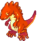Red Salamander (Lv 334)</td><td>Red Leather</td><td class="n">5</td><td>Exfoliation Towels (1 × 5 รอบ)</td></tr>
<tr class="mon-row" data-q='[["w14", 10, "Burner Pt. 2 (2 × 5 รอบ)", 0]]'><td><input aria-label="หาครบแล้ว" class="mon" id="pm11" type="checkbox"/></td><td>★ Tapasco Field 1 - Net of Lava</td><td>Red Salamander (Lv 334)</td><td>Red Fire</td><td class="n">10</td><td>Burner Pt. 2 (2 × 5 รอบ)</td></tr>
<tr class="mon-row" data-q='[["w2", 5, "Exfoliation Towels (1 × 5 รอบ)", 0]]'><td><input aria-label="หาครบแล้ว" class="mon" id="pm12" type="checkbox"/></td><td>★ Tapasco Field 1 - Net of Lava</td><td>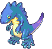Blue Salamander (Lv 339)</td><td>Blue Leather</td><td class="n">5</td><td>Exfoliation Towels (1 × 5 รอบ)</td></tr>
<tr class="mon-row" data-q='[["w14", 10, "Burner Pt. 2 (2 × 5 รอบ)", 0]]'><td><input aria-label="หาครบแล้ว" class="mon" id="pm13" type="checkbox"/></td><td>★ Tapasco Field 1 - Net of Lava</td><td>Blue Salamander (Lv 339)</td><td>Blue Fire</td><td class="n">10</td><td>Burner Pt. 2 (2 × 5 รอบ)</td></tr>
<tr class="mon-row" data-q='[["w1", 5, "Eliza Bath (1 × 5 รอบ)", 0]]'><td><input aria-label="หาครบแล้ว" class="mon" id="pm14" type="checkbox"/></td><td>★ Tapasco Field 2, 3</td><td>Funky Orc (Lv 343)</td><td>Therma Spa Coupon</td><td class="n">5</td><td>Eliza Bath (1 × 5 รอบ)</td></tr>
<tr class="mon-row" data-q='[["w8", 15, "Dorothy (3 × 5 รอบ)", 0]]'><td><input aria-label="หาครบแล้ว" class="mon" id="pm15" type="checkbox"/></td><td>★ Tapasco Field 2–4</td><td>Regent Orc (Lv 347)</td><td>Roll Cake</td><td class="n">15</td><td>Dorothy (3 × 5 รอบ)</td></tr>
<tr class="mon-row" data-q='[["w10", 15, "Officer Tera (3 × 5 รอบ)", 0]]'><td><input aria-label="หาครบแล้ว" class="mon" id="pm16" type="checkbox"/></td><td>★ Tapasco Field 2–4</td><td>Regent Orc (Lv 347)</td><td>Orc's Chain</td><td class="n">15</td><td>Officer Tera (3 × 5 รอบ)</td></tr>
<tr class="mon-row" data-q='[["w12", 10, "Inventor Gale (2 × 5 รอบ)", 0]]'><td><input aria-label="หาครบแล้ว" class="mon" id="pm17" type="checkbox"/></td><td>★ Tapasco Field 3, 4</td><td>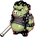Reggae Orc (Lv 351)</td><td>Black Suspenders</td><td class="n">10</td><td>Inventor Gale (2 × 5 รอบ)</td></tr>
<tr class="mon-row" data-q='[["k4", 2, "ขั้น 4 Special Flame", 0]]'><td><input aria-label="หาครบแล้ว" class="mon" id="pm18" type="checkbox"/></td><td>★ Tapasco Field 1–4</td><td>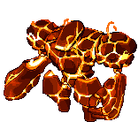Fire Golem (Lv 357)</td><td>Slag Orb</td><td class="n">2</td><td>ขั้น 4 Special Flame</td></tr>
<tr class="mon-row" data-q='[["k2", 1, "ขั้น 2 Absolute Ring (เดา)", 0]]'><td><input aria-label="หาครบแล้ว" class="mon" id="pm19" type="checkbox"/></td><td>★ Tapasco Field 1–4</td><td>Fire Golem (Lv 357)</td><td>Absolute Ring</td><td class="n">1</td><td>ขั้น 2 Absolute Ring (เดา)</td></tr>
</tbody>
</table>

แถว Absolute Ring เป็นการเดาจากหน้าไอเทม เพราะหน้าเควสขั้น 2 หายไป

</section>

<section>

## รูปจากวิกิ

### NPC

<a href="https://wikimirror.lifeto.co/wiki.ggftw.com/trickster/Blacksmith_Marx.html" rel="noopener" target="_blank">Blacksmith Marxขั้น 3–5, 7 · Field 1, 2 ↗</a>
<a href="https://wikimirror.lifeto.co/wiki.ggftw.com/trickster/Hunter_Master.html" rel="noopener" target="_blank">Hunter Masterขั้น 6 · Field 1 ↗</a>
<a href="https://wikimirror.lifeto.co/wiki.ggftw.com/trickster/Burner.html" rel="noopener" target="_blank">BurnerSpicy Island ↗</a>
<a href="https://wikimirror.lifeto.co/wiki.ggftw.com/trickster/Eliza_Bath.html" rel="noopener" target="_blank">Eliza BathGate of Theme Spa ↗</a>

### มอนสเตอร์

<a href="https://wikimirror.lifeto.co/wiki.ggftw.com/trickster/Fire_Moth.html" rel="noopener" target="_blank">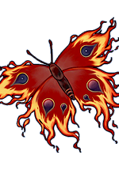Fire MothLv 289 · หน้าวิกิ ↗</a>
<a href="https://wikimirror.lifeto.co/wiki.ggftw.com/trickster/Red_Salamander.html" rel="noopener" target="_blank">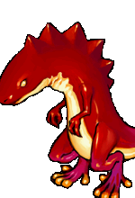Red SalamanderLv 334 · หน้าวิกิ ↗</a>
<a href="https://wikimirror.lifeto.co/wiki.ggftw.com/trickster/Blue_Salamander.html" rel="noopener" target="_blank">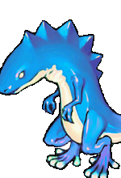Blue SalamanderLv 339 · หน้าวิกิ ↗</a>
<a href="https://wikimirror.lifeto.co/wiki.ggftw.com/trickster/Funky_Orc.html" rel="noopener" target="_blank">Funky OrcLv 343 · หน้าวิกิ ↗</a>
<a href="https://wikimirror.lifeto.co/wiki.ggftw.com/trickster/Regent_Orc.html" rel="noopener" target="_blank">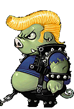Regent OrcLv 347 · หน้าวิกิ ↗</a>
<a href="https://wikimirror.lifeto.co/wiki.ggftw.com/trickster/Reggae_Orc.html" rel="noopener" target="_blank">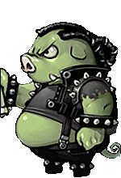Reggae OrcLv 351 · หน้าวิกิ ↗</a>
<a href="https://wikimirror.lifeto.co/wiki.ggftw.com/trickster/Fire_Golem.html" rel="noopener" target="_blank">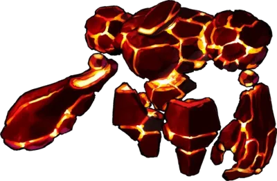Fire GolemLv 357 · หน้าวิกิ ↗</a>

### แมพ

<a href="https://wikimirror.lifeto.co/asset.103.ggftw.net/wiki/to-w/images/1/16/Tapasco_Volcano_Map.png" rel="noopener" target="_blank">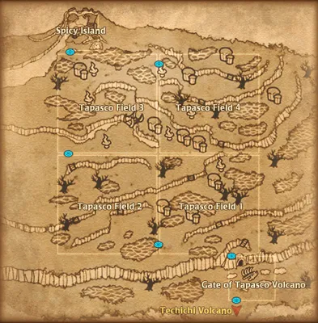แผนที่ Tapasco Volcanoทั้งโซน ↗</a>
<a href="https://wikimirror.lifeto.co/wiki.ggftw.com/trickster/Gate_of_Tapasco_Volcano.html" rel="noopener" target="_blank">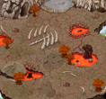Gate of Tapasco Volcanoหน้าแมพ ↗</a>
<a href="https://wikimirror.lifeto.co/wiki.ggftw.com/trickster/Tapasco_Field_1_-_Net_of_Lava.html" rel="noopener" target="_blank">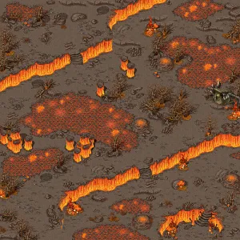Tapasco Field 1 - Net of Lavaหน้าแมพ ↗</a>
<a href="https://wikimirror.lifeto.co/wiki.ggftw.com/trickster/Tapasco_Field_2_-_Rhythm_of_Hammer.html" rel="noopener" target="_blank">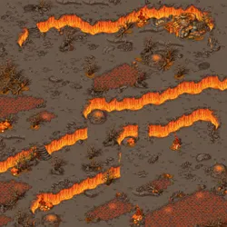Tapasco Field 2 - Rhythm of Hammerหน้าแมพ ↗</a>
<a href="https://wikimirror.lifeto.co/wiki.ggftw.com/trickster/Tapasco_Field_3_-_Valley_of_Flame.html" rel="noopener" target="_blank">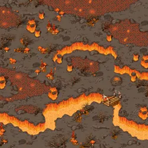Tapasco Field 3 - Valley of Flameหน้าแมพ ↗</a>
<a href="https://wikimirror.lifeto.co/wiki.ggftw.com/trickster/Tapasco_Field_4_-_Stairway_to_Fire.html" rel="noopener" target="_blank">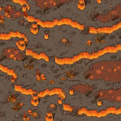Tapasco Field 4 - Stairway to Fireหน้าแมพ ↗</a>
<a href="https://wikimirror.lifeto.co/wiki.ggftw.com/trickster/Spicy_Island.html" rel="noopener" target="_blank">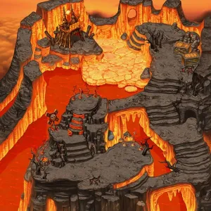Spicy Islandหน้าแมพ ↗</a>

</section>

<PageBehavior />
