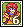
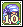
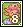
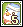
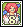
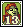

<header style="display:flex;flex-direction:column;gap:8px">

# เควสกุญแจ Tapasco Volcano

สรุปจากวิกิ ggFTW (ฉบับ mirror ของ LifeTO) หน้า [Category Tapasco Volcano](https://wikimirror.lifeto.co/wiki.ggftw.com/trickster/Category_Tapasco_Volcano.html), [Category Tapasco Volcano Quest](https://wikimirror.lifeto.co/wiki.ggftw.com/trickster/Category_Tapasco_Volcano_Quest.html) และหน้าเควส/มอน/แมพที่ลิงก์ไป

</header>

ประเภท<button type="button" data-t="all">ทั้งหมด</button><button type="button" data-t="key">เควสกุญแจ / สติ๊กเกอร์</button><button type="button" data-t="town">เควสอื่น</button>

<section>

## ภาพรวม

โซนต่อจาก Techichi Volcano เควสกุญแจเริ่มกับ **Clerk Z. Smith** ที่ Tapasco Field 1 - Net of Lava ต้อง<b>เลเวล 235+</b>

- หน้าเควส Tapasco Recommendation Sticker และ Absolute Ring หายจากวิกิ เลยไม่รู้จำนวนสติ๊กเกอร์ที่ต้องใช้ ตัวนับนับเทียบกับ 14 ใบ
- Tapasco Sticker ได้จากเควสธรรมดา 14 เควส
- เตรียม **Adventurer's Book** เล่มที่ได้จาก Techichi ไว้
- คุยกับ Kochi ที่ Gate of Tapasco Volcano เพื่อเปิดวาร์ป

</section>

<section aria-live="polite" class="counter">

## ความคืบหน้า

0 Tapasco Sticker ที่ควรมีตอนนี้

<button id="reset" type="button">ล้างทั้งหมด</button>

</section>

<section data-qt="key">

## เควสกุญแจ 7 ขั้น

ลำดับสำคัญ: ขั้น 1 → 2 → 3 → 4 → รับขั้น 5 ค้างไว้ → ทำขั้น 6 ได้ Hunter's Certificate → กลับไปส่งขั้น 5 → ขั้น 7

<label class="done"><input class="key" id="k1" type="checkbox"/> ทำแล้ว</label>ขั้น 1<h3>Clerk Z. Smith - Tapasco Recommendation Sticker</h3>

Tapasco Field 1 - Net of LavaLv 235+EXP 9.5M · TM 5.34M

ส่ง <b>Tapasco Sticker</b> (หน้าเควสหาย ไม่รู้จำนวน)

รางวัล: Adventurer's Book

<label class="done"><input class="key" id="k2" type="checkbox"/> ทำแล้ว</label>ขั้น 2<h3>Clerk Z. Smith - Absolute Ring</h3>

Tapasco Field 1 - Net of LavaLv 235+EXP 9.5M · TM 5.34M

หน้าเควสหาย ไอเทม <b>Absolute Ring</b> ดรอปจาก <b>Fire Golem</b> (Field 1–4) น่าจะต้องใช้อันนี้ แต่ยังไม่ยืนยัน

รางวัล: ไม่ทราบ

<label class="done"><input class="key" id="k3" type="checkbox"/> ทำแล้ว</label>ขั้น 3<h3>Blacksmith Marx - Ptah's Secrets</h3>

Tapasco Field 1 - Net of LavaLv 235+หลังผ่าน Absolute RingEXP 9.5M · TM 5.34M

ส่ง<ul><li><b>Hot Iron × 2</b> ← ขุดใน Tapasco Field</li><li><b>Whetstone × 2</b> ← ขุดใน Tapasco Field</li></ul>

รางวัล: 10,000 Galder Coupon

<label class="done"><input class="key" id="k4" type="checkbox"/> ทำแล้ว</label>ขั้น 4<h3>Blacksmith Marx - Special Flame</h3>

Tapasco Field 1 - Net of LavaLv 235+EXP 9.5M · TM 5.34M

ส่ง <b>Slag Orb × 2</b> ← <b>Fire Golem</b> หรือ Punisher <b>Fire Golem</b>

รางวัล: Polished Trickster Ring (ใช้ขั้น 5)

<label class="done"><input class="key" id="k5" type="checkbox"/> ทำแล้ว</label>ขั้น 5<h3>Blacksmith Marx - The Ring's Abilities</h3>

Tapasco Field 2 - Rhythm of HammerLv 235+รับค้างไว้ก่อนEXP 9.5M · TM 5.34M

ส่ง<ul><li><b>Hunter's Certificate</b> (ได้จากขั้น 6)</li><li><b>Polished Trickster Ring</b></li></ul>

รับเควสนี้ค้างไว้ก่อน แล้วไปทำขั้น 6

รางวัล: The Trickster Ring

<label class="done"><input class="key" id="k6" type="checkbox"/> ทำแล้ว</label>ขั้น 6<h3>Hunter Master - Show Me Your Skill</h3>

Tapasco Field 1 - Net of Lavaต้องมี The Ring's Abilities ค้างในสมุดเควสEXP 994.3K · TM 545.3K

ล่า <b>Fire Moth</b> × 30 ตัวภายใน 20 นาที (Field 1, 2)

รางวัล: Hunter's Certificate → เอาไปส่งขั้น 5

<label class="done"><input class="key" id="k7" type="checkbox"/> ทำแล้ว</label>ขั้น 7<h3>Blacksmith Marx - For Their Goals</h3>

Tapasco Field 2 - Rhythm of HammerLv 235+

ส่ง <b>Adventurer's Book</b>

รางวัล<ul><li><b>Adventurer's Book</b></li><li>Weapon Exchange Ticket J</li></ul>

</section>

<section data-qt="key">

## เควสที่ให้ Tapasco Sticker

มี 14 เควส

ชุดต่อกัน: Eliza Bath กับ Al-Hauri ให้ Body Wash และ Exfoliation Towel ไปส่ง Skipper Min · Captain Stan รอบ 5 ให้ Freezer Ticket ไปส่ง Ancient Polar Bear

<button aria-pressed="false" id="hideUnstar" type="button">ซ่อนเควสที่ไม่ติดดาว</button><button hidden="" id="showAll" type="button">แสดงทั้งหมด</button>

<table>
<thead><tr><th>ได้แล้ว</th><th>เควส</th><th>รอบ</th><th>ที่อยู่</th><th>NPC</th><th>เงื่อนไข</th><th>ของที่ต้องส่ง และแหล่ง</th></tr></thead>
<tbody>
<tr><td><input aria-label="ได้ Tapasco Sticker แล้ว" class="stk" id="w1" type="checkbox"/></td><td>★ Eliza Bath - Therma Spa Grand Opening</td><td class="n">5</td><td>Gate of Tapasco Theme Spa</td><td>Eliza Bath</td><td>Lv 230+</td><td>Therma Spa Coupon × 1 ← <b>Funky Orc</b> (Field 2, 3)</td></tr>
<tr><td><input aria-label="ได้ Tapasco Sticker แล้ว" class="stk" id="w2" type="checkbox"/></td><td>★ Al-Hauri - Tapasco Exfoliation Towels EXP 7.71M</td><td class="n">5</td><td>Tapasco Theme Spa 1st Floor - Bath</td><td>Al-Hauri</td><td>Lv 230+</td><td>Red Leather ← <b>Red Salamander</b> Blue Leather ← <b>Blue Salamander</b> (Field 1)</td></tr>
<tr><td><input aria-label="ได้ Tapasco Sticker แล้ว" class="stk" id="w3" type="checkbox"/></td><td>★ Skipper Min - Skipper Min's "RnR"</td><td class="n">5</td><td>Tapasco Theme Spa 1st Floor - Bath</td><td>Skipper Min</td><td>Lv 230+ · ทำ Eliza Bath กับ Al-Hauri ก่อน</td><td>Tapasco Body Wash ← รางวัลจาก Eliza Bath Exfoliation Towel ← รางวัลจาก Al-Hauri</td></tr>
<tr><td><input aria-label="ได้ Tapasco Sticker แล้ว" class="stk" id="w4" type="checkbox"/></td><td>★ Mighty Captain Stan - Fundraiser for the Polar Bear EXP 7.71M</td><td class="n">5</td><td>Tapasco Field 1 - Net of Lava</td><td>Mighty Captain Stan</td><td>Lv 230+</td><td>Diamond × 2 + Ruby × 2 ← ขุดใน Tapasco Field Sapphire × 2 ← ขุดใน Black Swamp หรือ Snow Hill Field</td></tr>
<tr><td><input aria-label="ได้ Tapasco Sticker แล้ว" class="stk" id="w5" type="checkbox"/></td><td>★ Ancient Polar Bear - Always Lost <b>(รอบเดียว)</b> EXP 7.71M</td><td class="n">1</td><td>Tapasco Field 2 - Rhythm of Hammer</td><td>Ancient Polar Bear</td><td>Lv 230+</td><td>Freezer Ticket × 1 ← รางวัลรอบ 5 ของ Captain Stan</td></tr>
<tr><td><input aria-label="ได้ Tapasco Sticker แล้ว" class="stk" id="w6" type="checkbox"/></td><td>★ Cluck Cluck Warrior - Flaming Chicken Warriors EXP 7.71M</td><td class="n">5</td><td>Tapasco Field 2 - Rhythm of Hammer</td><td>Cluck Cluck Warrior</td><td>Lv 230+</td><td>Fire Flower × 2 ← <b>Fire Moth</b> (Field 1, 2) Tapasco Pepper × 2 ← ขุดใน Tapasco Field</td></tr>
<tr><td><input aria-label="ได้ Tapasco Sticker แล้ว" class="stk" id="w7" type="checkbox"/></td><td>★ Sophia - For the Best Salt... EXP 7.71M</td><td class="n">5</td><td>Tapasco Field 2 - Rhythm of Hammer</td><td>Sophia</td><td>Lv 230+</td><td>Salt Jar × 3 ← ขุดใน Tapasco Field</td></tr>
<tr><td><input aria-label="ได้ Tapasco Sticker แล้ว" class="stk" id="w8" type="checkbox"/></td><td>★ Dorothy - I Want to Eat Something Sweet EXP 7.71M</td><td class="n">5</td><td>Tapasco Field 3 - Valley of Flame</td><td>Dorothy</td><td>Lv 230+</td><td>Roll Cake × 3 ← <b>Regent Orc</b> (Field 2–4)</td></tr>
<tr><td><input aria-label="ได้ Tapasco Sticker แล้ว" class="stk" id="w9" type="checkbox"/></td><td>★ Monkey T - Monkey T's Business Item (8) EXP 7.71M</td><td class="n">5</td><td>Tapasco Field 3 - Valley of Flame</td><td>Monkey T</td><td>Lv 230+</td><td>Volcano Water × 1 + Salt Jar × 1 ← ขุดใน Tapasco Field</td></tr>
<tr><td><input aria-label="ได้ Tapasco Sticker แล้ว" class="stk" id="w10" type="checkbox"/></td><td>★ Officer Tera - Misbehaving Monsters EXP 7.71M</td><td class="n">5</td><td>Tapasco Field 3 - Valley of Flame</td><td>Officer Tera</td><td>Lv 230+</td><td>Orc's Chain × 3 ← <b>Regent Orc</b> (Field 2–4)</td></tr>
<tr><td><input aria-label="ได้ Tapasco Sticker แล้ว" class="stk" id="w11" type="checkbox"/></td><td>★ Vinosh - "I want Spicy food!" EXP 7.71M</td><td class="n">5</td><td>Tapasco Field 3 - Valley of Flame</td><td>Vinosh</td><td>Lv 230+</td><td>Spicy Egg × 2 + Pupa of Tiger Moth × 2 ← ขุดใน Tapasco Field</td></tr>
<tr><td><input aria-label="ได้ Tapasco Sticker แล้ว" class="stk" id="w12" type="checkbox"/></td><td>★ Inventor Gale - Suspenders for the Inventor! EXP 7.71M</td><td class="n">5</td><td>Tapasco Field 4 - Stairway to Fire</td><td>Inventor Gale</td><td>Lv 230+</td><td>Black Suspenders × 2 ← <b>Reggae Orc</b> (Field 3, 4)</td></tr>
<tr><td><input aria-label="ได้ Tapasco Sticker แล้ว" class="stk" id="w13" type="checkbox"/></td><td>★ Burner - Burner's Secret</td><td class="n">5</td><td>Spicy Island</td><td>Burner</td><td>Lv 230+</td><td>Tapasco Pepper × 2 ← ขุดใน Tapasco Field</td></tr>
<tr><td><input aria-label="ได้ Tapasco Sticker แล้ว" class="stk" id="w14" type="checkbox"/></td><td>★ Burner - Burner's Secret Pt. 2</td><td class="n">5</td><td>Spicy Island</td><td>Burner</td><td>ทำ Burner's Secret ก่อน</td><td>Red Fire × 2 ← <b>Red Salamander</b> Blue Fire × 2 ← <b>Blue Salamander</b> (Field 1)</td></tr>
</tbody>
</table>

</section>

<section data-qt="key">

## จุดขุดและมอน เรียงตามแมพ

<table>
<thead><tr><th>ครบแล้ว</th><th>แมพ</th><th>ขุด / มอน</th><th>ไอเทม</th><th>จำนวนรวม</th><th>ใช้ในเควส</th></tr></thead>
<tbody>
<tr class="mon-row" data-q="[[&quot;w6&quot;, 10, &quot;Cluck Cluck (2 × 5 รอบ)&quot;, 0], [&quot;w13&quot;, 10, &quot;Burner's Secret (2 × 5 รอบ)&quot;, 0]]"><td><input aria-label="หาครบแล้ว" class="mon" id="pm1" type="checkbox"/></td><td>★ Tapasco Field (ขุด)</td><td>ขุด</td><td>Tapasco Pepper</td><td class="n">20</td><td>Cluck Cluck (2 × 5 รอบ) + Burner's Secret (2 × 5 รอบ)</td></tr>
<tr class="mon-row" data-q='[["w7", 15, "Sophia (3 × 5 รอบ)", 0], ["w9", 5, "Monkey T (1 × 5 รอบ)", 0]]'><td><input aria-label="หาครบแล้ว" class="mon" id="pm2" type="checkbox"/></td><td>★ Tapasco Field (ขุด)</td><td>ขุด</td><td>Salt Jar</td><td class="n">20</td><td>Sophia (3 × 5 รอบ) + Monkey T (1 × 5 รอบ)</td></tr>
<tr class="mon-row" data-q='[["w9", 5, "Monkey T (1 × 5 รอบ)", 0]]'><td><input aria-label="หาครบแล้ว" class="mon" id="pm3" type="checkbox"/></td><td>★ Tapasco Field (ขุด)</td><td>ขุด</td><td>Volcano Water</td><td class="n">5</td><td>Monkey T (1 × 5 รอบ)</td></tr>
<tr class="mon-row" data-q='[["w4", 10, "Captain Stan (2 × 5 รอบ)", 0]]' data-unit="ต่อชนิด"><td><input aria-label="หาครบแล้ว" class="mon" id="pm4" type="checkbox"/></td><td>★ Tapasco Field (ขุด)</td><td>ขุด</td><td>Diamond, Ruby</td><td class="n">10 ต่อชนิด</td><td>Captain Stan (2 × 5 รอบ)</td></tr>
<tr class="mon-row" data-q='[["w11", 10, "Vinosh (2 × 5 รอบ)", 0]]' data-unit="ต่อชนิด"><td><input aria-label="หาครบแล้ว" class="mon" id="pm5" type="checkbox"/></td><td>★ Tapasco Field (ขุด)</td><td>ขุด</td><td>Spicy Egg, Pupa of Tiger Moth</td><td class="n">10 ต่อชนิด</td><td>Vinosh (2 × 5 รอบ)</td></tr>
<tr class="mon-row" data-q="[[&quot;k3&quot;, 2, &quot;ขั้น 3 Ptah's Secrets&quot;, 0]]" data-unit="ต่อชนิด"><td><input aria-label="หาครบแล้ว" class="mon" id="pm6" type="checkbox"/></td><td>★ Tapasco Field (ขุด)</td><td>ขุด</td><td>Hot Iron, Whetstone</td><td class="n">2 ต่อชนิด</td><td>ขั้น 3 Ptah's Secrets</td></tr>
<tr class="mon-row" data-q='[["w4", 10, "Captain Stan (2 × 5 รอบ)", 0]]'><td><input aria-label="หาครบแล้ว" class="mon" id="pm7" type="checkbox"/></td><td>★ Black Swamp / Snow Hill Field (ขุด)</td><td>ขุด</td><td>Sapphire</td><td class="n">10</td><td>Captain Stan (2 × 5 รอบ)</td></tr>
<tr class="mon-row" data-q='[["w6", 10, "Cluck Cluck (2 × 5 รอบ)", 0]]'><td><input aria-label="หาครบแล้ว" class="mon" id="pm8" type="checkbox"/></td><td>★ Tapasco Field 1, 2</td><td>Fire Moth</td><td>Fire Flower</td><td class="n">10</td><td>Cluck Cluck (2 × 5 รอบ)</td></tr>
<tr class="mon-row" data-q='[["k6", 30, "ขั้น 6 Show Me Your Skill (30 ตัวใน 20 นาที)", 0]]' data-unit="ตัว"><td><input aria-label="หาครบแล้ว" class="mon" id="pm9" type="checkbox"/></td><td>★ Tapasco Field 1, 2</td><td>Fire Moth</td><td>ล่า (ไม่ต้องเก็บของ)</td><td class="n">30 ตัว</td><td>ขั้น 6 Show Me Your Skill (30 ตัวใน 20 นาที)</td></tr>
<tr class="mon-row" data-q='[["w2", 5, "Exfoliation Towels (1 × 5 รอบ)", 0]]'><td><input aria-label="หาครบแล้ว" class="mon" id="pm10" type="checkbox"/></td><td>★ Tapasco Field 1 - Net of Lava</td><td>Red Salamander</td><td>Red Leather</td><td class="n">5</td><td>Exfoliation Towels (1 × 5 รอบ)</td></tr>
<tr class="mon-row" data-q='[["w14", 10, "Burner Pt. 2 (2 × 5 รอบ)", 0]]'><td><input aria-label="หาครบแล้ว" class="mon" id="pm11" type="checkbox"/></td><td>★ Tapasco Field 1 - Net of Lava</td><td>Red Salamander</td><td>Red Fire</td><td class="n">10</td><td>Burner Pt. 2 (2 × 5 รอบ)</td></tr>
<tr class="mon-row" data-q='[["w2", 5, "Exfoliation Towels (1 × 5 รอบ)", 0]]'><td><input aria-label="หาครบแล้ว" class="mon" id="pm12" type="checkbox"/></td><td>★ Tapasco Field 1 - Net of Lava</td><td>Blue Salamander</td><td>Blue Leather</td><td class="n">5</td><td>Exfoliation Towels (1 × 5 รอบ)</td></tr>
<tr class="mon-row" data-q='[["w14", 10, "Burner Pt. 2 (2 × 5 รอบ)", 0]]'><td><input aria-label="หาครบแล้ว" class="mon" id="pm13" type="checkbox"/></td><td>★ Tapasco Field 1 - Net of Lava</td><td>Blue Salamander</td><td>Blue Fire</td><td class="n">10</td><td>Burner Pt. 2 (2 × 5 รอบ)</td></tr>
<tr class="mon-row" data-q='[["w1", 5, "Eliza Bath (1 × 5 รอบ)", 0]]'><td><input aria-label="หาครบแล้ว" class="mon" id="pm14" type="checkbox"/></td><td>★ Tapasco Field 2, 3</td><td>Funky Orc</td><td>Therma Spa Coupon</td><td class="n">5</td><td>Eliza Bath (1 × 5 รอบ)</td></tr>
<tr class="mon-row" data-q='[["w8", 15, "Dorothy (3 × 5 รอบ)", 0]]'><td><input aria-label="หาครบแล้ว" class="mon" id="pm15" type="checkbox"/></td><td>★ Tapasco Field 2–4</td><td>Regent Orc</td><td>Roll Cake</td><td class="n">15</td><td>Dorothy (3 × 5 รอบ)</td></tr>
<tr class="mon-row" data-q='[["w10", 15, "Officer Tera (3 × 5 รอบ)", 0]]'><td><input aria-label="หาครบแล้ว" class="mon" id="pm16" type="checkbox"/></td><td>★ Tapasco Field 2–4</td><td>Regent Orc</td><td>Orc's Chain</td><td class="n">15</td><td>Officer Tera (3 × 5 รอบ)</td></tr>
<tr class="mon-row" data-q='[["w12", 10, "Inventor Gale (2 × 5 รอบ)", 0]]'><td><input aria-label="หาครบแล้ว" class="mon" id="pm17" type="checkbox"/></td><td>★ Tapasco Field 3, 4</td><td>Reggae Orc</td><td>Black Suspenders</td><td class="n">10</td><td>Inventor Gale (2 × 5 รอบ)</td></tr>
<tr class="mon-row" data-q='[["k4", 2, "ขั้น 4 Special Flame", 0]]'><td><input aria-label="หาครบแล้ว" class="mon" id="pm18" type="checkbox"/></td><td>★ Tapasco Field 1–4</td><td>Fire Golem</td><td>Slag Orb</td><td class="n">2</td><td>ขั้น 4 Special Flame</td></tr>
<tr class="mon-row" data-q='[["k2", 1, "ขั้น 2 Absolute Ring (เดา)", 0]]'><td><input aria-label="หาครบแล้ว" class="mon" id="pm19" type="checkbox"/></td><td>★ Tapasco Field 1–4</td><td>Fire Golem</td><td>Absolute Ring</td><td class="n">1</td><td>ขั้น 2 Absolute Ring (เดา)</td></tr>
</tbody>
</table>

แถว Absolute Ring เป็นการเดาจากหน้าไอเทม เพราะหน้าเควสขั้น 2 หายไป

</section>

<section data-qt="town">

## เควสอื่นในโซน (ไม่ให้สติ๊กเกอร์)

ไม่รวมเควส Card Girl เควสเปลี่ยนอาชีพ และเควส Guardian

<table>
<thead><tr><th>เควส</th><th>รอบ</th><th>ที่อยู่</th><th>ของที่ต้องส่ง</th><th>รางวัล</th></tr></thead>
<tbody>
<tr><td>Kochi - Register Tapasco Teleport Service EXP 100 · TM 100</td><td class="n">1</td><td>Gate of Tapasco Volcano</td><td>ลงทะเบียนวาร์ปกับ Kochi</td><td>เปิดวาร์ปมา Gate of Tapasco Volcano </td></tr>
<tr><td>Happisto Stallone - New Weapon Materials (1) Lv 230+ EXP 6.16M</td><td class="n">5</td><td>Tapasco Field 2 - Rhythm of Hammer</td><td>Golem Stone × 5 ← Fire Golem / Punisher Fire Golem</td><td>รอบ 1–4: 1,000 Galder Coupon รอบ 5: 10,000 Galder Coupon, Chili Paste Jar, H. Stallone Card</td></tr>
<tr><td>Happisto Stallone - New Weapon Materials (2) Lv 230+, หลังผ่าน Happisto Stallone - New Weapon Materials (1) EXP 7.5M</td><td class="n">5</td><td>Tapasco Field 2 - Rhythm of Hammer</td><td>Lava Horse's Heart × 5 ← Lava Horse</td><td>รอบ 1–4: 1,000 Galder Coupon รอบ 5: 10,000 Galder Coupon, Chili Paste Jar, H. Stallone Card</td></tr>
<tr><td>Monkey T - Monkey T's Business Item (7) Lv 230+ EXP 7.71M</td><td class="n">5</td><td>Tapasco Field 3 - Valley of Flame</td><td>Roasted Sweet Potato × 3 ← ขุดใน Tapasco Volcano Fields</td><td>รอบ 1: Chili Paste Jar รอบ 2: Half Pink Potion × 20 รอบ 3: Chili Paste Jar รอบ 4: Half Blue Potion × 20 รอบ 5: Chili Paste Jar</td></tr>
<tr><td>Guard Gilbert - For the Best Weapon Lv 230+ EXP 6.16M</td><td class="n">5</td><td>Tapasco Field 4 - Stairway to Fire</td><td>Brave Fire × 5 ← ขุดใน Tapasco Fields</td><td>รอบ 1–4: 1,000 Galder Coupon รอบ 5: 10,000 Galder Coupon, Guard Gilbert Card, Chili Paste Jar</td></tr>
<tr><td>Guard Gilbert - For the Best Armor Lv 230+ EXP 7.5M</td><td class="n">5</td><td>Tapasco Field 4 - Stairway to Fire</td><td>Spa Salamander's Belly Skin × 5 ← Spa Salamander</td><td>รอบ 1–4: 1,000 Galder Coupon รอบ 5: 10,000 Galder Coupon, Guard Gilbert Card, Chili Paste Jar</td></tr>
<tr><td>Burner - Burner's Secret (1) Lv 230+ EXP 7.71M</td><td class="n">5</td><td>Spicy Island</td><td>Tapasco Pepper × 2 ← ขุดใน Tapasco Volcano Fields</td><td>รอบ 1: Half Pink Potion × 20 รอบ 2: Chili Paste Jar รอบ 3: Half Blue Potion × 20 รอบ 4: Chili Paste Jar รอบ 5: Tapasco Sticker</td></tr>
<tr><td>Blacksmith Marx - Silent Lava Mine Collection Lv 120+ EXP 1.25M</td><td class="n">5</td><td>Tapasco Mine - Silent Lava</td><td>Pure Scolecite × 3 ← ขุดใน 1st Mining Lot of Silent Lava Flawless Chrysocolla × 3 ← ขุดใน 2nd Mining Lot of Silent Lava</td><td>รอบ 1–4: Tornado Stone, Pink Potion C or 2~4x 500 Galder Coupon × 5 รอบ 5: Harkon</td></tr>
<tr><td>Monkey T - Monkey T's Request (11) Lv 270+ TM 3.14M</td><td class="n">25</td><td>Tapasco Field 2 - Rhythm of Hammer</td><td>Eternal Veneration Grass × 10 ← Fire Moth</td><td>50 Galder Coupon, 100 Galder Coupon or 500 Galder Coupon</td></tr>
<tr><td>Eclipse - The Story of the Gods 11 Lv 330+, ใช้ Mind's Eye, หลังผ่าน The Story of the Gods 10 และ หลังผ่าน Shadow Star 11 อย่างน้อย 1 ครั้ง EXP 20.39M · TM 10.57M</td><td class="n">1</td><td>Gate of Tapasco Volcano</td><td>Shadow Ruby × 2 ← Shadow Tapasco Field Monsters Shadow Lapis Lazuli × 2 ← Shadow Tapasco Field Monsters</td><td>10,000 Galder Coupon × 6</td></tr>
<tr><td>Wandering Photographer Ren - Lost Photo Collection Lv 235+ EXP 7.17M</td><td class="n">5</td><td>Gate of Tapasco Theme Spa</td><td>Model Photo Collection × 5 ← ขุดใน Tapasco Theme Spa 3rd Floor - Herbs Spa</td><td>รอบ 1–4: 1,000 Galder Coupon รอบ 5: 10,000 Galder Coupon, Capsulmatic Coupon</td></tr>
<tr><td>Eliza Bath - Theme Spa Grand Opening Lv 230+ EXP 7.71M</td><td class="n">5</td><td>Gate of Tapasco Theme Spa</td><td>Therma Spa Coupon ← Funky Orc</td><td>รอบ 1–4: Tapasco Body Wash รอบ 5: Tapasco Body Wash, Tapasco Sticker</td></tr>
<tr><td>Eliza Bath - Eliza Bath's Endless Curiosity Lv 235+, have Shopkeeper Laic - Suspect 1: Eliza Bath Story in the quest log EXP 7.17M</td><td class="n">5</td><td>Gate of Tapasco Theme Spa</td><td>Old Time Capsule × 5 ← ขุดใน Tapasco Fields</td><td>รอบ 1–4: 1,000 Galder Coupon รอบ 5: 10,000 Galder Coupon, Capsulmatic Coupon, Eliza Bath Card</td></tr>
<tr><td>Eliza Bath - Suspect 2: Leonardo's Story Lv 235+, หลังผ่าน Shopkeeper Laic - Suspect 1: Eliza Bath Story EXP 4.78M</td><td class="n">1</td><td>Gate of Tapasco Theme Spa</td><td>คุยกับ Leonardo</td><td>Doctor's Note</td></tr>
<tr><td>Chef Saporin - Developing a New Dish (1) Lv 230+ EXP 6.16M</td><td class="n">5</td><td>Gate of Tapasco Theme Spa</td><td>Tapasco Peppercorn × 5 ← ขุดใน Tapasco Fields</td><td>รอบ 1–4: 1,000 Galder Coupon รอบ 5: 10,000 Galder Coupon, Capsulmatic Coupon, Saporin Card</td></tr>
<tr><td>Chef Saporin - Developing a New Dish (2) Lv 230+, หลังผ่าน General Manager Penguin - Case Solved EXP 6.16M</td><td class="n">5</td><td>Gate of Tapasco Theme Spa</td><td>Tapasco Hot Sauce × 5 ← ขุดใน Tapasco Theme Spa 4th Floor - Lava Spa</td><td>รอบ 1–4: 1,000 Galder Coupon รอบ 5: 10,000 Galder Coupon, Capsulmatic Coupon, Saporin Card</td></tr>
<tr><td>General Manager Penguin - Theme Spa Case Investigation Lv 235+ EXP 4.78M</td><td class="n">1</td><td>Tapasco Theme Spa 1st Floor - Bath</td><td>วิกิไม่ระบุ</td><td>ไม่มี</td></tr>
<tr><td>Al-Hauri - Victim's Testimony Lv 235+, have General Manager Penguin - Theme Spa Case Investigation in the quest log EXP 4.78M</td><td class="n">1</td><td>Tapasco Theme Spa 1st Floor - Bath</td><td>Check the Changing Room</td><td>ไม่มี</td></tr>
<tr><td>Janitor Pavane - Retrieve the Shower Hoses Lv 235+ EXP 7.17M</td><td class="n">5</td><td>Tapasco Theme Spa 1st Floor - Bath</td><td>Shower Hose × 5 ← Spa Snake</td><td>รอบ 1–4: 1,000 Galder Coupon รอบ 5: 10,000 Galder Coupon, Capsulmatic Coupon, Pavane Card</td></tr>
<tr><td>Skipper Min - Apprentice Skipper Min's Vacation Lv 230+, หลังผ่าน Eliza Bath - Theme Spa Grand Opening และ Al-Hauri - Tapasco Exfoliation Towels EXP 7.71M</td><td class="n">5</td><td>Tapasco Theme Spa 1st Floor - Bath</td><td>Tapasco Body Wash ← รางวัลจาก Eliza Bath - Theme Spa Grand Opening Exfoliation Towel ← รางวัลจาก Al-Hauri - Tapasco Exfoliation Towels</td><td>รอบ 1: Chili Paste Jar รอบ 2: Half Pink Potion × 20 รอบ 3: Chili Paste Jar รอบ 4: Half Blue Potion × 20 รอบ 5: 10,000 Galder Coupon, Tapasco Sticker</td></tr>
<tr><td>Skipper Min - Skincare After a Bath Lv 235+ EXP 7.17M</td><td class="n">5</td><td>Tapasco Theme Spa 1st Floor - Bath</td><td>Spa Body Lotion × 2 ← Magic Yellow Special Perfume × 2 ← Scrubber Darcy</td><td>รอบ 1–4: 1,000 Galder Coupon รอบ 5: 10,000 Galder Coupon, Capsulmatic Coupon, Skipper Min Card</td></tr>
<tr><td>Dr. Guppy - Supplemental Snack Lv 235+ EXP 7.17M</td><td class="n">5</td><td>Tapasco Theme Spa 1st Floor - Bath</td><td>Nutritional Dead Skin Cells × 5 ← Unhappy Chair</td><td>รอบ 1–4: 1,000 Galder Coupon รอบ 5: 10,000 Galder Coupon, Capsulmatic Coupon, Dr. Guppy Card</td></tr>
<tr><td>Dr. Guppy - Nutritional Supplement Lv 235+ EXP 7.17M</td><td class="n">5</td><td>Tapasco Theme Spa 1st Floor - Bath</td><td>Sticky Dead Skin Cells × 5 ← Magic Green</td><td>รอบ 1–4: 1,000 Galder Coupon รอบ 5: 10,000 Galder Coupon, Capsulmatic Coupon, Dr. Guppy Card</td></tr>
<tr><td>Ice Boy (NPC) - Ice Boy's Whole Fortune Lv 235+ EXP 7.17M</td><td class="n">5</td><td>Tapasco Theme Spa 1st Floor - Bath</td><td>Coin Purse × 5 ← ขุดใน Tapasco Theme Spa 1st Floor - Bath</td><td>รอบ 1–4: 1,000 Galder Coupon, Unmelting Ice รอบ 5: 10,000 Galder Coupon, Unmelting Ice, Capsulmatic Coupon, Ice Boy Card</td></tr>
<tr><td>Ice Girl (NPC) - Ice Girl's Concern Lv 235+ EXP 7.17M</td><td class="n">5</td><td>Tapasco Theme Spa 1st Floor - Bath</td><td>Spa Body Lotion × 2 ← Magic Yellow Spa Sponge × 2 ← Magic Pink</td><td>รอบ 1–4: 1,000 Galder Coupon, Unmelting Ice รอบ 5: 10,000 Galder Coupon, Unmelting Ice, Capsulmatic Coupon, Ice Girl Card</td></tr>
<tr><td>Shopkeeper Laic - Witness' Testimony Lv 235+, หลังผ่าน Al-Hauri - Victim's Testimony EXP 7.17M</td><td class="n">5</td><td>Tapasco Theme Spa 2nd Floor - Flower Spa</td><td>Dog Chew Toy × 5 ← Disgruntled David</td><td>รอบ 1–4: 1,000 Galder Coupon รอบ 5: 10,000 Galder Coupon, Capsulmatic Coupon, Laic Card</td></tr>
<tr><td>Shopkeeper Laic - Suspect 1: Eliza Bath Story Lv 235+, หลังผ่าน Shopkeeper Laic - Witness' Testimony EXP 4.78M</td><td class="n">1</td><td>Tapasco Theme Spa 2nd Floor - Flower Spa</td><td>คุยกับ Eliza Bath</td><td>Threatening Letter</td></tr>
<tr><td>Mysterious Hairdresser - Stolen Salon Hair Clips Lv 235+ EXP 7.17M</td><td class="n">5</td><td>Tapasco Theme Spa 2nd Floor - Flower Spa</td><td>Salon Hair Clips × 5 ← Scrubber Darcy</td><td>รอบ 1–4: 1,000 Galder Coupon รอบ 5: 10,000 Galder Coupon, Capsulmatic Coupon, Mysterious Hairdresser Card</td></tr>
<tr><td>Mysterious Hairdresser - Collect the Tabs Lv 235+ EXP 4.78M</td><td class="n">1</td><td>Tapasco Theme Spa 2nd Floor - Flower Spa</td><td>Money Envelope × 3 ← รางวัลจาก Mirabo Watty - High-Fashion Item (2) , Mermaid Babe - Don't Eat It: It's</td><td>10,000 Galder Coupon, Capsulmatic Coupon</td></tr>
<tr><td>Miranda Watty - High-Fashion Item (1) Lv 235+ EXP 7.17M</td><td class="n">5</td><td>Tapasco Theme Spa 2nd Floor - Flower Spa</td><td>Bath Stool × 5 ← Unhappy Chair</td><td>รอบ 1–4: 1,000 Galder Coupon รอบ 5: 10,000 Galder Coupon, Capsulmatic Coupon, Miranda Watty Card</td></tr>
<tr><td>Mirabo Watty - High-Fashion Item (2) Lv 235+, มี Mysterious Hairdresser - Collect the Tabs ค้างในสมุดเควส EXP 7.17M</td><td class="n">5</td><td>Tapasco Theme Spa 2nd Floor - Flower Spa</td><td>Water Jug × 5 ← Spa Snake</td><td>รอบ 1–4: 1,000 Galder Coupon รอบ 5: 10,000 Galder Coupon, Money Envelope, Mirabo Watty Card</td></tr>
<tr><td>Mermaid Babe - Don't Eat It: It's for the Skin Lv 235+, มี Mysterious Hairdresser - Collect the Tabs ค้างในสมุดเควส EXP 7.17M</td><td class="n">5</td><td>Tapasco Theme Spa 2nd Floor - Flower Spa</td><td>Fruit Basket × 5 ← ขุดใน Tapasco Theme Spa 2nd Floor - Flower Spa</td><td>รอบ 1–4: 1,000 Galder Coupon รอบ 5: 10,000 Galder Coupon, Money Envelope, Mermaid Babe Card</td></tr>
<tr><td>Pet Breeder Erin - It's All About Pets Lv 235+ EXP 7.17M</td><td class="n">5</td><td>Tapasco Theme Spa 2nd Floor - Flower Spa</td><td>Flower Basket × 5 ← ขุดใน Tapasco Theme Spa 2nd Floor - Flower Spa</td><td>รอบ 1–4: 1,000 Galder Coupon รอบ 5: 10,000 Galder Coupon, Capsulmatic Coupon, Pet Breeder Erin Card</td></tr>
<tr><td>General Manager Penguin - Case Solved Lv 235+, หลังผ่าน General Manager Penguin - Theme Spa Case Investigation EXP 9.56M</td><td class="n">1</td><td>Theme Spa Employee Breakroom</td><td>คุยกับ NPC</td><td>10,000 Galder Coupon × 10, Capsulmatic Coupon, Penguin Card</td></tr>
<tr><td>Scrubber Intern Kayleen - Suspecting & Providing Evidence Lv 235+ EXP 7.17M</td><td class="n">5</td><td>Tapasco Theme Spa 3rd Floor - Herbs Spa</td><td>Quality Exfoliation Towel × 5 ← Scrubber Darcy</td><td>รอบ 1–4: 1,000 Galder Coupon รอบ 5: 10,000 Galder Coupon, Capsulmatic Coupon, Kayleen Card</td></tr>
<tr><td>Scrubber Intern Kayleen - Collect the Locker Keys Lv 235+ EXP 7.17M</td><td class="n">5</td><td>Tapasco Theme Spa 3rd Floor - Herbs Spa</td><td>Locker Key × 5 ← Disgruntled David</td><td>รอบ 1–4: 1,000 Galder Coupon รอบ 5: 10,000 Galder Coupon, Capsulmatic Coupon, Kayleen Card</td></tr>
<tr><td>Favian - A Gift For Her Lv 235+ EXP 7.17M</td><td class="n">5</td><td>Tapasco Theme Spa 3rd Floor - Herbs Spa</td><td>Herbed Clam Meat × 5 ← Herb Shell</td><td>รอบ 1–4: 1,000 Galder Coupon รอบ 5: 10,000 Galder Coupon, Capsulmatic Coupon, Favian Card</td></tr>
<tr><td>Homeless Ian (Spa) - Ian's Secret Mission Lv 235+ EXP 7.17M</td><td class="n">5</td><td>Tapasco Theme Spa 3rd Floor - Herbs Spa</td><td>Shower Cap × 5 ← Disgruntled David</td><td>รอบ 1–4: 1,000 Galder Coupon รอบ 5: 10,000 Galder Coupon, Capsulmatic Coupon, Homeless Ian Card</td></tr>
<tr><td>Vagabond Eloy - Eloy's Dry Skincare Lv 235+, มี Mysterious Hairdresser - Collect the Tabs ค้างในสมุดเควส EXP 7.17M</td><td class="n">5</td><td>Tapasco Theme Spa 3rd Floor - Herbs Spa</td><td>Herbs Pocket × 5 ← ขุดใน Tapasco Theme Spa 3rd Floor - Herbs Spa</td><td>รอบ 1–4: 1,000 Galder Coupon รอบ 5: 10,000 Galder Coupon, Money Envelope, Vagabond Eloy Card</td></tr>
<tr><td>Head Janitor Moresco - Suspicious Storage Bin Lv 235+, หลังผ่าน Leonardo - Suspect 3: Moresco's Story EXP 4.78M</td><td class="n">1</td><td>Tapasco Theme Spa 3rd Floor - Herbs Spa</td><td>Check the Storage Bin</td><td>Al-Hauri's Towel</td></tr>
<tr><td>Leonardo - Suspect 3: Moresco's Story Lv 235+, หลังผ่าน Leonardo - Special Perfume EXP 4.78M</td><td class="n">1</td><td>Tapasco Theme Spa 3rd Floor - Herbs Spa</td><td>คุยกับ Head Janitor Moresco</td><td>ไม่มี</td></tr>
<tr><td>Leonardo - Special Perfume Lv 235+, have Eliza Bath - Suspect 2: Leonardo's Story in the quest log EXP 7.17M</td><td class="n">5</td><td>Tapasco Theme Spa 3rd Floor - Herbs Spa</td><td>Special Perfume × 5 ← Scrubber Darcy</td><td>รอบ 1–4: 1,000 Galder Coupon รอบ 5: 10,000 Galder Coupon, Capsulmatic Coupon</td></tr>
<tr><td>Swampy Suu - Suu Likes Mudbaths Lv 235+ EXP 7.17M</td><td class="n">5</td><td>Tapasco Theme Spa 3rd Floor - Herbs Spa</td><td>Mud Herbs × 5 ← ขุดใน Tapasco Theme Spa 3rd Floor - Herbs Spa</td><td>รอบ 1–4: 1,000 Galder Coupon รอบ 5: 10,000 Galder Coupon, Capsulmatic Coupon, Swampy Suu Card</td></tr>
<tr><td>General Granada - The General Cares About His Looks Lv 235+ EXP 7.5M</td><td class="n">5</td><td>Tapasco Theme Spa 4th Floor - Lava Spa</td><td>Spa Salamander Perfume × 10 ← Spa Salamander</td><td>รอบ 1–4: 1,000 Galder Coupon รอบ 5: 10,000 Galder Coupon, Capsulmatic Coupon, General Granada Card</td></tr>
<tr><td>General Granada - The General's Survival Method Lv 235+ EXP 7.5M</td><td class="n">5</td><td>Tapasco Theme Spa 4th Floor - Lava Spa</td><td>Super Hot Pack × 10 ← Lava Horse</td><td>รอบ 1–4: 1,000 Galder Coupon รอบ 5: 10,000 Galder Coupon, Capsulmatic Coupon, General Granada Card</td></tr>
<tr><td>Vamp Lydia - Time to Clean the Lava Spa! Lv 235+ EXP 7.5M</td><td class="n">5</td><td>Tapasco Theme Spa 4th Floor - Lava Spa</td><td>Magma Moss × 10 ← ขุดใน Tapasco Theme Spa 4th Floor - Lava Spa</td><td>รอบ 1–4: 1,000 Galder Coupon รอบ 5: 10,000 Galder Coupon, Capsulmatic Coupon</td></tr>
<tr><td>Vamp Lydia - The True Identity of the Sticky Substance Lv 235+ EXP 7.5M</td><td class="n">5</td><td>Tapasco Theme Spa 4th Floor - Lava Spa</td><td>Spa Salamander Egg × 10 ← ขุดใน Tapasco Theme Spa 4th Floor - Lava Spa</td><td>รอบ 1–4: 1,000 Galder Coupon รอบ 5: 10,000 Galder Coupon, Capsulmatic Coupon</td></tr>
<tr><td>Majordomo Felix - Majordomo Felix's Request (1) Lv 235+ EXP 7.5M</td><td class="n">5</td><td>Tapasco Theme Spa 4th Floor - Lava Spa</td><td>Strawberry Juice Pack × 10 ← Scrubber Darcy</td><td>รอบ 1–4: 1,000 Galder Coupon รอบ 5: 10,000 Galder Coupon, Capsulmatic Coupon</td></tr>
<tr><td>Majordomo Felix - Majordomo Felix's Request (2) Lv 235+ EXP 7.5M</td><td class="n">5</td><td>Tapasco Theme Spa 4th Floor - Lava Spa</td><td>Strawberry Mingo Pops × 10 ← Magic Pink</td><td>รอบ 1–4: 1,000 Galder Coupon รอบ 5: 10,000 Galder Coupon, Capsulmatic Coupon</td></tr>
<tr><td>Queen Odinea (NPC) - The Queen of the Hot Springs (1) Lv 235+ EXP 7.5M</td><td class="n">5</td><td>Tapasco Theme Spa 4th Floor - Lava Spa</td><td>Burning Magma × 10 ← Lava Horse</td><td>รอบ 1–4: 1,000 Galder Coupon รอบ 5: 10,000 Galder Coupon, Capsulmatic Coupon</td></tr>
<tr><td>Queen Odinea (NPC) - The Queen of the Hot Springs (2) Lv 235+ EXP 7.5M</td><td class="n">5</td><td>Tapasco Theme Spa 4th Floor - Lava Spa</td><td>Hot Sauce Pupa Soup × 10</td><td>รอบ 1–4: 1,000 Galder Coupon รอบ 5: 10,000 Galder Coupon, Capsulmatic Coupon</td></tr>
<tr><td>Giant Coolem (NPC) - Loyal Coolem's Request Lv 235+ EXP 4.78M</td><td class="n">1</td><td>Tapasco Theme Spa 4th Floor - Lava Spa</td><td>Unmelting Ice × 10 ← รางวัลจาก Ice Boy (NPC) - Ice Boy's Whole Fortune and Ice Girl (NPC) - Ice Girl's Concern</td><td>10,000 Galder Coupon, Capsulmatic Coupon</td></tr>
<tr><td>Giant Coolem (NPC) - Epicure Coolem Lv 235+ EXP 7.5M</td><td class="n">5</td><td>Tapasco Theme Spa 4th Floor - Lava Spa</td><td>Apple Mingo Pops × 10 ← Magic Green</td><td>รอบ 1–4: 1,000 Galder Coupon รอบ 5: 10,000 Galder Coupon, Capsulmatic Coupon, Giant Coolem Card</td></tr>
<tr><td>Burner - Burner's Secret (3) Lv 235+, หลังผ่าน Burner - Burner's Secret Pt. 2 EXP 7.5M</td><td class="n">5</td><td>Tapasco Theme Spa 4th Floor - Lava Spa</td><td>Banana Mingo Pops × 10 ← Magic Yellow</td><td>รอบ 1–4: 1,000 Galder Coupon รอบ 5: 10,000 Galder Coupon, Capsulmatic Coupon</td></tr>
<tr><td>Burner - Burner's Secret (4) Lv 235+ EXP 7.5M</td><td class="n">5</td><td>Tapasco Theme Spa 4th Floor - Lava Spa</td><td>Spa Clam × 10 ← Herb Shell</td><td>รอบ 1–4: 1,000 Galder Coupon รอบ 5: 10,000 Galder Coupon, Capsulmatic Coupon</td></tr>
<tr><td>Kristoffer J. - The Best Bait Lv 235+ EXP 7.5M</td><td class="n">5</td><td>Tapasco Theme Spa 4th Floor - Lava Spa</td><td>Magma Earthworm × 10 ← ขุดใน Tapasco Theme Spa 4th Floor - Lava Spa</td><td>รอบ 1–4: 1,000 Galder Coupon รอบ 5: 10,000 Galder Coupon, Capsulmatic Coupon, Kristoffer J. Card</td></tr>
<tr><td>Kristoffer J. - Unique Bait Lv 235+ EXP 7.5M</td><td class="n">5</td><td>Tapasco Theme Spa 4th Floor - Lava Spa</td><td>Spa Salamander Tail × 10 ← Spa Salamander</td><td>รอบ 1–4: 1,000 Galder Coupon รอบ 5: 10,000 Galder Coupon, Capsulmatic Coupon, Kristoffer J. Card</td></tr>
<tr><td>Stella - Shadow Star 11 Lv 330+, ใช้ Mind's Eye</td><td class="n">1</td><td>Gate of Tapasco Volcano</td><td>Lost Marble × 5 ← Shadow Red Salamander / Shadow Blue Salamander / Shadow Funky Orc / Shadow Reggae Orc / Shadow Fire Golem</td><td>Star Card Pack No.5, Half Pink Potion × 14, Half Blue Potion or Stella's Defense 2 × 14</td></tr>
<tr><td>Boxer Jeanne - Fist of Will Boxer, Champion or Mercenary, Burning Rave (M), Counter Punch (Lv.10)</td><td class="n">1</td><td>Tapasco Field 1 - Net of Lava</td><td>Golem Stone × 20 ← Fire Golem / Punisher Fire Golem</td><td>Flaming Fist Card</td></tr>
<tr><td>Driller King Marky - Romance of Drilling - Tapasco Volcano Lv 150+, หลังผ่าน Indiana John - Old Man's Dream EXP 619.5K · TM 619.5K</td><td class="n">1</td><td>Gate of Tapasco Volcano</td><td>Weird Volcano Map A ← ขุดใน Tapasco Volcano Fields Weird Volcano Map B ← ขุดใน Tapasco Volcano Fields</td><td>Weird Volcano Treasure Map</td></tr>
<tr><td>Explorer Reina - Treasure Hunting 2 - Tapasco Volcano Lv 150+~400, หลังผ่าน Indiana John - Old Man's Dream และ finished Treasure Hunting 1 - Tapasco Volcano 50 times, ไม่มี Old Volcano Treasure Map ในกระเป๋า EXP 619.5K · TM 619.5K</td><td class="n">1</td><td>Spicy Island</td><td>Old Volcano Map A ← ขุดใน Tapasco Volcano Fields Old Volcano Map B ← ขุดใน Tapasco Volcano Fields</td><td>Old Volcano Treasure Map</td></tr>
<tr><td>Mighty Captain Stan - Finding the First Piece Lv 300+, have Draconic Circlet, Draconic Shield, และ Draconic Staff in inventory EXP 80.86M · TM 11.97M</td><td class="n">1</td><td>Tapasco Field 1 - Net of Lava</td><td>Shattered Amethyst Piece 1 ← ขุดใน Tapasco Volcano fields</td><td>Shattered Amethyst Piece 1</td></tr>
<tr><td>Vinosh - Finding the First Piece Lv 300+, have Draconic Circlet และ Draconic Bowgun in inventory EXP 80.86M · TM 11.97M</td><td class="n">1</td><td>Tapasco Field 3 - Valley of Flame</td><td>Shattered Amethyst Piece 1 ← ขุดใน Tapasco Volcano fields</td><td>Shattered Amethyst Piece 1</td></tr>
<tr><td>Burner - Finding the First Piece Lv 300+, have Draconic Circlet, Draconic Shield, และ Draconic Sword in inventory EXP 80.86M · TM 11.97M</td><td class="n">1</td><td>Spicy Island</td><td>Shattered Amethyst Piece 1 ← ขุดใน Tapasco Volcano fields</td><td>Shattered Amethyst Piece 1</td></tr>
<tr><td>Officer Tera - Tera's Second Piece หลังผ่าน Finding the First Piece EXP 80.86M · TM 11.97M</td><td class="n">1</td><td>Tapasco Field 3 - Valley of Flame</td><td>Orc's Bat × 100 ← Funky Orc Orc's Chain × 100 ← Regent Orc</td><td>Shattered Amethyst Piece 2</td></tr>
<tr><td>Eclipse - In Search of the Last Piece หลังผ่าน Officer Tera - Tera's Second Piece EXP 80.86M · TM 11.97M</td><td class="n">1</td><td>Spicy Island</td><td>Last Shattered Amethyst Piece ← ขุดใน Tapasco Boss Room (past)</td><td>Last Shattered Amethyst Piece</td></tr>
<tr><td>Happisto Stallone - A Pendant for the Hero of Cabala Lv 300+ หลังผ่าน Eclipse - In Search of the Last Piece EXP 101.07M · TM 14.96M</td><td class="n">1</td><td>Tapasco Field 2 - Rhythm of Hammer</td><td>Shattered Amethyst Piece 1 Shattered Amethyst Piece 2 Last Shattered Amethyst Piece</td><td>Draconic Restraint Pendant</td></tr>
</tbody>
</table>

</section>

<section>

## รูปจากวิกิ

### NPC

<a href="https://wikimirror.lifeto.co/wiki.ggftw.com/trickster/Blacksmith_Marx.html" rel="noopener" target="_blank">Blacksmith Marxขั้น 3–5, 7 · Field 1, 2 ↗</a>
<a href="https://wikimirror.lifeto.co/wiki.ggftw.com/trickster/Hunter_Master.html" rel="noopener" target="_blank">Hunter Masterขั้น 6 · Field 1 ↗</a>
<a href="https://wikimirror.lifeto.co/wiki.ggftw.com/trickster/Burner.html" rel="noopener" target="_blank">BurnerSpicy Island ↗</a>
<a href="https://wikimirror.lifeto.co/wiki.ggftw.com/trickster/Eliza_Bath.html" rel="noopener" target="_blank">Eliza BathGate of Theme Spa ↗</a>

### มอนสเตอร์

<a href="https://wikimirror.lifeto.co/wiki.ggftw.com/trickster/Fire_Moth.html" rel="noopener" target="_blank">Fire MothLv 289 · หน้าวิกิ ↗</a>
<a href="https://wikimirror.lifeto.co/wiki.ggftw.com/trickster/Red_Salamander.html" rel="noopener" target="_blank">Red SalamanderLv 334 · หน้าวิกิ ↗</a>
<a href="https://wikimirror.lifeto.co/wiki.ggftw.com/trickster/Blue_Salamander.html" rel="noopener" target="_blank">Blue SalamanderLv 339 · หน้าวิกิ ↗</a>
<a href="https://wikimirror.lifeto.co/wiki.ggftw.com/trickster/Funky_Orc.html" rel="noopener" target="_blank">Funky OrcLv 343 · หน้าวิกิ ↗</a>
<a href="https://wikimirror.lifeto.co/wiki.ggftw.com/trickster/Regent_Orc.html" rel="noopener" target="_blank">Regent OrcLv 347 · หน้าวิกิ ↗</a>
<a href="https://wikimirror.lifeto.co/wiki.ggftw.com/trickster/Reggae_Orc.html" rel="noopener" target="_blank">Reggae OrcLv 351 · หน้าวิกิ ↗</a>
<a href="https://wikimirror.lifeto.co/wiki.ggftw.com/trickster/Fire_Golem.html" rel="noopener" target="_blank">Fire GolemLv 357 · หน้าวิกิ ↗</a>

### แมพ

<a href="https://wikimirror.lifeto.co/asset.103.ggftw.net/wiki/to-w/images/1/16/Tapasco_Volcano_Map.png" rel="noopener" target="_blank">แผนที่ Tapasco Volcanoทั้งโซน ↗</a>
<a href="https://wikimirror.lifeto.co/wiki.ggftw.com/trickster/Gate_of_Tapasco_Volcano.html" rel="noopener" target="_blank">Gate of Tapasco Volcanoหน้าแมพ ↗</a>
<a href="https://wikimirror.lifeto.co/wiki.ggftw.com/trickster/Tapasco_Field_1_-_Net_of_Lava.html" rel="noopener" target="_blank">Tapasco Field 1 - Net of Lavaหน้าแมพ ↗</a>
<a href="https://wikimirror.lifeto.co/wiki.ggftw.com/trickster/Tapasco_Field_2_-_Rhythm_of_Hammer.html" rel="noopener" target="_blank">Tapasco Field 2 - Rhythm of Hammerหน้าแมพ ↗</a>
<a href="https://wikimirror.lifeto.co/wiki.ggftw.com/trickster/Tapasco_Field_3_-_Valley_of_Flame.html" rel="noopener" target="_blank">Tapasco Field 3 - Valley of Flameหน้าแมพ ↗</a>
<a href="https://wikimirror.lifeto.co/wiki.ggftw.com/trickster/Tapasco_Field_4_-_Stairway_to_Fire.html" rel="noopener" target="_blank">Tapasco Field 4 - Stairway to Fireหน้าแมพ ↗</a>
<a href="https://wikimirror.lifeto.co/wiki.ggftw.com/trickster/Spicy_Island.html" rel="noopener" target="_blank">Spicy Islandหน้าแมพ ↗</a>

</section>

<PageBehavior />
