

<header style="display:flex;flex-direction:column;gap:8px">

# เควสกุญแจ Techichi Volcano

สรุปจากวิกิ ggFTW (ฉบับ mirror ของ LifeTO) หน้า [Grandpa Tango - Techichi Recommendation Sticker](https://wikimirror.lifeto.co/wiki.ggftw.com/trickster/Grandpa_Tango_-_Techichi_Recommendation_Sticker.html), [Category Techichi Volcano Quest](https://wikimirror.lifeto.co/wiki.ggftw.com/trickster/Category_Techichi_Volcano_Quest.html) และหน้าเควส/มอน/แมพที่ลิงก์ไป

</header>

<section>

## ภาพรวม

โซนต่อจาก Snow Hill เควสกุญแจเริ่มกับ **Grandpa Tango** ที่ Techichi Volcano - Tango Cabin ต้อง<b>เลเวล 210+</b> และจบเควสกุญแจ Snow Hill แล้ว

- ต้องได้ **Techichi Sticker 13 ใบ** จากเควสธรรมดา
- เตรียม **Adventurer's Book** เล่มที่ได้จาก Fairy Godmother - Finding Peace Again ไว้ส่งในขั้น 6
- เข้าทาง Path to Techichi 1, 2 → Gate of Techichi
- ขั้น 2 กับขั้น 4 รับไว้ตั้งแต่แรกได้เลย จะได้เก็บของไปพร้อมกัน

</section>

<section aria-live="polite" class="counter">

## ความคืบหน้า

0 Techichi Sticker ที่ควรมีตอนนี้

<button id="reset" type="button">ล้างทั้งหมด</button>

</section>

<section>

## เควสกุญแจ 6 ขั้น

<label class="done"><input class="key" id="k1" type="checkbox"/> ทำแล้ว</label>ขั้น 1<h3>Grandpa Tango - Techichi Recommendation Sticker</h3>

Techichi Volcano - Tango CabinLv 210+จบเควสกุญแจ Snow Hill แล้ว

ส่ง <b>Techichi Sticker × 13</b>

รางวัล: Indiana's Portfolio (ใช้ขั้น 3)

<label class="done"><input class="key" id="k2" type="checkbox"/> ทำแล้ว</label>ขั้น 2<h3>Grandma Tango - Tango Cabin Soup</h3>

Techichi Volcano - Tango CabinLv 210+

ส่ง 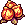<b>Blister Fruit × 5</b> ← 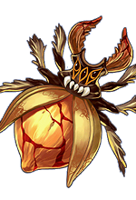<b>Dekumanus</b> (Field 4)

รางวัล: Thermos (ใช้ขั้น 3)

<label class="done"><input class="key" id="k3" type="checkbox"/> ทำแล้ว</label>ขั้น 3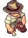<h3>Indiana John - Indiana John's Theory</h3>

Techichi Field 3Lv 210+

ส่ง<ul><li><b>Indiana's Portfolio</b></li><li><b>Thermos</b></li></ul>

รางวัล: ไม่มี

<label class="done"><input class="key" id="k4" type="checkbox"/> ทำแล้ว</label>ขั้น 4<h3>Indiana John - Supporting Evidence</h3>

Techichi Field 3Lv 210+

ส่ง<ul><li>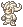<b>Orconio Plaster Statue</b> ← <b>Orconio</b> (Field 3)</li><li><b>Orpeo Plaster Statue</b> ← 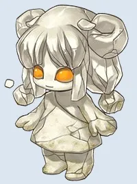<b>Orpeo</b> (Field 3)</li></ul>

รางวัล: 10,000 Galder Coupon

<label class="done"><input class="key" id="k5" type="checkbox"/> ทำแล้ว</label>ขั้น 5<h3>Indiana John - Checking Out</h3>

Techichi Field 3Lv 210+

ส่ง <b>Tough Rope × 3</b> ← 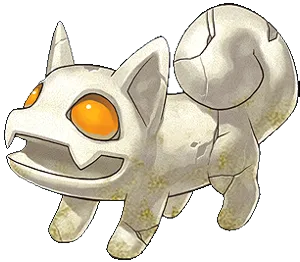<b>Ponchichi</b> (Field 2, 3)

รางวัล<ul><li>Empty Thermos</li><li>Lodging Fee Envelope (ใช้ขั้น 6)</li></ul>

<label class="done"><input class="key" id="k6" type="checkbox"/> ทำแล้ว</label>ขั้น 6<h3>Grandpa Tango - Grandpa Tango's Appreciation</h3>

Techichi Volcano - Tango CabinLv 210+

ส่ง<ul><li><b>Empty Thermos</b></li><li><b>Lodging Fee Envelope</b></li><li>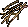<b>Dry Wood × 5</b> (ขุดใน Techichi Field)</li><li><b>Adventurer's Book</b></li></ul>

รางวัล<ul><li><b>Adventurer's Book</b> (เก็บไว้ใช้โซนต่อไป)</li><li>Weapon Ticket I</li></ul>

</section>

<section>

## เควสที่ให้ Techichi Sticker

มี 16 เควส ต้องการ 13 ใบ

เส้นทางแนะนำ 13 เควสติด ★ อยู่ใน Techichi Field เกือบทั้งหมด มีแค่ Explorer Reina ที่ต้องลง Black Ash Dungeon 1, 2

<button aria-pressed="false" id="hideUnstar" type="button">ซ่อนเควสที่ไม่ติดดาว</button><button hidden="" id="showAll" type="button">แสดงทั้งหมด</button>

<table>
<thead><tr><th>ได้แล้ว</th><th>เควส</th><th>รอบ</th><th>ที่อยู่</th><th>NPC</th><th>เงื่อนไข</th><th>ของที่ต้องส่ง และแหล่ง</th></tr></thead>
<tbody>
<tr><td><input aria-label="ได้ Techichi Sticker แล้ว" class="stk" id="w1" type="checkbox"/></td><td>★ Tango - Thoughtful Tango</td><td class="n">5</td><td>Techichi Volcano - Tango Cabin</td><td>Tango</td><td>Lv 200+</td><td>Serpentine, Spinel, Sulfur Stone อย่างละ 1 ← ขุดใน Techichi Field</td></tr>
<tr><td><input aria-label="ได้ Techichi Sticker แล้ว" class="stk" id="w2" type="checkbox"/></td><td>★ Al-Hauri - Prepare for Tapasco Spa</td><td class="n">5</td><td>Techichi Field 1</td><td>Al-Hauri</td><td>Lv 200+</td><td>Sulfur Stone × 3 ← ขุดใน Techichi Field หรือ 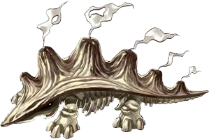<b>Kilimanjaro</b></td></tr>
<tr class="pre-row"><td><input aria-label="ทำขั้นนี้ครบแล้ว" class="pre" id="wp1" type="checkbox"/></td><td>★ Grandpa Tango - Briquettes for Tango Cabin ขั้นก่อนหน้า · ไม่ได้ Techichi Sticker</td><td class="n">5</td><td>Techichi Field 1</td><td>Grandpa Tango</td><td>Lv 200+ · รวม 25</td><td>Charcoal Briquettes × 5 ← <b>Kilimanjaro</b> (Field 1)</td></tr>
<tr><td><input aria-label="ได้ Techichi Sticker แล้ว" class="stk" id="w3" type="checkbox"/></td><td>★ Grandpa Tango - Gift from Tango Cabin</td><td class="n">5</td><td>Techichi Field 1</td><td>Grandpa Tango</td><td>ทำ Briquettes for Tango Cabin ก่อน</td><td>Dust Mask × 3 ← <b>Orpeo</b> (Field 3)</td></tr>
<tr><td><input aria-label="ได้ Techichi Sticker แล้ว" class="stk" id="w4" type="checkbox"/></td><td>★ Marie Elle - Errands from Mom</td><td class="n">5</td><td>Techichi Field 1</td><td>Marie Elle</td><td>Lv 200+</td><td>Amethystos × 1 ← ขุดใน Techichi Field</td></tr>
<tr><td><input aria-label="ได้ Techichi Sticker แล้ว" class="stk" id="w5" type="checkbox"/></td><td>★ Sandman - Tapasco Spa is under way</td><td class="n">5</td><td>Techichi Field 1</td><td>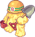Sandman</td><td>Lv 200+</td><td>Basalt Piece × 2 + Granite Piece × 2 ← ขุดใน Techichi Field หรือ 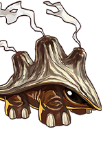<b>Laki</b></td></tr>
<tr><td><input aria-label="ได้ Techichi Sticker แล้ว" class="stk" id="w6" type="checkbox"/></td><td>★ Lethos - Cabin Guard</td><td class="n">5</td><td>Techichi Field 2</td><td>Lethos</td><td>Lv 200+</td><td>Saw Blade Ring × 10 ← <b>Laki</b> (Field 1, 2) หรือซื้อ</td></tr>
<tr><td><input aria-label="ได้ Techichi Sticker แล้ว" class="stk" id="w7" type="checkbox"/></td><td>★ Pharaoh Boy - Medicine for the Pyramid</td><td class="n">5</td><td>Techichi Field 2</td><td>Pharaoh Boy</td><td>Lv 200+</td><td>Serpentine × 2 + Lithosmasso × 2 ← ขุดใน Techichi Field</td></tr>
<tr><td><input aria-label="ได้ Techichi Sticker แล้ว" class="stk" id="w8" type="checkbox"/></td><td>★ Ancient Polar Bear - I'm Lost?</td><td class="n">5</td><td>Techichi Field 3</td><td>Ancient Polar Bear</td><td>Lv 200+</td><td>Portable Icepack × 3 ← ขุดใน Techichi Field</td></tr>
<tr class="pre-row"><td><input aria-label="ทำขั้นนี้ครบแล้ว" class="pre" id="wp2" type="checkbox"/></td><td>★ Rosemary - It's Difficult Being Pretty ขั้นก่อนหน้า · ไม่ได้ Techichi Sticker</td><td class="n">5</td><td>Techichi Field 3</td><td>Rosemary</td><td>Lv 200+ · รวม 5</td><td>Terrible Mask × 1 ← <b>Dekumanus</b> (Field 4)</td></tr>
<tr><td><input aria-label="ได้ Techichi Sticker แล้ว" class="stk" id="w9" type="checkbox"/></td><td>★ Rosemary - Special Skin Care</td><td class="n">5</td><td>Techichi Field 3</td><td>Rosemary</td><td>ทำ It's Difficult Being Pretty ก่อน</td><td>Volcanic Ash Pack × 2 ← <b>Orconio</b> (Field 3)</td></tr>
<tr><td><input aria-label="ได้ Techichi Sticker แล้ว" class="stk" id="w10" type="checkbox"/></td><td>★ Farmer Tsetsech - Reviving Tsetsech</td><td class="n">5</td><td>Techichi Field 4</td><td>Farmer Tsetsech</td><td>Lv 200+</td><td>Volcanic Ash × 5 ← <b>Kilimanjaro</b> (Field 1)</td></tr>
<tr class="pre-row"><td><input aria-label="ทำขั้นนี้ครบแล้ว" class="pre" id="wp3" type="checkbox"/></td><td>★ Match Girl Annie - The Little Match Girl ขั้นก่อนหน้า · ไม่ได้ Techichi Sticker</td><td class="n">5</td><td>Techichi Field 4</td><td>Match Girl Annie</td><td>Lv 200+ · รวม 10</td><td>Long Lasting Matchsticks × 2 ← ผสมที่ Compounder Paul (ดูหมายเหตุใต้ตารางมอน)</td></tr>
<tr><td><input aria-label="ได้ Techichi Sticker แล้ว" class="stk" id="w11" type="checkbox"/></td><td>★ Match Girl Annie - Annie's Story</td><td class="n">5</td><td>Techichi Field 4</td><td>Match Girl Annie</td><td>ทำ The Little Match Girl ก่อน</td><td>Glass Slipper × 1 ← ขุดใน Techichi Field</td></tr>
<tr><td><input aria-label="ได้ Techichi Sticker แล้ว" class="stk" id="w12" type="checkbox"/></td><td>★ Werewolf Lycan - Lunatic Charge</td><td class="n">5</td><td>Techichi Field 4</td><td>Werewolf Lycan</td><td>Lv 200+</td><td>Selinomarina × 2 ← ขุดใน Techichi Field</td></tr>
<tr class="pre-row"><td><input aria-label="ทำขั้นนี้ครบแล้ว" class="pre" id="wp4" type="checkbox"/></td><td>Shaman Girl Jia - Restless Souls of Black Ash ขั้นก่อนหน้า · ไม่ได้ Techichi Sticker</td><td class="n">5</td><td>Black Ash Dungeon 1</td><td>Shaman Girl Jia</td><td>Lv 210+</td><td>Volcanic Censer × 1 + 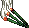Incense Sticks × 10 ← <b>Burning Kili</b> (Black Ash Dungeon 1, 3)</td></tr>
<tr><td><input aria-label="ได้ Techichi Sticker แล้ว" class="stk" id="w14" type="checkbox"/></td><td>Shaman Girl Jia - Wind Charms</td><td class="n">5</td><td>Black Ash Dungeon 1</td><td>Shaman Girl Jia</td><td>ทำ Restless Souls of Black Ash ก่อน</td><td>Wind Charm × 5 ← <b>Doom Claw</b> (Black Ash Dungeon 2–4)</td></tr>
<tr class="pre-row"><td><input aria-label="ทำขั้นนี้ครบแล้ว" class="pre" id="wp5" type="checkbox"/></td><td>Tango - Water Shortage - 1 ขั้นก่อนหน้า · ไม่ได้ Techichi Sticker</td><td class="n">5</td><td>Black Ash Dungeon 2</td><td>Tango</td><td>Lv 210+ · รวม 25</td><td>Iodine Pills × 5 ← <b>Ash Soldier</b> (Black Ash Dungeon 1–4)</td></tr>
<tr><td><input aria-label="ได้ Techichi Sticker แล้ว" class="stk" id="w15" type="checkbox"/></td><td>Tango - Water Shortage - 2</td><td class="n">5</td><td>Black Ash Dungeon 2</td><td>Tango</td><td>ทำ Water Shortage - 1 ก่อน</td><td>Crystal Blue Water × 3 ← ขุดใน Black Ash Dungeon</td></tr>
<tr class="pre-row"><td><input aria-label="ทำขั้นนี้ครบแล้ว" class="pre" id="wp6" type="checkbox"/></td><td>Al-Hauri - Preparing a Bath 1 - Black Ash ขั้นก่อนหน้า · ไม่ได้ Techichi Sticker</td><td class="n">5</td><td>Black Ash Dungeon 3</td><td>Al-Hauri</td><td>Lv 210+ · รวม 15</td><td>Black Volcanic Ash × 3 ← ขุดใน Black Ash Dungeon</td></tr>
<tr><td><input aria-label="ได้ Techichi Sticker แล้ว" class="stk" id="w16" type="checkbox"/></td><td>Al-Hauri - Preparing the Bath 2 - Sulfurous Mud</td><td class="n">5</td><td>Black Ash Dungeon 3</td><td>Al-Hauri</td><td>ทำ Preparing a Bath 1 ก่อน (วิกิไม่ได้เขียนไว้)</td><td>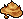Sulfurous Mud × 3 ← ขุดใน Black Ash Dungeon</td></tr>
<tr><td><input aria-label="ได้ Techichi Sticker แล้ว" class="stk" id="w13" type="checkbox"/></td><td>★ Explorer Reina - Relics of Black Ash</td><td class="n">5</td><td>Black Ash Dungeon 4</td><td>Explorer Reina</td><td>Lv 210+</td><td>Artifact of Ash ← 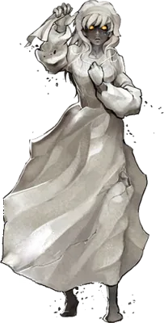<b>Malefic Matron</b> (Black Ash Dungeon 1, 2) Relic of Ash ← <b>Ash Soldier</b></td></tr>
</tbody>
</table>

</section>

<section>

## จุดขุดและมอน เรียงตามแมพ

<table>
<thead><tr><th>ครบแล้ว</th><th>แมพ</th><th>ขุด / มอน</th><th>ไอเทม</th><th>จำนวนรวม</th><th>ใช้ในเควส</th></tr></thead>
<tbody>
<tr class="mon-row" data-q="[[&quot;k6&quot;, 5, &quot;ขั้น 6 Grandpa Tango's Appreciation&quot;, 0], [&quot;wp3&quot;, 20, &quot;Little Match Girl (ไม้ขีด 2 อัน × 2 ชิ้น × 5 รอบ)&quot;, 0]]"><td><input aria-label="หาครบแล้ว" class="mon" id="tm1" type="checkbox"/></td><td>★ Techichi Field (ขุด)</td><td>ขุด</td><td>Dry Wood</td><td class="n">25</td><td>ขั้น 6 Grandpa Tango's Appreciation + Little Match Girl (ไม้ขีด 2 อัน × 2 ชิ้น × 5 รอบ)</td></tr>
<tr class="mon-row" data-q='[["w7", 10, "Pharaoh Boy (2 × 5 รอบ)", 0], ["w1", 5, "Thoughtful Tango (1 × 5 รอบ)", 0]]'><td><input aria-label="หาครบแล้ว" class="mon" id="tm2" type="checkbox"/></td><td>★ Techichi Field (ขุด)</td><td>ขุด</td><td>Serpentine</td><td class="n">15</td><td>Pharaoh Boy (2 × 5 รอบ) + Thoughtful Tango (1 × 5 รอบ)</td></tr>
<tr class="mon-row" data-q='[["w7", 10, "Pharaoh Boy (2 × 5 รอบ)", 0]]'><td><input aria-label="หาครบแล้ว" class="mon" id="tm3" type="checkbox"/></td><td>★ Techichi Field (ขุด)</td><td>ขุด</td><td>Lithosmasso</td><td class="n">10</td><td>Pharaoh Boy (2 × 5 รอบ)</td></tr>
<tr class="mon-row" data-q='[["w1", 5, "Thoughtful Tango (1 × 5 รอบ)", 0]]'><td><input aria-label="หาครบแล้ว" class="mon" id="tm4" type="checkbox"/></td><td>★ Techichi Field (ขุด)</td><td>ขุด</td><td>Spinel</td><td class="n">5</td><td>Thoughtful Tango (1 × 5 รอบ)</td></tr>
<tr class="mon-row" data-q='[["w2", 15, "Prepare for Tapasco Spa (3 × 5 รอบ)", 0], ["w1", 5, "Thoughtful Tango (1 × 5 รอบ)", 0]]'><td><input aria-label="หาครบแล้ว" class="mon" id="tm5" type="checkbox"/></td><td>★ Techichi Field (ขุด) หรือ Kilimanjaro</td><td>ขุด</td><td>Sulfur Stone</td><td class="n">20</td><td>Prepare for Tapasco Spa (3 × 5 รอบ) + Thoughtful Tango (1 × 5 รอบ)</td></tr>
<tr class="mon-row" data-q='[["w5", 10, "Sandman (2 × 5 รอบ)", 0]]' data-unit="ต่อชนิด"><td><input aria-label="หาครบแล้ว" class="mon" id="tm6" type="checkbox"/></td><td>★ Techichi Field (ขุด) หรือ Laki</td><td>ขุด</td><td>Basalt Piece, Granite Piece</td><td class="n">10 ต่อชนิด</td><td>Sandman (2 × 5 รอบ)</td></tr>
<tr class="mon-row" data-q='[["w4", 5, "Marie Elle (1 × 5 รอบ)", 0]]'><td><input aria-label="หาครบแล้ว" class="mon" id="tm7" type="checkbox"/></td><td>★ Techichi Field (ขุด)</td><td>ขุด</td><td>Amethystos</td><td class="n">5</td><td>Marie Elle (1 × 5 รอบ)</td></tr>
<tr class="mon-row" data-q='[["w8", 15, "Ancient Polar Bear (3 × 5 รอบ)", 0]]'><td><input aria-label="หาครบแล้ว" class="mon" id="tm8" type="checkbox"/></td><td>★ Techichi Field (ขุด)</td><td>ขุด</td><td>Portable Icepack</td><td class="n">15</td><td>Ancient Polar Bear (3 × 5 รอบ)</td></tr>
<tr class="mon-row" data-q="[[&quot;w11&quot;, 5, &quot;Annie's Story (1 × 5 รอบ)&quot;, 0]]"><td><input aria-label="หาครบแล้ว" class="mon" id="tm9" type="checkbox"/></td><td>★ Techichi Field (ขุด)</td><td>ขุด</td><td>Glass Slipper</td><td class="n">5</td><td>Annie's Story (1 × 5 รอบ)</td></tr>
<tr class="mon-row" data-q='[["w12", 10, "Werewolf Lycan (2 × 5 รอบ)", 0]]'><td><input aria-label="หาครบแล้ว" class="mon" id="tm10" type="checkbox"/></td><td>★ Techichi Field (ขุด)</td><td>ขุด</td><td>Selinomarina</td><td class="n">10</td><td>Werewolf Lycan (2 × 5 รอบ)</td></tr>
<tr class="mon-row" data-q='[["w10", 25, "Farmer Tsetsech (5 × 5 รอบ)", 0]]'><td><input aria-label="หาครบแล้ว" class="mon" id="tm11" type="checkbox"/></td><td>★ Path to Techichi 2, Techichi Field 1</td><td>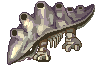Kilimanjaro</td><td>Volcanic Ash</td><td class="n">25</td><td>Farmer Tsetsech (5 × 5 รอบ)</td></tr>
<tr class="mon-row" data-q='[["wp1", 25, "Briquettes for Tango Cabin (5 × 5 รอบ)", 0]]'><td><input aria-label="หาครบแล้ว" class="mon" id="tm12" type="checkbox"/></td><td>★ Path to Techichi 2, Techichi Field 1</td><td>Kilimanjaro</td><td>Charcoal Briquettes</td><td class="n">25</td><td>Briquettes for Tango Cabin (5 × 5 รอบ)</td></tr>
<tr class="mon-row" data-q='[["w6", 50, "Cabin Guard (10 × 5 รอบ)", 0]]'><td><input aria-label="หาครบแล้ว" class="mon" id="tm13" type="checkbox"/></td><td>★ Techichi Field 1, 2</td><td>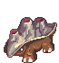Laki</td><td>Saw Blade Ring</td><td class="n">50</td><td>Cabin Guard (10 × 5 รอบ)</td></tr>
<tr class="mon-row" data-q='[["wp3", 10, "Little Match Girl (1 ต่อไม้ขีด × 2 × 5 รอบ)", 0]]'><td><input aria-label="หาครบแล้ว" class="mon" id="tm14" type="checkbox"/></td><td>★ Techichi Field 1, 2</td><td>Laki</td><td>Phosphorus Paste</td><td class="n">10</td><td>Little Match Girl (1 ต่อไม้ขีด × 2 × 5 รอบ)</td></tr>
<tr class="mon-row" data-q='[["k5", 3, "ขั้น 5 Checking Out", 0]]'><td><input aria-label="หาครบแล้ว" class="mon" id="tm15" type="checkbox"/></td><td>★ Techichi Field 2, 3</td><td>Ponchichi</td><td>Tough Rope</td><td class="n">3</td><td>ขั้น 5 Checking Out</td></tr>
<tr class="mon-row" data-q='[["k4", 1, "ขั้น 4 Supporting Evidence", 0]]'><td><input aria-label="หาครบแล้ว" class="mon" id="tm16" type="checkbox"/></td><td>★ Techichi Field 3</td><td>Orconio</td><td>Orconio Plaster Statue</td><td class="n">1</td><td>ขั้น 4 Supporting Evidence</td></tr>
<tr class="mon-row" data-q='[["w9", 10, "Special Skin Care (2 × 5 รอบ)", 0]]'><td><input aria-label="หาครบแล้ว" class="mon" id="tm17" type="checkbox"/></td><td>★ Techichi Field 3</td><td>Orconio</td><td>Volcanic Ash Pack</td><td class="n">10</td><td>Special Skin Care (2 × 5 รอบ)</td></tr>
<tr class="mon-row" data-q='[["k4", 1, "ขั้น 4 Supporting Evidence", 0]]'><td><input aria-label="หาครบแล้ว" class="mon" id="tm18" type="checkbox"/></td><td>★ Techichi Field 3</td><td>Orpeo</td><td>Orpeo Plaster Statue</td><td class="n">1</td><td>ขั้น 4 Supporting Evidence</td></tr>
<tr class="mon-row" data-q='[["w3", 15, "Gift from Tango Cabin (3 × 5 รอบ)", 0]]'><td><input aria-label="หาครบแล้ว" class="mon" id="tm19" type="checkbox"/></td><td>★ Techichi Field 3</td><td>Orpeo</td><td>Dust Mask</td><td class="n">15</td><td>Gift from Tango Cabin (3 × 5 รอบ)</td></tr>
<tr class="mon-row" data-q='[["k2", 5, "ขั้น 2 Tango Cabin Soup", 0]]'><td><input aria-label="หาครบแล้ว" class="mon" id="tm20" type="checkbox"/></td><td>★ Techichi Field 4</td><td>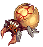Dekumanus</td><td>Blister Fruit</td><td class="n">5</td><td>ขั้น 2 Tango Cabin Soup</td></tr>
<tr class="mon-row" data-q="[[&quot;wp2&quot;, 5, &quot;It's Difficult Being Pretty (1 × 5 รอบ)&quot;, 0]]"><td><input aria-label="หาครบแล้ว" class="mon" id="tm21" type="checkbox"/></td><td>★ Techichi Field 4</td><td>Dekumanus</td><td>Terrible Mask</td><td class="n">5</td><td>It's Difficult Being Pretty (1 × 5 รอบ)</td></tr>
<tr class="mon-row" data-q='[["w13", 5, "Relics of Black Ash (1 × 5 รอบ)", 0]]'><td><input aria-label="หาครบแล้ว" class="mon" id="tm22" type="checkbox"/></td><td>★ Black Ash Dungeon 1, 2</td><td>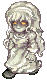Malefic Matron</td><td>Artifact of Ash</td><td class="n">5</td><td>Relics of Black Ash (1 × 5 รอบ)</td></tr>
<tr class="mon-row" data-q='[["wp4", 5, "Restless Souls (1 × 5 รอบ)", 0]]'><td><input aria-label="หาครบแล้ว" class="mon" id="tm23" type="checkbox"/></td><td>Black Ash Dungeon 1, 3</td><td>Burning Kili</td><td>Volcanic Censer</td><td class="n">5</td><td>Restless Souls (1 × 5 รอบ)</td></tr>
<tr class="mon-row" data-q='[["wp4", 50, "Restless Souls (10 × 5 รอบ)", 0]]'><td><input aria-label="หาครบแล้ว" class="mon" id="tm24" type="checkbox"/></td><td>Black Ash Dungeon 1, 3</td><td>Burning Kili</td><td>Incense Sticks</td><td class="n">50</td><td>Restless Souls (10 × 5 รอบ)</td></tr>
<tr class="mon-row" data-q='[["w13", 5, "Relics of Black Ash (1 × 5 รอบ)", 0]]'><td><input aria-label="หาครบแล้ว" class="mon" id="tm25" type="checkbox"/></td><td>★ Black Ash Dungeon 1–4</td><td>Ash Soldier</td><td>Relic of Ash</td><td class="n">5</td><td>Relics of Black Ash (1 × 5 รอบ)</td></tr>
<tr class="mon-row" data-q='[["wp5", 25, "Water Shortage 1 (5 × 5 รอบ)", 0]]'><td><input aria-label="หาครบแล้ว" class="mon" id="tm26" type="checkbox"/></td><td>Black Ash Dungeon 1–4</td><td>Ash Soldier</td><td>Iodine Pills</td><td class="n">25</td><td>Water Shortage 1 (5 × 5 รอบ)</td></tr>
<tr class="mon-row" data-q='[["w14", 25, "Wind Charms (5 × 5 รอบ)", 0]]'><td><input aria-label="หาครบแล้ว" class="mon" id="tm27" type="checkbox"/></td><td>Black Ash Dungeon 2–4</td><td>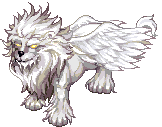Doom Claw</td><td>Wind Charm</td><td class="n">25</td><td>Wind Charms (5 × 5 รอบ)</td></tr>
<tr class="mon-row" data-q='[["wp6", 15, "Preparing a Bath 1 (3 × 5 รอบ)", 0]]'><td><input aria-label="หาครบแล้ว" class="mon" id="tm28" type="checkbox"/></td><td>Black Ash Dungeon (ขุด)</td><td>ขุด</td><td>Black Volcanic Ash</td><td class="n">15</td><td>Preparing a Bath 1 (3 × 5 รอบ)</td></tr>
<tr class="mon-row" data-q='[["w16", 15, "Preparing the Bath 2 (3 × 5 รอบ)", 0]]'><td><input aria-label="หาครบแล้ว" class="mon" id="tm29" type="checkbox"/></td><td>Black Ash Dungeon (ขุด)</td><td>ขุด</td><td>Sulfurous Mud</td><td class="n">15</td><td>Preparing the Bath 2 (3 × 5 รอบ)</td></tr>
<tr class="mon-row" data-q='[["w15", 15, "Water Shortage 2 (3 × 5 รอบ)", 0]]'><td><input aria-label="หาครบแล้ว" class="mon" id="tm30" type="checkbox"/></td><td>Black Ash Dungeon (ขุด)</td><td>ขุด</td><td>Crystal Blue Water</td><td class="n">15</td><td>Water Shortage 2 (3 × 5 รอบ)</td></tr>
</tbody>
</table>

Long Lasting Matchsticks ผสมที่ Compounder Paul (Techichi Town - Neil's Camp) จาก Dry Wood × 2 + Phosphorus Paste × 1 · Saw Blade Ring ซื้อได้จาก Item Girl ที่ Gate of Black Swamp ด้วย

</section>

<section>

## เควสอื่นในโซน (ไม่ให้สติ๊กเกอร์)

ไม่รวมเควส Card Girl เควสเปลี่ยนอาชีพ และเควส Guardian

<table>
<thead><tr><th>เควส</th><th>รอบ</th><th>ที่อยู่</th><th>ของที่ต้องส่ง</th><th>รางวัล</th></tr></thead>
<tbody>
<tr><td>Kochi - Register Techichi Teleport Service</td><td class="n">1</td><td>Gate of Techichi</td><td>ลงทะเบียนวาร์ปกับ Kochi</td><td>เปิดวาร์ปมา Gate of Techichi </td></tr>
<tr><td>Explorer Reina - Prizes of Techichi Lv 180+</td><td class="n">5</td><td>Gate of Techichi</td><td>Spinel × 2 ← ขุดใน Techichi Fields Selinomarina × 2 ← ขุดใน Techichi Fields Amethystos × 2 ← ขุดใน Techichi Fields Serpentine × 2 ← ขุดใน Techichi Fields</td><td>Land Drill No. 8</td></tr>
<tr><td>Bunny Maid - Protect Techichi Volcano Lv 200+</td><td class="n">5</td><td>Gate of Techichi</td><td>Sulfur Dioxide Capsule × 5 ← Fossil Soldier</td><td>รอบ 1–4: 500 Galder Coupon รอบ 5: 500 Galder Coupon, Bunny Maid Card</td></tr>
<tr><td>Vinosh - Chicken Combo Lv 200+</td><td class="n">5</td><td>Gate of Techichi</td><td>Fried Chicken × 2 ← Roaster Seasoned Chicken × 2 ← Roaster</td><td>รอบ 1–4: 500 Galder Coupon รอบ 5: 500 Galder Coupon, 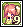Vinosh Card</td></tr>
<tr><td>Favian - Dangerous Weapon Lv 200+</td><td class="n">5</td><td>Gate of Techichi</td><td>Oval Briquette × 5 ← Fossil Soldier</td><td>รอบ 1–4: 500 Galder Coupon รอบ 5: 500 Galder Coupon, Favian Card</td></tr>
<tr><td>Merchant Miguel - Rare Volcanic Rock Lv 200+</td><td class="n">5</td><td>Gate of Techichi</td><td>Volcanic Rock × 5 ← ขุดใน Path to Techichi 1 and Path to Techichi 2</td><td>รอบ 1–4: 500 Galder Coupon รอบ 5: 500 Galder Coupon, 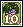Miguel Card</td></tr>
<tr><td>Relic Site (Field) - Excavate Techichi Volcano Relic (Techichi Field 1) Lv 200+, หลังผ่าน Prof. Neil - Prof. Neil's Second Test</td><td class="n">5</td><td>Techichi Field 1</td><td>Excavation Trowel ← ซื้อจาก Techichi Town - Neil's Camp (6,000G each)</td><td>500 Galder Coupon or Unknown Relic Piece</td></tr>
<tr><td>Relic Site (Field) - Excavate Techichi Volcano Relic (Techichi Field 2) Lv 200+, หลังผ่าน Prof. Neil - Prof. Neil's Second Test</td><td class="n">25</td><td>Techichi Field 2</td><td>Excavation Trowel ← ซื้อจาก Techichi Town - Neil's Camp (6,000G each)</td><td>500 Galder Coupon or Unknown Relic Piece</td></tr>
<tr><td>Relic Site (Field) - Excavate Techichi Volcano Relic (Techichi Field 3) Lv 200+, หลังผ่าน Prof. Neil - Prof. Neil's Second Test</td><td class="n">25</td><td>Techichi Field 3</td><td>Excavation Trowel ← ซื้อจาก Techichi Town - Neil's Camp (6,000G each)</td><td>500 Galder Coupon or Unknown Relic Piece</td></tr>
<tr><td>Relic Site (Field) - Excavate Techichi Volcano Relic (Techichi Field 4) Lv 200+, หลังผ่าน Prof. Neil - Prof. Neil's Second Test</td><td class="n">25</td><td>Techichi Field 4</td><td>Excavation Trowel ← ซื้อจาก Techichi Town - Neil's Camp (6,000G each)</td><td>500 Galder Coupon or Unknown Relic Piece</td></tr>
<tr><td>Monkey T - Monkey T's Request (10) Lv 200+</td><td class="n">25</td><td>Techichi Field 3</td><td>Eternal Fire Grass × 10 ← Ponchichi</td><td>50 Galder Coupon, 100 Galder Coupon or 500 Galder Coupon</td></tr>
<tr><td>Prof. Neil - Indiana John's Recommendation Lv 200+</td><td class="n">1</td><td>Techichi Town - Neil's Camp</td><td>Indiana John's Recommendation</td><td>500 Galder Coupon × 5</td></tr>
<tr><td>Prof. Neil - Prof. Neil's Second Test Lv 200+, หลังผ่าน Prof. Neil - Prof. Neil's First Test</td><td class="n">1</td><td>Techichi Town - Neil's Camp</td><td>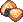Sand Cake × 5 ← Sand Demon Scorpion Jerky × 5 ← Sea Scorpion Clam Meat × 5 ← Shell Trap Star Candy × 5 ← Fanta Slime</td><td>500 Galder Coupon × 5, Prof. Neil Card</td></tr>
<tr><td>Ray - Past of Oops Wharf Lv 200+, หลังผ่าน Prof. Neil - Prof. Neil's Second Test</td><td class="n">1</td><td>Techichi Town - Neil's Camp</td><td>Galatea Statuette × 5 ← ขุดใน Oops Wharf Fields Pirate Coin × 5 ← ขุดใน Oops Wharf Fields Sculpture of Poseidon × 5</td><td>500 Galder Coupon × 5</td></tr>
<tr><td>Ray - Restoration of the Broken Relics Lv 200+, หลังผ่าน Ray - Past of Oops Wharf</td><td class="n">20</td><td>Techichi Town - Neil's Camp</td><td>Unknown Relic Piece ← รางวัลจาก Relic Site (Field) - Excavate Techichi Volcano Relic in Techichi Field 1 , 2 , 3 , and 4 , and Relic Site (Dungeon) - Excavate Techichi Volcano Relic in Black Ash Dungeon 1 , 2 , 3 , and 4</td><td>รอบ 1–19: Restored Relic รอบ 20: Restored Relic, Ray Card, Techichi Volcano Survey Report</td></tr>
<tr><td>Ravenwood - Professor's Taste Lv 200+, หลังผ่าน Prof. Neil - Prof. Neil's Second Test</td><td class="n">1</td><td>Techichi Town - Neil's Camp</td><td>Honey Tea Ginseng Tea Caballa Coffee</td><td>500 Galder Coupon × 5</td></tr>
<tr><td>Ravenwood - Techichi Relic Appraisal Lv 200+, หลังผ่าน Ravenwood - Professor's Taste</td><td class="n">20</td><td>Techichi Town - Neil's Camp</td><td>Restored Relic ← รางวัลจาก Ray - Restoration of the Broken Relics</td><td>รอบ 1: Appraised Relic รอบ 2: Fake Relic รอบ 3: Appraised Art Work รอบ 4: Appraised Relic รอบ 5: Fake Relic รอบ 6: Appraised Art Work รอบ 7: Fake Relic รอบ 8: Fake Relic รอบ 9: Appraised Art Work รอบ 10: Appraised Relic รอบ 11: Fake Relic รอบ 12: Appraised Relic รอบ 13: Fake Relic รอบ 14: Appraised Art Work รอบ 15: Fake Relic รอบ 16: Fake Relic รอบ 17: Appraised Art Work รอบ 18: Fake Relic รอบ 19: Fake Relic รอบ 20: Appraised Relic, Ravenwood Card, Techichi Volcano Survey Report</td></tr>
<tr><td>Irina - Ghost Blue Legend Lv 200+, หลังผ่าน Prof. Neil - Prof. Neil's Second Test</td><td class="n">1</td><td>Techichi Town - Neil's Camp</td><td>Broken Compass ← ขุดใน Ghost Blue Seabed Fields Ship Steering Wheel ← ขุดใน Ghost Blue Seabed Fields Anchor ← ขุดใน Ghost Blue Seabed Fields Shackles</td><td>500 Galder Coupon × 5</td></tr>
<tr><td>Irina - Techichi Volcano Relics and Nearby Countries Lv 200+, หลังผ่าน Irina - Ghost Blue Legend</td><td class="n">5</td><td>Techichi Town - Neil's Camp</td><td>Appraised Relic ← รางวัลจาก Ravenwood - Techichi Relic Appraisal</td><td>รอบ 1–4: 500 Galder Coupon × 5 รอบ 5: 500 Galder Coupon × 5, Irina Card, Techichi Volcano Survey Report</td></tr>
<tr><td>Elsa Key Kuan - Living in Harsh Environments Lv 200+, หลังผ่าน Prof. Neil - Prof. Neil's Second Test</td><td class="n">1</td><td>Techichi Town - Neil's Camp</td><td>Sun Cream × 5 ← ขุดใน Desert Beach Field 2 - Sand Palace Multi-Vitamin × 5 ← Pochi Mud Pack × 5 ← Mud Bigfoot</td><td>500 Galder Coupon × 5</td></tr>
<tr><td>Elsa Key Kuan - Relic's Art Value Lv 200+, หลังผ่าน Elsa Key Kuan - Living in Harsh Environments</td><td class="n">5</td><td>Techichi Town - Neil's Camp</td><td>Appraised Art Work ← รางวัลจาก Ravenwood - Techichi Relic Appraisal</td><td>รอบ 1–4: 500 Galder Coupon × 5 รอบ 5: 500 Galder Coupon × 5, Elsa Key Kuan Card, Techichi Volcano Survey Report</td></tr>
<tr><td>Rebecca - Black Swamp Plant Survey Lv 200+, หลังผ่าน Prof. Neil - Prof. Neil's Second Test</td><td class="n">1</td><td>Techichi Town - Neil's Camp</td><td>Lotus Leaf × 5 ← Chameleon Frog Red Apple × 5 ← Monkya Swamp Leaf × 5 ← ขุดใน Black Swamp Fields</td><td>500 Galder Coupon × 5</td></tr>
<tr><td>Rebecca - Unknown Seed (1) Lv 200+, หลังผ่าน Rebecca - Black Swamp Plant Survey</td><td class="n">1</td><td>Techichi Town - Neil's Camp</td><td>Unknown Seed × 5 ← ขุดใน Techichi Volcano Fields</td><td>500 Galder Coupon × 5</td></tr>
<tr><td>Rebecca - Unknown Seed (2) Lv 200+, หลังผ่าน Rebecca - Unknown Seed (1)</td><td class="n">1</td><td>Techichi Town - Neil's Camp</td><td>วิกิไม่ระบุ</td><td>500 Galder Coupon × 5</td></tr>
<tr><td>Rebecca - Unknown Seed (3) Lv 200+, หลังผ่าน Rebecca - Unknown Seed (2)</td><td class="n">1</td><td>Techichi Town - Neil's Camp</td><td>วิกิไม่ระบุ</td><td>500 Galder Coupon × 5</td></tr>
<tr><td>Automatic Plant Incubator - Plant Cultivation Experiment (Sand) Lv 200+, มี Rebecca - Unknown Seed (3) ค้างในสมุดเควส</td><td class="n">3</td><td>Techichi Town - Neil's Camp</td><td>Sand Powder × 10 ← Fan Lizard</td><td>รอบ 1–2: ไม่มี รอบ 3: Plant Cultivation Experiment (Sand)</td></tr>
<tr><td>Automatic Plant Incubator - Plant Cultivation Experiment (Pebble) Lv 200+, มี Rebecca - Unknown Seed (3) ค้างในสมุดเควส</td><td class="n">3</td><td>Techichi Town - Neil's Camp</td><td>Pebbles × 10 ← ขุดใน Coral Beach - Dark Cave , and Path to Mermaid Palace 1 and Path to Mermaid Palace 2</td><td>รอบ 1–2: ไม่มี รอบ 3: Plant Cultivation Experiment (Pebble)</td></tr>
<tr><td>Automatic Plant Incubator - Plant Cultivation Experiment (Mud) Lv 200+, มี Rebecca - Unknown Seed (3) ค้างในสมุดเควส</td><td class="n">3</td><td>Techichi Town - Neil's Camp</td><td>Squishy Mud × 10 ← Walking Tadpole</td><td>รอบ 1–2: ไม่มี รอบ 3: Plant Cultivation Experiment (Mud)</td></tr>
<tr><td>Rebecca - Flower Blooming in Ashes Lv 200+, หลังผ่าน Rebecca - Unknown Seed (3)</td><td class="n">1</td><td>Techichi Town - Neil's Camp</td><td>Flower Blooming in Ashes ← รางวัลจาก Automatic Plant Incubator - Plant Cultivation Experiment (Volcanic Ash)</td><td>Flower Blooming in Ashes (Equipment), Rebecca Card, Techichi Volcano Survey Report</td></tr>
<tr><td>Automatic Plant Incubator - Plant Cultivation Experiment (Volcanic Ash) Lv 200+, มี Rebecca - Flower Blooming in Ashes ค้างในสมุดเควส</td><td class="n">3</td><td>Techichi Town - Neil's Camp</td><td>Volcanic Ash × 10 ← Kilimanjaro</td><td>รอบ 1–2: ไม่มี รอบ 3: Flower Blooming in Ashes</td></tr>
<tr><td>Marion - Flowy Lace Lv 200+, หลังผ่าน Prof. Neil - Prof. Neil's Second Test</td><td class="n">1</td><td>Techichi Town - Neil's Camp</td><td>Pink Lace × 5 ← Pink Chipmunk Green Lace × 5 ← Green Chipmunk Blue Lace × 5 ← King Yamu</td><td>500 Galder Coupon × 5</td></tr>
<tr><td>Marion - Techichi Volcano Survey Report Lv 200+, หลังผ่าน Marion - Flowy Lace</td><td class="n">5</td><td>Techichi Town - Neil's Camp</td><td>Techichi Volcano Survey Report ← รางวัลจาก Ray - Restoration of the Broken Relics , Ravenwood - Techichi Relic Appraisal , Irina - Techichi Volcano Relics and Nearby Countries , Elsa Key Kuan - Relic's Art Value , and Rebecca - Flower Blooming in Ashes</td><td>รอบ 1–4: 500 Galder Coupon × 5 รอบ 5: 500 Galder Coupon × 5, Marion Card</td></tr>
<tr><td>Relic Site (Dungeon) - Excavate Techichi Volcano Relic (Black Ash Dungeon 1) Lv 200+, หลังผ่าน Prof. Neil - Prof. Neil's Second Test</td><td class="n">25</td><td>Black Ash Dungeon 1</td><td>Excavation Trowel ← ซื้อจาก Techichi Town - Neil's Camp (6,000G each)</td><td>500 Galder Coupon or Unknown Relic Piece</td></tr>
<tr><td>Relic Site (Dungeon) - Excavate Techichi Volcano Relic (Black Ash Dungeon 2) Lv 200+, หลังผ่าน Prof. Neil - Prof. Neil's Second Test</td><td class="n">25</td><td>Black Ash Dungeon 2</td><td>Excavation Trowel ← ซื้อจาก Techichi Town - Neil's Camp (6,000G each)</td><td>500 Galder Coupon or Unknown Relic Piece</td></tr>
<tr><td>Relic Site (Dungeon) - Excavate Techichi Volcano Relic (Black Ash Dungeon 3) Lv 200+, หลังผ่าน Prof. Neil - Prof. Neil's Second Test</td><td class="n">25</td><td>Black Ash Dungeon 3</td><td>Excavation Trowel ← ซื้อจาก Techichi Town - Neil's Camp (6,000G each)</td><td>500 Galder Coupon or Unknown Relic Piece</td></tr>
<tr><td>Relic Site (Dungeon) - Excavate Techichi Volcano Relic (Black Ash Dungeon 4) Lv 200+, หลังผ่าน Prof. Neil - Prof. Neil's Second Test</td><td class="n">25</td><td>Black Ash Dungeon 4</td><td>Excavation Trowel ← ซื้อจาก Techichi Town - Neil's Camp (6,000G each)</td><td>500 Galder Coupon or Unknown Relic Piece</td></tr>
<tr><td>Blacksmith Marx - Golden Ash Mine Collection Lv 120+</td><td class="n">5</td><td>Techichi Volcano - Golden Ash</td><td>Pure Stibnite × 3 ← ขุดใน Golden Ash Mine 1 Flawless Spinel × 3 ← ขุดใน Golden Ash Mine 2</td><td>รอบ 1–4: Tornado Stone or 4x Pink Potion C or 2x 500 Galder Coupon รอบ 5: Harkon</td></tr>
<tr><td>Eclipse - The Story of the Gods 10 Lv 315+, ใช้ Mind's Eye, หลังผ่าน The Story of the Gods 9 และ หลังผ่าน Shadow Star 10 อย่างน้อย 1 ครั้ง</td><td class="n">1</td><td>Techichi Town - Neil's Camp</td><td>Shadow Pale Sapphire × 2 ← Shadow Black Ash Dungeon Monsters Shadow Twilight Amethyst × 2 ← Shadow Black Ash Dungeon Monsters</td><td>10,000 Galder Coupon × 5</td></tr>
<tr><td>Stella - Shadow Star 10 Lv 315+, ใช้ Mind's Eye</td><td class="n">1</td><td>Techichi Town - Neil's Camp</td><td>Mysterious Spell Scroll × 5 ← Shadow Roaster / Shadow Kilimanjaro / Shadow Ponchichi / Shadow Orpeo / Shadow Orconio / Shadow Dekumanus</td><td>Star Card Pack No.5, Half Pink Potion × 13, Half Blue Potion or Stella's Defense 1 × 13</td></tr>
<tr><td>Warrior Kei - Fight With Your Soul! Warrior, Gladiator or Duelist, Piercing Wave (M)</td><td class="n">1</td><td>Techichi Field 2</td><td>Blue Soul Bottle × 20 ← Requi Red Soul Bottle × 20 ← Quiem</td><td>Chi Sword Card</td></tr>
<tr><td>Driller King Marky - Romance of Drilling - Techichi Volcano Lv.140~400</td><td class="n">1</td><td>Gate of Techichi</td><td>Weird Ruins Map A ← ขุดใน Techichi Fields Weird Ruins Map B ← ขุดใน Techichi Fields</td><td>Weird Ruins Treasure Map</td></tr>
<tr><td>Explorer Reina - Treasure Hunting 2 - Techichi Volcano Lv.140~400, finished Explorer Reina - Treasure Hunting 1 - Techichi Volcano 50 times</td><td class="n">1</td><td>Techichi Field 2</td><td>Old Ruins Map A ← ขุดใน Techichi Fields Old Ruins Map B ← ขุดใน Techichi Fields</td><td>Old Ruins Treasure Map</td></tr>
<tr><td>Ponchichi (NPC) - Ponchichi's Dog Bone (Blue) Lv 150+</td><td class="n">1</td><td>Techichi Path to Soki 1 - Maze of Death</td><td>Blue Bone 1</td><td>Blue Bone 2</td></tr>
<tr><td>Ponchichi (NPC) - Blue Bone 2 Lv 150+</td><td class="n">1</td><td>Techichi Path to Soki 1 - Maze of Death</td><td>Blue Bone 2</td><td>Blue Bone 3</td></tr>
<tr><td>Ponchichi (NPC) - Blue Bone 3 Lv 150+</td><td class="n">1</td><td>Techichi Path to Soki 1 - Maze of Death</td><td>Blue Bone 3</td><td>Blue Bone 4</td></tr>
<tr><td>Ponchichi (NPC) - Blue Bone 4 Lv 150+</td><td class="n">1</td><td>Techichi Path to Soki 1 - Maze of Death</td><td>Blue Bone 4</td><td>Blue Bone 5</td></tr>
<tr><td>Ponchichi (NPC) - Blue Bone 5 Lv 150+</td><td class="n">1</td><td>Techichi Path to Soki 1 - Maze of Death</td><td>Blue Bone 5</td><td>Blue Bone 6</td></tr>
<tr><td>Ponchichi (NPC) - Blue Bone 6 Lv 150+</td><td class="n">1</td><td>Techichi Path to Soki 1 - Maze of Death</td><td>Blue Bone 6</td><td>ไม่มี</td></tr>
<tr><td>Ponchichi (NPC) - Blue Bone Questions Lv 150+</td><td class="n">2</td><td>Techichi Path to Soki 1 - Maze of Death</td><td>Answer correctly 2 questions about Ponchichis</td><td>ไม่มี</td></tr>
<tr><td>Ponchichi (NPC) - Ponchichi's Red Bone Lv 150+</td><td class="n">1</td><td>Techichi Path to Soki 1 - Maze of Death</td><td>Red Bone 1</td><td>Red Bone 2</td></tr>
<tr><td>Ponchichi (NPC) - Red Bone 2 Lv 150+</td><td class="n">1</td><td>Techichi Path to Soki 1 - Maze of Death</td><td>Red Bone 2</td><td>Red Bone 3</td></tr>
<tr><td>Ponchichi (NPC) - Red Bone 3 Lv 150+</td><td class="n">1</td><td>Techichi Path to Soki 1 - Maze of Death</td><td>Red Bone 3</td><td>Red Bone 4</td></tr>
<tr><td>Ponchichi (NPC) - Red Bone 4 Lv 150+</td><td class="n">1</td><td>Techichi Path to Soki 1 - Maze of Death</td><td>Red Bone 4</td><td>Red Bone 5</td></tr>
<tr><td>Ponchichi (NPC) - Red Bone 5 Lv 150+</td><td class="n">1</td><td>Techichi Path to Soki 1 - Maze of Death</td><td>Red Bone 5</td><td>Red Bone 6</td></tr>
<tr><td>Ponchichi (NPC) - Red Bone 6 Lv 150+</td><td class="n">1</td><td>Techichi Path to Soki 1 - Maze of Death</td><td>Red Bone 6</td><td>ไม่มี</td></tr>
<tr><td>Ponchichi (NPC) - Red Bone Questions Lv 150+</td><td class="n">2</td><td>Techichi Path to Soki 1 - Maze of Death</td><td>Answer correctly 2 questions about Ponchichis</td><td>ไม่มี</td></tr>
<tr><td>Compounder Nadia - Matching Rune Stone 1 Lv 150+</td><td class="n">1</td><td>Techichi Path to Soki 2 - Origin of Death</td><td>Worn Magical Rune</td><td>Worn Magical Rune</td></tr>
<tr><td>Compounder Nadia - Matching Rune Stone 2 Lv 150+</td><td class="n">1</td><td>Techichi Path to Soki 2 - Origin of Death</td><td>Rune Stone</td><td>ไม่มี</td></tr>
<tr><td>Orpeo (NPC) - Bottle of Wishes Lv 150+</td><td class="n">1</td><td>Techichi Path to Soki 3 - Death's Time</td><td>คุยกับ NPC</td><td>Bottle of Wishes</td></tr>
<tr><td>Brother Tango - Doll Parts for Brother Tango (1) Lv 150+</td><td class="n">1</td><td>Techichi Path to Soki 4 - Test of Death</td><td>Cat Doll Part 1 ← ขุดใน Techichi Path to Soki 4 - Test of Death Cat Doll Part 2 ← ขุดใน Techichi Path to Soki 4 - Test of Death Cat Doll Part 3 ← ขุดใน Techichi Path to Soki 4 - Test of Death</td><td>ไม่มี</td></tr>
<tr><td>Brother Tango - Soul for Brother Tango (1) Lv 150+</td><td class="n">1</td><td>Techichi Path to Soki 4 - Test of Death</td><td>Techichi Village's Holy Sword ← Doom Lion</td><td>ไม่มี</td></tr>
<tr><td>Tango - Tango's Brother Lv 270+, have Gray Ash Helm, Gray Ash Staff, Gray Ash Shield in inventory</td><td class="n">1</td><td>Black Ash Dungeon 4-2</td><td>Tango's Cat Doll ← รางวัลจาก Brother Tango - Soul</td><td>Gray Ash Loincloth</td></tr>
<tr><td>Orconio (NPC) - Techichi Village's Holy Sword Lv 270+</td><td class="n">1</td><td>Techichi Path to Soki 1 - Maze of Death</td><td>คุยกับ NPC</td><td>Techichi Village's Holy Sword</td></tr>
<tr><td>Marked Stone - Old Ash Lv 270+</td><td class="n">1</td><td>Techichi Path to Soki 2 - Origin of Death</td><td>Techichi Village's Holy Sword ← รางวัลจาก Orconio (NPC) - Techichi Village's Holy Sword</td><td>Old Ash</td></tr>
<tr><td>Brother Tango - Doll Parts for Brother Tango (2) Lv 270+</td><td class="n">1</td><td>Techichi Path to Soki 4 - Test of Death</td><td>Cat Doll Part 1 ← ขุดใน Techichi Path to Soki 4 - Test of Death Cat Doll Part 2 ← ขุดใน Techichi Path to Soki 4 - Test of Death Cat Doll Part 3 ← ขุดใน Techichi Path to Soki 4 - Test of Death</td><td>ไม่มี</td></tr>
<tr><td>Brother Tango - Soul for Brother Tango (2) Lv 270+</td><td class="n">1</td><td>Techichi Path to Soki 4 - Test of Death</td><td>Techichi Village's Holy Sword × 2 ← Doom Lion</td><td>Tango's Cat Doll</td></tr>
</tbody>
</table>

</section>

<section>

## รูปจากวิกิ

### NPC

<a href="https://wikimirror.lifeto.co/wiki.ggftw.com/trickster/Grandpa_Tango.html" rel="noopener" target="_blank">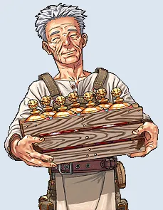Grandpa Tangoขั้น 1, 6 · Tango Cabin ↗</a>
<a href="https://wikimirror.lifeto.co/wiki.ggftw.com/trickster/Grandma_Tango.html" rel="noopener" target="_blank">Grandma Tangoขั้น 2 · Tango Cabin ↗</a>
<a href="https://wikimirror.lifeto.co/wiki.ggftw.com/trickster/Indiana_John.html" rel="noopener" target="_blank">Indiana Johnขั้น 3–5 · Field 3 ↗</a>
<a href="https://wikimirror.lifeto.co/wiki.ggftw.com/trickster/Match_Girl_Annie.html" rel="noopener" target="_blank">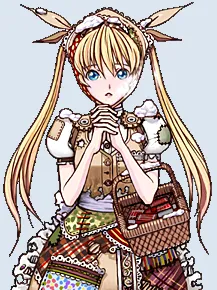Match Girl AnnieField 4 ↗</a>

### มอนสเตอร์

<a href="https://wikimirror.lifeto.co/wiki.ggftw.com/trickster/Kilimanjaro.html" rel="noopener" target="_blank">KilimanjaroLv 273 · หน้าวิกิ ↗</a>
<a href="https://wikimirror.lifeto.co/wiki.ggftw.com/trickster/Laki.html" rel="noopener" target="_blank">LakiLv 278 · หน้าวิกิ ↗</a>
<a href="https://wikimirror.lifeto.co/wiki.ggftw.com/trickster/Ponchichi.html" rel="noopener" target="_blank">PonchichiLv 286 · หน้าวิกิ ↗</a>
<a href="https://wikimirror.lifeto.co/wiki.ggftw.com/trickster/Orconio.html" rel="noopener" target="_blank">OrconioLv 290 · หน้าวิกิ ↗</a>
<a href="https://wikimirror.lifeto.co/wiki.ggftw.com/trickster/Orpeo.html" rel="noopener" target="_blank">OrpeoLv 299 · หน้าวิกิ ↗</a>
<a href="https://wikimirror.lifeto.co/wiki.ggftw.com/trickster/Dekumanus.html" rel="noopener" target="_blank">DekumanusLv 312 · หน้าวิกิ ↗</a>
<a href="https://wikimirror.lifeto.co/wiki.ggftw.com/trickster/Malefic_Matron.html" rel="noopener" target="_blank">Malefic MatronLv 320 · หน้าวิกิ ↗</a>
<a href="https://wikimirror.lifeto.co/wiki.ggftw.com/trickster/Burning_Kili.html" rel="noopener" target="_blank">Burning KiliLv 333 · หน้าวิกิ ↗</a>
<a href="https://wikimirror.lifeto.co/wiki.ggftw.com/trickster/Ash_Soldier.html" rel="noopener" target="_blank">Ash SoldierLv 345 · หน้าวิกิ ↗</a>
<a href="https://wikimirror.lifeto.co/wiki.ggftw.com/trickster/Doom_Claw.html" rel="noopener" target="_blank">Doom ClawLv 367 · หน้าวิกิ ↗</a>

### แมพ

<a href="https://wikimirror.lifeto.co/asset.103.ggftw.net/wiki/to-w/images/d/dd/Techichi_Volcano_Map-2.png" rel="noopener" target="_blank">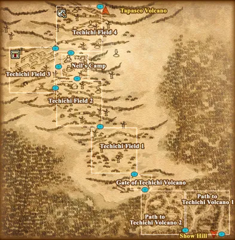แผนที่ Techichi Volcanoทั้งโซน ↗</a>
<a href="https://wikimirror.lifeto.co/wiki.ggftw.com/trickster/Techichi_-_Tango_Cabin.html" rel="noopener" target="_blank">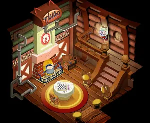Techichi - Tango Cabinหน้าแมพ ↗</a>
<a href="https://wikimirror.lifeto.co/wiki.ggftw.com/trickster/Techichi_Field_1.html" rel="noopener" target="_blank">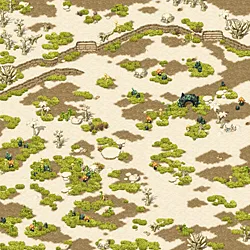Techichi Field 1หน้าแมพ ↗</a>
<a href="https://wikimirror.lifeto.co/wiki.ggftw.com/trickster/Techichi_Field_2.html" rel="noopener" target="_blank">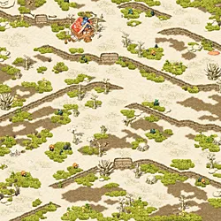Techichi Field 2หน้าแมพ ↗</a>
<a href="https://wikimirror.lifeto.co/wiki.ggftw.com/trickster/Techichi_Field_3.html" rel="noopener" target="_blank">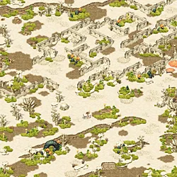Techichi Field 3หน้าแมพ ↗</a>
<a href="https://wikimirror.lifeto.co/wiki.ggftw.com/trickster/Techichi_Field_4.html" rel="noopener" target="_blank">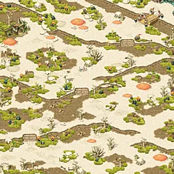Techichi Field 4หน้าแมพ ↗</a>
<a href="https://wikimirror.lifeto.co/wiki.ggftw.com/trickster/Black_Ash_Dungeon_1.html" rel="noopener" target="_blank">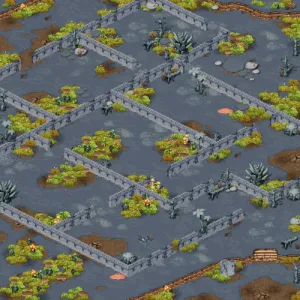Black Ash Dungeon 1หน้าแมพ ↗</a>
<a href="https://wikimirror.lifeto.co/wiki.ggftw.com/trickster/Black_Ash_Dungeon_2.html" rel="noopener" target="_blank">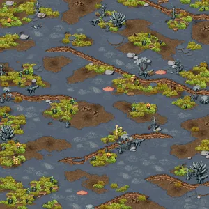Black Ash Dungeon 2หน้าแมพ ↗</a>
<a href="https://wikimirror.lifeto.co/wiki.ggftw.com/trickster/Black_Ash_Dungeon_3.html" rel="noopener" target="_blank">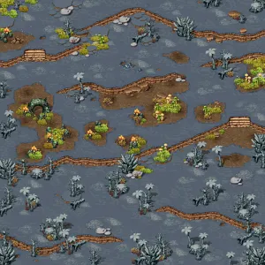Black Ash Dungeon 3หน้าแมพ ↗</a>
<a href="https://wikimirror.lifeto.co/wiki.ggftw.com/trickster/Black_Ash_Dungeon_4.html" rel="noopener" target="_blank">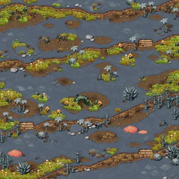Black Ash Dungeon 4หน้าแมพ ↗</a>

</section>

<PageBehavior />
