

<header style="display:flex;flex-direction:column;gap:8px">

# ของฝึกสกิล (Skill Mastery)

สกิลแต่ละตัวต้องใช้การ์ดมอนหรือไอเทมเฉพาะเพื่อดันให้ถึงขั้น Mastery ตารางนี้แยกตามสายตัวละคร ค้นชื่อสกิลได้จากช่องค้นหา

<ul class="notes"><li>วิกิเตือนว่าข้อมูลไอเทมที่ไม่ใช่การ์ดอาจเก่า ส่วนการ์ดเชื่อถือได้</li><li>การ์ดหลายใบใช้ส่งเควส Card Girl ด้วย ดูหน้าเควสการ์ดประกอบ</li><li>ติ๊กเมื่อเก็บของครบหรือสกิลถึง Mastery แล้ว</li></ul>

</header>

<input id="q" placeholder="ค้นชื่อสกิล การ์ด หรือมอน" type="search"/>

<label><input id="hidedone" type="checkbox"/> ซ่อนที่ทำแล้ว</label><button id="reset" type="button">ล้างติ๊ก</button>

<nav class="toc"><a href="#power">Power</a><a href="#magic">Magic</a><a href="#sense">Sense</a><a href="#charm">Charm</a></nav>

<section data-c="" id="power">

<h2>สาย Power (Bunny, Buffalo) </h2>

36 สกิล เรียงตามชื่อ ตัวเลขคือจำนวนที่ต้องใช้ให้สกิลถึงขั้น Mastery

<table><thead><tr><th></th><th>สกิล</th><th>ของที่ใช้</th><th>หาจาก</th><th>โซน</th></tr></thead><tbody>
<tr><td class="ck"><input aria-label="ทำแล้ว" id="p-0" type="checkbox"/></td><td class="nm" data-l="สกิล">Adrenaline</td><td data-l="ของที่ใช้">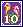<b>Cobra Flower Card</b> × 5</td><td data-l="หาจาก">Cobra Flower Lv 210 · Swamp Dungeon 2 - Marshy Pool, Swamp Dungeon 3 - Marshy Vacant Lot</td><td data-l="โซน">Black Swamp / Swamp Dungeon</td></tr>
<tr><td class="ck"><input aria-label="ทำแล้ว" id="p-1" type="checkbox"/></td><td class="nm" data-l="สกิล">Armor Breaker</td><td data-l="ของที่ใช้">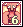<b>Turvy Card</b> × 2</td><td data-l="หาจาก">Turvy Lv 45 · Poppuri Dungeon - Spore Cave</td><td data-l="โซน">Megalopolis / Poppuri Dungeon</td></tr>
<tr><td class="ck"><input aria-label="ทำแล้ว" id="p-2" type="checkbox"/></td><td class="nm" data-l="สกิล">Aura of Haste</td><td data-l="ของที่ใช้">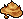<b>Squishy Mud</b> × 8</td><td data-l="หาจาก">Walking Tadpole Lv 166 · Swamp Field 1 - Black Hole</td><td data-l="โซน">Black Swamp / Swamp Dungeon</td></tr>
<tr><td class="ck"><input aria-label="ทำแล้ว" id="p-3" type="checkbox"/></td><td class="nm" data-l="สกิล">Berserker</td><td data-l="ของที่ใช้">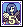<b>Crow Card</b> × 3</td><td data-l="หาจาก">Crow Lv 88 · Wharf Field 2 - Devil Crow, Wharf Field 3 - Phantom Park</td><td class="nw" data-l="โซน">Oops Wharf</td></tr>
<tr><td class="ck"><input aria-label="ทำแล้ว" id="p-4" type="checkbox"/></td><td class="nm" data-l="สกิล">Blazing Strike</td><td data-l="ของที่ใช้"><b>Mingo Toy</b> × 24</td><td data-l="หาจาก">Mingo Lv 171 · Swamp Field 3 - Maze of Forest</td><td data-l="โซน">Black Swamp / Swamp Dungeon</td></tr>
<tr><td class="ck"><input aria-label="ทำแล้ว" id="p-5" type="checkbox"/></td><td class="nm" data-l="สกิล">Bull's Eye</td><td data-l="ของที่ใช้">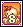<b>Hula Octopus Card</b> × 2</td><td data-l="หาจาก">Hula Octopus Lv 25 · Desert Beach Field 2 - Sand Palace</td><td data-l="โซน">Desert Beach / Pyramid Dungeon</td></tr>
<tr><td class="ck"><input aria-label="ทำแล้ว" id="p-6" type="checkbox"/></td><td class="nm" data-l="สกิล">Burning Rave</td><td data-l="ของที่ใช้">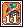<b>Nephthys Card</b> × 2</td><td data-l="หาจาก">Nephthys Lv 38 · Pyramid Dungeon 2 - Hall of Harpy</td><td data-l="โซน">Desert Beach / Pyramid Dungeon</td></tr>
<tr><td class="ck"><input aria-label="ทำแล้ว" id="p-7" type="checkbox"/></td><td class="nm" data-l="สกิล">Chi Sword</td><td data-l="ของที่ใช้"><b>Cobra Flower Card</b> × 5</td><td data-l="หาจาก">Cobra Flower Lv 210 · Swamp Dungeon 2 - Marshy Pool, Swamp Dungeon 3 - Marshy Vacant Lot</td><td data-l="โซน">Black Swamp / Swamp Dungeon</td></tr>
<tr><td class="ck"><input aria-label="ทำแล้ว" id="p-8" type="checkbox"/></td><td class="nm" data-l="สกิล">Counter Punch</td><td data-l="ของที่ใช้"><b>Silver-Colored Mantle</b> × 7</td><td data-l="หาจาก">Captain Arman Lv 145 · Rose Field 2 - Maze of Black Rose</td><td data-l="โซน">Rose Garden / Vamp Castle</td></tr>
<tr><td class="ck"><input aria-label="ทำแล้ว" id="p-9" type="checkbox"/></td><td class="nm" data-l="สกิล">Desperate Rally</td><td data-l="ของที่ใช้">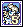<b>Dancer Isabelle Card</b> × 3</td><td data-l="หาจาก">Dancer Isabelle Lv 141 · Rose Field 1 - Stairway to Sorrow</td><td data-l="โซน">Rose Garden / Vamp Castle</td></tr>
<tr><td class="ck"><input aria-label="ทำแล้ว" id="p-10" type="checkbox"/></td><td class="nm" data-l="สกิล">Eagle Eye</td><td data-l="ของที่ใช้">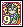<b>Officer Surapat Card</b> × 3</td><td data-l="หาจาก">Officer Surapat</td><td data-l="โซน">Mermaid Palace / Mermaid Dungeon</td></tr>
<tr><td class="ck"><input aria-label="ทำแล้ว" id="p-11" type="checkbox"/></td><td class="nm" data-l="สกิล">Earthquake Blade</td><td data-l="ของที่ใช้">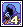<b>Officer Okto Card</b> × 3</td><td data-l="หาจาก">Okto Lv 129 · Mermaid Dungeon 2 - Legend of the Sea</td><td data-l="โซน">Mermaid Palace / Mermaid Dungeon</td></tr>
<tr><td class="ck"><input aria-label="ทำแล้ว" id="p-12" type="checkbox"/></td><td class="nm" data-l="สกิล">Flaming Fist</td><td data-l="ของที่ใช้">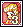<b>Madam Chiffon Card</b> × 5</td><td data-l="หาจาก">Madam Chiffon Lv 150 · Rose Field 3 - Maze of Blue Rose</td><td data-l="โซน">Rose Garden / Vamp Castle</td></tr>
<tr><td class="ck"><input aria-label="ทำแล้ว" id="p-13" type="checkbox"/></td><td class="nm" data-l="สกิล">Flash Cut</td><td data-l="ของที่ใช้">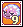<b>Slithis Card</b> × 5</td><td data-l="หาจาก">Slithis Lv 203 · Swamp Dungeon 1 - Marshy Trail</td><td data-l="โซน">Black Swamp / Swamp Dungeon</td></tr>
<tr><td class="ck"><input aria-label="ทำแล้ว" id="p-14" type="checkbox"/></td><td class="nm" data-l="สกิล">Gale Strike</td><td data-l="ของที่ใช้"><b>Madam Chiffon Card</b> × 5</td><td data-l="หาจาก">Madam Chiffon Lv 150 · Rose Field 3 - Maze of Blue Rose</td><td data-l="โซน">Rose Garden / Vamp Castle</td></tr>
<tr><td class="ck"><input aria-label="ทำแล้ว" id="p-15" type="checkbox"/></td><td class="nm" data-l="สกิล">Guard</td><td data-l="ของที่ใช้">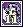<b>Dancer Michel Card</b> × 3</td><td data-l="หาจาก">Dancer Michel Lv 138 · Rose Field 1 - Stairway to Sorrow</td><td data-l="โซน">Rose Garden / Vamp Castle</td></tr>
<tr><td class="ck"><input aria-label="ทำแล้ว" id="p-16" type="checkbox"/></td><td class="nm" data-l="สกิล">Hyper Beat</td><td data-l="ของที่ใช้"><b>Mimic Card</b> × 2</td><td data-l="หาจาก">Mimic Lv 61 · Relics Field 2 - Hand of Giant, Relics Field 3 - Monkey Statues</td><td data-l="โซน">Caballa Relics / Relics Dungeon</td></tr>
<tr><td class="ck"><input aria-label="ทำแล้ว" id="p-17" type="checkbox"/></td><td class="nm" data-l="สกิล">Inferno Blade</td><td data-l="ของที่ใช้"><b>Dancer Isabelle Card</b> × 3</td><td data-l="หาจาก">Dancer Isabelle Lv 141 · Rose Field 1 - Stairway to Sorrow</td><td data-l="โซน">Rose Garden / Vamp Castle</td></tr>
<tr><td class="ck"><input aria-label="ทำแล้ว" id="p-18" type="checkbox"/></td><td class="nm" data-l="สกิล">Lacerator</td><td data-l="ของที่ใช้"><b>Quiem Card</b> × 2</td><td data-l="หาจาก">Quiem Lv 75 · Wharf Field 1 - Haunted Town, Wharf Field 3 - Phantom Park</td><td class="nw" data-l="โซน">Oops Wharf</td></tr>
<tr><td class="ck"><input aria-label="ทำแล้ว" id="p-19" type="checkbox"/></td><td class="nm" data-l="สกิล">Luck Breaker</td><td data-l="ของที่ใช้"><b>Silver G Card</b> × 2</td><td data-l="หาจาก">Silver G Lv 35 · Pyramid Dungeon 3 - Hall of Bastet</td><td data-l="โซน">Desert Beach / Pyramid Dungeon</td></tr>
<tr><td class="ck"><input aria-label="ทำแล้ว" id="p-20" type="checkbox"/></td><td class="nm" data-l="สกิล">Mega Flash Cut</td><td data-l="ของที่ใช้"><b>Slug G Card</b> × 5</td><td data-l="หาจาก">Slug G Lv 224 · Swamp Dungeon 6 - Suu's Muddy Pool</td><td data-l="โซน">Black Swamp / Swamp Dungeon</td></tr>
<tr><td class="ck"><input aria-label="ทำแล้ว" id="p-21" type="checkbox"/></td><td class="nm" data-l="สกิล">Piercing Wave</td><td data-l="ของที่ใช้"><b>Crow Card</b> × 18</td><td data-l="หาจาก">Crow Lv 88 · Wharf Field 2 - Devil Crow, Wharf Field 3 - Phantom Park</td><td class="nw" data-l="โซน">Oops Wharf</td></tr>
<tr><td class="ck"><input aria-label="ทำแล้ว" id="p-22" type="checkbox"/></td><td class="nm" data-l="สกิล">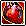Pumping Heart</td><td data-l="ของที่ใช้">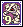<b>Mummy Card</b> × 2</td><td class="nw" data-l="หาจาก">Mummy</td><td data-l="โซน">Desert Beach / Pyramid Dungeon</td></tr>
<tr><td class="ck"><input aria-label="ทำแล้ว" id="p-23" type="checkbox"/></td><td class="nm" data-l="สกิล">Quad Punch</td><td data-l="ของที่ใช้"><b>Crow Card</b> × 3</td><td data-l="หาจาก">Crow Lv 88 · Wharf Field 2 - Devil Crow, Wharf Field 3 - Phantom Park</td><td class="nw" data-l="โซน">Oops Wharf</td></tr>
<tr><td class="ck"><input aria-label="ทำแล้ว" id="p-24" type="checkbox"/></td><td class="nm" data-l="สกิล">Sense Breaker</td><td data-l="ของที่ใช้">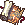<b>Book of the Dead</b> × 20</td><td data-l="หาจาก">ขุด ใน Pyramid Dungeon</td><td data-l="โซน">Desert Beach / Pyramid Dungeon</td></tr>
<tr><td class="ck"><input aria-label="ทำแล้ว" id="p-25" type="checkbox"/></td><td class="nm" data-l="สกิล">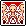Shadow</td><td data-l="ของที่ใช้">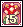<b>Myconid Card</b> × 5</td><td data-l="หาจาก">Myconid Lv 208 · Swamp Dungeon 1 - Marshy Trail, Swamp Dungeon 2 - Marshy Pool</td><td data-l="โซน">Black Swamp / Swamp Dungeon</td></tr>
<tr><td class="ck"><input aria-label="ทำแล้ว" id="p-26" type="checkbox"/></td><td class="nm" data-l="สกิล">Shockvibe</td><td data-l="ของที่ใช้">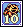<b>Gold G Card</b> × 2</td><td data-l="หาจาก">Gold G Lv 36 · Pyramid Dungeon 3 - Hall of Bastet, Pyramid Dungeon 5 - Hall of Love Affair</td><td data-l="โซน">Desert Beach / Pyramid Dungeon</td></tr>
<tr><td class="ck"><input aria-label="ทำแล้ว" id="p-27" type="checkbox"/></td><td class="nm" data-l="สกิล">Shockwave</td><td data-l="ของที่ใช้"><b>Clione Card</b> × 2</td><td data-l="หาจาก">Clione Lv 10 · Coral Beach Field 3 - Sunny Beach</td><td class="nw" data-l="โซน">Coral Beach</td></tr>
<tr><td class="ck"><input aria-label="ทำแล้ว" id="p-28" type="checkbox"/></td><td class="nm" data-l="สกิล">Sonic Slash</td><td data-l="ของที่ใช้"><b>Purple Worm Card</b> × 5</td><td data-l="หาจาก">Purple Worm Lv 215 · Swamp Dungeon 4 - Marshy Garden</td><td data-l="โซน">Black Swamp / Swamp Dungeon</td></tr>
<tr><td class="ck"><input aria-label="ทำแล้ว" id="p-29" type="checkbox"/></td><td class="nm" data-l="สกิล">Suffocate</td><td data-l="ของที่ใช้"><b>Cobra Flower Card</b> × 5</td><td data-l="หาจาก">Cobra Flower Lv 210 · Swamp Dungeon 2 - Marshy Pool, Swamp Dungeon 3 - Marshy Vacant Lot</td><td data-l="โซน">Black Swamp / Swamp Dungeon</td></tr>
<tr><td class="ck"><input aria-label="ทำแล้ว" id="p-30" type="checkbox"/></td><td class="nm" data-l="สกิล">Tempest Strike</td><td data-l="ของที่ใช้"><b>Cobra Flower Card</b> × 4</td><td data-l="หาจาก">Cobra Flower Lv 210 · Swamp Dungeon 2 - Marshy Pool, Swamp Dungeon 3 - Marshy Vacant Lot</td><td data-l="โซน">Black Swamp / Swamp Dungeon</td></tr>
<tr><td class="ck"><input aria-label="ทำแล้ว" id="p-31" type="checkbox"/></td><td class="nm" data-l="สกิล">Tetra Punch</td><td data-l="ของที่ใช้"><b>Slithis Card</b> × 4</td><td data-l="หาจาก">Slithis Lv 203 · Swamp Dungeon 1 - Marshy Trail</td><td data-l="โซน">Black Swamp / Swamp Dungeon</td></tr>
<tr><td class="ck"><input aria-label="ทำแล้ว" id="p-32" type="checkbox"/></td><td class="nm" data-l="สกิล">Tidal Slash</td><td data-l="ของที่ใช้"><b>Officer Surapat Card</b> × 3</td><td data-l="หาจาก">Officer Surapat</td><td data-l="โซน">Mermaid Palace / Mermaid Dungeon</td></tr>
<tr><td class="ck"><input aria-label="ทำแล้ว" id="p-33" type="checkbox"/></td><td class="nm" data-l="สกิล">Tornado Bomb</td><td data-l="ของที่ใช้"><b>Guiana Card</b> × 2</td><td data-l="หาจาก">Guiana Lv 66 · Caballa Relics Dungeon 1, Caballa Relics Dungeon 2</td><td data-l="โซน">Caballa Relics / Relics Dungeon</td></tr>
<tr><td class="ck"><input aria-label="ทำแล้ว" id="p-34" type="checkbox"/></td><td class="nm" data-l="สกิล">Upper Smash</td><td data-l="ของที่ใช้">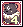<b>Koom Card</b> × 2</td><td data-l="หาจาก">Koom Lv 55 · Poppuri Dungeon - Moss Cave</td><td data-l="โซน">Megalopolis / Poppuri Dungeon</td></tr>
<tr><td class="ck"><input aria-label="ทำแล้ว" id="p-35" type="checkbox"/></td><td class="nm" data-l="สกิล">Uppercut</td><td data-l="ของที่ใช้"><b>Quiem Card</b> × 2</td><td data-l="หาจาก">Quiem Lv 75 · Wharf Field 1 - Haunted Town, Wharf Field 3 - Phantom Park</td><td class="nw" data-l="โซน">Oops Wharf</td></tr>
</tbody></table>

</section>

<section data-c="" id="magic">

<h2>สาย Magic (Sheep, Dragon) </h2>

75 สกิล เรียงตามชื่อ ตัวเลขคือจำนวนที่ต้องใช้ให้สกิลถึงขั้น Mastery

<table><thead><tr><th></th><th>สกิล</th><th>ของที่ใช้</th><th>หาจาก</th><th>โซน</th></tr></thead><tbody>
<tr><td class="ck"><input aria-label="ทำแล้ว" id="m-0" type="checkbox"/></td><td class="nm" data-l="สกิล">Aqua Bomb</td><td data-l="ของที่ใช้"><b>Myconid Card</b> × 5</td><td data-l="หาจาก">Myconid Lv 208 · Swamp Dungeon 1 - Marshy Trail, Swamp Dungeon 2 - Marshy Pool</td><td data-l="โซน">Black Swamp / Swamp Dungeon</td></tr>
<tr><td class="ck"><input aria-label="ทำแล้ว" id="m-1" type="checkbox"/></td><td class="nm" data-l="สกิล">Arrow of Light</td><td data-l="ของที่ใช้">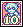<b>Requi Card</b> × 2</td><td data-l="หาจาก">Requi Lv 72 · Wharf Field 1 - Haunted Town, Wharf Field 2 - Devil Crow</td><td class="nw" data-l="โซน">Oops Wharf</td></tr>
<tr><td class="ck"><input aria-label="ทำแล้ว" id="m-2" type="checkbox"/></td><td class="nm" data-l="สกิล">Arrow Rush</td><td data-l="ของที่ใช้"><b>Guiana Card</b> × 2</td><td data-l="หาจาก">Guiana Lv 66 · Caballa Relics Dungeon 1, Caballa Relics Dungeon 2</td><td data-l="โซน">Caballa Relics / Relics Dungeon</td></tr>
<tr><td class="ck"><input aria-label="ทำแล้ว" id="m-3" type="checkbox"/></td><td class="nm" data-l="สกิล">Aura of Mana</td><td data-l="ของที่ใช้"><b>Silver G Card</b> × 2</td><td data-l="หาจาก">Silver G Lv 35 · Pyramid Dungeon 3 - Hall of Bastet</td><td data-l="โซน">Desert Beach / Pyramid Dungeon</td></tr>
<tr><td class="ck"><input aria-label="ทำแล้ว" id="m-4" type="checkbox"/></td><td class="nm" data-l="สกิล">Blood Testament</td><td data-l="ของที่ใช้"><b>Crow Card</b> × 3</td><td data-l="หาจาก">Crow Lv 88 · Wharf Field 2 - Devil Crow, Wharf Field 3 - Phantom Park</td><td class="nw" data-l="โซน">Oops Wharf</td></tr>
<tr><td class="ck"><input aria-label="ทำแล้ว" id="m-5" type="checkbox"/></td><td class="nm" data-l="สกิล">Bolster Ballad</td><td data-l="ของที่ใช้">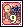<b>Ironclad Turtle Card</b> × 2</td><td data-l="หาจาก">Ironclad Turtle Lv 68 · Path to Oops Wharf</td><td class="nw" data-l="โซน">Oops Wharf</td></tr>
<tr><td class="ck"><input aria-label="ทำแล้ว" id="m-6" type="checkbox"/></td><td class="nm" data-l="สกิล">Bottle of Mana</td><td data-l="ของที่ใช้"><b>Silver G Card</b> × 2</td><td data-l="หาจาก">Silver G Lv 35 · Pyramid Dungeon 3 - Hall of Bastet</td><td data-l="โซน">Desert Beach / Pyramid Dungeon</td></tr>
<tr><td class="ck"><input aria-label="ทำแล้ว" id="m-7" type="checkbox"/></td><td class="nm" data-l="สกิล">Botulism Cloud</td><td data-l="ของที่ใช้"><b>Dancer Isabelle Card</b> × 3</td><td data-l="หาจาก">Dancer Isabelle Lv 141 · Rose Field 1 - Stairway to Sorrow</td><td data-l="โซน">Rose Garden / Vamp Castle</td></tr>
<tr><td class="ck"><input aria-label="ทำแล้ว" id="m-8" type="checkbox"/></td><td class="nm" data-l="สกิล">Catastrophe Heal</td><td data-l="ของที่ใช้"><b>Quiem Card</b> × 2</td><td data-l="หาจาก">Quiem Lv 75 · Wharf Field 1 - Haunted Town, Wharf Field 3 - Phantom Park</td><td class="nw" data-l="โซน">Oops Wharf</td></tr>
<tr><td class="ck"><input aria-label="ทำแล้ว" id="m-9" type="checkbox"/></td><td class="nm" data-l="สกิล">Celestial Strike</td><td data-l="ของที่ใช้"><b>Slug G Card</b> × 5</td><td data-l="หาจาก">Slug G Lv 224 · Swamp Dungeon 6 - Suu's Muddy Pool</td><td data-l="โซน">Black Swamp / Swamp Dungeon</td></tr>
<tr><td class="ck"><input aria-label="ทำแล้ว" id="m-10" type="checkbox"/></td><td class="nm" data-l="สกิล">Cleaving Terra</td><td data-l="ของที่ใช้">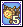<b>Lima Card</b> × 2</td><td data-l="หาจาก">Lima Lv 70 · Caballa Relics Dungeon 1, Caballa Relics Dungeon 2</td><td data-l="โซน">Caballa Relics / Relics Dungeon</td></tr>
<tr><td class="ck"><input aria-label="ทำแล้ว" id="m-11" type="checkbox"/></td><td class="nm" data-l="สกิล">Cure</td><td data-l="ของที่ใช้"><b>Hula Octopus Card</b> × 2</td><td data-l="หาจาก">Hula Octopus Lv 25 · Desert Beach Field 2 - Sand Palace</td><td data-l="โซน">Desert Beach / Pyramid Dungeon</td></tr>
<tr><td class="ck"><input aria-label="ทำแล้ว" id="m-12" type="checkbox"/></td><td class="nm" data-l="สกิล">Dark Barrier</td><td data-l="ของที่ใช้">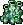<b>Malachite</b> × 10</td><td data-l="หาจาก">ขุด ใน Caballa Relics Dungeon</td><td data-l="โซน">Caballa Relics / Relics Dungeon</td></tr>
<tr><td class="ck"><input aria-label="ทำแล้ว" id="m-13" type="checkbox"/></td><td class="nm" data-l="สกิล">Dark Commando</td><td data-l="ของที่ใช้">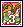<b>L. Wormhole Card</b> × 5</td><td class="nw" data-l="หาจาก">L. Wormhole</td><td data-l="โซน">Black Swamp / Swamp Dungeon</td></tr>
<tr><td class="ck"><input aria-label="ทำแล้ว" id="m-14" type="checkbox"/></td><td class="nm" data-l="สกิล">Dark Distractor</td><td data-l="ของที่ใช้">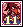<b>Chele Card</b> × 3</td><td data-l="หาจาก">Chele Lv 117 · Mermaid Dungeon 1 - Underworld</td><td data-l="โซน">Mermaid Palace / Mermaid Dungeon</td></tr>
<tr><td class="ck"><input aria-label="ทำแล้ว" id="m-15" type="checkbox"/></td><td class="nm" data-l="สกิล">Dark Lance</td><td data-l="ของที่ใช้"><b>Fried Egg</b> × 26</td><td data-l="หาจาก">Egg Specter Lv 94 · Phantom School 2-1, Phantom School 2-2</td><td data-l="โซน">Phantom School / Phantom Dungeon</td></tr>
<tr><td class="ck"><input aria-label="ทำแล้ว" id="m-16" type="checkbox"/></td><td class="nm" data-l="สกิล">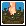Deadly Fen</td><td data-l="ของที่ใช้"><b>Crow Card</b> × 3</td><td data-l="หาจาก">Crow Lv 88 · Wharf Field 2 - Devil Crow, Wharf Field 3 - Phantom Park</td><td class="nw" data-l="โซน">Oops Wharf</td></tr>
<tr><td class="ck"><input aria-label="ทำแล้ว" id="m-17" type="checkbox"/></td><td class="nm" data-l="สกิล">Dragon Storm</td><td data-l="ของที่ใช้"><b>Myconid Card</b> × 5</td><td data-l="หาจาก">Myconid Lv 208 · Swamp Dungeon 1 - Marshy Trail, Swamp Dungeon 2 - Marshy Pool</td><td data-l="โซน">Black Swamp / Swamp Dungeon</td></tr>
<tr><td class="ck"><input aria-label="ทำแล้ว" id="m-18" type="checkbox"/></td><td class="nm" data-l="สกิล">Drip Bomb</td><td data-l="ของที่ใช้"><b>Lima Card</b> × 2</td><td data-l="หาจาก">Lima Lv 70 · Caballa Relics Dungeon 1, Caballa Relics Dungeon 2</td><td data-l="โซน">Caballa Relics / Relics Dungeon</td></tr>
<tr><td class="ck"><input aria-label="ทำแล้ว" id="m-19" type="checkbox"/></td><td class="nm" data-l="สกิล">Earth Shield</td><td data-l="ของที่ใช้"><b>Chele Card</b> × 3</td><td data-l="หาจาก">Chele Lv 117 · Mermaid Dungeon 1 - Underworld</td><td data-l="โซน">Mermaid Palace / Mermaid Dungeon</td></tr>
<tr><td class="ck"><input aria-label="ทำแล้ว" id="m-20" type="checkbox"/></td><td class="nm" data-l="สกิล">Earthquake</td><td data-l="ของที่ใช้"><b>Slithis Card</b> × 5</td><td data-l="หาจาก">Slithis Lv 203 · Swamp Dungeon 1 - Marshy Trail</td><td data-l="โซน">Black Swamp / Swamp Dungeon</td></tr>
<tr><td class="ck"><input aria-label="ทำแล้ว" id="m-21" type="checkbox"/></td><td class="nm" data-l="สกิล">Electro Attack</td><td data-l="ของที่ใช้"><b>Lima Card</b> × 2</td><td data-l="หาจาก">Lima Lv 70 · Caballa Relics Dungeon 1, Caballa Relics Dungeon 2</td><td data-l="โซน">Caballa Relics / Relics Dungeon</td></tr>
<tr><td class="ck"><input aria-label="ทำแล้ว" id="m-22" type="checkbox"/></td><td class="nm" data-l="สกิล">Fear</td><td data-l="ของที่ใช้"><b>Slug G Card</b> × 5</td><td data-l="หาจาก">Slug G Lv 224 · Swamp Dungeon 6 - Suu's Muddy Pool</td><td data-l="โซน">Black Swamp / Swamp Dungeon</td></tr>
<tr><td class="ck"><input aria-label="ทำแล้ว" id="m-23" type="checkbox"/></td><td class="nm" data-l="สกิล">Fire Shield</td><td data-l="ของที่ใช้"><b>Colored Paper</b> × 9</td><td data-l="หาจาก">Chameleon Frog Lv 169 · Swamp Field 2 - Beaver's Swamp, Swamp Field 4 - Dark Omen</td><td data-l="โซน">Black Swamp / Swamp Dungeon</td></tr>
<tr><td class="ck"><input aria-label="ทำแล้ว" id="m-24" type="checkbox"/></td><td class="nm" data-l="สกิล">Ghostly Whisper</td><td data-l="ของที่ใช้"><b>L. Wormhole Card</b> × 5</td><td class="nw" data-l="หาจาก">L. Wormhole</td><td data-l="โซน">Black Swamp / Swamp Dungeon</td></tr>
<tr><td class="ck"><input aria-label="ทำแล้ว" id="m-25" type="checkbox"/></td><td class="nm" data-l="สกิล">Gnome's Blessing</td><td data-l="ของที่ใช้"><b>Purple Worm Card</b> × 5</td><td data-l="หาจาก">Purple Worm Lv 215 · Swamp Dungeon 4 - Marshy Garden</td><td data-l="โซน">Black Swamp / Swamp Dungeon</td></tr>
<tr><td class="ck"><input aria-label="ทำแล้ว" id="m-26" type="checkbox"/></td><td class="nm" data-l="สกิล">Gnome's Domain</td><td data-l="ของที่ใช้">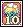<b>Maid Lydia Card</b> × 3</td><td data-l="หาจาก">Maid Lydia Lv 185 · Vamp Dungeon 1 - Banquet of the Vamp, Vamp Dungeon 2 - Banquet of the Dead</td><td data-l="โซน">Rose Garden / Vamp Castle</td></tr>
<tr><td class="ck"><input aria-label="ทำแล้ว" id="m-27" type="checkbox"/></td><td class="nm" data-l="สกิล">Gravity Crush</td><td data-l="ของที่ใช้"><b>Aristocratic Fan</b> × 7</td><td data-l="หาจาก">Madam Chiffon Lv 150 · Rose Field 3 - Maze of Blue Rose</td><td data-l="โซน">Rose Garden / Vamp Castle</td></tr>
<tr><td class="ck"><input aria-label="ทำแล้ว" id="m-28" type="checkbox"/></td><td class="nm" data-l="สกิล">Heart's Grace</td><td data-l="ของที่ใช้"><b>Dancer Isabelle Card</b> × 3</td><td data-l="หาจาก">Dancer Isabelle Lv 141 · Rose Field 1 - Stairway to Sorrow</td><td data-l="โซน">Rose Garden / Vamp Castle</td></tr>
<tr><td class="ck"><input aria-label="ทำแล้ว" id="m-29" type="checkbox"/></td><td class="nm" data-l="สกิล">Hellfire</td><td data-l="ของที่ใช้">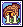<b>Chibcha Card</b> × 2</td><td data-l="หาจาก">Chibcha Lv 73 · Caballa Relics Dungeon 1, Caballa Relics Dungeon 3</td><td data-l="โซน">Caballa Relics / Relics Dungeon</td></tr>
<tr><td class="ck"><input aria-label="ทำแล้ว" id="m-30" type="checkbox"/></td><td class="nm" data-l="สกิล">Icey Shackles</td><td data-l="ของที่ใช้"><b>Crow Card</b> × 3</td><td data-l="หาจาก">Crow Lv 88 · Wharf Field 2 - Devil Crow, Wharf Field 3 - Phantom Park</td><td class="nw" data-l="โซน">Oops Wharf</td></tr>
<tr><td class="ck"><input aria-label="ทำแล้ว" id="m-31" type="checkbox"/></td><td class="nm" data-l="สกิล">Incinerate</td><td data-l="ของที่ใช้"><b>Officer Surapat Card</b> × 3</td><td data-l="หาจาก">Officer Surapat</td><td data-l="โซน">Mermaid Palace / Mermaid Dungeon</td></tr>
<tr><td class="ck"><input aria-label="ทำแล้ว" id="m-32" type="checkbox"/></td><td class="nm" data-l="สกิล">Light Shield</td><td data-l="ของที่ใช้"><b>Chele Card</b> × 3</td><td data-l="หาจาก">Chele Lv 117 · Mermaid Dungeon 1 - Underworld</td><td data-l="โซน">Mermaid Palace / Mermaid Dungeon</td></tr>
<tr><td class="ck"><input aria-label="ทำแล้ว" id="m-33" type="checkbox"/></td><td class="nm" data-l="สกิล">Light Wave</td><td data-l="ของที่ใช้"><b>Swamp Shark's Fin</b> × 25</td><td data-l="หาจาก">Swamp Shark Lv 176 · Swamp Field 3 - Maze of Forest, Swamp Field 5 - Further Maze of Forest</td><td data-l="โซน">Black Swamp / Swamp Dungeon</td></tr>
<tr><td class="ck"><input aria-label="ทำแล้ว" id="m-34" type="checkbox"/></td><td class="nm" data-l="สกิล">Mana Arrow</td><td data-l="ของที่ใช้"><b>Clione Card</b> × 2</td><td data-l="หาจาก">Clione Lv 10 · Coral Beach Field 3 - Sunny Beach</td><td class="nw" data-l="โซน">Coral Beach</td></tr>
<tr><td class="ck"><input aria-label="ทำแล้ว" id="m-35" type="checkbox"/></td><td class="nm" data-l="สกิล">Mana Ring</td><td data-l="ของที่ใช้"><b>Nephthys Card</b> × 2</td><td data-l="หาจาก">Nephthys Lv 38 · Pyramid Dungeon 2 - Hall of Harpy</td><td data-l="โซน">Desert Beach / Pyramid Dungeon</td></tr>
<tr><td class="ck"><input aria-label="ทำแล้ว" id="m-36" type="checkbox"/></td><td class="nm" data-l="สกิล">Mana Ring Booster</td><td data-l="ของที่ใช้"><b>Guiana Card</b> × 2</td><td data-l="หาจาก">Guiana Lv 66 · Caballa Relics Dungeon 1, Caballa Relics Dungeon 2</td><td data-l="โซน">Caballa Relics / Relics Dungeon</td></tr>
<tr><td class="ck"><input aria-label="ทำแล้ว" id="m-37" type="checkbox"/></td><td class="nm" data-l="สกิล">Mana Shield</td><td data-l="ของที่ใช้"><b>Turvy Card</b> × 2</td><td data-l="หาจาก">Turvy Lv 45 · Poppuri Dungeon - Spore Cave</td><td data-l="โซน">Megalopolis / Poppuri Dungeon</td></tr>
<tr><td class="ck"><input aria-label="ทำแล้ว" id="m-38" type="checkbox"/></td><td class="nm" data-l="สกิล">Mana Storm</td><td data-l="ของที่ใช้">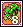<b>Larva Card</b> × 2</td><td data-l="หาจาก">Larva Lv 52 · Poppuri Dungeon - Moss Cave, Poppuri Dungeon - Spore Cave</td><td data-l="โซน">Megalopolis / Poppuri Dungeon</td></tr>
<tr><td class="ck"><input aria-label="ทำแล้ว" id="m-39" type="checkbox"/></td><td class="nm" data-l="สกิล">Mana Web</td><td data-l="ของที่ใช้"><b>Gold G Card</b> × 2</td><td data-l="หาจาก">Gold G Lv 36 · Pyramid Dungeon 3 - Hall of Bastet, Pyramid Dungeon 5 - Hall of Love Affair</td><td data-l="โซน">Desert Beach / Pyramid Dungeon</td></tr>
<tr><td class="ck"><input aria-label="ทำแล้ว" id="m-40" type="checkbox"/></td><td class="nm" data-l="สกิล">Mist of Mana</td><td data-l="ของที่ใช้"><b>Koom Card</b> × 2</td><td data-l="หาจาก">Koom Lv 55 · Poppuri Dungeon - Moss Cave</td><td data-l="โซน">Megalopolis / Poppuri Dungeon</td></tr>
<tr><td class="ck"><input aria-label="ทำแล้ว" id="m-41" type="checkbox"/></td><td class="nm" data-l="สกิล">Oath of Light</td><td data-l="ของที่ใช้"><b>Crow Card</b> × 3</td><td data-l="หาจาก">Crow Lv 88 · Wharf Field 2 - Devil Crow, Wharf Field 3 - Phantom Park</td><td class="nw" data-l="โซน">Oops Wharf</td></tr>
<tr><td class="ck"><input aria-label="ทำแล้ว" id="m-42" type="checkbox"/></td><td class="nm" data-l="สกิล">Phoenix Rising</td><td data-l="ของที่ใช้"><b>Captain Arman Card</b> × 3</td><td data-l="หาจาก">Captain Arman Lv 145 · Rose Field 2 - Maze of Black Rose</td><td data-l="โซน">Rose Garden / Vamp Castle</td></tr>
<tr><td class="ck"><input aria-label="ทำแล้ว" id="m-43" type="checkbox"/></td><td class="nm" data-l="สกิล">Radiant Strike</td><td data-l="ของที่ใช้"><b>Silk Thread</b> × 7</td><td data-l="หาจาก">Arachne Lv 178 · Swamp Field 4 - Dark Omen, Swamp Field 6 - Lake of Illusion</td><td data-l="โซน">Black Swamp / Swamp Dungeon</td></tr>
<tr><td class="ck"><input aria-label="ทำแล้ว" id="m-44" type="checkbox"/></td><td class="nm" data-l="สกิล">Raging Storm</td><td data-l="ของที่ใช้"><b>Cobra Flower Card</b> × 5</td><td data-l="หาจาก">Cobra Flower Lv 210 · Swamp Dungeon 2 - Marshy Pool, Swamp Dungeon 3 - Marshy Vacant Lot</td><td data-l="โซน">Black Swamp / Swamp Dungeon</td></tr>
<tr><td class="ck"><input aria-label="ทำแล้ว" id="m-45" type="checkbox"/></td><td class="nm" data-l="สกิล">Raion's Blessing</td><td data-l="ของที่ใช้"><b>Purple Worm Card</b> × 5</td><td data-l="หาจาก">Purple Worm Lv 215 · Swamp Dungeon 4 - Marshy Garden</td><td data-l="โซน">Black Swamp / Swamp Dungeon</td></tr>
<tr><td class="ck"><input aria-label="ทำแล้ว" id="m-46" type="checkbox"/></td><td class="nm" data-l="สกิล">Raion's Space</td><td data-l="ของที่ใช้"><b>Maid Lydia Card</b> × 3</td><td data-l="หาจาก">Maid Lydia Lv 185 · Vamp Dungeon 1 - Banquet of the Vamp, Vamp Dungeon 2 - Banquet of the Dead</td><td data-l="โซน">Rose Garden / Vamp Castle</td></tr>
<tr><td class="ck"><input aria-label="ทำแล้ว" id="m-47" type="checkbox"/></td><td class="nm" data-l="สกิล">Razor Gale</td><td data-l="ของที่ใช้">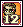<b>Captain Charman Card</b> × 3</td><td data-l="หาจาก">Captain Charman Lv 142 · Rose Field 2 - Maze of Black Rose</td><td data-l="โซน">Rose Garden / Vamp Castle</td></tr>
<tr><td class="ck"><input aria-label="ทำแล้ว" id="m-48" type="checkbox"/></td><td class="nm" data-l="สกิล">Rust</td><td data-l="ของที่ใช้"><b>Gold G Card</b> × 2</td><td data-l="หาจาก">Gold G Lv 36 · Pyramid Dungeon 3 - Hall of Bastet, Pyramid Dungeon 5 - Hall of Love Affair</td><td data-l="โซน">Desert Beach / Pyramid Dungeon</td></tr>
<tr><td class="ck"><input aria-label="ทำแล้ว" id="m-49" type="checkbox"/></td><td class="nm" data-l="สกิล">Sacred Oath</td><td data-l="ของที่ใช้"><b>Slug G Card</b> × 5</td><td data-l="หาจาก">Slug G Lv 224 · Swamp Dungeon 6 - Suu's Muddy Pool</td><td data-l="โซน">Black Swamp / Swamp Dungeon</td></tr>
<tr><td class="ck"><input aria-label="ทำแล้ว" id="m-50" type="checkbox"/></td><td class="nm" data-l="สกิล">Salamander's Blessing</td><td data-l="ของที่ใช้"><b>Purple Worm Card</b> × 5</td><td data-l="หาจาก">Purple Worm Lv 215 · Swamp Dungeon 4 - Marshy Garden</td><td data-l="โซน">Black Swamp / Swamp Dungeon</td></tr>
<tr><td class="ck"><input aria-label="ทำแล้ว" id="m-51" type="checkbox"/></td><td class="nm" data-l="สกิล">Salamander's Territory</td><td data-l="ของที่ใช้"><b>Maid Lydia Card</b> × 3</td><td data-l="หาจาก">Maid Lydia Lv 185 · Vamp Dungeon 1 - Banquet of the Vamp, Vamp Dungeon 2 - Banquet of the Dead</td><td data-l="โซน">Rose Garden / Vamp Castle</td></tr>
<tr><td class="ck"><input aria-label="ทำแล้ว" id="m-52" type="checkbox"/></td><td class="nm" data-l="สกิล">Scorching Earth</td><td data-l="ของที่ใช้"><b>Crow Card</b> × 3</td><td data-l="หาจาก">Crow Lv 88 · Wharf Field 2 - Devil Crow, Wharf Field 3 - Phantom Park</td><td class="nw" data-l="โซน">Oops Wharf</td></tr>
<tr><td class="ck"><input aria-label="ทำแล้ว" id="m-53" type="checkbox"/></td><td class="nm" data-l="สกิล">Scythe</td><td data-l="ของที่ใช้"><b>Purple Worm Card</b> × 8</td><td data-l="หาจาก">Purple Worm Lv 215 · Swamp Dungeon 4 - Marshy Garden</td><td data-l="โซน">Black Swamp / Swamp Dungeon</td></tr>
<tr><td class="ck"><input aria-label="ทำแล้ว" id="m-54" type="checkbox"/></td><td class="nm" data-l="สกิล">Searing Light</td><td data-l="ของที่ใช้"><b>Cobra Flower Card</b> × 5</td><td data-l="หาจาก">Cobra Flower Lv 210 · Swamp Dungeon 2 - Marshy Pool, Swamp Dungeon 3 - Marshy Vacant Lot</td><td data-l="โซน">Black Swamp / Swamp Dungeon</td></tr>
<tr><td class="ck"><input aria-label="ทำแล้ว" id="m-55" type="checkbox"/></td><td class="nm" data-l="สกิล">Shard of the Glacier</td><td data-l="ของที่ใช้"><b>Dancer Michel Card</b> × 3</td><td data-l="หาจาก">Dancer Michel Lv 138 · Rose Field 1 - Stairway to Sorrow</td><td data-l="โซน">Rose Garden / Vamp Castle</td></tr>
<tr><td class="ck"><input aria-label="ทำแล้ว" id="m-56" type="checkbox"/></td><td class="nm" data-l="สกิล">Shield of Heaven</td><td data-l="ของที่ใช้"><b>Slithis Card</b> × 5</td><td data-l="หาจาก">Slithis Lv 203 · Swamp Dungeon 1 - Marshy Trail</td><td data-l="โซน">Black Swamp / Swamp Dungeon</td></tr>
<tr><td class="ck"><input aria-label="ทำแล้ว" id="m-57" type="checkbox"/></td><td class="nm" data-l="สกิล">Staff of Agony</td><td data-l="ของที่ใช้">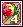<b>Tooth Flower Card</b> × 5</td><td data-l="หาจาก">Tooth Flower Lv 212 · Swamp Dungeon 3 - Marshy Vacant Lot</td><td data-l="โซน">Black Swamp / Swamp Dungeon</td></tr>
<tr><td class="ck"><input aria-label="ทำแล้ว" id="m-58" type="checkbox"/></td><td class="nm" data-l="สกิล">Staff of Thunder</td><td data-l="ของที่ใช้"><b>Slithis Card</b> × 5</td><td data-l="หาจาก">Slithis Lv 203 · Swamp Dungeon 1 - Marshy Trail</td><td data-l="โซน">Black Swamp / Swamp Dungeon</td></tr>
<tr><td class="ck"><input aria-label="ทำแล้ว" id="m-59" type="checkbox"/></td><td class="nm" data-l="สกิล">Summon Boulder</td><td data-l="ของที่ใช้"><b>Officer Okto Card</b> × 3</td><td data-l="หาจาก">Okto Lv 129 · Mermaid Dungeon 2 - Legend of the Sea</td><td data-l="โซน">Mermaid Palace / Mermaid Dungeon</td></tr>
<tr><td class="ck"><input aria-label="ทำแล้ว" id="m-60" type="checkbox"/></td><td class="nm" data-l="สกิล">Sylph's Blessing</td><td data-l="ของที่ใช้"><b>Purple Worm Card</b> × 5</td><td data-l="หาจาก">Purple Worm Lv 215 · Swamp Dungeon 4 - Marshy Garden</td><td data-l="โซน">Black Swamp / Swamp Dungeon</td></tr>
<tr><td class="ck"><input aria-label="ทำแล้ว" id="m-61" type="checkbox"/></td><td class="nm" data-l="สกิล">Sylph's Playground</td><td data-l="ของที่ใช้"><b>Maid Lydia Card</b> × 3</td><td data-l="หาจาก">Maid Lydia Lv 185 · Vamp Dungeon 1 - Banquet of the Vamp, Vamp Dungeon 2 - Banquet of the Dead</td><td data-l="โซน">Rose Garden / Vamp Castle</td></tr>
<tr><td class="ck"><input aria-label="ทำแล้ว" id="m-62" type="checkbox"/></td><td class="nm" data-l="สกิล">Tesla Field</td><td data-l="ของที่ใช้"><b>Madam Chiffon Card</b> × 3</td><td data-l="หาจาก">Madam Chiffon Lv 150 · Rose Field 3 - Maze of Blue Rose</td><td data-l="โซน">Rose Garden / Vamp Castle</td></tr>
<tr><td class="ck"><input aria-label="ทำแล้ว" id="m-63" type="checkbox"/></td><td class="nm" data-l="สกิล">Thunder Shield</td><td data-l="ของที่ใช้"><b>Ball Joint</b> × 9</td><td data-l="หาจาก">Dancer Michel Lv 138 · Rose Field 1 - Stairway to Sorrow</td><td data-l="โซน">Rose Garden / Vamp Castle</td></tr>
<tr><td class="ck"><input aria-label="ทำแล้ว" id="m-64" type="checkbox"/></td><td class="nm" data-l="สกิล">Thunderbolt</td><td data-l="ของที่ใช้"><b>Crow Card</b> × 3</td><td data-l="หาจาก">Crow Lv 88 · Wharf Field 2 - Devil Crow, Wharf Field 3 - Phantom Park</td><td class="nw" data-l="โซน">Oops Wharf</td></tr>
<tr><td class="ck"><input aria-label="ทำแล้ว" id="m-65" type="checkbox"/></td><td class="nm" data-l="สกิล">Tornado Blast</td><td data-l="ของที่ใช้"><b>Crow Card</b> × 3</td><td data-l="หาจาก">Crow Lv 88 · Wharf Field 2 - Devil Crow, Wharf Field 3 - Phantom Park</td><td class="nw" data-l="โซน">Oops Wharf</td></tr>
<tr><td class="ck"><input aria-label="ทำแล้ว" id="m-66" type="checkbox"/></td><td class="nm" data-l="สกิล">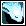Undine's Blessing</td><td data-l="ของที่ใช้"><b>Purple Worm Card</b> × 5</td><td data-l="หาจาก">Purple Worm Lv 215 · Swamp Dungeon 4 - Marshy Garden</td><td data-l="โซน">Black Swamp / Swamp Dungeon</td></tr>
<tr><td class="ck"><input aria-label="ทำแล้ว" id="m-67" type="checkbox"/></td><td class="nm" data-l="สกิล">Undine's Garden</td><td data-l="ของที่ใช้"><b>Maid Lydia Card</b> × 3</td><td data-l="หาจาก">Maid Lydia Lv 185 · Vamp Dungeon 1 - Banquet of the Vamp, Vamp Dungeon 2 - Banquet of the Dead</td><td data-l="โซน">Rose Garden / Vamp Castle</td></tr>
<tr><td class="ck"><input aria-label="ทำแล้ว" id="m-68" type="checkbox"/></td><td class="nm" data-l="สกิล">Water Shield</td><td data-l="ของที่ใช้"><b>Chele Card</b> × 3</td><td data-l="หาจาก">Chele Lv 117 · Mermaid Dungeon 1 - Underworld</td><td data-l="โซน">Mermaid Palace / Mermaid Dungeon</td></tr>
<tr><td class="ck"><input aria-label="ทำแล้ว" id="m-69" type="checkbox"/></td><td class="nm" data-l="สกิล">Whirlwind</td><td data-l="ของที่ใช้"><b>Officer Surapat Card</b> × 3</td><td data-l="หาจาก">Officer Surapat</td><td data-l="โซน">Mermaid Palace / Mermaid Dungeon</td></tr>
<tr><td class="ck"><input aria-label="ทำแล้ว" id="m-70" type="checkbox"/></td><td class="nm" data-l="สกิล">Whirlwind Blaze</td><td data-l="ของที่ใช้"><b>Lima Card</b> × 2</td><td data-l="หาจาก">Lima Lv 70 · Caballa Relics Dungeon 1, Caballa Relics Dungeon 2</td><td data-l="โซน">Caballa Relics / Relics Dungeon</td></tr>
<tr><td class="ck"><input aria-label="ทำแล้ว" id="m-71" type="checkbox"/></td><td class="nm" data-l="สกิล">Wicked Flame</td><td data-l="ของที่ใช้"><b>Quiem Card</b> × 2</td><td data-l="หาจาก">Quiem Lv 75 · Wharf Field 1 - Haunted Town, Wharf Field 3 - Phantom Park</td><td class="nw" data-l="โซน">Oops Wharf</td></tr>
<tr><td class="ck"><input aria-label="ทำแล้ว" id="m-72" type="checkbox"/></td><td class="nm" data-l="สกิล">Wind Blade</td><td data-l="ของที่ใช้"><b>Lima Card</b> × 2</td><td data-l="หาจาก">Lima Lv 70 · Caballa Relics Dungeon 1, Caballa Relics Dungeon 2</td><td data-l="โซน">Caballa Relics / Relics Dungeon</td></tr>
<tr><td class="ck"><input aria-label="ทำแล้ว" id="m-73" type="checkbox"/></td><td class="nm" data-l="สกิล">Wind Shield</td><td data-l="ของที่ใช้"><b>Chele Card</b> × 3</td><td data-l="หาจาก">Chele Lv 117 · Mermaid Dungeon 1 - Underworld</td><td data-l="โซน">Mermaid Palace / Mermaid Dungeon</td></tr>
<tr><td class="ck"><input aria-label="ทำแล้ว" id="m-74" type="checkbox"/></td><td class="nm" data-l="สกิล">Withering Disease</td><td data-l="ของที่ใช้"><b>Captain Charman Card</b> × 4</td><td data-l="หาจาก">Captain Charman Lv 142 · Rose Field 2 - Maze of Black Rose</td><td data-l="โซน">Rose Garden / Vamp Castle</td></tr>
</tbody></table>

</section>

<section data-c="" id="sense">

<h2>สาย Sense (Fox, Lion) </h2>

41 สกิล เรียงตามชื่อ ตัวเลขคือจำนวนที่ต้องใช้ให้สกิลถึงขั้น Mastery

<table><thead><tr><th></th><th>สกิล</th><th>ของที่ใช้</th><th>หาจาก</th><th>โซน</th></tr></thead><tbody>
<tr><td class="ck"><input aria-label="ทำแล้ว" id="s-0" type="checkbox"/></td><td class="nm" data-l="สกิล">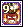Anger Management</td><td data-l="ของที่ใช้"><b>Lima Card</b> × 2</td><td data-l="หาจาก">Lima Lv 70 · Caballa Relics Dungeon 1, Caballa Relics Dungeon 2</td><td data-l="โซน">Caballa Relics / Relics Dungeon</td></tr>
<tr><td class="ck"><input aria-label="ทำแล้ว" id="s-1" type="checkbox"/></td><td class="nm" data-l="สกิล">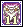Armor Destructor</td><td data-l="ของที่ใช้"><b>Koom Card</b> × 2</td><td data-l="หาจาก">Koom Lv 55 · Poppuri Dungeon - Moss Cave</td><td data-l="โซน">Megalopolis / Poppuri Dungeon</td></tr>
<tr><td class="ck"><input aria-label="ทำแล้ว" id="s-2" type="checkbox"/></td><td class="nm" data-l="สกิล">Aura of Luck</td><td data-l="ของที่ใช้"><b>Crow Card</b> × 3</td><td data-l="หาจาก">Crow Lv 88 · Wharf Field 2 - Devil Crow, Wharf Field 3 - Phantom Park</td><td class="nw" data-l="โซน">Oops Wharf</td></tr>
<tr><td class="ck"><input aria-label="ทำแล้ว" id="s-3" type="checkbox"/></td><td class="nm" data-l="สกิล">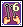Basic Detection</td><td data-l="ของที่ใช้"><b>Larva Card</b> × 2</td><td data-l="หาจาก">Larva Lv 52 · Poppuri Dungeon - Moss Cave, Poppuri Dungeon - Spore Cave</td><td data-l="โซน">Megalopolis / Poppuri Dungeon</td></tr>
<tr><td class="ck"><input aria-label="ทำแล้ว" id="s-4" type="checkbox"/></td><td class="nm" data-l="สกิล">Berserk</td><td data-l="ของที่ใช้"><b>Tooth Flower Card</b> × 5</td><td data-l="หาจาก">Tooth Flower Lv 212 · Swamp Dungeon 3 - Marshy Vacant Lot</td><td data-l="โซน">Black Swamp / Swamp Dungeon</td></tr>
<tr><td class="ck"><input aria-label="ทำแล้ว" id="s-5" type="checkbox"/></td><td class="nm" data-l="สกิล">Butt Plate</td><td data-l="ของที่ใช้"><b>Ironclad Turtle Card</b> × 2</td><td data-l="หาจาก">Ironclad Turtle Lv 68 · Path to Oops Wharf</td><td class="nw" data-l="โซน">Oops Wharf</td></tr>
<tr><td class="ck"><input aria-label="ทำแล้ว" id="s-6" type="checkbox"/></td><td class="nm" data-l="สกิล">Chain of Knives</td><td data-l="ของที่ใช้"><b>Chele Card</b> × 3</td><td data-l="หาจาก">Chele Lv 117 · Mermaid Dungeon 1 - Underworld</td><td data-l="โซน">Mermaid Palace / Mermaid Dungeon</td></tr>
<tr><td class="ck"><input aria-label="ทำแล้ว" id="s-7" type="checkbox"/></td><td class="nm" data-l="สกิล">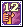Compound Master</td><td data-l="ของที่ใช้"><b>Crow Card</b> × 3</td><td data-l="หาจาก">Crow Lv 88 · Wharf Field 2 - Devil Crow, Wharf Field 3 - Phantom Park</td><td class="nw" data-l="โซน">Oops Wharf</td></tr>
<tr><td class="ck"><input aria-label="ทำแล้ว" id="s-8" type="checkbox"/></td><td class="nm" data-l="สกิล">Double Shot</td><td data-l="ของที่ใช้"><b>Officer Okto Card</b> × 3</td><td data-l="หาจาก">Okto Lv 129 · Mermaid Dungeon 2 - Legend of the Sea</td><td data-l="โซน">Mermaid Palace / Mermaid Dungeon</td></tr>
<tr><td class="ck"><input aria-label="ทำแล้ว" id="s-9" type="checkbox"/></td><td class="nm" data-l="สกิล">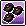Explosives Expert</td><td data-l="ของที่ใช้"><b>Slithis Card</b> × 8</td><td data-l="หาจาก">Slithis Lv 203 · Swamp Dungeon 1 - Marshy Trail</td><td data-l="โซน">Black Swamp / Swamp Dungeon</td></tr>
<tr><td class="ck"><input aria-label="ทำแล้ว" id="s-10" type="checkbox"/></td><td class="nm" data-l="สกิล">Fan of Knives</td><td data-l="ของที่ใช้"><b>Cobra Flower Card</b> × 4</td><td data-l="หาจาก">Cobra Flower Lv 210 · Swamp Dungeon 2 - Marshy Pool, Swamp Dungeon 3 - Marshy Vacant Lot</td><td data-l="โซน">Black Swamp / Swamp Dungeon</td></tr>
<tr><td class="ck"><input aria-label="ทำแล้ว" id="s-11" type="checkbox"/></td><td class="nm" data-l="สกิล">Gas Mask</td><td data-l="ของที่ใช้"><b>Officer Okto Card</b> × 3</td><td data-l="หาจาก">Okto Lv 129 · Mermaid Dungeon 2 - Legend of the Sea</td><td data-l="โซน">Mermaid Palace / Mermaid Dungeon</td></tr>
<tr><td class="ck"><input aria-label="ทำแล้ว" id="s-12" type="checkbox"/></td><td class="nm" data-l="สกิล">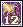Gun Booster</td><td data-l="ของที่ใช้"><b>Turvy Card</b> × 2</td><td data-l="หาจาก">Turvy Lv 45 · Poppuri Dungeon - Spore Cave</td><td data-l="โซน">Megalopolis / Poppuri Dungeon</td></tr>
<tr><td class="ck"><input aria-label="ทำแล้ว" id="s-13" type="checkbox"/></td><td class="nm" data-l="สกิล">Gun Overdrive</td><td data-l="ของที่ใช้"><b>Purple Worm Card</b> × 5</td><td data-l="หาจาก">Purple Worm Lv 215 · Swamp Dungeon 4 - Marshy Garden</td><td data-l="โซน">Black Swamp / Swamp Dungeon</td></tr>
<tr><td class="ck"><input aria-label="ทำแล้ว" id="s-14" type="checkbox"/></td><td class="nm" data-l="สกิล">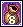Heavy Carrier</td><td data-l="ของที่ใช้"><b>Hula Octopus Card</b> × 2</td><td data-l="หาจาก">Hula Octopus Lv 25 · Desert Beach Field 2 - Sand Palace</td><td data-l="โซน">Desert Beach / Pyramid Dungeon</td></tr>
<tr><td class="ck"><input aria-label="ทำแล้ว" id="s-15" type="checkbox"/></td><td class="nm" data-l="สกิล">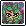Hide</td><td data-l="ของที่ใช้"><b>Cobra Flower Card</b> × 5</td><td data-l="หาจาก">Cobra Flower Lv 210 · Swamp Dungeon 2 - Marshy Pool, Swamp Dungeon 3 - Marshy Vacant Lot</td><td data-l="โซน">Black Swamp / Swamp Dungeon</td></tr>
<tr><td class="ck"><input aria-label="ทำแล้ว" id="s-16" type="checkbox"/></td><td class="nm" data-l="สกิล">Item Detector</td><td data-l="ของที่ใช้"><b>Quiem Card</b> × 2</td><td data-l="หาจาก">Quiem Lv 75 · Wharf Field 1 - Haunted Town, Wharf Field 3 - Phantom Park</td><td class="nw" data-l="โซน">Oops Wharf</td></tr>
<tr><td class="ck"><input aria-label="ทำแล้ว" id="s-17" type="checkbox"/></td><td class="nm" data-l="สกิล">Keen Sense</td><td data-l="ของที่ใช้">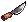<b>Old Hand Knife</b> × 8</td><td data-l="หาจาก">Maiden Ghost Lv 104 · Phantom School - 2F Chilly Hallway, Phantom School 2-2</td><td data-l="โซน">Phantom School / Phantom Dungeon</td></tr>
<tr><td class="ck"><input aria-label="ทำแล้ว" id="s-18" type="checkbox"/></td><td class="nm" data-l="สกิล">Landmine</td><td data-l="ของที่ใช้"><b>Chele Card</b> × 3</td><td data-l="หาจาก">Chele Lv 117 · Mermaid Dungeon 1 - Underworld</td><td data-l="โซน">Mermaid Palace / Mermaid Dungeon</td></tr>
<tr><td class="ck"><input aria-label="ทำแล้ว" id="s-19" type="checkbox"/></td><td class="nm" data-l="สกิล">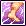Leg Training</td><td data-l="ของที่ใช้"><b>Dancer Isabelle Card</b> × 4</td><td data-l="หาจาก">Dancer Isabelle Lv 141 · Rose Field 1 - Stairway to Sorrow</td><td data-l="โซน">Rose Garden / Vamp Castle</td></tr>
<tr><td class="ck"><input aria-label="ทำแล้ว" id="s-20" type="checkbox"/></td><td class="nm" data-l="สกิล">Lightning Rod</td><td data-l="ของที่ใช้"><b>Dancer Michel Card</b> × 3</td><td data-l="หาจาก">Dancer Michel Lv 138 · Rose Field 1 - Stairway to Sorrow</td><td data-l="โซน">Rose Garden / Vamp Castle</td></tr>
<tr><td class="ck"><input aria-label="ทำแล้ว" id="s-21" type="checkbox"/></td><td class="nm" data-l="สกิล">Lock-on</td><td data-l="ของที่ใช้"><b>Dancer Michel Card</b> × 3</td><td data-l="หาจาก">Dancer Michel Lv 138 · Rose Field 1 - Stairway to Sorrow</td><td data-l="โซน">Rose Garden / Vamp Castle</td></tr>
<tr><td class="ck"><input aria-label="ทำแล้ว" id="s-22" type="checkbox"/></td><td class="nm" data-l="สกิล">Lucky Fist</td><td data-l="ของที่ใช้">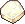<b>Royal Jelly</b> × 55</td><td data-l="หาจาก">Forest Wasp Lv 47 · Southwest Forest</td><td data-l="โซน">Megalopolis / Poppuri Dungeon</td></tr>
<tr><td class="ck"><input aria-label="ทำแล้ว" id="s-23" type="checkbox"/></td><td class="nm" data-l="สกิล">Lucky Seven</td><td data-l="ของที่ใช้"><b>Guiana Card</b> × 2</td><td data-l="หาจาก">Guiana Lv 66 · Caballa Relics Dungeon 1, Caballa Relics Dungeon 2</td><td data-l="โซน">Caballa Relics / Relics Dungeon</td></tr>
<tr><td class="ck"><input aria-label="ทำแล้ว" id="s-24" type="checkbox"/></td><td class="nm" data-l="สกิล">Mega Crazy Drilling</td><td data-l="ของที่ใช้"><b>Crow Card</b> × 3</td><td data-l="หาจาก">Crow Lv 88 · Wharf Field 2 - Devil Crow, Wharf Field 3 - Phantom Park</td><td class="nw" data-l="โซน">Oops Wharf</td></tr>
<tr><td class="ck"><input aria-label="ทำแล้ว" id="s-25" type="checkbox"/></td><td class="nm" data-l="สกิล">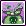Poison Assault</td><td data-l="ของที่ใช้"><b>Dancer Isabelle Card</b> × 5</td><td data-l="หาจาก">Dancer Isabelle Lv 141 · Rose Field 1 - Stairway to Sorrow</td><td data-l="โซน">Rose Garden / Vamp Castle</td></tr>
<tr><td class="ck"><input aria-label="ทำแล้ว" id="s-26" type="checkbox"/></td><td class="nm" data-l="สกิล">Poison Pouch</td><td data-l="ของที่ใช้"><b>Dancer Isabelle Card</b> × 5</td><td data-l="หาจาก">Dancer Isabelle Lv 141 · Rose Field 1 - Stairway to Sorrow</td><td data-l="โซน">Rose Garden / Vamp Castle</td></tr>
<tr><td class="ck"><input aria-label="ทำแล้ว" id="s-27" type="checkbox"/></td><td class="nm" data-l="สกิล">Pouch of Pain</td><td data-l="ของที่ใช้"><b>Red Rosary</b> × 8</td><td data-l="หาจาก">Ugly Corpse Lv 119 · Phantom School 2-4</td><td data-l="โซน">Phantom School / Phantom Dungeon</td></tr>
<tr><td class="ck"><input aria-label="ทำแล้ว" id="s-28" type="checkbox"/></td><td class="nm" data-l="สกิล">Power Shot</td><td data-l="ของที่ใช้"><b>Quiem Card</b> × 2</td><td data-l="หาจาก">Quiem Lv 75 · Wharf Field 1 - Haunted Town, Wharf Field 3 - Phantom Park</td><td class="nw" data-l="โซน">Oops Wharf</td></tr>
<tr><td class="ck"><input aria-label="ทำแล้ว" id="s-29" type="checkbox"/></td><td class="nm" data-l="สกิล">Precise Pitch</td><td data-l="ของที่ใช้"><b>Ironclad Turtle Card</b> × 2</td><td data-l="หาจาก">Ironclad Turtle Lv 68 · Path to Oops Wharf</td><td class="nw" data-l="โซน">Oops Wharf</td></tr>
<tr><td class="ck"><input aria-label="ทำแล้ว" id="s-30" type="checkbox"/></td><td class="nm" data-l="สกิล">Revealing Eye</td><td data-l="ของที่ใช้"><b>Cobra Flower Card</b> × 6</td><td data-l="หาจาก">Cobra Flower Lv 210 · Swamp Dungeon 2 - Marshy Pool, Swamp Dungeon 3 - Marshy Vacant Lot</td><td data-l="โซน">Black Swamp / Swamp Dungeon</td></tr>
<tr><td class="ck"><input aria-label="ทำแล้ว" id="s-31" type="checkbox"/></td><td class="nm" data-l="สกิล">Sharp Sense</td><td data-l="ของที่ใช้"><b>Purple Worm Card</b> × 5</td><td data-l="หาจาก">Purple Worm Lv 215 · Swamp Dungeon 4 - Marshy Garden</td><td data-l="โซน">Black Swamp / Swamp Dungeon</td></tr>
<tr><td class="ck"><input aria-label="ทำแล้ว" id="s-32" type="checkbox"/></td><td class="nm" data-l="สกิล">Shield Breaker</td><td data-l="ของที่ใช้"><b>Dancer Isabelle Card</b> × 3</td><td data-l="หาจาก">Dancer Isabelle Lv 141 · Rose Field 1 - Stairway to Sorrow</td><td data-l="โซน">Rose Garden / Vamp Castle</td></tr>
<tr><td class="ck"><input aria-label="ทำแล้ว" id="s-33" type="checkbox"/></td><td class="nm" data-l="สกิล">Shooting Spree</td><td data-l="ของที่ใช้"><b>Crow Card</b> × 3</td><td data-l="หาจาก">Crow Lv 88 · Wharf Field 2 - Devil Crow, Wharf Field 3 - Phantom Park</td><td class="nw" data-l="โซน">Oops Wharf</td></tr>
<tr><td class="ck"><input aria-label="ทำแล้ว" id="s-34" type="checkbox"/></td><td class="nm" data-l="สกิล">Shuriken Master</td><td data-l="ของที่ใช้">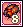<b>Oran G Card</b> × 2</td><td data-l="หาจาก">Oran G Lv 30 · Pyramid Dungeon 1 - Hall of the Slave</td><td data-l="โซน">Desert Beach / Pyramid Dungeon</td></tr>
<tr><td class="ck"><input aria-label="ทำแล้ว" id="s-35" type="checkbox"/></td><td class="nm" data-l="สกิล">Sixth Sense</td><td data-l="ของที่ใช้"><b>Clione Card</b> × 2</td><td data-l="หาจาก">Clione Lv 10 · Coral Beach Field 3 - Sunny Beach</td><td class="nw" data-l="โซน">Coral Beach</td></tr>
<tr><td class="ck"><input aria-label="ทำแล้ว" id="s-36" type="checkbox"/></td><td class="nm" data-l="สกิล">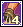Sticky Foot</td><td data-l="ของที่ใช้"><b>Silver G Card</b> × 2</td><td data-l="หาจาก">Silver G Lv 35 · Pyramid Dungeon 3 - Hall of Bastet</td><td data-l="โซน">Desert Beach / Pyramid Dungeon</td></tr>
<tr><td class="ck"><input aria-label="ทำแล้ว" id="s-37" type="checkbox"/></td><td class="nm" data-l="สกิล">Sticky Icky</td><td data-l="ของที่ใช้"><b>Red Woolen Yarn</b> × 7</td><td data-l="หาจาก">Snowkid Lv 198 · Snow Field 1 - Merry Christmas</td><td data-l="โซน">Snow Hill / Blue Ice Dungeon</td></tr>
<tr><td class="ck"><input aria-label="ทำแล้ว" id="s-38" type="checkbox"/></td><td class="nm" data-l="สกิล">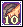Stone Strike</td><td data-l="ของที่ใช้"><b>Clione Card</b> × 2</td><td data-l="หาจาก">Clione Lv 10 · Coral Beach Field 3 - Sunny Beach</td><td class="nw" data-l="โซน">Coral Beach</td></tr>
<tr><td class="ck"><input aria-label="ทำแล้ว" id="s-39" type="checkbox"/></td><td class="nm" data-l="สกิล">Strong Mind</td><td data-l="ของที่ใช้"><b>Purple Worm Card</b> × 7</td><td data-l="หาจาก">Purple Worm Lv 215 · Swamp Dungeon 4 - Marshy Garden</td><td data-l="โซน">Black Swamp / Swamp Dungeon</td></tr>
<tr><td class="ck"><input aria-label="ทำแล้ว" id="s-40" type="checkbox"/></td><td class="nm" data-l="สกิล">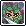Sudden Attack</td><td data-l="ของที่ใช้"><b>Slug G Card</b> × 6</td><td data-l="หาจาก">Slug G Lv 224 · Swamp Dungeon 6 - Suu's Muddy Pool</td><td data-l="โซน">Black Swamp / Swamp Dungeon</td></tr>
</tbody></table>

</section>

<section data-c="" id="charm">

<h2>สาย Charm (Cat, Raccoon) </h2>

38 สกิล เรียงตามชื่อ ตัวเลขคือจำนวนที่ต้องใช้ให้สกิลถึงขั้น Mastery

<table><thead><tr><th></th><th>สกิล</th><th>ของที่ใช้</th><th>หาจาก</th><th>โซน</th></tr></thead><tbody>
<tr><td class="ck"><input aria-label="ทำแล้ว" id="c-0" type="checkbox"/></td><td class="nm" data-l="สกิล">(Summon) Card Soldier</td><td data-l="ของที่ใช้"><b>Purple Worm Card</b> × 5</td><td data-l="หาจาก">Purple Worm Lv 215 · Swamp Dungeon 4 - Marshy Garden</td><td data-l="โซน">Black Swamp / Swamp Dungeon</td></tr>
<tr><td class="ck"><input aria-label="ทำแล้ว" id="c-1" type="checkbox"/></td><td class="nm" data-l="สกิล">2 Hit Combo</td><td data-l="ของที่ใช้"><b>Purple Worm Card</b> × 6</td><td data-l="หาจาก">Purple Worm Lv 215 · Swamp Dungeon 4 - Marshy Garden</td><td data-l="โซน">Black Swamp / Swamp Dungeon</td></tr>
<tr><td class="ck"><input aria-label="ทำแล้ว" id="c-2" type="checkbox"/></td><td class="nm" data-l="สกิล">Beast Claw</td><td data-l="ของที่ใช้"><b>Officer Okto Card</b> × 3</td><td data-l="หาจาก">Okto Lv 129 · Mermaid Dungeon 2 - Legend of the Sea</td><td data-l="โซน">Mermaid Palace / Mermaid Dungeon</td></tr>
<tr><td class="ck"><input aria-label="ทำแล้ว" id="c-3" type="checkbox"/></td><td class="nm" data-l="สกิล">Bodyguard</td><td data-l="ของที่ใช้">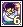<b>Black Foe Card</b> × 2</td><td data-l="หาจาก">Black Foe Lv 79 · Wharf Field 4 - Chrono Wharf</td><td class="nw" data-l="โซน">Oops Wharf</td></tr>
<tr><td class="ck"><input aria-label="ทำแล้ว" id="c-4" type="checkbox"/></td><td class="nm" data-l="สกิล">Card Strike</td><td data-l="ของที่ใช้"><b>Ironclad Turtle Card</b> × 2</td><td data-l="หาจาก">Ironclad Turtle Lv 68 · Path to Oops Wharf</td><td class="nw" data-l="โซน">Oops Wharf</td></tr>
<tr><td class="ck"><input aria-label="ทำแล้ว" id="c-5" type="checkbox"/></td><td class="nm" data-l="สกิล">Deadly Funk</td><td data-l="ของที่ใช้"><b>Maid Lydia Card</b> × 3</td><td data-l="หาจาก">Maid Lydia Lv 185 · Vamp Dungeon 1 - Banquet of the Vamp, Vamp Dungeon 2 - Banquet of the Dead</td><td data-l="โซน">Rose Garden / Vamp Castle</td></tr>
<tr><td class="ck"><input aria-label="ทำแล้ว" id="c-6" type="checkbox"/></td><td class="nm" data-l="สกิล">Dodge Master</td><td data-l="ของที่ใช้"><b>Hula Octopus Card</b> × 2</td><td data-l="หาจาก">Hula Octopus Lv 25 · Desert Beach Field 2 - Sand Palace</td><td data-l="โซน">Desert Beach / Pyramid Dungeon</td></tr>
<tr><td class="ck"><input aria-label="ทำแล้ว" id="c-7" type="checkbox"/></td><td class="nm" data-l="สกิล">Entrancing Wink</td><td data-l="ของที่ใช้"><b>Slug G Card</b> × 5</td><td data-l="หาจาก">Slug G Lv 224 · Swamp Dungeon 6 - Suu's Muddy Pool</td><td data-l="โซน">Black Swamp / Swamp Dungeon</td></tr>
<tr><td class="ck"><input aria-label="ทำแล้ว" id="c-8" type="checkbox"/></td><td class="nm" data-l="สกิล">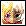Evolution</td><td data-l="ของที่ใช้"><b>Officer Surapat Card</b> × 3</td><td data-l="หาจาก">Officer Surapat</td><td data-l="โซน">Mermaid Palace / Mermaid Dungeon</td></tr>
<tr><td class="ck"><input aria-label="ทำแล้ว" id="c-9" type="checkbox"/></td><td class="nm" data-l="สกิล">Fatal Wound</td><td data-l="ของที่ใช้"><b>Thorn Stem</b> × 5</td><td data-l="หาจาก">Mud Bigfoot Lv 180 · Swamp Field 6 - Lake of Illusion</td><td data-l="โซน">Black Swamp / Swamp Dungeon</td></tr>
<tr><td class="ck"><input aria-label="ทำแล้ว" id="c-10" type="checkbox"/></td><td class="nm" data-l="สกิล">Final Blow</td><td data-l="ของที่ใช้"><b>Guiana Card</b> × 2</td><td data-l="หาจาก">Guiana Lv 66 · Caballa Relics Dungeon 1, Caballa Relics Dungeon 2</td><td data-l="โซน">Caballa Relics / Relics Dungeon</td></tr>
<tr><td class="ck"><input aria-label="ทำแล้ว" id="c-11" type="checkbox"/></td><td class="nm" data-l="สกิล">Fist Full of Galders</td><td data-l="ของที่ใช้"><b>Cobra Flower Card</b> × 4</td><td data-l="หาจาก">Cobra Flower Lv 210 · Swamp Dungeon 2 - Marshy Pool, Swamp Dungeon 3 - Marshy Vacant Lot</td><td data-l="โซน">Black Swamp / Swamp Dungeon</td></tr>
<tr><td class="ck"><input aria-label="ทำแล้ว" id="c-12" type="checkbox"/></td><td class="nm" data-l="สกิล">Flux Capacitor</td><td data-l="ของที่ใช้"><b>Dancer Michel Card</b> × 3</td><td data-l="หาจาก">Dancer Michel Lv 138 · Rose Field 1 - Stairway to Sorrow</td><td data-l="โซน">Rose Garden / Vamp Castle</td></tr>
<tr><td class="ck"><input aria-label="ทำแล้ว" id="c-13" type="checkbox"/></td><td class="nm" data-l="สกิล">Full House</td><td data-l="ของที่ใช้"><b>Slug G Card</b> × 5</td><td data-l="หาจาก">Slug G Lv 224 · Swamp Dungeon 6 - Suu's Muddy Pool</td><td data-l="โซน">Black Swamp / Swamp Dungeon</td></tr>
<tr><td class="ck"><input aria-label="ทำแล้ว" id="c-14" type="checkbox"/></td><td class="nm" data-l="สกิล">Furious Galder Throw</td><td data-l="ของที่ใช้"><b>Dancer Michel Card</b> × 3</td><td data-l="หาจาก">Dancer Michel Lv 138 · Rose Field 1 - Stairway to Sorrow</td><td data-l="โซน">Rose Garden / Vamp Castle</td></tr>
<tr><td class="ck"><input aria-label="ทำแล้ว" id="c-15" type="checkbox"/></td><td class="nm" data-l="สกิล">Galder Barrage</td><td data-l="ของที่ใช้"><b>Quiem Card</b> × 2</td><td data-l="หาจาก">Quiem Lv 75 · Wharf Field 1 - Haunted Town, Wharf Field 3 - Phantom Park</td><td class="nw" data-l="โซน">Oops Wharf</td></tr>
<tr><td class="ck"><input aria-label="ทำแล้ว" id="c-16" type="checkbox"/></td><td class="nm" data-l="สกิล">Galder Thrower</td><td data-l="ของที่ใช้"><b>Gold G Card</b> × 2</td><td data-l="หาจาก">Gold G Lv 36 · Pyramid Dungeon 3 - Hall of Bastet, Pyramid Dungeon 5 - Hall of Love Affair</td><td data-l="โซน">Desert Beach / Pyramid Dungeon</td></tr>
<tr><td class="ck"><input aria-label="ทำแล้ว" id="c-17" type="checkbox"/></td><td class="nm" data-l="สกิล">Heavy Hit</td><td data-l="ของที่ใช้"><b>Purple Worm Card</b> × 5</td><td data-l="หาจาก">Purple Worm Lv 215 · Swamp Dungeon 4 - Marshy Garden</td><td data-l="โซน">Black Swamp / Swamp Dungeon</td></tr>
<tr><td class="ck"><input aria-label="ทำแล้ว" id="c-18" type="checkbox"/></td><td class="nm" data-l="สกิล">Impelling Rage</td><td data-l="ของที่ใช้"><b>Chele Card</b> × 3</td><td data-l="หาจาก">Chele Lv 117 · Mermaid Dungeon 1 - Underworld</td><td data-l="โซน">Mermaid Palace / Mermaid Dungeon</td></tr>
<tr><td class="ck"><input aria-label="ทำแล้ว" id="c-19" type="checkbox"/></td><td class="nm" data-l="สกิล">Lady Luck</td><td data-l="ของที่ใช้"><b>Maid Lydia Card</b> × 3</td><td data-l="หาจาก">Maid Lydia Lv 185 · Vamp Dungeon 1 - Banquet of the Vamp, Vamp Dungeon 2 - Banquet of the Dead</td><td data-l="โซน">Rose Garden / Vamp Castle</td></tr>
<tr><td class="ck"><input aria-label="ทำแล้ว" id="c-20" type="checkbox"/></td><td class="nm" data-l="สกิล">Magic Defense Breaker</td><td data-l="ของที่ใช้"><b>Silver G Card</b> × 2</td><td data-l="หาจาก">Silver G Lv 35 · Pyramid Dungeon 3 - Hall of Bastet</td><td data-l="โซน">Desert Beach / Pyramid Dungeon</td></tr>
<tr><td class="ck"><input aria-label="ทำแล้ว" id="c-21" type="checkbox"/></td><td class="nm" data-l="สกิล">Magic Meltdown</td><td data-l="ของที่ใช้"><b>Gold G Card</b> × 2</td><td data-l="หาจาก">Gold G Lv 36 · Pyramid Dungeon 3 - Hall of Bastet, Pyramid Dungeon 5 - Hall of Love Affair</td><td data-l="โซน">Desert Beach / Pyramid Dungeon</td></tr>
<tr><td class="ck"><input aria-label="ทำแล้ว" id="c-22" type="checkbox"/></td><td class="nm" data-l="สกิล">Mana Reflector</td><td data-l="ของที่ใช้"><b>Nephthys Card</b> × 2</td><td data-l="หาจาก">Nephthys Lv 38 · Pyramid Dungeon 2 - Hall of Harpy</td><td data-l="โซน">Desert Beach / Pyramid Dungeon</td></tr>
<tr><td class="ck"><input aria-label="ทำแล้ว" id="c-23" type="checkbox"/></td><td class="nm" data-l="สกิล">Metamorphosis</td><td data-l="ของที่ใช้"><b>Officer Okto Card</b> × 3</td><td data-l="หาจาก">Okto Lv 129 · Mermaid Dungeon 2 - Legend of the Sea</td><td data-l="โซน">Mermaid Palace / Mermaid Dungeon</td></tr>
<tr><td class="ck"><input aria-label="ทำแล้ว" id="c-24" type="checkbox"/></td><td class="nm" data-l="สกิล">One Pair</td><td data-l="ของที่ใช้"><b>Chele Card</b> × 3</td><td data-l="หาจาก">Chele Lv 117 · Mermaid Dungeon 1 - Underworld</td><td data-l="โซน">Mermaid Palace / Mermaid Dungeon</td></tr>
<tr><td class="ck"><input aria-label="ทำแล้ว" id="c-25" type="checkbox"/></td><td class="nm" data-l="สกิล">Physical Training</td><td data-l="ของที่ใช้"><b>Mimic Card</b> × 2</td><td data-l="หาจาก">Mimic Lv 61 · Relics Field 2 - Hand of Giant, Relics Field 3 - Monkey Statues</td><td data-l="โซน">Caballa Relics / Relics Dungeon</td></tr>
<tr><td class="ck"><input aria-label="ทำแล้ว" id="c-26" type="checkbox"/></td><td class="nm" data-l="สกิล">Power Blow</td><td data-l="ของที่ใช้"><b>Clione Card</b> × 2</td><td data-l="หาจาก">Clione Lv 10 · Coral Beach Field 3 - Sunny Beach</td><td class="nw" data-l="โซน">Coral Beach</td></tr>
<tr><td class="ck"><input aria-label="ทำแล้ว" id="c-27" type="checkbox"/></td><td class="nm" data-l="สกิล">Power Charging</td><td data-l="ของที่ใช้"><b>Tooth Flower Card</b> × 6</td><td data-l="หาจาก">Tooth Flower Lv 212 · Swamp Dungeon 3 - Marshy Vacant Lot</td><td data-l="โซน">Black Swamp / Swamp Dungeon</td></tr>
<tr><td class="ck"><input aria-label="ทำแล้ว" id="c-28" type="checkbox"/></td><td class="nm" data-l="สกิล">Raging Nail</td><td data-l="ของที่ใช้"><b>Purple Worm Card</b> × 5</td><td data-l="หาจาก">Purple Worm Lv 215 · Swamp Dungeon 4 - Marshy Garden</td><td data-l="โซน">Black Swamp / Swamp Dungeon</td></tr>
<tr><td class="ck"><input aria-label="ทำแล้ว" id="c-29" type="checkbox"/></td><td class="nm" data-l="สกิล">Sharp Scream</td><td data-l="ของที่ใช้"><b>Purple Worm Card</b> × 5</td><td data-l="หาจาก">Purple Worm Lv 215 · Swamp Dungeon 4 - Marshy Garden</td><td data-l="โซน">Black Swamp / Swamp Dungeon</td></tr>
<tr><td class="ck"><input aria-label="ทำแล้ว" id="c-30" type="checkbox"/></td><td class="nm" data-l="สกิล">Shield All</td><td data-l="ของที่ใช้"><b>Mummy Card</b> × 2</td><td class="nw" data-l="หาจาก">Mummy</td><td data-l="โซน">Desert Beach / Pyramid Dungeon</td></tr>
<tr><td class="ck"><input aria-label="ทำแล้ว" id="c-31" type="checkbox"/></td><td class="nm" data-l="สกิล">Siren Song</td><td data-l="ของที่ใช้"><b>Nephthys Song</b> × 40</td><td data-l="หาจาก">Nephthys Lv 38 · Pyramid Dungeon 2 - Hall of Harpy</td><td data-l="โซน">Desert Beach / Pyramid Dungeon</td></tr>
<tr><td class="ck"><input aria-label="ทำแล้ว" id="c-32" type="checkbox"/></td><td class="nm" data-l="สกิล">Skunk Pouch</td><td data-l="ของที่ใช้"><b>Koom Card</b> × 2</td><td data-l="หาจาก">Koom Lv 55 · Poppuri Dungeon - Moss Cave</td><td data-l="โซน">Megalopolis / Poppuri Dungeon</td></tr>
<tr><td class="ck"><input aria-label="ทำแล้ว" id="c-33" type="checkbox"/></td><td class="nm" data-l="สกิล">Sturdy Shield</td><td data-l="ของที่ใช้"><b>Turvy Card</b> × 2</td><td data-l="หาจาก">Turvy Lv 45 · Poppuri Dungeon - Spore Cave</td><td data-l="โซน">Megalopolis / Poppuri Dungeon</td></tr>
<tr><td class="ck"><input aria-label="ทำแล้ว" id="c-34" type="checkbox"/></td><td class="nm" data-l="สกิล">Sumo Suit</td><td data-l="ของที่ใช้"><b>Captain Charman Card</b> × 3</td><td data-l="หาจาก">Captain Charman Lv 142 · Rose Field 2 - Maze of Black Rose</td><td data-l="โซน">Rose Garden / Vamp Castle</td></tr>
<tr><td class="ck"><input aria-label="ทำแล้ว" id="c-35" type="checkbox"/></td><td class="nm" data-l="สกิล">Titanium Wrist</td><td data-l="ของที่ใช้"><b>Koom Card</b> × 2</td><td data-l="หาจาก">Koom Lv 55 · Poppuri Dungeon - Moss Cave</td><td data-l="โซน">Megalopolis / Poppuri Dungeon</td></tr>
<tr><td class="ck"><input aria-label="ทำแล้ว" id="c-36" type="checkbox"/></td><td class="nm" data-l="สกิล">Volley Kick</td><td data-l="ของที่ใช้"><b>Ironclad Turtle Card</b> × 2</td><td data-l="หาจาก">Ironclad Turtle Lv 68 · Path to Oops Wharf</td><td class="nw" data-l="โซน">Oops Wharf</td></tr>
<tr><td class="ck"><input aria-label="ทำแล้ว" id="c-37" type="checkbox"/></td><td class="nm" data-l="สกิล">Wild Nail</td><td data-l="ของที่ใช้"><b>Officer Okto Card</b> × 3</td><td data-l="หาจาก">Okto Lv 129 · Mermaid Dungeon 2 - Legend of the Sea</td><td data-l="โซน">Mermaid Palace / Mermaid Dungeon</td></tr>
</tbody></table>

</section>

<footer>สรุปจากวิกิ ggFTW ฉบับ mirror ของ LifeTO <a href="https://wikimirror.lifeto.co/wiki.ggftw.com/trickster/Card_Quest_%26_Skill_Mastery_Items_List.html" rel="noopener" target="_blank">Card Quest &amp; Skill Mastery Items List</a> ติ๊กเก็บไว้ในเบราว์เซอร์ที่เปิดหน้านี้เท่านั้น</footer>

<PageBehavior />
