

<header style="display:flex;flex-direction:column;gap:8px">

# เควสสกิล

สกิลอาชีพ 3 หาจากไหน Card Pack และเควสการ์ดสกิลทั้ง 8 เควส

</header>

<input id="q" placeholder="ค้นชื่อสกิล อาชีพ หรือของ" type="search"/>

<nav class="toc"><a href="#where">หาสกิลจากไหน</a><a href="#pack">Card Pack</a><a href="#quests">เควสการ์ดสกิล</a></nav>

<section id="where">

## สกิลอาชีพ 3 หาจากไหน

<ul class="notes">
<li><b>สายเพียว</b>: การ์ดสกิลกระจายอยู่ตามคอนเทนต์ต่างๆ ทั้งเปิด Card Pack ดรอปจากมอน (รวมถึงมอนใน Tower of Chaos ชั้น 38 ขึ้นไป) และทำเควสในหน้านี้ ดูที่มาของแต่ละสกิลได้ในช่อง "ได้จาก" ของหน้า <a href="./jobs">อาชีพ</a></li>
<li><b>สายไฮบริด</b>: ซื้อการ์ดสกิลจาก NPC อาชีพ 2 ของตัวละครคู่ได้เลย เช่น เล่น Witch (แกะไฮบริด) ซื้อสกิลจาก Magician Louie (NPC อาชีพมังกร)</li>
</ul>

</section>

<section id="pack">

## Card Pack

ซื้อ <b>Card Pack</b> ได้จาก <b>Card Girl</b> ตามร้านในเมือง เช่น Paradise Shop, Megalopolis Shop, Azteca, Aquarius Shop, Carbigal Shop ราคา <b>100,000 Galder</b> ต่อแพ็ค · เปิดแล้วสุ่มได้ Skill Card, 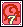Arcana Card, NPC Card หรือ Empty Card · การ์ดสกิลที่ได้ซื้อขายแลกเปลี่ยนได้

</section>

<section data-c="" id="quests">

## เควสการ์ดสกิล

เควสสายเพียว 8 เควส บางเควสอาชีพอื่นทำเอาการ์ดไปขายได้แต่เรียนเองไม่ได้

<table><thead><tr><th>เควส</th><th>เงื่อนไข</th><th>ต้องส่ง</th><th>ที่</th></tr></thead><tbody>
<tr id="q-fist"><td class="nm" data-l="เควส">Boxer Jeanne - Fist of Will ได้การ์ด <b>Flaming Fist</b> Champion</td><td data-l="เงื่อนไข">Boxer / Champion / Mercenary · Burning Rave (Master) + Counter Punch Lv 10 Boxer และ Mercenary ทำเควสเอาการ์ดได้ แต่เรียนสกิลไม่ได้</td><td data-l="ต้องส่ง">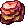<b>Golem Stone × 20</b> · ดรอปจาก Fire Golem ที่ Tapasco Field 2/4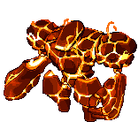</td><td data-l="ที่">Tapasco Field 1 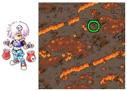</td></tr>
<tr id="q-soul"><td class="nm" data-l="เควส">Warrior Kei - Fight With Your Soul! ได้การ์ด <b>Chi Sword</b> Gladiator</td><td data-l="เงื่อนไข">Warrior / Gladiator / Duelist · Piercing Wave (Master) Warrior และ Duelist ทำเควสเอาการ์ดได้ แต่เรียนสกิลไม่ได้</td><td data-l="ต้องส่ง"><b>Blue Soul Bottle × 20</b> · ดรอปจาก Requi ที่ Wharf Field 1/2/3 <b>Red Soul Bottle × 20</b> · ดรอปจาก Quiem ที่ Wharf Field 1/3</td><td data-l="ที่">Techichi Field 2 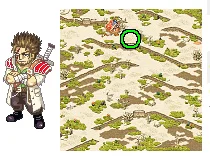</td></tr>
<tr id="q-commando"><td class="nm" data-l="เควส">Fortune Teller - Dark Commando ได้การ์ด <b>Dark Commando</b> Dark Lord</td><td data-l="เงื่อนไข">Dark Lord · Dark Barrier (Master) + Fear Lv 1</td><td data-l="ต้องส่ง">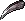<b>Crow Claw × 10</b> · ดรอปจาก Crow ที่ Wharf Field 2/3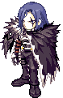 <b>Serpentine × 10</b> · ขุดใน Techichi Fields และ Black Ash Dungeons</td><td data-l="ที่">Gate of Caballa 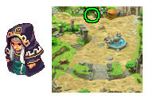</td></tr>
<tr id="q-faith"><td class="nm" data-l="เควส">Magician Louie - Power of Faith ได้การ์ด <b>Sacred Oath</b> Priest</td><td data-l="เงื่อนไข">Magician / Priest / Witch · Oath of Light (Master) Magician และ Witch ทำเควสเอาการ์ดได้ แต่เรียนสกิลไม่ได้</td><td data-l="ต้องส่ง"><b>Golden Bell × 20</b> · ดรอปจาก Mister Freaks ที่ Vamp Dungeon 2</td><td data-l="ที่">Mirage Island Field 7 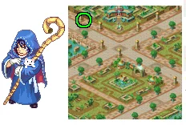</td></tr>
<tr id="q-legacy"><td class="nm" data-l="เควส">Magician Louie - Ancient Legacy ได้การ์ด <b>Celestial Strike</b> Priest</td><td data-l="เงื่อนไข">Magician / Priest / Witch · Radiant Strike Lv 5 + Light Wave Lv 5 Magician และ Witch ทำเควสเอาการ์ดได้ แต่เรียนสกิลไม่ได้</td><td data-l="ต้องส่ง"><b>Ancient Feather Pen × 10</b> · ขุดใน Mirage Island Field 1/5/6 <b>Papyrus × 10</b> · ขุดใน Pyramid Dungeon Halls, Path of Desert Beach, Techichi Field 2/3 และ Mirage Island Field 1</td><td data-l="ที่">Mirage Island Field 2 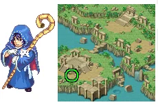</td></tr>
<tr id="q-liquid"><td class="nm" data-l="เควส">Explorer Reina - Ancient Liquid ได้การ์ด <b>Poison Pouch</b> Thief Master</td><td data-l="เงื่อนไข">Explorer / Thief Master / Cyber Hunter · Pouch of Pain (Master) Explorer และ Cyber Hunter ทำเควสเอาการ์ดได้ แต่เรียนสกิลไม่ได้</td><td data-l="ต้องส่ง"><b>Neurotoxin × 10</b> · ดรอปจาก Aabon ที่ Techichi Field 4 <b>Formic Acid × 10</b> · ดรอปจาก Forest Tickler ที่ Southwest Forest (Megalopolis)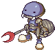</td><td data-l="ที่">Pyramid Dungeon 2 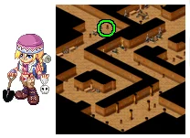</td></tr>
<tr id="q-crafts"><td class="nm" data-l="เควส">Explorer Reina - Poisonous Crafts ได้การ์ด <b>Poison Assault</b> Thief Master</td><td data-l="เงื่อนไข">Thief Master · Shuriken Master Lv 1 + Hide Lv 5</td><td data-l="ต้องส่ง"><b>Neurotoxin × 5</b> · ดรอปจาก Aabon ที่ Techichi Field 4 <b>Formic Acid × 5</b> · ดรอปจาก Forest Tickler ที่ Southwest Forest (Megalopolis) <b>Brush × 2</b> · ขุดใน Seabed Fields (Ghost Blue)</td><td data-l="ที่">Pyramid Dungeon 3 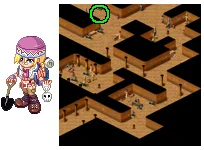</td></tr>
<tr id="q-spell"><td class="nm" data-l="เควส">Frog Shaman - Passing the Spell ได้การ์ด <b>(Summon) Card Soldier</b> Gambler</td><td data-l="เงื่อนไข">Card Master / Gambler · Metamorphosis (Master) Card Master ทำเควสเอาการ์ดได้ แต่เรียนสกิลไม่ได้</td><td data-l="ต้องส่ง"><b>Eye of the Sun × 20</b> · ดรอปจาก Lima ที่ Caballa Relics Dungeon 1/2/3/4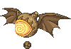</td><td data-l="ที่">Swamp Dungeon 2 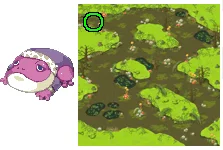</td></tr>
</tbody></table>

</section>

<footer>สรุปจาก <a href="https://docs.google.com/document/d/1OkZ1jDK8V_eeYJoYYga_6VVXCrYLp3Bq_UIKNBH5B3k/mobilebasic" rel="noopener" target="_blank">สกิลคลาส 3 หาได้จากที่ไหน โดยน้องจอย</a></footer>

<PageBehavior />
