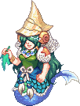
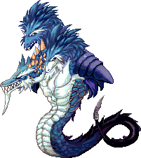
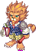
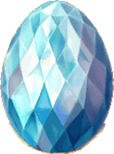
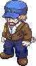
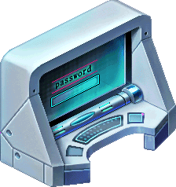
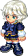
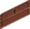
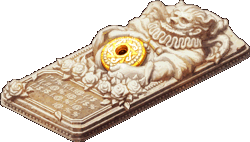
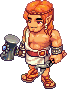

<header style="display:flex;flex-direction:column;gap:8px">

# Story Quest · เนื้อเรื่องหลัก

เควสเนื้อเรื่องของ Trickster แบ่งเป็น 7 Episode รวม 223 เควส ทำต่อกันเป็นสายตั้งแต่ลงทะเบียนที่ Coral Beach จนถึงตอนจบที่ Alteo

สรุปจากวิกิ ggFTW (ฉบับ mirror ของ LifeTO) หน้า [Story](https://wikimirror.lifeto.co/wiki.ggftw.com/trickster/Story.html) และ [Category Episode Quest](https://wikimirror.lifeto.co/wiki.ggftw.com/trickster/Category_Episode_Quest.html)

</header>

<section aria-live="polite" class="counter">

## ความคืบหน้ารวม

0 / 223 เควส

</section>

<section id="prologue">

## ก่อนเริ่มเกม: พินัยกรรมของมหาเศรษฐี

ห้าปีก่อน Don Cavalier มหาเศรษฐีผู้ก่อตั้ง Megalo Company บริษัทเกมที่ใหญ่ที่สุดในโลก ไปงานเกมโชว์ที่ยุโรปแล้วประมูลได้ม้วนคัมภีร์หนังวาฬขาวที่เขียนเรื่องอาณาจักรโบราณที่สาบสูญชื่อ Alteo เขาชนะการประมูลแม้แต่ Veronica นักมานุษยวิทยาที่ตามหาคัมภีร์นี้มาทั้งชีวิต

หนึ่งปีต่อมามีเกาะประหลาดโผล่ขึ้นกลางมหาสมุทรแปซิฟิก Don Cavalier เชื่อว่าเป็นส่วนหนึ่งของ Alteo จึงซื้อเกาะแล้วตั้งชื่อตามตัวเองว่า Caballa Island แล้วพาทีมงานมาสร้างโปรเจกต์ลับชิ้นสุดท้าย คือเกม Trickster ใช้เวลากว่า 4 ปี

แล้ววันหนึ่งข่าวก็ออกว่า Don Cavalier เสียชีวิต พินัยกรรมโฮโลแกรมบอกว่าเขาจะไม่ยกมรดกให้ใครคนเดียว แต่จะแบ่งให้ทุกคนที่มาร่วมเล่นเกม Trickster บนเกาะนี้ ผู้คนจากทั่วโลกจึงแห่กันมา เป้าหมายคือสะสมการ์ดพิเศษที่ต้องใช้สว่าน (drill) ของ Megalo Company ขุดขึ้นมา ส่วน Veronica ก็มาด้วยเพื่อพิสูจน์ว่าเกาะนี้คือ Alteo จริง

</section>

<section id="ep0">

<h2 id="ep0-h">Episode 0 · The Start of an Adventure </h2>

จุดเริ่มต้นการผจญภัย3 บท · 36 เควสเริ่มที่ Heidi

บทสอนเล่นของเกม ลงทะเบียนเป็นผู้เล่น ฝึกขุด ผสมยา และตีบวกอาวุธ แล้วได้พบโฮโลแกรมของ Don Cavalier ที่บอกเป้าหมายจริงของเกม

บท 1<h3>The Start of an Adventure</h3>

10 เควสเริ่มที่ Heidi · Coral Town - Blooming Cora

มาถึง Blooming Cora บน Caballa Island Heidi ให้ใบลงทะเบียนแล้วส่งไปหา Bunny Maid ซึ่งทดสอบด้วยการให้หาแครอทมาให้ จากนั้นช่วยเหลือคนในเมือง ทั้ง Winnie ที่ห่วง Lifeguard Deen, Tinnie ที่ดูแลสนามวอลเลย์บอล และ Lifeguard Bean ที่ขอน้ำแข็ง สุดท้าย Bean บอกว่าทั้งหมดคือบททดสอบ และให้ไปพบ Don Giuvanni รองประธาน Megalo Company ที่อีกฝั่งของถ้ำ

<a href="./episode-0.html#ch-1">ดูเควสบทนี้ →</a>

บท 2<h3>Don Giuvanni's Push</h3>

8 เควสเริ่มที่ Don Giuvanni · Gate of Desert Beach

Don Giuvanni ประกาศว่าตอนนี้เขาคุมเกม Trickster และจะเลือกผู้ชนะเอง เขาจัดโปรแกรมฝึกให้ เริ่มจากเรียนขุดกับ Driller Marky แล้วไปหา Officer Robert ที่ Paradise เพื่อเรียนผสมยา (Compounder Paul) ผสมแบบ Mature (Alchemist Nate) และตีบวกอาวุธ (Blacksmith Marx) จบแล้วได้ Hologram Port ซึ่งพาไปพบโฮโลแกรมของ Don Cavalier เขาบอกว่าจะเป็น Trickster ตัวจริงได้ต้องมีสายเลือดของ Trickster แท้ และต้องตามหารูปปั้นในตำนาน Poseidon's Blessing

<a href="./episode-0.html#ch-2">ดูเควสบทนี้ →</a>

บท 3<h3>Our Prologue</h3>

18 เควสเริ่มที่ Andrew · Beach Town - Paradise

Andrew ให้ไปทำความรู้จักชาวเมือง Paradise โดยเก็บ Heart Gem ให้ครบ 8 เม็ดจากการช่วยเหลือคนต่างๆ แต่ละคนมีเควสให้ 2 แบบ แบบหนึ่งสำหรับตัวละครที่ตรงกับเขา อีกแบบสำหรับตัวละครอื่น

<a href="./episode-0.html#ch-3">ดูเควสบทนี้ →</a>

</section>

<section id="ep1">

<h2 id="ep1-h">Episode 1 · Secret of the Alteo Empire </h2>

ความลับของอาณาจักร AlteoLv 45+3 บท · 22 เควสเริ่มที่ Monkey T

เริ่มรู้จักตำนานของราชินี Nefertiti, รูปปั้น Poseidon's Blessing และแร่ศักดิ์สิทธิ์ Harkon

บท 1<h3>Nefertiti's Necklace</h3>

11 เควสเริ่มที่ Monkey T · Gate of Caballa Relics

ได้สร้อยคอเก่าแต่สวยมาแล้วพยายามซ่อม ระหว่างนั้นเจอภาพวาดหญิงงามชื่อ Nefertiti และได้ฟังตำนาน ราชินีสาวแห่ง Fremeia ที่สัตว์ร้าย Enkicladus หลงรักจนลักพาตัวไปก้นทะเล ก่อนเทพ Poseidon จะสังหาร Enkicladus แล้วพาเธอไปเป็นมเหสีที่อาณาจักร Alteo สร้อยกลับไปหาเจ้าของคือ Love Hunter Robin ซึ่งให้เอาภาพไปให้ Rosaline Gracia คู่หมั้นของ Don Giuvanni เธอมอบคัมภีร์ลึกลับที่เล่าว่า Poseidon's Blessing คือของขวัญจาก Poseidon ถึง Nefertiti ลูกหลานของเธอควบคุมพลัง Harkon ได้และถูกเรียกว่า Trickster ส่วนเหล่า Nereides พี่น้องของมเหสีเดิมของ Poseidon ได้ทำลาย Alteo เพื่อแก้แค้น

<a href="./episode-1.html#ch-1">ดูเควสบทนี้ →</a>

บท 2<h3>Unknown Ancient Box</h3>

6 เควสเริ่มที่ Indiana John · Caballa Relics Dungeon 1

ตามเบาะแสจากคัมภีร์จนเจอกล่องเก่าจาก Alteo ต้องรวบรวมชิ้นส่วนจากคนที่ Oops Wharf มาเปิด ในกล่องมีเอกสารเล่าเรื่อง Harkon, Hephaistos ผู้สร้าง Poseidon's Blessing, ผู้พิทักษ์ 16 คนที่ซ่อนรูปปั้นไว้หลัง Alteo ล่มสลาย และ Janus ผู้พิทักษ์คนแรกที่ทิ้ง Nefertiti ไปเพราะใจที่เต็มไปด้วยความโกรธ

<a href="./episode-1.html#ch-2">ดูเควสบทนี้ →</a>

บท 3<h3>Harkon Searchers</h3>

5 เควสเริ่มที่ Tango · Gate of Oops Wharf

ผจญภัยต่อจนได้ Harkon มา และเจอนางฟ้า Nono ที่ถูกผนึกในก้อน Harkon ขนาดใหญ่ ซึ่งดูเหมือนมีแต่เราที่มองเห็นและได้ยินเธอ

<a href="./episode-1.html#ch-3">ดูเควสบทนี้ →</a>

</section>

<section id="ep2">

<h2 id="ep2-h">Episode 2 · Mirage Island </h2>

เกาะมิราจLv 80+3 บท · 29 เควสเริ่มที่ Kahlihara

ถึง Rosaline จะเตือน แต่เราก็ไปหาดาบ Sword of Vengeance ให้ Don Giuvanni และได้รู้ถึงพลังอันน่ากลัวของมัน พร้อมกับการปรากฏของ Mirage Island ที่นั่นเราได้ฟังเรื่องรักโศกของคนสองคนที่เกิดขึ้นก่อนจะมี Caballa Island

บท 1<h3>Sword of Vengeance</h3>

10 เควสเริ่มที่ Kahlihara · Gate of Mermaid Dungeon

ตามหาดาบ Sword of Vengeance ให้ Kahlihara แล้วพบว่า Rosaline เป็นห่วงเรื่องดาบเล่มนี้ ทำฝักดาบกับ Blacksmith Marx แล้วส่งดาบให้ Don Giuvanni จนได้ตั๋วล่องเรือไป Mirage Island

<a href="./episode-2.html#ch-1">ดูเควสบทนี้ →</a>

บท 2<h3>Song of Memories</h3>

6 เควสเริ่มที่ Bard La Fimmel · Gate of Mirage Island

บน Mirage Island ช่วย Bard La Fimmel จุดกำยานแห่งความทรงจำ ฟื้นความจำของ Portina และราชินี Nefertiti

<a href="./episode-2.html#ch-2">ดูเควสบทนี้ →</a>

บท 3<h3>Prelude of The Cursed Soul</h3>

13 เควสเริ่มที่ Enkicladus 1 · Mirage Island Field 2 - Cliff of Fate

ดูละครแห่งความทรงจำทีละฉาก เรื่องของ Enkicladus กับ Nefertiti ตั้งแต่หน้าผาแห่งโชคชะตา คำสาปของสามเทพีแห่งโชคชะตา (Moirae) ไปจนถึงการตายของ Enkicladus และคำขอสุดท้ายของเขา

<a href="./episode-2.html#ch-3">ดูเควสบทนี้ →</a>

</section>

<section id="ep3">

<h2 id="ep3-h">Episode 3 · Dreams of an Empire </h2>

ความฝันของอาณาจักรLv 130+4 บท · 37 เควสเริ่มที่ Chief Architect Amos

ลึกเข้าไปใน Mirage Island คือ Alteo ดินแดนในตำนานที่ตอนนี้รกร้าง ที่นี่เราจะได้รู้ว่า Trickster เกิดขึ้นมาอย่างไร ความลับเบื้องหลังการล่มสลายของ Alteo และได้พบ Nefertiti กับเรื่องของคนรักผู้ถูกลิขิต Enkicladus และพลังแห่งการแก้แค้นที่กำลังฟื้นคืน

บท 1<h3>Building an Empire</h3>

7 เควสเริ่มที่ Chief Architect Amos · Mirage Island Field 4 - Alteo Construction Site

ช่วย Chief Architect Amos สร้างเมือง Alteo ขึ้นใหม่ งานหนักทั้งเก็บหิน ทำอิฐ หาไม้ เตรียมของกิน และขนอัญมณี

<a href="./episode-3.html#ch-1">ดูเควสบทนี้ →</a>

บท 2<h3>A Hero Appears</h3>

11 เควสเริ่มที่ Light Filled Egg · Trickster Shrine

ไข่แห่งแสงเล่าถึงกำเนิดของ Trickster ยุคแรก ศึกษาภาพจิตรกรรมฝาผนังกับ Curator Morgos ที่เล่าเรื่องการเกิด การเติบโต และวีรบุรุษ แล้วไกล่เกลี่ยความขัดแย้งของสามตระกูล Byzantine, Ra และ Folkan

<a href="./episode-3.html#ch-2">ดูเควสบทนี้ →</a>

บท 3<h3>Robin's Advice</h3>

13 เควสเริ่มที่ Love Hunter Robin · Nefertiti's Shrine

Love Hunter Robin ให้คำแนะนำ ผ่านบททดสอบของนางฟ้ากุหลาบ เอาชนะ Rosaspina ผู้พิทักษ์ Rhodonite แล้วได้ยินเสียงจากรูปปั้น Poseidon's Blessing พบกับ Nono อีกครั้ง ได้ข้อความจากวิญญาณของ Nefertiti และสุดท้าย Don Cavalier ก็ยื่นข้อเสนอมา

<a href="./episode-3.html#ch-3">ดูเควสบทนี้ →</a>

โบนัส<h3>บทโบนัส</h3>

6 เควสเริ่มที่ Chief Architect Amos · Mirage Island Field 4 - Alteo Construction Site

พิมพ์เขียวเมืองหายไป สืบหาคนร้ายจากคนงานทั้งสี่ จนได้คำสารภาพจาก Monkey T

<a href="./episode-3.html#ch-bonus">ดูเควสบทนี้ →</a>

</section>

<section id="ep4">

<h2 id="ep4-h">Episode 4 · Beyond the Veil </h2>

เบื้องหลังม่านLv 150+4 บท · 25 เควสเริ่มที่ Coward Craven

เราได้รับเชิญไปห้อง Dev Room ของ Megalo Company ได้พบทีมพัฒนาที่เล่าที่มาของบริษัท และเรื่องความขัดแย้งระหว่าง Don Cavalier กับ Don Giuvanni ตกดึกได้พบเด็กชายชื่อ Don Danihen ที่บอกเรื่องฟังก์ชันลับของคอมพิวเตอร์แม่ข่ายในห้องนี้

บท 1<h3>Company Invitation</h3>

6 เควสเริ่มที่ Coward Craven · Underground Dev Room - Underground Passage 4

ลิฟต์เสียทำให้ต้องเดินลงไป Underground Dev Room Don Giuvanni ต้อนรับ แล้วช่วยงานทีมพัฒนาแต่ละคน

<a href="./episode-4.html#ch-1">ดูเควสบทนี้ →</a>

บท 2<h3>Development Diary</h3>

5 เควสเริ่มที่ Developer's PC · Underground Dev Room - Dev Room

คอมพิวเตอร์ของ Developer ติดไวรัส ต้องกำจัดไวรัส หาแผ่น Backup CD และวัคซีน เตรียมงาน User Conference และฟังตำนานเมืองของ Dev Room

<a href="./episode-4.html#ch-2">ดูเควสบทนี้ →</a>

บท 3<h3>The Ghost of Dev Room</h3>

11 เควสเริ่มที่ Don Danihen · Underground Dev Room - Dev Room

ตอนกลางคืนเจอ Don Danihen ผีเด็กแห่ง Dev Room ช่วยเขาขัดขวางการสืบสวนของ Coward Craven ส่งจดหมายลับให้คนที่จำ 'ชาติก่อน' ได้ จนได้อุปกรณ์เก็บความทรงจำจาก Don Cavalier

<a href="./episode-4.html#ch-3">ดูเควสบทนี้ →</a>

โบนัส<h3>บทโบนัส</h3>

3 เควสเริ่มที่ Waste Basket · Underground Dev Room - Dev Room

ตามหาของหายในถังขยะ คืนเงินที่หายให้ Guild Clerk Esther และขอลายเซ็นให้ Lead Developer

<a href="./episode-4.html#ch-bonus">ดูเควสบทนี้ →</a>

</section>

<section id="ep5">

<h2 id="ep5-h">Episode 5 · Rebirth of Memories </h2>

ความทรงจำที่ฟื้นคืนLv 160+4 บท · 32 เควสเริ่มที่ JOKER

ใช้เครื่องฟื้นฟูเซลล์ความทรงจำในคอมพิวเตอร์แม่ข่ายของ Dev Room ย้อนดูอดีตของ Don Giuvanni, Rosaline และ Don Cavalier ผู้ถือกุญแจของความลับ แล้วบุกเข้าห้องลับในห้องทำงานของ Don Cavalier เพื่อไขปริศนาสุดท้ายของเขา ประธาน Megalo Company และ Trickster ผู้ก่อตั้ง

บท 1<h3>Memory Recovery</h3>

9 เควสเริ่มที่ JOKER · Underground Dev Room - Control Room

ผ่านระบบรักษาความปลอดภัย JOKER แล้วใช้เส้นผมของแต่ละคนทำ Memory Kit เพื่อเข้าไปในความทรงจำของ Don Giuvanni และ Rosaline

<a href="./episode-5.html#ch-1">ดูเควสบทนี้ →</a>

บท 2<h3>Cavalier's Room</h3>

6 เควสเริ่มที่ Drawer · Cavalier's Office

เปิดลิ้นชักที่ล็อกในห้องทำงานของ Don Cavalier อ่านไดอารี่ของ Danihen ไขความลับของกรอบรูปปริศนา จนเจอทางเข้าห้องลับหลังตู้หนังสือ

<a href="./episode-5.html#ch-2">ดูเควสบทนี้ →</a>

บท 3<h3>Mysterious Sarcophagus</h3>

9 เควสเริ่มที่ Mysterious Sarcophagus · Secret Room

เจอโลงศพปริศนา (Sarcophagus) ตามรอยความทรงจำของชายพันผ้าพันแผล ไขรหัสเปิดโลง แล้วได้พบกับ Don Cavalier

<a href="./episode-5.html#ch-3">ดูเควสบทนี้ →</a>

โบนัส<h3>บทโบนัส</h3>

8 เควสเริ่มที่ Bard La Fimmel · Underground Dev Room - Underground Passage 5

ตามหาเพลงที่หายไปของ Danihen กับ Bard La Fimmel และฟังคำทำนายของสามเทพีแห่งโชคชะตา

<a href="./episode-5.html#ch-bonus">ดูเควสบทนี้ →</a>

</section>

<section id="ep6">

<h2 id="ep6-h">Episode 6 · Songs of Love and Fate </h2>

บทเพลงแห่งรักและโชคชะตาLv 200+5 บท · 42 เควสเริ่มที่ Don Cavalier

บทสุดท้ายของเรื่อง Trickster ผู้ถูกเลือกโดย Nefertiti ได้รับคำสั่งจาก Don Cavalier ให้ไปหาเมือง Alteo ที่ซึ่งความลับทั้งหมดรออยู่

บท 1<h3>Alteo Doomsday</h3>

13 เควสเริ่มที่ Don Cavalier · The Sarcophagus

Don Cavalier ที่จริงยังไม่ตาย (เขาแกล้งตายมาหลายครั้ง) มอบภารกิจสุดท้ายให้ตามหาพรของ Harkon ใช้ Mind's Eye มองหากล่อง Vendetta ที่พาไป Gate of Alteo Empire สำรวจซากเมืองกับ Reina และ John จนเจอประตูลับ ได้พบ Robin ผู้พิทักษ์ของ Nefertiti ที่เตือนว่าอย่าไว้ใจ Don Cavalier ย้อนดูความทรงจำของ Nefertiti กับ Enkicladus แล้วไปปกป้องศาลเจ้าจาก Chronos และกองทัพมืด

<a href="./episode-6.html#ch-1">ดูเควสบทนี้ →</a>

บท 2<h3>Nefertiti and Enkicladus</h3>

12 เควสเริ่มที่ Spirit of Nefertiti · Space of Light

King Poppuri กับพวกพ้องสร้างเกราะกั้นศาลเจ้า Nefertiti ขอให้หาคนที่มีชะตาเหมือนเธอ ซึ่งก็คือ Rosaline ที่ถูกพาตัวมาอยู่ที่ Tree Sanctuary หลังสูญเสีย Don Danihen คนรัก Nefertiti ผนึกตัวเองในเศษ Harkon ให้เราพาไปหา Rosaline แล้วทั้งสองรวมร่างกันด้วยผงวิเศษจาก Ethel และ Grandpa T เพื่อทำลายคำสาปแห่งโชคชะตา

<a href="./episode-6.html#ch-2">ดูเควสบทนี้ →</a>

บท 3<h3>Rosaline and Don Danihen</h3>

7 เควสเริ่มที่ Transformed Rosaline · Tree Sanctuary

Rosaline เชื่อว่า Don Cavalier คือ Don Danihen ที่โดนสามเทพีแห่งโชคชะตาสาป เราใช้อุปกรณ์วาร์ปของ Willie ส่งเธอไปหา Cavalier แต่ Don Giuvanni ที่ถูกดาบ Sword of Vengeance ครอบงำโผล่มาแทง Cavalier ดาบทำลายคำสาปจน Cavalier กลับเป็น Danihen แล้วหักเป็นสองท่อน เราช่วย Giuvanni ให้หลุดจากความมืด เขาขอโทษและพี่น้องคืนดีกัน ตามด้วยศึกกับเทวดามืด Janus ที่ Nereides ส่งมา Rosaline แต่งตั้งเราเป็น True Champion และเธอกับ Danihen ก็หายไปอยู่ด้วยกันในที่ที่ไม่มีเทพองค์ใดรบกวน

<a href="./episode-6.html#ch-3">ดูเควสบทนี้ →</a>

บท 4<h3>Pastor Tau and Chagan</h3>

7 เควสเริ่มที่ Madam Sarah · Gate of Alteo Empire

ระหว่างงานฉลอง Madam Sarah เป็นห่วง Pastor Tau ที่ไปตามหา Little Chagan ใน Alteo King Poppuri ช่วยเปิดทางเข้าไปในหัวใจของ Chagan เราคุ้มกัน Tau ไปถึงตัว Chagan ที่ถูก Flashire ผู้พิทักษ์ที่อาศัยอยู่ในตัวเธอครอบงำ เอาชนะ Flashire ให้กลับไปหลับในตัว Chagan แล้ว Tau ฝากแหวนประจำตระกูลไปให้ Sarah

<a href="./episode-6.html#ch-4">ดูเควสบทนี้ →</a>

โบนัส<h3>บทโบนัส</h3>

3 เควสเริ่มที่ Happisto Stallone · Gate of Alteo Empire

กลับมาที่ Gate of Alteo Empire ทุกคนเตรียมฉลองชัยชนะ Bard La Fimmel ร้องเพลงรักของ Rosaline กับ Danihen, Louis Bitton ตัดเสื้อคลุม Trickster's Cloak ให้ และ Happisto Stallone ผู้สร้างดาบ Sword of Vengeance หลอมเศษดาบเป็นมงกุฎ Trickster's Crown

<a href="./episode-6.html#ch-bonus">ดูเควสบทนี้ →</a>

</section>

<PageBehavior />
