

<header style="display:flex;flex-direction:column;gap:8px">

# Tower of Chaos

วิธีเข้าหอ เควสขอบัตร วาร์ป เลเวลมอน DP แนะนำ ของสวมใส่ Chaos / Requiem / Altiverse การหลอม และการ์ดสกิล

</header>

<input id="q" placeholder="ค้นชื่อมอน ชั้น หรือของ" type="search"/>

<nav class="toc"><a href="#go">ทางเข้า</a><a href="#entry">เควสเข้าหอ</a><a href="#tp">วาร์ป</a><a href="#f7up">ขึ้นชั้น 7</a><a href="#limit">ปลดล็อคชั้น</a><a href="#floors">ชั้นและมอน</a><a href="#dp">DP แนะนำ</a><a href="#gear">ของสวมใส่</a><a href="#forge">หลอม</a><a href="#rqlist">Requiem</a><a href="#alti">Altiverse</a><a href="#cards">การ์ดสกิล</a><a href="#req">หลังชั้น 72</a></nav>

<section id="go">

## ทางเข้า

ประตูเข้าหออยู่ที่ <b>Relics Field 1 - Atlas</b> (โซน Caballa Relics) เดินเข้าไปจะถึง <b>Tower of Chaos Entrance (ชั้น 1)</b> ต้อง Lv 60+ และเปลี่ยนอาชีพขั้น 2 แล้ว มีทั้งหมด 72 ชั้น (และชั้น Requiem 73–80) วิกิแนะนำให้ไปเป็นปาร์ตี้

ทางเข้าหออยู่ซ้ายบนของ Relics Field 1 - Atlas (วงเขียว)

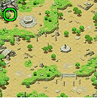

<ul class="notes">
<li><b>Safe Floor (ชั้นพัก)</b>: 1, 7, 13, 19, 25, 31, 37, 43, 49, 55, 61, 67</li>
<li><b>Boss Floor (Chaotic Space)</b>: 12, 24, 36, 48, 60, 72</li>
</ul>

</section>

<section data-c="" data-def-fold="1" id="entry">

<h2>เควสขอบัตรเข้าหอ</h2>

ทำครั้งเดียว เรียงตามลำดับที่ทำจริง

<table><thead><tr><th>เควส</th><th>ที่</th><th>ต้องทำ</th></tr></thead><tbody>
<tr><td class="nm" data-l="เควส">Wandering Photographer Ren - Flyer Picture Request (1)</td><td data-l="ที่">Gate of Caballa Relics 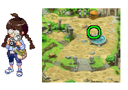</td><td data-l="ต้องทำ">Gold Lens ← ผสมที่ Compounder Paul (Azteca): Optical Glass Crystal + Animal Bone (ขุดใน Relics Fields) + Gold × 5 (ดรอปจาก Mimic ใน Relics Field 2/3/4)</td></tr>
<tr><td class="nm" data-l="เควส">Wandering Photographer Ren - Flyer Picture Request (2)</td><td data-l="ที่">Gate of Caballa Relics</td><td data-l="ต้องทำ">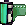Expensive Film × 20 ← ขุดใน Caballa Relics Fields · ได้ 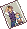Enlarged Brother's Picture</td></tr>
<tr><td class="nm" data-l="เควส">Poirot - Make a Missing Ed Flyer</td><td data-l="ที่">Gate of Caballa Relics 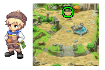</td><td data-l="ต้องทำ">เปลี่ยนอาชีพ 2 แล้ว (Lv 60+) · ส่ง Brother's Pendant (ได้ตอนรับเควส) + Enlarged Brother's Picture</td></tr>
<tr><td class="nm" data-l="เควส">Poirot - Get to the Bottom of the Rumours</td><td data-l="ที่">Gate of Caballa Relics</td><td data-l="ต้องทำ">เดินไป Relics Field 1 - Atlas เข้าประตูหอ แล้วคุยกับ Poirot ที่ชั้น 1</td></tr>
<tr><td class="nm" data-l="เควส">Poirot - Issue the Tower of Chaos Entrance Pass</td><td data-l="ที่">Tower of Chaos ชั้น 1 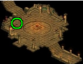</td><td data-l="ต้องทำ">รับไว้ก่อน ต้องใช้ Tower of Chaos Pass จากเควสถัดไป</td></tr>
<tr><td class="nm" data-l="เควส">Developer Project Manager L - Poirot Entrance Promise</td><td data-l="ที่">Tower of Chaos ชั้น 1 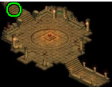</td><td data-l="ต้องทำ">รับไว้ แล้วไปเอา Mercenary Contract จาก Wandering Warrior Tan</td></tr>
<tr><td class="nm" data-l="เควส">Wandering Warrior Tan - Mercenary Contract Stage 1 Test</td><td data-l="ที่">Relics Field 1 - Atlas (หน้าหอ) </td><td data-l="ต้องทำ">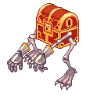ล่า Mimic (Lv 61) × 50 ใน 15 นาที ที่ Relics Field 2/3/4 (เลือกตัวเลือกให้ถูกตอนคุย ไม่งั้นไม่ให้เควส)</td></tr>
<tr><td class="nm" data-l="เควส">Wandering Warrior Tan - Mercenary Contract Stage 2 Test</td><td data-l="ที่">Relics Field 1 - Atlas</td><td data-l="ต้องทำ">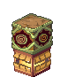ล่า Naranjo (Lv 84) × 30 ใน 15 นาที ที่ Relics Dungeon 3/4</td></tr>
<tr><td class="nm" data-l="เควส">Wandering Warrior Tan - Mercenary Contract Stage 3 Test</td><td data-l="ที่">Relics Field 1 - Atlas</td><td data-l="ต้องทำ">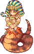ล่า Punisher Aposis (Lv 71) × 2 ใน 15 นาที ที่ Relics Field 1/2/3/4 · ได้ Mercenary Contract</td></tr>
<tr><td class="nm" data-l="เควส">ส่ง Mercenary Contract ให้ Developer Project Manager L</td><td data-l="ที่">Tower of Chaos ชั้น 1</td><td data-l="ต้องทำ">ได้ 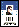Tower of Chaos Pass</td></tr>
<tr><td class="nm" data-l="เควส">ส่ง Tower of Chaos Pass ให้ Poirot</td><td data-l="ที่">Tower of Chaos ชั้น 1</td><td data-l="ต้องทำ">เข้าหอได้ และได้ 2F Survey Notebook · คุยกับ Developer Project Manager L เลือก "ไปชั้น 2" (ฟรี) แล้วเริ่มเควสกับ Wandering Warrior Tan ต่อได้เลย</td></tr>
</tbody></table>

</section>

<section id="tp">

## วาร์ปจากชั้น 1

<b>Developer Project Manager L</b> ไปชั้น 2 ฟรี (หลังได้บัตรเข้าหอ) · <b>Kochi</b> ไปชั้น 7 / 13 / 19 / 25 (700–2,500 Galder) · <b>Pachi</b> ไปชั้น 31 / 37 / 43 (3,100–4,300) · ตั้งแต่ชั้น 43 มี <b>Teleporting Machine</b> ไปชั้น 49 / 55 / 61 / 67 ต้องเดินขึ้นไปลงทะเบียนที่ชั้นนั้นก่อน (เควส Register for Tower of Chaos ...th Floor) ชั้นพักทุกชั้นมี Item Girl, Poirot และ Professor Komby

</section>

<section data-def-fold="1" id="f7up">

## ขึ้นชั้น 7

คุยกับ <b>Don Giuvanni</b> ที่ชั้น 6 เขาจะขอ <b>Mysterious Video CD × 1</b> ซึ่งดรอปจาก <b>Win64 Worm</b> (มีแค่ชั้น 6) เอา CD ไปส่งแล้ว Don จะส่งเราขึ้นชั้น 7 · ถึงแล้วอย่าลืมคุยกับ <b>Kochi</b> ที่ชั้น 7 เพื่อเซฟจุดวาร์ป

ตำแหน่ง Don Giuvanni ที่ชั้น 6 (วงเขียว)

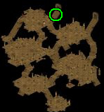

</section>

<section id="limit">

## ปลดล็อคชั้นสูง (เซิฟ PlayTrickster)

เซิฟ PlayTrickster จำกัดการปีนหอ ต้องจบ Key Quest ของเมืองก่อนถึงจะขึ้นชั้นนั้นได้

<table><thead><tr><th>ชั้น</th><th>ปลดล็อคเมื่อ</th></tr></thead><tbody>
<tr><td class="nm" data-l="ชั้น">ชั้น 13</td><td data-l="ปลดล็อคเมื่อ">จบ Key Quest <a href="./key-mermaid-palace">Mermaid Palace</a></td></tr>
<tr><td class="nm" data-l="ชั้น">ชั้น 25</td><td data-l="ปลดล็อคเมื่อ">จบ Key Quest <a href="./key-rose-garden">Rose Garden</a></td></tr>
<tr><td class="nm" data-l="ชั้น">ชั้น 37</td><td data-l="ปลดล็อคเมื่อ">จบ Key Quest <a href="./key-black-swamp">Black Swamp</a></td></tr>
<tr><td class="nm" data-l="ชั้น">ชั้น 49</td><td data-l="ปลดล็อคเมื่อ">จบ Key Quest <a href="./key-snow-hill">Snow Hill</a></td></tr>
<tr><td class="nm" data-l="ชั้น">ชั้น 61</td><td data-l="ปลดล็อคเมื่อ">จบ Key Quest <a href="./key-techichi-volcano">Techichi Volcano</a></td></tr>
<tr><td class="nm" data-l="ชั้น">ชั้น Requiem (73–80)</td><td data-l="ปลดล็อคเมื่อ">จบ Key Quest <a href="./key-tapasco-volcano">Tapasco Volcano</a></td></tr>
</tbody></table>

</section>

<section data-c="" id="floors">

<h2>ชั้นและเลเวลมอน</h2>

เลเวลคือเลเวลมอนปกติในช่วงชั้น ไม่รวมมอนอัญเชิญ

<table><thead><tr><th>ช่วงชั้น</th><th>ชั้นพักก่อนหน้า</th><th>เลเวลมอน</th><th>มอนในช่วงนี้</th></tr></thead><tbody>
<tr><td class="nm" data-l="ช่วงชั้น">ชั้น 2–6</td><td data-l="ชั้นพักก่อนหน้า">ชั้น 1 · ทางเข้า</td><td class="nw" data-l="เลเวลมอน">Lv 102–127</td><td data-l="มอนในช่วงนี้">Corrupt Scarab, Win64 Worm, Chaos Scarab, Corrupt Nephthys, Chaos Nephthys, Corrupt Thief Mole, Chaos Thief Mole, Corrupt Chocho …</td></tr>
<tr><td class="nm" data-l="ช่วงชั้น">ชั้น 8–12</td><td data-l="ชั้นพักก่อนหน้า">ชั้น 7 · วาร์ปจากชั้น 1: Kochi 700</td><td class="nw" data-l="เลเวลมอน">Lv 127–152</td><td data-l="มอนในช่วงนี้">Corrupt Xeper, Chaos Xeper, Corrupt Chimu, Chaos Chimu, Corrupt Isis, Chaos Isis, Corrupt Kerberos, Chaos Kerberos … 12F Chaotic Space: Requiem Grudge Lv 194, Requiem Nephthys (summon) Lv 109, Requiem Chimu (summon) Lv 134, Requiem Isis (summon) Lv 139, Requiem Golden Mole (summon) Lv 149</td></tr>
<tr><td class="nm" data-l="ช่วงชั้น">ชั้น 14–18</td><td data-l="ชั้นพักก่อนหน้า">ชั้น 13 · วาร์ปจากชั้น 1: Kochi 1,300</td><td class="nw" data-l="เลเวลมอน">Lv 152–177</td><td data-l="มอนในช่วงนี้">Corrupt Kheperer, Chaos Kheperer, Corrupt Thiefmon, Chaos Thiefmon, Corrupt Goma, Chaos Goma, Corrupt Niwerth, Chaos Niwerth …</td></tr>
<tr><td class="nm" data-l="ช่วงชั้น">ชั้น 20–24</td><td data-l="ชั้นพักก่อนหน้า">ชั้น 19 · วาร์ปจากชั้น 1: Kochi 1,900</td><td class="nw" data-l="เลเวลมอน">Lv 177–202</td><td data-l="มอนในช่วงนี้">Corrupt Incense Pig, Corrupt Monkya, Chaos Incense Pig, Chaos Monkya, Corrupt Ponchichi, Chaos Ponchichi, Corrupt Chibcha, Chaos Chibcha … 24F Chaotic Space: Requiem Spirit Lv 297, Requiem King Mole (summon) Lv 174, Requiem Incense Pig (summon) Lv 179, Requiem Monkya (summon) Lv 184, Requiem Naranjo (summon) Lv 199</td></tr>
<tr><td class="nm" data-l="ช่วงชั้น">ชั้น 26–30</td><td data-l="ชั้นพักก่อนหน้า">ชั้น 25 · วาร์ปจากชั้น 1: Kochi 2,500</td><td class="nw" data-l="เลเวลมอน">Lv 202–227</td><td data-l="มอนในช่วงนี้">Corrupt Freyr, Chaos Freyr, Corrupt Mimic, Chaos Mimic, Corrupt Stone Soldier, Chaos Stone Soldier, Corrupt Toy Soldier, Chaos Toy Soldier …</td></tr>
<tr><td class="nm" data-l="ช่วงชั้น">ชั้น 32–36</td><td data-l="ชั้นพักก่อนหน้า">ชั้น 31 · วาร์ปจากชั้น 1: Pachi 3,100</td><td class="nw" data-l="เลเวลมอน">Lv 227–252</td><td data-l="มอนในช่วงนี้">Corrupt Bone Fighter, Chaos Bone Fighter, Corrupt Kira, Chaos Kira, Corrupt Werepot, Chaos Werepot, Corrupt Bone Warrior, Chaos Bone Warrior … 36F Chaotic Space: Requiem Body Lv 400, Requiem Stone Soldier (summon) Lv 214, Requiem Bone Fighter (summon) Lv 229, Requiem Kira (summon) Lv 234, Requiem Werepot (summon) Lv 239</td></tr>
<tr><td class="nm" data-l="ช่วงชั้น">ชั้น 38–42</td><td data-l="ชั้นพักก่อนหน้า">ชั้น 37 · วาร์ปจากชั้น 1: Pachi 3,700</td><td class="nw" data-l="เลเวลมอน">Lv 252–282</td><td data-l="มอนในช่วงนี้">Corrupt Cone Stone, Chaos Cone Stone, Corrupt Black Foe, Chaos Black Foe, Corrupt Orpeo, Chaos Orpeo, Corrupt Ancient Werepot, Chaos Ancient Werepot …</td></tr>
<tr><td class="nm" data-l="ช่วงชั้น">ชั้น 44–48</td><td data-l="ชั้นพักก่อนหน้า">ชั้น 43 · วาร์ปจากชั้น 1: Pachi 4,300</td><td class="nw" data-l="เลเวลมอน">Lv 282–312</td><td data-l="มอนในช่วงนี้">Corrupt Ancient Naranjo, Chaos Ancient Naranjo, Corrupt Freaks, Chaos Freaks, Corrupt Orconio, Chaos Orconio, Corrupt Ghost Book, Chaos Ghost Book … 48F Chaotic Space: Requiem Core Lv 503, Requiem Set (summon) Lv 279, Requiem Ghost Book (summon) Lv 299, Requiem Queen Mummy (summon) Lv 309, Requiem Part-Timer Mon (summon) Lv 319</td></tr>
<tr><td class="nm" data-l="ช่วงชั้น">ชั้น 50–54</td><td data-l="ชั้นพักก่อนหน้า">ชั้น 49 · วาร์ปจากชั้น 1: Teleporting Machine</td><td class="nw" data-l="เลเวลมอน">Lv 312–342</td><td data-l="มอนในช่วงนี้">Corrupt Iron Golem, Chaos Iron Golem, Corrupt Part-Timer Mon, Chaos Part-Timer Mon, Corrupt Kili, Chaos Kili, Corrupt Ghost Knight, Chaos Ghost Knight …</td></tr>
<tr><td class="nm" data-l="ช่วงชั้น">ชั้น 56–60</td><td data-l="ชั้นพักก่อนหน้า">ชั้น 55 · วาร์ปจากชั้น 1: Teleporting Machine</td><td class="nw" data-l="เลเวลมอน">Lv 342–377</td><td data-l="มอนในช่วงนี้">Corrupt Ancient Chimu, Chaos Ancient Chimu, Corrupt Decomposing Mummy, Chaos Decomposing Mummy, Corrupt Death Soldier, Chaos Death Soldier, Corrupt Pirate Ghost, Chaos Pirate Ghost … 60F Chaotic Space: Requiem Identity Lv 666, Requiem Ghost Knight (summon) Lv 329, Requiem Ancient Chimu (summon) Lv 344, Requiem Coal Soldier (summon) Lv 364, Requiem Sulaphat (summon) Lv 384</td></tr>
<tr><td class="nm" data-l="ช่วงชั้น">ชั้น 62–66</td><td data-l="ชั้นพักก่อนหน้า">ชั้น 61 · วาร์ปจากชั้น 1: Teleporting Machine</td><td class="nw" data-l="เลเวลมอน">Lv 377–417</td><td data-l="มอนในช่วงนี้">Corrupt Hopeless Woman, Chaos Hopeless Woman, Corrupt Sulaphat, Chaos Sulaphat, Corrupt Fire Golem, Chaos Fire Golem, Corrupt Fish Bone, Chaos Fish Bone …</td></tr>
<tr><td class="nm" data-l="ช่วงชั้น">ชั้น 68–72</td><td data-l="ชั้นพักก่อนหน้า">ชั้น 67 · วาร์ปจากชั้น 1: Teleporting Machine</td><td class="nw" data-l="เลเวลมอน">Lv 407–442</td><td data-l="มอนในช่วงนี้">Corrupt Dekumanus, Chaos Dekumanus, Corrupt Moa Stone, Chaos Moa Stone, Corrupt Cut Throat, Chaos Cut Throat, Corrupt Tanya, Chaos Tanya … 72F Chaotic Space: Outraged Requiem Lv 769, Requiem Moa Stone (summon) Lv 414, Requiem Tanya (summon) Lv 424, Requiem Egg Specter (summon) Lv 434, Requiem Guardian (summon) Lv 444</td></tr>
</tbody></table>

</section>

<section id="dp">

## DP แนะนำสำหรับเก็บเลเวล

เทสจากเซิฟ PlayTrickster เก่า ใช้เป็นแนวทางคร่าวๆ

<table><thead><tr><th>ชั้น</th><th>DP แนะนำ</th></tr></thead><tbody>
<tr><td class="nm" data-l="ชั้น">ชั้น 8 / 9</td><td class="nw" data-l="DP แนะนำ">1,500+</td></tr>
<tr><td class="nm" data-l="ชั้น">ชั้น 12</td><td class="nw" data-l="DP แนะนำ">2,000+</td></tr>
<tr><td class="nm" data-l="ชั้น">ชั้น 18 / 20</td><td class="nw" data-l="DP แนะนำ">2,500+</td></tr>
<tr><td class="nm" data-l="ชั้น">ชั้น 26</td><td class="nw" data-l="DP แนะนำ">3,000+</td></tr>
<tr><td class="nm" data-l="ชั้น">ชั้น 30</td><td class="nw" data-l="DP แนะนำ">3,500+</td></tr>
<tr><td class="nm" data-l="ชั้น">ชั้น 36 / 38</td><td class="nw" data-l="DP แนะนำ">4,000+</td></tr>
<tr><td class="nm" data-l="ชั้น">ชั้น 44</td><td class="nw" data-l="DP แนะนำ">5,000+</td></tr>
<tr><td class="nm" data-l="ชั้น">ชั้น 48</td><td class="nw" data-l="DP แนะนำ">5,500+</td></tr>
<tr><td class="nm" data-l="ชั้น">ชั้น 54 / 56</td><td class="nw" data-l="DP แนะนำ">6,500+</td></tr>
<tr><td class="nm" data-l="ชั้น">ชั้น 62</td><td class="nw" data-l="DP แนะนำ">8,200+</td></tr>
<tr><td class="nm" data-l="ชั้น">ชั้น 72</td><td class="nw" data-l="DP แนะนำ">11,000+</td></tr>
</tbody></table>

</section>

<section id="gear">

## ของสวมใส่จากหอ

มี 3 เกรด เรียงจากต่ำไปสูง: Chaos → Requiem → Altiverse

<ul class="notes">
<li><b>Chaos</b> : สุ่มดรอปจากมอนทุกตัวในหอ หรือเอากระดาษ <b>Code</b> ไปแลกที่ <b>Developer Project Manager L</b> (อยู่ชั้นพัก) · Code ได้จากการส่งลูกแก้ว <b>Chaos Integer Byte</b> ให้ <b>Part-Timer G</b> (อยู่ตามชั้นที่มีมอน) Code:  · Chaos Integer Byte: </li>
<li><b>Requiem</b> : เอาของ Chaos ชิ้นเดียวกัน + <b>Requiem Marble × 1</b> ไปแลกที่ <b>Professor Komby</b> (อยู่ชั้นพัก) ค่าสถานะจะสุ่มใหม่หมด · Requiem Marble สุ่มดรอปจากมอนและบอสในหอ · หรือสุ่มได้จากกล่อง 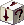<b>Requiem Box</b> (กล่องขาว) ที่บอสชั้น 12 / 24 / 36 / 48 / 60 / 72 ดรอป</li>
<li><b>Altiverse</b> : เปิดกล่อง <b>Altiverse Box</b> (กล่องดำ) การันตีได้ 1 ใน 6 ชิ้น (Helmet, Sword, Staff, Gun, Shield, Necklace) · กล่องดำสุ่มได้จากการเปิด Requiem Box อีกที</li>
</ul>

ตัวอย่างแลก Requiem: <b>Requiem Kalis</b> (Lv 170) = Chaos Kalis (Lv 170) + Requiem Marble · <b>Requiem Defender</b> (Lv 185) = Chaos Defender (Lv 185) + Requiem Marble

</section>

<section id="forge">

## หลอมของ (Forging)

คุยกับ <b>Professor Komby</b> ในหอ ใช้ได้กับของเกรด Chaos / Requiem / Altiverse เท่านั้น เอาของชนิดเดียวกัน 2 ชิ้นมาหลอม ชิ้นแรก (ด้านบน) เป็นตัวหลัก ชิ้นที่สอง (ด้านล่าง) จะหายไป

<ul class="notes">
<li><b>Chaos / Requiem</b>: ค่าไหนชิ้นแรกสูงกว่า ระบบเก็บค่านั้นไว้ไม่สุ่มใหม่ · ค่าไหนชิ้นที่สองสูงกว่า ระบบสุ่มค่านั้นใหม่ในช่วงระหว่างค่าของทั้งสองชิ้น (เช่น ชิ้นแรก MD กับ Comp.Slots สูงกว่า เก็บไว้ ส่วน MA, DA, DP ชิ้นที่สองสูงกว่า สุ่มใหม่)</li>
<li><b>Altiverse</b>: ไม่สุ่ม ระบบเอาค่าที่สูงที่สุดของแต่ละค่าจากทั้งสองชิ้นมารวมกันเลย (เช่น ชิ้นแรก MD, DP, Comp.Slots สูงกว่า ชิ้นที่สอง AC, LK สูงกว่า ได้ค่าสูงสุดทั้งหมด)</li>
<li>โอกาสสำเร็จพื้นฐาน <b>70%</b> ใส่ <b>Willie's Stabilizer</b> (+30%) ให้เป็น <b>100%</b> ซื้อได้ที่ MyShop › Enhance › Modifiers</li>
</ul>

ตัวอย่างหน้าต่างหลอม: Chaos / Requiem (ซ้าย) และ Altiverse (ขวา)

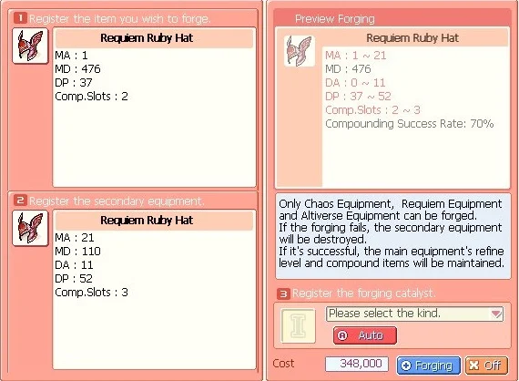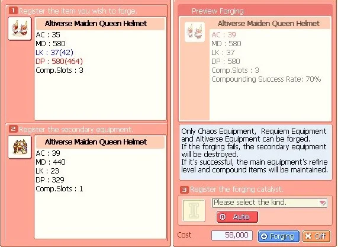

</section>

<section id="rqlist">

## รายชื่อของ Requiem และชั้นที่แลก

แลกกับ Professor Komby ที่ชั้นพักตามตาราง ทุกชิ้นชื่อขึ้นต้นด้วย "Requiem" · ดาบ AP สูง คอมธาตุไม่ได้ · มีด AP ต่ำ DA สูง คอมธาตุดินได้ · คทาสาย MA คอมธาตุไม่ได้ · ปืนสายปืนคอม AC · หมวกสาย AP/AC/HV ตีบวกเพิ่ม DP · หมวกสาย MA/DA ตีบวกเพิ่ม MD · โล่แนะนำหาที่ DP สูงแล้วตีบวกเพิ่ม DP

<table><thead><tr><th>แลกที่</th><th>ดาบ</th><th>มีด</th><th>คทา</th><th>ปืน</th><th>หมวก สาย AP/AC/HV</th><th>หมวก สาย MA/DA</th><th>โล่</th></tr></thead><tbody>
<tr><td class="nm" data-l="แลกที่">ชั้น 1</td><td data-l="ดาบ">Epoch Sword Lv 65 Katana Lv 80</td><td data-l="มีด">Dirk Lv 65 Flat Sword Lv 80</td><td data-l="คทา">Wood Rod Lv 65 Stone Rod Lv 80</td><td data-l="ปืน">Metal Gun Lv 65 Sten Gun Lv 80</td><td data-l="หมวก สาย AP/AC/HV">Basic Cap Lv 65 Iron Cap Lv 80</td><td data-l="หมวก สาย MA/DA">Leather Gear Lv 65 Felt Hood Lv 80</td><td data-l="โล่">Thorn Shield Lv 65 Square Shield Lv 80</td></tr>
<tr><td class="nm" data-l="แลกที่">ชั้น 7</td><td data-l="ดาบ">Dao Lv 95 Sabre Lv 110</td><td data-l="มีด">Kaldo Lv 95 Kukri Lv 110</td><td data-l="คทา">Rune Staff Lv 95 Battle Rod Lv 110</td><td data-l="ปืน">Titan Gun Lv 95 Milli-Gun Lv 110</td><td data-l="หมวก สาย AP/AC/HV">Brim Cap Lv 95 Buckler Cap Lv 110</td><td data-l="หมวก สาย MA/DA">Beret Lv 95 Hunting Cap Lv 110</td><td data-l="โล่">Guardian Shield Lv 95 Knight Shield Lv 110</td></tr>
<tr><td class="nm" data-l="แลกที่">ชั้น 13</td><td data-l="ดาบ">Shotel Lv 125 Long Sword Lv 140</td><td data-l="มีด">Main-Gauche Lv 125 Stiletto Lv 140</td><td data-l="คทา">Silver Rod Lv 125 Gold Rod Lv 140</td><td data-l="ปืน">Blue Seal Gun Lv 125 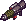Pierce Gun Lv 140</td><td data-l="หมวก สาย AP/AC/HV">Nasal Helm Lv 125 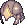Headpiece Lv 140</td><td data-l="หมวก สาย MA/DA">Turban Lv 125 Soft Hat Lv 140</td><td data-l="โล่">Crest Shield Lv 125 Jade Shield Lv 140</td></tr>
<tr><td class="nm" data-l="แลกที่">ชั้น 19</td><td data-l="ดาบ">Talwar Lv 155 Shamshir Lv 170</td><td data-l="มีด">Bundi Dagger Lv 155 Kalis Lv 170</td><td data-l="คทา">Celestial Rod Lv 155 Blue Dragon Rod Lv 170</td><td data-l="ปืน">Blunderbuss Lv 155 Shotgun Lv 170</td><td data-l="หมวก สาย AP/AC/HV">Argent Helm Lv 155 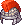Diadem Lv 170</td><td data-l="หมวก สาย MA/DA">Vaquero Hat Lv 155 Witch Hat Lv 170</td><td data-l="โล่">Silver Shield Lv 155 Golden Shield Lv 170</td></tr>
<tr><td class="nm" data-l="แลกที่">ชั้น 25</td><td data-l="ดาบ">Wakizashi Lv 185 Sparta Lv 200</td><td data-l="มีด">Pugio Lv 185 Ring Knife Lv 200</td><td data-l="คทา">Black Dragon Rod Lv 185 Metal Stick Lv 200</td><td data-l="ปืน">Hand Cannon Lv 185 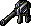Maverick Gun Lv 200</td><td data-l="หมวก สาย AP/AC/HV">Head Bucket Lv 185 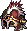Hunter Helm Lv 200</td><td data-l="หมวก สาย MA/DA">Velvet Hat Lv 185 Hunter Hat Lv 200</td><td data-l="โล่">Defender Lv 185 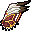Hunter Shield Lv 200</td></tr>
<tr><td class="nm" data-l="แลกที่">ชั้น 31</td><td data-l="ดาบ">Sky Blade Lv 215 Machete Lv 230</td><td data-l="มีด">Poignard Lv 215 Seeker Lv 230</td><td data-l="คทา">Stick Lv 215 Soul Stick Lv 230</td><td data-l="ปืน">Stinger Gun Lv 215 Lucky 7 Lv 230</td><td data-l="หมวก สาย AP/AC/HV">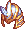Mithril Helm Lv 215 Crystal Helm Lv 230</td><td data-l="หมวก สาย MA/DA">Mithril Hat Lv 215 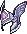Crystal Hat Lv 230</td><td data-l="โล่">Mithril Shield Lv 215 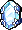Crystal Shield Lv 230</td></tr>
<tr><td class="nm" data-l="แลกที่">ชั้น 37</td><td data-l="ดาบ">Estoc Lv 245 God Sword Lv 260</td><td data-l="มีด">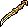Jambiya Lv 245 Bone Dagger Lv 260</td><td data-l="คทา">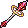Diamond Stick Lv 245 Misty Stick Lv 260</td><td data-l="ปืน">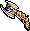Schneider Lv 245 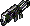J. Colet Lv 260</td><td data-l="หมวก สาย AP/AC/HV">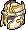Cross Helm Lv 245 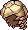Bone Helm Lv 260</td><td data-l="หมวก สาย MA/DA">Cross Hat Lv 245 Tortise Hat Lv 260</td><td data-l="โล่">Cross Shield Lv 245 Tortise Shield Lv 260</td></tr>
<tr><td class="nm" data-l="แลกที่">ชั้น 43</td><td data-l="ดาบ">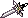Broadsword Lv 275 Ancient Broadsword Lv 290</td><td data-l="มีด">Khanjar Lv 275 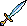Sting Lv 290</td><td data-l="คทา">Arc Stick Lv 275 Luna Stick Lv 290</td><td data-l="ปืน">MJS-G5 Lv 275 Hell Keeper Lv 290</td><td data-l="หมวก สาย AP/AC/HV">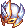Helm of Honor Lv 275 Ruby Helm Lv 290</td><td data-l="หมวก สาย MA/DA">Hat of Honor Lv 275 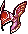Ruby Hat Lv 290</td><td data-l="โล่">Shield of Honor Lv 275 Ruby Shield Lv 290</td></tr>
<tr><td class="nm" data-l="แลกที่">ชั้น 49</td><td data-l="ดาบ">Langschwert Lv 305 Colada Lv 320</td><td data-l="มีด">Jur Lv 305 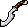Khopesh Lv 320</td><td data-l="คทา">Chrome Staff Lv 305 Holy Staff Lv 320</td><td data-l="ปืน">Striker Lv 305 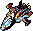Renegade Lv 320</td><td data-l="หมวก สาย AP/AC/HV">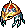Regal Helm Lv 305 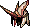Horned Helm Lv 320</td><td data-l="หมวก สาย MA/DA">Regal Hat Lv 305 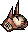Horned Hat Lv 320</td><td data-l="โล่">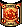Regal Shield Lv 305 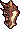Horned Shield Lv 320</td></tr>
<tr><td class="nm" data-l="แลกที่">ชั้น 55</td><td data-l="ดาบ">Rhomphaia Lv 335</td><td data-l="มีด">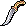Pesh Kabs Lv 335</td><td data-l="คทา">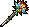Wild Staff Lv 335</td><td data-l="ปืน">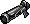Grenade Lv 335</td><td data-l="หมวก สาย AP/AC/HV">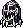Demon Helm Lv 335</td><td data-l="หมวก สาย MA/DA">Demon Hat Lv 335</td><td data-l="โล่">Demon Shield Lv 335</td></tr>
<tr><td class="nm" data-l="แลกที่">ชั้น 61</td><td data-l="ดาบ">Damascus Lv 350</td><td data-l="มีด">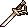Syabel Dagger Lv 350</td><td data-l="คทา">Spirit Staff Lv 350</td><td data-l="ปืน">Slayer Lv 350</td><td data-l="หมวก สาย AP/AC/HV">Flame Helm Lv 350</td><td data-l="หมวก สาย MA/DA">Flame Hat Lv 350</td><td data-l="โล่">Flame Shield Lv 350</td></tr>
</tbody></table>

</section>

<section id="alti">

## ชุด Altiverse

ทุกชุดมี Bonus Set · ดาบ ค้อน และคทา คอมพาวธาตุตามตารางได้

<table><thead><tr><th>ชุด</th><th>ใส่ได้</th><th>คอมธาตุได้</th><th>ได้จาก</th></tr></thead><tbody>
<tr><td class="nm" data-l="ชุด">Altiverse Spiritual 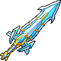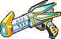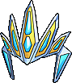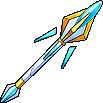</td><td class="nw" data-l="ใส่ได้">Lv 110+</td><td data-l="คอมธาตุได้">น้ำ</td><td data-l="ได้จาก">Altiverse Spiritual Box ← สุ่มจาก Stage 1 Requiem Box (บอสชั้น 12)</td></tr>
<tr><td class="nm" data-l="ชุด">Altiverse Twist </td><td class="nw" data-l="ใส่ได้">Lv 155+</td><td data-l="คอมธาตุได้">ลม</td><td data-l="ได้จาก">Altiverse Twist Box ← สุ่มจาก Stage 2 Requiem Box (บอสชั้น 24)</td></tr>
<tr><td class="nm" data-l="ชุด">Altiverse Flash Bat </td><td class="nw" data-l="ใส่ได้">Lv 200+</td><td data-l="คอมธาตุได้">ดิน</td><td data-l="ได้จาก">Altiverse Flash Bat Box ← สุ่มจาก Stage 3 Requiem Box (บอสชั้น 36)</td></tr>
<tr><td class="nm" data-l="ชุด">Altiverse Thorny Rose </td><td class="nw" data-l="ใส่ได้">Lv 245+</td><td data-l="คอมธาตุได้">มืด</td><td data-l="ได้จาก">Altiverse Thorny Rose Box ← สุ่มจาก Stage 4 Requiem Box (บอสชั้น 48)</td></tr>
<tr><td class="nm" data-l="ชุด">Altiverse Maiden Queen </td><td class="nw" data-l="ใส่ได้">Lv 290+</td><td data-l="คอมธาตุได้">ไฟฟ้า</td><td data-l="ได้จาก">Altiverse Maiden Queen Box ← สุ่มจาก Stage 5 Requiem Box (บอสชั้น 60)</td></tr>
<tr><td class="nm" data-l="ชุด">Altiverse Crimson </td><td class="nw" data-l="ใส่ได้">Lv 335+</td><td data-l="คอมธาตุได้">ไฟ</td><td data-l="ได้จาก">Altiverse Crimson Box ← สุ่มจาก Stage 6 Requiem Box (บอสชั้น 72)</td></tr>
</tbody></table>

</section>

<section id="cards">

## การ์ดสกิลจากหอ

การ์ดสกิลพิเศษของคลาส 3 สุ่มดรอปจากมอนในหอตั้งแต่ชั้น 38 ขึ้นไปเท่านั้น (หลังผ่านบอสชั้น 36)

<table><thead><tr><th>สกิล</th><th>อาชีพ</th><th>TM</th><th>ทำอะไร</th></tr></thead><tbody>
<tr><td class="nm" data-l="สกิล">Chi Release</td><td data-l="อาชีพ">Champion</td><td class="nw" data-l="TM">240</td><td data-l="ทำอะไร">สกิลหมู่หนึ่งเดียวของกระต่ายตรง โจมตีเป้าหมายรอบตัว คิดดาเมจจาก AP</td></tr>
<tr><td class="nm" data-l="สกิล">Chakra Balance</td><td data-l="อาชีพ">Gladiator</td><td class="nw" data-l="TM">240</td><td data-l="ทำอะไร">บัฟฟื้น HP ทุก 2 วินาที นาน 30 วินาที</td></tr>
<tr><td class="nm" data-l="สกิล">Dimensional Rift</td><td data-l="อาชีพ">Soul Master</td><td class="nw" data-l="TM">240</td><td data-l="ทำอะไร">สร้าง Rift ทำดาเมจและดูดศัตรูในระยะ</td></tr>
<tr><td class="nm" data-l="สกิล">Dark Assimilation</td><td data-l="อาชีพ">Dark Lord</td><td class="nw" data-l="TM">240</td><td data-l="ทำอะไร">บัฟเพิ่มธาตุมืด (Dark Attr%) ให้ตัวเอง</td></tr>
<tr><td class="nm" data-l="สกิล">Refreshing Dew</td><td data-l="อาชีพ">Priest</td><td class="nw" data-l="TM">240</td><td data-l="ทำอะไร">บัฟลดคูลดาวน์สกิลให้ตัวเองและปาร์ตี้</td></tr>
<tr><td class="nm" data-l="สกิล">Exploit Weakness</td><td data-l="อาชีพ">Thief Master</td><td class="nw" data-l="TM">240</td><td data-l="ทำอะไร">โจมตีไม่สนพลังป้องกัน ทะลุ Guard, Shield of Heaven, Bunker และ Dark Barrier ได้</td></tr>
<tr><td class="nm" data-l="สกิล">Bunker</td><td data-l="อาชีพ">Scientist</td><td class="nw" data-l="TM">240</td><td data-l="ทำอะไร">สร้าง Bunker ป้องกันตัว ยิงและใช้สกิลได้ แต่เดินไม่ได้ระหว่างอยู่ใน Bunker</td></tr>
<tr><td class="nm" data-l="สกิล">Bunker Release</td><td data-l="อาชีพ">Scientist</td><td class="nw" data-l="TM">240</td><td data-l="ทำอะไร">ออกจาก Bunker</td></tr>
<tr><td class="nm" data-l="สกิล">Beast's Instinct</td><td data-l="อาชีพ">Primadonna</td><td class="nw" data-l="TM">240</td><td data-l="ทำอะไร">เพิ่มค่าสถานะจากบัฟแปลงร่าง Evolution · Base AP จาก ×2.5 เป็น ×6.0</td></tr>
<tr><td class="nm" data-l="สกิล">Four of A Kind</td><td data-l="อาชีพ">Gambler</td><td class="nw" data-l="TM">240</td><td data-l="ทำอะไร">สกิลหมู่ของสายปาไพ่</td></tr>
</tbody></table>

</section>

<section id="req">

## หลังชั้น 72

Poirot มีเควสสำรวจชั้นต่อเนื่อง (Deliver the 2nd Floor Survey Notebook ไปจนถึง 12th Survey Notebook กับ Wandering Warrior Tan) จบแล้วจะเปิด <b>Poirot - Defeat Outraged Requiem</b> ที่ชั้น 72 (บอส Lv 769) จากนั้นทำ <b>Reinvestigate Outraged Requiem</b> ได้ทุกวัน รางวัลคือ Stage 6 Requiem Box

</section>

<footer>สรุปจากวิกิ ggFTW ฉบับ mirror ของ LifeTO <a href="https://wikimirror.lifeto.co/wiki.ggftw.com/trickster/Category_Tower_of_Chaos.html" rel="noopener" target="_blank">Category: Tower of Chaos</a>, <a href="https://wikimirror.lifeto.co/wiki.ggftw.com/trickster/Tower_of_Chaos_Entrance_(1st_Floor).html" rel="noopener" target="_blank">Tower of Chaos Entrance</a> และ <a href="https://docs.google.com/document/d/1yNfcAdWkbV7SCN8_E4MPrZwqH-Yr3y_W5PU0ojEHQM8/mobilebasic" rel="noopener" target="_blank">Chaos Tower Guide/FAQs โดยน้องจอย</a></footer>

<PageBehavior />
