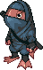
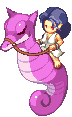
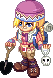
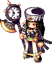

<header style="display:flex;flex-direction:column;gap:8px">

# Abyss

เควสทั้งหมด 28 เควสในโซน Abyss แยกตามประเภท เมืองหลักคือ Abyss Town - Platonia ส่วนใหญ่ต้อง Lv 290+

</header>

<input id="q" placeholder="ค้นชื่อเควส NPC หรือของ" type="search"/>

ประเภท<button type="button" data-t="all">ทั้งหมด</button><button type="button" data-t="town">เควสในเมือง</button><button type="button" data-t="hunt">ล่ามอน</button><button type="button" data-t="daily">รายวัน</button><button type="button" data-t="shadow">Shadow World</button><button type="button" data-t="warp">วาร์ป</button>

<section data-c="" data-qt="town" id="town">

## เควสของคนในเมือง

ทำซ้ำได้ 3–5 รอบ ส่วนใหญ่รอบสุดท้ายให้ Abyss Sticker · ของที่ต้องส่งเกือบทั้งหมดขุดได้ใน Abyss Fields หรือดรอปจากมอนแถวนั้น

<table><thead><tr><th>เควส</th><th>ที่</th><th>ต้องทำ</th><th>รางวัล</th></tr></thead><tbody>
<tr><td class="nm" data-l="เควส">Captain Stan - Black Box of the Santa Noriho Lv 290+ · 5 รอบ EXP 12.6M</td><td data-l="ที่">Abyss Field 3 - The Dark Hills</td><td data-l="ต้องทำ">Black Box JJ-00H × 5 ← ขุดใน Abyss Fields</td><td data-l="รางวัล">Gift of God, Half Pink Potion × 20, Captain Stan Card · รอบ 5: <b>Abyss Sticker</b></td></tr>
<tr><td class="nm" data-l="เควส">Copyfish DomDom - Projection Lesson (1) Lv 290+ · 5 รอบ EXP 12.6M</td><td data-l="ที่">Abyss Field 1 - The Valley Mouth</td><td data-l="ต้องทำ">Blank Scroll ← Krybeth (Lv 400) Waterproof Ink ← Skelefish (Lv 410)</td><td data-l="รางวัล">Half Pink Potion × 20, Gift of God · รอบ 5: Art of Projection (1)</td></tr>
<tr><td class="nm" data-l="เควส">Copyfish DomDom - Projection Lesson (2) Lv 290+ · หลัง Projection Lesson (1) · 5 รอบ EXP 12.6M</td><td data-l="ที่">Abyss Field 1 - The Valley Mouth</td><td data-l="ต้องทำ">Art of Projection (1) ← จากเควสก่อนหน้า Krybeth Tooth × 3 ← Krybeth (Lv 400)</td><td data-l="รางวัล">Half Blue Potion × 20, Gift of God (คืน Art of Projection (1) ทุกรอบ) · รอบ 5: <b>Abyss Sticker</b>, Art of Projection (2)</td></tr>
<tr><td class="nm" data-l="เควส">Dr. Jelly Head - Dr. Jelly Head's Research (1) Lv 290+ · 5 รอบ EXP 12.6M</td><td data-l="ที่">Abyss Town - Platonia</td><td data-l="ต้องทำ">Random Part × 5 ← ขุดใน Abyss Fields</td><td data-l="รางวัล">500 Galder Coupon × 20, Half Pink / Half Blue Potion × 20 · รอบ 5: Dr. Jelly Head Card</td></tr>
<tr><td class="nm" data-l="เควส">Dr. Jelly Head - Dr. Jelly Head's Research (2) Lv 290+ · 5 รอบ EXP 12.6M</td><td data-l="ที่">Abyss Town - Platonia</td><td data-l="ต้องทำ">Random Bearing × 5 ← ขุดใน Abyss Fields</td><td data-l="รางวัล">Half Pink / Half Blue Potion × 20, 500 Galder Coupon × 20 · รอบ 5: <b>Abyss Sticker</b></td></tr>
<tr><td class="nm" data-l="เควส">Granpa Jelly Head - Granpa Jelly Head's Worries Lv 290+ · 3 รอบ EXP 13M</td><td data-l="ที่">Abyss Town - Platonia</td><td data-l="ต้องทำ">Blank Scroll × 5 ← Krybeth (Lv 400) Waterproof Ink × 3 ← Skelefish (Lv 410)</td><td data-l="รางวัล">Half Pink / Half Blue Potion × 20 · รอบ 3: <b>Abyss Sticker</b>, Gift of God</td></tr>
<tr><td class="nm" data-l="เควส">Jill Jelly Head - Potion of Bravery Lv 290+ · 3 รอบ EXP 13M</td><td data-l="ที่">Abyss Town - Platonia</td><td data-l="ต้องทำ">Giant Octopus Leg × 3 + Sea Whale Sinew × 3 ← ขุดใน Abyss Fields</td><td data-l="รางวัล">500 Galder Coupon × 20, Gift of God · รอบ 3: <b>Abyss Sticker</b></td></tr>
<tr><td class="nm" data-l="เควส">Jim Jelly Head - Preparing for Battle Lv 290+ · 5 รอบ EXP 12.6M</td><td data-l="ที่">Abyss Town - Platonia</td><td data-l="ต้องทำ">Sharp Bone × 5 ← Skelefish (Lv 410)</td><td data-l="รางวัล">500 Galder Coupon × 20, Half Pink / Half Blue Potion × 20, Gift of God · รอบ 5: <b>Abyss Sticker</b></td></tr>
<tr><td class="nm" data-l="เควส">Louis Bitton - Fashion Ideas for Jill Jelly Head Lv 290+ · 5 รอบ EXP 12.6M</td><td data-l="ที่">Abyss Field 3 - The Dark Hills</td><td data-l="ต้องทำ">Sea Whale Fluff × 10, Sea Whale Leather × 2, Sea Whale Bone Needle × 1, Sea Whale Sinew × 2 ← ขุดใน Abyss Fields</td><td data-l="รางวัล">Sheer Leather Dress ทุกรอบ (ใช้ส่งเควส Mermaid Babe (2)) · รอบ 4: Louis Bitton Card · รอบ 5: <b>Abyss Sticker</b></td></tr>
<tr><td class="nm" data-l="เควส">Marinel - The Best Kind of Fuel Lv 290+ · 5 รอบ EXP 12.6M</td><td data-l="ที่">Abyss Field 2 - Living Boneyard</td><td data-l="ต้องทำ">Hydelite × 3 ← ขุดใน Abyss Fields</td><td data-l="รางวัล">Half Blue Potion × 20 หรือ 500 Galder Coupon × 20, Gift of God · รอบ 5: <b>Abyss Sticker</b></td></tr>
<tr><td class="nm" data-l="เควส">Mermaid Babe - Mermaid Babe's Ocean Diet (1) Lv 290+ · 5 รอบ EXP 12.6M</td><td data-l="ที่">Abyss Field 2 - Living Boneyard</td><td data-l="ต้องทำ">Golden Concoction ← Phantom Dame (Lv 415)</td><td data-l="รางวัล">Gift of God, Half Pink Potion × 20</td></tr>
<tr><td class="nm" data-l="เควส">Mermaid Babe - Mermaid Babe's Ocean Diet (2) Lv 290+ · หลัง Ocean Diet (1) · 5 รอบ EXP 12.6M</td><td data-l="ที่">Abyss Field 2 - Living Boneyard</td><td data-l="ต้องทำ">Sheer Leather Dress ← จากเควส Louis Bitton</td><td data-l="รางวัล">Half Blue Potion × 20, Gift of God, 500 Galder Coupon × 20 · รอบ 5: <b>Abyss Sticker</b></td></tr>
<tr><td class="nm" data-l="เควส">Sophia - Special Octopus Dish Lv 290+ · 5 รอบ EXP 12.6M</td><td data-l="ที่">Abyss Field 1 - The Valley Mouth</td><td data-l="ต้องทำ">Giant Octopus Leg × 5 ← ขุดใน Abyss Fields Golden Concoction ← Phantom Dame (Lv 415)</td><td data-l="รางวัล">Half Pink Potion × 20, Gift of God, Sophia Card · รอบ 5: <b>Abyss Sticker</b></td></tr>
</tbody></table>

</section>

<section data-c="" data-qt="hunt" id="hunt">

## เควสล่ามอนจำกัดเวลา

รับที่ Gate of Abyss ได้ 10,000 Galder Coupon × 2 ทุกรอบ

<table><thead><tr><th>เควส</th><th>ที่</th><th>ต้องทำ</th><th>รางวัล</th></tr></thead><tbody>
<tr><td class="nm" data-l="เควส">Hunter Yuri - Abyss Hunter Girl Yuri's Quest Lv 290+ · ทำได้ช่วงละ 5 รอบ EXP 6.3–7.2M · TM ~1M</td><td data-l="ที่">Gate of Abyss</td><td data-l="ต้องทำ">ล่าตามช่วงเลเวล: Lv 290–293: Krybeth (Lv 400) × 30 ใน 20 นาที · Field 1 Lv 294–297: Ghost Diver (Lv 405) × 30 ใน 20 นาที · Field 1 Lv 298–301: Skelefish (Lv 410) × 30 ใน 20 นาที · Field 2 Lv 302+: Phantom Dame (Lv 415) × 30 ใน 15 นาที · Field 2</td><td data-l="รางวัล">10,000 Galder Coupon × 2 ต่อรอบ</td></tr>
<tr><td class="nm" data-l="เควส">Assistant Hunter - Abyss Assistant Hunter's Quest Lv 290+ · เคยทำเควส Hunter Yuri อย่างน้อย 1 รอบ · 5 รอบ EXP 4.4M · TM 2.3M</td><td data-l="ที่">Gate of Abyss</td><td data-l="ต้องทำ">ล่า Skelefish King (Lv 427) × 20 ใน 10 นาที · Field 4</td><td data-l="รางวัล">10,000 Galder Coupon × 2 ต่อรอบ</td></tr>
<tr><td class="nm" data-l="เควส">Love Hunter Robin - Abyss Love Hunter Quest Lv 260+ · ทำได้ช่วงละ 5 รอบ TM 3.2–3.4M</td><td data-l="ที่">Gate of Abyss</td><td data-l="ต้องทำ">ล่าตามช่วงเลเวล: Lv 290–294: Krybeth King (Lv 418) × 30 ใน 20 นาที Lv 295+: Phantom Witch (Lv 430) × 30 ใน 20 นาที ทั้งคู่อยู่ Field 3</td><td data-l="รางวัล">10,000 Galder Coupon × 2 ต่อรอบ</td></tr>
</tbody></table>

</section>

<section data-c="" data-qt="daily" id="daily">

## เควสรายวัน

<table><thead><tr><th>เควส</th><th>ที่</th><th>ต้องทำ</th><th>รางวัล</th></tr></thead><tbody>
<tr><td class="nm" data-l="เควส">Madam Sarah - Daily Quest - Abyss Lv 290+ · วันละครั้ง TM 5.7M</td><td data-l="ที่">Abyss Town - Platonia</td><td data-l="ต้องทำ">Random Part × 5 + Random Bearing × 5 ← ขุดใน Abyss Fields</td><td data-l="รางวัล">Daily Coupon, Herb Potion × 15, Gold Pearl Potion × 15, 500 Galder Coupon × 50 · อยู่ในหน้า<a href="./daily-quests">เควสรายวัน</a>ด้วย</td></tr>
<tr><td class="nm" data-l="เควส">Keeper Julio - Julio's Storage Mission 10 Lv 290+ · วันละครั้ง TM 3.7M–44.6M</td><td data-l="ที่">Gate of Abyss</td><td data-l="ต้องทำ">ส่ง Hydelite ← ขุดใน Abyss Fields ยิ่งส่งเยอะยิ่งได้เยอะ: 10 / 20 / 40 / 60 / 80 / 100 ชิ้น</td><td data-l="รางวัล">1,000 Galder Coupon × 1–6 ตามจำนวนที่ส่ง · ส่ง 100 ชิ้นได้ Chaos's Feather 305 เพิ่ม</td></tr>
</tbody></table>

</section>

<section data-c="" data-qt="town" id="series">

## เควสซีรีส์ (มีในหลายเมือง)

เควส Monkey T, ล่าสมบัติของ Explorer Reina และขุดแผนที่ของ Driller King Marky

<table><thead><tr><th>เควส</th><th>ที่</th><th>ต้องทำ</th><th>รางวัล</th></tr></thead><tbody>
<tr><td class="nm" data-l="เควส">Monkey T - Monkey T's Business (7) Lv 290+ · 5 รอบ EXP 12.6M</td><td data-l="ที่">Abyss Field 4 - The Crushing Depths</td><td data-l="ต้องทำ">Fake Eyeball × 10 ← Ghost Diver (Lv 405)</td><td data-l="รางวัล">Half Blue Potion × 20, Gift of God · รอบ 5: <b>Abyss Sticker</b></td></tr>
<tr><td class="nm" data-l="เควส">Monkey T - Monkey T's Business (8) Lv 290+ · หลัง Business (7) · 5 รอบ EXP 12.6M</td><td data-l="ที่">Abyss Field 4 - The Crushing Depths</td><td data-l="ต้องทำ">Sharp Bone × 5 ← Skelefish (Lv 410)</td><td data-l="รางวัล">Half Pink Potion × 20, Gift of God, Monkey T Card · รอบ 5: <b>Abyss Sticker</b></td></tr>
<tr><td class="nm" data-l="เควส">Monkey T - Monkey T's Request (12) Lv 290+ · 25 รอบ TM 3.7M</td><td data-l="ที่">Abyss Field 1 - The Valley Mouth</td><td data-l="ต้องทำ">Eternal Bestial Grass × 10 ← Ghost Diver (Lv 405)</td><td data-l="รางวัล">สุ่ม 50 / 100 / 500 Galder Coupon</td></tr>
<tr><td class="nm" data-l="เควส">Explorer Reina - Treasure Hunting 1 - Abyss Lv 160+ · หลัง Indiana John - Old Man's Dream · ทำซ้ำได้ไม่จำกัด</td><td data-l="ที่">Abyss Town - Platonia</td><td data-l="ต้องทำ">Worn Abyss Map A + Worn Abyss Map B ← ขุดใน Abyss Fields</td><td data-l="รางวัล">Worn Abyss Treasure Map</td></tr>
<tr><td class="nm" data-l="เควส">Explorer Reina - Treasure Hunting 2 - Abyss Lv 160+ · ทำ Treasure Hunting 1 - Abyss ครบ 50 ครั้ง · 1 รอบ EXP 713K · TM 713K</td><td data-l="ที่">Abyss Town - Platonia</td><td data-l="ต้องทำ">Old Abyss Map A + Old Abyss Map B ← ขุดใน Abyss Fields</td><td data-l="รางวัล">Old Abyss Treasure Map</td></tr>
<tr><td class="nm" data-l="เควส">Driller King Marky - Romance of Drilling - Abyss Lv 160+ · หลัง Indiana John - Old Man's Dream · 1 รอบ EXP 713K · TM 713K</td><td data-l="ที่">Gate of Abyss</td><td data-l="ต้องทำ">Weird Abyss Map A + Weird Abyss Map B ← ขุดใน Abyss Fields</td><td data-l="รางวัล">Weird Abyss Treasure Map</td></tr>
</tbody></table>

</section>

<section data-c="" data-qt="shadow" id="shadow">

## เควส Shadow World

ต้อง Lv 345+ และใช้ Mind's Eye เพื่อเข้า Shadow World

<table><thead><tr><th>เควส</th><th>ที่</th><th>ต้องทำ</th><th>รางวัล</th></tr></thead><tbody>
<tr><td class="nm" data-l="เควส">Stella - Shadow Star 12 Lv 345+ · ใช้ Mind's Eye · 1 รอบ EXP 7.4M</td><td data-l="ที่">Abyss Town - Platonia</td><td data-l="ต้องทำ">Sealing Gem × 5 ← Shadow Channa (Lv 621), Shadow Ghost Diver (Lv 627)</td><td data-l="รางวัล">Star Card Pack No.5, Half Pink + Half Blue Potion × 15 หรือ Stella's Defense 3</td></tr>
<tr><td class="nm" data-l="เควส">Eclipse - The Story of the Gods 12 Lv 345+ · ใช้ Mind's Eye · หลัง The Story of the Gods 11 และทำ Shadow Star 12 แล้วอย่างน้อย 1 ครั้ง EXP 22.4M · TM 11.5M</td><td data-l="ที่">Abyss Town - Platonia</td><td data-l="ต้องทำ">Shadow Rust Emerald × 2 + Shadow Azure Topaz × 2 ← มอน Shadow Abyss Field</td><td data-l="รางวัล">10,000 Galder Coupon × 6</td></tr>
<tr><td class="nm" data-l="เควส">Shaman Girl Jia - Dark Spirit Punishment 12 Lv 345+ · ใช้ Mind's Eye EXP 4.2–4.4M · TM ~630K</td><td data-l="ที่">Abyss Town - Platonia</td><td data-l="ต้องทำ">ล่าตามช่วงเลเวล ใน 12 นาที: Lv 345–348: Shadow Krybeth (Lv 624) × 3 · Field 1 / 3 Lv 349+: Shadow Skelefish (Lv 630) × 3 · Field 2</td><td data-l="รางวัล">Half Pink + Half Blue Potion × 10</td></tr>
</tbody></table>

</section>

<section data-c="" data-qt="warp" id="warp">

## วาร์ป

<table><thead><tr><th>เควส</th><th>ที่</th><th>ต้องทำ</th><th>รางวัล</th></tr></thead><tbody>
<tr><td class="nm" data-l="เควส">Kochi - Register Abyss Teleport Service ไม่มีเงื่อนไข EXP 100 · TM 100</td><td data-l="ที่">Gate of Abyss</td><td data-l="ต้องทำ">ลงทะเบียนวาร์ปกับ Kochi</td><td data-l="รางวัล">วาร์ปมา Gate of Abyss ได้</td></tr>
</tbody></table>

</section>

<footer>สรุปจากวิกิ ggFTW ฉบับ mirror ของ LifeTO <a href="https://wikimirror.lifeto.co/wiki.ggftw.com/trickster/Category_Abyss_Quest.html" rel="noopener" target="_blank">Category: Abyss Quest</a> และหน้าเควสที่ลิงก์ไป</footer>

<PageBehavior />
