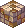

<header style="display:flex;flex-direction:column;gap:8px">

# Alteo Empire

เควสทั้งหมด 54 เควสในโซน Alteo Empire แยกตามประเภท ส่วนใหญ่เป็นเนื้อเรื่อง Episode 6

</header>

<input id="q" placeholder="ค้นชื่อเควส NPC หรือของ" type="search"/>

ประเภท<button type="button" data-t="all">ทั้งหมด</button><button type="button" data-t="story">เนื้อเรื่อง</button><button type="button" data-t="town">เควสในเมือง</button><button type="button" data-t="hunt">ล่ามอน</button>

<nav class="toc"><a href="#story">เควสเนื้อเรื่อง</a><a href="#town">เควสในเมือง</a><a href="#hunt">เควสล่ามอนจำกัดเวลา</a></nav>

<section data-c="" data-qt="story" id="story">

## เควสเนื้อเรื่อง

เควสจากหน้า Episode ที่อยู่ในโซนนี้ เรียงตามลำดับเนื้อเรื่อง กดเลขตอนเพื่อไปอ่านต่อในหน้า Episode

<table><thead><tr><th>เควส</th><th>ที่</th><th>ต้องทำ</th><th>รางวัล</th></tr></thead><tbody>
<tr><td class="nm" data-l="เควส">Officer Albert - Officer Albert's Test <a href="./episode-6#q-e6-2">Episode 6 · 1.2</a> Lv 200+ ผ่านเควส Don Cavalier - Encounter แล้ว</td><td data-l="ที่">Gate of Alteo Empire</td><td data-l="ต้องทำ">ตอบคำถาม 10 ข้อให้ถูกทั้งหมด คำตอบตามลำดับ: Nefertiti, Enkicladus, Poseidon, Nereids, Sword of Vengeance, Trickster, Ra Family, Fate Necklace, 17, Officer Albert</td><td data-l="รางวัล">Secret Contract · EXP 3,790,388 / TM 702,095</td></tr>
<tr><td class="nm" data-l="เควส">Officer Albert - Relics Specialist Researcher <a href="./episode-6#q-e6-3">Episode 6 · 1.3</a></td><td data-l="ที่">Gate of Alteo Empire</td><td data-l="ต้องทำ">Give Secret Contract to Indiana John Secret Contract ได้จากเควส Officer Albert - Officer Albert's Test · Indiana John อยู่ที่ Alteo Empire Field 1 - Secret Garden</td><td data-l="รางวัล">None · EXP 3,790,388 / TM 702,095</td></tr>
<tr><td class="nm" data-l="เควส">Indiana John - Alteo Empire Survey 1 <a href="./episode-6#q-e6-4">Episode 6 · 1.4</a></td><td data-l="ที่">Alteo Empire Field 1 - Secret Garden</td><td data-l="ต้องทำ">Old Slate Piece × 10 Old Slate Piece ขุดได้ที่ Alteo Empire Fields</td><td data-l="รางวัล">10,000 Galder Coupon · EXP 7,580,776 / TM 1,404,191</td></tr>
<tr><td class="nm" data-l="เควส">Indiana John - The Slate's Secret <a href="./episode-6#q-e6-5">Episode 6 · 1.5</a></td><td data-l="ที่">Alteo Empire Field 1 - Secret Garden</td><td data-l="ต้องทำ">Unknown Item Unknown Item คือ Collection of Shiny Pieces ได้จากเควส Explorer Reina - Alteo Empire Survey 3</td><td data-l="รางวัล">Ancient Alteo Slate, Collection of Shiny Pieces · EXP 3,790,388 / TM 702,095</td></tr>
<tr><td class="nm" data-l="เควส">Explorer Reina - Alteo Empire Survey 2 <a href="./episode-6#q-e6-6">Episode 6 · 1.6</a> รับเควส Indiana John - The Slate's Secret ค้างไว้</td><td data-l="ที่">Alteo Empire Field 2 - Time Cascade</td><td data-l="ต้องทำ">Shiny Piece × 10 Shiny Piece ขุดได้ที่ Alteo Empire Fields</td><td data-l="รางวัล">10,000 Galder Coupon · EXP 7,580,776 / TM 1,404,191</td></tr>
<tr><td class="nm" data-l="เควส">Explorer Reina - Alteo Empire Survey 3 <a href="./episode-6#q-e6-7">Episode 6 · 1.7</a></td><td data-l="ที่">Alteo Empire Field 2 - Time Cascade</td><td data-l="ต้องทำ">Water Spirit Stone, Electricity Spirit Stone, Wind Spirit Stone, Earth Spirit Stone Water Spirit Stone ดรอปจาก Water Spirit (Lv 250) · Electricity Spirit Stone ดรอปจาก Electricity Spirit (Lv 250) · Wind Spirit Stone ดรอปจาก Wind Spirit (Lv 250) และ Intermediate Spirit of Wind (Lv 285) · Earth Spirit Stone ดรอปจาก Earth Spirit (Lv 250) และ Intermediate Spirit of Earth (Lv 285)</td><td data-l="รางวัล">Collection of Shiny Pieces · EXP 7,580,776 / TM 1,404,191</td></tr>
<tr><td class="nm" data-l="เควส">Indiana John - The Door of the Hidden Shrine <a href="./episode-6#q-e6-8">Episode 6 · 1.8</a> ผ่านเควส Indiana John - The Slate's Secret แล้ว</td><td data-l="ที่">Alteo Empire Field 1 - Secret Garden</td><td data-l="ต้องทำ">Ancient Alteo Slate, Collection of Shiny Pieces ต้องหา Gate of Hidden Shrine ใน Alteo Empire Field 1 - Secret Garden · อยู่แถวมุมซ้ายบนของแมพ ต้องใช้ Mind's Eye ถึงจะเห็น · ประตูนี้จะวาร์ปไป The Shrine's Secret Passage</td><td data-l="รางวัล">None · EXP 3,790,388 / TM 702,095</td></tr>
<tr><td class="nm" data-l="เควส">Love Hunter Robin - Robin's Memory <a href="./episode-6#q-e6-9">Episode 6 · 1.9</a></td><td data-l="ที่">The Shrine's Secret Passage</td><td data-l="ต้องทำ">The Truth in Memories (A), The Truth in Memories (B) Love Hunter Robin พาเข้า Robin's Memory ได้ · The Truth in Memories (A) ได้จากเควส Enkicladus 2 - Enkicladus in Robin's Memory · The Truth in Memories (B) ได้จากเควส Queen Nefertiti - Nefertiti in Robin's Memory · ได้ The Truth in Memories (A) และ (B) ครบแล้ว ไปคุยกับ Robin Van Peruoza ใน Robin's Memory · เลือก "Help Nefertiti..." เพื่อส่งเควส · Robin Van Peruoza จะวาร์ปไป Gate of Nefertiti Shrine</td><td data-l="รางวัล">10,000 Galder Coupon · EXP 7,580,776 / TM 1,404,191</td></tr>
<tr><td class="nm" data-l="เควส">Enkicladus 2 - Enkicladus in Robin's Memory <a href="./episode-6#q-e6-10">Episode 6 · 1.10</a> รับเควส Love Hunter Robin - Robin's Memory ค้างไว้</td><td data-l="ที่">Robin's Memory</td><td data-l="ต้องทำ">Nefertiti's Heart × 10 Nefertiti's Heart ขุดได้ที่ Robin's Memory</td><td data-l="รางวัล">The Truth in Memories (A) · EXP 7,580,776 / TM 1,404,191</td></tr>
<tr><td class="nm" data-l="เควส">Nefertiti 2 - Nefertiti in Robin's Memory <a href="./episode-6#q-e6-11">Episode 6 · 1.11</a> รับเควส Love Hunter Robin - Robin's Memory ค้างไว้</td><td data-l="ที่">Robin's Memory</td><td data-l="ต้องทำ">Enkicladus' Heart × 10 Enkicladus' Heart ขุดได้ที่ Robin's Memory</td><td data-l="รางวัล">The Truth in Memories (B) · EXP 7,580,776 / TM 1,404,191</td></tr>
<tr><td class="nm" data-l="เควส">King Poppuri - Harkon Guardian Battle <a href="./episode-6#q-e6-12">Episode 6 · 1.12</a> ผ่านเควส Love Hunter Robin - Robin's Memory แล้ว</td><td data-l="ที่">Gate of Nefertiti Shrine</td><td data-l="ต้องทำ">Dark Heart Dark Heart ดรอปจาก Chronos (Lv 720) · รับเควสแล้ว King Poppuri จะวาร์ปไป Nefertiti's Audience Chamber และเริ่มศึก Harkon Guardian Battle</td><td data-l="รางวัล">10,000 Galder Coupon, King Poppuri Card · EXP 7,580,776 / TM 1,404,191</td></tr>
<tr><td class="nm" data-l="เควส">King Poppuri - Nefertiti's Descendant Trickster <a href="./episode-6#q-e6-13">Episode 6 · 1.13</a></td><td data-l="ที่">Gate of Nefertiti Shrine</td><td data-l="ต้องทำ">ไปคุยกับ Spirit of Nefertiti ที่ Space of Light คุยกับรูปปั้น Poseidon's Blessing ใน Nefertiti's Audience Chamber · รูปปั้นจะวาร์ปไป Space of Light</td><td data-l="รางวัล">None · EXP 7,580,776 / TM 1,404,191</td></tr>
<tr><td class="nm" data-l="เควส">Spirit of Nefertiti - Temporary Harkon Sculpture <a href="./episode-6#q-e6-14">Episode 6 · 2.1</a> ผ่านเควส King Poppuri - Nefertiti's Descendant Trickster แล้ว</td><td data-l="ที่">Space of Light</td><td data-l="ต้องทำ">Harkon Crystal × 16 Harkon Crystal ดรอปจาก Harkon Spirit (Lv 250) · ส่งเควสแล้ว Spirit of Nefertiti จะวาร์ปไป Gate of Nefertiti Shrine</td><td data-l="รางวัล">Spirit Infused Harkon · EXP 7,580,776 / TM 1,404,191</td></tr>
<tr><td class="nm" data-l="เควส">Spirit of Nefertiti - Spirit Infused Harkon <a href="./episode-6#q-e6-15">Episode 6 · 2.2</a></td><td data-l="ที่">Space of Light</td><td data-l="ต้องทำ">Give Spirit Infused Harkon to Rosaline Gracia in Tree Sanctuary Spirit Infused Harkon ได้จากเควส Spirit of Nefertiti - Temporary Harkon Sculpture · เข้า Tree Sanctuary ได้โดยคุยกับ Opening in the Sanctuary ใน Alteo Empire Field 3 - Sanctuary Forest</td><td data-l="รางวัล">None · EXP 7,580,776 / TM 1,404,191</td></tr>
<tr><td class="nm" data-l="เควส">King Poppuri - Seal the Shrine <a href="./episode-6#q-e6-16">Episode 6 · 2.3</a> ผ่านเควส Spirit of Nefertiti - Temporary Harkon Sculpture แล้ว</td><td data-l="ที่">Gate of Nefertiti Shrine</td><td data-l="ต้องทำ">Shrine Block (A), Shrine Block (B), Shrine Block (C) Shrine Block (A) ได้จากเควส Artisan Poppuri - Seal the Shrine Mission (1) · Shrine Block (B) ได้จากเควส Poppuri - Seal the Shrine Mission (2) · Shrine Block (C) ได้จากเควส Blue Muffler Poppuri - Seal the Shrine Mission (3)</td><td data-l="รางวัล">10,000 Galder Coupon · EXP 7,580,776 / TM 1,404,191</td></tr>
<tr><td class="nm" data-l="เควส">Artisan Poppuri - Seal the Shrine Mission (1) <a href="./episode-6#q-e6-17">Episode 6 · 2.4</a> รับเควส King Poppuri - Seal the Shrine ค้างไว้</td><td data-l="ที่">Gate of Nefertiti Shrine</td><td data-l="ต้องทำ">Light Spirit Stone × 10 Light Spirit Stone ดรอปจาก Light Spirit (Lv 250)</td><td data-l="รางวัล">Shrine Block (A) · EXP 7,580,776 / TM 1,404,191</td></tr>
<tr><td class="nm" data-l="เควส">Poppuri - Seal the Shrine Mission (2) <a href="./episode-6#q-e6-18">Episode 6 · 2.5</a> รับเควส King Poppuri - Seal the Shrine ค้างไว้</td><td data-l="ที่">Gate of Nefertiti Shrine</td><td data-l="ต้องทำ">Marble Piece × 10 Marble Piece ขุดได้ที่ Gate of Nefertiti Shrine</td><td data-l="รางวัล">Shrine Block (B) · EXP 7,580,776 / TM 1,404,191</td></tr>
<tr><td class="nm" data-l="เควส">Blue Muffler Poppuri - Seal the Shrine Mission (3) <a href="./episode-6#q-e6-19">Episode 6 · 2.6</a> รับเควส King Poppuri - Seal the Shrine ค้างไว้</td><td data-l="ที่">Gate of Nefertiti Shrine</td><td data-l="ต้องทำ">Holy Leaf × 10 Holy Leaf ขุดได้ที่ Gate of Nefertiti Shrine</td><td data-l="รางวัล">Shrine Block (C) · EXP 7,580,776 / TM 1,404,191</td></tr>
<tr><td class="nm" data-l="เควส">King Poppuri - Guardian Robin <a href="./episode-6#q-e6-20">Episode 6 · 2.7</a> ผ่านเควส King Poppuri - Seal the Shrine แล้ว</td><td data-l="ที่">Gate of Nefertiti Shrine</td><td data-l="ต้องทำ">ไปคุยกับ Robin Van Peruoza ที่ The Shrine's Secret Passage รับเควสแล้ว King Poppuri จะวาร์ปไป The Shrine's Secret Passage</td><td data-l="รางวัล">None · EXP 7,580,776 / TM 1,404,191</td></tr>
<tr><td class="nm" data-l="เควส">Robin Van Peruoza - To Be a Guardian <a href="./episode-6#q-e6-21">Episode 6 · 2.8</a></td><td data-l="ที่">The Shrine's Secret Passage</td><td data-l="ต้องทำ">คุยกับ NPC แล้วดูเนื้อเรื่อง รับเควสแล้ว Robin Van Peruoza จะวาร์ปไป Matrix · จบเควสแล้ว Robin Van Peruoza จะวาร์ปไป Alteo Empire Field 1 - Secret Garden</td><td data-l="รางวัล">–</td></tr>
<tr><td class="nm" data-l="เควส">Rosaline Gracia - Preparations to Be One <a href="./episode-6#q-e6-22">Episode 6 · 2.9</a> ผ่านเควส Spirit of Nefertiti - Spirit Infused Harkon แล้ว</td><td data-l="ที่">Tree Sanctuary</td><td data-l="ต้องทำ">Unknown Item Unknown Item คือ Pain in the Butt Daily Pill ได้จากเควส Stargazer Ethel - Inconvenient Request</td><td data-l="รางวัล">Spirit Infused Harkon · EXP 7,580,776 / TM 1,404,191</td></tr>
<tr><td class="nm" data-l="เควส">Stargazer Ethel - Inconvenient Request <a href="./episode-6#q-e6-23">Episode 6 · 2.10</a> รับเควส Rosaline Gracia - Preparations to Be One ค้างไว้</td><td data-l="ที่">Alteo Empire Field 3 - Sanctuary Forest</td><td data-l="ต้องทำ">Wind Spirit Stone × 10, Water Spirit Stone × 10, Earth Spirit Stone × 10, Star Dust Wind Spirit Stone ดรอปจาก Wind Spirit (Lv 250) และ Intermediate Spirit of Wind (Lv 285) · Water Spirit Stone ดรอปจาก Water Spirit (Lv 250) · Earth Spirit Stone ดรอปจาก Earth Spirit (Lv 250) และ Intermediate Spirit of Earth (Lv 285) · Star Dust ได้จากเควส Grandpa T - Honest Grandpa T</td><td data-l="รางวัล">Pain in the Butt Daily Pill · EXP 7,580,776 / TM 1,404,191</td></tr>
<tr><td class="nm" data-l="เควส">Grandpa T - Honest Grandpa T <a href="./episode-6#q-e6-24">Episode 6 · 2.11</a> รับเควส Stargazer Ethel - Inconvenient Request ค้างไว้</td><td data-l="ที่">Alteo Empire Field 2 - Time Cascade</td><td data-l="ต้องทำ">Ancient Nutritious Mushroom × 20 Ancient Nutritious Mushroom ขุดได้ที่ Alteo Empire Fields</td><td data-l="รางวัล">Star Dust, Grandpa T Card · EXP 7,580,776 / TM 1,404,191</td></tr>
<tr><td class="nm" data-l="เควส">Rosaline Gracia - Unite as One <a href="./episode-6#q-e6-25">Episode 6 · 2.12</a> ผ่านเควส Rosaline Gracia - Preparations to Be One แล้ว</td><td data-l="ที่">Tree Sanctuary</td><td data-l="ต้องทำ">Spirit Infused Harkon Spirit Infused Harkon ได้จากเควส Rosaline Gracia - Preparations to Be One · Rosaline Gracia จะรวมร่างกับ Spirit of Nefertiti กลายเป็น Transformed Rosaline · คุยกับ Transformed Rosaline เพื่อส่งเควส</td><td data-l="รางวัล">10,000 Galder Coupon · EXP 7,580,776 / TM 1,404,191</td></tr>
<tr><td class="nm" data-l="เควส">Transformed Rosaline - Metamorphosed Rosaline's Request <a href="./episode-6#q-e6-26">Episode 6 · 3.1</a> ผ่านเควส Rosaline Gracia - Unite as One แล้ว</td><td data-l="ที่">Tree Sanctuary</td><td data-l="ต้องทำ">Special Teleporting Device Special Teleporting Device ได้จากเควส Willie - Make a Special Transporting Device</td><td data-l="รางวัล">Special Teleporting Device, Temporary Harkon Sculpture, Resurrection Marble × 2 · EXP 7,580,776 / TM 1,404,191</td></tr>
<tr><td class="nm" data-l="เควส">Willie - Make a Special Transporting Device <a href="./episode-6#q-e6-27">Episode 6 · 3.2</a> รับเควส Rosaline - Metamorphosed Rosaline's Request ค้างไว้</td><td data-l="ที่">Gate of Alteo Empire</td><td data-l="ต้องทำ">Teleporting Device (Alteo) × 10, Electricity Spirit Stone × 15, Homunculus' Debris × 15 Teleporting Device (Alteo) ซื้อจาก Item Boy Thomas ชิ้นละ 15,000 Galder · Electricity Spirit Stone ดรอปจาก Electricity Spirit (Lv 250) · Homunculus' Debris ขุดได้ที่ Alteo Empire Fields</td><td data-l="รางวัล">Special Teleporting Device · EXP 7,580,776 / TM 1,404,191</td></tr>
<tr><td class="nm" data-l="เควส">Don Giuvanni - An Apology <a href="./episode-6#q-e6-30">Episode 6 · 3.5</a></td><td data-l="ที่">Matrix</td><td data-l="ต้องทำ">ไปคุยกับ Don Danihen</td><td data-l="รางวัล">Broken Sword of Vengeance (A) · EXP 7,580,776 / TM 1,404,191</td></tr>
<tr><td class="nm" data-l="เควส">Transformed Don Danihen - Song of Destiny <a href="./episode-6#q-e6-31">Episode 6 · 3.6</a> รับเควส Don Giuvanni - An Apology ค้างไว้</td><td data-l="ที่">Matrix</td><td data-l="ต้องทำ">Janus' Feather Janus' Feather ดรอปจาก Janus (Lv 410) · ต้องใช้ Mind's Eye ถึงจะเห็น Janus · Janus จะเรียก Nereides ออกมาช่วย</td><td data-l="รางวัล">Broken Sword of Vengeance (B), Janus' Feather, Transformed Don Danihen Card · EXP 15,161,552 / TM 2,808,382</td></tr>
<tr><td class="nm" data-l="เควส">Transformed Rosaline - Birth of a True Trickster <a href="./episode-6#q-e6-32">Episode 6 · 3.7</a> ผ่านเควส Don Giuvanni - An Apology แล้ว</td><td data-l="ที่">Matrix</td><td data-l="ต้องทำ">ไปคุยกับ Transformed Rosaline ส่งเควสนี้แล้วจะขึ้นเครดิตปิดเกม Trickster Online · จากนั้นจะวาร์ปไป Gate of Alteo Empire</td><td data-l="รางวัล">Harkon Crystal Dust, Token of a True Trickster, Rosaline's Music Sheet, Transformed Rosaline Card · EXP 37,903,880 / TM 7,020,957</td></tr>
<tr><td class="nm" data-l="เควส">Madam Sarah - Sarah's Concerns <a href="./episode-6#q-e6-33">Episode 6 · 4.1</a> ผ่านเควส Transformed Rosaline - Birth of a True Trickster แล้ว</td><td data-l="ที่">Gate of Alteo Empire</td><td data-l="ต้องทำ">Unknown Item Unknown Item คือ Jade Ring ได้จากเควส Pastor Tau - Tau and Chagan</td><td data-l="รางวัล">Madam Sarah Card, 10,000 Galder Coupon × 10 · EXP 6,064,620 / TM 1,123,353</td></tr>
<tr><td class="nm" data-l="เควส">King Poppuri - Holy Preparations? <a href="./episode-6#q-e6-34">Episode 6 · 4.2</a> รับเควส Madam Sarah - Sarah's Concerns ค้างไว้</td><td data-l="ที่">Gate of Nefertiti Shrine</td><td data-l="ต้องทำ">Poppuri Incense Burner, Poppuri Incense, Poppuri Snack Set Poppuri Incense Burner ได้จากเควส Poppuri - Make a Holy Incense Burner · Poppuri Incense ได้จากเควส Artisan Poppuri - Make Holy Incense · Poppuri Snack Set ได้จากเควส Blue Muffler Poppuri - Make Holy Snacks</td><td data-l="รางวัล">Transfer to Chagan's Heart (Purification) · EXP 6,064,620 / TM 1,123,353</td></tr>
<tr><td class="nm" data-l="เควส">Poppuri - Make a Holy Incense Burner <a href="./episode-6#q-e6-35">Episode 6 · 4.3</a> รับเควส King Poppuri - Holy Preparations ค้างไว้</td><td data-l="ที่">Gate of Nefertiti Shrine</td><td data-l="ต้องทำ">Strong Tooth × 10 Strong Tooth ดรอปจาก Intermediate Spirit of Earth (Lv 285)</td><td data-l="รางวัล">Poppuri Incense Burner · EXP 6,064,620 / TM 1,123,353</td></tr>
<tr><td class="nm" data-l="เควส">Artisan Poppuri - Make Holy Incense <a href="./episode-6#q-e6-36">Episode 6 · 4.4</a> รับเควส King Poppuri - Holy Preparations ค้างไว้</td><td data-l="ที่">Gate of Nefertiti Shrine</td><td data-l="ต้องทำ">Wind Feather × 10 Wind Feather ดรอปจาก Intermediate Spirit of Wind (Lv 285)</td><td data-l="รางวัล">Poppuri Incense · EXP 6,064,620 / TM 1,123,353</td></tr>
<tr><td class="nm" data-l="เควส">Blue Muffler Poppuri - Make Holy Snacks <a href="./episode-6#q-e6-37">Episode 6 · 4.5</a> รับเควส King Poppuri - Holy Preparations ค้างไว้</td><td data-l="ที่">Gate of Nefertiti Shrine</td><td data-l="ต้องทำ">Red Flower Cotton Candy × 15, Blue Flower Cotton Candy × 15 Red Flower Cotton Candy และ Blue Flower Cotton Candy ขุดได้ที่ Alteo Empire Fields</td><td data-l="รางวัล">Poppuri Snack Set · EXP 6,064,620 / TM 1,123,353</td></tr>
<tr><td class="nm" data-l="เควส">Pastor Tau - Chagan's Heart <a href="./episode-6#q-e6-38">Episode 6 · 4.6</a> ผ่านเควส King Poppuri - Holy Preparations แล้ว</td><td data-l="ที่">Chagan's Heart (Purification)</td><td data-l="ต้องทำ">คุ้มกัน Young Pastor Tau ระหว่างที่เขาเดิน Pastor Tau จะวาร์ปไป Chagan's Heart (Confusion) · คุ้มกัน Young Pastor Tau จาก Corroded Cognition (Lv 270) ระหว่างที่เขาเดินผ่านแมพ · เดินจบทางแล้วจะกลับมาที่ Chagan's Heart (Purification) · คุยกับ Pastor Tau อีกครั้งเพื่อส่งเควส</td><td data-l="รางวัล">None · EXP 6,064,620 / TM 1,123,353</td></tr>
<tr><td class="nm" data-l="เควส">Pastor Tau - Tau and Chagan <a href="./episode-6#q-e6-39">Episode 6 · 4.7</a></td><td data-l="ที่">Chagan's Heart (Purification)</td><td data-l="ต้องทำ">คุยกับ NPC แล้วดูเนื้อเรื่อง Pastor Tau จะวาร์ปไป Deep Within Chagan's Heart · จบเควสแล้ว Pastor Tau จะวาร์ปกลับ Gate of Alteo Empire</td><td data-l="รางวัล">–</td></tr>
<tr><td class="nm" data-l="เควส">Happisto Stallone - Nefertiti's Crown <a href="./episode-6#q-e6-40">Episode 6 · โบนัส 1</a> ผ่านเควส Transformed Rosaline - Birth of a True Trickster แล้ว</td><td data-l="ที่">Gate of Alteo Empire</td><td data-l="ต้องทำ">Broken Sword of Vengeance (A), Broken Sword of Vengeance (B), Homunculus' Debris × 10 Broken Sword of Vengeance (A) ได้จากเควส Don Giuvanni - An Apology · Broken Sword of Vengeance (B) ได้จากเควส Don Danihen 2 - Song of Destiny · Homunculus' Debris ขุดได้ที่ Alteo Empire Fields</td><td data-l="รางวัล">Trickster's Crown, H. Stallone Card · EXP 3,790,388 / TM 702,095</td></tr>
<tr><td class="nm" data-l="เควส">Louis Bitton - Trickster Cloak <a href="./episode-6#q-e6-41">Episode 6 · โบนัส 2</a> ผ่านเควส Transformed Rosaline - Birth of a True Trickster แล้ว</td><td data-l="ที่">Gate of Alteo Empire</td><td data-l="ต้องทำ">Harkon Crystal Dust, Tattered Silk Piece × 10 Harkon Crystal Dust ได้จากเควส Rosaline - Birth of a True Trickster · Tattered Silk Piece ขุดได้ที่ Alteo Empire Fields</td><td data-l="รางวัล">Trickster's Cloak, Louis Bitton Card · EXP 3,790,388 / TM 702,095</td></tr>
<tr><td class="nm" data-l="เควส">Bard La Fimmel - Song About Love and Destiny <a href="./episode-6#q-e6-42">Episode 6 · โบนัส 3</a> ผ่านเควส Transformed Rosaline - Birth of a True Trickster แล้ว</td><td data-l="ที่">Gate of Alteo Empire</td><td data-l="ต้องทำ">Rosaline's Music Sheet, Clear Spring Water × 10 Rosaline's Music Sheet ได้จากเควส Rosaline - Birth of a True Trickster · Clear Spring Water ดรอปจาก Water Spirit (Lv 250)</td><td data-l="รางวัล">Love Song, La Fimmel Card · EXP 3,790,388 / TM 702,095</td></tr>
</tbody></table>

</section>

<section data-c="" data-qt="town" id="town">

## เควสในเมือง

<table><thead><tr><th>เควส</th><th>ที่</th><th>ต้องทำ</th><th>รางวัล</th></tr></thead><tbody>
<tr><td class="nm" data-l="เควส">Grandpa T - Grandpa T's Request (13) Lv 200+ 25 รอบ TM 2,089,570</td><td data-l="ที่">Alteo Empire Field 2 - Time Cascade</td><td data-l="ต้องทำ">Ancient Elixir × 10 Ancient Elixir ← Wind Spirit (Lv 250), Earth Spirit (Lv 250), Water Spirit (Lv 250), Electricity Spirit (Lv 250), Intermediate Spirit of Wind (Lv 285), และ Intermediate Spirit of Earth (Lv 285)</td><td data-l="รางวัล">10,000 Galder Coupon</td></tr>
<tr><td class="nm" data-l="เควส">Keeper Rachel - Chatterbox Albert's Crush Lv 200+ 5 รอบ EXP 5,710,964</td><td data-l="ที่">Gate of Alteo Empire</td><td data-l="ต้องทำ">Dearly Beloved Dearly Beloved ← ขุดใน Alteo Empire Fields</td><td data-l="รางวัล">รอบ 1~4: 2,000 Galder Coupon · รอบ 5: 2,000 Galder Coupon × 5, Keeper Rachel Card</td></tr>
<tr><td class="nm" data-l="เควส">Keeper Rachel - How to Look Good Lv 200+ 5 รอบ EXP 5,710,964</td><td data-l="ที่">Gate of Alteo Empire</td><td data-l="ต้องทำ">Sparkly Blush × 5 Sparkly Blush ← Electricity Spirit (Lv 250)</td><td data-l="รางวัล">รอบ 1~4: 2,000 Galder Coupon · รอบ 5: 2,000 Galder Coupon × 5</td></tr>
<tr><td class="nm" data-l="เควส">Keeper Rachel - Nice? Rachel Lv 200+ · มีเควส Willie - Find the Unfriendly Employee ค้างอยู่ 5 รอบ EXP 6,853,156</td><td data-l="ที่">Gate of Alteo Empire</td><td data-l="ต้องทำ">Rachel's Picture × 10, Glue Stick × 5 Rachel's Picture และ Glue Stick ← ขุดใน Alteo Empire Fields</td><td data-l="รางวัล">รอบ 1~4: 2,000 Galder Coupon · รอบ 5: 2,000 Galder Coupon × 5, Rachel's Resume</td></tr>
<tr><td class="nm" data-l="เควส">Officer Albert - A Day in the Life As a Chatterbox Lv 200+ 5 รอบ EXP 5,710,964</td><td data-l="ที่">Gate of Alteo Empire</td><td data-l="ต้องทำ">Mint Ice Cream Cone × 5 Mint Ice Cream Cone ← Water Spirit (Lv 250)</td><td data-l="รางวัล">รอบ 1~4: 2,000 Galder Coupon · รอบ 5: 2,000 Galder Coupon × 5, Albert's Resume</td></tr>
<tr><td class="nm" data-l="เควส">Officer Albert - Stop Talking Behind My Back! Lv 200+ 5 รอบ EXP 5,710,964</td><td data-l="ที่">Gate of Alteo Empire</td><td data-l="ต้องทำ">Chewy Macaron × 10 Chewy Macaron ← Earth Spirit (Lv 250) และ Wind Spirit (Lv 250)</td><td data-l="รางวัล">รอบ 1~4: 2,000 Galder Coupon · รอบ 5: 2,000 Galder Coupon × 5, Albert Card</td></tr>
<tr><td class="nm" data-l="เควส">Star Gazer Stella - A Note From a Fool Lv 200+ · หลัง Stargazer Ethel - Don't Bother Me 1 รอบ EXP 6,091,695</td><td data-l="ที่">Gate of Alteo Empire</td><td data-l="ต้องทำ">ส่ง To a Fool ให้ Stargazer Ethel To a Fool ← ได้จากเควส Stargazer Ethel - Don't Bother Me</td><td data-l="รางวัล">10,000 Galder Coupon</td></tr>
<tr><td class="nm" data-l="เควส">Star Gazer Stella - Family Attraction Lv 200+ 1 รอบ EXP 6,091,695</td><td data-l="ที่">Gate of Alteo Empire</td><td data-l="ต้องทำ">To a Gloomy Kid To a Gloomy Kid ← ได้จากเควส Stargazer Ethel - Bend over backwards For You?</td><td data-l="รางวัล">รอบ 1: 2,000 Galder Coupon · รอบ 5: Stella's Trash Bin, Stargazer Stella Card</td></tr>
<tr><td class="nm" data-l="เควส">Stargazer Ethel - Bend over backwards For You? Lv 200+ · หลัง Star Gazer Stella - A Note From a Fool 5 รอบ EXP 5,710,964</td><td data-l="ที่">Alteo Empire Field 3 - Sanctuary Forest</td><td data-l="ต้องทำ">Fairy Dust × 5 Fairy Dust ← Intermediate Spirit of Wind (Lv 285)</td><td data-l="รางวัล">รอบ 1~4: 10,000 Galder Coupon · รอบ 5: To a Gloomy Kid, Stargazer Ethel Card</td></tr>
<tr><td class="nm" data-l="เควส">Stargazer Ethel - Don't Bother Me Lv 200+ · หลัง Stargazer Ethel - You Look Familiar 1 รอบ EXP 6,091,695</td><td data-l="ที่">Alteo Empire Field 3 - Sanctuary Forest</td><td data-l="ต้องทำ">ส่ง Star Card Pack No.6 and Star Card Pack No.7 ให้ Star Gazer Stella Star Card Pack No.6 และ Star Card Pack No.7 ← ได้จากเควส Stargazer Ethel - You Look Familiar</td><td data-l="รางวัล">To a Fool</td></tr>
<tr><td class="nm" data-l="เควส">Stargazer Ethel - You Look Familiar Lv 200+ · มีเควส Star Gazer Stella - Family Attraction ค้างอยู่ 5 รอบ EXP 5,710,964</td><td data-l="ที่">Alteo Empire Field 3 - Sanctuary Forest</td><td data-l="ต้องทำ">Star Card Pack No.6, Star Card Pack No.7 Star Card Pack No.6 และ Star Card Pack No.7 ← Alteo Empire Monsters</td><td data-l="รางวัล">รอบ 1~4: 10,000 Galder Coupon · รอบ 5: Star Card Pack No.6, Star Card Pack No.7</td></tr>
<tr><td class="nm" data-l="เควส">Willie - Find the Unfriendly Employee Lv 200+ 1 รอบ EXP 4,873,356</td><td data-l="ที่">Gate of Alteo Empire</td><td data-l="ต้องทำ">Rachel's Resume Rachel's Resume ← ได้จากเควส Keeper Rachel - Nice? Rachel</td><td data-l="รางวัล">Ariel Card, 2,000 Galder Coupon × 3</td></tr>
<tr><td class="nm" data-l="เควส">Willie - Spy on the Strange Officer Lv 200+ · หลัง Willie - Find the Unfriendly Employee 1 รอบ EXP 4,873,356</td><td data-l="ที่">Gate of Alteo Empire</td><td data-l="ต้องทำ">Albert's Resume Albert's Resume ← ได้จากเควส Officer Albert - A Day in the Life As a Chatterbox</td><td data-l="รางวัล">2,000 Galder Coupon × 5</td></tr>
</tbody></table>

</section>

<section data-c="" data-qt="hunt" id="hunt">

## เควสล่ามอนจำกัดเวลา

<table><thead><tr><th>เควส</th><th>ที่</th><th>ต้องทำ</th><th>รางวัล</th></tr></thead><tbody>
<tr><td class="nm" data-l="เควส">Officer Albert - Monsters Scare Me Lv 200+ ช่วงละ 5 รอบ</td><td data-l="ที่">Gate of Alteo Empire</td><td data-l="ต้องทำ">Lv 200+: ล่า Wind Spirit (Lv 250) × 30 ใน 10 นาที→ 2,000 Galder Coupon × 5 Wind Spirit อยู่ที่ Alteo Empire Field 1 - Secret Garden, Alteo Empire Field 2 - Time Cascade, Alteo Empire Field 3 - Sanctuary Forest</td><td data-l="รางวัล">ตามช่วงเลเวล (ดูช่องต้องทำ)</td></tr>
<tr><td class="nm" data-l="เควส">Willie - Cocky Kids Lv 200+ ช่วงละ 5 รอบ</td><td data-l="ที่">Gate of Alteo Empire</td><td data-l="ต้องทำ">Lv 200+: ล่า Intermediate Spirit of Earth (Lv 285) × 30 ใน 10 นาที→ 2,000 Galder Coupon × 5 Intermediate Spirit of Earth อยู่ที่ Alteo Empire Field 3 - Sanctuary Forest</td><td data-l="รางวัล">ตามช่วงเลเวล (ดูช่องต้องทำ)</td></tr>
</tbody></table>

</section>

<footer>สรุปจากวิกิ ggFTW ฉบับ mirror ของ LifeTO <a href="https://wikimirror.lifeto.co/wiki.ggftw.com/trickster/Category_Alteo_Empire_Quest.html" rel="noopener" target="_blank">Category: Alteo Empire Quest</a> และหน้าเควสที่ลิงก์ไป · เควสเนื้อเรื่องมาจากหน้า Episode</footer>

<PageBehavior />
