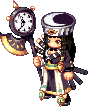

<header style="display:flex;flex-direction:column;gap:8px">

# Coral Beach

เควสทั้งหมด 22 เควสในโซน Coral Beach แยกตามประเภท โซนเริ่มต้นของเกม

</header>

<input id="q" placeholder="ค้นชื่อเควส NPC หรือของ" type="search"/>

ประเภท<button type="button" data-t="all">ทั้งหมด</button><button type="button" data-t="story">เนื้อเรื่อง</button><button type="button" data-t="town">เควสในเมือง</button><button type="button" data-t="hunt">ล่ามอน</button><button type="button" data-t="daily">รายวัน</button><button type="button" data-t="shadow">Shadow World</button><button type="button" data-t="warp">วาร์ป</button>

<nav class="toc"><a href="#story">เควสเนื้อเรื่อง</a><a href="#town">เควสในเมือง</a><a href="#hunt">เควสล่ามอนจำกัดเวลา</a><a href="#daily">เควสรายวัน / ทำซ้ำรายวัน</a><a href="#shadow">เควส Shadow World</a><a href="#warp">วาร์ป</a></nav>

<section data-c="" data-qt="story" id="story">

## เควสเนื้อเรื่อง

เควสจากหน้า Episode ที่อยู่ในโซนนี้ เรียงตามลำดับเนื้อเรื่อง กดเลขตอนเพื่อไปอ่านต่อในหน้า Episode

<table><thead><tr><th>เควส</th><th>ที่</th><th>ต้องทำ</th><th>รางวัล</th></tr></thead><tbody>
<tr><td class="nm" data-l="เควส">Heidi - Trickster Registration <a href="./episode-0#q-e0-1">Episode 0 · 1.1</a> Lv 1+ มี Registration Form</td><td data-l="ที่">Coral Town - Blooming Cora</td><td data-l="ต้องทำ">ไปคุยกับ Bunny Maid Registration Form ได้จากการคุยกับ Heidi</td><td data-l="รางวัล">Rookie Sword, Rookie Hat, Rookie Shield · EXP 256 / TM 256</td></tr>
<tr><td class="nm" data-l="เควส">Bunny Maid - Prove Your Spirit! <a href="./episode-0#q-e0-2">Episode 0 · 1.2</a> Lv 1+</td><td data-l="ที่">Coral Town - Blooming Cora</td><td data-l="ต้องทำ">Baby Carrot × 2 Baby Carrot ดรอปจาก Torobbie (Lv 1)</td><td data-l="รางวัล">Level Up Guide, 2,000 Galder · EXP 1,374 / TM 1,374</td></tr>
<tr><td class="nm" data-l="เควส">Bunny Maid - Helping Others <a href="./episode-0#q-e0-3">Episode 0 · 1.3</a> Lv 1+</td><td data-l="ที่">Coral Town - Blooming Cora</td><td data-l="ต้องทำ">ไปคุยกับ Winnie</td><td data-l="รางวัล">Young Egg, 2,000 Galder · EXP 2,739 / TM 2,739</td></tr>
<tr><td class="nm" data-l="เควส">Winnie - Winnie's Request <a href="./episode-0#q-e0-4">Episode 0 · 1.4</a> Lv 1+</td><td data-l="ที่">Coral Town - Blooming Cora</td><td data-l="ต้องทำ">ไปคุยกับ Lifeguard Dean Lifeguard Deen อยู่ที่ Coral Beach Field 1 หน้าอาคาร Lifeguard</td><td data-l="รางวัล">Lucky Pink Potion × 10, Lucky Blue Potion × 10, Recovery Guide · EXP 3,735 / TM 3,735</td></tr>
<tr><td class="nm" data-l="เควส">Lifeguard Deen - Deen's Request - 1 <a href="./episode-0#q-e0-5">Episode 0 · 1.5</a> Lv 1+</td><td data-l="ที่">Coral Beach Field 1 - Blue Wave</td><td data-l="ต้องทำ">ล่า Tottochi (Lv 2) ให้ได้ 5 ตัวภายใน 10 นาที</td><td data-l="รางวัล">500 Galder Coupon × 5 · EXP 3,735 / TM 3,735</td></tr>
<tr><td class="nm" data-l="เควส">Lifeguard Deen - Deen's Request - 2 <a href="./episode-0#q-e0-6">Episode 0 · 1.6</a> Lv 1+ ผ่านเควส Lifeguard Dean - Deen's Request - 1 แล้ว</td><td data-l="ที่">Coral Beach Field 1 - Blue Wave</td><td data-l="ต้องทำ">ไปคุยกับ Tinnie Tinnie อยู่ที่ Coral Beach Field 2 ข้างสนามวอลเลย์บอลชายหาด</td><td data-l="รางวัล">Lucky Pink Potion × 10, Lucky Blue Potion × 10, 2,000 Galder · EXP 4,970 / TM 4,970</td></tr>
<tr><td class="nm" data-l="เควส">Tinnie - Tinnie's Request - 1 <a href="./episode-0#q-e0-7">Episode 0 · 1.7</a> Lv 1+ ผ่านเควส Lifeguard Dean - Deen's Request - 2 แล้ว</td><td data-l="ที่">Coral Beach Field 2 - Passionate Sun</td><td data-l="ต้องทำ">ล่า Bad Fury (Lv 4) ให้ได้ 5 ตัวภายใน 10 นาที</td><td data-l="รางวัล">500 Galder Coupon × 5 · EXP 4,970 / TM 4,970</td></tr>
<tr><td class="nm" data-l="เควส">Tinnie - Tinnie's Request - 2 <a href="./episode-0#q-e0-8">Episode 0 · 1.8</a> Lv 1+</td><td data-l="ที่">Coral Beach Field 2 - Passionate Sun</td><td data-l="ต้องทำ">ไปคุยกับ Lifeguard Bean Lifeguard Bean อยู่ที่ Coral Beach Field 3 หน้าบ่อน้ำ</td><td data-l="รางวัล">Lucky Pink Potion × 10, Lucky Blue Potion × 10, 2,000 Galder · EXP 4,970 / TM 4,970</td></tr>
<tr><td class="nm" data-l="เควส">Lifeguard Bean - Bean's Request <a href="./episode-0#q-e0-9">Episode 0 · 1.9</a> Lv 1+</td><td data-l="ที่">Coral Beach Field 3 - Sunny Beach</td><td data-l="ต้องทำ">Cool Ice × 5 Cool Ice ดรอปจาก Blue Penguin (Lv 6)</td><td data-l="รางวัล">Pocket Pouch, Shortcut Guide, 10,000 Galder · EXP 32,928 / TM 32,928</td></tr>
<tr><td class="nm" data-l="เควส">Lifeguard Bean - Meet Don Giuvanni <a href="./episode-0#q-e0-10">Episode 0 · 1.10</a> Lv 1+</td><td data-l="ที่">Coral Beach Field 3 - Sunny Beach</td><td data-l="ต้องทำ">ไปคุยกับ Don Giuvanni Don Giuvanni อยู่ที่ Gate of Desert Beach</td><td data-l="รางวัล">4,000 Galder · EXP 12,664 / TM 12,664</td></tr>
</tbody></table>

</section>

<section data-c="" data-qt="town" id="town">

## เควสในเมือง

<table><thead><tr><th>เควส</th><th>ที่</th><th>ต้องทำ</th><th>รางวัล</th></tr></thead><tbody>
<tr><td class="nm" data-l="เควส">Explorer Reina - It's Too Hot! Lv 12+ 1 รอบ EXP 10,410</td><td data-l="ที่">Coral Beach Field 3 - Sunny Beach</td><td data-l="ต้องทำ">Cool Spring Water × 5 Cool Spring Water ← Clione (Lv 10)</td><td data-l="รางวัล">4,000 Galder</td></tr>
<tr><td class="nm" data-l="เควส">Monkey T - Loyal Monkey T Lv 12+ 1 รอบ TM 10,410</td><td data-l="ที่">Coral Beach Field 3 - Sunny Beach</td><td data-l="ต้องทำ">Panacea Herbs × 5 Panacea Herbs ← Clione (Lv 10)</td><td data-l="รางวัล">Monkey T's Bad Check</td></tr>
<tr><td class="nm" data-l="เควส">Monkey T - Monkey T's Revenge Lv 10+ 1 รอบ EXP 5,313</td><td data-l="ที่">Coral Beach - Dark Cave</td><td data-l="ต้องทำ">Master Mong's Fur Master Mong's Fur ← Master Mong (Lv 55) · ต้องทำเควส Monkey T - Transfer to Coral Beach Boss Room</td><td data-l="รางวัล">1,000 Galder</td></tr>
<tr><td class="nm" data-l="เควส">Warrior Kei - A Novice's Growth Lv 12+ 1 รอบ EXP 10,410</td><td data-l="ที่">Coral Beach - Dark Cave</td><td data-l="ต้องทำ">Mole Crown × 5 Mole Crown ← Real Golden Mole (Lv 15)</td><td data-l="รางวัล">4,000 Galder</td></tr>
</tbody></table>

</section>

<section data-c="" data-qt="hunt" id="hunt">

## เควสล่ามอนจำกัดเวลา

<table><thead><tr><th>เควส</th><th>ที่</th><th>ต้องทำ</th><th>รางวัล</th></tr></thead><tbody>
<tr><td class="nm" data-l="เควส">Assistant Hunter - Assistant Hunter's Monster Quest Lv 12+ · หลัง Hunter Yuri - Coral Beach Monster Quest ช่วงละ 1 รอบ</td><td data-l="ที่">Coral Beach - Dark Cave</td><td data-l="ต้องทำ">Lv 12+: ล่า Real Golden Mole (Lv 15) × 10 ใน 10 นาที→ 100 Galder Coupon × 3 Real Golden Mole อยู่ที่ Coral Beach - Dark Cave</td><td data-l="รางวัล">ตามช่วงเลเวล (ดูช่องต้องทำ)</td></tr>
<tr><td class="nm" data-l="เควส">Hunter Yuri - Coral Beach Monster Quest Lv 12+ ช่วงละ 1 รอบ</td><td data-l="ที่">Coral Beach Field 3 - Sunny Beach</td><td data-l="ต้องทำ">Lv 12~14: ล่า Clione (Lv 10) × 15 ใน 15 นาที→ 100 Galder Coupon Lv 15+: ล่า Thiefmon (Lv 13) × 10 ใน 15 นาที→ 100 Galder Coupon × 2 Clione อยู่ที่ Coral Beach Field 3 - Sunny Beach · Thiefmon อยู่ที่ Coral Beach Field 3 - Sunny Beach</td><td data-l="รางวัล">ตามช่วงเลเวล (ดูช่องต้องทำ)</td></tr>
</tbody></table>

</section>

<section data-c="" data-qt="daily" id="daily">

## เควสรายวัน / ทำซ้ำรายวัน

<table><thead><tr><th>เควส</th><th>ที่</th><th>ต้องทำ</th><th>รางวัล</th></tr></thead><tbody>
<tr><td class="nm" data-l="เควส">Indiana John - Daily Quest - Coral Beach Lv 5+ 1 รอบ TM 3,369</td><td data-l="ที่">Coral Town - Blooming Cora</td><td data-l="ต้องทำ">Crystal × 2 Crystal ← ขุดใน Coral Beach Fields · ซีซันถัดไปจะเปลี่ยนเป็น Cacao × 2</td><td data-l="รางวัล">Daily Coupon และ Pink Potion A × 5, Blue Potion A × 5, 100 Galder Coupon × 2 หรือ Moon Staff</td></tr>
<tr><td class="nm" data-l="เควส">Shaman Girl Jia - Dark Spirit Punishment 1 Lv 180+ · ใช้ Mind's Eye ช่วงละ 1 รอบ</td><td data-l="ที่">Coral Town - Blooming Cora</td><td data-l="ต้องทำ">Lv 180~183: ล่า Shadow Torobbie (Lv 324) × 3 ใน 15 นาที→ Half Pink Potion × 3, Half Blue Potion × 3 Lv 184~187: ล่า Shadow Bad Fury (Lv 327) × 3 ใน 10 นาที→ Half Pink Potion × 3, Half Blue Potion × 3 Lv 188~191: ล่า Shadow Little Cora (Lv 333) × 3 ใน 11 นาที→ Half Pink Potion × 3, Half Blue Potion × 3 Lv 192~195: ล่า Shadow Bustshell (Lv 339) × 3 ใน 11 นาที→ Half Pink Potion × 3, Half Blue Potion × 3 Lv 196+: ล่า Shadow Addax (Lv 349) × 3 ใน 10 นาที→ Half Pink Potion × 3, Half Blue Potion × 3 Shadow Torobbie อยู่ที่ Coral Beach Field 1 - Blue Wave · Shadow Bad Fury อยู่ที่ Coral Beach Field 2 - Passionate Sun · Shadow Little Cora อยู่ที่ Coral Beach Field 2 - Passionate Sun · Shadow Bustshell อยู่ที่ Coral Beach Field 2 - Passionate Sun · Shadow Addax อยู่ที่ Coral Beach - Dark Cave</td><td data-l="รางวัล">ตามช่วงเลเวล (ดูช่องต้องทำ)</td></tr>
<tr><td class="nm" data-l="เควส">Stella - Shadow Star 1 Lv 180+ · ใช้ Mind's Eye 1 รอบ EXP 1,842,847</td><td data-l="ที่">Coral Town - Blooming Cora</td><td data-l="ต้องทำ">Giant Nail × 5 Giant Nail ← Shadow Tottochi (Lv 330), Shadow Clione (Lv 342), และ Shadow Thiefmon (Lv 346)</td><td data-l="รางวัล">Star Card Pack No.5, Half Pink Potion × 5, Half Blue Potion × 5 หรือ Story of the Star Gazer Girl 1</td></tr>
</tbody></table>

</section>

<section data-c="" data-qt="shadow" id="shadow">

## เควส Shadow World

ต้องใช้ Mind's Eye เพื่อเข้า Shadow World

<table><thead><tr><th>เควส</th><th>ที่</th><th>ต้องทำ</th><th>รางวัล</th></tr></thead><tbody>
<tr><td class="nm" data-l="เควส">Eclipse - The Story of the Gods 1 Lv 180+ · ใช้ Mind's Eye · หลัง Shadow Star 1 อย่างน้อย 1 ครั้ง 1 รอบ EXP 5,607,717 · TM 4,336,917</td><td data-l="ที่">Coral Town - Blooming Cora</td><td data-l="ต้องทำ">Space Chain × 3 Space Chain ← Shadow Coral Beach Monsters</td><td data-l="รางวัล">10,000 Galder Coupon</td></tr>
</tbody></table>

</section>

<section data-c="" data-qt="warp" id="warp">

## วาร์ป

เควสที่เปิดทางไปแมพอื่นหรือลงทะเบียนวาร์ป

<table><thead><tr><th>เควส</th><th>ที่</th><th>ต้องทำ</th><th>รางวัล</th></tr></thead><tbody>
<tr><td class="nm" data-l="เควส">Monkey T - Transfer to Master Mong's Lair Lv 10~40 · มีเควส Monkey T - Monkey T's Revenge ค้างอยู่</td><td data-l="ที่">Coral Beach - Dark Cave</td><td data-l="ต้องทำ">Addax's Horn (ใช้แล้วหมดไป) × 3 Addax's Horn ← Addax (Lv 18)</td><td data-l="รางวัล">–</td></tr>
<tr><td class="nm" data-l="เควส">Monkey T - Transfer to Master Mong's Lair 2 Lv 41+</td><td data-l="ที่">Coral Beach - Dark Cave</td><td data-l="ต้องทำ">30,000 Galder (ใช้แล้วหมดไป)</td><td data-l="รางวัล">–</td></tr>
</tbody></table>

</section>

<footer>สรุปจากวิกิ ggFTW ฉบับ mirror ของ LifeTO <a href="https://wikimirror.lifeto.co/wiki.ggftw.com/trickster/Category_Coral_Beach_Quest.html" rel="noopener" target="_blank">Category: Coral Beach Quest</a> และหน้าเควสที่ลิงก์ไป · เควสเนื้อเรื่องมาจากหน้า Episode</footer>

<PageBehavior />
