

<header style="display:flex;flex-direction:column;gap:8px">

# Mirage Island

เควสทั้งหมด 73 เควสในโซน Mirage Island แยกตามประเภท ส่วนใหญ่เป็นเนื้อเรื่อง Episode 2 และ 3

</header>

<input id="q" placeholder="ค้นชื่อเควส NPC หรือของ" type="search"/>

ประเภท<button type="button" data-t="all">ทั้งหมด</button><button type="button" data-t="story">เนื้อเรื่อง</button><button type="button" data-t="town">เควสในเมือง</button><button type="button" data-t="daily">รายวัน</button><button type="button" data-t="warp">วาร์ป</button>

<section data-c="" data-qt="story" id="story">

## เควสเนื้อเรื่อง

เควสจากหน้า Episode ที่อยู่ในโซนนี้ เรียงตามลำดับเนื้อเรื่อง กดเลขตอนเพื่อไปอ่านต่อในหน้า Episode

<table><thead><tr><th>เควส</th><th>ที่</th><th>ต้องทำ</th><th>รางวัล</th></tr></thead><tbody>
<tr><td class="nm" data-l="เควส">Bard La Fimmel - Incense of Flame 1 <a href="./episode-2#q-e2-11">Episode 2 · 2.1</a> Lv 80+</td><td data-l="ที่">Gate of Mirage Island</td><td data-l="ต้องทำ">Yellow Flame Incense Yellow Flame Incense ได้จากเควส Portina, Remembered</td><td data-l="รางวัล">Yellow Musical Score · EXP 506,800 / TM 967,950</td></tr>
<tr><td class="nm" data-l="เควส">Portina - Portina, Remembered <a href="./episode-2#q-e2-12">Episode 2 · 2.2</a> Lv 80+</td><td data-l="ที่">Mirage Island Field 2 - Cliff of Fate</td><td data-l="ต้องทำ">Abiox × 5 Abiox ดรอปจาก Sea Spirit (Lv 121)</td><td data-l="รางวัล">Yellow Flame Incense, Portina Card · EXP 506,800 / TM 967,950</td></tr>
<tr><td class="nm" data-l="เควส">Bard La Fimmel - Incense of Flame 2 <a href="./episode-2#q-e2-13">Episode 2 · 2.3</a> Lv 80+</td><td data-l="ที่">Gate of Mirage Island</td><td data-l="ต้องทำ">Purple Flame Incense Purple Flame Incense ได้จากเควส Queen Nefertiti, Remembered</td><td data-l="รางวัล">Purple Musical Score · EXP 506,800 / TM 967,950</td></tr>
<tr><td class="nm" data-l="เควส">Nefertiti 2 - Queen Nefertiti, Remembered <a href="./episode-2#q-e2-14">Episode 2 · 2.4</a> Lv 80+</td><td data-l="ที่">Mirage Island Field 3 - Fremeia</td><td data-l="ต้องทำ">Magical Silver Platter Magical Silver Platter ได้จากเควส Fortune Teller - Magical Silver Platter</td><td data-l="รางวัล">Purple Flame Incense · EXP 506,800 / TM 967,950</td></tr>
<tr><td class="nm" data-l="เควส">Fortune Teller - Magical Silver Platter <a href="./episode-2#q-e2-15">Episode 2 · 2.5</a> Lv 80+</td><td data-l="ที่">Mirage Island Field 1 - Alteo</td><td data-l="ต้องทำ">Silver Platter, Mirror Spring Water Silver Platter ดรอปจาก Werepot (Lv 98) · Mirror Spring Water ขุดได้ที่ Mirage Island Field 1 - Alteo</td><td data-l="รางวัล">Magical Silver Platter, Fortune Teller Card · EXP 506,800 / TM 967,950</td></tr>
<tr><td class="nm" data-l="เควส">Bard La Fimmel - Gift From La Fimmel <a href="./episode-2#q-e2-16">Episode 2 · 2.6</a> Lv 80+</td><td data-l="ที่">Gate of Mirage Island</td><td data-l="ต้องทำ">Moonlight Coral × 5, Whale Baleen × 5 Moonlight Coral ขุดได้ที่ Mirage Island Field 3 - Fremeia · Whale Baleen ดรอปจาก Sea Hyena (Lv 126)</td><td data-l="รางวัล">Crescent, La Fimmel Card · EXP 7,095,200 / TM 13,551,300</td></tr>
<tr><td class="nm" data-l="เควส">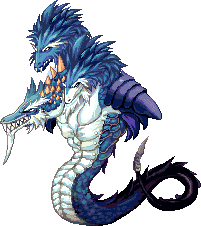Enkicladus 1 - Act 1 Scene 1, End of the Cliff <a href="./episode-2#q-e2-17">Episode 2 · 3.1</a> Lv 80+</td><td data-l="ที่">Mirage Island Field 2 - Cliff of Fate</td><td data-l="ต้องทำ">Dark Choco Piece × 3 Dark Choco Piece ผสม (Compound) จาก 2x Cacao และ 1x Mysterious Milk กับ Compounder Paul ที่ Blooming Cora Shop · Cacao ขุดได้ที่ Coral Beach Fields · Mysterious Milk ดรอปจาก Clione (Lv 10)</td><td data-l="รางวัล">Dark Attribute Stone × 3 · EXP 506,800 / TM 967,950</td></tr>
<tr><td class="nm" data-l="เควส">Knight Scar - Act 1 Scene 2: Badly Aimed Spear <a href="./episode-2#q-e2-18">Episode 2 · 3.2</a> Lv 80+</td><td data-l="ที่">Mirage Island Field 2 - Cliff of Fate</td><td data-l="ต้องทำ">Witch's Deadly Poison, Sharp Spear Witch's Deadly Poison ได้จากเควส Witch's Deadly Poison · Sharp Spear ดรอปจาก Fabilsag (Lv 106)</td><td data-l="รางวัล">Light Attribute Stone, Knight Scar Card · EXP 506,800 / TM 967,950</td></tr>
<tr><td class="nm" data-l="เควส">Enkicladus 1 - Act 1 Scene 3, Love's Sacrifice <a href="./episode-2#q-e2-20">Episode 2 · 3.4</a> Lv 80+</td><td data-l="ที่">Mirage Island Field 2 - Cliff of Fate</td><td data-l="ต้องทำ">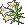White Lily Bouquet White Lily Bouquet ดรอปจาก Sea Spirit (Lv 121)</td><td data-l="รางวัล">Mirage Drill, Ember of Memory 1, Enkicladus 1 Card · EXP 506,800 / TM 967,950</td></tr>
<tr><td class="nm" data-l="เควส">Clotho - Act 1 Scene 4, Curse of Moirae <a href="./episode-2#q-e2-21">Episode 2 · 3.5</a> Lv 80+</td><td data-l="ที่">Mirage Island Dungeon 2 - Deepest Cave</td><td data-l="ต้องทำ">Fluorescent Marble × 5 Fluorescent Marble ดรอปจาก Dark Hollow (Lv 122) · คุยกับ Sea Spirit Rumo เพื่อเข้า Mirage Island Dungeon 2 - Deepest Cave · ใช้ Abiox เป็นค่าเข้า</td><td data-l="รางวัล">Cursed Scroll, Clotho Card · EXP 506,800 / TM 967,950</td></tr>
<tr><td class="nm" data-l="เควส">Nefertiti 2 - Act 2, Scene 1: Reunion of Nefertiti <a href="./episode-2#q-e2-22">Episode 2 · 3.6</a> Lv 80+</td><td data-l="ที่">Mirage Island Field 3 - Fremeia</td><td data-l="ต้องทำ">Earthen Fate Necklace Earthen Fate Necklace ได้จากเควส Confession of the Spirit of the Ocean</td><td data-l="รางวัล">Water Attribute Stone × 2 · EXP 506,800 / TM 967,950</td></tr>
<tr><td class="nm" data-l="เควส">Sea Spirit Rumo - Confession of the Spirit of the Ocean <a href="./episode-2#q-e2-23">Episode 2 · 3.7</a> Lv 80+</td><td data-l="ที่">Mirage Island Field 3 - Fremeia</td><td data-l="ต้องทำ">Anklet of Ocean Spirit × 5 Anklet of Ocean Spirit ดรอปจาก Sea Spirit (Lv 121)</td><td data-l="รางวัล">Earthen Fate Necklace, Sea Spirit Rumo Card · EXP 506,800 / TM 967,950</td></tr>
<tr><td class="nm" data-l="เควส">Enkicladus 1 - Act 2 Scene 2, Reunion of Enkicladus <a href="./episode-2#q-e2-24">Episode 2 · 3.8</a> Lv 80+</td><td data-l="ที่">Mirage Island Field 3 - Fremeia</td><td data-l="ต้องทำ">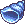Ocean Conch × 5 Ocean Conch ดรอปจาก Sea Hyena (Lv 126)</td><td data-l="รางวัล">Mirage Shield · EXP 506,800 / TM 967,950</td></tr>
<tr><td class="nm" data-l="เควส">Love Hunter Robin - Robin's Secret <a href="./episode-2#q-e2-25">Episode 2 · 3.9</a> Lv 80+</td><td data-l="ที่">Mirage Island Field 1 - Alteo</td><td data-l="ต้องทำ">Papyrus, Ancient Feather Pen Papyrus ขุดได้ที่ Pyramid Dungeon, Mirage Island Field 1 / 6 · Ancient Feather Pen ขุดได้ที่ Mirage Island Field 1 / 5 / 6</td><td data-l="รางวัล">Contract of Secrecy, L. Hunter Robin Card · EXP 506,800 / TM 967,950</td></tr>
<tr><td class="nm" data-l="เควส">Nefertiti 2 - Act 3 Scene 1, Death of Enkicladus <a href="./episode-2#q-e2-26">Episode 2 · 3.10</a> Lv 80+</td><td data-l="ที่">Mirage Island Dungeon 1 - Ocean's End</td><td data-l="ต้องทำ">Sky's Fate Necklace Sky's Fate Necklace ได้จากเควส Enkicladus 2 - The Final Request</td><td data-l="รางวัล">Dark Earth Fate Necklace · EXP 506,800 / TM 967,950</td></tr>
<tr><td class="nm" data-l="เควส">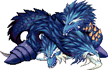Enkicladus 2 - The Final Request <a href="./episode-2#q-e2-27">Episode 2 · 3.11</a> Lv 80+</td><td data-l="ที่">Mirage Island Dungeon 1 - Ocean's End</td><td data-l="ต้องทำ">Bloody Rune of Fate Bloody Rune of Fate ขุดได้ที่ Mirage Island Dungeon 1 - Ocean's End</td><td data-l="รางวัล">Sky's Fate Necklace, Mirage Helm, Enkicladus 2 Card · EXP 506,800 / TM 967,950</td></tr>
<tr><td class="nm" data-l="เควส">Lachesis - Act 3 Scene 2, Recall of Spirit <a href="./episode-2#q-e2-28">Episode 2 · 3.12</a> Lv 80+</td><td data-l="ที่">Mirage Island Dungeon 2 - Deepest Cave</td><td data-l="ต้องทำ">Shard of Spirit Shard of Spirit ดรอปจาก Sea Hyena (Lv 126)</td><td data-l="รางวัล">Blessed Scroll, Lachesis Card · EXP 506,800 / TM 967,950</td></tr>
<tr><td class="nm" data-l="เควส">Nefertiti 2 - Final Act, Waiting <a href="./episode-2#q-e2-29">Episode 2 · 3.13</a> Lv 80+</td><td data-l="ที่">Mirage Island Dungeon 1 - Ocean's End</td><td data-l="ต้องทำ">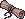Cursed Scroll, Blessed Scroll, Dark Earth Fate Necklace Cursed Scroll ได้จากเควส Clotho - Act 1 Scene 4, Curse of Moirae · Blessed Scroll ได้จากเควส Lachesis - Act 3 Scene 2, Recall of Spirit · Dark Earth Fate Necklace ได้จากเควส Nefertiti - Act 3 Scene 1, Death of Enkicladus</td><td data-l="รางวัล">Ember of Memory 2, Ancient Treasure Box, Queen Nefertiti Card · EXP 7,095,200 / TM 13,551,300</td></tr>
<tr><td class="nm" data-l="เควส">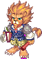Chief Architect Amos - Amos' Orders <a href="./episode-3#q-e3-1">Episode 3 · 1.1</a> Lv 130+</td><td data-l="ที่">Mirage Island Field 4 - Alteo Construction Site</td><td data-l="ต้องทำ">Signed Document 4 Signed Document 4 ได้จากเควส Sue - Hard Job Pt. 4 Transport Gems</td><td data-l="รางวัล">Alteo Passport · EXP 2,593,183 / TM 969,261</td></tr>
<tr><td class="nm" data-l="เควส">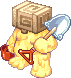Larry - Hard Job Pt. 1 Pick Rocks <a href="./episode-3#q-e3-2">Episode 3 · 1.2</a> Lv 130+</td><td data-l="ที่">Mirage Island Field 4 - Alteo Construction Site</td><td data-l="ต้องทำ">Shard of Caliche × 20 Shard of Caliche ขุดได้ที่ Mirage Island Field 4 - Alteo Construction Site</td><td data-l="รางวัล">Signed Statement 1 · EXP 2,074,547 / TM 775,409</td></tr>
<tr><td class="nm" data-l="เควส">Bob - Hard Job Pt. 2 Collect Bricks <a href="./episode-3#q-e3-3">Episode 3 · 1.3</a> Lv 130+</td><td data-l="ที่">Mirage Island Field 4 - Alteo Construction Site</td><td data-l="ต้องทำ">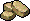Lump of Gray Clay × 10, 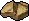Lump of Pale Clay × 10, Lump of Red Clay × 10 Lump of Gray Clay ดรอปจาก Gray Clay Rock (Lv 60) · Lump of Pale Clay ดรอปจาก Pale Clay Rock (Lv 60) · Lump of Red Clay ดรอปจาก Red Clay Rock (Lv 60)</td><td data-l="รางวัล">Blue Potion B × 10 · EXP 2,074,547 / TM 775,409</td></tr>
<tr><td class="nm" data-l="เควส">Bob - Hard Job Pt. 2 Collect Timber <a href="./episode-3#q-e3-4">Episode 3 · 1.4</a> Lv 130+</td><td data-l="ที่">Mirage Island Field 4 - Alteo Construction Site</td><td data-l="ต้องทำ">Poplar Wood × 10, Cherry Wood × 10, Walnut Wood × 10 Poplar Wood ดรอปจาก Poplar Tree (Lv 60) · Cherry Wood ดรอปจาก Cherry Tree (Lv 60) · Walnut Wood ดรอปจาก Walnut Tree (Lv 60)</td><td data-l="รางวัล">Signed Document 2 · EXP 2,074,547 / TM 775,409</td></tr>
<tr><td class="nm" data-l="เควส">Jim - Hard Job Pt. 3 Prepare Snacks <a href="./episode-3#q-e3-5">Episode 3 · 1.5</a> Lv 130+</td><td data-l="ที่">Mirage Island Field 4 - Alteo Construction Site</td><td data-l="ต้องทำ">Chickensaurus's Leg × 5 Chickensaurus's Leg ดรอปจาก Chickensaurus (Lv 116)</td><td data-l="รางวัล">Signed Document 3 · EXP 2,074,547 / TM 775,409</td></tr>
<tr><td class="nm" data-l="เควส">Sue - Hard Job Pt. 4 Transport Gems <a href="./episode-3#q-e3-6">Episode 3 · 1.6</a> Lv 130+</td><td data-l="ที่">Mirage Island Field 4 - Alteo Construction Site</td><td data-l="ต้องทำ">Gem Supply Box Gem Supply Box ได้จากเควส Merchant Vinny - Gem Supply Box</td><td data-l="รางวัล">Signed Document 4 · EXP 2,074,547 / TM 775,409</td></tr>
<tr><td class="nm" data-l="เควส">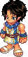Merchant Vinny - Gem Supply Box <a href="./episode-3#q-e3-7">Episode 3 · 1.7</a> Lv 130+ รับเควส Hard Job Pt. 4 Transport Gems ค้างไว้</td><td data-l="ที่">Gate of Mirage Island</td><td data-l="ต้องทำ">คุยกับ NPC ตัวนี้</td><td data-l="รางวัล">Gem Supply Box</td></tr>
<tr><td class="nm" data-l="เควส">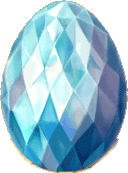Light Filled Egg - Birth of the Early Tricksters <a href="./episode-3#q-e3-8">Episode 3 · 2.1</a> Lv 130+</td><td data-l="ที่">Trickster Shrine</td><td data-l="ต้องทำ">Fabilsag's Stinger × 2, Ancient Face × 5 Fabilsag's Stinger ดรอปจาก Fabilsag G (Lv 110) · Ancient Face ดรอปจาก Ancient Chimu (Lv 160)</td><td data-l="รางวัล">Crystal of Light × 2 · EXP 1,852,274 / TM 692,329</td></tr>
<tr><td class="nm" data-l="เควส">Curator Morgos - The Story of the Mural - Birth <a href="./episode-3#q-e3-9">Episode 3 · 2.2</a> Lv 130+</td><td data-l="ที่">Trickster Shrine</td><td data-l="ต้องทำ">Status Report Status Report ได้จากเควส Indiana John - Mural's Analysis</td><td data-l="รางวัล">Status Report · EXP 1,852,274 / TM 692,329</td></tr>
<tr><td class="nm" data-l="เควส">Indiana John - Mural's Analysis <a href="./episode-3#q-e3-10">Episode 3 · 2.3</a> Lv 130+</td><td data-l="ที่">Mirage Island Field 7 - Guardian's Square</td><td data-l="ต้องทำ">Fatigue Medicine Fatigue Medicine ผสม (Compound) จาก 5x Panacea และ 1x Herb Potion กับ Compounder Paul ที่ Mirage Island Field 7 · Panacea ดรอปจาก Werepot (Lv 98), Fabilsag (Lv 106), Fabilsag G (Lv 110), Chickensaurus (Lv 116), Dark Hollow (Lv 122), Ancient Chimu (Lv 160) · Herb Potion ซื้อได้ตามร้านค้าทั่วไปและขุดได้หลายแมพ</td><td data-l="รางวัล">Status Report · EXP 1,852,274 / TM 692,329</td></tr>
<tr><td class="nm" data-l="เควส">Curator Morgos - The Story of the Mural - Growth <a href="./episode-3#q-e3-11">Episode 3 · 2.4</a> Lv 130+</td><td data-l="ที่">Trickster Shrine</td><td data-l="ต้องทำ">Restoration Details Restoration Details ได้จากเควส Old Artist - Mural's Restoration</td><td data-l="รางวัล">10,000 Galder Coupon · EXP 1,852,274 / TM 692,329</td></tr>
<tr><td class="nm" data-l="เควส">Old Artist - Mural's Restoration <a href="./episode-3#q-e3-12">Episode 3 · 2.5</a> Lv 130+</td><td data-l="ที่">Mirage Island Field 7 - Guardian's Square</td><td data-l="ต้องทำ">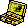Restoration Box, Status Report Restoration Box ดรอปจาก Ancient Werepot (Lv 170) · Status Report ได้จากเควส Indiana John - Mural's Analysis</td><td data-l="รางวัล">Restoration Details · EXP 1,852,274 / TM 692,329</td></tr>
<tr><td class="nm" data-l="เควส">Curator Morgos - The Story of the Mural - Hero <a href="./episode-3#q-e3-13">Episode 3 · 2.6</a> Lv 130+</td><td data-l="ที่">Trickster Shrine</td><td data-l="ต้องทำ">Bindi, Crystal of Light Bindi ดรอปจาก Ancient Chimu (Lv 160) · Crystal of Light ได้จากเควส Light Filled Egg - Birth of the Early Tricksters</td><td data-l="รางวัล">Resurrection Marble × 2 · EXP 1,852,274 / TM 692,329</td></tr>
<tr><td class="nm" data-l="เควส">Nefertiti 2 - Reunion with the Princess <a href="./episode-3#q-e3-14">Episode 3 · 2.7</a> Lv 130+ มี Proof of a Hero ในกระเป๋า</td><td data-l="ที่">Mirage Island Field 6 - Water Garden</td><td data-l="ต้องทำ">Morgos's Message Proof of a Hero ดรอปจาก Golem (Lv 300) · Morgos's Message ได้จากเควส Curator Morgos - Hyper Mind Control</td><td data-l="รางวัล">Nothing · EXP 5,186,367 / TM 1,938,522</td></tr>
<tr><td class="nm" data-l="เควส">Curator Morgos - Hyper Mind Control <a href="./episode-3#q-e3-15">Episode 3 · 2.8</a> Lv 130+</td><td data-l="ที่">Mirage Island Field 6 - Water Garden</td><td data-l="ต้องทำ">Ra Weapon Box, Folkan Weapon Box, Byzantine Weapon Box Ra Weapon Box ได้จากเควส The Ra's Complaints · Folkan Weapon Box ได้จากเควส The Folkan's Complaints · Byzantine Weapon Box ได้จากเควส The Byzantine's Complaints</td><td data-l="รางวัล">Morgos's Message, Legendary Gaia Box · EXP 1,852,274 / TM 692,329</td></tr>
<tr><td class="nm" data-l="เควส">Chief Architect Amos - The Byzantine's Complaints <a href="./episode-3#q-e3-16">Episode 3 · 2.9</a> Lv 130+</td><td data-l="ที่">Mirage Island Field 5 - Alteo City</td><td data-l="ต้องทำ">Byzantine Family's Feeling of Unity Byzantine Family's Feeling of Unity ได้จากการแลก Byzantine Family's Grievances กับ Poseidon's Blessing ที่ Nefertiti's Shrine · ถ้ายังมี Grievances ติดตัว Amos จะไม่รับของ</td><td data-l="รางวัล">Byzantine Weapon Box · EXP 1,852,274 / TM 692,329</td></tr>
<tr><td class="nm" data-l="เควส">Dancer Olinda - The Ra's Complaints <a href="./episode-3#q-e3-17">Episode 3 · 2.10</a> Lv 130+</td><td data-l="ที่">Mirage Island Field 5 - Alteo City</td><td data-l="ต้องทำ">Ra Family's Feeling of Unity Ra Family's Feeling of Unity ได้จากการแลก Ra Family's Grievances กับ Poseidon's Blessing ที่ Nefertiti's Shrine · ถ้ายังมี Grievances ติดตัว Olinda จะไม่รับของ</td><td data-l="รางวัล">Ra Weapon Box · EXP 1,852,274 / TM 692,329</td></tr>
<tr><td class="nm" data-l="เควส">Merchant Vinny - The Folkan's Complaints <a href="./episode-3#q-e3-18">Episode 3 · 2.11</a> Lv 130+</td><td data-l="ที่">Mirage Island Field 5 - Alteo City</td><td data-l="ต้องทำ">Folkan Family's Feeling of Unity Folkan Family's Feeling of Unity ได้จากการแลก Folkan Family's Grievances กับ Poseidon's Blessing ที่ Nefertiti's Shrine · ถ้ายังมี Grievances ติดตัว Vinny จะไม่รับของ</td><td data-l="รางวัล">Folkan Weapon Box · EXP 1,852,274 / TM 692,329</td></tr>
<tr><td class="nm" data-l="เควส">Love Hunter Robin - Robin's Advice <a href="./episode-3#q-e3-19">Episode 3 · 3.1</a> Lv 130+</td><td data-l="ที่">Nefertiti's Shrine</td><td data-l="ต้องทำ">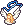Robin's Necklace Robin's Necklace ดรอปจาก Rosaspina (Lv 210)</td><td data-l="รางวัล">Sincere Heart · EXP 2,593,183 / TM 969,261</td></tr>
<tr><td class="nm" data-l="เควส">Rose Fairy Harmony - Rose Fairy's Message 1 <a href="./episode-3#q-e3-20">Episode 3 · 3.2</a> Lv 130+ รับเควส Robin's Advice ค้างไว้</td><td data-l="ที่">Nefertiti's Shrine</td><td data-l="ต้องทำ">Rose Certificate A Rose Certificate A ได้จากเควส Rose Fairy's First Test</td><td data-l="รางวัล">Nothing · EXP 2,593,183 / TM 969,261</td></tr>
<tr><td class="nm" data-l="เควส">Rose Fairy Marion - Rose Fairy's First Test <a href="./episode-3#q-e3-21">Episode 3 · 3.3</a> Lv 130+ รับเควส Rose Fairy's Message 1 ค้างไว้</td><td data-l="ที่">Nefertiti's Shrine</td><td data-l="ต้องทำ">คุยกับ NPC แล้วดูเนื้อเรื่อง</td><td data-l="รางวัล">–</td></tr>
<tr><td class="nm" data-l="เควส">Rose Fairy Harmony - Rose Fairy's Message 2 <a href="./episode-3#q-e3-22">Episode 3 · 3.4</a> Lv 130+</td><td data-l="ที่">Nefertiti's Shrine</td><td data-l="ต้องทำ">Rose Certificate B Rose Certificate B ได้จากเควส Rose Fairy's Second Test</td><td data-l="รางวัล">Nothing · EXP 2,593,183 / TM 969,261</td></tr>
<tr><td class="nm" data-l="เควส">Rose Fairy Marion - Rose Fairy's Second Test <a href="./episode-3#q-e3-23">Episode 3 · 3.5</a> Lv 130+ รับเควส Rose Fairy's Message 2 ค้างไว้</td><td data-l="ที่">Nefertiti's Shrine</td><td data-l="ต้องทำ">คุยกับ NPC แล้วดูเนื้อเรื่อง</td><td data-l="รางวัล">–</td></tr>
<tr><td class="nm" data-l="เควส">Rosaspina - The Rhodonite Guardian <a href="./episode-3#q-e3-24">Episode 3 · 3.6</a> Lv 130+</td><td data-l="ที่">Guardian's Room</td><td data-l="ต้องทำ">ล้ม Rosaspina (Lv 210) Rosaspina ดรอป Robin's Necklace</td><td data-l="รางวัล">Soul Summoning Scroll 1, Robin's Necklace, Voice of Spirits · EXP 2,593,183 / TM 969,261</td></tr>
<tr><td class="nm" data-l="เควส">Love Hunter Robin - Harkon Statue <a href="./episode-3#q-e3-25">Episode 3 · 3.7</a> Lv 130+</td><td data-l="ที่">Nefertiti's Shrine</td><td data-l="ต้องทำ">Earthen Fate Necklace Earthen Fate Necklace ได้จากเควส Spirit Nefertiti's Message</td><td data-l="รางวัล">Earthen Fate Necklace · EXP 2,593,183 / TM 969,261</td></tr>
<tr><td class="nm" data-l="เควส">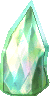Poseidon's Blessing - The Voice from the Statue <a href="./episode-3#q-e3-26">Episode 3 · 3.8</a> Lv 130+</td><td data-l="ที่">Nefertiti's Shrine</td><td data-l="ต้องทำ">Soul Summoning Scroll 3, 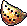Voice of Spirits, Sincere Heart, Crystal of Light, Spirit of Light Soul Summoning Scroll 3 ได้จากเควส Decipher the Scroll · Voice of Spirits ได้จากเควส The Rhodonite Guardian · Sincere Heart ได้จากเควส Robin's Advice · Crystal of Light ได้จากเควส Birth of the Early Tricksters · Spirit of Light ได้จากเควส Reunion with Nono</td><td data-l="รางวัล">Soul Summoning (Skill) × 5 · EXP 2,593,183 / TM 969,261</td></tr>
<tr><td class="nm" data-l="เควส">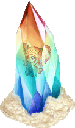Fairy Nono - Reunion with Nono <a href="./episode-3#q-e3-27">Episode 3 · 3.9</a> Lv 130+</td><td data-l="ที่">Nefertiti's Shrine</td><td data-l="ต้องทำ">Soul Summoning Scroll 1, Fairy Eyedrops Soul Summoning Scroll 1 ได้จากเควส The Rhodonite Guardian · Fairy Eyedrops ดรอปจาก Rose Worm (Lv 190)</td><td data-l="รางวัล">Soul Summoning Scroll 2, Spirit of Light · EXP 2,593,183 / TM 969,261</td></tr>
<tr><td class="nm" data-l="เควส">Indiana John - Decipher the Scroll <a href="./episode-3#q-e3-28">Episode 3 · 3.10</a> Lv 130+</td><td data-l="ที่">Mirage Island Field 7 - Guardian's Square</td><td data-l="ต้องทำ">Bindi, Soul Summoning Scroll 2 Bindi ดรอปจาก Ancient Chimu (Lv 160) · Soul Summoning Scroll 2 ได้จากเควส Reunion with Nono</td><td data-l="รางวัล">Soul Summoning Scroll 3 · EXP 2,593,183 / TM 969,261</td></tr>
<tr><td class="nm" data-l="เควส">Spirit of Nefertiti - Spirit Nefertiti's Message <a href="./episode-3#q-e3-29">Episode 3 · 3.11</a> Lv 130+</td><td data-l="ที่">Room of Light</td><td data-l="ต้องทำ">Earthen Fate Necklace Earthen Fate Necklace ขุดได้ที่ Room of Light ไปได้ด้วยสกิล Soul Summoning ซึ่งได้จากเควส Poseidon's Blessing - The Voice from the Statue · Earthen Fate Necklace ทิ้ง เทรด หรือขาย NPC ไม่ได้ แต่ฝากโกดังได้</td><td data-l="รางวัล">Earthen Fate Necklace · EXP 2,593,183 / TM 969,261</td></tr>
<tr><td class="nm" data-l="เควส">Officer Robert - Robert the Spy <a href="./episode-3#q-e3-30">Episode 3 · 3.12</a> Lv 130+</td><td data-l="ที่">Mirage Island Field 6 - Water Garden</td><td data-l="ต้องทำ">Ancient Feather Pen, Papyrus, 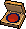Red Ink Pad Ancient Feather Pen ขุดได้ที่ Mirage Island Field 1 / 5 / 6 · Papyrus ขุดได้ที่ Pyramid Dungeon, Mirage Island Field 1 / 6 · Red Ink Pad ดรอปจาก Ancient Naranjo (Lv 180)</td><td data-l="รางวัล">Holographic Photo · EXP 2,593,183 / TM 969,261</td></tr>
<tr><td class="nm" data-l="เควส">Don Cavalier - Don Cavalier's Proposal <a href="./episode-3#q-e3-31">Episode 3 · 3.13</a> Lv 130+ ใช้ Holographic Photo เพื่อไปหา NPC</td><td data-l="ที่">Hologram Chamber</td><td data-l="ต้องทำ">Earthen Fate Necklace Earthen Fate Necklace ได้จากเควส Spirit Nefertiti's Message · Holographic Photo ได้จากเควส Officer Robert - Robert the Spy</td><td data-l="รางวัล">Dev. Room Card Key, Legendary Gaia Box × 4 · EXP 11,113,644 / TM 4,153,977</td></tr>
<tr><td class="nm" data-l="เควส">Chief Architect Amos - Find the Missing Blueprints <a href="./episode-3#q-e3-32">Episode 3 · โบนัส 1</a> Lv 130+</td><td data-l="ที่">Mirage Island Field 4 - Alteo Construction Site</td><td data-l="ต้องทำ">City Blueprint City Blueprint ได้จากเควส Monkey T - The Criminal's Confession</td><td data-l="รางวัล">10,000 Galder Coupon × 5 · EXP 2,646,105</td></tr>
<tr><td class="nm" data-l="เควส">Larry - Who is the Criminal? <a href="./episode-3#q-e3-33">Episode 3 · โบนัส 2</a> Lv 130+</td><td data-l="ที่">Mirage Island Field 4 - Alteo Construction Site</td><td data-l="ต้องทำ">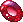Secretly Hidden Gem Secretly Hidden Gem ขุดได้ที่ Mirage Island Field 4 - Alteo Construction Site</td><td data-l="รางวัล">Secretly Hidden Gem, Ripped Contract · EXP 2,646,105</td></tr>
<tr><td class="nm" data-l="เควส">Bob - Who is the Criminal? <a href="./episode-3#q-e3-34">Episode 3 · โบนัส 3</a> Lv 130+</td><td data-l="ที่">Mirage Island Field 4 - Alteo Construction Site</td><td data-l="ต้องทำ">Secretly Hidden Gem Secretly Hidden Gem ขุดได้ที่ Mirage Island Field 4 - Alteo Construction Site</td><td data-l="รางวัล">Secretly Hidden Gem × 2, Ripped Contract · EXP 2,646,105</td></tr>
<tr><td class="nm" data-l="เควส">Jim - Who is the Criminal? <a href="./episode-3#q-e3-35">Episode 3 · โบนัส 4</a> Lv 130+</td><td data-l="ที่">Mirage Island Field 4 - Alteo Construction Site</td><td data-l="ต้องทำ">Secretly Hidden Gem Secretly Hidden Gem ขุดได้ที่ Mirage Island Field 4 - Alteo Construction Site</td><td data-l="รางวัล">Secretly Hidden Gem × 2, Ripped Contract · EXP 2,646,105</td></tr>
<tr><td class="nm" data-l="เควส">Sue - Who is the Criminal? <a href="./episode-3#q-e3-36">Episode 3 · โบนัส 5</a> Lv 130+</td><td data-l="ที่">Mirage Island Field 4 - Alteo Construction Site</td><td data-l="ต้องทำ">Secretly Hidden Gem Secretly Hidden Gem ขุดได้ที่ Mirage Island Field 4 - Alteo Construction Site</td><td data-l="รางวัล">Secretly Hidden Gem × 2, Ripped Contract · EXP 2,646,105</td></tr>
<tr><td class="nm" data-l="เควส">Monkey T - The Criminal's Confession <a href="./episode-3#q-e3-37">Episode 3 · โบนัส 6</a> Lv 130+</td><td data-l="ที่">Mirage Island Field 1 - Alteo</td><td data-l="ต้องทำ">Restored Contract, Secretly Hidden Gem, Restored Contract ได้จากการเอา Ripped Contracts ครบ 4 ชิ้นไปแลกกับ Compounder Paul ที่ Mirage Island Field 7 · Secretly Hidden Gem ขุดได้ที่ Mirage Island Field 4</td><td data-l="รางวัล">City Blueprint · EXP 2,646,105</td></tr>
</tbody></table>

</section>

<section data-c="" data-qt="town" id="town">

## เควสในเมือง

<table><thead><tr><th>เควส</th><th>ที่</th><th>ต้องทำ</th><th>รางวัล</th></tr></thead><tbody>
<tr><td class="nm" data-l="เควส">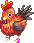Cluck Cluck Warrior - The Great Chicken War Lv 80+ 5 รอบ EXP 177,380 · TM 338,782</td><td data-l="ที่">Mirage Island Field 2 - Cliff of Fate</td><td data-l="ต้องทำ">Chickensaurus's Leg × 5 Chickensaurus's Leg ← Chickensaurus (Lv 116)</td><td data-l="รางวัล">Fire Attribute Stone, 500 Galder Coupon × 4 หรือ 500 Galder Coupon × 8</td></tr>
<tr><td class="nm" data-l="เควส">Explorer Reina - Treasure Hunting 1 - Mirage Island Lv 80~280 · หลัง Indiana John - Old Man's Dream · ไม่มี Worn Island Treasure Map ในกระเป๋า ทำซ้ำได้ไม่จำกัด</td><td data-l="ที่">Mirage Island Field 1 - Alteo</td><td data-l="ต้องทำ">Worn Island Map A, Worn Island Map B Worn Island Map A และ Worn Island Map B ← ขุดใน Mirage Island Fields</td><td data-l="รางวัล">Worn Island Treasure Map</td></tr>
<tr><td class="nm" data-l="เควส">Magician Louie - Ancient Legacy Magician · Priest หรือ Witch · Radiant Strike (Lv 5) · Light Wave (Lv 5) 1 รอบ</td><td data-l="ที่">Mirage Island Field 2 - Cliff of Fate</td><td data-l="ต้องทำ">Ancient Feather Pen × 10, Papyrus × 10 Ancient Feather Pen ← ขุดใน Mirage Island Field 1 / 5 / 6. Papyrus ← ขุดใน Pyramid Dungeon Halls, Path to Desert Beach, Techichi Field 2 / 3, และ Mirage Island Field 1. Magician และ Witch ทำเควสได้ แต่ Priest เท่านั้นที่เรียน Celestial Strike ได้</td><td data-l="รางวัล">Celestial Strike Card</td></tr>
<tr><td class="nm" data-l="เควส">Magician Louie - Power of Faith Magician · Priest หรือ Witch · Oath of Light (Master) 1 รอบ</td><td data-l="ที่">Mirage Island Field 7 - Guardian's Square</td><td data-l="ต้องทำ">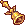Golden Bell × 20 Golden Bell ← Mister Freaks (Lv 191) · Magician และ Witch ทำเควสได้ แต่ Priest เท่านั้นที่เรียน Sacred Oath ได้</td><td data-l="รางวัล">Sacred Oath Card</td></tr>
<tr><td class="nm" data-l="เควส">Monkey T - Monkey T's Request Lv 80+ 25 รอบ TM 1,355,130</td><td data-l="ที่">Mirage Island Field 1 - Alteo</td><td data-l="ต้องทำ">Panacea × 10 Panacea ← Werepot (Lv 98), Fabilsag (Lv 106), Fabilsag G (Lv 110), Chickensaurus (Lv 116), Dark Hollow (Lv 122), Ancient Chimu (Lv 160)</td><td data-l="รางวัล">รอบ 1~10: 10 Galder Coupon, 50 Galder Coupon หรือ 100 Galder Coupon · รอบ 11~25: Electric Stone, 10 Galder Coupon, 50 Galder Coupon หรือ 100 Galder Coupon</td></tr>
<tr><td class="nm" data-l="เควส">Spirit of Nefertiti - Be a True Trickster Lv 135+ · อาชีพ 3 · หลัง Gift from Nefertiti · ปลูก Poseidon Seed แล้ว 1 รอบ EXP 2,013,276 · TM 710,832</td><td data-l="ที่">Another Dimension of Light</td><td data-l="ต้องทำ">Questionable Letter, Dimensional Key Questionable Letter ได้ในกระเป๋า MyShop ตอนถึง Lv 135 · Dimensional Key ← ได้จาก Eclipse ที่ Eclipse's Dimension · · ทำไม่ได้ถ้า Poseidon Seed ฟักแล้ว</td><td data-l="รางวัล">Dimension Card Pack</td></tr>
<tr><td class="nm" data-l="เควส">Spirit of Nefertiti - Gift from Nefertiti Lv 135+ · อาชีพ 3 1 รอบ EXP 2,013,276 · TM 710,832</td><td data-l="ที่">Another Dimension of Light</td><td data-l="ต้องทำ">Soul Essence, Essence of Life, Elixir of Gods Soul Essence ← ได้จากเควส La Vida - Soul Essence · Essence of Life ← ได้จากเควส Frog Prince - Essence of Life · Elixir of Gods ← ได้จากเควส Atropos's Deal · Spirit of Nefertiti จะวาร์ปไป Eclipse's Dimension แล้ว Eclipse ให้ Dimensional Key และ offer teleportation to: Vamp Castle Parlor - Soul Sanctuary, Black Swamp - Site of Life, Rose Garden Park, และ Another Dimension of Light</td><td data-l="รางวัล">Poseidon Seed, Empathy Manual</td></tr>
</tbody></table>

</section>

<section data-c="" data-qt="daily" id="daily">

## เควสรายวัน / ทำซ้ำรายวัน

<table><thead><tr><th>เควส</th><th>ที่</th><th>ต้องทำ</th><th>รางวัล</th></tr></thead><tbody>
<tr><td class="nm" data-l="เควส">Driller King Marky - Romance of Drilling - Mirage Island Lv 80~280 · หลัง Indiana John - Old Man's Dream 1 รอบ EXP 151,558 · TM 151,558</td><td data-l="ที่">Gate of Mirage Island</td><td data-l="ต้องทำ">Weird Island Map A, Weird Island Map B Weird Island Map A และ Weird Island Map B ← ขุดใน Mirage Island Fields</td><td data-l="รางวัล">Weird Island Treasure Map</td></tr>
<tr><td class="nm" data-l="เควส">Explorer Reina - Treasure Hunting 2 - Mirage Island Lv 80~280 · หลัง Indiana John - Old Man's Dream และทำ Treasure Hunting 1 - Mirage Island ครบ 50 ครั้ง · ไม่มี Old Island Treasure Map ในกระเป๋า 1 รอบ EXP 151,558 · TM 151,558</td><td data-l="ที่">Mirage Island Field 1 - Alteo</td><td data-l="ต้องทำ">Old Island Map A, Old Island Map B Old Island Map A และ Old Island Map B ← ขุดใน Mirage Island Fields</td><td data-l="รางวัล">Old Island Treasure Map</td></tr>
</tbody></table>

</section>

<section data-c="" data-qt="warp" id="warp">

## วาร์ป

เควสที่เปิดทางไปแมพอื่นหรือลงทะเบียนวาร์ป

<table><thead><tr><th>เควส</th><th>ที่</th><th>ต้องทำ</th><th>รางวัล</th></tr></thead><tbody>
<tr><td class="nm" data-l="เควส">3rd Mural "A Hero" - Transfer to Water Garden's Golem Lv 130+ · หลัง Curator Morgos - The Story of the Mural - Hero</td><td data-l="ที่">Trickster's Shrine</td><td data-l="ต้องทำ">คุยกับ NPC</td><td data-l="รางวัล">–</td></tr>
<tr><td class="nm" data-l="เควส">Chief Architect Amos - Transfer to Guardian's Square Lv 130+</td><td data-l="ที่">Mirage Island Field 4 - Alteo Construction Site</td><td data-l="ต้องทำ">Alteo Passport Alteo Passport ← ได้จากเควส Chief Architect Amos - Amos' Orders</td><td data-l="รางวัล">–</td></tr>
<tr><td class="nm" data-l="เควส">Curator Morgos - Transfer to Water Garden (Lower Area) Lv 130+ · หลัง Curator Morgos - The Story of the Mural - Hero</td><td data-l="ที่">Mirage Island Field 6 - Water Garden</td><td data-l="ต้องทำ">คุยกับ NPC</td><td data-l="รางวัล">–</td></tr>
<tr><td class="nm" data-l="เควส">Fairy Nono (2) - Transfer to Nefertiti's Shrine Lv 1+</td><td data-l="ที่">Room of Light</td><td data-l="ต้องทำ">คุยกับ NPC</td><td data-l="รางวัล">–</td></tr>
<tr><td class="nm" data-l="เควส">Light Filled Egg - Transfer to Another Dimension of Light Lv 135+ · อาชีพ 3 · มี Questionable Letter · มี Card Identification</td><td data-l="ที่">Trickster's Shrine</td><td data-l="ต้องทำ">Questionable Letter Questionable Letter ได้ในกระเป๋า MyShop ตอนถึง Lv 135 · Card Identification ← ได้จากเควสแยกการ์ด</td><td data-l="รางวัล">–</td></tr>
<tr><td class="nm" data-l="เควส">Love Hunter Robin - Transfer to Water Garden (Upper Area) Lv 130+</td><td data-l="ที่">Mirage Island Field 6 - Water Garden</td><td data-l="ต้องทำ">Proof of a Hero Proof of a Hero ← Golem (Lv 300)</td><td data-l="รางวัล">–</td></tr>
<tr><td class="nm" data-l="เควส">Love Hunter Robin - Transfer to Ocean's End Lv 80+</td><td data-l="ที่">Mirage Island Field 1 - Alteo</td><td data-l="ต้องทำ">Contract of Secrecy Contract of Secrecy ← ได้จากเควส Love Hunter Robin - Robin's Secret</td><td data-l="รางวัล">–</td></tr>
<tr><td class="nm" data-l="เควส">Sea Spirit Rumo - Transfer to Deepest Cave Lv 80+</td><td data-l="ที่">Mirage Island Field 2 - Cliff of Fate</td><td data-l="ต้องทำ">Abiox × 1 Abiox ← Sea Spirit (Lv 121)</td><td data-l="รางวัล">–</td></tr>
<tr><td class="nm" data-l="เควส">Skipper Min - Transfer to Oops Wharf Lv 80+</td><td data-l="ที่">Gate of Mirage Island</td><td data-l="ต้องทำ">Cruise Ticket (ไม่หายไป) Cruise Ticket ← ได้จากเควส Don Giuvanni - Writing on the Knife</td><td data-l="รางวัล">–</td></tr>
</tbody></table>

</section>

<footer>สรุปจากวิกิ ggFTW ฉบับ mirror ของ LifeTO <a href="https://wikimirror.lifeto.co/wiki.ggftw.com/trickster/Category_Mirage_Island_Quest.html" rel="noopener" target="_blank">Category: Mirage Island Quest</a> และหน้าเควสที่ลิงก์ไป · เควสเนื้อเรื่องมาจากหน้า Episode</footer>

<PageBehavior />
