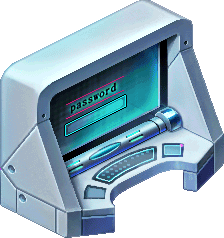
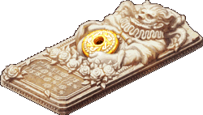
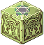

<header style="display:flex;flex-direction:column;gap:8px">

# Underground Dev Room

เควสทั้งหมด 74 เควสในโซน Underground Dev Room แยกตามประเภท ส่วนใหญ่เป็นเนื้อเรื่อง Episode 4 และ 5

</header>

<input id="q" placeholder="ค้นชื่อเควส NPC หรือของ" type="search"/>

ประเภท<button type="button" data-t="all">ทั้งหมด</button><button type="button" data-t="story">เนื้อเรื่อง</button><button type="button" data-t="town">เควสในเมือง</button><button type="button" data-t="hunt">ล่ามอน</button><button type="button" data-t="daily">รายวัน</button><button type="button" data-t="warp">วาร์ป</button>

<section data-c="" data-qt="story" id="story">

## เควสเนื้อเรื่อง

เควสจากหน้า Episode ที่อยู่ในโซนนี้ เรียงตามลำดับเนื้อเรื่อง กดเลขตอนเพื่อไปอ่านต่อในหน้า Episode

<table><thead><tr><th>เควส</th><th>ที่</th><th>ต้องทำ</th><th>รางวัล</th></tr></thead><tbody>
<tr><td class="nm" data-l="เควส">Coward Craven - Broken Elevator <a href="./episode-4#q-e4-1">Episode 4 · 1.1</a> Lv 150+</td><td data-l="ที่">Underground Dev Room - Underground Passage 4</td><td data-l="ต้องทำ">Merchant Mon's Bag × 5 Merchant Mon's Bag ดรอปจาก Merchant Mon (Lv 186)</td><td data-l="รางวัล">Emergency Key · EXP 5,075,677 / TM 1,403,525</td></tr>
<tr><td class="nm" data-l="เควส">Don Giuvanni - Welcome! <a href="./episode-4#q-e4-2">Episode 4 · 1.2</a> Lv 150+</td><td data-l="ที่">Underground Dev Room - Lobby</td><td data-l="ต้องทำ">Nondisclosure Agreement, Pen Nondisclosure Agreement และ Pen ดรอปจาก Robber Mole (Lv 230) · Pen ตัวนี้ไม่ใช่ Pen ที่ดรอปจาก Cannon Shell (Lv 33)</td><td data-l="รางวัล">500 Galder Coupon × 15 · EXP 3,045,406 / TM 842,115</td></tr>
<tr><td class="nm" data-l="เควส">Lead Developer - The Star of Developer Photo2 <a href="./episode-4#q-e4-3">Episode 4 · 1.3</a> Lv 150+</td><td data-l="ที่">Underground Dev Room - Lobby</td><td data-l="ต้องทำ">Americano Americano ผสม (Compound) จาก Company Mug และ Coffee Beans กับ Water Dispenser ที่ Underground Dev Room - Lobby · Company Mug ขุดได้ที่ System Control Room · Coffee Beans ดรอปจาก Guiana (Lv 66) และ Merchant Mon (Lv 186)</td><td data-l="รางวัล">500 Galder Coupon × 15, Leader Dev Card · EXP 3,045,406 / TM 842,115</td></tr>
<tr><td class="nm" data-l="เควส">Developer J - Dev J Quest <a href="./episode-4#q-e4-4">Episode 4 · 1.4</a> Lv 150+ ตอนกลางวัน</td><td data-l="ที่">Underground Dev Room - Dev Room</td><td data-l="ต้องทำ">Merchant Mon's Leaflet Bundle × 10 Merchant Mon's Leaflet Bundle ดรอปจาก Merchant Mon (Lv 186)</td><td data-l="รางวัล">Blue Potion C × 10, Dev J Card, Poppuri Card · EXP 3,045,406 / TM 842,115</td></tr>
<tr><td class="nm" data-l="เควส">Developer H - Dev H's Request <a href="./episode-4#q-e4-5">Episode 4 · 1.5</a> Lv 150+ ตอนกลางวัน</td><td data-l="ที่">Underground Dev Room - System Control Room</td><td data-l="ต้องทำ">Hot Cup Noodles Hot Cup Noodles ผสม (Compound) จาก Cup Noodles และ Wooden Chopsticks กับ Water Dispenser ที่ Underground Dev Room - Lobby · Cup Noodles และ Wooden Chopsticks ขุดได้ที่ System Control Room</td><td data-l="รางวัล">Pink Potion C × 10, Dev H Card · EXP 3,045,406 / TM 842,115</td></tr>
<tr><td class="nm" data-l="เควส">Developer K - Dev K Quest <a href="./episode-4#q-e4-6">Episode 4 · 1.6</a> Lv 150+ ตอนกลางวัน</td><td data-l="ที่">Underground Dev Room - Dev Room</td><td data-l="ต้องทำ">Fan Art A, Fan Art B, Fan Art C, Fan Art D, Fan Art E, Fan Art F Fan Art A, Fan Art B ขุดได้ที่ Underground Dev Room - Dev Room · Fan Art C, Fan Art D, Fan Art E, Fan Art F ดรอปจาก Robber Mole (Lv 230)</td><td data-l="รางวัล">Blue Potion C × 10, Dev K Card · EXP 5,075,677 / TM 1,403,525</td></tr>
<tr><td class="nm" data-l="เควส">Developer's PC - Defeat the Virus! <a href="./episode-4#q-e4-7">Episode 4 · 2.1</a> Lv 150+ ใส่รหัสผ่านให้ถูก (ดูหมายเหตุ)</td><td data-l="ที่">Underground Dev Room - Dev Room</td><td data-l="ต้องทำ">H Key, O Key, T Key, S Key, G Key H Key, O Key, T Key, S Key, G Key ดรอปจาก Win32 Worm (Lv 235) · รหัสคือ "GHOST"</td><td data-l="รางวัล">Blue Potion C × 10 · EXP 5,075,677 / TM 1,403,525</td></tr>
<tr><td class="nm" data-l="เควส">Developer's PC - Find the Backup CD <a href="./episode-4#q-e4-8">Episode 4 · 2.2</a> Lv 150+</td><td data-l="ที่">Underground Dev Room - Dev Room</td><td data-l="ต้องทำ">Backup CD Backup CD ดรอปจาก Merchant Mon (Lv 186)</td><td data-l="รางวัล">Blue Potion C × 10 · EXP 3,045,406 / TM 842,115</td></tr>
<tr><td class="nm" data-l="เควส">Developer's PC - Find the Vaccine <a href="./episode-4#q-e4-9">Episode 4 · 2.3</a> Lv 150+</td><td data-l="ที่">Underground Dev Room - Dev Room</td><td data-l="ต้องทำ">Antivirus Program Antivirus Program ได้จากเควส Developer Y - Preparing for User Conference</td><td data-l="รางวัล">Developer's Journal, Developer's PC Card · EXP 3,045,406 / TM 842,115</td></tr>
<tr><td class="nm" data-l="เควส">Developer Y - Preparing for User Conference <a href="./episode-4#q-e4-10">Episode 4 · 2.4</a> Lv 150+ ตอนกลางวัน</td><td data-l="ที่">Underground Dev Room - System Control Room</td><td data-l="ต้องทำ">Capuccino × 5, Green Tea × 5 Capuccino ผสม (Compound) จาก Instant Coffee + Company Mug · Green Tea ผสมจาก Green Tea Bag + Company Mug ทั้งคู่ใช้ Water Dispenser ที่ Underground Dev Room - Lobby · Instant Coffee, Green Tea Bag, Company Mug ขุดได้ที่ System Control Room</td><td data-l="รางวัล">Antivirus Program, GM Y Card · EXP 3,045,406 / TM 842,115</td></tr>
<tr><td class="nm" data-l="เควส">Waste Basket - Dev Room Urban Legends <a href="./episode-4#q-e4-11">Episode 4 · 2.5</a> Lv 150+</td><td data-l="ที่">Underground Dev Room - Dev Room</td><td data-l="ต้องทำ">Trash × 100 Trash ขุดได้ที่ Underground Dev Room Passages, Dev Room (สองที่นี้ขุดได้ง่าย) และ System Control Room</td><td data-l="รางวัล">Urban Legend Note, Trash Can Card · EXP 5,075,677 / TM 1,403,525</td></tr>
<tr><td class="nm" data-l="เควส">Don Danihen - The Star of the Ghost Story <a href="./episode-4#q-e4-12">Episode 4 · 3.1</a> Lv 150+ ตอนกลางคืน</td><td data-l="ที่">Underground Dev Room - Dev Room</td><td data-l="ต้องทำ">Deliver Delicate Key to Rosaline Gracia</td><td data-l="รางวัล">500 Galder Coupon × 15 · EXP 5,075,677 / TM 1,403,525</td></tr>
<tr><td class="nm" data-l="เควส">Rosaline Gracia - Key Necklace <a href="./episode-4#q-e4-13">Episode 4 · 3.2</a> Lv 150+</td><td data-l="ที่">Underground Dev Room - Lobby</td><td data-l="ต้องทำ">Delicate Key, Necklace Chain Delicate Key ขุดได้ที่ Rose Garden Fields · Necklace Chain ขุดได้ที่ Dev Room</td><td data-l="รางวัล">500 Galder Coupon × 15 · EXP 3,045,406 / TM 842,115</td></tr>
<tr><td class="nm" data-l="เควส">Don Danihen - Interrupt Craven's Investigation <a href="./episode-4#q-e4-14">Episode 4 · 3.3</a> Lv 150+ ตอนกลางคืน</td><td data-l="ที่">Underground Dev Room - Dev Room</td><td data-l="ต้องทำ">คุยกับ Coward Craven แล้วทำเควส What Craven Needs 1 / 2</td><td data-l="รางวัล">Blank Check, 500 Galder Coupon × 15 · EXP 3,045,406 / TM 842,115</td></tr>
<tr><td class="nm" data-l="เควส">Coward Craven - What Craven Needs 1 <a href="./episode-4#q-e4-15">Episode 4 · 3.4</a> Lv 150+</td><td data-l="ที่">Underground Dev Room - System Control Room</td><td data-l="ต้องทำ">Emergency Lantern Emergency Lantern ขุดได้ที่ System Control Room</td><td data-l="รางวัล">Nothing</td></tr>
<tr><td class="nm" data-l="เควส">Coward Craven - What Craven Needs 2 <a href="./episode-4#q-e4-16">Episode 4 · 3.5</a> Lv 150+</td><td data-l="ที่">Underground Dev Room - System Control Room</td><td data-l="ต้องทำ">Pork Bellies, Green Bull Tonic Pork Bellies และ Green Bull Tonic ขุดได้ที่ System Control Room</td><td data-l="รางวัล">Pink Potion C × 10 · EXP 3,045,406 / TM 842,115</td></tr>
<tr><td class="nm" data-l="เควส">Don Danihen - Commission Painting 1 <a href="./episode-4#q-e4-17">Episode 4 · 3.6</a> Lv 150+ ตอนกลางคืน</td><td data-l="ที่">Underground Dev Room - Dev Room</td><td data-l="ต้องทำ">Receipt Envelope Receipt Envelope ได้จากเควส Old Artist - Commission Painting 2</td><td data-l="รางวัล">Secret Letter 1 · EXP 3,045,406 / TM 842,115</td></tr>
<tr><td class="nm" data-l="เควส">Old Artist - Commission Painting 2 <a href="./episode-4#q-e4-18">Episode 4 · 3.7</a> Lv 150+</td><td data-l="ที่">Underground Dev Room - Lobby</td><td data-l="ต้องทำ">Blank Check, Dark Cloth Blank Check ได้จากเควส Don Danihen - Interrupt Craven's Investigation · Dark Cloth ดรอปจาก Crow (Lv 88)</td><td data-l="รางวัล">Receipt Envelope · EXP 3,045,406 / TM 842,115</td></tr>
<tr><td class="nm" data-l="เควส">Lead Developer - A Request from a Long Time Ago <a href="./episode-4#q-e4-19">Episode 4 · 3.8</a> Lv 150+</td><td data-l="ที่">Underground Dev Room - Lobby</td><td data-l="ต้องทำ">Secret Letter 1 คุยกับ Lead Developer แล้วตอบว่า "Fate has found us" · Secret Letter 1 ได้จากเควส Don Danihen - Commission Painting 1</td><td data-l="รางวัล">Don Cavalier Wep Exchange, Secret Letter 2 · EXP 3,045,406 / TM 842,115</td></tr>
<tr><td class="nm" data-l="เควส">Officer Robert - A Request from a Long Time Ago <a href="./episode-4#q-e4-20">Episode 4 · 3.9</a> Lv 150+</td><td data-l="ที่">Underground Dev Room - Lobby</td><td data-l="ต้องทำ">Secret Letter 2 คุยกับ Officer Robert แล้วตอบว่า "Don't forget about our 'previous life'" · Secret Letter 2 ได้จากเควส Lead Developer - A Request from a Long Time Ago</td><td data-l="รางวัล">Don Cavalier's Hat, Secret Letter 3 · EXP 3,045,406 / TM 842,115</td></tr>
<tr><td class="nm" data-l="เควส">Rosaline Gracia - A Request from a Long Time Ago <a href="./episode-4#q-e4-21">Episode 4 · 3.10</a> Lv 150+</td><td data-l="ที่">Underground Dev Room - Lobby</td><td data-l="ต้องทำ">Secret Letter 3 คุยกับ Rosaline Gracia แล้วตอบว่า "Do you remember our love?" · Secret Letter 3 ได้จากเควส Officer Robert - A Request from a Long Time Ago</td><td data-l="รางวัล">Don Cavalier's Shield, Hologram Port · EXP 3,045,406 / TM 842,115</td></tr>
<tr><td class="nm" data-l="เควส">Don Cavalier - Memory Storage Device <a href="./episode-4#q-e4-22">Episode 4 · 3.11</a> Lv 150+ ใช้ Hologram Port เพื่อไปหา NPC</td><td data-l="ที่">Hologram Chamber</td><td data-l="ต้องทำ">คุยกับ NPC ตัวนี้ Hologram Port ได้จากเควส Rosaline Gracia - A Request from a Long Time Ago</td><td data-l="รางวัล">Half Blue Potion × 10, Half Pink Potion × 10, Star Card Pack No.5 · EXP 17,764,872 / TM 4,912,339</td></tr>
<tr><td class="nm" data-l="เควส">Waste Basket - Find Missing Item <a href="./episode-4#q-e4-23">Episode 4 · โบนัส 1</a> Lv 150+</td><td data-l="ที่">Underground Dev Room - Dev Room</td><td data-l="ต้องทำ">Urban Legend Note, Trash Bag Urban Legend Note ได้จากเควส Waste Basket - Dev Room Urban Legends · Trash Bag ขุดได้ที่ Dev Room · เก็บ Lost 10,000 Galder ไว้ใช้เควสถัดไป ระวังอย่าเผลอกดใช้</td><td data-l="รางวัล">Lost 10,000 Galder · EXP 3,262,935</td></tr>
<tr><td class="nm" data-l="เควส">Guild Clerk Esther - Lost Galder <a href="./episode-4#q-e4-24">Episode 4 · โบนัส 2</a> Lv 150+ ตอนกลางวัน</td><td data-l="ที่">Underground Dev Room - Dev Room</td><td data-l="ต้องทำ">Lost 10,000 Galder Lost 10,000 Galder ได้จากเควส Waste Basket - Find Missing Item</td><td data-l="รางวัล">10,000 Galder Coupon × 2 · EXP 3,262,935</td></tr>
<tr><td class="nm" data-l="เควส">Lead Developer - Autograph Request <a href="./episode-4#q-e4-25">Episode 4 · โบนัส 3</a> Lv 150+</td><td data-l="ที่">Underground Dev Room - Lobby</td><td data-l="ต้องทำ">Pen, Developer Photo 2, Americano Pen ดรอปจาก Robber Mole (Lv 230) · Pen ตัวนี้ไม่ใช่ Pen ที่ดรอปจาก Cannon Shell (Lv 33) · Developer Photo 2 ได้จากการเปิด Strange Box, Angel Ring Pack, หรือ Weird Box · Americano ผสม (Compound) จาก Company Mug และ Coffee Beans กับ Water Dispenser ที่ Underground Dev Room - Lobby · Company Mug ขุดได้ที่ System Control Room · Coffee Beans ดรอปจาก Guiana (Lv 66) และ Merchant Mon (Lv 186)</td><td data-l="รางวัล">Signed Developer Photo 2, Water Cooler Card · EXP 3,262,935</td></tr>
<tr><td class="nm" data-l="เควส">JOKER - Security System JOKER <a href="./episode-5#q-e5-1">Episode 5 · 1.1</a> Lv 160+</td><td data-l="ที่">Underground Dev Room - Control Room</td><td data-l="ต้องทำ">คุยกับ NPC ตัวนี้ รหัสคือ "F", "A", "T", "E"</td><td data-l="รางวัล">10,000 Galder Coupon · EXP 5,844,468 / TM 1,471,407</td></tr>
<tr><td class="nm" data-l="เควส">Don Giuvanni - Don Giuvanni's Hair <a href="./episode-5#q-e5-2">Episode 5 · 1.2</a> Lv 160+</td><td data-l="ที่">Underground Dev Room - Lobby</td><td data-l="ต้องทำ">ล้ม Don Giuvanni (Lv 238), Don Giuvanni's Hair Don Giuvanni จะวาร์ปไป Giuvanni's Hidden Room · Don Giuvanni's Hair ดรอปจาก Don Giuvanni (Lv 238)</td><td data-l="รางวัล">10,000 Galder Coupon × 2, Don Giuvanni's Hair · EXP 5,260,021 / TM 1,323,951</td></tr>
<tr><td class="nm" data-l="เควส">JOKER - Memory of Don Giuvanni <a href="./episode-5#q-e5-3">Episode 5 · 1.3</a> Lv 160+</td><td data-l="ที่">Underground Dev Room - Control Room</td><td data-l="ต้องทำ">Memory Kit 1 รหัสคือ 12487257 · Memory Kit 1 ผสม (Compound) จาก Memory Projector + Hologram Source + DNA Sensor + Don Giuvanni's Hair กับ Inventor Gale ที่ Underground Dev Room - Lobby · Memory Projector และ Hologram Source ดรอปจาก Win16 Worm (Lv 232) · DNA Sensor ดรอปจาก Thief Mole (Lv 227) · Don Giuvanni's Hair ได้จากเควส Don Giuvanni - Don Giuvanni's Hair</td><td data-l="รางวัล">Approved Memory Kit 1 · EXP 3,506,680 / TM 882,634</td></tr>
<tr><td class="nm" data-l="เควส">Don Giuvanni - Don Giuvanni's Memory <a href="./episode-5#q-e5-4">Episode 5 · 1.4</a> Lv 160+</td><td data-l="ที่">Giuvanni's Memory</td><td data-l="ต้องทำ">Voice Chip Voice Chip ขุดได้ที่ Giuvanni's Memory</td><td data-l="รางวัล">Half Pink Potion × 20, Half Blue Potion × 20 · EXP 2,805,344 / TM 706,107</td></tr>
<tr><td class="nm" data-l="เควส">Don Cavalier - Don Cavalier's Memory <a href="./episode-5#q-e5-5">Episode 5 · 1.5</a> Lv 160+</td><td data-l="ที่">Giuvanni's Memory</td><td data-l="ต้องทำ">Voice Chip Voice Chip ขุดได้ที่ Giuvanni's Memory</td><td data-l="รางวัล">Executive Room Card Key · EXP 2,805,344 / TM 706,107</td></tr>
<tr><td class="nm" data-l="เควส">Rosaline Gracia - Rosaline's Hair <a href="./episode-5#q-e5-6">Episode 5 · 1.6</a> Lv 160+</td><td data-l="ที่">Underground Dev Room - Control Room</td><td data-l="ต้องทำ">Comb Comb ขุดได้ที่ System Control Room</td><td data-l="รางวัล">Rosaline's Hair · EXP 3,506,680 / TM 882,634</td></tr>
<tr><td class="nm" data-l="เควส">JOKER - Memory of Rosaline <a href="./episode-5#q-e5-7">Episode 5 · 1.7</a> Lv 160+</td><td data-l="ที่">Underground Dev Room - Control Room</td><td data-l="ต้องทำ">Memory Kit 2 รหัสคือ 54244724 · Memory Kit ผสม (Compound) จาก Memory Projector + Hologram Source + DNA Sensor + Rosaline's Hair กับ Inventor Gale ที่ Underground Dev Room - Lobby · Memory Projector และ Hologram Source ดรอปจาก Win16 Worm (Lv 232) · DNA Sensor ดรอปจาก Thief Mole (Lv 227) · Rosaline's Hair ได้จากเควส Rosaline Gracia - Rosaline's Hair</td><td data-l="รางวัล">Approved Memory Kit 2 · EXP 3,506,680 / TM 882,634</td></tr>
<tr><td class="nm" data-l="เควส">Little Rosaline - Rosaline's Memory <a href="./episode-5#q-e5-8">Episode 5 · 1.8</a> Lv 160+</td><td data-l="ที่">Rosaline's Memory</td><td data-l="ต้องทำ">Voice Chip Voice Chip ขุดได้ที่ Rosaline's Memory</td><td data-l="รางวัล">Half Pink Potion × 20, Half Blue Potion × 20 · EXP 2,805,344 / TM 706,107</td></tr>
<tr><td class="nm" data-l="เควส">Don Danihen - Don Danihen's Memory <a href="./episode-5#q-e5-9">Episode 5 · 1.9</a> Lv 160+</td><td data-l="ที่">Rosaline's Memory</td><td data-l="ต้องทำ">Voice Chip Voice Chip ขุดได้ที่ Rosaline's Memory</td><td data-l="รางวัล">Half Pink Potion × 20, Half Blue Potion × 20, Don Danihen's Music Sheet · EXP 2,805,344 / TM 706,107</td></tr>
<tr><td class="nm" data-l="เควส">Drawer - Locked Desk Drawer <a href="./episode-5#q-e5-10">Episode 5 · 2.1</a> Lv 160+</td><td data-l="ที่">Cavalier's Office</td><td data-l="ต้องทำ">Desk Key Desk Key ขุดได้ที่ Cavalier's Office · ไป Cavalier's Office โดยคุยกับ Officer Robert ที่ Underground Dev Room - Lobby แล้วเลือก "Ask about the secret"</td><td data-l="รางวัล">Danihen's Diary (locked) · EXP 3,506,680 / TM 882,634</td></tr>
<tr><td class="nm" data-l="เควส">Rosaline Gracia - Danihen's Diary <a href="./episode-5#q-e5-11">Episode 5 · 2.2</a> Lv 160+</td><td data-l="ที่">Underground Dev Room - Control Room</td><td data-l="ต้องทำ">Danihen's Diary (locked) Danihen's Diary (locked) ได้จากเควส Drawer - Locked Desk Drawer</td><td data-l="รางวัล">Danihen's Diary (unlocked) · EXP 2,805,344 / TM 706,107</td></tr>
<tr><td class="nm" data-l="เควส">Mysterious Frame - The Frame's Secret 1 <a href="./episode-5#q-e5-12">Episode 5 · 2.3</a> Lv 160+</td><td data-l="ที่">Cavalier's Office</td><td data-l="ต้องทำ">Ladder Ladder ดรอปจาก Part-Timer (Lv 180)</td><td data-l="รางวัล">Hologram Port × 10 · EXP 3,506,680 / TM 882,634</td></tr>
<tr><td class="nm" data-l="เควส">Enkicladus 2 - The Frame's 1st Tale <a href="./episode-5#q-e5-13">Episode 5 · 2.4</a> Lv 160+ ใช้ Hologram Port เพื่อไปหา NPC</td><td data-l="ที่">Ocean of the Past</td><td data-l="ต้องทำ">Pure Lily, Chrysanthemum Pure Lily และ Chrysanthemum ขุดได้ที่ Ocean of the Past · Hologram Port ได้จากเควส The Frame's Secret 1</td><td data-l="รางวัล">Pure Lily, Chrysanthemum, Enkicladus's Scale · EXP 4,208,016 / TM 1,059,161</td></tr>
<tr><td class="nm" data-l="เควส">Mysterious Frame - The Frame's Secret 2 <a href="./episode-5#q-e5-14">Episode 5 · 2.5</a> Lv 160+</td><td data-l="ที่">Cavalier's Office</td><td data-l="ต้องทำ">Emergency Lantern Emergency Lantern ขุดได้ที่ System Control Room</td><td data-l="รางวัล">Memo · EXP 3,506,680 / TM 882,634</td></tr>
<tr><td class="nm" data-l="เควส">Bookcase - Entrance to the Secret Room <a href="./episode-5#q-e5-15">Episode 5 · 2.6</a> Lv 160+</td><td data-l="ที่">Cavalier's Office</td><td data-l="ต้องทำ">Danihen's Diary (unlocked) Danihen's Diary (unlocked) ได้จากเควส Danihen's Diary</td><td data-l="รางวัล">Danihen's Diary (unlocked) · EXP 2,805,344 / TM 706,107</td></tr>
<tr><td class="nm" data-l="เควส">Mysterious Sarcophagus - Mysterious Sarcophagus <a href="./episode-5#q-e5-16">Episode 5 · 3.1</a> Lv 160+</td><td data-l="ที่">Secret Room</td><td data-l="ต้องทำ">Emergency Lantern, Magnifying Glasses Emergency Lantern ขุดได้ที่ System Control Room · Magnifying Glasses ขุดได้ที่ Secret Room</td><td data-l="รางวัล">Mysterious Hair · EXP 3,506,680 / TM 882,634</td></tr>
<tr><td class="nm" data-l="เควส">JOKER - Mysterious Hair <a href="./episode-5#q-e5-17">Episode 5 · 3.2</a> Lv 160+</td><td data-l="ที่">Underground Dev Room - Control Room</td><td data-l="ต้องทำ">Memory Kit 3 รหัสคือ 78252985 · Memory Kit ผสม (Compound) จาก Memory Projector + Hologram Source + DNA Sensor + Mysterious Hair กับ Inventor Gale ที่ Underground Dev Room - Lobby · Memory Projector และ Hologram Source ดรอปจาก Win16 Worm (Lv 232) · DNA Sensor ดรอปจาก Thief Mole (Lv 227) · Mysterious Hair ได้จากเควส Mysterious Sarcophagus</td><td data-l="รางวัล">Approved Memory Kit 3 · EXP 3,506,680 / TM 882,634</td></tr>
<tr><td class="nm" data-l="เควส">Bandaged Man - Someone's Memory <a href="./episode-5#q-e5-18">Episode 5 · 3.3</a> Lv 160+</td><td data-l="ที่">Memory of a Nightmare</td><td data-l="ต้องทำ">Voice Chip Voice Chip ขุดได้ที่ Memory of a Nightmare</td><td data-l="รางวัล">Half Pink Potion × 20, Half Blue Potion × 20 · EXP 2,805,344 / TM 706,107</td></tr>
<tr><td class="nm" data-l="เควส">Bandaged Man - Dark Nightmare <a href="./episode-5#q-e5-19">Episode 5 · 3.4</a> Lv 160+</td><td data-l="ที่">Memory of a Nightmare</td><td data-l="ต้องทำ">Bandage × 5 Bandage ขุดได้ที่ Memory of a Nightmare</td><td data-l="รางวัล">Message for Rosie · EXP 3,506,680 / TM 882,634</td></tr>
<tr><td class="nm" data-l="เควส">Mysterious Sarcophagus - The Code <a href="./episode-5#q-e5-20">Episode 5 · 3.5</a> Lv 160+</td><td data-l="ที่">Secret Room</td><td data-l="ต้องทำ">Pen, Paper Pen ดรอปจาก Robber Mole (Lv 230) · Pen ตัวนี้ไม่ใช่ Pen ที่ดรอปจาก Cannon Shell (Lv 33) · Paper ซื้อจาก Item Girl ได้หลายร้าน รวมถึงร้านที่ Underground Dev Room - Lobby</td><td data-l="รางวัล">Paper with Passcodes · EXP 3,506,680 / TM 882,634</td></tr>
<tr><td class="nm" data-l="เควส">Rosaline Gracia - The Code of Two <a href="./episode-5#q-e5-21">Episode 5 · 3.6</a> Lv 160+</td><td data-l="ที่">Underground Dev Room - Control Room</td><td data-l="ต้องทำ">Message for Rosie, Paper with Passcodes Message for Rosie ได้จากเควส Bandaged Man - Dark Nightmare · Paper with Passcodes ได้จากเควส Mysterious Sarcophagus - The Code · คำตอบที่ถูกคือ "skyline"</td><td data-l="รางวัล">Sky's Fate Necklace · EXP 2,805,344 / TM 706,107</td></tr>
<tr><td class="nm" data-l="เควส">Mysterious Sarcophagus - It's Open! <a href="./episode-5#q-e5-22">Episode 5 · 3.7</a> Lv 160+</td><td data-l="ที่">Secret Room</td><td data-l="ต้องทำ">Sky's Fate Necklace, Earthen Fate Necklace Sky's Fate Necklace ได้จากเควส Rosaline Gracia - The Code of Two · Earthen Fate Necklace ได้จากเควส Queen Nefertiti - The Frame's 2nd Tale</td><td data-l="รางวัล">Half Pink Potion × 20, Half Blue Potion × 20 · EXP 2,805,344 / TM 706,107</td></tr>
<tr><td class="nm" data-l="เควส">Mysterious Sarcophagus - Into the Dark <a href="./episode-5#q-e5-23">Episode 5 · 3.8</a> Lv 160+</td><td data-l="ที่">Secret Room</td><td data-l="ต้องทำ">Rope, Emergency Lantern Rope ขุดได้ที่ Control Room · Emergency Lantern ขุดได้ที่ System Control Room</td><td data-l="รางวัล">Half Pink Potion × 20, Half Blue Potion × 20 · EXP 3,506,680 / TM 882,634</td></tr>
<tr><td class="nm" data-l="เควส">Don Cavalier - Encounter <a href="./episode-5#q-e5-24">Episode 5 · 3.9</a> Lv 160+</td><td data-l="ที่">Sarcophagus</td><td data-l="ต้องทำ">คุยกับ NPC ตัวนี้</td><td data-l="รางวัล">Cavalier Weapon Modifier, Cavalier Hat Modifier, Cavalier Shield Modifier · EXP 20,455,638 / TM 5,148,701</td></tr>
<tr><td class="nm" data-l="เควส">Bard La Fimmel - Danihen's Lost Song <a href="./episode-5#q-e5-25">Episode 5 · โบนัส 1</a> Lv 160+ ผ่านเควส Don Cavalier - Encounter แล้ว</td><td data-l="ที่">Underground Dev Room - Underground Passage 5</td><td data-l="ต้องทำ">Don Danihen's Music Sheet Don Danihen's Music Sheet ได้จากเควส Don Danihen's Memory</td><td data-l="รางวัล">Song About a Legend · EXP 3,005,726</td></tr>
<tr><td class="nm" data-l="เควส">Explorer Reina - Hair in the Pumpkin <a href="./episode-5#q-e5-26">Episode 5 · โบนัส 2</a> Lv 160+</td><td data-l="ที่">Underground Dev Room - Underground Passage 5</td><td data-l="ต้องทำ">Baseball Video DVD × 50, Baseball Game CD × 50 Baseball Video DVD และ Baseball Game CD ดรอปจาก Merchant Mon (Lv 186)</td><td data-l="รางวัล">Pumpkin with Hair · EXP 3,757,158</td></tr>
<tr><td class="nm" data-l="เควส">JOKER - Memory of Pumpkin <a href="./episode-5#q-e5-27">Episode 5 · โบนัส 3</a> Lv 160+</td><td data-l="ที่">Underground Dev Room - Control Room</td><td data-l="ต้องทำ">Memory Kit 4 รหัสคือ 0404134 · Memory Kit 4 ผสม (Compound) จาก Memory Projector + Hologram Source + DNA Sensor + Pumpkin with Hair กับ Inventor Gale ที่ Underground Dev Room - Lobby · Memory Projector และ Hologram Source ดรอปจาก Win16 Worm (Lv 232) · DNA Sensor ดรอปจาก Thief Mole (Lv 227) · Pumpkin with Hair ได้จากเควส Explorer Reina - Hair in the Pumpkin</td><td data-l="รางวัล">Approved Memory Kit 4 · EXP 3,757,158</td></tr>
<tr><td class="nm" data-l="เควส">Knight Scar - Prophecy <a href="./episode-5#q-e5-28">Episode 5 · โบนัส 4</a> Lv 160+</td><td data-l="ที่">The Prophecy</td><td data-l="ต้องทำ">Voice Chip Voice Chip ขุดได้ที่ The Prophecy</td><td data-l="รางวัล">Half Pink Potion × 20, Half Blue Potion × 20 · EXP 3,005,726</td></tr>
<tr><td class="nm" data-l="เควส">Clotho - The First Prophecy <a href="./episode-5#q-e5-29">Episode 5 · โบนัส 5</a> Lv 160+</td><td data-l="ที่">The Prophecy</td><td data-l="ต้องทำ">Voice Chip Voice Chip ขุดได้ที่ The Prophecy</td><td data-l="รางวัล">Half Pink Potion × 20, Half Blue Potion × 20 · EXP 3,005,726</td></tr>
<tr><td class="nm" data-l="เควส">Lachesis - Second Prophecy <a href="./episode-5#q-e5-30">Episode 5 · โบนัส 6</a> Lv 160+</td><td data-l="ที่">The Prophecy</td><td data-l="ต้องทำ">Voice Chip Voice Chip ขุดได้ที่ The Prophecy</td><td data-l="รางวัล">Half Pink Potion × 20, Half Blue Potion × 20 · EXP 3,005,726</td></tr>
<tr><td class="nm" data-l="เควส">Atropos - Third Prophecy <a href="./episode-5#q-e5-31">Episode 5 · โบนัส 7</a> Lv 160+</td><td data-l="ที่">The Prophecy</td><td data-l="ต้องทำ">Voice Chip Voice Chip ขุดได้ที่ The Prophecy</td><td data-l="รางวัล">Half Pink Potion × 20, Half Blue Potion × 20, Don Danihen's Picture · EXP 3,005,726</td></tr>
<tr><td class="nm" data-l="เควส">Don Cavalier - Final Mission for Inheritance <a href="./episode-6#q-e6-1">Episode 6 · 1.1</a> Lv 200+ ผ่านเควส Don Cavalier - Encounter แล้ว</td><td data-l="ที่">The Sarcophagus</td><td data-l="ต้องทำ">Unknown Item, Unknown Item ต้องใช้ Mind's Eye ถึงจะเห็น Vendetta · Vendetta จะวาร์ปไป Gate of Alteo Empire · Unknown Item ชิ้นแรกคือ Temporary Harkon Sculpture ชิ้นที่สองคือ Special Teleporting Device ได้ทั้งคู่จากเควส Transformed Rosaline - Metamorphosed Rosaline's Request · ส่งเควสแล้ว Don Cavalier จะวาร์ปไป Matrix เพื่อสู้กับเรา</td><td data-l="รางวัล">None · EXP 7,580,776 / TM 1,404,191</td></tr>
<tr><td class="nm" data-l="เควส">Don Cavalier - How To Break Free From Destiny <a href="./episode-6#q-e6-28">Episode 6 · 3.3</a> Lv 200+ ผ่านเควส Don Cavalier - Final Mission for Inheritance แล้ว</td><td data-l="ที่">Sarcophagus</td><td data-l="ต้องทำ">คุยกับ NPC แล้วดูเนื้อเรื่อง</td><td data-l="รางวัล">–</td></tr>
<tr><td class="nm" data-l="เควส">Don Cavalier - Evil Don Giuvanni <a href="./episode-6#q-e6-29">Episode 6 · 3.4</a> Lv 200+</td><td data-l="ที่">Sarcophagus</td><td data-l="ต้องทำ">คุยกับ NPC แล้วดูเนื้อเรื่อง หลังบทสนทนาของ Transformed Rosaline กับ Don Cavalier ที่ Evil Don Giuvanni เข้ามาขัด จะโดนวาร์ปไป Matrix เพื่อสู้กับ Evil Don Giuvanni</td><td data-l="รางวัล">–</td></tr>
</tbody></table>

</section>

<section data-c="" data-qt="town" id="town">

## เควสในเมือง

<table><thead><tr><th>เควส</th><th>ที่</th><th>ต้องทำ</th><th>รางวัล</th></tr></thead><tbody>
<tr><td class="nm" data-l="เควส">Developer Project Manager L - Intruder's Identity 1 รอบ EXP 18,117,342 · TM 4,003,408</td><td data-l="ที่">Underground Dev Room - Lobby</td><td data-l="ต้องทำ">Intruder Information Memo Intruder Information Memo ← ได้จากเควส Professor Komby - Suspicious Intruder Info</td><td data-l="รางวัล">100k Galder Check × 2, Wing of Return (Tower of Chaos 1st Floor)</td></tr>
<tr><td class="nm" data-l="เควส">Explorer Reina - Treasure Hunting 1 - Underground Dev Room Lv 120+ · หลัง Indiana John - Old Man's Dream · ไม่มี Worn Underground Treasure Map ในกระเป๋า ทำซ้ำได้ไม่จำกัด</td><td data-l="ที่">Underground Dev Room - Underground Passage 2</td><td data-l="ต้องทำ">Worn Underground Map A, Worn Underground Map B Worn Underground Map A และ Worn Underground Map B ← ขุดใน Underground Dev Room - Underground Passages</td><td data-l="รางวัล">Worn Underground Treasure Map</td></tr>
<tr><td class="nm" data-l="เควส">Monkey T - Monkey T's Loyalty Lv 150+ 25 รอบ TM 1,670,863</td><td data-l="ที่">Underground Dev Room - Underground Passage 3</td><td data-l="ต้องทำ">Eternal Youth Grass × 10 Eternal Youth Grass ← Spiteful Developer's Spirit (Lv 192)</td><td data-l="รางวัล">50 Galder Coupon, 100 Galder Coupon หรือ 500 Galder Coupon</td></tr>
<tr><td class="nm" data-l="เควส">Nefertiti 2 - The Frame's 2nd Tale Lv 160+ EXP 2,805,344 · TM 706,107</td><td data-l="ที่">Ocean of the Past</td><td data-l="ต้องทำ">Pure Lily, Chrysanthemum, Enkicladus's Scale Pure Lily และ Chrysanthemum ← ขุดใน Ocean of the Past หรือได้พร้อม Enkicladus's Scale จากเควส Enkicladus2 - The Frame's 1st Tale</td><td data-l="รางวัล">–</td></tr>
<tr><td class="nm" data-l="เควส">Professor Komby - Be Likeable (1) มีเควส Developer Project Manager L - Intruder's Identity ค้างอยู่ 1 รอบ EXP 4,831,364 · TM 1,067,649</td><td data-l="ที่">Underground Dev Room - Dev Room</td><td data-l="ต้องทำ">Cup Noodles, Wooden Chopsticks Cup Noodles และ Wooden Chopsticks ← ขุดใน Underground Dev Room - System Control Room</td><td data-l="รางวัล">–</td></tr>
<tr><td class="nm" data-l="เควส">Professor Komby - Be Likeable (2) หลัง Professor Komby - Be Likeable (1) 1 รอบ EXP 4,831,364 · TM 1,067,649</td><td data-l="ที่">Underground Dev Room - Dev Room</td><td data-l="ต้องทำ">Pork Bellies × 5, Green Bull Tonic × 5 Pork Bellies และ Green Bull Tonic ← ขุดใน Underground Dev Room - System Control Room</td><td data-l="รางวัล">–</td></tr>
<tr><td class="nm" data-l="เควส">Professor Komby - Suspicious Intruder Info หลัง Professor Komby - Be Likeable (2) 1 รอบ EXP 4,831,364 · TM 1,067,649</td><td data-l="ที่">Underground Dev Room - Dev Room</td><td data-l="ต้องทำ">Paper, Pen Paper ← ซื้อจาก Item Girl · Pen ← Robber Mole (Lv 230)</td><td data-l="รางวัล">Intruder Information Memo</td></tr>
</tbody></table>

</section>

<section data-c="" data-qt="hunt" id="hunt">

## เควสล่ามอนจำกัดเวลา

<table><thead><tr><th>เควส</th><th>ที่</th><th>ต้องทำ</th><th>รางวัล</th></tr></thead><tbody>
<tr><td class="nm" data-l="เควส">Assistant Hunter - Dev Room Assistant Hunter's Quest Lv 150+ · เคยทำ Dev Room Hunter Girl Yuri's Quest ช่วงละ 5 รอบ</td><td data-l="ที่">Underground Dev Room - Underground Passage</td><td data-l="ต้องทำ">Lv 150+: ล่า Robber Mole (Lv 230) × 20 ใน 10 นาที→ 10,000 Galder Coupon × 4 Robber Mole อยู่ที่ Underground Dev Room - Dev Room</td><td data-l="รางวัล">ตามช่วงเลเวล (ดูช่องต้องทำ)</td></tr>
<tr><td class="nm" data-l="เควส">Hunter Master - Dev Room Hunter Master's Quest Lv 150+ · เคยทำ Dev Room Hunter Girl Yuri's Quest และ Dev Room Assistant Hunter's Quest ช่วงละ 5 รอบ</td><td data-l="ที่">Underground Dev Room - Underground Passage</td><td data-l="ต้องทำ">Lv 150+: ล่า Win32 Worm (Lv 235) × 20 ใน 10 นาที→ 10,000 Galder Coupon × 6 Win32 Worm อยู่ที่ Underground Dev Room - System Control Room</td><td data-l="รางวัล">ตามช่วงเลเวล (ดูช่องต้องทำ)</td></tr>
<tr><td class="nm" data-l="เควส">Hunter Yuri - Dev Room Hunter Girl Yuri's Quest Lv 150+ ช่วงละ 5 รอบ</td><td data-l="ที่">Underground Dev Room - Underground Passage</td><td data-l="ต้องทำ">Lv 150~153: ล่า Part-Timer (Lv 180) × 30 ใน 20 นาที→ 10,000 Galder Coupon × 2 Lv 154~157: ล่า Spiteful Developer's Spirit (Lv 192) × 30 ใน 20 นาที→ 10,000 Galder Coupon × 2 Lv 158~161: ล่า Thief Mole (Lv 227) × 30 ใน 20 นาที→ 10,000 Galder Coupon × 2 Lv 162+: ล่า Win16 Worm (Lv 232) × 30 ใน 20 นาที→ 10,000 Galder Coupon × 2 Part-Timer อยู่ที่ Underground Dev Room - Underground Passage 1 / 2 / 3 / 4 / 5 · Spiteful Developer's Spirit อยู่ที่ Underground Dev Room - Control Room และ Underground Dev Room - Underground Passage 1 / 2 / 3 / 4 / 5 · Thief Mole อยู่ที่ Underground Dev Room - Dev Room · Win16 Worm อยู่ที่ Underground Dev Room - System Control Room</td><td data-l="รางวัล">ตามช่วงเลเวล (ดูช่องต้องทำ)</td></tr>
<tr><td class="nm" data-l="เควส">Love Hunter Robin - Dev Room Love Hunter Robin's Quest Lv 160+ ช่วงละ 5 รอบ</td><td data-l="ที่">Underground Dev Room - Underground Passage</td><td data-l="ต้องทำ">Lv 160~163: ล่า Merchant Mon (Lv 186) × 20 ใน 10 นาที→ 500 Galder Coupon × 10 Lv 164+: ล่า Grudging Developer's Spirit (Lv 238) × 20 ใน 10 นาที→ 500 Galder Coupon × 10 Merchant Mon อยู่ที่ Underground Dev Room - Underground Passage 1 / 2 / 3 / 4 / 5 และ Underground Dev Room - Dev Room · Grudging Developer's Spirit อยู่ที่ Underground Dev Room - System Control Room, Control Room, และ Dev Room</td><td data-l="รางวัล">ตามช่วงเลเวล (ดูช่องต้องทำ)</td></tr>
</tbody></table>

</section>

<section data-c="" data-qt="daily" id="daily">

## เควสรายวัน / ทำซ้ำรายวัน

<table><thead><tr><th>เควส</th><th>ที่</th><th>ต้องทำ</th><th>รางวัล</th></tr></thead><tbody>
<tr><td class="nm" data-l="เควส">Driller King Marky - Romance of Drilling - Underground Dev Room Lv 120+ · หลัง Indiana John - Old Man's Dream 1 รอบ EXP 378,636 · TM 378,636</td><td data-l="ที่">Underground Dev Room - Underground Passage 3</td><td data-l="ต้องทำ">Weird Underground Map A, Weird Underground Map B Weird Underground Map A และ Weird Underground Map B ← ขุดใน Underground Dev Room - Underground Passages</td><td data-l="รางวัล">Weird Underground Treasure Map</td></tr>
<tr><td class="nm" data-l="เควส">Explorer Reina - Treasure Hunting 2 - Underground Dev Room Lv 120+ · หลัง Indiana John - Old Man's Dream และทำ Treasure Hunting 1 - Underground Dev Room ครบ 50 ครั้ง · ไม่มี Old Underground Treasure Map ในกระเป๋า 1 รอบ EXP 378,636 · TM 378,636</td><td data-l="ที่">Underground Dev Room - Underground Passage 2</td><td data-l="ต้องทำ">Old Underground Map A, Old Underground Map B Old Underground Map A และ Old Underground Map B ← ขุดใน Underground Dev Room - Underground Passages</td><td data-l="รางวัล">Old Underground Treasure Map</td></tr>
</tbody></table>

</section>

<section data-c="" data-qt="warp" id="warp">

## วาร์ป

เควสที่เปิดทางไปแมพอื่นหรือลงทะเบียนวาร์ป

<table><thead><tr><th>เควส</th><th>ที่</th><th>ต้องทำ</th><th>รางวัล</th></tr></thead><tbody>
<tr><td class="nm" data-l="เควส">Officer Robert - Transfer to Underground Dev Room - Underground Passage 5 Lv 160+ · หลัง Don Danihen's Memory</td><td data-l="ที่">Underground Dev Room - Lobby</td><td data-l="ต้องทำ">คุยกับ NPC คุยแล้วเลือก "Ask about the secret"</td><td data-l="รางวัล">–</td></tr>
<tr><td class="nm" data-l="เควส">Vendetta - Transfer to the Gate of Alteo Empire มีเควส Don Cavalier - Final Mission for Inheritance ค้างอยู่</td><td data-l="ที่">Sarcophagus</td><td data-l="ต้องทำ">คุยกับ NPC</td><td data-l="รางวัล">–</td></tr>
</tbody></table>

</section>

<footer>สรุปจากวิกิ ggFTW ฉบับ mirror ของ LifeTO <a href="https://wikimirror.lifeto.co/wiki.ggftw.com/trickster/Category_Underground_Dev_Room_Quest.html" rel="noopener" target="_blank">Category: Underground Dev Room Quest</a> และหน้าเควสที่ลิงก์ไป · เควสเนื้อเรื่องมาจากหน้า Episode</footer>

<PageBehavior />
